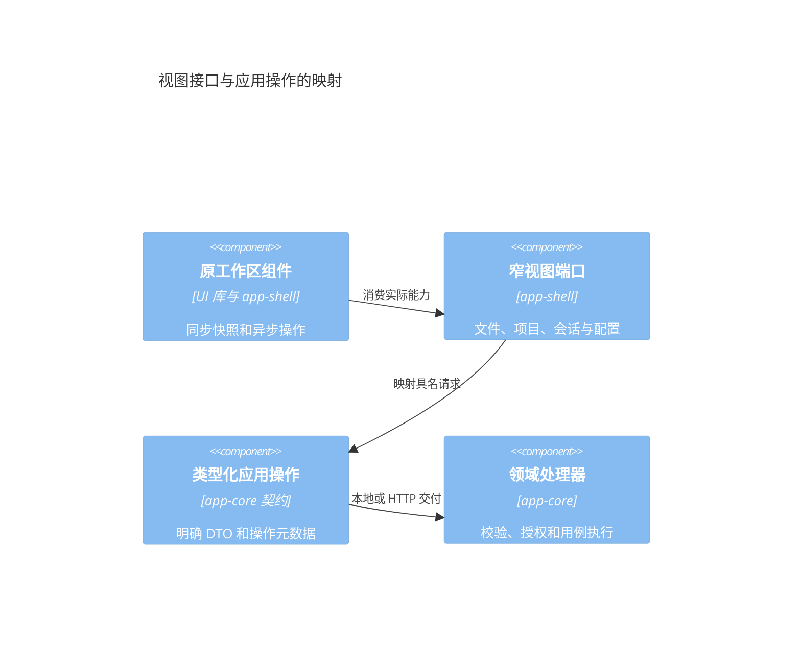

# MindOS 应用宿主迁移接口规格

> 归档：旧 ApplicationPort / ApplicationHost 及持久回执链已移除。当前实现见 [模块边界](../design/frontend-backend-modules.md) 与 [HTTP 宿主](../http-app.md)。

状态：待评审。范围：v5.3 的现有应用接口，以及完成原工作区迁移所需的目标接口。基线日期：2026 年 10 月 14 日。

本规格配合[迁移评审方案](application-host-migration-review.md)使用，列出查询、命令、输入输出、授权、事件、取消、回执和资源生命周期。已有领域对象直接引用所属模块的公开类型，不复制一份可能漂移的消息、任务或模型定义。拟新增操作尚未提供运行时实现；以下目录完整覆盖本次迁移的已识别能力，但服务端快照一致性等开放问题仍须定稿。

## 1 接口分层与调用规则



ApplicationPort 是传输契约，UI 端口是组件能力，二者不要求方法名一一相同。浏览器里的文件接口可以返回本地 IFileSystem 适配对象，后台的文件句柄不序列化；编辑器持有的仅是能力映射和自身资源所有权。

现有公共方法保留为 query、command、subscribe、close。目标按名称声明固定操作元数据，由本地和 HTTP 适配共同执行；不能让客户端选择 delivery、权限等级或任意服务方法。

| 元数据 | 取值与意义 |
|---|---|
| kind | query 或 command；联网测试和影响准备等操作明确分类 |
| delivery | 业务变更为 durable；临时视图释放和纯探测为 ephemeral；现有回执装饰器尚未按此分类 |
| access | 文件读写、会话观察/控制、项目管理、配置编辑、来源管理或宿主维护 |
| readiness | 操作自己的初始化依赖，不统一等待全部 Runtime 后台工作 |
| ownership | runtime、client 或 view，决定停止与释放责任 |
| events | 提交后受影响对象与范围；读取或失败不伪造提交事件 |

查询可以按需创建可释放的观察资源，但不得隐式改变项目、会话、挂载或取得写租约。接受的 durable 命令继续执行并保存结果，HTTP 断开不等于取消。临时资源操作不复用宿主重启前的持久成功回执。

## 2 通用输入输出

### 2.1 身份、版本与分页

| 字段 | 规则 |
|---|---|
| clientId | 当前 HTTP 校验为 1–80 个字母、数字、下划线或连字符；与证书指纹组合为后台身份 |
| requestId | 当前命令校验为 1–128 个相同字符集合；相同身份与 ID 必须对应同一规范化输入 |
| viewId | 客户端生成的观察资源标识；只能访问本客户端作用域内绑定目标 |
| epoch | 后台资源或事件代次；宿主重启后旧资源标识失效 |
| revision / ifRevision | 不透明对象版本；由所属来源解释；不从客户端时间戳生成 |
| authorizationRevision | 授权快照版本；显示用，后台每次操作仍核对当前授权 |
| cursor | 不透明分页位置，绑定目标、筛选和数据版本；不得跨对象复用 |
| path | 已授权视图中的绝对虚拟路径；拒绝穿越、反斜杠和控制字符 |

已有目录接口使用 offset/limit，limit 为 1–1000；目标目录分页改为带版本游标，版本变化返回 ECONFLICT 并重新读取该目录。任务分页继续使用 Kernel 的 afterIndex/throughIndex，事件可带 firstAvailableIndex，不能与目录游标混用。会话历史的 before 是轮次标识，范围由 Session 投影解释。

拟新增的共用 DTO：

```typescript
type Id = string;
type Revision = string;
type Access = 'ro' | 'rw';
interface PageRequest { cursor?: string; limit?: number }
interface Page<T> { items: T[]; nextCursor?: string; revision: Revision }
interface Versioned<T> { value: T; revision: Revision }
interface ViewRef { viewId: Id; epoch: Id }
interface MutationResult<T> { value: T; revision?: Revision; operationId?: Id }
type OperationState = 'pending' | 'completed' | 'failed' | 'unknown';
```

不存在结果时使用 null 或明确的可选字段，不以空对象替代服务缺失。DTO 只含可持久化 JSON 数据，不能含函数、AbortSignal、Date 实例、Map、文件句柄或 Runtime；时间使用所属领域已经规定的数值或 ISO 格式。

### 2.2 请求与响应

现有入口为 `POST /api/application`，信封携带 kind、clientId、name、input，命令额外携带 requestId；成功为 `{ result }`，失败为 `{ error: { code, message } }`。SSE 使用 `GET /api/application/events`。

现有公共基础对象如下；它们属于当前协议，后续版本化分页和能力声明扩展另行标注：

```typescript
type WorkspaceIdentity =
    | { kind: 'workspace'; name: string }
    | { kind: 'project'; id: string };
interface DirectoryQuery {
    workspace: WorkspaceIdentity; path: string; offset?: number; limit?: number;
}
interface DirectoryPage { entries: FSNode[]; nextOffset?: number }
interface ApplicationCapabilities {
    protocol: number; workspaces: string[]; commands: string[];
    events: boolean; receipts: boolean;
}
interface ApplicationFolder {
    path: string; name: string; parentPath: string | null; projectId?: string;
}
interface CommandReceipt {
    id: string; name: string; state: 'pending' | 'completed' | 'failed';
    createdAt: number; result?: JsonValue;
    error?: { code: FSErrorCode; message: string };
}
```

目标错误增加结构化 reason、operationId 和可公开的 details；传输适配负责映射错误，不序列化异常 cause、凭据、SQL、宿主栈或内部路径。一般查询缺失返回 null 还是 ENOENT 由目录逐项声明，不依赖传输判断。

二进制小对象明确编码为 base64；现有正文读取和 OCR 大小上限为 8 MiB，Harness prompt 上限为 1 MiB。目标附件、归档和大文件走受控 artifact 分块，不把单个 HTTP JSON 请求上限当完整资源上限。

### 2.3 公共领域类型

| 类型族 | 权威定义 |
|---|---|
| 文件节点、能力、错误和事件 | vfs-core 公共 contracts；应用按授权视图投影 |
| ConversationManifest、SessionSummary、SessionSnapshot、会话命令 | llm-session 公共 contracts |
| 人工交互记录、任务列表/事件游标 | durable-kernel 公共 contracts；UI 使用 TaskInspectionPort 投影 |
| Provider、Connection、Agent、Skill、MCP 与定价 | driver-llm 与 kernel-adapters 公共 contracts |
| Harness profile、会话、turn、事件与原生回执 | piagent-driver 公共 contracts |
| SessionSubmission 与 Flow 定义/运行 | llm-flow 公共 contracts |
| 同步绑定、预览计划与比较 | vfs-sync 公共 contracts 与应用 ProjectSyncComparison |
| 偏好、联系人、标签和维护 | app-preferences 公共 contracts |

目前配置与分身操作参数从具体服务的 Parameters/ReturnType 推导；拟将这些数据类型迁入领域公共契约，由服务实现接口。下面对已有嵌套操作沿用现行签名，实施时不能用 unknown 强转消除约束。

## 3 现有顶层应用接口全量目录

本节依据 ApplicationQueries 和 ApplicationCommands 的源码逐项列出输入输出。`import(...).Type` 引用及 ReturnType 表达式就是现有类型约束；它们引用第 2.3 节的权威定义，不意味着可传输整个服务。unknown 输出是当前契约缺口，应在对应领域迁移时替换为可辨别结果类型。

### 3.1 查询

| 名称 | 输入 | 输出 |
|---|---|---|
| remoteAgentDetails | `{ id: string }` | `import('../projects/remote-agent-details').RemoteAgentDetails \| undefined` |
| harness | `import('./harness-contracts').HarnessReadRequest` | `import('./harness-contracts').HarnessReadResult` |
| ocrSettings | `undefined` | `import('../configuration/ocr-service').OcrSettings` |
| ocrConnections | `undefined` | `import('../configuration/ocr-service').OcrConnection[]` |
| ocrStatus | `undefined` | `{ label: string; ready: boolean }` |
| projectNavigation | `{ path: string }` | `import('../projects/navigation-view').ProjectNavigationView` |
| projectSearch | `{ folder: string; query: import('../projects/project-search').ProjectSearchQuery }` | `import('../projects/project-search').ProjectSearchResult` |
| taskList | `{ sessionId: string; afterIndex?: number; throughIndex?: number; limit?: number }` | `import('../session/task-inspection').TaskInspectionPage` |
| taskDetail | `{ sessionId: string; taskId: string }` | `Awaited<ReturnType<import('../session/task-inspection').TaskInspectionPort['detail']>>` |
| taskEvents | `{ sessionId: string; taskId: string; afterIndex?: number; throughIndex?: number; limit?: number }` | `import('../session/task-inspection').TaskInspectionEvents` |
| fileTags | `{ workspace: WorkspaceIdentity }` | `string[]` |
| toolboxCatalog | `undefined` | `import('./toolbox-catalog').ApplicationToolboxCatalog` |
| preferences | `undefined` | `PreferenceSnapshot` |
| preference | `PreferenceRequest<typeof import('./preference-contracts').PREFERENCE_READS[number]>` | `unknown` |
| toolbox | `undefined` | `{ drawers: import('../configuration/toolbox-drawers').Drawer[]; tools: import('../configuration/toolbox-catalog').ToolboxTool[]; remoteAgents: import('../projects/remote-agent-catalog').RemoteHarnessAgent[] }` |
| initialFiles | `undefined` | `import('../presets/initial-files').InitialFileEntry[]` |
| configurationImpact | `{ kind: 'provider' \| 'mcp'; ids: string[] }` | `import('../configuration/model-commands').ProviderDeletionImpact \| import('../configuration/model-commands').MCPDeletionImpact` |
| twinSnapshot | `undefined` | `Awaited<ReturnType<DigitalTwinService['snapshot']>>` |
| twin | `TwinRequest<TwinRead>` | `unknown` |
| flow | `{ name: string; args?: JsonValue }` | `unknown` |
| tools | `undefined` | `import('../configuration/toolbox-catalog').ToolboxTool[]` |
| editorContext | `{ providerIds?: string[]; agents?: boolean; pricing?: boolean }` | `ConfigurationEditorContext` |
| configuration | `ConfigurationRequest<ConfigurationRead>` | `ConfigurationResult<ConfigurationRead>` |
| entry | `{ workspace: WorkspaceIdentity; path: string }` | `FSNode \| null` |
| session | `{ sessionId: string }` | `SessionSummary` |
| navigation | `{ folder: string \| null }` | `{ folders: ApplicationFolder[]; sessions: SessionSummary[] }` |
| receipt | `{ requestId: string }` | `CommandReceipt \| null` |
| capabilities | `undefined` | `ApplicationCapabilities` |
| directory | `DirectoryQuery` | `DirectoryPage` |
| file | `{ workspace: WorkspaceIdentity; path: string; encoding?: 'text' \| 'base64' }` | `{ content: string; encoding: 'text' \| 'base64'; revision?: string }` |
| sessions | `{ folder?: string \| null }` | `SessionSummary[]` |
| conversation | `{ sessionId: string; before?: string; limit?: number }` | `{ manifest: ConversationManifest; snapshot: SessionSnapshot; writable: boolean; revision: number; hasEarlier: boolean; interactions: Array<{ taskId: string; request: InteractionRecord<JsonValue> }> }` |

### 3.2 命令

| 名称 | 输入 | 输出 |
|---|---|---|
| harness | `import('./harness-contracts').HarnessWriteRequest` | `import('./harness-contracts').HarnessWriteOutcome` |
| releaseHarness | `{ viewId: string }` | `void` |
| saveOcrSettings | `import('../configuration/ocr-service').OcrSettings` | `void` |
| prepareOcrPrompt | `Record<string, never>` | `string` |
| recognizeImage | `{ content: string; mimeType: string }` | `string` |
| resetTask | `{ sessionId: string; taskId: string }` | `void` |
| fileAction | `{ workspace: WorkspaceIdentity; path: string } & ( { operation: 'write'; content: string } \| { operation: 'mkdir' } \| { operation: 'delete' } \| { operation: 'rename'; destination: string } \| { operation: 'metadata'; metadata: Record<string, JsonValue> } \| { operation: 'tags'; tags: string[] })` | `FSNode \| null` |
| toolboxFile | `{ kind: 'agents' \| 'skills' \| 'flows'; path: string } & ( { operation: 'mkdir' } \| { operation: 'rename'; destination: string } \| { operation: 'metadata'; metadata: Record<string, JsonValue> } \| { operation: 'tags'; tags: string[] })` | `void` |
| discardConfigurationPlan | `{ revision: string }` | `void` |
| preference | `PreferenceRequest<typeof import('./preference-contracts').PREFERENCE_WRITES[number]>` | `unknown` |
| restoreInitialFiles | `{ ids: string[] }` | `import('../presets/initial-files').InitialFileResult[]` |
| toolbox | `ToolboxCommand` | `unknown` |
| deleteConfiguration | `{ kind: 'provider'; revision: string } \| { kind: 'mcp'; revision: string; force: boolean } \| { kind: 'connections' \| 'prompts'; ids: string[] }` | `void` |
| twin | `TwinRequest<TwinWrite>` | `unknown` |
| flow | `{ name: string; args?: JsonValue }` | `unknown` |
| configuration | `ConfigurationRequest<ConfigurationWrite>` | `ConfigurationResult<ConfigurationWrite>` |
| createConversation | `{ title: string; folder?: string \| null }` | `{ sessionId: string }` |
| conversation | `{ sessionId: string; name: string; args?: JsonValue }` | `unknown` |
| respond | `{ sessionId: string; taskId: string; interactionId: string; value: JsonValue }` | `void` |
| cancelTask | `{ sessionId: string; taskId: string }` | `void` |
| saveFile | `{ workspace: WorkspaceIdentity; path: string; content: string; revision?: string }` | `{ revision?: string }` |

## 4 现有嵌套操作全量目录

### 4.1 配置与工具箱

配置读取白名单：getAgents、getAgentConfig、getConnections、getConnection、getDefaultConnection、getFullConnection、getProviders、getFullProvider、getProviderDefaults、listSystemPrompts、getSystemPrompt、getSkills、getMCPServers、readMCPResource、getMCPPrompt、queryCosts、getPricingConfig、getPricingDefaults、getRestorableItems。

配置执行白名单：saveAgent、deleteAgent、saveConnection、deleteConnection、setDefaultConnection、saveProvider、deleteProvider、saveSystemPrompt、deleteSystemPrompt、saveSkill、deleteSkill、saveMCPServer、deleteMCPServer、writePricing、restoreItem、resetAllDefaults、testConnection、listProviderModels、testMCPServer。

每项 args 与 output 当前由 ConfigurationArgs/ConfigurationResult 对应服务方法确定，元组参数数量由 CONFIGURATION_ARITY 校验。列表只读安全元数据；完整凭据配置仅在显式编辑请求下取得，目标进一步声明字段的读取/覆盖/保留语义，避免列表快照带出密钥。探测按 explicit 命令执行，不能在列表读取中发现全部远端。

| 工具箱 operation | 输入 | 输出和提交事件 |
|---|---|---|
| create | kind、name，选填 providerId/drawerId/drawerName | 当前结果由资源创建用例决定；目标返回 created resource IDs，失效所属分类 |
| import | 定义交换内容 content | 导入结果；提交后失效相关分类，不覆盖身份映射检查 |
| export | paths，选填 drawers(kind/name) | 定义交换内容；读取，不修改分组 |
| toolGrant | toolId、agentId、enabled | void；配置变更，后台更新明确授权策略 |
| delete | paths | void；按资源领域删除，不调用原始文件删除 |
| drawerCreate | kind、name | 当前创建结果；目标返回分组记录 |
| drawerRename / drawerRemove | id，rename 另带 name | 分组变更；后台同名校验和串行写 |
| drawerAssign | entries(path/name) | 分组变更；后台校验资源归属 |

关联删除使用 configurationImpact → deleteConfiguration；当前 Provider 输入为 revision，MCP 输入另有 force 确认选择。preview 不能作为最终授权，执行前重新校验当前关联依赖，不新增已从原 UI 移除的 Agent 替换流程。discardConfigurationPlan 仅释放临时计划，目标 delivery 为 ephemeral。

### 4.2 会话与 Flow

已有 conversation 内部只开放以下 SessionCommand 成员；成员值和 args schema 使用 llm-session 契约，不发布任意 CommandBus 命令：

| 分类 | SessionCommand 成员 |
|---|---|
| 观察 | GetSnapshot、GetSessions、GetCurrentId、GetStatus、IsGenerating、HasUnsaved、GetSettings、GetConnections、GetAgents、GetModels、CanRegenerate、CanDelete、CanEdit、GetSiblings、ContextGet、ContextSnapshotGet、ContextPreview、FlowBranchExecutions、FlowRerunContext、Export |
| 控制 | Send、Abort、ContextSet、Regenerate、RegenerateFromUser、DeleteMessage、DeleteMessages、UpdateDraft、CommitEdit、SwitchSibling、SaveSettings、FlowRerun |

目标将观察成员置于 query 路径，将控制成员置于 durable command 路径，按操作返回确定类型；后台绑定 sessionId，不允许 args 改写当前 Session 身份。人工响应和 cancelTask 另外校验 taskId/interactionId 归属。

| 分类 | FlowCommand 或 SessionCommand 成员 |
|---|---|
| Flow 查询 | DraftList、DraftLoad、DraftValidate、RevisionGet、RevisionList、Presentations、RunList、RunGet、RunTranscript；SessionCommand.GetConnections |
| Flow 执行 | DraftCreate、DraftAdopt、DraftSave、RevisionCreate、RunResume、RunStart、RunCancel、RunRespond、RunSignal、RunTaskCancel、RunTaskRetry、RunGoalUpdate；SessionCommand.CreateFromFlow |

Flow 输入输出使用 llm-flow 命令契约，Revision 与运行 scope 不由 UI 任意绑定。重试 Task 与恢复 Run 是明确业务操作，不是传输层自动重发。任务检查已有 list/detail/events/reset 四项，读取不获取执行句柄，reset 先检查写入门且未完成清理返回 EBUSY。

### 4.3 偏好、分身与 OCR

| 分类 | 操作 | 输入输出依据 |
|---|---|---|
| 偏好读取 | readDocument、exportMixedData、listLocalSnapshots | PreferencesPort 对应方法；readDocument 仅允许声明的 UI 文档范围 |
| 偏好修改 | saveTag、deleteTag、saveContact、deleteContact、syncTags、writeDocument、importMixedData | PreferencesPort 对应方法；成功发布 preferences 失效 |
| 现有维护方法 | createSnapshot、deleteSnapshot、restoreSnapshot、factoryReset | PreferencesMaintenance；HTTP 尚未提供完整服务端维护适配 |
| 分身读取 | previewSource、selectionInfo、previewScanRule、forgetPreview、forgetScopePreview、getSettings | TwinRequest 对应方法；不启动所有源读取 |
| 分身执行 | mergePeople、addSource、setSourceEnabled、removeSource、analyze、cancelAnalysis、selectSource、removeSelection、saveScanRule、saveScanPlan、setScanPlanEnabled、removeScanPlan、runScanPlan、cancelScanRun、addMemory、review、linkExecution、suppress、forgetScope、forget、configure | DigitalTwinService 对应方法；目标抽离公共 DTO；成功发布 twin 失效 |
| OCR | ocrSettings、ocrConnections、ocrStatus、saveOcrSettings、prepareOcrPrompt、recognizeImage | 顶层目录中已明确；识别在后台执行，客户端停止等待不宣称撤销模型调用 |

分身的后台调度由 Runtime 拥有，不跟页面启停；configure 和 review 等操作保留版本/草稿语义，不能在 HTTP 适配中绕过。维护类操作将按第 12 节补齐宿主能力，不以浏览器 IndexedDB 接口代替服务器实现。

### 4.4 MCP Harness

已有 HarnessBinding 为 viewId/connectionId，timeoutMs 可选，后台只解析已保存的连接。读操作 profiles、list、read、events、operation 的逐项输入如下：

| operation | 附加输入 | 输出 |
|---|---|---|
| profiles | 无 | HarnessClient.profiles 结果 |
| list | profileId，选填 cursor/archived | HarnessClient.list 结果 |
| read | profileId、sessionId，选填 cursor/toolDetail | HarnessClient.read 结果；toolDetail 仅 summary |
| events | profileId，选填 after/eventEpoch 游标与 toolDetail | HarnessClient.events 结果 |
| operation | profileId、原生 requestId，选填 epoch | HarnessClient.operation 回执 |

写操作共同携带 profileId、原生 requestId、选填 epoch 和 timeoutMs：create(workspaceId)、resume(sessionId)、turn(sessionId,prompt)、interrupt(sessionId,turnId)、respond(nativeRequestId,response)。结果为 committed/result，或 unknown/not-committed/requestId/code。当前写输入 requestId 是原生操作 ID，HTTP 信封 requestId 是应用命令 ID，两者不能混用。

每次调用检查配置仍存在且 endpoint/凭据版本未变；删除或改变配置后旧视图拒绝访问。releaseHarness 不中断任务，目标为 ephemeral；原面板读取消可透传，业务写只按明确命令中断。

## 5 目标项目与会话组织接口

以下操作拟新增到应用操作表，已有本地用例为实施依据。名称可在评审中统一，业务目标与结果形状必须明确。

```typescript
type ResourceTarget =
    | { kind: 'project'; projectId: Id }
    | { kind: 'group'; folder: string | null }
    | { kind: 'session'; sessionId: Id }
    | { kind: 'file'; projectId: Id; path: string };
type SourceSelection =
    | { kind: 'internal'; path: string }
    | { kind: 'approved-host'; sourceId: Id }
    | { kind: 'remote-project'; connectionId: Id; serverProjectId: Id; path?: string };
interface ProjectItem {
    id: Id; name: string; displayName?: string;
    folder: string; parentFolder: string | null;
    source: SourceSelection; readonly: boolean; offline: boolean;
}
interface FavoriteItem { id: Id; target: ResourceTarget; title: string }
```

SourceSelection 仅是授权选择结果；approved-host sourceId 由平台能力颁发，HTTP 请求不传任意宿主路径。远端源显示名称等安全元数据单独投影，credentialRef 和真实凭据不进入项目目录。

| 查询名 | 输入 | 输出 | 归属检查 |
|---|---|---|---|
| projectList | parentFolder?、PageRequest | Page<ProjectItem> | 当前身份可见的项目 |
| projectGet | projectId | Versioned<ProjectItem> | 项目存在且可读，缺失 ENOENT |
| projectForFolder | folder | ProjectItem 或 null | 规范导航路径；只返回可见归属 |
| projectCurrent | 无 | ProjectItem 或 null | 读取已保存选择，不初始化所有来源 |
| sessionFamily | sessionId | rootId、SessionSummary[]、revision | 同组成员均在可见范围 |
| sessionMoveCandidates | sessionId | 同项目候选 SessionSummary[]、revision | 排除自身、后代与待删除成员 |
| projectFavorites | projectId | Versioned<FavoriteItem[]> | 项目可见；文件标题校准与通知明确 |
| resolveFavorite | projectId、favoriteId | 目标 ResourceTarget 和可用状态 | 重验对象存在与项目归属，不直接信任旧 URL |
| pendingSessionDeletions | PageRequest | Page<{ sessionId, operationId }> | 当前身份可管理的删除意图 |

projectNavigation 和 projectSearch 沿用现有端口，并逐步将 ProjectFolder 等含宿主来源细节的结果投影成安全 UI DTO。搜索结果绑定授权版本，打开结果时检查版本仍有效；导航不能按旧 bindingIdentity 改写授权。

| 命令名 | 输入 | 输出 | 授权和事件 |
|---|---|---|---|
| createProject | name、parentFolder、SourceSelection | MutationResult<ProjectItem> | 项目管理、来源允许范围、独立根校验；projects/navigation |
| renameProject | projectId、name、ifRevision | MutationResult<ProjectItem> | 结构写守卫，影响成员租约、补偿；projects/navigation |
| setCurrentProject | projectId | void | 可见项目；仅选择偏好事件 |
| createSession | title、projectId、folder、parentSessionId? | sessionId | 事务内检查项目、父子关系和待删除状态；sessions |
| createChildSession | parentSessionId | sessionId | 同项目与结构写守卫；sessions |
| renameSession | sessionId、title、ifRevision | MutationResult<SessionSummary> | 会话结构写检查；sessions |
| reparentSession | sessionId、parentSessionId 或 null、ifRevision | void | 事务内重验循环、项目与关系版本；sessions |
| moveSession | sessionId、targetProjectId、targetFolder、ifRevision | operationId、state | 使用原搬迁意图和恢复用例，不逐文件手工迁移；sessions/projects |
| closeSession | sessionId | void | 执行控制与写入门；关闭业务执行，不仅是 UI 标签 |
| deleteSession | sessionId | operationId、state | 删除意图、成员和资源顺序；失败可核对；sessions |
| toggleFavorite | projectId、ResourceTarget、title、enabled | MutationResult<FavoriteItem 或 null> | 目标可见且属于项目；favorites |

createSession 替代当前直接仓储 createConversation 的简单路径；本地无项目模式仍用已有 ProjectSessions，是否允许该模式由能力声明决定。UI 关闭标签不调用 closeSession；命令名必须在适配层区分。

## 6 目标文件视图与文件操作接口

### 6.1 获取、读取与释放

```typescript
type FileViewTarget =
    | { kind: 'workspace'; name: string }
    | { kind: 'project'; projectId: Id; namespace: 'source' | 'workspace' }
    | { kind: 'session'; sessionId: Id };
interface FileCapabilities {
    readonly: boolean; conditionalReplace: boolean; rangeRead: boolean;
}
interface FileViewSnapshot extends ViewRef {
    target: FileViewTarget; cwd: string;
    authorizationRevision: Revision; capabilities: FileCapabilities;
}
interface FileContent {
    content: string; encoding: 'text' | 'base64';
    revision?: Revision; offset: number; length: number; totalBytes?: number;
}
```

| 操作 | 输入 | 输出 | 生命周期与校验 |
|---|---|---|---|
| query fileView | viewId、FileViewTarget、requestedAccess | FileViewSnapshot | client/view 所有；相同绑定共享初始化；不能改变目标；不获取写租约 |
| query viewEntry | ViewRef、path | FSNode 或 null | 读取该视图的节点；不存在返回 null |
| query viewDirectory | ViewRef、path、PageRequest | Page<FSNode> | 当前层元数据；游标绑定目录版本 |
| query viewCapabilities | ViewRef、path | FileCapabilities 和 authorizationRevision | 能力按路径判断，支持子挂载不同权限 |
| query viewFile | ViewRef、path、encoding、offset?、length? | FileContent | 范围在后台读取；限制解码后大小；透传查询取消 |
| query viewTags | ViewRef | 标签摘要数组 | 不扫描正文；只读来源明确声明标签能力 |
| command releaseFileView | ViewRef | void | ephemeral，幂等关闭，排空已接受操作；旧 epoch 不重放旧句柄 |

来源视图根为 `/`，项目 workspace 为 `/workspace`，会话视图 cwd 由授权挂载计算。文件节点和事件都使用所属视图中的路径；适配器不猜测或通过字符串前缀暗改根目录。文件路径解析与租约属于不同能力，不把文件正文读取绑到会话执行准备。

### 6.2 文件变更

| 命令 | 输入 | 输出 | 条件 |
|---|---|---|---|
| writeViewFile | ViewRef、path、content、encoding、ifRevision? | MutationResult<FSNode> | 当前授权可写；显式版本要求来源原子条件替换，否则 ECAPABILITY |
| createViewEntry | ViewRef、parentPath、name、type、content?、encoding? | MutationResult<FSNode> | 不存在才创建；并发同名 EEXIST，不静默覆盖 |
| deleteViewEntries | ViewRef、paths、预览版本? | 删除结果与 operationId? | 托管状态拒绝原始删除；部分结果明确 |
| renameViewEntry | ViewRef、path、name、ifRevision? | MutationResult<FSNode> | 目标同名校验；原名失效、新名事件 |
| moveViewEntries | 来源和目标 ViewRef、paths、destination、planRevision? | 转移结果 | 应用预检跨项目策略；不伪装跨来源原子性 |
| copyViewEntries | 来源和目标 ViewRef、paths、destination、planRevision? | 转移结果 | 读源和写目标分别授权；中断/部分成功可核对 |
| updateViewMetadata | ViewRef、path、允许的 metadata 字段、ifRevision? | MutationResult<FSNode> | 不开放托管执行状态或权限元数据写入 |
| setViewTags | ViewRef、path、tags、ifRevision? | MutationResult<FSNode> | 来源标签能力和当前授权 |

变更是 durable；成功发布带业务身份的 file 事件并失效受影响目录。目标与来源版本改变后拒绝在旧视图上继续写，保留编辑器草稿。通用文件接口仅用于用户文件，项目、Session、Flow、Agent 等托管资源走各自用例。

原文件聊天和 AI 动作输入为 FileViewTarget、path、revision、选中文本与会话目标，不传宿主路径。拟新增 createConversationFromFile/executeFileAction，结果为 sessionId 或领域任务 ID；权限和模型配置在后台检查，前端仍使用原右键菜单。

## 7 目标挂载与来源选择接口

```typescript
interface MountItem {
    id: Id; at: string; source: SourceSelection; label: string;
    access: Access; readonlySource: boolean; available: boolean;
}
interface MountSnapshot {
    sessionId: Id; cwd: string; mounts: MountItem[];
    fixedWorkspace?: string; home?: SourceSelection;
    revision: Revision; canSelectHost: boolean;
}
```

| 操作 | 输入 | 输出 | 校验和事件 |
|---|---|---|---|
| query sessionMounts | sessionId | MountSnapshot | 当前会话归属；不打开全部已保存来源 |
| query sourceDirectories | 允许的来源根标识、path、PageRequest | Page<{ id, label, selection }> | 内部或已授权服务器范围；不接受任意宿主根 |
| query sourceStatus | SourceSelection | 可用性、能力和安全诊断 | 不返回密钥、内部堆栈或数据库路径 |
| command addSessionDirectory | sessionId、SourceSelection、access、at?、asCwd、ifRevision | MountSnapshot | 写入门、活动任务、固定 workspace 规则；mounts/files |
| command setSessionWorkspace | sessionId、SourceSelection、access、ifRevision | MountSnapshot | 原工作区固定规则和来源独立性；mounts/files |
| command setDefaultDirectory | SourceSelection、ifRevision | home 和 revision | 来源管理；preferences，影响后续显式挂载 |
| command mountDefaultDirectory | sessionId、ifRevision | MountSnapshot | 重验默认来源与当前 Session；mounts/files |
| command updateSessionMount | sessionId、mountId、access、asCwd、ifRevision | MountSnapshot | 拒绝提升只读来源或改变固定 workspace；mounts/files |
| command removeSessionMount | sessionId、mountId、ifRevision | MountSnapshot | 活动任务与固定挂载限制；撤销派生视图 |
| command reconnectSessionMount | sessionId、mountId | MountSnapshot | 不产生新授权、不扩大来源范围；状态与文件范围失效 |

Tauri 的 chooseDirectory 是本机平台能力，选择后返回应用允许的 SourceSelection；HTTP 用服务器授权来源列表替代本机 chooser。原 UI 文案和动作保留，canSelectHost 必须反映实际可用能力。restoreWorkspace 和 processMounts 是内部恢复/执行机制，不作为 UI 公共 API。

## 8 目标草稿与附件接口

| 操作 | 输入 | 输出 | 校验和事件 |
|---|---|---|---|
| query projectDraft | projectId、folder | draftId、state、data、revision、sessionId?、submissionId? | 项目归属；submitting 不当作新草稿 |
| command saveProjectDraft | projectId、draftId、data、ifRevision | draftId、revision | 版本冲突保留原输入；drafts |
| command clearProjectDraft | projectId、draftId、ifRevision | 新草稿 ID 和 revision | 不删除已提交 Session；drafts |
| command prepareProjectDraft | projectId、draftId、folder、ifRevision | sessionId、resumeOnly、SessionSubmission? | 原提交意图机制；稳定身份；durable |
| query submissionForSession | projectId、sessionId | SessionSubmission 或 null | 归属核对和只读证据投影 |
| command putDraftAttachment | projectId、draftId、artifactId、mimeType、name? | attachmentId | 项目草稿授权；提交中的附件策略明确 |
| query draftAttachment | projectId、draftId、attachmentId | ArtifactInfo | 当前草稿或已绑定提交可读 |

prepare 不等于消息发送成功；只有持久提交证据成立才提升草稿并产生 project.draftPromoted。事件不是创建后继草稿的依据。当前 DraftStore 未提供版本字段，目标 CAS 需要扩展该域存储机制，不能仅在 HTTP DTO 中添加 ifRevision。

会话附件的 put/read/delete/list 使用 sessionId 或 FileViewTarget 和 attachmentId，后台选择已授权附件挂载；上传不能把任意磁盘文件或任意旧 artifact 绑定到另一会话。原 SessionDraftControls 和附件展示接口不依赖 HTTP。

### 8.1 会话记忆管理与共享

原 MemoryDialog 和 MemorySharingDialog 使用固定 Session 的 SessionMemoryControls/MemorySharingControls。目标逐项映射以下操作，具体 MemoryWrite、MemoryMutationOptions 和共享引用类型沿用 llm-session 与 llm-tasks 的公开契约。

| 操作 | 输入 | 输出 | 权限与事件 |
|---|---|---|---|
| query sessionMemoryList | sessionId、agentId | MemoryEntry[] | 后台读取 Agent 的真实 memoryPolicy；不接受客户端 policy |
| command upsertSessionMemory | sessionId、agentId、MemoryWrite、expectedContentHash/expectedRevision | void | 写租约、scope 与 CAS；冲突保留草稿；memory |
| command removeSessionMemory | sessionId、agentId、scope、entryId、版本和 hash | void | 原删除前置条件；memory |
| query memorySharingState | sessionId、agentId | 共享策略、安全资源投影和 sessionId | namespace 与资源可见性；不暴露其它资源 |
| query memorySharingAudit | sessionId、agentId、分页参数 | 审计页 | 当前选中 incarnation 的审计授权 |
| command createSharedMemory | sessionId、agentId、id | 共享引用 id/incarnation | 原 namespace 与初始授权；memory |
| command useSharedMemory | sessionId、agentId、共享引用或 null | void | 引用 namespace 重验、Agent 配置编辑权限；configuration/memory |
| command grantSharedMemory | sessionId、agentId、targetSessionId、writable | void | 原策略范围和目标归属；memory |
| command revokeSharedMemory | sessionId、agentId、targetSessionId | void | 共享资源版本重验；memory |
| command removeSharedMemory | sessionId、agentId | void | 删除选中 incarnation；不能按名称误删新资源；memory |

共享资源和 Agent 配置的组合操作不是跨域原子事务，部分失败保留核对结果。原审计方法未分页，目标需要从持久层增加有界读取；不能只给 DTO 增加 cursor 却每次读取全量审计。

### 8.2 会话 Skill 与编辑器临时作用域

| 操作 | 输入 | 输出 | 权限与生命周期 |
|---|---|---|---|
| query sessionSkills | sessionId | SessionSkillControls.listLoaded 的安全结果 | 包含版本策略、drift 与工具可用性；不加载所有 Skill 正文 |
| query describeSessionSkill | sessionId、skillId | 名称、类型、instructions、触发策略、enabled 或 null | 显式调用才读定义；保留 action/silent 规则 |
| command loadSessionSkill / unloadSessionSkill | sessionId、skillId | load 为 toolIds，unload 为 void | 持久加载身份变更，检查 Session 写入能力；skills |
| command activateEditorSkills | sessionId、文件 ViewRef、path、editorViewId | void | ephemeral；文件授权与 Session 范围重验，后台汇总活跃编辑器 |
| command deactivateEditorSkills | sessionId、editorViewId | void | ephemeral；引用计数释放，不误卸载其它客户端同文件作用域 |

SessionSkillControls.onChange 适配成 Session 范围语义通知，不序列化回调。临时 glob 挂载不写持久 loaded 身份；客户端关闭和超时释放对应 editorViewId，执行任务已经持有的版本继续遵循领域版本策略。UI 不能通过任意 filePath 授权更多工具。

## 9 目标远端会话与状态接口

```typescript
interface RemoteSessionTarget {
    projectId: Id; profileId: Id; sessionId: Id; archived?: boolean;
}
interface RemoteConversationView extends ViewRef {
    target: { projectId: Id; profileId: Id; sessionId?: Id; archived?: boolean };
    authorizationRevision: Revision;
    writable: boolean; unavailableReason?: string;
    capabilities: { attachments: boolean; branches: boolean; respond: boolean };
}
```

| 操作 | 输入 | 输出 | 语义 |
|---|---|---|---|
| query remoteProfiles | projectId | 可用 profile 摘要和 revision | 只选匹配项目作用域的 profile；离线局部失败 |
| query remoteSessionList | projectId、profileId、archived?、PageRequest | 原生会话摘要页 | 投影当前层；不读取所有会话正文 |
| query remoteConversationView | viewId、projectId、profileId、sessionId?、archived? | RemoteConversationView | 缺省 sessionId 为未创建的原生草稿；后台获取授权端口，不自动创建会话 |
| query remoteConversation | ViewRef、原生历史游标? | 通用 ConversationControls 所需状态和历史 | 遵循远端 epoch；能力不足不本地模拟分支 |
| query remoteSessionFamily | RemoteSessionTarget | 原生同组成员与动作声明 | 使用服务器能力，不套用本地仓储关系 |
| query remoteSessionSources | projectId | 可搜索的 profile 来源 | 不读取所有正文，搜索仍为显式操作 |
| query remoteSessionOperation | projectId、profileId、nativeRequestId、epoch | 原生回执 | 仅核对，不重新执行 |
| command createRemoteSession | ViewRef、nativeRequestId、epoch | 新 RemoteSessionTarget 或未知结果 | 仅未创建视图；服务器 workspace 从项目授权推导 |
| command remoteSessionControl | ViewRef、具名控制 DTO、nativeRequestId、epoch | 原生结果或 unknown/not-committed | resume/send/interrupt/respond/fork/rename/archive/unarchive/delete 逐项白名单，按 profile 能力开放 |
| command releaseRemoteConversation | ViewRef | void | ephemeral；不取消任务，排空观察操作 |

控制 DTO 的每个变体使用 piagent-driver 对应公开输入输出：resume 无附加字段；send 包含 prompt 与已授权 attachmentIds；interrupt 包含 turnId；respond 包含原生交互 ID 和领域响应值；fork 包含可选 name；rename 包含 title；archive/unarchive 是明确变体；delete 返回 deletedSessionIds。操作名、目标和结果通过可辨别联合类型关联，不能使用任意 name/args。项目和服务器 workspace 身份由后台推导，不能由 UI 改写。

attachments、branches、rename/archive 等可选能力未声明时返回 ECAPABILITY，原 UI 使用已有状态和错误展示，不新增假成功。remoteSessionControl 先查应用回执再查原生回执；不把当前 MCP 面板只有 prompt 的 turn 当完整附件协议。

状态订阅目标为可见项目/打开标签，后台共享观察并限制资源；文件版本改变只刷新相关来源。客户端 setVisible 类操作为 ephemeral，隐藏后停止额外观察，重新显示校准当前状态；运行任务继续属于服务器。

## 10 目标归档、转移与同步接口

| 操作 | 输入 | 输出 | 语义 |
|---|---|---|---|
| query archivePreview | ResourceTarget[]、format | 影响和估计大小、previewRevision | 文件、项目和会话业务目标；不扫描无关项目 |
| command exportArchive | ResourceTarget[]、previewRevision? | ArtifactInfo | 受控结果资源；不暴露宿主保存路径 |
| query importArchivePreview | artifactId、ResourceTarget | 冲突、依赖和 previewRevision | 验完整归档和目标授权 |
| command importArchive | artifactId、ResourceTarget、previewRevision、显式策略 | 导入目标、补偿状态与 operationId | 复用原 importer；部分失败可核对 |
| query transferTargets | ResourceTarget[]、copy/move、目标上下文 | 允许的目标与禁用原因 | 后台 ProjectService 策略，执行前重验 |
| query syncStatus | projectId | vfs-sync 绑定/状态安全投影 | 不泄露凭据；只读投影 |
| command syncPreview | projectId | StoredFilePlan | 可能持久化计划，归 durable 操作 |
| query syncCompare | projectId、planId、path | ProjectSyncComparison | 计划归属和当前绑定版本 |
| command syncResolve | projectId、planId、decisions | 新 StoredFilePlan | decisions 为 path→local/remote；版本重验 |
| command syncMergeText | projectId、planId、paths | 新 StoredFilePlan | 仅文本和声明能力；保留冲突信息 |
| command syncExecute | projectId、planId | FilePlan 与执行状态 | 原 coordinator 排他与恢复证据；不重复应用旧计划 |
| command syncConfigure | projectId、expectedToken、direction | 绑定新版本 | direction 为 both/upload/download；无在途计划 |
| command syncUnbind | projectId、expectedToken | 解绑状态 | 原 detaching/detached 流程；不删除正文 |
| command syncRecover / syncReconcileExpired | projectId | 状态或重新预览计划 | 核对既有云端结果，不作用于新来源 |

同步初次绑定需要单独的来源目录查询与 syncSetup(projectId, selection, direction, expectedToken?)，由宿主 provider 实现，不从 UI 构造 StateStore。未注入 provider 时能力明确不可用。

## 11 目标 artifact 接口

```typescript
interface ArtifactInfo {
    id: Id; name: string; mimeType: string; byteLength: number;
    digest: string; expiresAt?: number;
}
```

| 操作 | 输入 | 输出 | 所有权 |
|---|---|---|---|
| command beginArtifact | 用途、目标业务身份、name、mimeType、byteLength、digest? | uploadId、chunkBytes | 客户端和目标授权绑定，配额预检 |
| command putArtifactChunk | uploadId、offset、base64、chunkDigest | 已接受范围 | 重复相同范围按 digest 幂等；不同内容冲突 |
| command finishArtifact | uploadId、digest | ArtifactInfo | 全长与摘要验证；不能把未完成资源交给业务 |
| query artifactChunk | artifactId、offset、length | base64、length、totalBytes、digest | 当前身份/目标可读，实际范围读取 |
| command releaseArtifact | artifactId 或 uploadId | void | 临时未绑定资源 ephemeral 释放；已提交附件不因页面关闭删除 |

逻辑接口继续通过 ApplicationPort；HTTP 可用受认证的二进制流优化具体传输，但不得把磁盘路径或长期无认证 URL 作为 artifactId。上传、下载配额和到期参数由宿主能力声明，不要求独立 UI 库知道服务器地址。大文件单次块预算不超过声明上限，未完成上传在关闭或超时后清理。

## 12 目标宿主维护接口

```typescript
interface MaintenanceCapabilities {
    backend: 'indexeddb' | 'localfs-sqlite' | 'other';
    snapshots: boolean; restore: boolean; reset: boolean; migrate: boolean;
}
interface MaintenancePlan {
    id: Id; operation: 'snapshot' | 'restore' | 'reset' | 'migrate';
    revision: Revision; expiresAt: number;
    activeTasks: number; requiresQuiescence: boolean;
    affectedScopes: string[]; warnings: string[];
}
interface MaintenanceStatus {
    operationId: Id; state: OperationState; phase: string;
    progress?: { completed: number; total?: number };
    resultId?: Id; reason?: string;
}
```

| 操作 | 输入 | 输出 | 行为 |
|---|---|---|---|
| query storageOverview | 无 | 后端类别、可统计用量、空间信息和 MaintenanceCapabilities | 不将服务器磁盘冒充浏览器配额，未知值明确 |
| query storageSnapshots | PageRequest | 快照摘要页 | 安全 ID、时间、大小、格式版本和完整性状态 |
| query prepareMaintenance | operation、snapshotId?、允许的迁移目标 ID? | MaintenancePlan | 影响预览，只创建临时计划，不执行业务 |
| command executeMaintenance | planId、revision、原 UI 的确认选择 | operationId | 维护权限；执行前重验计划和活动任务；durable |
| query maintenanceStatus | operationId | MaintenanceStatus | 崩溃后核对，不自动重放恢复/重置 |
| command deleteSnapshot | snapshotId、ifRevision | void | 未被使用的快照；维护事件 |
| command discardMaintenancePlan | planId | void | ephemeral，幂等释放 |

一致快照必须由存储能力取得，明确文件与索引的协调点。活动任务与 writes 的 quiescence 策略由宿主实施，不能复制运行中的 SQLite 文件或只备份正文便宣称完整。恢复/重置改变 epoch，停止新写入并排空已接受操作，完成后重建共享投影并要求客户端重同步。

这些数据形状已定义，但维护的停写窗口、备份格式和原子恢复策略仍需按真实驱动能力定稿；对应实现前 capabilities 必须为 false。原设置界面通过窄维护端口接入，保持原确认与错误交互。

## 13 事件、错误与一致性契约

### 13.1 事件

当前事件有 file、session、registry、invalidate 四类；revision 为客户端观察序号，SSE 游标为 epoch:sequence。它不是数据库提交版本或文件 revision，不能用作条件写依据。

目标新增 project、mount、draft、remoteStatus、sync、maintenance 的明确语义事件，或以可定位的 invalidate 范围实现相同契约。每项事件携带业务身份、对象版本或受影响目录；不传服务实例与凭据。

| 事件范围 | 必须覆盖的触发 | UI 处理 |
|---|---|---|
| files | 文件提交、授权撤销、来源重连、绑定版本改变 | 失效当前对象与相关目录；编辑中不覆盖草稿 |
| sessions/projects | 组织变更、标题、搬迁、删除、项目结构改变 | 更新导航与相关标签，不读取全部正文 |
| configuration | 配置变更或撤销 | 编辑快照标记过期；普通文件和无关聊天不刷新 |
| drafts | 草稿保存、提交意图、已证实 promotion | 校准草稿身份；promotion 不在 UI 生成新草稿 |
| remoteStatus/sync | 可见来源状态与计划变化 | 当前范围展示；隐藏视图标记 dirty |
| maintenance/all | 恢复、重置、事件缺口、epoch 改变 | 当前工作区重新取得能力与快照，保留可恢复草稿 |

目标首次快照带一致性游标，订阅建立后核对读取期间的事件，防止查询与订阅空窗。超过现有 256 条/2 MiB 重放预算或慢消费者预算时重新同步；只重放事件，不重放业务命令。跨进程直接改文件的事件源仍需实现，不能承诺现有进程内通知覆盖它。

### 13.2 错误和重试

| code 或结果 | 含义与客户端动作 |
|---|---|
| EINVAL | 信封、路径、大小、游标或 DTO 不合法；修正输入，不直接重试 |
| ENOENT | 必需对象不存在；保留草稿，导航恢复按原语义处理 |
| EACCES / EROFS | 授权、归属或只读限制；重新取得当前能力，不能换底层路径绕过 |
| ECAPABILITY | 来源或宿主不支持该操作；明确显示限制，不返回假成功 |
| ECONFLICT / EEXIST | 版本、身份、关系或同名冲突；重读、比较后由用户重新提交 |
| EBUSY | 活动任务、搬迁、维护或资源预算阻止操作；保留当前状态，核对阻塞来源 |
| EIO 或传输失败 | 读取可显式重试；写入必须先核对 requestId 和领域状态 |
| unknown | 结果未知；只核对应用与领域回执，不自动生成新 ID 执行 |

查询取消和超时属于操作等待语义，后台若无法中止底层读取仍需排空。接受的写操作不因 signal 中断而回滚；真正停止、任务取消和维护取消均需要各自明确能力。通用回执 failed 不能证明跨实体操作完全未执行。

## 14 原 UI 接口映射与验收

| 原消费方 | 所需窄端口 | 应用映射 |
|---|---|---|
| SessionWorkbench | 会话组织、项目、文件、挂载、草稿、远端与任务 | 第 5–9 节；不注入 ProjectService 或 DirectoryMountService |
| ProjectNavigation | ProjectNavigationPort | 已有 projectNavigation，加目录范围事件 |
| SessionFamilyActions | 同组与组织端口 | family/candidates/createChild/reparent/rename |
| project-file-editor | 文件来源工厂与 FileSystemContextOwner 适配 | fileView 及 viewFile/writeViewFile；原编辑与关闭逻辑 |
| MountDialog | 挂载快照、异步动作和平台选择能力 | 第 7 节；不传本机文件句柄 |
| 原草稿编辑器 | SessionDraftControls 与附件端口 | 第 8 节；prepare 与真实提交分开 |
| 原记忆和共享弹窗 | 固定 Session 的记忆管理端口 | 第 8.1 节；版本比较、namespace 与 incarnation |
| 原 Skill 列表和编辑器联动 | SessionSkillControls 展示契约 | 第 8.2 节；持久加载与临时挂载分开 |
| 原远端会话编辑器 | 通用 ConversationControls 与状态观察 | 第 9 节；不直接连接 8787 |
| 原同步、归档菜单 | 同步/归档窄端口 | 第 10–11 节；确认仍在 UI |
| 工具箱与配置编辑器 | 异步配置端口、目录快照及明确操作 | 第 3–4 节；移除完整服务强转 |
| 原存储设置 | MaintenanceCapabilities 与维护端口 | 第 12 节；实际宿主语义 |

每项接口验收必须覆盖：合法输入、非法/越界输入、能力未就绪、对象缺失、权限改变、并发版本冲突、查询取消、命令未知结果、事件缺口和关闭。领域契约复用既有测试，新增测试验证跨边界风险，不重复验证简单 DTO 映射。

接口设计完整不等于实现或验收完成。评审需确认临时资源 delivery 分类、项目安全 DTO、文件和草稿版本机制、来源选择授权、远端控制变体、artifact 配额、维护一致性、首次快照游标和跨宿主事件源。定稿后更新公共类型与白名单，并对本地/HTTP 同一组件逐项验收。

## 15 权威源码索引

| 契约 | 当前定义 |
|---|---|
| 顶层应用操作与事件 | [contracts](../../backend/app-core/src/application/contracts.ts) |
| 配置签名、参数数量 | [configuration-contracts](../../backend/app-core/src/application/configuration-contracts.ts) |
| 会话白名单 | [conversation-policy](../../backend/app-core/src/application/conversation-policy.ts) |
| 项目、草稿与同步用例 | [ProjectSessions](../../backend/app-core/src/projects/project-sessions.ts)、[draft contracts](../../backend/app-core/src/projects/drafts/contracts.ts)、[sync service](../../backend/app-core/src/projects/sync/service.ts) |
| 文件与挂载边界 | [ApplicationFiles](../../backend/app-core/src/application/files.ts)、[DirectoryMountService](../../backend/app-core/src/vfs/directory-mounts.ts) |

以下模块属于规划，尚无对应源码；本文中的目标接口不代表当前已提供的应用能力。

| 规划职责 | 拟议模块或契约 |
|---|---|
| Flow 应用白名单 | `flow-policy.ts` |
| 偏好、分身与 Harness 应用契约 | `preference-contracts.ts`、`twin-contracts.ts`、`harness-contracts.ts` |
| 偏好与存储维护边界 | 拟议 app-preferences 包的 PreferencesMaintenance 契约 |

现有接口以以上源码为准；未来新增操作必须同步目标目录、权威公开类型、输入校验、操作元数据和对应消费方。
