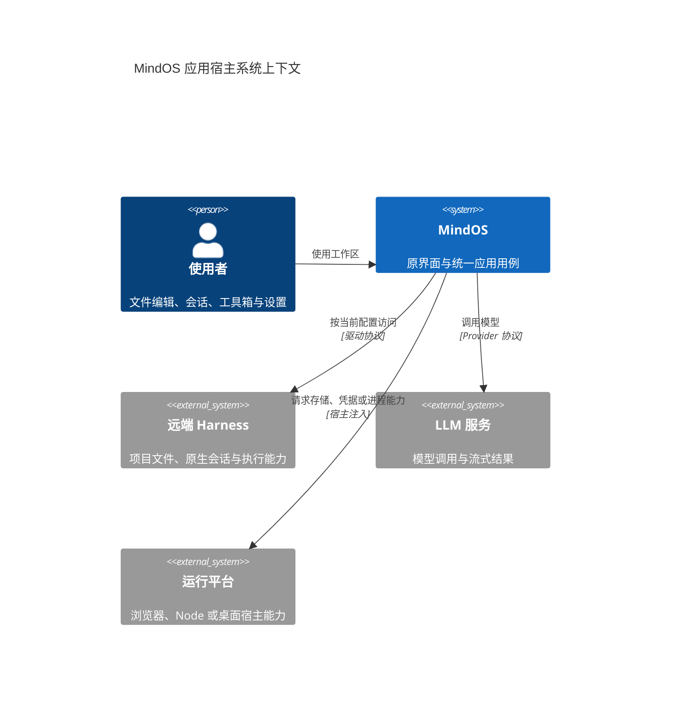
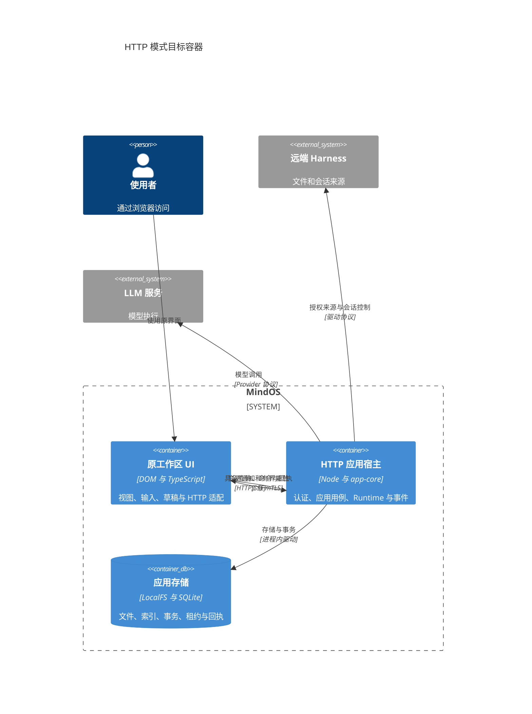
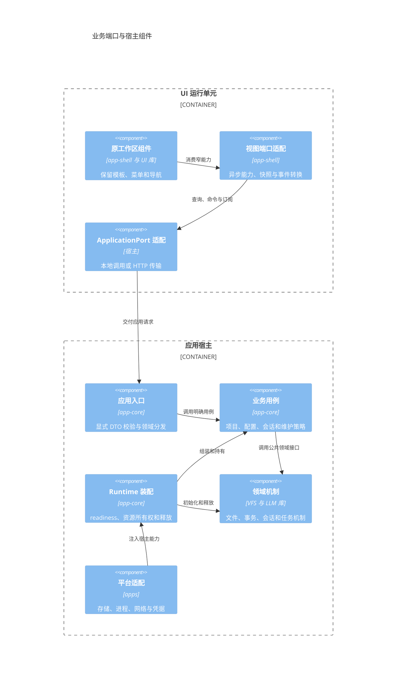
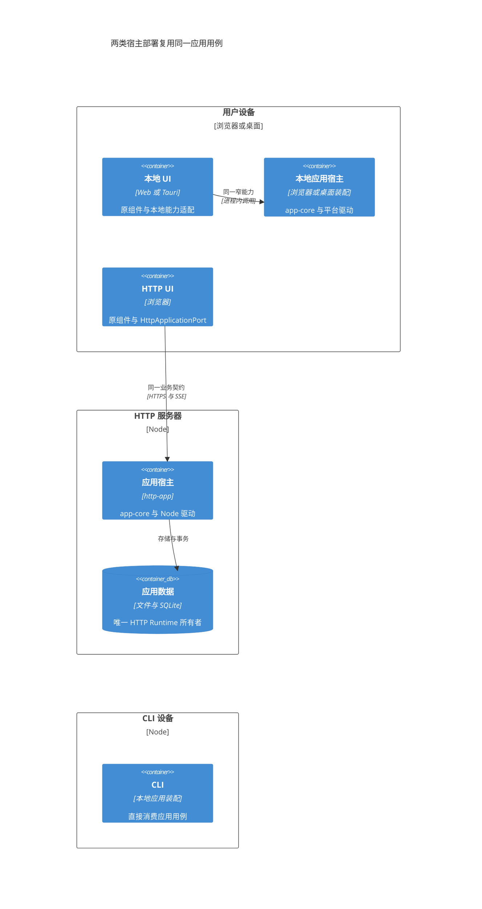
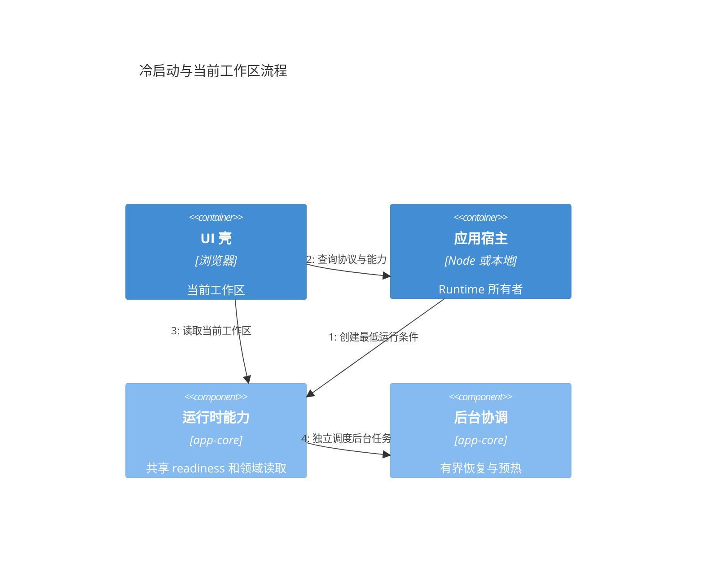
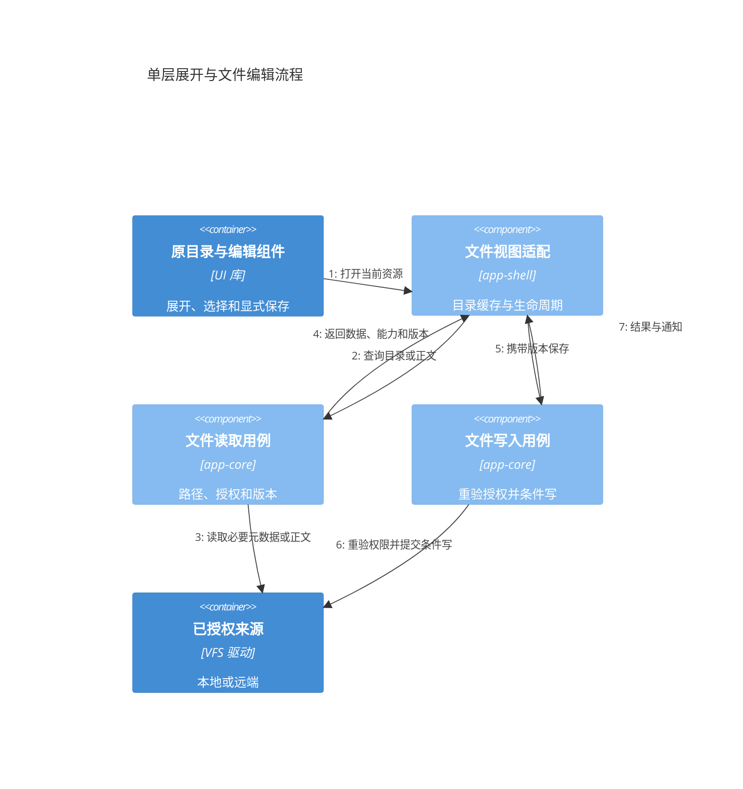
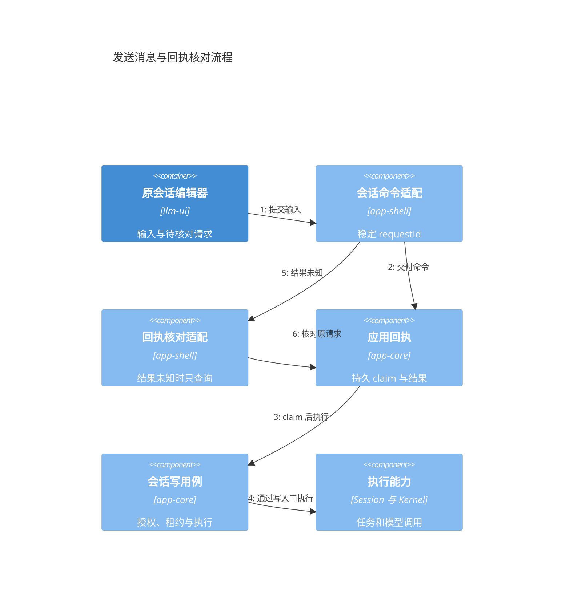
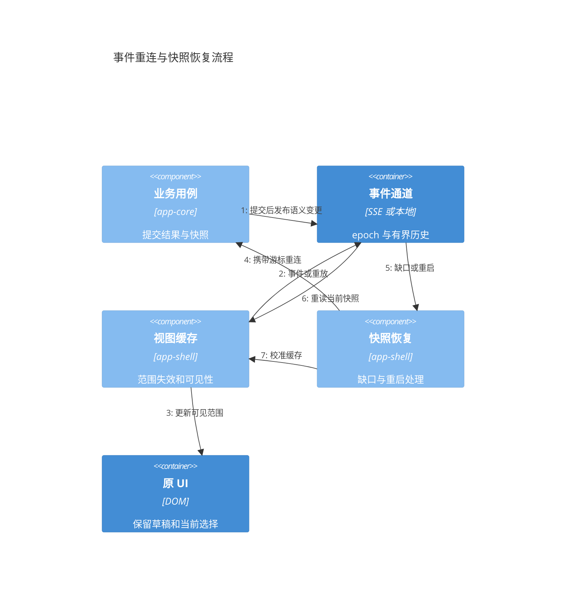
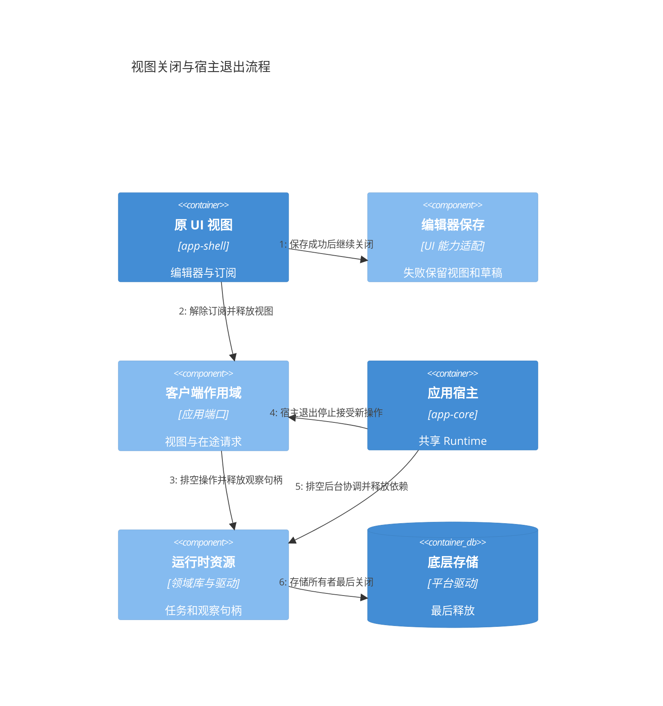

# MindOS 应用宿主迁移评审方案

> 归档：旧 ApplicationPort / ApplicationHost 及持久回执链已移除。当前实现见 [模块边界](../design/frontend-backend-modules.md) 与 [HTTP 宿主](../http-app.md)。

> 2026-10-15 更新：统一 ApplicationClient 门面已接入 Web/Tauri/HTTP，任务和工具箱聚合、初始化屏障、共享规则与资源撤销已落地，见 [当前模块边界](../design/frontend-backend-modules.md)。以下正文保留迁移前的设计取舍，不代表当前功能缺口。

> 2026-10-14 更新：HTTP 已改为完整共用 app-shell.initApp 与共享服务接口；旧精简 Shell、存储 HTTP 协议和内部监听已删除。本文保留设计取舍，当前实现、协议差异和验证入口以 [HTTP 应用说明](../http-app.md) 为准。

状态：迁移设计留档。评审基线：v5.3 工作树，2026 年 10 月 14 日。

本方案迁移业务执行位置和数据访问方式，保留现有工作区的界面、菜单、弹窗、导航与持久 UI 状态。HTTP 模式由服务器持有唯一 ApplicationRuntime；浏览器复用原组件，通过应用能力访问宿主。Web、Tauri 与 CLI 继续按各自平台装配同一应用用例，独立 npm 库保持可单独使用。

建议采用**单应用宿主、按业务能力划分端口、本地和 HTTP 两种适配**。先完成原 SessionWorkbench 的依赖抽离与功能接线，再切换 HTTP 主会话工作台；每一阶段均要求界面和业务行为一致。当前基础传输与多个工作区已接入，主会话工作台、服务端维护及部分文件动作仍有缺口。

实现证据和历史回归保留在[边界审查记录](application-host-boundaries.md)。本文中的“目标接口”和“拟实施”均为评审设计，不代表当前已提供相应 API。

逐项输入输出与操作语义见[迁移接口规格](application-host-interface-design.md)，包含当前全部 32 个查询、21 个命令和嵌套白名单，以及待迁移的项目、文件、挂载、草稿、记忆、Skill、远端、同步、artifact 和维护能力。

## 1 评审目标与约束

| 目标 | 可验证条件 |
|---|---|
| 保持产品界面 | 同一原组件分别注入本地和 HTTP 适配；模板、菜单、标签、分组、弹窗、快捷操作和深链接一致 |
| 明确执行所有权 | HTTP 浏览器不创建 VFS 执行 Runtime、LLM Driver、Kernel 或恢复任务；服务器拥有租约和后台任务 |
| 降低耦合 | UI 接收实际需要的窄接口；平台差异只在宿主接线和适配器中出现 |
| 缩短交互等待 | 打开当前目录不等待 LLM、所有项目扫描或全量恢复；折叠子层与未打开正文不读取 |
| 保持一致性 | 保存、授权变化、跨客户端修改、事件断流与关闭都具有明确语义 |
| 保持独立库边界 | vfs-core、vfs-ui、driver-llm 等不导入 app-core、app-shell 或 HTTP 应用契约 |

迁移不要求保留旧 HTTP 协议或旧简化工作台。UI 与后端成套升级，通过协议版本检测拒绝不匹配的组合。CLI 可直接消费应用用例，不为了形式统一而通过 HTTP 调用本机。

## 2 当前架构与迁移缺口

### 2.1 已有能力

| 能力 | 当前实现 | 仍需完成 |
|---|---|---|
| 应用宿主 | ApplicationHost 共享一次 Runtime 初始化，管理客户端、共享投影与回执 | 更细的领域处理器和能力声明 |
| HTTP 传输 | 具名查询、命令、回执、SSE；mTLS 与证书登记 | 完整业务状态矩阵与生产候选验收 |
| 文件工作区 | HTTP 复用原 Workbench、文件编辑器、标签和 UI 状态 | 文件聊天、部分 AI 动作；文件版本与能力透传复核 |
| 工具箱 | 复用原 ToolboxWorkbench、Flow 菜单、OCR、资源编辑器 | catalog 全分类准备、远端发现与可见层级读取彻底分离 |
| 设置与分身 | 原设置页面、系统只读投影及数字分身应用适配已接入 | 服务端存储概况、快照、恢复和重置 |
| 会话工作台后端 | 原 SessionWorkbench 仍直接持有 Kernel、SessionRepository 和项目服务 | 抽离任务检查、会话组织、项目、挂载、草稿、文件与远端控制端口 |
| HTTP 主会话界面 | 简化 ApplicationWorkbench 已删除，基础文件/会话复用原 Workbench 的侧栏、标签页与编辑器 | 项目与任务等能力仍保留原 SessionWorkbench 实现，尚未接入 HTTP；不作为完整迁移验收 |
| 远端 Agent 与 MCP | 原 Agent 详情与 Harness 面板接入；远端连接由后台持有 | 原主工作台的远端会话、附件、分支和项目作用域 |

### 2.2 需要先解决的设计问题

1. **服务对象与视图契约混用。** SessionWorkbenchBackend 尚未落地；原 SessionWorkbench 仍直接消费 Kernel、仓储、ProjectService、DirectoryMountService 等具体服务。拟议本地装配接口中的文件句柄、订阅和工厂不能直接 JSON 序列化为 HTTP 契约。
2. **展示组件复用已开始。** HTTP 已删除 ApplicationWorkbench，复用原 Workbench 的 VFS 侧栏、保留编辑器标签页和默认标题栏。当前允许 HTTP 暂缺项目与任务相关能力，原 SessionWorkbench 实现保留；后续继续抽离领域端口并复用原组件，不新建 HTTP 专用界面。
3. **文件路径与能力不完整。** 当前项目文件 API 使用 openFiles 的来源视图；原项目编辑器使用 openWorkspace 的 `/workspace` 视图。当前 file-backend 适配提供基础文件展示与保存；拟议 files-view 还需补齐 readonly、条件写版本、范围读取和订阅释放，不能按浏览器配置推断真实权限。
4. **查询隐含写入准备。** 当前 conversation 查询会调用 prepareSession，可能获取写租约。目标是历史和状态读取独立于写入门，写能力在发送、修改和任务控制时由后台检查。
5. **领域入口集中。** LocalApplicationPort 同时处理配置、文件、会话、工具箱和分身。保留一个传输入口，但将校验、用例和投影按领域拆分。
6. **事件与缓存覆盖不完整。** 部分缓存仍全局失效；项目文件来源的订阅、跨客户端更新和跨宿主变更通知需要闭环，不能用无限轮询代替。

## 3 宿主拆分方案比较

| 方案 | 部署与调用 | 耦合与性能 | 对其它模式的影响 | 结论 |
|---|---|---|---|---|
| A 浏览器 Runtime 加远程 VFS | 浏览器运行 app-core；每次存储操作跨 HTTP | 底层 stat、路径解析、配置与恢复产生大量往返；浏览器与远程存储协议耦合 | 本地实现容易复用，但各浏览器重复初始化执行服务 | 不作为 HTTP 目标 |
| B HTTP 单应用宿主 | UI 经应用端口调用服务器内的 app-core、VFS、Kernel | 网络跨越业务边界；存储与执行本地协作；无需内部 RPC | 本地适配复用相同用例，不要求 Web、Tauri、CLI 启动服务器 | 推荐 |
| C app-core Worker 或独立子进程 | HTTP 网关通过进程消息调用 Runtime | 提供进程隔离，但新增序列化、取消、事件、句柄和退出协议 | 需为桌面和 CLI 单独决定是否隔离；不能将 Worker 当公共库要求 | 有明确故障隔离需求后再引入 |
| D VFS 与 LLM 等微服务 | 网关协调多个业务后端 | 网络边界进入事务和执行协作；授权、版本、恢复和释放更复杂 | 增加部署依赖，难保持离线本地使用 | 当前规模不采用 |

方案 B 中 vfs-core 作为机制库在服务器进程内运行，不需要单独变成 HTTP 服务。独立远端文件来源、8787 Harness 和云端 LLM 仍通过各自驱动接入；这些来源的网络边界由驱动负责，不穿透到 UI。

## 4 目标架构

以下 C4 图表示目标。C4 的容器表示可运行单元，组件表示单元内部职责，不要求每个组件拆成 npm 包。

### 4.1 系统上下文



### 4.2 HTTP 容器与信任边界



浏览器提交配置连接 ID 和业务身份；宿主解析当前地址和凭据。HTTP 浏览器不直接访问局域网 8787。SSH 反向隧道只承载 HTTPS 字节，不替代 TLS、应用授权或 HTTP 服务；网络故障与业务迁移缺口分别诊断。

### 4.3 应用组件与依赖方向



独立库只能依赖自身领域契约或底层通用接口。vfs-ui 接收 BrowserSource 或文件展示接口；llm-ui 接收 ConversationControls 等展示契约。MindOS 的项目归属、恢复策略、HTTP 请求、URL 和证书身份留在应用及宿主层。

### 4.4 本地与 HTTP 部署



同图中的本地 Web 和 Tauri 是部署选择，文件和进程驱动由各宿主注入。Tauri 当前可以保留前端应用装配与原生平台桥；把其整个 Runtime 搬到原生侧不是本次 HTTP 迁移的前置条件。CLI 的远程模式可另行使用 HTTP 适配，本地命令仍直接装配用例。

## 5 接口设计

### 5.1 三类接口各自负责什么

| 接口 | 位置 | 内容 | 不跨越的边界 |
|---|---|---|---|
| 领域接口 | 所属独立库或领域包 | 文件、会话、任务、配置的通用机制 | 不含 MindOS 路由或 HTTP |
| UI 窄端口 | 应用展示与领域展示契约 | 该组件实际需要的读取、操作和订阅 | 不暴露 Runtime 或完整具体服务 |
| 应用传输契约 | app-core 的 application 公共入口 | 可序列化 DTO、查询、命令、回执和事件 | 不传函数、句柄、Kernel 或 IFileSystem 实例 |

一套业务语义有本地调用和 HTTP 两种适配，不维护两套业务 API。UI 端口可以保留函数与本地资源对象，由适配器把它们转换为显式应用请求；不能把具体服务整体 Proxy 成远程服务。

同步显示值来自已加载快照，例如配置元数据、按钮可用性和来源名称；真实操作返回 Promise。禁止用空列表、固定 readonly 或强制类型转换掩盖尚未加载与不支持的能力。

### 5.2 能力划分与迁移映射

以下名称表示拟拆分的能力职责；TaskInspectionPort 和 ProjectNavigationPort 尚未落地，已有 ConversationControls 优先沿用。

| 业务能力 | UI 消费方 | 查询与命令 | 状态 |
|---|---|---|---|
| 会话浏览与组织 | SessionWorkbench、SessionFamilyActions | 当前层、摘要、同组、创建、改名、移动与删除 | 部分抽离；完整 HTTP 接线待做 |
| 会话控制 | 原会话编辑器 | 历史、分支、发送、停止与人工响应 | 基础应用适配已有；原工作台接线待做 |
| 项目导航 | ProjectNavigation | 选择器、当前项目、离线标记与待删除数量 | 已有本地和应用适配 |
| 项目操作 | 原项目菜单和对话框 | 创建、改名、收藏、归档导入导出 | 本地用例已有；HTTP 接线待做 |
| 文件视图 | 原目录列表和文件编辑器 | 单层目录、正文、能力、条件写与释放 | 工作区基础已有；项目和会话视图待做 |
| 目录挂载 | 原挂载弹窗和 slash 命令 | 当前授权、内部目录、挂载、工作目录、重连与移除 | 待抽离 |
| 项目草稿 | 原草稿编辑器 | 草稿、附件、保存、准备与提升 | 待抽离 |
| 会话记忆与 Skill | 原记忆弹窗、共享管理、Skill 列表与编辑器联动 | 记忆 CAS、共享 incarnation、加载与临时 glob 挂载 | 待完整接入应用端口 |
| 远端会话 | 原远端会话编辑器与状态视图 | profile、项目作用域、会话状态、控制与回执 | MCP 独立面板已有；主工作台待做 |
| 项目同步 | 原同步菜单和状态视图 | 绑定、预览、冲突选择与执行 | 本地用例已有；HTTP 接线待做 |
| 配置与工具箱 | 原设置编辑器和工具箱 | 元数据、单项配置、测试、创建、影响预览与删除 | 应用适配已有；需缩小编辑器依赖并拆处理器 |
| 偏好与宿主维护 | 原设置页面 | UI 偏好、存储概况、快照、恢复、迁移与重置 | 偏好已有；服务端维护待做 |
| OCR、Flow、分身与任务 | 现有对应 UI | 各自明确查询、命令和通知 | 多项已接入；保留各自验收边界 |

### 5.3 ApplicationPort 与 HTTP 信封

沿用类型化 `query(name, input, signal)`、`command(name, input, signal, requestId)`、`subscribe(listener)` 和 `close()`。DTO 按领域定义并聚合为具名操作表；LocalApplicationPort 只组装领域处理器，不包含各领域算法。

当前 HTTP 信封如下，具体 operation 由白名单和输入校验决定：

```json
{
  "kind": "query",
  "clientId": "tab-1",
  "name": "directory",
  "input": {
    "workspace": { "kind": "workspace", "name": "minds" },
    "path": "/notes",
    "offset": 0,
    "limit": 100
  }
}
```

| 传输入口 | 责任 |
|---|---|
| `POST /api/application` | 查询、命令和客户端关闭；认证后校验名称及 DTO |
| `GET /api/application/events` | 客户端变更订阅、有界重放与缺口通知 |
| `query('receipt', { requestId })` | 读取当前认证身份下的应用命令回执 |
| 静态 UI | 与后端来自同一候选；返回适当静态缓存头 |

目标能力声明增加当前可用查询、命令及可选能力信息。`capabilities.protocol` 是启动时校验依据；全量迁移前，不能因为注册了 workspace renderer 就声明该工作区所有功能完整。

本地适配也执行输入、归属、权限和租约检查。HTTP 认证确定调用者身份，业务用例再检查该身份可访问的对象；原始宿主路径、数据库对象及未声明的方法不可作为输入。

### 5.4 文件视图与项目路径

目标文件视图明确区分来源目录、项目编辑器和会话授权文件三种语义。来源视图根为 `/`；项目编辑器与工具共用 `/workspace`；会话视图按已授权挂载提供自身 cwd。URL 中的 `folder:`、`@files` 等只在导航适配层解释。

以下为拟实施的 DTO 形状，字段名在评审后确定：

```typescript
type FileViewTarget =
    | { kind: 'workspace'; name: string }
    | { kind: 'project'; projectId: string; namespace: 'source' | 'workspace' }
    | { kind: 'session'; sessionId: string };

interface FileViewSnapshot {
    viewId: string;
    epoch: string;
    target: FileViewTarget;
    cwd: string;
    authorizationRevision: string;
    capabilities: {
        readonly: boolean;
        conditionalReplace: boolean;
        rangeRead: boolean;
    };
}

interface FileWriteRequest {
    viewId: string;
    epoch: string;
    path: string;
    content: string;
    encoding: 'text' | 'base64';
    ifRevision?: string;
}
```

能力快照负责显示；后端每次使用重新核对授权与来源版本，不将缓存快照当授权依据。只读来源即使客户端要求 rw 仍拒写。来源不支持条件替换时明确声明 false，不能靠客户端先读再写模拟原子 CAS。

资源句柄只在宿主内保存。客户端提交自身作用域内的 viewId，宿主返回已绑定身份的视图信息；不能用句柄切换项目。视图获取和释放属于临时资源控制，不套用持久业务回执重放；宿主重启改变 epoch，旧句柄拒绝并重新获取，业务写命令仍通过持久 requestId 核对。

简单目录查询优先按稳定业务身份短期获取并释放来源，不必全部引入长租约。只有编辑器、范围下载或远端协议明确需要持续句柄时保留视图。保留视图后仍须覆盖授权撤销、连接变更、关闭和空闲回收。

目录响应携带展示所需类型、标题、时间、大小、标签与能力信息，避免逐节点 stat。拟为大量目录增加带目录版本的分页游标；现有 offset 分页在并发变动下可能重复或漏项，不能宣称跨页一致快照。范围读取在服务端执行，不先下载完整文件再在浏览器截取；大文件复用原预览与下载行为。

### 5.5 挂载与平台选择能力

挂载端口返回当前授权、固定工作区、默认目录与可用动作，命令明确区分添加、移除、改变 access/cwd、设置 home/workspace 和重连。会话归属、活动任务限制、写租约、授权版本与来源范围均在后台重新校验。

HTTP 浏览器选择的是服务器可用来源，不是浏览器本机路径；不能让用户输入任意服务器路径并直接打开。服务器可选目录根由部署配置授权，内部目录只暴露允许范围。Tauri 本机目录选择器属于宿主平台能力，UI 窄端口可以注入 chooser；HTTP 没有 chooser 时提供相应来源选择能力或明确限制，不能调用服务器图形对话框。

### 5.6 会话控制与业务命令

读取历史不获取写租约，不恢复所有会话，也不初始化所有 Agent。发送、分支修改、删除、人工响应和重置等写操作经过其用例的授权和写入门。后台返回只读原因与当前可用动作，UI 使用原状态展示。

远端会话控制保留通用 ConversationControls 或 HarnessClient 展示契约，应用适配负责项目作用域与请求映射。MCP Harness 面板的已有适配不直接当作主工作台的完整实现：项目身份、附件、分支、状态订阅、原生会话族和草稿提升需要分别接入。

归档和跨实体配置修改使用业务目标，不通过通用 fileAction 改写托管状态。原确认弹窗在 UI，影响检查、版本重验、执行与补偿在应用用例。服务端维护同样提供明确 preview/execute 操作，不暴露 SQL 或原始数据库复制 API。

### 5.7 结果与回执

| 情况 | UI 行为 | 后台行为 |
|---|---|---|
| 查询失败或取消 | 保留当前视图与草稿；显式重读 | 尽可能取消读取，释放临时资源 |
| 命令尚未接受 | 显示明确错误 | 不启动业务操作 |
| 命令结果明确完成 | 使用结果并等待相应视图更新 | 保存完成回执；发布提交后通知 |
| 传输断开或结果未知 | 保存 requestId 并查询回执；不重新生成 ID 发送 | 已接受写入继续执行并保存回执 |
| 回执 pending 或崩溃遗留 | 显示待核对；不自动执行 | 不自动重放业务操作 |
| 远端原生结果未知 | 先查应用回执，再查远端 operation | 保留原生 requestId 与 epoch，不重发变更 |

相同身份、requestId 和输入的重复送达复用已有状态；相同 ID 对应不同输入拒绝。当前输入摘要基于 JSON 序列化，客户端核对必须保留原信封；拟在领域校验后统一规范化输入，避免字段顺序差异改变请求身份。

应用业务提交与回执完成不是同一跨领域事务，failed 也不自动证明所有业务步骤均未发生；不能承诺普遍 exactly-once。对具有部分成功或补偿流程的用例，返回领域操作 ID 和可核对状态，由用户在原 UI 中明确继续。

## 6 初始化与流程设计

### 6.1 readiness 与初始化策略

readiness 是某项能力可以安全使用的条件。单次初始化 Promise 共享、失败传播和关闭排空属于机制；什么时候预热、哪些操作等待什么依赖属于宿主策略。vfs-core 负责自身来源或设备可用性，不负责调度整个应用的 LLM、项目与工作区。

当前 StartupCoordinator 和 interactive/headless 策略已分开。其 task 会缓存失败 Promise，activate 的并发限制主要覆盖延后任务；不能因此宣称所有初始化都限流、失败后都能自动重试。目标增加按能力的重试策略，允许重试前必须排空旧任务，并保证初始化不会重复写默认配置或创建重复服务。

| 能力 | HTTP 交互宿主策略 | 首次使用依赖 |
|---|---|---|
| 认证、基础存储和应用路由 | 服务接收请求前建立最低运行条件 | 存储和身份可信 |
| LLM 配置 | 可后台预热，不阻塞文件 UI | 模型配置编辑、模型调用所需配置 |
| 项目索引 | 当前层投影按需读取 | 项目导航所需索引，不扫描全部正文 |
| 会话历史 | 当前会话按需读取 | 仓储与观察能力；不要求写租约 |
| 会话写入与恢复 | 按 Session 准备 | 所属恢复批次、写租约和执行依赖 |
| Agent、Flow 恢复和草稿协调 | 就绪后有界后台执行 | 对应业务写操作需要时等待 |
| 远端来源和设备节点 | 按需获取，可有界预热 | 所选连接与当前授权 |
| 工作区 UI | 路由选中后动态加载 | 当前界面的窄能力与 UI 状态 |

### 6.2 冷启动与首屏



图中编号表达交互依赖；工作区读取只等待自身能力，后台任务可以更早开始，但不能无界争抢首屏资源。服务器热启动时，浏览器不再次创建 Runtime。UI 骨架和当前工作区代码可并行加载，实际读取各自等待对应能力。

测量分别记录监听可用、当前工作区可交互、当前正文可用、后台恢复结束；不能只记录总 Boot 时间。后台仍有必要初始化日志，浏览器只记录 UI 和应用请求；降低打印量不能代替消除重复初始化。

### 6.3 单层目录与文件编辑



恢复展开状态只读取可见祖先和实际展开层；折叠目录不读取后代，不为子树计数扫描全部内容。刷新尽量按目录范围失效；目录列表已带节点信息时，适配器用该信息补充本地 stat 缓存。

共享目录读取不能因一个调用者取消而影响其他等待者；视图关闭或代次变化后，旧结果不得回填。保存失败保留正文和文件视图，原关闭流程先完成保存再释放；导航取消则排空已接受读取后释放资源。

### 6.4 发送消息与未知结果



停止浏览器等待不是撤销写入。停止任务、响应人工请求与删除会话是独立业务命令，必须校验任务所属 Session 和写所有权。HTTP 查询断开后的 signal 尽可能透传；底层不支持取消时仍排空读取和释放资源，不能声称后台操作已停止。

### 6.5 事件断流与缓存恢复



当前 SSE 每客户端具有 epoch 和 revision，历史限制为 256 条及 2 MiB，慢消费者超过缓冲预算断开；这是观察通道，不用于命令重放。目标快照携带可关联的版本或游标，解决初次读取与订阅建立之间的空窗；重连、历史缺口和服务器重启统一要求当前范围重同步。

普通文件事件不能刷新无关聊天；配置变更不能重载普通目录。隐藏视图只标记 dirty，重新显示时读取必要范围。跨宿主直接写入当前还没有完整事件保证；验收前需明确通知源或采用版本核对，不能将单 Runtime 的进程内通知当成跨进程机制。

### 6.6 关闭与资源所有权



| 资源 | 所有者 | 释放规则 |
|---|---|---|
| Runtime、Kernel、写租约和后台任务 | 应用宿主 | 宿主退出统一停止与排空；页面离开不取消任务 |
| 共享配置、项目索引与事件投影 | 宿主或领域服务 | 提交后失效；Runtime 关闭时释放 |
| 会话观察、文件句柄、Harness 视图 | 客户端视图作用域 | 显式关闭、授权撤销或空闲回收；重连重新校验 |
| 编辑器 DOM、标签、目录状态与草稿 | UI | 保存成功后关闭；失败保留，释放自身订阅 |
| 底层存储驱动 | 平台宿主 | 最后释放；被借用的 backend 不由客户端关闭 |

现有 Harness 面板连接空闲 60 秒回收，仍打开的面板下次操作重新连接；显式关闭拒绝晚到调用。该参数是当前实现，不作为所有文件或会话视图的统一超时。API 客户端在没有事件订阅和在途请求时回收，保持 SSE 的遗留视图仍需域内资源预算。

## 7 性能策略与一致性

| 层 | 优化方式 | 必须保持的条件 |
|---|---|---|
| 网络 | 一次应用查询返回当前层展示数据，减少底层往返 | 不扩大授权范围，不读取折叠后代 |
| 初始化 | 各能力共享初始化 Promise，沿依赖图并行 | 有界并发，失败可见，关闭排空 |
| 文件 | 目录内元数据复用，范围正文读取，打开后保留必要句柄 | 条件写、来源版本和撤权检查 |
| 宿主缓存 | 共享配置和项目索引快照，去重在途刷新 | 提交失效，跨客户端通知，跨宿主范围明确 |
| UI 缓存 | 缓存可见目录、编辑状态和必要快照 | 对象身份稳定；代次隔离；断流重同步 |
| 静态资源 | 动态 import、内容哈希资源缓存、文本压缩 | HTML 和协议检测支持成套发布；缓存不存凭据或可变授权 |
| 远端连接 | 按需发现、共享来源、限制探测与恢复预算 | 离线连接只影响所属资源；不回退未授权本地来源 |

缓存策略只控制性能，权限、版本、租约和命令回执不从 UI 缓存推导。不能用无限并行掩盖冗余读取；先减少工作量，再为独立任务分配并发预算。当前 StartupCoordinator 默认延后任务并发为 2，具体远端、目录与模型预算在对应领域单独定义。

验收采用同一数据集、相同构建和网络条件，分别记录冷宿主、热宿主、新浏览器和已缓存浏览器：首屏时间、当前层查询数、正文读取数、原始 VFS 请求数、空闲请求数、重连重读范围和内存资源数量。原始 VFS 对外请求应为零；折叠后代和未打开正文读取应为零。首屏总请求数随实际恢复的展开层和深链变化，不承诺固定两次请求。

## 8 迁移步骤与完成条件

### 8.1 分阶段实施

| 阶段 | 实施范围 | 完成条件 |
|---|---|---|
| M1 领域契约与处理器 | 定义项目、文件、挂载、草稿与远端窄端口；拆应用分发；审查配置编辑接口 | 不强转具体服务，不开放任意方法 RPC，DTO 校验及归属检查可独立测试 |
| M2 项目与会话文件 | 来源与 `/workspace` 语义、能力与版本、附件、范围读取和视图释放 | 本地/远端只读、冲突、撤权、关闭失败保留草稿；原文件编辑器两种适配通过 |
| M3 原主工作台 | 会话组织、项目创建/归档、挂载、草稿、记忆/Skill、同组、收藏、搜索和同步接线 | 原 SessionWorkbench 在本地和 HTTP 共用；删除简化聊天实现与错误路由前缀逻辑 |
| M4 远端会话闭环 | 原会话编辑器、项目作用域、附件、分支、状态订阅及回执 | 真实 Harness 来源验证；离线、重连、未知结果和配置改变不丢草稿或重复执行 |
| M5 设置与剩余动作 | 服务端维护、文件聊天、AI 菜单和完整可选能力声明 | 原界面功能矩阵逐项闭合；不以隐藏入口代表迁移成功 |
| M6 统一验收与切换 | 构建图、独立安装、本地平台、HTTP 和公网测试 | UI/后端同候选部署，真实数据与故障矩阵达标；切换与退回不破坏数据 |

每个阶段先在原组件上替换依赖，再接本地与 HTTP 适配，不继续扩展 ApplicationWorkbench。M1 与 M2 的独立领域工作可并行；M3 依赖文件和项目基础能力，M4 依赖项目作用域、回执和视图生命周期。M5 不阻塞文件能力抽离，但完整发布必须全部达标。

### 8.2 功能与平台验收

| 维度 | 必验场景 |
|---|---|
| 界面 | 项目选择器、侧栏上下分区、标签、菜单、对话框、图标、深链接、移动端切换和展开恢复 |
| 文件 | 单层展开、创建/移动/重命名、二进制与大文件、标签、保存冲突、只读、撤权、附件与链接跳转 |
| 会话 | 历史分页、创建/同组/移动/删除、分支、发送/停止/HITL、草稿、任务与只读租约状态 |
| 远端 | Harness 项目和会话范围、网络超时、凭据变更、关闭、重连、未知结果、断流与回执核对 |
| 维护 | 存储概况、快照一致性、活动任务限制、恢复、重置确认与失败后继续使用 |
| 生命周期 | 导航取消、编辑器关闭失败、客户端刷新、宿主退出、资源预算和后台任务所有权 |
| 发布平台 | Web/IndexedDB、Tauri、CLI、HTTP/mTLS；独立 npm 库在仓库外安装和声明打包 |
| 性能 | 同数据同链路基线、冷/热首屏、折叠零读取、空闲零无关查询、事件后精确刷新 |

2026 年 10 月 14 日上一轮回归覆盖 app-core 543、app-shell 661、HTTP 45 项，另有 30 项外部环境用例跳过。默认并发曾有两个 IndexedDB 时序相关失败，降低并发后通过；完整平台和高并发验收仍需闭合。当前候选尚未替换线上，该测试数量不代表公网迁移已验收。

### 8.3 构建与发布

HTTP 浏览器构建图不能包含执行 Runtime、Node 存储和服务端凭据模块；类型引用也不能引入未公开的领域入口。独立 npm 库修改自身通用接口，应用适配留在应用层；开发时有独立目录则使用其公开出口，没有则使用 npm 版本。发布产物不得包含本机 link、workspace 路径或临时补丁。

同一候选目录包含静态资源、后端与协议标识。先在隔离端口和测试 profile 完成验证，再成套切换进程；避免新 UI 调旧后端产生 Unknown API route。退回上一候选前确认数据布局仍可读取，备份和快照按正式维护协议取得。

## 9 评审决策与开放问题

| 编号 | 建议决策 | 评审需要确认的取舍 |
|---|---|---|
| D1 | 采用 HTTP 单应用宿主 | 当前不引入 Worker 或微服务；隔离需求出现时复用端口而非重写 UI |
| D2 | 原 UI 为唯一展示实现 | 完整接线后删除简化 ApplicationWorkbench；不保留兼容界面分支 |
| D3 | UI 窄端口与传输 DTO 分开 | 按业务能力拆分，避免把完整具体服务或通用文件 CRUD 当全部业务接口 |
| D4 | 区分来源、项目 workspace 与会话文件 | 稳定身份优先；需要持续句柄时显式管理 epoch、授权版本和释放 |
| D5 | 观察读取不获取写租约 | 当前 conversation 的 prepareSession 行为需改；写用例重新校验 readiness 和租约 |
| D6 | 结果未知只核对，不自动重发 | 通用回执与领域核对结合；不承诺普遍 exactly-once |
| D7 | 服务器来源选择由部署授权 | 定义允许根与可选择来源；HTTP 不访问任意宿主路径或本机选择器 |
| D8 | 服务端维护接回原设置 | 先定义一致快照、活动任务与恢复策略，再开放操作 |
| D9 | 性能指标与功能完成分开验收 | 为统一数据集设可接受的首屏和资源预算；先记录可复现基线 |

尚待明确：文件视图保留策略与上限、目录分页一致性级别、跨宿主事件来源、服务器快照和恢复的存储能力、输入规范化与回执保留期限。这些问题分别影响授权生命周期、读一致性、更新可见性和运维恢复，应在相关阶段实施前定稿。

## 10 代码与文档索引

| 范围 | 当前代码或文档 |
|---|---|
| 迁移状态与验收证据 | [边界审查记录](application-host-boundaries.md) |
| 应用策略与机制 | [应用策略边界](application-policy-boundaries.md) |
| 宿主与协议 | [HTTP 应用说明](../http-app.md)、[运行时架构](../runtime-architecture.md) |
| 应用契约与所有权 | [contracts](../../backend/app-core/src/application/contracts.ts)、[host](../../backend/app-core/src/application/host.ts)、[local](../../backend/app-core/src/application/local.ts) |
| 回执与事件 | [receipts](../../backend/app-core/src/application/receipts.ts)、[HTTP 视图 API](../../apps/http-app/src/server/view-api.ts) |
| 初始化策略与机制 | [startup-policy](../../backend/app-core/src/runtime/startup-policy.ts)、[startup-coordinator](../../backend/app-core/src/runtime/startup-coordinator.ts) |
| 原主工作台与会话浏览 | [SessionWorkbench](../../ui/app-shell/src/projects/SessionWorkbench.ts)、[session-browser](../../backend/app-core/src/session/session-browser.ts) |
| 文件与挂载迁移点 | [project-file-editor](../../ui/app-shell/src/projects/project-file-editor.ts)、[mount-dialog](../../ui/app-shell/src/files/mount-dialog.ts)、[服务适配](../../apps/http-app/src/server/view-services.ts)、[HTTP 客户端](../../apps/http-app/src/client/view-client.ts) |
| 现有远端控制与会话管理 | [Harness 控制面板](../../ui/app-shell/src/harness/control.ts)、[remote-session-management](../../backend/app-core/src/session/remote-session-management.ts) |

以下是待实现模块，不作为当前源码链接：`workbench-backend.ts`（会话工作台窄端口）、`files-view.ts`（持续授权文件视图）、`harness-client.ts`（应用端口客户端）、`harness-runtime.ts` 与 `harness.ts`（宿主 Harness 适配及生命周期）。具体文件组织可随实施调整，落地后再加入上表。

实施时同步本文的阶段状态和[边界审查记录](application-host-boundaries.md)，具体公共接口以所属模块的实现契约为准。
