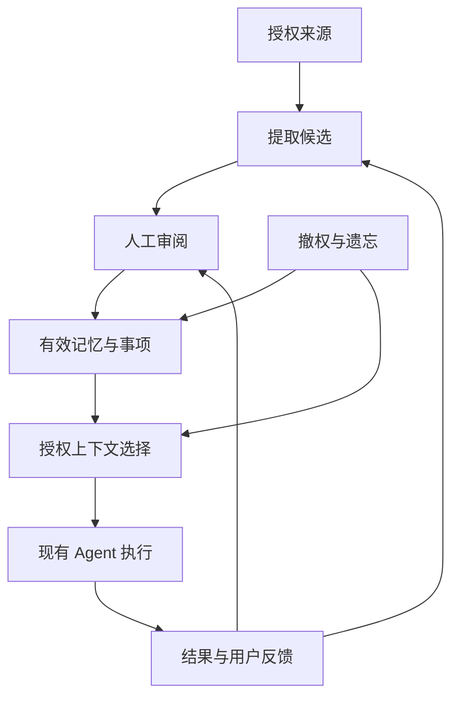
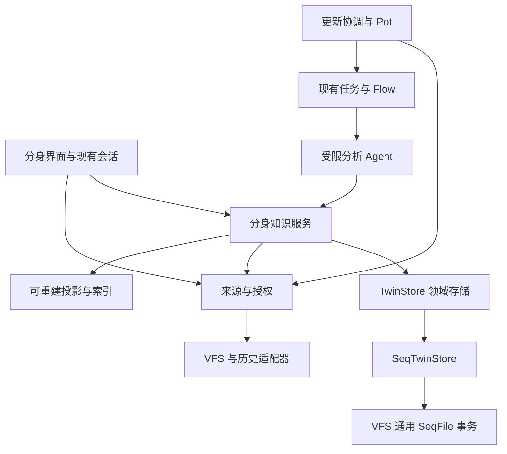

> 历史归档：已由规则驱动方案替代，不随当前实现更新。

# 数字分身完整设计与实施计划

状态：本地分身使用闭环及多扫描计划已接入 Web、Tauri 与 CLI；扩展适配器、完整故障矩阵、提醒及剩余 S2/S3 尚未完成。更新日期：2026-10-09。

数字分身从用户显式授权的文件、会话、笔记及后续接入的邮件中，维护本人信息、相关人物、项目背景、事件、决策、目标和承诺。它为现有 Agent 提供可追溯、可纠正、可遗忘的个人上下文，并通过一个分身管家 Pot 协调分析、审阅和后续关注。

前期交付“选择来源—提取候选—人工确认—跨会话使用—纠正与遗忘”的完整闭环，同时提供基础人物关系和事件时间线。中后期增加持续更新、目标提醒、私密来源、真实邮箱和有限授权代理。

除第 18.8、18.9 节列出的实现外，本文中的类型和接口仍为目标契约。实际公开 API 与支持边界以这两节和测试为准，不能用页面存在替代完整阶段验收。

## 1 产品定位与边界

### 1.1 数字分身的定义

本产品定位为个人认知与记忆分身：在授权范围内持续维护个人及相关事项的状态，以事实、偏好、经历和目标支持理解、决策与协作。

产品不以头像、语音克隆或人格表演作为成立条件，也不将“保存个人资料”直接等同于已经实现行为模拟。前期不声称能够准确预测本人选择、完整复制人格，或未经授权代表本人行动。

数字分身需要同时具备以下能力：

1. 建模：区分本人、第三方、项目、事件、事实、推断和计划。
2. 更新：按明确的来源版本、覆盖范围和更新策略维护状态。
3. 使用：让已授权 Agent 在实际任务中使用相关记忆。
4. 反馈：让用户查看使用依据，确认、纠正、拒绝或限制后续使用。
5. 治理：执行权限、删除、遗忘、恢复与费用边界。

### 1.2 核心用户问题

分身应逐步支持回答：

- 我有哪些已确认的背景、偏好和约束？
- 某个人是谁，与我及当前项目有什么关系？
- 这件事经历了哪些变化，现在进行到哪里？
- 上次为什么选择这个方案，什么条件下需要重审？
- 我答应了什么，还有哪些未完成或待确认事项？
- 本次回答使用了哪些记忆，如何纠正或停止使用？

### 1.3 默认原则

默认不扫描全部可见资料，不自动启用外部行动，不将第三方信息归入本人画像，不将推断展示为已验证事实。前期由模型提取的候选须经用户确认后才能进入正常个性化使用；用户主动手动录入的明确陈述，可在同一次提交中完成确认。

数据的提取授权、保存授权、使用授权和行动授权分别表达。“我允许你记住”不意味着“允许所有 Agent 使用”，更不意味着“允许代表我发送”。

## 2 现有基础与集成前提

| 现有能力 | 计划复用 | 分身新增内容 |
| --- | --- | --- |
| 工作区导航与原生 DOM UI | 导航装配、列表、编辑和详情视图 | 分身工作区、审阅与会话内使用说明 |
| VFS SeqFile 与记录事务 | 同一后端跨 SeqFile 事务、条件更新、记录删除 | 分身领域存储、记录布局、反向索引、回执与清理协议 |
| Session 本地与共享 Memory | 现有上下文接入经验与授权隔离契约 | 分身上下文 provider；不通过通用 Memory 正文接口保存分身权威对象 |
| VFS 元数据与事件 | 文件身份、授权读取、变化提示 | 来源清单、事件持久消费、扫描核对 |
| harness 原生历史与分页 | 原生身份、历史读取和分页 | 覆盖范围、增量提取与依赖失效 |
| 项目 watcher | 变化版本和缺口提示 | 差异核对与有界补扫 |
| Durable Task 与 Flow | 执行、预算、租约、恢复和交互 | Pot 配置、触发装配和分身任务载荷 |
| 现有 Agent 与 Session | 任务执行和上下文装配 | 分身上下文选择、使用回执与纠正入口 |

已有邮件工作区中的内容属于草稿，不等同于已发送邮件。真实邮箱必须使用独立适配器。

私密工作区标识不构成读取授权，也不证明派生数据已加密。分身使用独立的 TwinStore，不依赖通用 Memory 工具获得分身资源访问权。跨会话授权和使用仍须单独验收，不继承共享 Memory 的实现或验收结论。

实现前核对项目中的共享 Memory 契约 `p2-completion.md`、Session API `../llm-session-api.md`、事件流 `../event-flows.md`、项目与 harness 模型 `pi-agent-project-model.md`。这些路径为原方案中的集成依赖名称，实际位置和能力以仓库为准。

## 3 提取内容与记忆范围

### 3.1 内容分类

| 类别 | 提取内容 | 关键限制 |
| --- | --- | --- |
| 本人信息 | 身份、职业、角色、技能、经历 | 区分自述、观察和推断；保留有效区间 |
| 偏好与习惯 | 沟通、工作、学习方式和选择倾向 | 区分长期偏好与当前任务要求 |
| 相关人物与关系 | 身份、职责、合作关系、明确偏好、互动 | 不凭姓名自动合并；不自动推断性格 |
| 项目与事项 | 目标、背景、参与者、阶段、状态、资源约束 | 限定项目范围，避免污染全局画像 |
| 事件与经历 | 参与者、动作、对象、时间、结果 | 区分计划与发生；保留时间精度 |
| 决策与理由 | 选择、备选方案、理由、条件和取舍 | 建议不等于接受；保留重审条件 |
| 目标与计划 | 期望结果、成功条件、期限、阶段计划 | 意向不自动成为已承诺目标 |
| 任务与承诺 | 责任人、对象、期限、依赖、完成依据 | 区分本人和他人承诺；不由模型自证完成 |
| 经验与方法 | 做法、条件、效果、失败原因、可复用步骤 | 单次经历不自动提升为普遍规律 |
| 约束与协作规则 | 资源、项目边界、沟通要求、明确禁止项 | 行动权限由受信任配置确认，不能从材料自动生效 |
| 待解决问题 | 疑问、假设、分歧、阻塞、等待回复 | 保存不确定性；没有新消息不代表解决 |

通用文档、完整邮件、代码和大段日志继续保留在原来源或知识库中。分身优先保存未来有助于理解人物、恢复事项上下文或推进明确行动的信息，不将所有可读内容重复存储为个人记忆。

### 3.2 提取判断

候选至少满足以下条件：有明确主体或标记主体未知；有授权证据或用户直接陈述；具有跨轮次或事项跟踪价值；能说明适用范围；保存成本和敏感程度符合策略。

前期不自动提取心理诊断、人格定性、亲疏评分或未经明确支持的因果结论。来源中明确存在的主观看法可保存为“某人认为……”，不能改写成被描述者的客观属性。

### 3.3 原子事实与上下文

优先将独立事实拆分保存，同时通过对象和关系恢复上下文。例如“王工负责项目验收，我答应周五提交报告”应拆成职责事实、承诺记录及其关联，而不是只保留一段难以局部纠正的摘要。

事实类型至少区分：事实、偏好、意向、承诺、假设、推断、问题。未知主体或不明确的时间不能被模型补造；主体未确认的内容不得进入本人画像。

## 4 对象与展示投影

### 4.1 本人和相关人物

本人由 Twin 的所有者身份明确指定。第三方人物记录姓名或称呼、来源中的稳定账号身份、所属组织、项目职责、与本人的关系及已发生互动。

同名、昵称和邮件展示名仅用于提出匹配候选。合并人物需要稳定身份支持或人工确认。合并操作保留别名、原身份和反向引用，支持纠正错误合并。人物身份匹配也不能向无权限的场景泄露跨范围关联。

“用户认为王工较急切”保留陈述者为用户、被描述者为王工、类型为主观看法；不能变成“王工性格急躁”。对某次评审的要求限定于该评审，不直接成为长期沟通偏好。

### 4.2 项目与事项

项目记录背景、预期结果、参与者、约束、当前阶段及关联目标。项目现状是有效记录的聚合投影，应能展开到决策、进展事件和未解决事项。

项目已结束不等于其历史记忆必须删除；项目中的临时偏好和授权不自动延续到新项目。

### 4.3 三种时间线

| 视图 | 内容 | 排序依据 |
| --- | --- | --- |
| 经历时间线 | 本人和相关人物的已发生事件 | 事件发生时间 |
| 项目时间线 | 讨论、决策、执行、反馈和状态变化 | 事件时间及明确的先后关系 |
| 记忆变化记录 | 分身新增、确认、纠正和失效操作 | 系统记录时间 |

计划事项可在时间线中切换显示，但必须明确标识为计划。今天读取上个月的邮件，事件仍归入上个月；系统发现时间单独显示。

事件支持时间区间、日期精度、未知时间和不确定标记。解析“明天”“下周五”时使用来源消息时间和适用时区，无法确定时保留原表达并请求确认。界面不能将仅知月份的事件伪装为月初发生。

时间先后不构成因果关系；“导致”“解决”“因此选择”等关系须有明确证据或标为推断。

### 4.4 单一权威数据

本人画像、人物卡片、项目概览和时间线均由统一记录生成，不独立维护另一套事实。画像字段的直接编辑转换为人工纠正，记录新的用户陈述及适用范围，再更新投影。

投影按使用范围生成或分片缓存。完整私密画像不能先加载到普通客户端，再靠隐藏字段实现隔离。

## 5 目标与承诺闭环

目标是有生命周期的结构化对象，不只是 Pot 提示词中的一段文字。任务执行状态继续由现有任务引擎负责，分身通过关联引用和事件观察进展，不复制一套执行状态机。

| 对象 | 必需信息 | 状态依据 |
| --- | --- | --- |
| Goal | 描述、成功条件、优先级、期限、时区、状态、关联项目 | 用户确认及可验证的完成条件 |
| Commitment | 承诺人、接收对象、承诺事项、截止时间、条件 | 明确承诺及其后续变更 |
| WorkItem | 待办或问题、负责人、依赖、关联目标、完成依据 | 用户操作或明确业务事件 |
| ExecutionLink | 关联任务或 Flow 身份、观察版本、结果引用 | 现有执行引擎的权威状态 |

目标支持 draft、active、paused、completed、cancelled；阻塞作为独立属性。目标完成须由用户确认，或由用户预先确认的可验证规则判定。Agent 输出“已完成”、任务退出成功或某份文件生成，并不天然代表目标达成。

承诺、任务和目标可互相关联，但不能自动互相等同。目标取消后取消后续提醒与未生效行动，不伪装成已经完成。

前期提供人工创建、候选确认、关联与手动更新；中期提供定时检查、站内提醒、延后和去重；对外跟进属于后期行动授权范围。

## 6 导航与界面

### 6.1 前期页面

保留五个顶层页面，前期通过标签和详情抽屉承载人物、项目和事件，不为每种实体建立新的导航入口。

| 页面 | 内容 | 必须支持的操作 |
| --- | --- | --- |
| 概览 | 近期变化、覆盖范围、待确认、关注事项、Pot 状态 | 添加来源、继续分析、进入审阅、手动检查 |
| 个人画像 | 本人当前信息、偏好、能力与协作要求 | 查看依据、纠正、限定场景、查看历史 |
| 记忆与经历 | 事实、决策、经验、事件；人物和项目筛选 | 搜索、手动新增、列表与时间线切换、详情、遗忘 |
| 目标与关注 | 目标、承诺、待办、阻塞和未解决问题 | 创建、确认、关联、更新、完成、取消 |
| 来源与设置 | 来源、权限、处理模型、Pot、费用、运行记录 | 选择与排除、撤权、核对、暂停、恢复、清理状态 |

相关人物卡片和项目概览从记忆中的链接或筛选入口打开。规模增长后可独立为“人物与项目”，底层记录不迁移为新的平行事实库。

### 6.2 首次使用

首次进入展示空状态与建立流程：选择文件或会话，预览来源范围和排除项，确认允许的模型与用途，设置预算，开始分析，审阅候选，在现有会话中试用。

费用只能给出估算时明确标为估算；历史总量未知时不显示伪造的完成百分比。

### 6.3 审阅界面

概览与记忆页面共享同一审阅队列。每条候选显示内容、主体、类型、场景、有效时间、证据片段、来源版本、系统建议和可用范围。

操作包含确认、修改、仅适用于当前事项、不准确、不再适用、不保存及不再自动提取。复杂选项可以渐进展开，但不能将所有负向决定合并为含义不明的“拒绝”。

冲突提供并排证据与有效时间比较；批量确认只作用于用户明确选择的条目和版本。审阅期间来源或候选变化时重新检查版本，提示更新，不静默确认新内容。

“本人确认”“来源直接陈述”“工具观察”“系统推断”分别展示，不统一标为“事实已验证”。模型置信度仅用于内部排序或辅助说明，不作为事实正确率展示。

### 6.4 会话内使用

现有 Session 中提供是否使用分身的开关、当前使用范围和“本次使用了哪些记忆”入口。可查看记忆依据、纠正、停止本次使用或限制后续使用。没有可用记忆时按普通任务执行，不要求用户先建立完整画像。

使用记录说明哪些内容被提供给模型，不声称能够精确证明每句话受到哪条记忆影响。导出、共享会话或发送内容时需要重新遵守其输出范围规则。

### 6.5 暂停和删除操作

| 操作 | 明确语义 |
| --- | --- |
| 暂停自动更新 | 停止新的常规分析触发；不关闭删除和撤权失效处理 |
| 停止记忆使用 | 阻止后续向 Agent 提供分身上下文；不自动删除 |
| 取消当前分析 | 取消该任务，保留安全检查点；已提交内容按回执显示 |
| 移除来源授权 | 停止读取，并限制依赖该授权的派生内容 |
| 遗忘指定内容 | 清理指定记录及可控派生副本，显示清理范围 |
| 不再记住此类信息 | 保存最小化的持续限制规则 |

遗忘前展示受影响记忆、人物或项目视图、摘要和缓存范围；无法清理的外部副本单独说明。执行中显示“已停止使用，正在清理”与剩余范围，不将异步清理伪装为瞬间完成。

### 6.6 进度与可访问性

最近检查、来源内容更新时间、最近成功分析、已分析版本和覆盖范围分别显示。未知总量时显示已处理轮次或页数、截至位置和暂停原因。

后台未运行、预算耗尽、授权失效、网络中断分别提供可操作状态。列表支持分页或虚拟化，详情可通过键盘访问，状态不只靠颜色表达；窄屏下将证据对照改为可切换面板。

## 7 来源身份与适配器

### 7.1 来源类型

| 来源 | 身份与读取契约 | 阶段 |
| --- | --- | --- |
| 工作台文件与笔记 | 授权 VFS 视图、项目和挂载身份、文件身份与创建代次 | 前期 |
| MindOS Session | Session、分支、消息、轮次身份和持久历史 | 前期 |
| harness Session | MCP 连接、server、project、profile、native Session 和原生页 | 前期，逐适配器通过能力验收 |
| 邮件草稿 | 文件来源，标记草稿状态 | 前期随文件来源支持 |
| 私密内容 | 独立授权、模型限制、派生数据保护与备份策略 | 后期保护能力通过后启用 |
| 真实邮箱 | 账号、邮箱、原生消息身份、修订和删除能力 | 后期 |

读取历史使用公开只读契约，不通过 resume harness 改变原 Session 的运行或控制所有权。

### 7.2 适配器能力声明

每个适配器声明：稳定身份、版本化读取、分页枚举、历史修订检测、事件游标、删除信号、快照一致性、完成事件、单对象查询和内容校验能力。

缺少能力时选择明确的降级策略，例如周期性核对或前后版本检查，并在覆盖信息中反映限制。无法达到最低授权或一致性要求的适配器不进入支持列表。

sourceId 不仅是路径。无法获得稳定身份时使用授权命名空间、规范化路径和创建代次。路径删除后重建必须产生新 incarnation；仅凭内容 hash 相同不能证明移动或同一身份。

同一物理来源通过多个绑定接入时，可以在授权允许的范围内复用读取或分析结果，但授权、覆盖和派生使用关系分别保留。移除一个绑定不等同于删除物理来源，也不能默认为另一绑定允许相同用途。

## 8 授权与处理边界

### 8.1 权限维度

| 维度 | 控制内容 |
| --- | --- |
| 来源读取 | 能读取哪些对象、范围、版本和片段 |
| 模型处理 | 允许的提供方、模型、路由和处理位置 |
| 派生保存 | 保存哪些类型、保留期限和敏感范围 |
| 派生使用 | 哪个 Agent、Session、项目及用途可检索 |
| 外部行动 | 允许的工具、目标、内容范围和确认条件 |

权限信息不由模型自行填写后生效。来源正文和历史消息是待分析数据，其中的指令不能修改 Pot、扩大 scope 或授权对外操作。

提取执行使用专门的受限工具集合；在现有 Agent 引擎中运行不意味着继承原 Agent 的全部写入、网络或发送权限。模型返回结构化候选，宿主负责身份、引用、范围和版本校验。

### 8.2 检查时点

读取前、向模型发送前、提交前、向消费方交付前及外部行动前检查当前策略。权限变更更新 grantRevision 或策略代次，旧任务和缓存不能凭旧授权继续提交或交付。

撤权确认表示服务端策略已生效，之后开始的受控读取、交付和模型发送必须服从新策略。已开始的外部请求可能无法撤回，应尽力取消并抑制其后续持久提交；不能承诺从已收到数据的第三方服务中即时收回。

已注入本地会话的记忆，在下一次上下文装配时排除或重建上下文；可控的临时副本纳入清理。无法选择性移除的会话历史明确列入保留范围，不将“停止检索”声称为“所有副本已清除”。

### 8.3 权限传播

摘要、实体索引、关系、拒绝记录、证据摘要和元数据同样继承适用限制。综合派生内容不能因为包含公开来源，就被视为公开。

无法精确拆分时，前期按全部生成输入的适用限制保守处理。若要降低限制，使用获允许的剩余材料重新生成并校验，不能只删除敏感引用或修改标签。

前期不提供新的私密来源保护承诺。普通来源也必须满足读取、处理和使用授权；标记为需要私密保护而当前平台无法满足的来源应拒绝接入，而不是降级读取。

## 9 逻辑数据模型

以下是逻辑对象。S1 使用 SeqFile 记录族实现，不要求一对象一服务或一对象一物理表。每个权威对象均绑定 Twin 身份与 incarnation，跨对象引用包含对应身份与不可复用版本。

| 对象 | 关键字段或语义 |
| --- | --- |
| Twin | twinId、ownerId、incarnation、schemaVersion、revision、policyRevision、forgetEpoch、Pot 引用、默认策略 |
| Grant | grantId、可信消费身份、用途、来源与记忆范围、模型处理限制、revision、撤销状态 |
| SourceBinding | bindingId、twinId、范围、grantRevision、处理限制、使用用途、删除策略 |
| SourceRecord | sourceId、incarnation、原生身份、当前位置、revision、mtime、size、contentHash、来源状态 |
| SourceCheckpoint | 绑定与消费范围、扫描代次、事件游标、已处理片段、已分析版本、覆盖缺口、提取版本 |
| EntityRecord | entityId、人物或组织或项目、稳定身份、别名、匹配状态；显示属性引用记忆 |
| MemoryEntry | memoryId、revision、subjectRef、类型、内容或结构化载荷、contextScope、有效时间、记录时间、敏感范围、状态维度 |
| MemoryHead | memoryId、当前 revision、CAS version；与对应 MemoryEntry 版本同事务维护 |
| Evidence | evidenceId、来源或用户陈述引用、sourceId、incarnation、sourceRevision、定位、证据类别、授权路径 |
| EvidenceAccessPath | evidenceId、bindingId、绑定版本；当前授权由门禁重新解析，旧引用不授予访问权 |
| SupportSet | memoryId 与 revision、支持成员、直接支持或联合支持、反证与缺失状态 |
| DerivationRecord | 输入版本集合、输出版本、提取或聚合规则、模型与处理策略版本 |
| RelationRecord | 起点、关系类型、终点、有效时间、证据、状态和敏感范围 |
| ReviewDecision | decisionId、对象版本、决定、纠正陈述、适用范围、操作者、时间、替代关系 |
| SuppressionRule | ruleId、作用于来源或字段类别或已知事实、最小匹配依据、敏感范围、revision、撤销记录 |
| Goal | goalId、成功条件、期限与时区、优先级、状态、关联记录 |
| WorkItem | itemId、任务或承诺或问题、责任主体、条件、依赖、完成依据、可选 executionRef |
| Projection | 本人或人物或项目视图、依赖版本、用途范围、覆盖情况、生成版本 |
| ContextUseReceipt | 消费 Session 与请求、提供的 memoryId 和 revision、授权范围、时间；默认不复制正文 |
| PotDefinition | 持续职责、Agent 或 Flow 引用、来源、触发、预算、并发与行动权限 |
| AnalysisJob | 幂等键、来源目标版本、提取版本、检查点、租约、fence、回执、预算预留与重试 |
| InvalidationRecord | 来源或授权或事实范围、incarnation、失效代次、原因、操作身份 |
| CleanupOperation | 操作身份、遗忘范围、状态、已完成项、剩余范围、重试和回执 |
| OperationReceipt | 操作身份、请求摘要、结果身份、提交代次；不复制敏感正文 |
| OutboxRecord | 事件身份、操作引用、交付状态与重试；载荷优先使用对象版本引用 |
| BudgetAccount / Reservation / Usage | 账户、预留与结算身份、上限、已用、预留金额、状态和幂等结算依据 |

事件、决策和经验使用 MemoryEntry 的结构化类型载荷，不再创建平行的原文事实副本。关系使用关联记录；前期不引入图数据库。AnalysisJob 保存来源目标与执行引用，执行状态、租约及恢复仍归现有引擎，不复制执行状态机。

revision 在对象生命周期内不可复用，用于 CAS 与引用。内容 hash 用于内容比较，不等同于对象身份或可排序的业务版本。墓碑和审计不保存被要求遗忘的正文。

## 10 证据与人工决定

### 10.1 支持与生成依赖

证据支持和生成依赖分别记录：某条来源可能确实支持一个结论，也可能只是生成时被模型看到。前者用于事实有效性，后者用于权限传播与派生清理。

支持关系区分独立支持和联合支持。A 与 B 各自支持 X 时，失去 A 后可检查 B 是否仍足够；必须结合 A 和 B 才得到 X 时，任一必要支持失效都使 X 待核对。

一条长摘要中有多个事实时，应尽量拆分，避免因“还剩一个有效引用”而保留整段无法证明的内容。推断即使有来源支持，也不因此变成已验证事实。

### 10.2 确认和纠正

确认针对明确的内容、版本、主体和适用范围。纠正产生新的用户陈述及替代关系；旧证据继续作为历史记录或被纠正对象，不能支持与其不一致的新内容。

用户手动录入和“保留为独立记忆”均使用用户陈述作为依据。来源已删除的旧引用不得继续展示为可打开、可验证的来源。

人工决定优先于自动提取，但不同时间和不同场景的合法新事实可以提出新候选。例如旧地址已变更，并不代表历史居住经历错误。系统不能用最新时间自动覆盖冲突，也不能让一次确认永久冻结所有未来变化。

### 10.3 拒绝与抑制

“候选不准确”“不再适用”“不保存本次候选”“不再提取此类信息”分别表达。前期对已知事实标识、来源片段、字段类别和已确认主体范围进行确定性抑制。

新的模型或提取规则不能通过生成新 memoryId 绕过决定。对无法确定等价的自然语言改写，仅能标记为可能重复并审阅，不能承诺任意表达永久零重提取。

## 11 增量检测与分析

### 11.1 变化发现

mtime、大小、来源 revision 和事件用于低成本筛选。权威内容版本或 hash 用于确认内容变化。复制保留时间、同毫秒修改和时钟回拨不得导致永久漏检。

无可靠版本的来源安排有界内容校验与完整枚举。工作台“2 分钟内近期活跃”只用于状态展示，不作为完整性、轮次结束或同步水位。

### 11.2 处理流程

1. 在授权范围内发现变化，固定来源身份、incarnation、目标版本和处理策略。
2. 读取版本化内容；不支持版本化读取时执行前后检查，必要时重复读取比较 hash，并记录仍存在的一致性限制。
3. 定位受影响片段和既有派生记录，构造必要的前文与实体上下文。
4. 调用受限 Agent 提取候选、撤回或替代建议，保留证据定位。
5. 校验结构、主体、引用、权限、当前来源版本、人工决定和遗忘代次。
6. 提交候选与派生依赖、处理回执及覆盖检查点。
7. 经确认后激活适用记录，更新投影；按需产生后续关注事项。

模型输出可以提出记忆变更建议，不能直接执行删除、授权调整或外部行动。

### 11.3 检查点与幂等

幂等键包含 Twin 或租户范围、来源身份、incarnation、目标版本、处理分区和提取规范版本；提取规范包含影响结果的提示词、规则和模型配置版本。授权变化不靠幂等键解决，提交时必须独立校验。

片段结果成功持久化后推进对应覆盖检查点；所有必需片段都处理完成，才标记该版本分析完成。预算耗尽仅表示本轮执行完成或暂停，不能把整个来源标为完整。

提取完成与审阅完成分开：候选已持久化即可记录该片段已提取，但界面仍显示待确认，普通检索仍不使用候选。

### 11.4 旧记录核对

新版本处理必须核对旧版本支持的记录，区分继续支持、明确替代、明确否定、内容移除和本次未覆盖。未再次出现不等于历史事实为假；尚未读取的部分也不能判断为撤回。

需要最新来源支持的当前记录在来源已知变化且尚未核对时标记 stale，默认不作为当前确定事实使用。已固定发生区间的历史事实可按策略保留，但说明依据版本，不能伪称来源仍未变化。

仅时间变化、内容未变时可跳过模型分析，但仍检查授权、来源状态和策略变化。重新分析采用核对或替换对应提取结果，不无条件追加重复记忆。

## 12 长会话与历史证据

### 12.1 内容策略

| 消息类型 | 提取规则 |
| --- | --- |
| 用户明确陈述、要求和纠正 | 主要证据；区分长期规则与当前任务 |
| 用户引用的文件、邮件、代码 | 识别真实主体与引用关系，不自动代表用户观点 |
| Assistant 建议和推测 | 不直接成为个人事实或已执行决策 |
| 用户明确接受方案 | 关联接受消息和具体方案，必要时读取前文 |
| 工具与执行结果 | 提取必要结果，并区分工具成功与业务目标完成 |
| 思考内容、重复日志、大量代码 | 默认不进入个人记忆 |

新增轮次是增量处理对象，但分析可以读取必要前文和有效状态。“按第二个方案办”不能脱离前文独立解释。

### 12.2 分块与覆盖

优先按完整轮次组织，超大轮次允许按消息或内容块继续分段并保留轮次关联。首次历史逐页读取，设置 token、页数、时间、费用和单块上限；保存稳定游标与已处理片段，不因摘要存在而声称原始历史完整。

正在生成的内容为临时数据。可靠完成事件到达后提交，或按适配器声明的版本稳定策略形成“截至此版本”的候选。稳定策略只说明读取一致性，不证明任务完成或用户接受。

保存原生 Session、分支、turn、message 或 item 身份及内容 hash。旧消息编辑、分支变化和重新生成使受影响片段及其后续依赖摘要失效。

父子 Session 与分支共享前缀按原生身份和引用去重；复制记录不增加独立证据数量。平台压缩或省略的历史标记限制，不补造原文。每层摘要保存输入版本与覆盖范围，支持精确失效。

## 13 记忆使用与反馈

### 13.1 使用请求

上下文选择请求包含消费方身份、Session、项目、用途、当前任务、时间范围、模型路由和 token 预算。身份和权限由宿主解析，不接受模型自行声称拥有更大 scope。

选择顺序为：验证使用授权，筛选主体与场景，检查记录状态和证据支持，处理有效时间与冲突，按任务相关性选择，最后在预算内装配上下文。

前期使用结构化过滤与词项检索。向量检索后置，但不会改变先鉴权再交付的原则。无匹配时返回空集合及覆盖说明，不能编造记忆。

### 13.2 使用规则

候选、明确失效、已遗忘和未解决冲突默认不进入正常个性化上下文。用户显式进行历史回顾或冲突审阅时，可在授权范围内读取带状态的历史记录。

当前明确任务要求优先于冲突的长期偏好；一次临时要求不自动修改长期偏好。记忆始终作为有来源的资料传入，不自动提升为系统权限或高优先级指令。

使用返回包含选中的记录版本、证据入口、适用范围和覆盖限制。ContextUseReceipt 记录提供给模型的记忆，不重复保存全文，也不声称证明模型实际如何利用了每条记忆。

### 13.3 反馈闭环



执行结果只作为新的证据输入，不自动认可 Agent 的所有结论。使用反馈可产生纠正候选、事项进展或经验候选；授权配置变更必须走专门的受信任操作。

## 14 删除与撤权

### 14.1 删除发现

来源清单记录分析过的对象，持久变更记录记录收到的变化及消费进度。VFS 事件是通知入口，不假设现有事件系统已提供完整持久日志。新增持久消费与完整扫描核对，补齐应用关闭、外部操作和 watcher 缺口。

扫描固定绑定、范围、策略版本和代次。所有分页成功且完整枚举后，才产生缺失候选。网络失败、权限不足、范围变化、卸载或扫描截断不能转为删除。

无一致快照时，对缺失对象进行单对象查询或后续完整核对。无法可靠确认删除时保持 missing-unconfirmed，不进行破坏性清理；必要时请用户确认。

### 14.2 状态差异

移动保留已证明的身份；不明确的移动按新增与缺失核对。归档可停止更新而保留允许的历史记忆；恢复后延续原身份。撤权使对应授权路径失效；断开和暂时不可访问按原策略限制使用，不当成来源已删除。

### 14.3 删除后的处理

1. 发布对应来源身份与 incarnation 的持久失效记录，使检索交付立即服从新状态。
2. 使受影响摘要、索引、实体属性和投影失效；先阻止使用，再异步清理。
3. 对剩余证据重新评估完整支持关系和使用权限。仅有独立且充分支持时保留，联合推断失去必要依据时降级或重算。
4. 仅由失效来源支持的未确认候选清理；已确认记录若无有效支持，进入来源失效审阅，默认不进入普通检索。
5. 用户可选择一并遗忘，或明确保留为独立陈述。若本来已存在独立用户陈述，按该陈述及其权限处理，不机械地要求再次确认。

来源删除后同路径重建不复活旧证据。删除检测前系统不能假装已经知道外部变化；前期以“最近核对截至时间”说明边界。

## 15 遗忘与恢复

### 15.1 操作区分

| 操作 | 可承诺范围 |
| --- | --- |
| 遗忘指定记录 | 清除指定记录及其可控派生依赖 |
| 遗忘指定人物或项目范围 | 清除或重算该范围关联内容，保留其他独立内容 |
| 排除指定来源 | 不再从该来源获取新内容 |
| 不再保存某字段或类别 | 使用持续规则阻止该类候选自动保存 |
| 抑制已知具体事实 | 使用受保护匹配依据阻止已知等价内容重复保存 |

界面可保留“彻底遗忘”名称，但必须展示本次可清理范围和限制，不能承诺删除一切外部副本或对任意语义改写永不重提取。

### 15.2 执行顺序

创建持久操作身份并提升遗忘代次，立即阻止相关检索和旧任务提交，再清理记忆正文、证据摘要、片段摘要、投影、缓存、索引及可控临时副本。共享派生内容根据剩余独立依据重新生成，无法拆分时整体失效。

未完成任务、重试载荷、outbox、检查点快照、日志和使用回执中的可控敏感副本都属于清理清单。回执尽量只保留不含正文的必要操作事实。

清理采用 pending、invalidated、cleaning、completed、failed 等状态，崩溃后继续同一操作。completed 仅表示声明的清理范围完成，外部不受控副本另列。

### 15.3 抑制与保留边界

防止再次提取需要保留某种规则或匹配依据。该依据也可能敏感，应最小化、受限保存并让用户知晓。文本 hash 只能支持有限精确匹配，不能解决任意改写；不能声称 hash 自动匿名化。

用户可撤销抑制规则，撤销不自动恢复已删除正文。如需恢复内容，必须从仍授权的来源重新分析并正常审阅。

### 15.4 备份与外部副本

可控制的备份遵循明确保留期或密钥销毁策略。恢复时先恢复授权、删除与遗忘记录，再重放失效和清理，完成检查之前不得开放旧记忆检索。

云服务已处理的数据、已交付外部导出及不受控副本不能由本系统承诺删除。本地仍可控制的导出或历史快照应纳入清理范围核对，而不是统一排除。

## 16 Pot 与现有执行引擎

Pot 是持续职责和调度配置实例，Agent 定义任务执行方式。主动性来自宿主触发器与调度器，Agent 本身也可被主动调度。

| 维度 | Agent | Pot |
| --- | --- | --- |
| 关注点 | 如何完成一次任务 | 持续关注哪些来源、目标和限制 |
| 配置 | 提示、工具、模型与任务能力 | Agent 或 Flow 引用、触发、范围、预算 |
| 运行状态 | 当前执行及上下文 | 触发记录、来源水位、待办和任务汇总 |
| 执行归属 | 现有任务引擎 | 调用并观察现有引擎，不另建内核 |

前期只有一个分身管家 Pot，手动触发分析和检查。新增内容的事件与定时分析在中期上线；前期仍必须处理已经观察到的删除、撤权和遗忘失效。

职责文本可进入提示词，授权、触发、去抖、重试、预算和行动权限由结构化配置执行。默认自动操作只包括候选整理、有效投影更新和站内结果展示。

派生数据位于独立资源且排除在来源监听之外。来源变化按对象合并，流式 delta 不逐条触发提取；任务结果回流带有来源和生成身份，避免自我重复分析。

暂停自动更新不暂停安全失效。待审阅数量不阻塞整个 Pot，无关来源可继续处理。

只有宿主或后台服务运行时才执行。离线期间的持久触发在恢复后处理；界面明确“后台未运行”，不能因已设置定时规则而声称持续在线。

## 17 状态与并发恢复

### 17.1 独立状态维度

| 对象 | 状态维度 |
| --- | --- |
| Pot 配置 | enabled、paused；策略 revision |
| Pot 运行汇总 | 后台在线性、排队数、运行数、待审阅数、最近成功、下次触发 |
| 来源生命周期 | present、archived、missing-unconfirmed、deleted |
| 来源可访问性 | available、disconnected、inaccessible；绑定授权另存 |
| 来源新鲜度 | 未分析、当前、已变化、部分覆盖、待核对 |
| 记忆生命周期 | candidate、active、superseded、forgotten |
| 记忆审阅 | pending、confirmed、rejected、disputed |
| 证据支持 | supported、stale、unsupported、unknown |
| 分析任务 | queued、reading、extracting、committing、succeeded、failed、cancelled |

任务等待重试、预算暂停和检查点进度作为独立属性。各枚举可按现有引擎映射，不要求修改通用内核以匹配命名。

### 17.2 提交与交付门禁

提交验证来源 incarnation、适用的来源版本、当前授权和模型处理策略、提取规范、人工决定、遗忘代次及租约 fence。旧执行者失去租约后不能提交。

同一事务数据库尽量同时提交证据、记忆、覆盖、回执和必要 outbox。跨存储不声称全局原子性；先在读取必经的权威路径发布失效，再通过持久 outbox 更新投影和清理。

交付前检查当前失效状态和依赖版本。缓存命中也不能绕过此门禁；权威权限不可确认时拒绝交付受影响内容。授权更新与交付的先后语义由此门禁定义，不能仅依赖缓存 TTL。

未知提交结果先核对回执，不盲目重跑模型。新来源版本到来后可取消尚未开始的过期任务；已执行任务的费用仍保留，未成功提交不能抹去实际消耗。

### 17.3 预算与退避

任务、Pot 和日预算支持预留、结算和释放。并发执行先预留，再请求模型，避免同时越过预算；使用量未知时按保守策略保留额度直到核对或到期处理。

重试有次数、时间和费用上限，永久权限错误不无限重试。提供方无法取消的在途请求可能产生尾部费用，应记录而不是声称取消后费用立即为零。

## 18 模块与存储

### 18.1 逻辑分工

| 模块 | 责任 | 不承担 |
| --- | --- | --- |
| 来源与授权 | 适配器、身份、范围、版本、覆盖、失效 | 人物画像推断和 Agent 执行内核 |
| 分身知识 | 记忆、证据、人工决定、实体、目标、投影、使用选择 | 远程连接管理和任务调度底层 |
| 更新协调 | 增量规划、Pot 装配、预算协调、调用现有引擎 | 复制 Durable 的租约和恢复实现 |
| UI 与会话接入 | 导航、审阅、来源选择、使用说明和纠正 | 自行读取数据库绕过授权 |



图中 Agent 到知识服务的输出为候选提交入口，仍由宿主执行版本、权限和人工决定校验。

### 18.2 项目模块映射

app-shell 承担界面与会话入口；app-core 组织上述分身领域服务、TwinStore 契约、SeqTwinStore 实现及 TwinContextProvider 接线；llm-session 保留通用会话和 Memory 能力，通过公开上下文契约消费分身数据；llm-tasks、llm-flow、durable-kernel 承担通用执行；piagent-driver 只通过公开契约读取授权远程文件和原生历史，不保存画像。

SeqTwinStore 只依赖 vfs-core 的公开 IFileSystem / SeqFile 契约，不取得原生 IDBDatabase、SQLite 连接或 driver 内部 records 表。浏览器 IndexedDB 与桌面、CLI SQLite 的选择由宿主装配，app-core 不出现平台数据库 API。

vfs-core 只定义通用记录、事务及分页能力；vfsdriver-indexeddb / vfsdriver-local 只实现这些能力，不包含记忆、证据、人物、目标或 Pot 类型。业务 schema 和索引布局由 SeqTwinStore 管理。普通 Memory 工具和宿主管理入口不得直接访问分身权威资源，所有分身读写均经过知识服务的领域门禁。

实现时可先使用模块化单体。逻辑对象不等于独立进程，前期不引入多 Pot 通信栈、图数据库或新的调度系统。

### 18.3 持久资源

分身资源独立于普通 Session 生命周期和远程项目工作目录。Linux 部署可将 `/var/lib/digital-twin` 作为候选路径，浏览器或桌面平台由对应持久化层映射，路径不作为跨平台 API。

S1 采用数据库支持的 SeqFile 记录存储；浏览器通过 IndexedDB records，桌面与 CLI 通过 SQLite records 持久化，不新增分身专用 object store 或 SQL 表。JSON 仅作为单条领域记录的序列化格式，不使用普通 JSON 文件整体覆盖模拟事务。

宿主为分身注入同一事务后端的受信任存储视图。分身权威资源不挂载到模型工具或普通来源视图，不进入自动来源扫描；路径隐藏本身不构成授权。SeqFile 事务只覆盖该后端的记录操作，不覆盖普通文件创建、正文写入、网络请求或其他数据库。

画像、时间线和搜索索引可重建；记忆、人工决定、授权、失效记录及恢复所需回执按权威数据管理。前期不承诺新增加密能力，实际落盘、日志和备份保护由平台能力与启用门槛决定。

### 18.4 TwinStore 领域契约

TwinStore 提供 commitAnalysis、applyReview、invalidate、selectContext、startForget、cleanBatch 等领域命令与查询。命令包含操作身份、目标版本及所需条件；实现负责原子校验和提交，不暴露任意键值写入。本文为目标契约，具体类型与公共导出在 S0 固定。

TwinContextProvider 经知识服务选择可交付的记忆，不复制另一份长期记忆权威库。使用回执记录 token 裁剪后实际交付的版本；无相关匹配返回空集合。每次模型 Effect 实际发送前重新检查依赖与处理授权，覆盖工具后续轮次、重试和恢复；无法安全移除失效内容时取消执行或重建上下文。仅首次装配检查不能满足撤权语义。

### 18.5 记录族与索引布局

每个 Twin 使用固定的少量 SeqFile，全部落在同一受支持后端：

| 文件 | 记录族 |
| --- | --- |
| authority.seq | Twin、Grant、SuppressionRule、InvalidationRecord、CleanupOperation |
| knowledge.seq | MemoryHead、MemoryEntry 版本、Evidence、EvidenceAccessPath、SupportSet 与成员、DerivationRecord、ReviewDecision、EntityRecord、RelationRecord、Goal、WorkItem |
| processing.seq | SourceBinding、SourceRecord、SourceCheckpoint、PotDefinition、执行引用、预算记录、操作回执、outbox、使用回执 |
| indexes.seq | 主体、项目、待审阅、来源反向引用、生成依赖反向引用及词项索引 |

Projection 可按用途独立保存为可重建缓存。上述文件数量是初始布局，不是一条记忆一个文件；也不按 scope 保存不断增长的正文数组。

```text
memory/head/<memoryId>
memory/version/<memoryId>/<revision>
evidence/<evidenceId>
support/set/<supportSetId>
support/member/<supportSetId>/<evidenceId>
index/subject/<subjectId>/<memoryId>
index/project/<projectId>/<memoryId>
index/source/<sourceId>/<sourceIncarnation>/<outputId>
index/dependency/<inputId>/<inputRevision>/<outputId>
```

键段采用统一、无歧义的编码，不能直接拼接不受控路径或名称。排序时间使用固定宽度表示，版本身份不承担时间排序。索引只保存最小引用，不复制正文；词项、主体关联及索引元数据仍继承权限，索引命中不能替代权威门禁。

支持集合内部成员表达共同必要支持，不同支持集合表达替代方案；独立支持 A、B 表达为两个集合，联合支持表达为一个含 A、B 的集合。正向支持与反证分开。生成依赖保存全部实际输入版本，不只保存模型返回的证据引用。

正文和必要索引同事务维护；派生投影可通过 outbox 异步重建。启动发现索引损坏或版本不兼容时关闭受影响查询并重建，不使用过期索引绕过失效检查。

### 18.6 事务、初始化与清理

分析提交在一次记录事务内查幂等回执，校验 Twin incarnation、授权、来源版本、人工决定、遗忘代次及执行 fence，再写证据、候选版本、支持与生成依赖、必要索引、覆盖检查点、回执和 outbox。校验失败不推进覆盖。审阅操作同事务更新决定、新版本、当前版本指针及索引，不能仅修改展示投影。

文件创建在记录事务外幂等准备，只忽略确定的 EEXIST；随后通过事务初始化 schema 元信息。初始化未完成的资源不开放读取。对象与索引迁移保存 schemaVersion、状态和进度，支持中断恢复；未知较新 schema 拒绝访问。模型调用、网络请求和耗时 hash 计算在事务外，事务内只做有界读取、校验和写入。

遗忘先发布持久失效，再按反向依赖分批删除正文、受影响的全部历史版本、证据副本、索引及可控任务快照，并保存清理进度。保留历史版本不意味着永久保留被遗忘正文。deleteEntry 表示存储记录删除，不承诺擦除 SQLite WAL、浏览器底层介质、备份或外部服务副本；completed 的范围遵守第 15 节。

恢复遗忘之前的备份可能缺少较新删除记录。必须有独立删除记录或恢复代次核对机制；不能确认其完整性时保持不可检索，等待核对或重新授权，不能只调整旧备份内部的恢复顺序。

### 18.7 通用分页与封装边界

S0 对实际使用的 driver 版本验证前缀遍历、批量读取、事务完成和崩溃恢复。当前安装的 IndexedDB 实现会先加载匹配前缀再分页，createIndex 不建立业务字段索引；不能把接口名称当作性能保证。S1 先使用明确记录键与领域索引，并为长历史、依赖遍历和清理提供后端有界分页。

优先优化既有 limit/offset 的底层读取；若需要起始键分页，在 vfs-core 定义通用的前缀、起始键、数量上限、排序与返回游标契约，由各 driver 实现。该契约不包含 subjectId、记忆状态或 JSON 业务字段，也不暴露任意 SQL 或原生事务句柄。分页在并发变更时不天然是全局快照，完整扫描仍使用第 14 节的代次与核对规则。

新增分身专用 IndexedDB store 或 SQLite 表仅作为后续替代方案：根据真实查询延迟、读取量、内存和提交成本评估，通过 TwinStore 替换存储实现。若采用独立数据库，全部分身权威状态由其管理，与 Kernel/Session 通过幂等命令、回执及 outbox 协调，不声称跨库原子性。业务模块不修改 VFS 内部 schema、数据库版本或直接访问 records。

### 18.8 当前本地实现、入口与边界

公开入口为 app-core 的 `DigitalTwinService`、`createNativeDigitalTwin`、`SeqTwinStore` 与 `TwinStore`。领域契约见 [contracts.ts](../../packages/app-core/src/digital-twin/contracts.ts) 和 [domain.ts](../../packages/app-core/src/digital-twin/domain.ts)；[service.ts](../../packages/app-core/src/digital-twin/service.ts) 组织来源、分析、审核、检索、使用门禁及遗忘。普通 Memory 工具仍只使用原有 Session/SharedMemory 存储，不注册分身读写工具。

| 部分 | 已接入行为 | 实现入口 |
| --- | --- | --- |
| 来源 | 手动添加普通内部文档或本地会话，预览、指定模型连接、撤销、重新授权、移除；使用前重新读取并核对 | [source-reader.ts](../../packages/app-core/src/digital-twin/source-reader.ts)、[sources.ts](../../packages/app-core/src/digital-twin/sources.ts) |
| 分析 | 一个分身管家协调多扫描计划，通过 Durable Kernel 调用模型；约 4000 字符一批、256 字符重叠前文、精确引文、默认候选、无工具、取消、累计预算、迟到结果拒绝 | [analysis.ts](../../packages/app-core/src/digital-twin/analysis.ts)、[extraction.ts](../../packages/app-core/src/digital-twin/extraction.ts) |
| 审核 | 确认、拒绝、争议、纠正，expectedRevision 检查，独立用户陈述与来源支持分开；同主体/类型/内容候选抑制 | [knowledge.ts](../../packages/app-core/src/digital-twin/knowledge.ts) |
| 使用 | 本地原生 Chat/Agent 入口按会话、Agent、模型连接和可选项目授权；相关性选择、空匹配不注入、最多 5 条；以最终请求中的实际引用保存版本回执 | [context.ts](../../packages/app-core/src/digital-twin/context.ts)、[conversation-system.ts](../../packages/app-core/src/runtime/conversation-system.ts) |
| 发送校验 | LLM 请求事件持久化前及 provider 调用前复验；后续轮次、重试与恢复仍核对该会话已有使用回执；连接目的地变更不能继承旧授权 | [llm-chat-effect.ts](../../packages/kernel-adapters/src/effects/llm-chat-effect.ts) |
| 页面 | 总览、画像、记忆、目标、来源；人物卡片、项目背景、记录顺序时间线、搜索、人工目标状态/成功条件/截止表达、关联已存在的本地执行 | [分身工作台](../../packages/app-shell/src/digital-twin/index.ts)、[页面投影](../../packages/app-shell/src/digital-twin/view.ts) |
| 治理 | 条目及选定人物/项目范围原子失效，清理历史版本、证据、审核记录；清理中断可重开继续；可明确选择删除曾使用条目的整个会话 | [seq-twin-store.ts](../../packages/app-core/src/digital-twin/seq-twin-store.ts) |
| 诊断 | 来源状态与本次观察时间、任务状态、预算/未知用量预留、清理失败；分身来源/上下文及后续模型回答不写入完整 LLM 调试日志 | [llm-logger.ts](../../packages/app-core/src/digital-twin/llm-logger.ts) |

Web/Tauri 的导航入口为“数字分身”，路由为 `#/twin/overview`、`#/twin/profile`、`#/twin/memories`、`#/twin/goals`、`#/twin/sources`。本地会话 Files 页的入口自动带入会话。建议先在“来源”添加来源并分析，再到“记忆”审核，最后在“总览”为另一会话授权。模型连接的 provider、端点、协议或模型配置变化后，需要显式重新授权。

CLI 使用 `mindos twin list|preview-source|add-source|add-memory|analyze|cancel|review|forget|forget-subject|forget-project|suppress|grant|settings|link-execution|revoke-source|enable-source|remove-source`，共享 profile 中的 SQLite SeqFile，参数示例见 [CLI README](../../apps/cli/README.md)。这不自动为 YAML Flow 开启分身检索；CLI Flow 接入的是相同发送门禁。远程桌面的只读 dashboard 不提供本地分身页面。

**存储布局与有界读取。** 仍使用 authority、knowledge、processing、indexes 四个 SeqFile，不新增 IndexedDB object store 或 SQLite 表。metadata 的 `schemaVersion = 1`、`layoutVersion = 3` 标识扫描协议；已知 schema 1/layout 2 原子升级权威元数据，保留 owner/incarnation/forgetEpoch、记忆与 tombstone，以阻断旧客户端绕过扫描租约。未知或早期无 layoutVersion 的数据拒绝自动重新初始化，不提供未知布局迁移器。`commit` 的正文、证据、源进度、任务/预算、当前指针、版本和回执可同事务提交，并校验源/授权等前置版本。当前资源绑定为单用户 `personal/admin`，不是多租户认证接口。

[seq-pages.ts](../../packages/app-core/src/digital-twin/seq-pages.ts) 以 ordinal 分配 100 槽固定页；directory 保存有效页计数，slot 指向稳定槽。分页只查询 `page/<family>/<page>/`，包括 IndexedDB 的 getAll 实现每次也至多读取 100 条小索引记录。删除在失效事务内移除槽并更新计数，不产生分页空洞。存储层原子限制 500 条当前记忆、50 个当前来源，其余记录族各 10000 条；这也是当前支持规模，不代表无限历史能力。不可变版本记录包含 `previousRevision`；清理按持久 cursor 沿链逐条读取和删除，单批最多 100 个正文版本，不扫描整个版本前缀。pending cleanup 使用显式目录，最多 100 个未完成操作，每次取 20 个恢复。这些都是分身领域布局，driver 只执行通用 SeqFile 操作。

**授权与独立支持。** 来源分析和会话使用分别授权。来源衍生记忆只能发送至该来源已授权的同一连接；用户纠正为独立陈述后，以消费授权为准。确认候选不自动变为独立陈述，来源失效会停止其使用；“纠正”是明确的独立用户陈述。来源中的同名人物使用来源代次隔离的 subjectId，手工主体标识由用户明确指定，不自动按姓名合并。目标状态与时间表达不由模型推断，关联执行只验证既有任务，不启动任务、不证明完成。

**已使用的旧上下文。** 一个会话用过的版本被纠正、遗忘、撤权或证据失效后，后续模型调用被阻止；目前采用新建会话或明确删除旧会话的处理方式，不把旧回答/摘要静默改写为“已清理”。使用回执表示发送前授权及引用选择，也覆盖请求已复制到持久执行状态但 provider 结果未知的情况，不证明 provider 一定收到或使用了内容。

**支持边界与待验证项。** 文件限 `/home/admin/` 下的普通文本类型，拒绝私密/隐藏/受保护范围及执行配置；单来源正文最多 1 MiB。本地 Session 仅当前分支，最多 2000 轮、1 MiB，保留用户/助手角色，仅提取可见文字，排除 system、thinking、tool；在途、缺失、内部或多父合并历史拒绝接入。长历史超过这些上限、远程/harness 来源、真实邮箱、私密来源、提醒、多 Pot、向量检索与对外行动未接入。间隔调度和变化轮询仅在在线宿主运行，详见下一节。普通文件目前使用路径、createdAt 与正文 hash 核对，不能证明离线期间“同路径、同创建时间、同内容”的物理重建；严格物理身份适配器验收仍未通过，不能把这一实现表述为任意来源身份连续性证明。完整备份回滚缺失 tombstone 的恢复核对也未实现。

遗忘清理的是分身权威记录及其证据/审核历史；原始文件默认保留。已授权选择的会话通过现有 SessionLifecycleService 整体删除；未选择的会话副本明确保留并阻止后续使用。导出、手动复制、外部备份、服务商保留的数据不在本地清理范围，不能声称全部副本已擦除。移除来源保留用户独立陈述及其修订历史；遗忘该陈述或人物/项目范围才清理这些版本。模型失败/取消后未知 token 用量保持预留，不记为免费；清理失败保留状态供后续恢复。

证据：[存储事务与 IndexedDB 实际分页](../../packages/app-core/tests/digital-twin-store.test.ts)、[领域闭环](../../packages/app-core/tests/digital-twin-service.test.ts)、[来源排除与角色](../../packages/app-core/tests/digital-twin-source.test.ts)、[完整 Kernel → 本地会话与日志脱敏](../../packages/app-core/tests/digital-twin-runtime.test.ts)、[五页 DOM](../../packages/app-shell/tests/digital-twin.test.ts)、[真实 SQLite 重开](../../apps/cli/tests/digital-twin-sqlite.test.ts)。真实浏览器/Tauri 进程崩溃、多主机与备份恢复矩阵仍待验收，因此 S0/S1 的全部规范验收尚未关闭。

本次验证（2026-10-09）：app-core 全包 369 项测试通过；app-shell 全包 598 项通过、30 项既有跳过，随后追加的五页纠正流程复核通过；kernel-adapters 全包 238 项通过，发送门禁相关 17 项再次通过。CLI 的 SQLite/管理启动、Memory 运行、HTTP 和运行时相关测试通过；构建后的 CLI 在独立临时 profile 中完成添加、重开、纠正、遗忘，stdout 可解析为 JSON。全仓类型、架构边界、样式和文档检查通过，文档检查保留 5 条历史表述告警；Web、Tauri 前端和 CLI 构建通过。模型链路使用模拟 HTTP 响应，未调用真实外部模型；Tauri 原生打包、真实 GUI 操作及故障矩阵不包含在这组验证中。

### 18.9 多扫描计划与在线调度

总览加载错误与操作失败分开提示；加载失败将原始异常写入浏览器控制台的 `[DigitalTwin]` 诊断。首次初始化失败不缓存被拒绝的 Promise，空页面仍可刷新重试，刷新成功清除旧错误并继续保留表单草稿。DOM 回归覆盖首次存储失败后的完整恢复；新建数据的 Chromium 浏览器已实测正常进入总览，此结果不代表已有数据或 Tauri 故障已排除。

分身的身份、记录版本、操作回执、来源 incarnation、扫描计划/运行及租约 owner 均使用 common 的 `randomUUID()` 兼容入口。HTTP 局域网或缺少原生 `crypto.randomUUID` 的 WebView 使用 `getRandomValues` 生成 UUID，避免总览初始化及后续写入失败；Memory/IndexedDB 回归覆盖缺少原生接口时的初始化、扫描、确认、人工记忆、遗忘、删除计划和重开。

扫描管理入口为“数字分身 → 来源与扫描”，包含来源清单、扫描计划、运行记录三个页签，保持五个主页面。工具箱仍管理模型、Agent、Flow 和工具；本次扫描使用内置无工具提取程序，不提供任意 Agent/Flow 的扫描替换入口。计划引用工具箱配置的模型连接，运行关联现有 Kernel Task，不复制模型执行状态机。

公开契约见 [scan-domain.ts](../../packages/app-core/src/digital-twin/scan-domain.ts)，命令见 `DigitalTwinService.saveScanPlan/setScanPlanEnabled/removeScanPlan/runScanPlan/cancelScanRun/waitScanRun/scanOnce`。`snapshot().scans` 返回计划、运行、下次检查及宿主信息。

| 对象 | 主要字段与职责 |
| --- | --- |
| TwinScanPlan | name、sourceIds、connectionId/connectionFingerprint、kinds、mode、trigger、intervalMinutes、tokenLimit、enabled；更新通过 expectedRevision |
| TwinScanRun | planId/planRevision、配置快照、来源完成列表、排队/运行/完成/暂停/失败/取消/中断状态、累计实际与预留 token、宿主 owner/fence、时间及错误代码 |
| 分类检查点 | 来源 id/hash/incarnation、模型目的地指纹、规范化提取类型、片段 offset/complete；同策略重叠计划复用，不同类型单独维护 |
| 调度控制 | 有界队列、nextAt/变化 signature、扫描宿主租约；来源安全核对保持运行 |

最多 50 个计划、100 个待结束运行，运行及分类检查点各最多 10000 条。新增 `scan-plan/scan-run/scan-checkpoint` 记录族与 `checkpoint` 中的队列、调度水位、租约，仍在原四个 SeqFile 内，不创建 IndexedDB object store 或 SQLite 专用表；layout 3 保留原有分页和版本链，扫描前迁移已知 layout 2 以隔离旧客户端。分类检查点与运行记录不保存来源正文。扫描只覆盖计划选定的既有授权来源，不枚举未知目录文件或自动授权新来源。

触发支持手动、固定间隔、按周期检查变化；周期 1–10080 分钟。`changes` 是轮询，不是实时 VFS watcher。在线宿主每 15 秒检查到期计划，持久 nextAt 合并错过的触发，不逐个重放。变化检查依赖来源 hash/代次/启停/状态，单纯分析进度更新不触发新扫描。`mode=reconcile` 只核对状态、不调用模型；模型分析暂停时仍可运行。源模型目的地改变、来源撤权或未授权范围会拒绝运行，需要显式核对授权。

[scan-store.ts](../../packages/app-core/src/digital-twin/scan-store.ts) 使用事务 CAS 维护共享队列与 60 秒宿主租约，约 20 秒心跳；[scan-worker.ts](../../packages/app-core/src/digital-twin/scan-worker.ts) 默认串行处理。预算预留与任务创建、正文/证据与覆盖进度及实际费用均原子提交，同时核对 [scan-guard.ts](../../packages/app-core/src/digital-twin/scan-guard.ts) 的计划版本、来源与类型、运行状态及宿主 fence。租约过期接管把旧运行标为 interrupted，阻断旧宿主迟到提交；已提交进度可被新运行复用，未知计费继续保留全局预留。本地共享 profile 的租约假设各进程使用可比较时钟，不据此宣称跨时钟、多端同步或进程崩溃矩阵已验收。

暂停、编辑或删除计划使旧运行失效；删除计划保留已生成记忆和不含正文的运行历史，记忆清理使用遗忘命令。旧开发版本中缺少 scanScope 的分析 Job 拒绝自动恢复模型发送，核对后从已提交检查点重新发起。单次来源“分析下一批”也进入同一队列；完整计划持续处理到选定来源完成或预算/错误中止。每次预算与分身总预算同时生效，失败和取消的未知用量不释放为免费额度。

`createApplicationRuntime` 默认启动在线调度并在内核释放前停止；Web/Tauri 关闭或休眠、浏览器后台节流会延迟执行，未安装独立操作系统服务。CLI 管理命令不开自动调度、不修改 cwd 项目标识；`twin watch --profile ...` 在当前进程持续运行，`twin scan-tick` 只检查处理一次。长期后台运行由已有 CLI/用户进程管理器承接。命令、参数和关闭方式见 [CLI README](../../apps/cli/README.md)。

扫描验收：[内存/IndexedDB 20 项](../../packages/app-core/tests/digital-twin-scans.test.ts) 覆盖多计划排队、重叠复用、类型隔离、预算续跑、暂停迟到结果、间隔补跑、变化检测、暂停安全核对、删除保留记忆、租约接管与重开，以及退出竞态与保留遗忘状态的布局迁移；[DOM 操作](../../packages/app-shell/tests/digital-twin.test.ts) 覆盖三个页签、多计划、选择草稿和任务引用；[SQLite/CLI](../../apps/cli/tests/digital-twin-sqlite.test.ts) 覆盖配置及队列重开、布局迁移、就绪前信号注册。CLI 实际命令已验证来源授权、计划创建/执行/重开/删除和仅状态核对的零模型调用；`watch` 就绪后立即 SIGTERM 的五次真实进程验证均正常关闭。app-core 全包 389 项、app-shell 全包 599 项通过（30 项既有跳过）；CLI 相关 18 项通过，类型/架构/样式/文档检查及 Web、Tauri 前端、CLI 构建通过。事件推送、公平优先级、独立系统服务、提醒和自定义 Agent/Flow 提取仍是后续能力。

## 19 前期与后期实施计划

### 19.1 阶段划分

| 阶段 | 目标 | 交付门槛 |
| --- | --- | --- |
| 前置 S0 | 核对基础契约与能力 | 支持来源和持久化方案明确，关键依赖通过验证 |
| 前期 S1 | 记忆管理和实际使用闭环 | 授权来源到跨会话使用、纠正、遗忘完整可用 |
| 中期 S2 | 持续更新与目标跟踪 | 有界自动触发、提醒和后台状态真实可恢复 |
| 后期 S3 | 外部来源、私密处理与授权代理 | 按能力单独验收，不捆绑宣称全部完成 |

阶段以功能门槛推进，不先给缺乏实现依据的工期承诺。

### 19.2 前置 S0

- 固定 TwinStore 命令、记录 schema、索引键编码和 SeqTwinStore 布局；核对同一后端的跨 SeqFile 事务、CAS、回执、记录删除与索引失效能力。
- 验证 Web IndexedDB、Tauri SQLite、CLI SQLite 的有界分页、事务回滚与重开恢复；新增通用能力遵守第 18.7 节封装边界。
- 固定跨会话身份、使用授权及模型发送门禁，确保普通 Memory 工具无法绕过分身确认与失效检查。
- 为每个来源适配器建立能力表和一致性降级规则。
- 确定事务边界、失效读取门禁、outbox、备份和恢复方式。
- 确认现有任务系统的租约 fence、检查点、取消、预算预留和重复执行语义。
- 固定内容类型、主体和场景字段、人工决定与抑制规则的最小契约。
- 建立人工标注的提取与使用样本集，覆盖误归属、旧事实变更、重复来源与纠正。

S0 未通过的能力要么先补齐，要么从 S1 支持范围明确排除，不能以“后续完善”掩盖已依赖的权限与正确性缺口。

### 19.3 前期 S1 必做内容

| 工作包 | 交付内容 |
| --- | --- |
| 领域存储 | TwinStore / SeqTwinStore、固定 SeqFile 布局、版本与当前指针、必要索引、回执及迁移恢复 |
| 来源接入 | 手动选择普通文件、笔记和通过验收的会话来源；预览范围和排除项 |
| 记忆提取 | 本人事实、场景偏好、人物职责与关系、项目背景、事件、决策、目标和明确承诺 |
| 增量与恢复 | 版本核对、长历史分页、必要前文、预算暂停续跑、旧结果核对 |
| 审阅 | 确认、纠正、拒绝、范围调整、冲突对照和已知重复抑制 |
| 视图 | 五个页面；人物卡片、项目详情和基础事件时间线 |
| 使用闭环 | 至少一个现有 Agent 路径接入授权上下文选择、使用回执和纠正入口 |
| 目标基础 | 人工创建、候选确认、状态更新、成功条件与执行引用 |
| 数据治理 | 已观察变化的失效处理、完整扫描核对、撤权、遗忘与清理恢复 |
| 可观测性 | 覆盖情况、来源新鲜度、后台在线状态、预算与失败原因 |

S1 中普通模型候选默认经确认生效，已知删除和撤权不等待人工确认才停止使用。启动或恢复后的核对、手动核对和本地已观察事件用于删除检测；外部未观察变化的发现延迟由最近核对时间说明。

S1 不提供真实邮箱、私密来源完整处理、自动定时提醒、对外发送、多 Pot 协作和向量检索。私密来源应验证拒绝或阻断，普通来源仍必须通过全部基础权限检查。

S1 按以下顺序交付；拆分不降低上表的最终门槛：

| 单元 | 范围 | 验收证据 |
| --- | --- | --- |
| S1-A | 单一来源适配器、SeqTwinStore、候选审阅、撤权与遗忘 | 正文/证据/索引/覆盖/回执原子提交；清理中断重开；通用 Memory 工具拒绝直接访问 |
| S1-B | 一个现有 Agent 路径跨会话使用、使用回执与纠正 | 相关与空匹配；裁剪后回执；首轮后撤权、工具后续轮次、重试与任务恢复发送门禁 |
| S1-C | 人物、项目、时间线、目标及长历史扩展 | 分页资源有界、旧版本依赖失效、视图可重建、五页面完整体验 |

### 19.4 中期 S2

- 新增来源事件驱动和定时分析，支持去抖、事件缺口补扫、优先级与公平调度。
- 提供明确运行位置的后台服务，显示离线、补跑和下一次计划时间。
- 目标与承诺按用户规则生成站内提醒，支持延后、去重、静默时段和时区。
- 增加稳定的进展事件对接，避免把执行任务成功误认成业务目标完成。
- 改善实体匹配、跨来源去重和项目摘要，但保留人工确认及纠正入口。
- 提供更完整的运行记录、预算告警、清理范围和覆盖缺口视图。
- 根据质量数据评估是否允许低风险候选自动激活；若启用，必须单独配置类型和范围，能解释与纠正，不以置信度作为唯一条件。

S2 承诺的同步频率、最大补扫间隔和后台可用条件写入配置与验收。自动提醒不自动升级为对外行动。

### 19.5 后期 S3

| 能力 | 工作内容 | 独立上线条件 |
| --- | --- | --- |
| 真实邮箱 | 账号与消息身份、草稿/已发送/收到区分、增量、撤权和删除 | 适配器权限与历史完整性测试通过 |
| 私密来源 | 处理路由、派生数据、缓存、密钥和备份保护 | 平台全链路保护验收通过 |
| 更强检索 | 中文词项优化、语义与向量检索、重排 | 检索收益、权限与遗忘测试通过 |
| 人物与项目工作区 | 独立页面、关系浏览、跨项目事件回顾 | 有实际数据规模与用户需求 |
| 经验与决策辅助 | 条件化经验、方案对照、目标建议和反馈评估 | 有依据、有不确定性说明，不夸大个人预测能力 |
| 有限授权代理 | 草拟、修改、发送或外部任务执行 | 动作授权、预览、必要确认、幂等与回执齐备 |
| 专用 Pot | 按项目、领域或目标配置多个服务实例 | 共享预算、责任边界与去重明确 |
| 多端协同 | 分身权威数据、授权和遗忘状态同步 | 单独定义冲突、离线与失效传播契约 |

向量检索、多端协同、行为模拟和多 Pot 协作均不作为前期成立条件。后期也不因具备更多来源就声称能够完整代表本人。

## 20 验收矩阵

### 20.1 前期必须通过

| 范围 | 必测场景 | 通过条件 |
| --- | --- | --- |
| 内容变化 | mtime 不变内容变；内容不变时间变；同毫秒和回拨 | 不永久漏检，不无谓重复模型分析 |
| 来源枚举 | 外部删除、应用关闭后删除、分页中断、网络失败、范围变化 | 仅确认缺失后删除，覆盖限制真实 |
| 来源身份 | 移动、同路径重建、归档恢复、Session 删除 | 不串用 incarnation，不复活旧证据 |
| 多绑定 | 同来源多绑定、单绑定撤权、不同用途权限 | 不误删其他独立授权，不绕过用途限制 |
| 长历史 | 分页续跑、超大轮次、旧消息编辑、分支共享前缀 | 覆盖准确、必要依赖失效、不增加重复证据 |
| 主体与语义 | 第三方材料、临时要求、意向、Assistant 建议 | 不误归本人，不将建议和计划认作事实 |
| 人工决定 | 纠正、拒绝、改模型重提取、审阅时来源变化 | 决定不被旧任务覆盖，证据不虚假挂接 |
| 多源支持 | 独立证据删除、联合证据删除、混合敏感来源 | 依据充分才保留，权限不自动降级 |
| 使用 | 跨 Session 个性化、当前要求冲突、空匹配 | 使用相关且获授权内容，可查看与纠正 |
| 目标 | 工具成功但目标未完成、承诺修改、取消 | 目标状态有正确依据，不继续无效提醒 |
| 遗忘 | 旧任务提交、缓存命中、清理崩溃、备份恢复 | 声明范围内不复活，清理进度可恢复 |
| 权限 | 模型发送前撤权、提交时撤权、交付时撤权 | 遵守定义的生效点，已外发限制如实说明 |
| 并发 | 双执行者、租约过期、CAS 冲突、回执丢失 | 无重复权威提交，先查回执再重放 |
| 存储 | 跨 SeqFile 提交中断、索引更新失败、迁移中断、较新 schema | 无部分权威提交；恢复可核对；未知 schema 不开放使用 |
| 封装 | 普通 Memory 工具、直接资源挂载、各宿主存储实现 | 不绕过知识服务；driver 不依赖分身类型或业务 schema |
| 分页 | 大前缀、小页、扫描中并发变更、分批清理 | 单页读取与内存有界；不因 offset 变化漏清理；覆盖不伪装为快照 |
| 预算 | 并发预留、调用失败、在途取消、未知费用 | 费用状态真实，重试和并发有界 |
| 界面 | 首次建立、审阅、纠正、时间线、遗忘、恢复 | 用户无需理解内部术语即可完成闭环 |
| 运行 | 浏览器关闭、宿主退出、暂停更新、自触发 | 不虚报在线，安全失效不受普通暂停影响 |

权限越界、确认后的失效记录继续被新请求交付、旧任务复活遗忘内容，在对应确定性测试中必须为零；语义提取能力不以无法证明的“百分之百正确”作承诺。

### 20.2 提取与使用质量

建立带证据和预期状态的人工标注集，分别统计主体归属、事实类型、时间解析、证据支持、去重、冲突识别、明确撤回识别和事项完成判断。

质量评价不能只检查 JSON 合法或引用存在。还应比较使用记忆前后的真实任务效果：是否减少重复背景、是否正确恢复决策理由、是否避免过时事实、是否引入无关偏好。

前置阶段冻结样本集版本、指标口径和发布阈值；模型或提取规则变更运行同一回归集，避免用更低费用掩盖关键错误增加。阈值根据试点标注和任务价值确定，不在未测量前伪造基线。

### 20.3 中后期追加验收

S2 增加触发合并、定时补跑、后台离线、时区、提醒去重及自动激活边界测试。S3 对每项能力独立增加邮箱权限、私密路由与加密保护、索引清理、外部行动预览与回执、多端遗忘传播测试。

没有通过某项独立门槛时，该能力保持未启用；不能因前期已上线而继承未验证的后期承诺。

## 21 前期完整体验示例

以下为验收示例，不代表真实用户信息。

用户选择一个项目笔记和一段讨论会话。材料说明“王工负责验收”“为减少维护组件选择直接管理 TAP”“我会在周五前交付测试报告”。

系统提取人物职责、项目决策及理由、承诺和关联目标，展示证据与时间，用户确认后生成项目概览和时间线。

在另一个授权会话中，用户问“我接下来应该先做什么”。系统根据未完成承诺、依赖和已确认项目约束提供上下文，Agent 给出建议，界面能展开本次提供的记忆。

用户纠正“交付改到下周一”。系统产生新的用户陈述，更新当前承诺并保留必要变更历史；旧的周五截止日期不再作为当前安排使用。

随后用户删除原会话。系统发现删除后失效相关证据，对仍有笔记或独立用户陈述支持的内容重新评估；其他内容停止普通使用并进入来源失效审阅。用户选择遗忘项目时，立即阻止该范围继续交付，清理可控派生内容，展示范围和回执。

这一体验通过后，才认为前期已经完成数字分身的记忆与使用闭环。

## 22 参考依据

以下资料用于定位和架构参考，不构成对本产品实现状态的证明，也不代表存在统一的个人数字分身认证标准。

- [Digital Twin Consortium Definition of a Digital Twin](https://www.digitaltwinconsortium.org/initiatives/the-definition-of-a-digital-twin/)：数据驱动表示、明确频率与保真度的同步交互。
- [LangChain Memory overview](https://docs.langchain.com/oss/python/concepts/memory)：跨会话记忆、画像与记忆集合、后台写入及使用。
- [Microsoft Manage Copilot Memory](https://support.microsoft.com/en-us/microsoft-365-copilot/manage-copilot-memory-in-microsoft-365-copilot)：用户管理记忆，以及关闭功能和删除内容的区别。
- [Generative Agents Interactive Simulacra of Human Behavior](https://arxiv.org/abs/2304.03442)：观察、记忆、反思与规划的行为代理研究；不等同于对真实个人的可靠行为复制。
