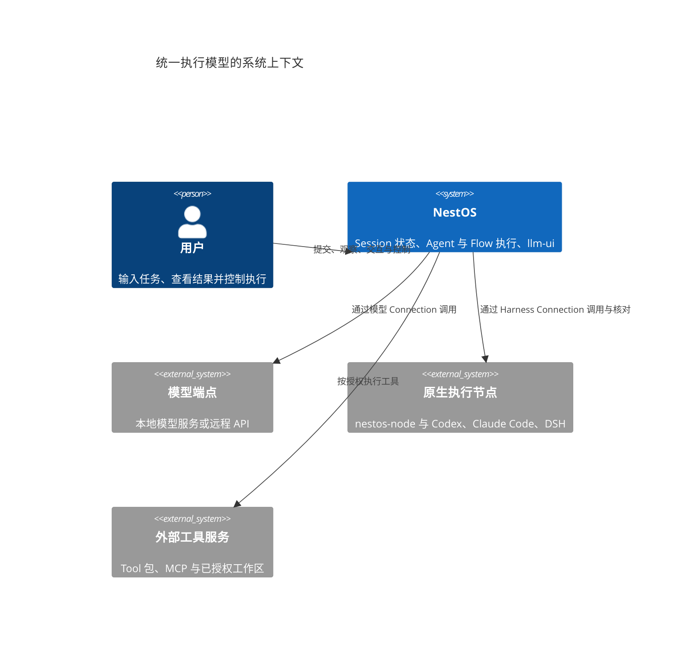
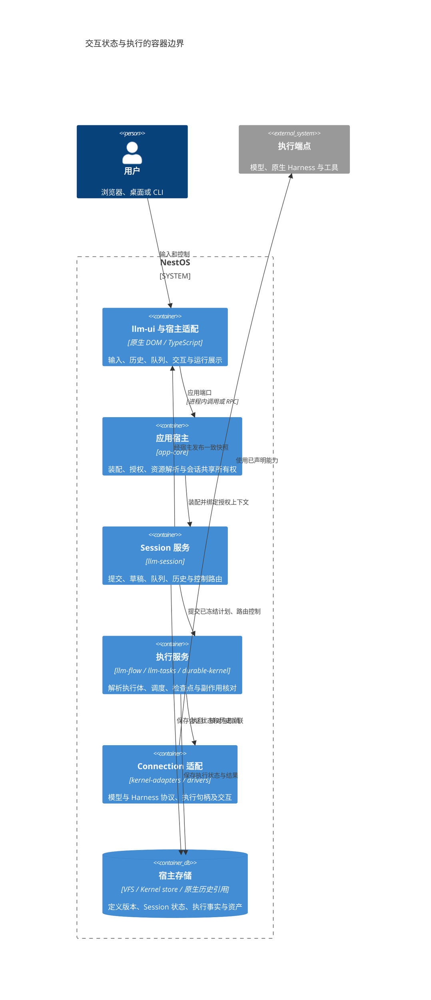
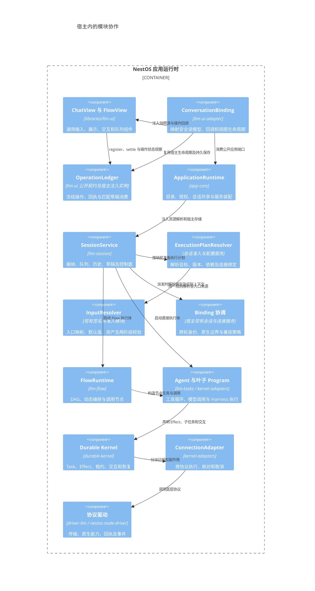
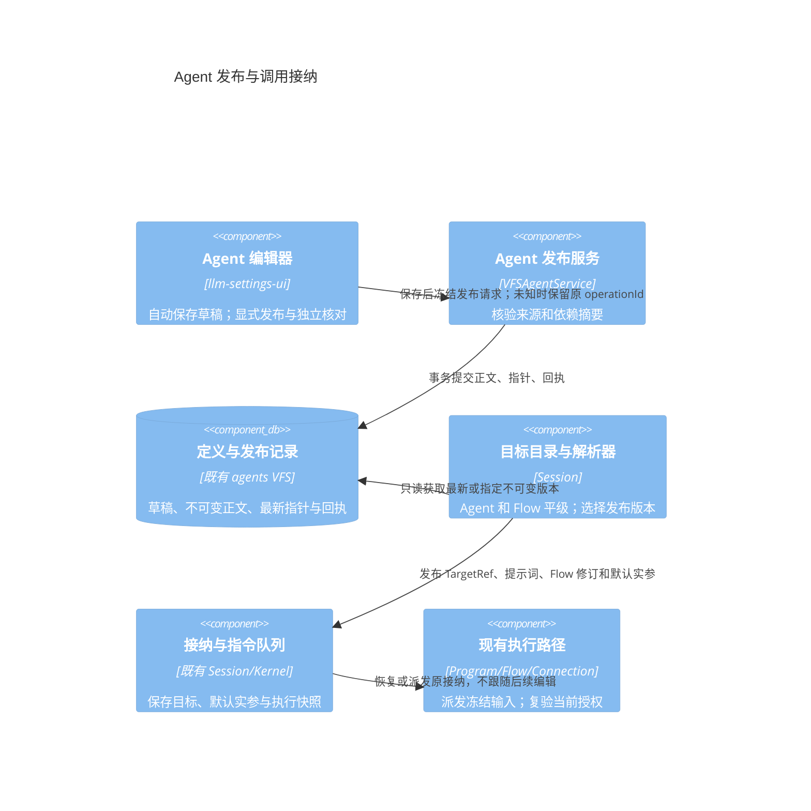
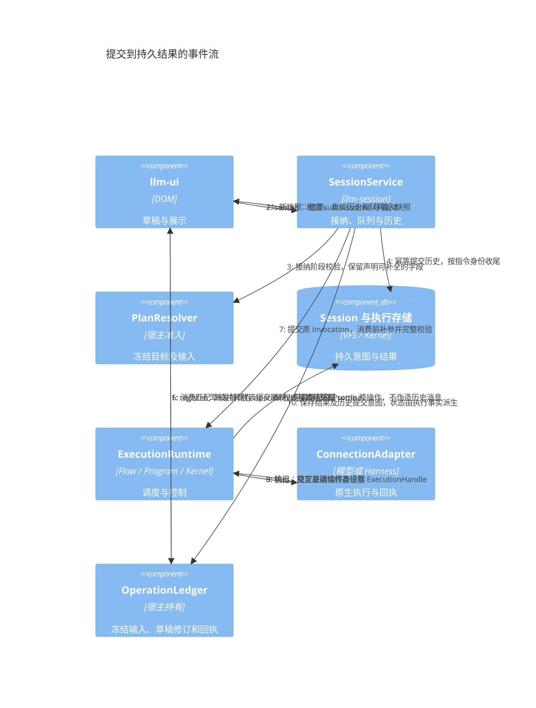
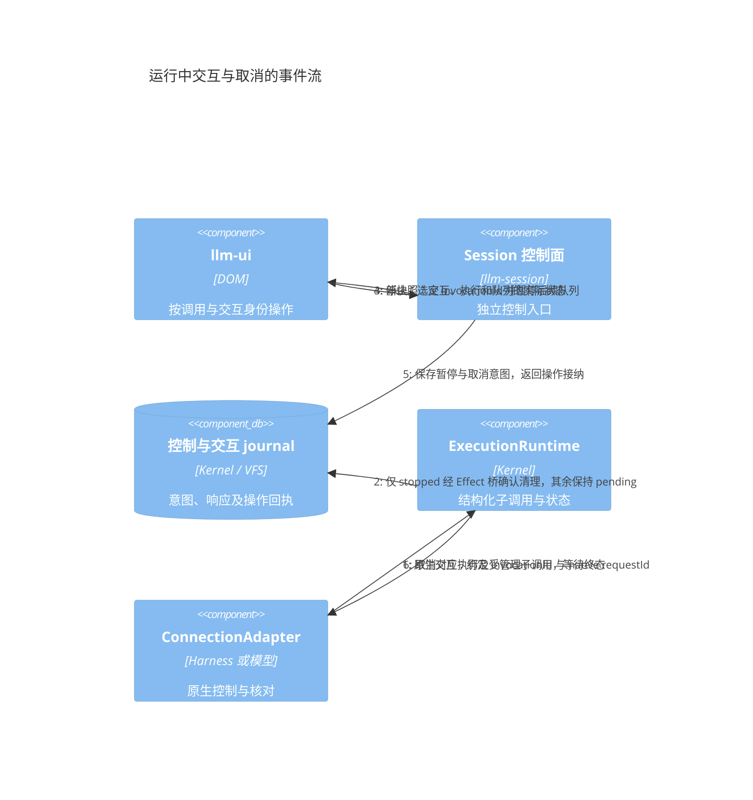
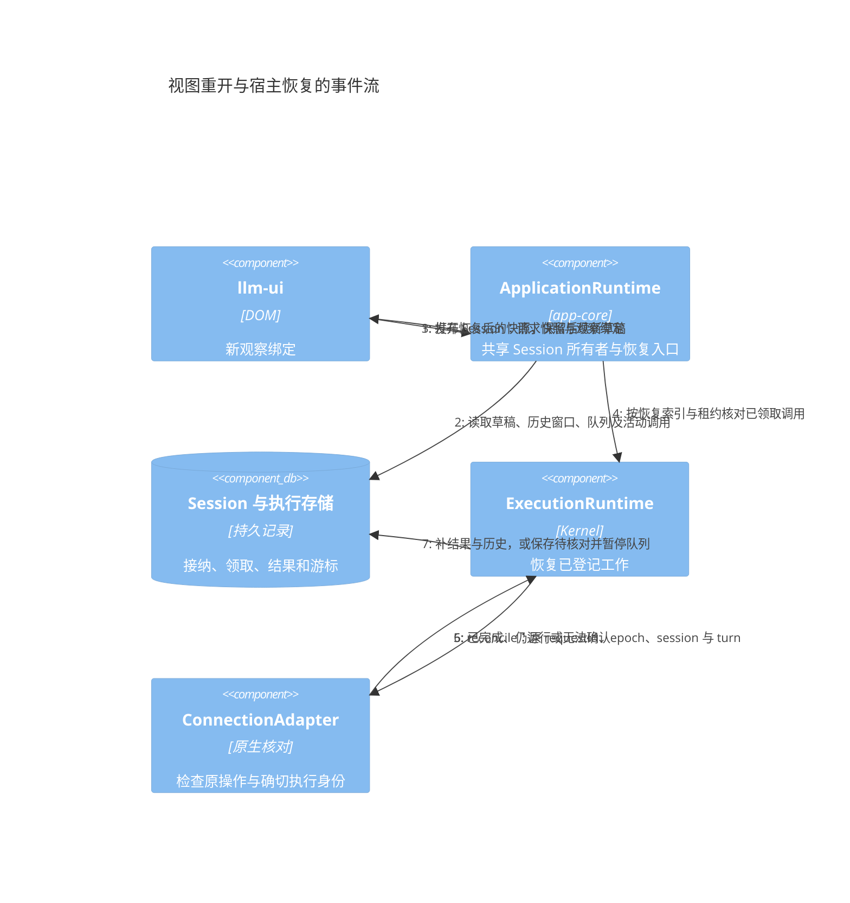
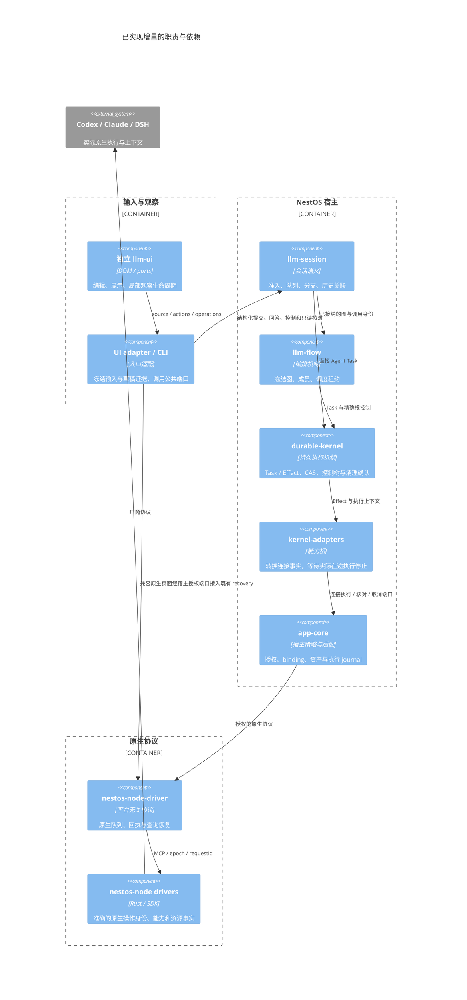
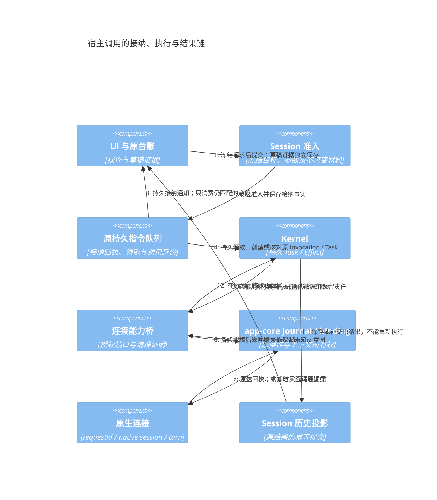

# Agent Session Connection 与 llm-ui 统一执行模型评审稿

状态：目标架构有条件通过；已实现增量的架构复核与提交范围见第 14 节。更新：2026-10-25。

评审基线：[itookit 5e9365a](https://github.com/mushuanli/NestOS/tree/5e9365ae3aac3d4d0b8e820135e072c01c8389f8)、其锁定的 [llm-ui f39c40b](https://github.com/mushuanli/llm-ui/tree/f39c40ba7d6c88d3c87832e0b2348988f174c2c6) 与 [durable-kernel 0a786b2](https://github.com/mushuanli/durable-kernel/tree/0a786b24c410abdf8b75983c6acb5dd59a247207)。当前工作树已有队列相关增量；第 12 节分别标记基线能力、已确认的兼容问题和目标契约。

实施前须落实取消与核对适配、重试身份及四份配套协议，保留交互补参和操作台账，并完成跨边界组合回归。文档修订不等同于这些运行行为已经修复或验收。::@753a5dac-460c-4cbc-ae38-b1053e4ec8e3@

四份配套协议是对应规则的详细规范，本文保留跨层架构、接口关联及迁移顺序：

| 协议 | 主要评审内容 |
| --- | --- |
| [上下文绑定](execution-context-binding.md) | binding 身份、new/continue/fork、工作区与记忆隔离、原生条件写 |
| [输入解析与资产传输](invocation-input-resolution.md) | 入口来源、JSON 实参、默认值、补参、readiness 及远端文件准备 |
| [Invocation 展示与历史投影](invocation-presentation.md) | 调用组、parts、输出选择、详情分页与 renderer 生命周期 |
| [控制与状态矩阵](invocation-control-state.md) | 五条控制通道、按钮、暂停范围、屏障及跨边界竞态 |

Agent 作为可调用的执行抽象，Flow 提供 DAG 或 Agent 编排实现，Session 保存持续状态，Connection 提供具体执行能力。llm-ui 只负责输入、展示和控制，通过宿主端口连接上述对象。本方案统一本地模型与原生 Harness 的调用边界，保留原生会话、运行回执和历史来源。

需要修正“Connection 是函数执行线程”的命名：Connection 是可复用的执行端点；一次业务调用由 Invocation 标识，本次底层执行由 ExecutionHandle 关联，持续原生上下文由独立 binding 关联。多个调用可以共用一个 Connection，而不共用执行状态。

本文中的接口、事件名和模块内职责是目标设计，不是已经发布的 API。第 12 节列出当前实现与迁移关系；现有运行链和存储继续有效。

## 1 评审目标与核心决策

| 决策 | 建议 |
| --- | --- |
| Agent 与 Flow 的关系 | Agent 是执行抽象及命名策略入口；Flow 是可独立发布、调用和展示的执行体。工具箱与 llm-ui 可平级选择两种资源 |
| Workflow 的名字 | 统一使用 Flow；DAG 与 Agent 编排使用不同 Flow body，不建立第三套 Workflow 引擎 |
| Session 的职责 | 保存历史、分支、上下文引用、草稿、队列、交互及执行关联；Session 本身不等于一个 Agent 或一个线程 |
| Connection 的职责 | 定义执行端点、适配协议和能力；本地或远程属于部署属性 |
| 一次执行的名字 | Invocation；其子调用形成执行树，与 Session 的对话历史图分开 |
| llm-ui 对接 | 保留 source/actions/operations；UI 经原台账消费匹配草稿，执行完成依据持久结果 |
| 执行与存储 | 复用 durable-kernel、llm-tasks、llm-flow、llm-session；统一逻辑契约，按事实所有权存储 |

“函数调用”统一输入、输出、身份和错误契约。运行期间仍支持流式展示、人工交互、取消与结果核对；这些能力通过事件和控制端口提供。

## 2 领域对象与身份

| 对象 | 含义与所有权 | 生命周期 |
| --- | --- | --- |
| AgentDefinition | 命名入口、输入输出契约、策略、执行实现引用 | 可编辑草稿与不可变发布版本 |
| FlowDefinition | 参数、输出与 DAG 或 Agent 编排 body，可独立调用 | 可编辑草稿与不可变发布版本 |
| ConnectionDefinition | 模型或 Harness 端点、配置修订、能力及凭据引用 | 配置保存至停用或删除 |
| Session | 对话及工作状态容器，可依次或显式并发调用不同目标 | 创建至归档或删除 |
| Submission | 用户提交及持久接纳事实 | 编辑态冻结后，直至回执确认或待核对 |
| Instruction | Session 发送队列中的一个已接纳请求 | 等待、领取、执行关联、收尾 |
| Invocation | 某个已冻结目标的一次执行，关联父调用及 Kernel Task | 准入、运行、等待、核对、终结 |
| ExecutionHandle | 某次底层执行的稳定关联，包含适配器私有绑定 | 分配、持有、停止确认、释放 |
| ContextBinding | 一条可续接的原生上下文关联；Session 保存绑定集合 | 跨 Invocation 续用、分叉、失效或新代次 |
| HistoryEntry | 用户输入、回复、调用卡片与结果引用的历史事实 | 随 Session 保留，可分支与归档 |
| Artifact | 内容及结构化产物的不可变引用 | 受 Session、执行与归档引用管理 |

一个 Session 可以关联多个 Invocation；一个 Invocation 可以调用多个子 Invocation、使用多个 Connection。一个 Connection 可以服务多个 Session。需要延续原生对话时，由独立 binding 绑定 native session，本次 ExecutionHandle 引用该 binding；独立函数调用默认隔离。

2026-10-25 补充决策：subsession 复用具有 parentSessionId 的 Session。独立任务/Flow 默认创建新的子 Session；同一 Flow 多次独立运行拥有不同子 Session/Invocation，普通节点不逐个创建会话。同一子会话的续聊或重跑仍产生新 Invocation。默认以函数调用组展示输入、状态及最终输出，提供打开真实子会话的基础入口；高级内嵌详情后续增强。归属、单次准入、控制边界及 C4 见[子会话与函数调用视图](session-invocation-ui.md)，任务与未完成状态见[合入计划第 7 节](functional-merge-plan.md#7-子会话与函数视图的交付安排)。

界面中的 Agent 资源和 Flow 资源保持平级。执行时，目标解析器把二者转换为同一种 ExecutionPlan：Agent 带入自身策略及实现引用，Flow 直接使用发布执行体。直接调用 Flow 不需要生成一个持久化的包装 Agent。

`sessionId`、`submissionId`、`instructionId`、`invocationId`、`taskId`、`executionHandleId` 和 native session/turn ID 各有含义。队列接纳不能用 native turn ID 代替，原生身份不能用 UI 消息 ID 代替。首次草稿提交复用已经分配的 Session ID。

跨轮上下文使用独立 bindingId；taskId/effectId 继续用于恢复同一次执行。Session 不是只有一个 nativeSessionId 的容器，同一调用也可关联多个角色或 worker 的 binding。长期业务工作项如需持续上下文，保存 binding 引用而不复用 Kernel Task 的语义。

### 2.1 核对 重试与重新执行的身份

| 行为 | Invocation 身份 | 其他身份与处理方式 |
| --- | --- | --- |
| 提交或控制丢回复后的核对 | 保持不变；尚未证明已创建时也不能另建 | 保留原 operationId、submissionId、instructionId 和已登记原生 requestId，读取原事实 |
| 尚未终结调用的内部重试 | 保持同一个业务 Invocation | Task/Effect 管理 attempt 或替代成员，记录 retryOfTaskId；仅按已声明且安全的重试策略执行 |
| 队列派发被明确拒绝且尚未启动 | 保留接纳的 Instruction；Invocation 尚无终态时可继续原准入 | 用户显式重试后使用新的派发 attempt；原拒绝回执和提交摘要不变 |
| 用户重新运行或重新生成已终结调用 | 新建 Invocation、Submission 和相应队列项 | 新 Invocation 保存 retryOfInvocationId；保留旧结果、旧终态及旧历史 |

attempt 不是一次新业务调用的替代身份。已终结 Invocation 不能由 failed/cancelled 退回 running，重新执行也不能覆盖原输出位置。若队列拒绝已经形成终态 Invocation，则采用最后一行的规则，不能再套用“尚未启动”的重试规则。

图内替代成员允许失败 Task 有新的 retryOfTaskId，但根 Invocation 必须仍可恢复。现有 [Flow 成员重试](../../backend/llm-flow/src/flow/run-members.ts) 与 [图级重试](../../backend/llm-flow/src/flow/graph-retry.ts) 保留这些边界；终态根任务不能通过节点重试重新打开。

## 3 系统架构

### 3.1 C4 系统上下文



### 3.2 C4 容器



容器表示职责边界，不强制新增进程或服务。在纯浏览器宿主中，运行时和存储适配可位于浏览器；HTTP 宿主在服务端持有运行与队列，浏览器只持有观察绑定。关闭页面后能否继续执行，由宿主生命周期决定。

## 4 模块职责与依赖



| 模块 | 应拥有的职责 | 公共边界 |
| --- | --- | --- |
| llm-ui | 编辑态、通用 schema 表单、历史与运行读模型、操作反馈 | 自包含 UI DTO、snapshot/subscribe、具名回调 |
| llm-ui-adapter | NestOS 与原生会话的展示映射、能力映射和导航接线 | 消费 app-contracts；向独立库注入端口 |
| app-core | 目标目录、定义解析、连接与 binding 协调、授权及共享宿主实例 | 应用用例与组合根 |
| llm-session | Submission、Instruction、入口解析协作、上下文、历史及控制关联 | Session 命令及读模型 |
| llm-flow | DAG 与 Agent 编排的统一执行体、调用、分支、循环和汇合 | 已解析定义及通用运行端口 |
| llm-tasks | 可恢复 Agent 循环、基础执行契约与任务 Program | Program、输入输出及通用执行引用 |
| durable-kernel | Task/Effect 状态、租约 fencing、交互、取消与恢复机制 | 已有 Kernel 接口 |
| kernel-adapters | Connection 能力分派、模型与 Harness Effect | 适配器接口与授权资源句柄 |
| driver-llm / nestos-node-driver | 各自的传输、协议和原生语义 | 能力目录、执行、回执、事件及核对 |

以上职责优先在现有模块内收敛，不为每个概念新建 package。Flow 不依赖 Session 服务，独立 UI 不依赖 app-core、VFS 或执行包。流程字段、业务提示词和业务产物处理继续由外部 Flow、Tool 和产品配置提供。

## 5 定义与执行计划

本节接口为评审用的结构草案。`JsonValue`、`JsonSchema`、`AssetRef`、`ContentBlock` 等基础类型沿用相应模块的公开契约；独立 UI 使用结构兼容的自有 DTO，不反向导入业务契约。

### 5.1 Agent 与 Flow

```ts
type Version = string;
type TargetSelection = { kind: 'agent' | 'flow'; id: string; version?: Version };
type TargetRef = { kind: 'agent' | 'flow'; id: string; version: Version; digest: string };

interface CallableContract {
    inputSchema: JsonSchema;
    outputSchema: JsonSchema;
}

interface DefinitionMeta {
    id: string;
    name: string;
    exposure: 'global' | 'local';
    contract: CallableContract;
}

interface AgentDefinition extends DefinitionMeta {
    policy: AgentPolicy;
    implementation:
        | { kind: 'flow'; target: TargetSelection & { kind: 'flow' } }
        | { kind: 'program'; program: ProgramRef; connections: ConnectionBindings };
}

interface FlowDefinition extends DefinitionMeta {
    parameters: FlowParameter[];
    outputs: FlowOutputDefinition[];
    body:
        | { kind: 'dag'; graph: DagDefinition }
        | { kind: 'orchestration'; orchestration: AgentOrchestrationDefinition };
}
```

`AgentPolicy` 保存 system prompt 引用、工具能力、记忆和上下文默认值。Flow 的 orchestration body 声明主持者、候选调用目标、选择方式、轮数、预算与汇合；编译为现有动态 Flow 和 Agent Program，不另建调度内核。普通单 Agent 可以直接使用 Program，避免每次单轮对话都构造无意义的 DAG。

Flow 的 contract 从 parameters 和 outputs 派生，只有一份可编辑签名来源。Agent 默认继承实现的签名；提供默认实参后可收窄公开必填项，发布时校验兼容性。需要转换输入输出时通过显式 Flow 节点表达，不能另藏一套参数推断规则。

Flow 内部保留两种清楚的动作：`invoke` 调用 Agent 或其他 Flow；`execute` 使用连接槽调用模型或原生执行能力。业务工具仍走既有 Tool 调用，Connection 不取代所有 Tool。用户所称 Agent 的 workflow 对应 `implementation.kind = flow`，另一 workflow 仍是另一个 Flow。

发布依赖使用定义 ID、不可变版本与 digest。目标选择可跟随最新发布，但接纳后的 TargetRef 和完整依赖快照不可变。`Version` 是接口中的不透明版本标识；迁移时保留既有 Flow revision 与 Agent version，不改写历史版本或依赖锁。

静态依赖环在发布时检查；动态调用受可信父调用链、深度、轮数和共享预算约束。显式迭代通过编排节点表达，不通过无限自调用实现。

#### 5.1.1 Agent 独立发布的当前实施

Agent `.agent` 文件继续作为可编辑来源；`getAgentConfig/getAgents` 供配置和资源管理读取草稿。新增 `getAgentPublicationStatus`、`publishAgent`、`getAgentRevision` 和 `getAgentPublicationReceipt`，版本记录与发布回执保存在 agents VFS 模块既有 SeqFile 能力下的 `/.agent-publications.seq`。它属于定义持久化，不复制 Invocation、Task 或 Kernel 状态，不新增 package 或调度器。

发布请求冻结 agentId、operationId、expectedSourceDigest、expectedRevisionDigest 和 expectedPublishedVersion。来源摘要校验实际 Agent 文件，修订摘要覆盖定义、共享提示词快照及所选 Flow 修订；准备后依赖改变时拒绝旧摘要。最新指针、不可变正文和操作回执在同一事务提交。事务丢回复先查原回执；同 operationId 换输入拒绝；旧操作重入只返回原版本，不把最新指针回退。新版本使用 `ap1_<SHA-256>` 不透明身份，保留原 definition.version 来源标签和旧执行记录。



首次独立发布前保留旧 Agent 的兼容解析；首次发布后，普通聊天、typed Session 根调用、CLI 所用目标目录及聊天配置投影使用发布定义。显式版本调用可选择仍存在资源的旧发布版本，不能用 legacy 标签绕过发布去执行新草稿。草稿作用域变化不替换旧发布作用域；删除资源拒绝新调用，已接纳快照及定义版本继续可读。授权撤销仍按运行时权限处理，发布不授予工具、连接或工作区权限。

共享提示词从持久文件读取并保存完整已选系统段；执行旧发布版本不读取后续提示词正文。Flow 实现锁定其 id/revision/digest，保留 Agent 默认实参并校验部分默认值的合法性，不要求发布时已经提供将来调用者负责的必填输入。非业务时间戳变化不产生新版本。队列继续复用原快照和接纳回执，Runtime 重建后仍可分别派发先后接纳的不同 Agent 发布版本。

普通重新生成及参数表单重跑保留来源 Agent 的精确发布身份与 Flow 修订，创建新的 Invocation，不跟随后续发布，也不改写原终态。兼容发送入口不能覆盖已发布 Agent 的 Flow 实现；需要另一实现时显式选择另一个目标。发布校验限制平台契约字段，Flow 的业务参数名由其 schema 解释，不按 headers、password 等字段名猜测业务含义或拒绝合法实参。删除已发布 default 来源后，目录和解析器不得重新合成同名旧默认 Agent。

设置页提供发布与核对操作；写响应悬挂但精确回执已到时释放该操作的按钮限制，迟到响应不能结算新操作。只读预检失败不创建未知写锁；确实可能已发送的发布保留冻结请求，用户显式重试沿用同一身份。客户端确认回执的目标、来源及修订摘要后才解除未决状态。日志记录操作、阶段、结果、安全原因和耗时，不记录提示词、参数、文件或密钥。

未决发布期间收到来源刷新时，编辑器保留当前已查看内容及原请求，仍允许核对原操作；确认后必须重新打开来源再发起新发布，不能把未查看的新来源直接发布。此保护不替代跨页面的持久操作恢复；发布请求在浏览器强制重载后的恢复仍需单独接入既有操作存储。

证据见[发布事务与故障](../../backend/llm-session/__tests__/agent-revisions.test.ts)、[真实 Runtime 与队列恢复](../../backend/app-core/tests/agent-publication.test.ts)、[设置页状态竞态](../../ui/llm-settings-ui/tests/agent-publication.test.ts)和[认证 RPC](../../apps/http-app/tests/view-api.test.ts)。重建回归重建 Kernel、VFS 视图和服务并保留存储，不等同于线上 daemon 重启或原浏览器故障验收。

尚未完成：共同 CallableContract 和 implementation/body 迁移、Flow 内 Agent/Skill/MCP 等依赖的完整发布版本闭包、发布版本的归档/导入映射及完整旧资源迁移；动态 worker 与授权仍按原运行准入处理。不能据此声称所有子调用依赖已经在发布时冻结。

### 5.2 可见性与调用权限

| 调用入口 | global | local |
| --- | --- | --- |
| llm-ui、CLI 或外部根调用 | 可以，仍需授权 | 拒绝 |
| 已授权 Flow 的内部调用 | 可以 | 可以，须在发布依赖或受限调用目录内 |
| 用户在参数中随意提供一个目标 ID | 按目录及授权复验 | 不产生内部调用资格 |

保留“local 仅被其他 Flow 调用”的语义。根 Agent 绑定 local Flow 也不能间接开放入口；准入需沿实现引用复验。若希望 Agent 可以把 local Flow 作为私有实现，需要另行评审这条可见性规则，不能只调整 UI 过滤。

词法作用域的内联 `functions` 与 exposure 分开：它们随所属定义发布、锁定和解析，不独立加入全局目录。运行中的 Invocation 使用已保存快照；隐藏、停用或删除资源会影响新准入，授权撤销仍会影响后续副作用执行。

实施进展（2026-10-25）：现有 AgentDefinition、ExecutorConfig、FlowDraft/FlowRevision 已承载可选 `exposure`，缺省按 global 兼容，未知值拒绝。Flow 发布、递归内联定义、归档投影和摘要保留显式值；旧定义不补写 global，避免改变既有发布摘要。此字段是所选定义修订的调用范围，发布新修订不等于撤销旧修订的授权；资源隐藏、停用和授权撤销仍属于独立策略。

| 当前入口 | 已落地的准入行为 |
| --- | --- |
| 普通 Session Agent 解析 | 根选择拒绝 local，不转为缺失 Agent fallback；宿主 fallback 同样复验；Flow 内部精确解析允许 local Agent |
| 独立 Flow Invocation、Flow Agent | 在参数、材料绑定和图准备之前拒绝 local 根定义；Agent 不能把 local Flow 包成根入口 |
| 公共 RunStart | 已存在的发布身份由存储解析，不能用调用方快照删除或修改 exposure；不存在的修订不能冒充另一个已发布资源 |
| Flow 内部引用与源码检查 | 编译器允许合法 local 依赖；源码检查、发布和设计器仍能读取、校验及管理 local 定义 |
| 已接纳调用核对 | 复用已保存身份、定义及计划；普通 Agent 新队列项也保存带摘要的宿主身份，派发/重启不重新读取提示词或 exposure；旧无快照队列保留兼容路径 |
| 对话选择器、设置页和启动器 | 根选择器过滤 local/无效定义；被隐藏的 default 不会由合成选项重新引入；设置页可编辑范围，local Agent 禁止直接开始对话 |

低层 `flowToDag` 仍是编译能力，并不提供外部调用资格；可信宿主的 `prepareRun/submitPrepared` 与公共命令端口分开。Agent 独立发布的实施与限制见 5.1.1；全部入口的 TargetRef、统一 implementation/body、编排体迁移及统一授权仍未完成，本节落地范围不代表整个平级模型已实现。

### 5.3 提示词与初始化

Agent 的 system prompt 表达角色与策略，Flow 的 system prompt 表达模型节点的默认约束，节点继续显式使用 `inherit/replace/none`。编译结果记录每段提示词的来源和最终顺序。确定性计算节点无需 system prompt。

每次调用的任务内容使用参数及节点 instruction/messages 模板。会话首次初始化使用显式、可恢复的初始化步骤，按 Session 和初始化定义版本记录完成事实；页面 ready、选择目标和重连均不触发初始化。更换目标需要新初始化时，由准入规则明确决定并保存。

初始化必须声明作用域，去重键由作用域身份、初始化定义版本及步骤键组成。Session 级使用 sessionId；原生会话级使用 bindingId 和 bindingGeneration；工作区级使用持久工作区身份及环境版本。重新创建原生会话、替换工作区或更换环境后，不能复用旧作用域的完成标记。仅换页面不会改变初始化作用域；提示词或 Agent 的变化先按第 8.1 节验证能否复用 binding，再决定初始化资格。

Harness 的输入能力由连接声明。无法设置原生 system prompt 时，适配器只能提供其支持的上下文或任务输入，并明确报告差异；传入文本不代表扩大远端工具权限。

### 5.4 Connection 与执行句柄

```ts
interface ConnectionDefinition {
    id: string;
    revision: number;
    name: string;
    kind: 'llm' | 'harness';
    adapterId: string;
    configRef: string;
    capabilities: ConnectionCapabilities;
}

interface ExecutionHandle {
    id: string;
    connectionId: string;
    connectionRevision: number;
    ownerInvocationId: string;
    bindingRef: string;
}
```

`configRef` 和 `bindingRef` 只在宿主解析；UI 得到安全目录和能力，不得到密钥或原生控制凭据。Harness 配置引用既有 node、project、profile 及授权修订。模型连接继续保留自己的 Provider、模型档位和模态配置，统一的连接目录不抹平这些约束。

LLM 连接提供模型调用，工具循环由本地 Program 持有；Harness 提供原生 Agent 执行，循环及原生工具由原生端持有。需要调用本地 Agent 或 Flow 的远程主持者，必须声明并实现受限调用桥；未实现时返回能力不支持，不能假定已可调度。

连接能力包含适配器输入输出契约，至少区分输入模态、结构化输出、流式输出、状态查询、交互、取消、原生续接及可确认的暂停。运行时还按授权、观察新鲜度和当前状态计算可用动作。连接存在不代表当前执行可控。

默认独立调用取得独立 ExecutionHandle。同一原生 session 的续接是显式模式，按底层 thread 身份串行，不能只按 connectionId 全局串行。endpoint 容量、项目写锁和 Session 写租约是不同约束。视图退出只释放观察；执行占用须等待停止及清理确认，或明确转交给具有 fencing 的持久恢复所有者。

可续用的原生 session 关联保存在 Session 的 execution binding 中；每个 Invocation 仍取得自己的逻辑 ExecutionHandle 和操作身份。多个句柄可以先后引用同一 binding，持久所有权和本次执行占用分别管理。原生身份尚未确认时保存待核对 journal 引用，不能填入猜测的 session 或 turn ID。

ConnectionAdapter 复用现有 Effect 的执行、核对和取消模式：

```ts
interface ConnectionCleanupEvidence {
    sessionId: string;
    taskId: string;
    effectId: string;
    ref: string;
    kind: 'not-started' | 'terminal';
}
type CancelResult =
    | { status: 'stopped'; cleanup: 'confirmed' | 'pending'; evidence: ConnectionCleanupEvidence }
    | { status: 'pending'; phase: 'execution' | 'cleanup'; code?: string }
    | { status: 'unknown'; code?: string };

type ConnectionReconcileResult =
    | { status: 'completed'; result: ConnectionResult }
    | { status: 'running'; handleRef: string }
    | { status: 'not-started'; evidence: ConnectionCleanupEvidence & { kind: 'not-started' } }
    | { status: 'unknown'; code?: string };

interface ConnectionAdapter {
    execute(call: ConnectionCall, context: EffectExecutionContext): Promise<ConnectionResult>;
    reconcile(call: ConnectionCall, context: EffectExecutionContext): Promise<ConnectionReconcileResult>;
    cancel(call: ConnectionCall, context: EffectExecutionContext): Promise<CancelResult>;
}
```

ConnectionCall 包含稳定 operationId、ExecutionHandle、冻结输入和授权资源引用。execute 可等待终态，进度和交互通过执行上下文发布；cancel 和 reconcile 使用独立控制通道，可在 execute 未返回时工作。成功结果携带已核对输出及底层身份引用，取消结果区分已停止、仍清理和无法确认。能力不支持在副作用开始前明确拒绝，不能返回伪成功。

### 5.5 与现有 Kernel 的取消和核对适配

现有 EffectAdapter.cancel 返回 Promise<void>；Kernel 等待该调用正常返回后保存清理确认。新的 CancelResult 只能在 Connection 层使用，由 Effect 桥显式映射，不能只 await 后丢弃返回值。现有 [Kernel 清理路径](../../libraries/durable-kernel/src/application/kernel.ts)、[清理等待器](../../libraries/durable-kernel/src/runtime/effect-cleanup.ts) 与 [Harness Effect](../../backend/kernel-adapters/src/effects/harness-execution-effect.ts) 是迁移边界。

| Connection 结果 | EffectAdapter.cancel 的行为 | 释放与队列 |
| --- | --- | --- |
| stopped 且原执行、受管理子调用和所需资源均满足停止及清理条件 | 完成 in-flight 停止确认后正常返回 void，由 Kernel 持久确认清理 | 依据持久确认释放冲突占用 |
| stopped 且 cleanup=pending，或 pending | 抛出 CONNECTION_CLEANUP_PENDING / CONNECTION_STOP_PENDING，保留 journal 和 cleanupPending | 不确认释放、不放行冲突调用 |
| unknown、超时或断线 | 抛出待核对错误，保留原身份；后续继续核对 | 不把取消接纳或网络断开当作停止 |

stopped 的 evidence 必须匹配当前 sessionId/taskId/effectId，包含有效的证明引用及 not-started/terminal 分类，并且 cleanup=confirmed；其他执行的证明不能用于确认本次清理。原生 Provider 核对其受持久身份约束的 journal，完成绑定收尾后才返回该证明；缺少 journal 仅在先持久登记、后执行的既有不变量下作为未启动证据。桥保留 provider.cancel 后等待 inFlight.confirmStopped 的保障。取消路径可能已经收到 aborted signal、没有执行 grants 或普通 sessionState；使用既有受限清理状态解析器读取本 Effect journal，不新增执行授权，也不依赖正常执行事件通道完成清理。

核对映射同样由 Effect 桥负责。completed 返回已有核对结果；running 继续附着并观察原 handle，在当前恢复预算内无法取得终态时保留 indeterminate；unknown 直接保持 indeterminate。只有 not-started 具有可信的未启动证据且符合重试策略时，才可映射为 Kernel 的 retry，仍复用持久操作身份。epoch 改变、回执缺失或“仍在运行”均不构成 retry 依据。原执行明确失败或取消则按已知终态处理，不包装成成功结果。

此迁移不增加 Kernel 状态、清理调度器或新的自动重放策略。清理超时后沿现有 cleanupPending、恢复及显式核对机制继续，不通过返回 void 绕过确认。生产取消的 journal 清理端口继续只访问原记录；binding 收尾由宿主另行提供固定身份的方法，重读持久证据后才准备和释放，不向取消后的 Effect 开放共享集合。接线、故障回归及真实队列验收见[控制协议 §8.4.1](invocation-control-state.md#841-原执行-binding-的生产清理端口)。

### 5.6 ExecutionPlan 的最小结构

```ts
interface ExecutionPlan {
    id: string;
    schemaVersion: 1;
    target: TargetRef;
    implementationRef: string;
    dependencySnapshots: Array<{ target: TargetRef; snapshotRef: string }>;
    connectionBindings: Array<{ slot: string; snapshotRef: string; revision: number }>;
    policySnapshotRef: string;
    policySources: Array<{ kind: string; id: string; version: string; digest: string }>;
    inputSnapshotRef: string;
    sourceSnapshotRef: string;
    inputResolutionRef: string;
    validation: { admissionSchemaRef: string; consumptionSchemaRef: string; deferredFields: string[] };
    contextPolicy: ContextPolicy;
    programRef: ProgramRef;
}

interface InvocationExecutionRef {
    planId: string;
    kernelSessionId: string;
    rootTaskId: string;
}
```

接纳时冻结 target、实现及依赖正文引用、连接修订、策略来源、输入和补参约束；内容引用必须不可变且可由宿主校验。Flow 图或 Program 由 implementationRef/programRef 解析，不由各模块重新解释目标类型。授权和连接当前可用性在实际执行前仍复验。

sourceSnapshotRef 保存原入口来源，inputSnapshotRef 保存规范化实参，inputResolutionRef 保存签名、默认值和字段来源。三者有不同含义，输入解析规则以配套协议为准。策略快照也包含工作区、记忆与无人值守交互策略，不能把原生新 thread 等同于完整环境隔离。

派发时才保存实际 contextRef、补参后的有效输入引用及根 Task 关联。它们记录在 Invocation/执行 journal 中，不修改接纳计划和原提交摘要。contextRef 的含义由 ContextPolicy 决定；原生续接记录已知边界，不冒称完整原生上下文。rootTaskId 分配与保存走现有持久创建意图，调用丢回复后先核对，不创建第二个根 Task。

## 6 输入输出与运行状态

### 6.1 从编辑态到调用输入

```ts
interface ComposerDraft {
    revision: number;
    textRevision: number;
    target?: TargetSelection;
    text: string;
    attachments: Array<{ id: string; file: AssetRef; revision: number }>;
    values: Record<string, JsonValue>;
    valuesRevision: number;
}

interface SubmissionRequest {
    submissionId: string;
    sessionId: string;
    branchId: string;
    target: TargetSelection;
    source: CallSource;
    expectedSignature?: SignatureRef;
    contextPolicy: ContextPolicy;
}

type SubmissionReceipt =
    | { status: 'accepted'; submissionId: string; instructionId: string; revision: number }
    | { status: 'rejected'; submissionId: string; code: string; message: string }
    | { status: 'unknown'; submissionId: string; code: string; message: string };

interface InvocationOutput {
    value: JsonValue;
    artifacts: AssetRef[];
}
```

ComposerDraft 属于编辑态，可以还不满足必填项。SubmissionRequest 冻结本次入口来源；宿主使用同一个 InputResolver 应用绑定和默认值，执行接纳校验，保存规范化实参、计划与 Instruction 后才返回 accepted。交互界面必须提供编辑签名，机器 arguments 可以按入口策略显式跟随最新并由宿主冻结一次。声明可交互补全的字段按下面的两阶段规则处理。unknown 只表示提交事实待核对，不能据此断言没有执行。

draft 的 revision、textRevision 和附件 revision 延续独立 UI 的编辑语义，参数另有 valuesRevision；它们不同于宿主持久草稿的 CAS 修订令牌。旧附件缺少 revision 时按既有规则视为 0，不因迁移修改资产身份。

入口编辑、宿主解析与执行实参是三个阶段，规范见[输入解析协议](invocation-input-resolution.md)。绑定显式描述 `composer.text → arguments.<字段>`、`composer.attachments → arguments.<字段>` 与参数表单路径。Flow 只消费最后的结构化实参，不接收浏览器 File 或控件对象。安全元数据足以渲染表单，不把完整 system prompt 传给 UI。

文本、图像与其他内容复用标准 ContentBlock。资产正文先交给宿主资产服务，调用实参保存稳定 AssetRef；派发时还须完成目标端准备。临时 URL 或本地路径不代表远端可访问，文件传输、结果导入和显式转换步骤遵守配套资产协议。

结构化结果保存在 InvocationOutput，显示消息是它及执行事件的投影。其他 Flow 通过输出端口读取 value/artifacts，独立于是否显示聊天气泡。没有文本展示的函数仍可正常返回 JSON；渲染失败不改变执行结果。

同一份参数签名派生两阶段校验规则，不能把全部 required 字段直接转换为提交阶段的 JSON Schema required：

| 阶段 | 校验要求 | 持久事实 |
| --- | --- | --- |
| 接纳时 | 校验请求外形、非延后字段及资产和权限；允许 onMissing=interact 的字段缺失；已声明可交互纠正的初值按当前规则保留给输入节点 | 保存原 Submission、冻结参数签名、待补字段及初值 |
| 节点消费前 | builtin.input 或显式绑定步骤完成后，消费字段必须满足完整类型、必填及取值约束；未满足时继续等待或按定义失败 | 保存 interactionId、响应修订、补全来源及有效输入快照 |

现有 [Flow 参数准入校验](../../backend/llm-flow/src/flow/parameters.ts) 对 interact 字段还延后了部分类型和取值约束。迁移默认保留该行为；若要在接纳时提前拒绝这类初值，需要另行更改并版本化签名语义。消费步骤不得把未解析的参数模板或无效补参直接发给模型、Tool 或子 Flow。

补参追加到 Invocation 的有效输入记录，保留原值和响应来源，不覆盖原 Submission 去重摘要、计划签名或已接纳输入快照。再次投递同一 Submission 仍核对原摘要，而不是与补参后的值比较。

补参新增的资产、模态需求或调用目标仍须在消费前复验授权和连接能力，并受原预算及参数签名约束；交互补全不是绕过准入限制的通道。

### 6.2 Invocation 状态

```ts
type InvocationStatus =
    | 'ready' | 'running' | 'waiting-input' | 'paused'
    | 'cancelling' | 'reconciling'
    | 'completed' | 'failed' | 'cancelled';

interface InvocationRecord {
    id: string;
    sessionId: string;
    parentInvocationId?: string;
    retryOfInvocationId?: string;
    instructionId?: string;
    target: TargetRef;
    planRef: string;
    inputRef: string;
    effectiveInputRef?: string;
    contextRef?: string;
    executionRef?: InvocationExecutionRef;
    readonly status: InvocationStatus;
    readonly cleanup: 'pending' | 'settled';
    outputValidation: 'pending' | 'passed' | 'failed';
    historyCommit: 'not-requested' | 'pending' | 'committed';
    outputRef?: string;
    error?: { code: string; stage: string; message: string };
}
```

status、传输连接状态、提交回执及 cleanup 分开表达。断网时运行可以仍然 active；取消请求接纳后显示 cancelling，确认原执行终止后才能标 cancelled。终态结果已知但资源尚未清理时，保留 cleanup=pending，阻止有冲突的下一次调用。

InvocationRecord 是事实关联及读模型，不是另一套可任意迁移的 Task 状态机。executionRef 在根任务创建确认后保存；此前由原持久创建意图核对。status 和 cleanup 从下表的事实派生，可以缓存重建，不能由 UI 回写或凭一条迟到事件独立覆盖。

| 内容 | 权威来源与维护者 | 调用层处理 |
| --- | --- | --- |
| 根执行及成员 Task、Effect 状态 | Kernel；Flow 维护既有成员和替代关系 | 从 executionRef 读取，不复制为第二份可写状态 |
| 等待交互 | Kernel Interaction 或适配器持久交互 journal | 投影 waiting-input 和允许回应的 revision |
| 暂停及取消意图 | 控制 journal；实际确认来自检查点、Kernel 和适配器 | 有意图不等于已暂停或已停止 |
| outputValidation 与 outputRef | 既有输出校验 Program 或执行结果提交者 | 输出失败可以使调用结果失败，保留根 Task 的原状态和校验原因 |
| historyCommit | Session 历史协调器的持久提交意图 | pending 时只补历史，不重做成功执行、不回退终态 |
| cleanup | Kernel Effect.cleanupPending 及受管理资源的确认事实 | 未确认的外部取消仍显示 cancelling/reconciling，不因根 Task 已 cancelled 就释放占用 |

调用层新增的事实限定为定义与输入关联、校验结果、历史提交及控制意图。完成的 Invocation 保持终态；内部成员替代不重开终态根，用户重新运行使用新 Invocation 及 retryOfInvocationId。

completed 需要输入输出契约通过验证、对应执行的终态证据和结果持久化。原生 RPC 返回、Session idle、UI 关闭、AbortSignal 触发及未加载历史均不能单独证明成功或停止。结构化输出不符合 schema 时报告 output-validation 错误；只有定义明确允许的修复策略才追加模型调用，并计入预算。

子调用使用独立 Invocation 和共享约束，按 parentInvocationId 形成执行树。取消默认覆盖其结构化子调用；detached 仅在显式授权的生命周期策略下开放，结果和资源另有持久所有者。

## 7 llm-ui 的输入 展示与控制

### 7.1 公开对接方式

业务端使用 ConversationPort；独立 llm-ui 保留现有 source + actions + operations 三部分，由适配层映射 ConversationSource、ConversationActions 与 OperationLedger。台账负责操作注册、冻结输入、回执和匹配草稿的消费；不另建一套并行的草稿清理机制。目标接口草案如下，具体分页、资产与草稿 DTO 从各自公开契约提供。

```ts
interface ConversationPort {
    getSnapshot(): ConversationView;
    subscribe(listener: () => void): () => void;
    refresh(): Promise<void>;
    readHistory(query: HistoryQuery): Promise<HistoryPage>;
    readInvocation(query: InvocationDetailsQuery): Promise<InvocationDetailsPage>;

    submit(request: SubmissionRequest): Promise<SubmissionReceipt>;
    reconcile(submissionId: string): Promise<SubmissionReceipt>;
    editQueue(edit: QueueEdit): Promise<OperationReceipt>;
    control(command: InvocationControl): Promise<OperationReceipt>;
    respond(response: InteractionResponse): Promise<OperationReceipt>;
    steer?(request: SteeringRequest): Promise<OperationReceipt>;
    queueControl(command: QueueControlRequest): Promise<OperationReceipt>;
    query(request: ReadQuery): Promise<QueryResult>;

    saveDraft(draft: ComposerDraft, expectedStoredRevision: string,
        operationId: string): Promise<DraftReceipt>;
    close(): Promise<void>;
}
```

调用回执回答“这次操作是否接纳”；快照回答“当前事实是什么”。UI 不同时维护 appendDelta、setMessages 与业务事件 reducer 等多份权威状态。后端流式事件先由宿主投影，UI 通知后读取新快照，可以批量更新而无需逐 token 跨 RPC。

ConversationView 至少提供：Session/分支身份、单调 revision、历史窗口、调用摘要、队列、待答交互、目标候选、命令目录、能力及可操作错误。分页历史通过稳定 cursor 合并，保持消息 ID 和滚动锚点；刷新不会重建用户正在编辑的输入节点。

### 7.2 输入与清理

| 操作 | llm-ui | 宿主 |
| --- | --- | --- |
| 选择 Agent 或 Flow | 更新本地目标选择及表单，保留可兼容草稿 | 返回当前目标签名和安全元数据，不执行任务 |
| 输入和上传 | 编辑文字、参数和资产引用 | 读取或保存资产，返回具体格式与大小错误 |
| 提交 | 捕获 submissionId、草稿 revision 和目标，显示提交中 | 校验、冻结计划、持久接纳与调度 |
| 接纳确认 | 只清理该次提交匹配的文字和资产 | 返回回执，并发布队列版本 |
| 失败或待核对 | 保留原输入、原身份及新输入，显示错误或核对入口 | 返回具体拒绝原因或核对原操作 |
| 切换目标或页面 | 后续输入使用新选择，关闭观察绑定 | 已接纳调用继续使用旧目标与版本 |

快照通知可能早于发送响应，清理草稿的两条路径必须按同一个稳定 submissionId 幂等处理。接纳后新增的文字和附件属于后续草稿，不能随旧响应被清除。

#### 7.2.1 OperationLedger 与提交状态

| 身份 | 映射及保存位置 |
| --- | --- |
| operationId | UI 在 dispatch 前注册到现有 OperationLedger，保存本次冻结输入和 draft；宿主持久装配继续保存提交关联 |
| submissionId | 发送操作推荐直接使用 operationId；已有不同身份时，在派发前持久保存一一映射 |
| instructionId | 后端接纳时返回并进入台账的 submissionRef 或明确映射；UI 不据此创建已执行的历史消息 |
| observedUserMessageId | 真实历史中的用户项已经提交后再补入原台账；队列接纳时允许为空 |

队列的权威接纳证据通过适配层 settle 同一 OperationLedger 为 accepted。当前 confirmed 历史消息仍可补充接纳和消息身份，但不再是队列场景确认接纳的唯一来源。接纳证据必须匹配原 operation/submission，不能用“当前队列非空”或无关条目推断。

OperationLedger 保存 UI 操作恢复状态，不取代后端队列、Kernel 或历史的权威事实。宿主继续注入其持久保存与生命周期；两端回执暂时不一致时按稳定身份核对后端，不能自行创建第二个提交或伪造执行状态。

保留现有 Composer.accept 的细粒度判断：文字按 textRevision 和内容比较，附件按草稿条目 ID、file ID 和附件 revision 比较。新增参数输入也保存字段或参数集修订。仅用一个整体 draft revision 会错误保留或清除部分输入，不能替代这些判断。

| 台账事实 | 提交限制 | 迟到响应 |
| --- | --- | --- |
| 注册中或 submitting，尚无接纳证据 | 限制该操作重复提交；不能阻塞其执行的独立取消与回应 | 必须关联原 operationId |
| accepted，原发送 Promise 尚未返回 | 立即解除该操作对后续新草稿的提交限制；允许继续入队 | 只 settle 原操作；不能重新锁定输入，也不能清除新操作的限制 |
| unknown，尚无接纳证据 | 保留原操作限制；宿主允许时可接纳明确的新草稿，但不能越过未知屏障派发 | 保持同一身份核对，不能用重复文本自动配对 |
| rejected | 保留未消费输入，明确重试或修改入口 | 后续矛盾回执作为诊断，不覆盖已持久终态 |

传输 Promise 是否结束不再充当发送资格。限制以操作身份和草稿修订为范围；已 accepted 操作的旧 inFlight 键也不能因为新草稿正文相同而拦截新的 operationId。旧请求 finally 只释放自己持有的限制，不得释放后续操作的限制。

### 7.3 输出与历史展示

详细规范及 InvocationGroupView 见[展示协议](invocation-presentation.md)。Flow 默认一个根调用组，内部包含多条 ChatMessage 和多个 part；普通单 Agent 可以保留简洁外观。调用组外壳使用 DOM 或 extension renderer，Markdown part 使用自己的 MDxRenderer，不强制用一个编辑器包住全部过程。

| 展示内容 | 关联身份 | 来源 |
| --- | --- | --- |
| 已接纳但未派发的输入 | instructionId | 队列投影，不伪造已经执行的 Round |
| 用户输入及助手回复 | historyEntryId、invocationId | 已提交历史与运行展示投影 |
| Flow 调用卡片及子调用 | invocationId、parentInvocationId | 执行摘要与输出引用 |
| 工具过程与进度 | invocationId、taskId、稳定 partId | 执行事件的可展示投影 |
| 审批与补充输入 | interactionId、revision、invocationId | 持久交互记录 |
| 结果与附件 | invocationId、outputRef、artifactId | 已提交的结构化结果和资产 |

同一调用可以有多个展示项，不能用 submissionId 把 user、assistant、tool 消息合并为一个气泡。流式内容使用稳定 message/part ID；最终结果修订同一投影，避免补读历史后重复显示。

主结果、结构化数据与产物按发布的展示配置选择；节点过程默认详情按需读取，不预创建全部重型 renderer。审批在调用组突出显示；动态节点总数未知时显示计数而非虚假百分比。编辑报告生成派生版本，原执行结果保持不变。

### 7.4 控制与命令

具体状态维度、动作 DTO、按钮及暂停确认以[控制与状态矩阵](invocation-control-state.md)为准。Session 顶部只有派生摘要，不能用一个 running/wait/idle 枚举决定全部按钮。

| 动作 | 目标与完成依据 |
| --- | --- |
| 取消执行 | 指定 invocationId；控制接纳后继续等待执行终态及清理结果 |
| 暂停或恢复执行 | 指定 invocationId；按声明的范围设屏障并等待确认，外层调度暂停不代表原生端停止 |
| 暂停或继续队列 | 指定 Session 与队列 revision；只改变后续派发 |
| 停止当前并暂停后续 | 宿主持久登记一个复合控制意图，先暂停队列，再取消选定 Invocation；分阶段显示结果 |
| 回复审批或补参 | 指定 interactionId 和已显示 revision；按原操作核对，不默认批准 |
| 内部重试与用户重新运行 | 内部重试受未终结根任务约束；用户重新运行创建新 Invocation 并保存 retryOfInvocationId；未知执行先核对 |
| 分支或编辑历史输入 | 新分支或新调用保留原执行事实；原生能力不支持时给出具体原因 |

控制操作使用独立 operationId，不能被一个等待完整执行结果的发送锁阻塞。多个后台调用存在时，控件要求选择具体 Invocation；控制一项不隐式取消无关调用。关闭视图只解除观察，取消执行由显式控制命令发起。

submit、respond、steer、control、queueControl 是五条不同语义通道。普通输入用于下一次提交，不自动回答审批或变成 steer；后两者要求明确目标及能力。输入主按钮保持发送或入队含义，指定执行的停止与恢复由独立控件承担。

暂停能力明确区分调度边界、Agent loop 边界、原生检查点和不支持。控制版本不随 token 更新；祖先屏障、暂停期间保存回答、取消与完成竞态均由控制协议确定。队列暂停与调用暂停分别管理，不能互相代替。

slash 是输入语法。宿主提供版本化目录，`execution=query` 经 query 通道直接读取状态，`execution=serial` 经 submit 进入队列，取消或审批等使用专门控制端口。未知命令明确拒绝，旧节点缺少分类时按 serial 处理。目录变化须复验定义身份，避免把本应查询的旧名字执行为有副作用的新命令。

当前原生只读通道已按正向能力接入 queryCommand/harness_query/reconcileQuery；查询报告与执行接纳独立，DSH 冷目录不隐式取得 Agent 写入权。具体覆盖与尚未上线边界见[控制协议 §8.6](invocation-control-state.md#86-原生只读命令与查询报告)。

### 7.5 Flow 编辑与已发布调用的端口

| 场景 | 端口与身份 | 行为 |
| --- | --- | --- |
| 设计器编辑、保存和试运行 | 既有 FlowSource/FlowActions，携带 graphRevision、node revision 与 OperationContext | 编辑 CAS 和图版本试运行，保留当前恢复台账 |
| 选择已发布 Flow 并调用 | ConversationPort.submit，携带目标发布版本、参数和资产 | 经参数准入、队列或独立调用服务创建 Invocation |
| 展示运行进度和结果 | 可复用 FlowExecutionView 与运行检查器，关联 executionRef | 读模型适配，不改变发起入口的含义 |

现有 FlowActions.run(expectedGraphRevision) 不能代替已发布版本的参数调用接口。设计器试运行也须冻结图快照；已发布调用使用发布依赖，不读取随后修改的设计器草稿。

Flow 控制至少分为图编辑、启动接纳和具体执行控制三个操作范围。未知编辑或启动回执只限制相应范围；快照已给出可信 executionRef 且能力允许时，取消仍可按该身份独立提交，并单独登记操作台账。未知道执行身份时先核对，不能猜测被取消的目标。

## 8 命令队列与上下文

一个 Session 的普通对话输入使用同一条串行发送队列。本地模型、Agent、Flow 及续接原生会话共享接纳与编辑规则；显式后台 Flow 调用可走独立 Invocation 准入，按既有并发策略执行，不伪装成普通队列的下一条对话。

Instruction 保存稳定身份、分支、原始提交摘要、修订后的输入、TargetRef、计划及资产引用、连接快照和 ContextPolicy。目标、定义、显式参数、模型选择与内容来源在接纳时冻结；默认“继续当前对话”的历史头在派发时读取，并在执行前持久化 contextRef。用户显式选取的历史材料作为不可变内容来源，不随派发时的新历史变化。

| 队列阶段 | 必须保留的事实 |
| --- | --- |
| 接纳 | 原提交摘要、Instruction、冻结计划和可恢复索引先持久化，再返回 accepted |
| 编辑 | expectedRevision 匹配且条目仍 pending；保存新输入与必要的新绑定 |
| 领取 | CAS 保存 dispatching、attemptId 及 invocationId，再产生外部执行副作用 |
| 运行 | 精确关联 Invocation/原生操作回执；之后的状态查询不覆盖队首自己的回执 |
| 收尾 | 保存输出与历史关联，确认对应执行停止及清理，再按 instructionId 完成队列项 |
| 恢复 | 查原回执、Invocation 和历史提交；无法确认时转 uncertain 并暂停，保留原身份 |

正文编辑不修改原始提交去重摘要；重试原提交仍返回原接纳事实。更换目标需要显式修改并重新准入，不能因顶部选择变化而修改旧队列。已领取项不可编辑。

排序只作用于 pending 条目。合并仅在宿主声明可合并且目标、版本、分支、上下文策略与连接选择兼容时开放；结构化函数输入需要专门的合并定义，不能默认拼接 JSON。原生命令不能合并。

默认队列只在当前对话调用完成、历史已提交、无待答交互、未知回执或资源清理时续发。失败和取消暂停后续。分支历史发生并发修改时，按分支写约束完成准入或报告冲突；不能把结果写入另一个已切换的分支。

### 8.1 宿主上下文与原生续接

ContextPolicy、ConversationSelection、ContextBinding 和 HarnessCall 的完整契约见[上下文绑定协议](execution-context-binding.md)。以下为跨层概述；Task/Effect journal 用于本次执行恢复，跨轮续接以 binding 为准。

| 模式 | contextRef 保存的内容 | 本次发给执行端的内容 |
| --- | --- | --- |
| host-assembled | 实际选择的分支历史、显式材料、策略及完整装配快照 | 已装配输入；对 Harness 默认创建独立原生会话 |
| native-continuation | binding 与代际、native session 身份、可得的游标或前序 turn、已知策略摘要、本次增量输入及观察范围 | 仅本次增量；不再次发送已经进入 native thread 的完整宿主历史 |

两种 contextRef 不具有相同的完整性保证：host-assembled 记录宿主实际装配内容，native-continuation 仅记录已知原生边界和本次追加。原生隐藏指令、压缩和外部客户端消息不可据本地快照推断；界面和审计需保留该差别。不能把原生续接标成与宿主分支完全一致的无状态函数调用。

binding 至少关联 Session、branchId、目标发布版本、有效策略摘要、连接及项目授权、native session 身份和 generation。接纳队列项时冻结 binding 代际及策略；派发取得 thread 占用后，再读取并保存实际前序边界。本 Session 之前的已确认串行调用可以推进该边界，外部或无法归属的推进不能静默接受。

| 变化 | 默认行为 | 可显式选择的处理 |
| --- | --- | --- |
| 同分支、同目标和策略，由同一受控队列连续推进 | 核对前序操作后续用 binding，发送增量 | 单次改用独立 host-assembled 调用 |
| A 分支切换为 B 分支 | 拒绝复用 A 的 native thread | 能定位确切基点且具备能力时 fork；否则新建原生会话并装配 B，或明确拒绝 |
| 更换 Agent、实现版本、system prompt 或影响上下文的策略 | 摘要或目标不匹配则拒绝续用 | 明确 reset/new binding；仅在能力支持且已声明兼容策略时续接 |
| 外部客户端推进、原生游标有缺口或代际变化 | 停止自动派发并核对，不能把旧 contextRef 当作当前上下文 | 显式接管最新原生对话、可验证 fork 或新建隔离会话 |
| 原生会话或环境重新创建 | 新 bindingGeneration，重新判断相应初始化资格 | 读取旧历史作为显式材料，不能沿用旧线程身份 |

fork/reset/new 都是会改变运行边界的动作，需要明确策略和稳定操作回执；不得把不支持确切位置的 latest fork 静默当成所需分支基点。接管最新原生对话会产生新的上下文来源事实，不能伪称已恢复为原来的宿主分支。

读取边界到提交增量之间也要防止并发变化。优先使用原生端前序版本条件或排他写控制；只有本地 mutex 而无法约束其他写入者时，不能承诺严格上下文一致性。适配器无法提供所需保证时，禁用该续接策略并要求独立会话，或进入用户显式选择的原生对话接管模式。

当前 [Harness 独立执行](../../backend/app-core/src/projects/harness-execution-operations.ts) 创建自己的 native session，[会话输入构造](../../backend/llm-session/src/session/direct-conversation.ts) 传入宿主装配消息。迁移先保留这一默认；原生续接是独立能力门槛，不能仅把 create 换成 resume 就宣称完成。

## 9 历史与存储

统一存储接口按领域事实划分，不要求把所有数据复制进一种文件或一张表。执行日志、用户可见历史和原生历史分别保留自己的所有权。

| 逻辑记录 | 唯一权威所有者 | 持久内容及关联 |
| --- | --- | --- |
| DefinitionStore | 配置及 Flow 定义服务 | 草稿、发布版本、schema、实现引用、依赖锁 |
| ConnectionStore | 宿主连接服务 | 配置修订、安全元数据、凭据引用及删除墓碑 |
| SessionStore | Session 服务 | manifest、分支、绑定集合、目标偏好、草稿、队列、接纳回执及恢复索引 |
| HistoryStore | Session 历史服务 | Round/HistoryEntry、调用卡片锚点、输出与资产引用 |
| InvocationStore | 既有 Kernel 与执行协调器 | 计划快照、Task/Effect、检查点、控制意图、结果及清理状态 |
| ExecutionJournal | 对应 Effect 或原生会话适配器 | 原生 requestId、epoch、session/turn、回执、事件游标与绑定 |
| ArtifactStore | 宿主资产服务 | 不可变内容、摘要、引用和回收信息 |

这些是逻辑端口名。实现优先映射现有 SessionRepository、RoundLog、Kernel shared records、SeqFile store 和 HarnessRecovery，不创建第二份 Kernel 执行状态库。需要新增索引时，仅保存可重建或用于恢复的关联。

### 9.1 历史与上下文分离

History 是可追溯记录；Context 是某次调用实际读取的材料快照。Flow 内部节点、工具结果或子调用默认按策略展示，不全部自动加入后续模型上下文。publishToHistory 和 includeInContext 分别声明，展示过滤不能删除下游执行所需输出。

同一 Session 的历史顺序依据已保存的锚点、分支和调用身份；后台任务完成顺序不决定其发起位置。摘要、记忆、折叠窗口属于派生材料，保留来源引用和版本，避免把 UI 展示文本当作原始上下文。

### 9.2 本地与原生历史

本地历史由 Session 服务保存。原生历史继续由原生端保存，Session 保留 binding 与原生身份，适配层读取并投影；缓存标注来源、游标和观察时间。外部历史仅可观察时明确显示 external，不宣称已持有执行控制权。

只在归档或显式导入时复制必要原生历史，并保留来源标识。重开原生历史不会自动 resume/adopt。需要控制外部原生会话时走单独的授权与接管步骤，不与普通读取混合。

### 9.3 一致性与恢复

Kernel、Session 历史和远端无法承诺一个跨存储事务。采用持久意图、稳定身份及可核对的提交阶段：先登记接纳意图和引用，再创建执行；结果持久化后写入可幂等消费的历史提交意图，最后确认队列收尾。每一步重启后可判断已经发生到哪一阶段。

执行已成功但历史写入失败时保留结果和 history-pending，重试历史提交，不能重新调用模型。历史项使用 Invocation 和固定输出位置去重。回执超过保留窗口后，若历史和执行记录都无法证明原结果，应报告无法确认，不把缺失解释为未执行。

根结果的固定位置按 invocationId 与输出端口识别；内部重试的过程或节点条目还关联实际 taskId、成员迭代及 partId，不能只凭 nodeId 合并替代成员。用户重新运行具有新的 invocationId，因此不会碰撞旧调用的终态历史位置；同一历史提交重放则继续使用原键。

Session 的写入继续由单写者租约及 fencing 保护，队列编辑使用 CAS。执行预算与 Effect fencing 沿用 Kernel。授权执行前复验；冻结配置不会延长已撤销授权。

归档显式收集 Session 历史、调用关联、所需定义快照与资产；导入不复活活动任务、原生线程绑定或远程授权。资产仅在队列、历史、执行与归档都不再引用时回收。

## 10 事件契约与事件流

### 10.1 事件身份与投影

```ts
interface SessionEvent<T> {
    eventId: string;
    sessionId: string;
    invocationId?: string;
    causationId: string;
    cursor: { streamEpoch: string; sequence: number };
    timestamp: number;
    type: string;
    payload: T;
}
```

`causationId` 关联触发该事件的 submissionId、operationId 或父事件。sequence 只在同一个 Session/streamEpoch 内有序；Kernel sequence、原生 seq 和 UI view revision 不混用。事件发布时间使用宿主时间，原生时间另留 provenance，避免伪造跨机器的全局时序。

| 事件类别 | 关键内容 | 事实来源 |
| --- | --- | --- |
| submission.accepted / rejected | 提交身份、Instruction、队列 revision 或拒绝原因 | 持久接纳结果 |
| queue.changed | revision、暂停原因、条目状态或可重读引用 | Session 队列 CAS |
| invocation.created / state-changed | 父子关联、目标版本、状态与清理状态 | 执行协调器及 Kernel |
| output.changed / committed | 稳定输出 part 身份、展示修订或持久 outputRef | 执行投影及已核对结果 |
| interaction.requested / resolved | 交互身份、revision、允许决策和所属调用 | Kernel 或原生适配 journal |
| history.committed | historyEntryId、分支及所属 Invocation | 幂等历史提交 |
| observation.changed | online/offline、fresh/stale、controlled/external、错误阶段 | 协议观察与宿主核对 |
| input.resolved | 签名、规范实参及来源引用，不带输入正文 | InputResolver 的持久接纳记录 |
| binding.changed / invalidated | bindingId、代次、修订和可观察边界引用 | 宿主绑定记录及原生核对 |
| control.changed | 控制范围、请求及确认、屏障、activeOperations/stopped/settled | Kernel 与适配器事实的投影 |

output.changed 可以合并为短批次展示更新；output.committed 及执行终态保留持久依据。观察事件不会将断网转换为失败或停止，展示流关闭不会终结 Invocation。

传输按至少一次接收处理：宿主按 eventId 或原生 epoch/seq 去重，同一调用的终态不被迟到的 running 事件覆盖。保留窗口内支持补读；游标过期、epoch 变化或发现缺口时，读取权威快照再继续。快照与后续订阅使用同一游标边界，避免“读完快照再订阅”之间丢事件。

Session 服务提供规范的逻辑事件，适配层生成 ConversationView，独立 llm-ui 只收到快照变化通知。Task、Effect 与原生事件仍保存原始所属身份，不把每个底层事件都复制成另一份执行日志。

### 10.2 提交与完成



图中的多个持久写入是可恢复阶段，不代表跨存储原子事务。结果先持久化后，后续历史写入失败只重试提交；第一条运行仍可能在网络响应到达前结束，回执与快照按身份核对而非到达顺序处理。

### 10.3 交互与取消



响应或取消丢回复时，重开页面查询原 operationId。原生端没有回执或 epoch 已变时，保留 reconciling/cleanup-pending，不自动重发审批、不把取消接纳当作停止成功。

### 10.4 重连与恢复



页面重开只是附着现有状态，不创建新的 Invocation。只读外部历史走观察接口；接管和恢复运行需要显式授权。宿主冷启动按恢复索引发现活动 Session，避免扫描全部历史并主动连接所有远程节点。

## 11 诊断与错误契约

错误至少包含 code、stage、可操作 message 及关联身份，区分编辑校验、schema、资产准备、目标解析、连接能力、授权、持久接纳、传输、原生执行、输出验证、历史提交和资源清理。HTTP 成功响应不能替代业务接纳或执行结果。

关键日志统一记录 operation、stage、outcome、durationMs、sessionId、submissionId/operationId、invocationId、必要的适配器错误码，以及队列或定义修订。跨层保留关联 ID，按需增加数量、格式、字节数、重连次数及游标缺口。

日志不记录用户正文、完整函数参数、附件、system prompt、凭据或原始原生错误帧。界面提示使用经过分类的具体原因和下一步动作；未知错误保留关联 ID，受授权的详细执行记录与普通诊断日志分开。

## 12 当前实现与迁移

### 12.1 现有能力映射

基线已有 Agent/Flow/Harness 执行、交互补参、单批 Composite 和 UI 操作台账。可编辑队列、查询分类及原生队列回执等当前工作树增量，须按其独立变更验收，不能计作上述固定基线已经具备的能力。

| 当前实现 | 可复用部分 | 目标差异 |
| --- | --- | --- |
| [AgentExecution](../../backend/kernel-adapters/src/llm-management/contracts/agent.ts) | Agent、Flow 与 Harness 的执行引用 | 从界面类型和分散分支收敛为明确的执行实现与计划解析 |
| [Flow 契约](../../backend/llm-flow/src/contracts/flow-definition.ts) | 参数、systemPrompt、outputs、内联函数及不可变 revision | 增加明确的入口可见性及编排 body，保持既有 DAG 兼容 |
| [Flow 调用与组合](flow-invocation-composition.md) | 独立调用、子 Flow、内容来源与输出绑定 | 统一父子 Invocation 关联及目标目录 |
| [远程 Harness 执行连接](remote-harness-connections.md) | 具名连接、冻结授权、Program/Effect、回执与取消核对 | 统一连接目录及调用展示；保留模型与原生能力差异 |
| [Session 指令队列](session-instruction-queue.md) | 持久接纳、编辑 CAS、后台所有权及精确收尾 | 泛化输入、目标和计划，不按 harness 名判断路由 |
| [ISession](../../backend/llm-session/src/contracts/session.ts) | signal/events 的控制与事件入口 | 以 Session 状态实体解释其接口，具体运行身份归 Invocation |
| [独立 llm-ui](../../libraries/llm-ui/src/contracts.ts) | source/actions/operations、冻结 draft、OperationReceipt 与交互 DTO | 同一 OperationLedger 接纳队列证据，修正操作限制范围，再扩展展示 |
| [AgentComposition](../../backend/kernel-adapters/src/llm-management/contracts/agent-composition.ts) | 主持者选择一批成员任务，再汇总 | 迁入 single-batch orchestration，保持原限制；迭代主持显式 opt-in |
| [HarnessRecovery](../../libraries/nestos-node-driver/src/harness/conversation-journal.ts) | 原生回执、命令结果、队列与草稿恢复 | 统一逻辑关联，同时保留 adapter journal 所有权 |

当前 Agent 的 Flow 执行绑定及远程执行连接可以保留，目标设计不要求先重写它们。当前远程执行节点的输入输出、流式展示和控制能力以各自已实现契约为准，新增能力须经过目录协商。

本地与原生队列已有独立恢复实现；远程原生队列目前在 Session 重开时恢复，尚未形成冷启动发现所有远程未完成队列的统一索引。第 10 节的统一恢复索引属于后续迁移目标。

### 12.2 已确认的 UI 兼容问题

以下三项是已核对评审基线源码的兼容问题。U1/U2 是操作限制问题，U3 是统一输入入口的能力缺口；表格描述评审时行为，当前实施证据见 12.5。

| 编号与位置 | 触发与当前结果 | 必须落实的修复契约 |
| --- | --- | --- |
| U1 [chat-view.ts](../../libraries/llm-ui/src/chat-view.ts) 的 submit、operationChanged 和 updateAvailability | accepted 通知已更新台账，但发送 Promise 未返回时 sending 仍为 true，后续新草稿被拦截 | 接纳释放原操作的提交限制；传输在途与提交资格分离；迟到响应和 finally 只处理原 operationId |
| U2 [flow.ts](../../libraries/llm-ui/src/flow.ts) 的 perform | 任意 flow.* 操作 submitting/unknown 就阻止其他 Flow 操作；已知 executionRef 时也会阻止 cancel | 以图修订、启动操作和 executionRef 分域控制；取消按目标及自身未决操作去重，不被未知编辑或启动阻塞 |
| U3 [composer.ts](../../libraries/llm-ui/src/composer.ts) 的 update 和 chat-view.ts 的 submit | 两处都以文字或附件非空作为条件，纯参数、全默认或零参数不能从统一 ChatInput 提交 | 依据目标契约、参数、资产与接纳能力计算 readiness，并移除两处硬编码；既有独立 Flow 表单不等同于该入口已支持 |

U1 同时检查按输入内容构造的 inFlight 去重键：接纳后的旧请求即使仍在传输，也不能阻止用户明确提交的新操作。未知同一操作仍不可自动复制为新发送。U2 仍保留取消自身的去重和授权，不能用“控制独立”绕过目标身份检查。

最小回归包含：原发送响应悬挂且接纳已知时可继续入队；新草稿正文相同也有新的操作身份；旧响应到达不清理或解锁新操作；启动回执 unknown 但可信 executionRef 已知时可以取消；取消自身仍未决时不重复发出。

U3 已增加纯参数、纯默认值、零参数以及按钮与 submit 同步判断的回归；异步 readiness、表单与 JSON 共用状态还需落实。既有 inputSource 附件绑定仍限制为图片，通用文件传输和所有入口完整共享 InputResolver 继续列入实施目标。

### 12.3 AgentComposition 迁移

| 现有配置或行为 | orchestration 映射 | 保持条件 |
| --- | --- | --- |
| coordinatorAgentId | 已冻结主持者 TargetRef | 沿用主持者可用性、能力与授权限制 |
| memberAgentIds | 已冻结候选成员目录及依赖快照 | 沿用当前成员类型限制，不因统一引用就自动放宽 |
| maxDelegations / maxConcurrency | 单批任务总量及成员并发预算 | 保持现有默认值、上限与失败策略 |
| 一次任务批次后汇总 | 显式 mode=single-batch | 主持者先选择有界批次，成员结束后汇总，不再追加下一批 |
| 新增多轮主持 | 另选 mode=iterative 并声明轮数、预算及停止条件 | 新能力独立验收，旧配置迁移不自动启用 |

single-batch 的“一批”不等于只有一次模型请求，任务选择和最终汇总仍是两个阶段。远程主持者尚未具有本地调用桥时继续拒绝；宿主不能把成员目录仅拼成文本就当成完成了调度能力接入。

### 12.4 迁移顺序

1. 先固定第 2.1、5.5、5.6 和 6 节的身份、Kernel 适配、计划结构及状态所有权；补齐两阶段校验和旧记录读取规则，尚不开放原生续接。
2. 在现有准入处保存计划、根任务关联、有效输入与历史提交事实，继续委托原 Flow/Program/Effect；以 host-assembled 和独立原生会话保持当前上下文语义。
3. 修复 U1/U2，复用 OperationLedger 完成队列接纳确认、细粒度草稿消费和控制分域；先通过悬挂响应与未知启动回执的回归。
4. 依据输入协议统一 UI、CLI、定时任务和父 Flow 的规范实参；修复 U3，补齐目标文件准备、默认值冻结、签名核对与补参，扩展结构化队列并按 single-batch 迁移 Composite。
5. 按展示及控制协议收敛 ConversationPort；Invocation 分组、内容块和按需详情共用读模型，五条操作通道与多维状态分别投影。区分 Flow 设计器运行和发布调用，保留旧界面兼容路径。
6. 补齐事件游标、历史提交恢复及跨宿主恢复索引，验证停止确认和终态重跑身份，随后移除已被验收替代的兼容分支。
7. 原生边界检查、分支与策略隔离、binding 初始化均通过后才开放 native-continuation；多轮主持及远程调度桥分别验收，不随兼容迁移自动启用。

每一步先提供旧记录读取和新记录版本识别。导入、导出、CLI、Web、Tauri、HTTP RPC 与只读原生历史分别验证。跨包移动契约时保持依赖向下，不能让 llm-flow 导入 Session 或 UI 服务。

### 12.5 实施跟踪

完整范围与逐项证据见[实施记录](fixtures/unified-execution-progress.json)。已落实 U1/U2、同一操作台账的队列接纳及原生提交关联，并开始落实 U3、共享输入解析与冻结实参；详细覆盖见[输入协议第 7 节](invocation-input-resolution.md#7-当前实施覆盖)。原生队列保留近期提交到 turn 的关联，排空或重开视图后仍可对照真实历史。

统一目标入口已增加 `TargetSelection/TargetRef`、`SubmissionRequest`、`session.targets.list` 和 `session.submit`。已发布 Flow 可以不依赖任何 Agent 定义直接进入现有 Session 队列；目录区分同 ID 的 Agent 与 Flow，只返回公开元数据。提交核对版本及摘要，队列冻结发布定义、默认实参和连接，参数编辑按原计划重新校验并使用原队列版本 CAS，失败不改持久队列。Round 保存真实目标、输入来源及接纳参数；重新生成创建新的 Flow Invocation，并将这些事实与执行引用一起写入预建 Round。相关证据见[真实宿主回归](../../backend/app-core/tests/flow-target-submission.test.ts)。

独立 llm-ui 的目标选择通过 `targetSelection` 显式启用；默认正式 Session 工作台也已从同一只读目录提供 Agent/Flow 选择，按分支保存独立目标引用。它保留历史和设置实现，通过统一提交入口使用现有队列；OperationLedger 在派发前把冻结请求保存到既有 Session UI 记录，持久接纳通知可以先于 RPC 回复解除发送限制。未知提交重开后只核对原操作；预期 Session 及 conversation 来源归属在后端复验，防止迟到请求进入另一个会话。参数表单确认后冻结 arguments，原文字作为 presentation 保存；历史展示接纳参数，编辑动作重新打开对应来源的参数表单，已发布 Flow 不自动发布新草稿。结构化参数没有通用合并策略时拒绝文本合并。[真实 DOM 回归](../../ui/app-shell/tests/session-call-targets.test.ts)覆盖默认工作台选择、悬挂响应下继续入队、台账恢复、实际参数与展示分离及原发布版本重跑。

本地项目首次草稿已迁入同一目录与提交入口：直接选择已发布 Flow、纯参数或零参数提交均复用原草稿 UUID 和输入 DOM，无需 Agent 定义，也不伪造创建 Agent 来源；[本地与真实 RPC 回归](../../ui/app-shell/tests/draft-promotion.test.ts)覆盖原地转正。表单确认实参保存为同一参数草稿，失败和重开保留实际编辑内容。新 `session.submission.receipt` 按原冻结请求摘要只读核对队列或历史接纳，独立核对条不依赖当前目标可见或重新填写表单；同一 OperationLedger 的接纳会释放仍悬挂的原发送。参数或分支改变时，旧回执不能清理新草稿。接纳不等于执行完成，删除队列条目也不抹除原接纳事实。[恢复竞态回归](../../ui/app-shell/tests/submission-reconciliation.test.ts)覆盖新正文、同文新分支和新参数。

CLI 的 Session 根调用已进入同一目录与 session.submit：--agent/--flow 独立选择，参数文件及位置文字分别形成 arguments/composer 输入；prepare 和 send 可在派发前独占保存原请求，submit/receipt 复用文件身份。CLI 核对使用无绑定 session.submission.inspect，不为查询激活 Session；原绑定内 receipt 仍严格核对当前绑定。只读端口共用已有摘要和历史验证，缺证据保持 unknown。目录及回执命令补入只读传输分类；等待结果按本次 Round 与当前 Flow 成员判断，不用 Session 全局完成或其他审批代替。[CLI 回归](../../apps/cli/tests/application-submission.test.ts)覆盖真实队列、RPC、丢回执、纯参数、零文本、Flow Agent 旧签名和运行时补参。

远程原生首次草稿、父 Flow、定时入口与旧 YAML/RunDefinition CLI 根身份尚未全部迁入此入口；独立库组件也尚未替换所有兼容工作台组件。Agent 独立发布及其直接依赖锁定见 5.1.1；完整传递依赖闭包、统一 implementation/body、完整资产传输、原生续接与控制屏障仍未完成。附件及接纳后崩溃窗口的完整草稿消费仍待闭环。新队列记录 `identityVersion=1`；旧队列缺少接纳身份时保留兼容分支，不按当前目录补造历史事实。已增加真实旧队列派发不补造 target 标签的回归，但旧 Task 已接纳后丢确认的完整迁移矩阵仍未完成。

独立 Flow 调用已增加 invocationId、根任务身份核对、CAS 并发接纳及 retryOf 关联；旧记录通过 flowInvocationId 提供确定性别名。用户“再次调用”创建新 Invocation，来源必须有真实根终态；普通/图节点重试的新操作均限制在未终结 Run 内，旧 requestId 回执仍可核对。运行面板与后端一起限制终态追加执行。[调用回归](../../backend/llm-session/__tests__/flow-invocations.test.ts)、[运行时重试回归](../../backend/llm-flow/__tests__/durable-flow-executor.test.ts)、[UI 回归](../../ui/app-shell/tests/flow-invocations.test.ts)分别覆盖恢复、并发、旧终态不变和实际新调用。

普通 Agent 和 Flow Agent 队列也已使用共享 InvocationIdentity：队首领取与新身份在同一次持久写入完成，未知执行只核对原领取；根任务 labels、Flow 根执行快照及 Round.executions 保存同一身份。用户重新生成、编辑后重跑和 Flow 参数重跑从真实 Kernel 终态取得来源，创建新 Invocation 并保存 retryOf；有过执行的空回复轮次也创建替代 Round，保留原失败或取消历史。Round 的执行关联事件更新已有用户提交组，不能等到助手结果完成或页面重载才取得身份。[队列与模型运行回归](../../backend/app-core/tests/instruction-queue.test.ts)、[Flow Agent 运行回归](../../backend/app-core/tests/flow-agent-execution.test.ts)覆盖领取、成功/空失败后重跑、原记录不变及实时投影；[身份回归](../../backend/llm-session/__tests__/invocation-identity.test.ts)覆盖活动来源拒绝、引用冲突和旧任务确定性来源。内部可调用子节点的独立身份、原生续接绑定和全部展示去重键仍需迁移，不能据此声称上下文协议已完成。

重复附着同一执行只核对原关联，不把已终结 Round 改回 running；同一 Task 与不同 Invocation 的关联返回 EXECUTION_IDENTITY_CONFLICT。用户重跑入口的操作台账幂等、CLI/DAG 准入及子调用身份仍未全部统一，不能把新建身份本身当成丢回执后安全重试的完整实现。

上下文 binding 已开始落地：[上下文协议第 8 节](execution-context-binding.md#8-当前实施覆盖)记录宿主装配 new、显式检查点 fork、创建前绑定意图、Session 集合 CAS、完整装配依据、未知操作占用和带 journal 凭据的分阶段释放。Codex 检查点 fork 经节点边界验证、驱动回执、远程历史入口及普通 Harness Agent 队列接入；创建后验证不符保留真实引用并停止增量调用，旧结果恢复不释放后来所有者。[检查点目录](execution-context-binding.md#84-已确认检查点与只读目录)保留真实终态 head，旧已知 head 显式标记未归属；只读分页及 CLI 选择不激活 Session，显式 fork 不跟随最新 head。正式 Session 的[上下文选择](execution-context-binding.md#86-宿主-session-的上下文草稿)通过被动资格、冻结检查点及独立草稿修订接入原台账，旧接纳不会消费新选择。同一 thread 的条件追加、外部上下文推进、队列前序 head 推进和 worker 编排等仍未完成，不能将元数据 CAS 或 checkpointFork 当作远端条件写保证。

DSH 资源容量已补充受控复现与修复：[上下文协议第 8.2 节](execution-context-binding.md#82-dsh-观察资源与上下文身份)区分观察订阅与原生上下文，容量不足时回收已完成的订阅，确认退出后才释放槽位；运行中、待审批和未知结果继续受保护。原历史、回执及 binding 保留，队列准备按需恢复同一 sessionId。实时 requestId 与原生历史编号的完整持久映射、真实线上故障归因仍未完成，不能据此声称原页面已经恢复。

DSH 普通输入丢回执后可按原生 source.rpcId 与冻结输入摘要确认原接纳，并先更新原回执库再解除占用；迟到工作者不能覆盖已知回执或清掉其他轮次。原生 turn 也须匹配本次输入后才关联完成；取消未识别目标时拒绝发送，未知取消继续保留屏障，成功竞态保留真实终态。详见[输入证据与实际 turn](execution-context-binding.md#83-dsh-原生输入接纳与实际-turn-关联)。该路径目前依赖存活驱动的原生事件，历史缺口恢复仍未闭环。

DSH 长串行命令使用独立有界等待，不因普通查询或服务对调用方的响应超时而取消原工作者。原 native HTTP 响应经 rpcId 核对后保留到原 epoch/requestId 回执持久确认；修改串行锁持续覆盖回执提交和驱动收尾，原响应未确认时不能释放命令占用。真实 25 秒服务超时、调用方丢弃及后续修改等待的实施证据见[控制协议 §8.8](invocation-control-state.md#88-dsh-长命令与原响应核对)。原生响应真正丢失、跨 epoch 和外部写入的完整身份恢复仍未实现，不能从相同命令历史推断接纳。

[ConnectionCancelResult](../../backend/kernel-adapters/src/llm-management/contracts/connection-control.ts)已接入 Harness Provider 与 Effect 桥：只有带同一执行证明的 stopped/cleanup=confirmed 才正常返回；pending、unknown、缺失或串用证明均保留 Kernel 清理待确认。原生取消接纳仍不能替代实际终态及绑定清理，旧 void 返回不再视为确认。[真实 Kernel 回归](../../backend/kernel-adapters/src/programs/harness-program.test.ts)覆盖未知/待清理后的持久恢复及原执行不重放、本地在途仍未退出、跨执行证明拒绝。ConnectionReconcileResult 也已接入 Harness Provider：completed 返回原结果，running/unknown 保持 Kernel indeterminate，只有匹配原执行且分类为 not-started 的证明才能转为 retry。原运行在恢复预算内继续观察，预算结束仍不重放；其他连接种类与完整 ConnectionAdapter 入口仍需迁移。

原生 UI 取消已接入独立控制回执、精确目标与实际终态投影。队首发送悬挂时仍可经 HTTP RPC 入队、编辑、独立暂停队列和停止原调用；控制不消费输入草稿。存储事务已提交但回复丢失时先核对己方写入，真实并发冲突不覆盖胜者。实现、C4 事件流、组合回归和未完成的暂停屏障见[控制协议第 8 节](invocation-control-state.md#8-当前实施覆盖)。

完整目标仍在实施：结构化队列编辑、上下文 binding、通用资产传输、多维控制与 Invocation 展示尚未全部闭环，不能以前置修复或新增接口代替整体完成验收。本任务未部署或重启在线服务。2026-10-24 16:02 UTC 只读核对发现 httpd 已由其他流程更新为 20261024T155957-6d8d2171-dirty，服务 ready；对应本地 release 含独立控制、存储核对与队列修订保护代码。随后通过同一 ProjectConversationPort 只读核对原 Session 为 idle、pending=false、队列及交互为空，canSend/canQueue 均为 true；认证 MCP discovery 报告节点版本 0.4.0。原浏览器页面行为及精确节点构建仍未验收。

## 13 验收与待评审决策

### 13.1 验收矩阵

| 场景 | 通过条件 |
| --- | --- |
| Agent 与 Flow 平级选择 | 切换不执行、不丢草稿；直接 Flow 调用无需创建包装 Agent |
| DAG 与 Agent 编排互调 | 共用执行身份、预算及恢复；无重复循环与第二套调度器 |
| local Flow | UI、CLI 和根 Agent 绕行均拒绝；可信 Flow 内部调用成功 |
| 模型与 Harness 连接 | 输入输出契约一致，模态、工具循环与控制能力按适配器验证 |
| 同连接并发 | 隔离句柄可以并发；同一个原生 thread 有序，取消不影响其他调用 |
| 忙时入队和切换目标 | 接纳前持久化；旧条目按冻结目标运行，默认上下文包含前一轮结果 |
| 队列编辑冲突 | 旧 revision 拒绝，已领取不可改；结构化输入不被错误拼接 |
| 通知先于发送响应 | 同一 submissionId 只接纳一次，不误锁输入、不清除后续草稿 |
| 已接纳但原发送响应悬挂 | 可以继续提交新草稿，包括相同正文；旧 inFlight 和 finally 不阻塞或影响新操作 |
| Flow 启动回执未知而执行身份已知 | 可独立取消该 executionRef，编辑或启动锁不阻塞；取消自身仍去重 |
| 纯参数或零参数从 ChatInput 提交 | readiness、按钮及 submit 判断一致；UI、CLI、父 Flow 生成相同规范实参 |
| 默认值与字段绑定 | false/0/null/空值保持显式语义；未绑定输入、冲突字段及旧签名明确拒绝 |
| 文件从宿主到目标 | host-ready 和 target-ready 分开确认，目标可访问后才消费；重试复用传输身份 |
| 台账与队列接纳 | queue accepted 更新同一 OperationLedger；observedUserMessageId 等真实历史提交后补入，不伪造 Round |
| 查询与异步命令 | query 可在 active 时读取；串行命令等待确切完成，查询不覆盖队首回执 |
| 丢回复与宿主重启 | 以原身份核对；unknown 不重发、不创建重复付费调用 |
| 内部重试与用户重新运行 | 内部重试保留未终结调用及替代关系；重新运行新建 Invocation、保存 retryOfInvocationId，旧终态和输出不变 |
| 核对发现原操作仍运行 | 继续观察原 handle 或保持 indeterminate，不能映射成 retry 再发一次 |
| 原生续接跨分支或策略变化 | 旧 binding 不被静默复用；确切 fork/new/reset 的身份与上下文来源持久可核对 |
| 原生边界被外部推进 | 检出变化或能力不足时停止自动派发，不声称已掌握完整实际上下文 |
| 交互必填字段及无效初值 | 接纳允许声明的延后校验；消费前完成补参和完整校验，原提交摘要不变 |
| 初始化作用域变化 | Session、binding 代际、工作区环境分别去重；新原生会话不能复用旧完成标记 |
| Composite 兼容迁移 | 只执行一个成员任务批次后汇总；多轮主持须显式选择 |
| 调用组与内容块 | 主报告、JSON、产物和节点详情分别渲染；审批突出，详情按需挂载，编辑报告不改原输出 |
| 多维状态及五条操作通道 | 多个调用与队列状态共存，输入主按钮不变成停止；普通文字不自动成为回应或 steer |
| 暂停范围与屏障 | 外层暂停不冒称远端停止；新子任务继承屏障，保存回答不绕过暂停，恢复不解除祖先 hold |
| 输出完成但历史写失败 | 只补历史提交；结果、卡片和队列均不重复 |
| 流式事件重放和缺口 | 稳定 part 身份、去重及快照修复，无重复气泡与终态回退 |
| 审批和停止 | 控制入口不被发送阻塞；取消有确切终态或显示待核对，未默认授权 |
| 取消结果桥接 | stopped 且清理确认才正常返回 void；pending/unknown 保留 cleanupPending，冲突调用不放行 |
| 关页、只读和外部原生历史 | 关页只关闭观察；无授权不接管，缓存不冒充可控运行 |
| 归档与资产回收 | 依赖可追溯，活动线程和授权不复活，仍被引用的资产不回收 |
| 失败诊断 | 各阶段可定位且保留关联身份，日志无正文和凭据 |

### 13.2 评审决策表

| 编号 | 需确认的设计选择 | 本稿建议 |
| --- | --- | --- |
| D1 | Agent 是抽象执行入口，还是仅指本地工具循环 | 采用抽象执行入口；具体一次运行叫 Invocation |
| D2 | Flow 是否仍是独立资源 | 保留独立发布与调用，在 UI 与 Agent 平级；实现解析后进入同一运行链 |
| D3 | DAG 与 Agent 编排是否共用 Flow | 共用 Flow 定义分类和执行机制，保留不同 body 的校验 |
| D4 | local 是否允许根 Agent 作为私有实现引用 | 按原需求严格限制为 Flow 内部调用；如扩大需显式修改规则 |
| D5 | Connection 是否承担线程身份 | Connection 只作端点；本次底层执行归 ExecutionHandle，跨轮原生上下文归独立 binding |
| D6 | 普通队列与并发调用如何共存 | 普通对话串行；后台 Flow 显式独立调用，两者都登记 Invocation |
| D7 | 是否迁移为单一物理历史库 | 统一逻辑接口，保留本地历史、执行日志与原生历史各自权威来源 |
| D8 | 本轮交付范围 | 先统一契约、身份和投影，逐步迁移；不以重写存储或远端协议作为前置条件 |
| D9 | 终态调用是否允许原 ID 重跑 | 禁止；新 Invocation 通过 retryOfInvocationId 关联，内部重试另按 Task/Effect 处理 |
| D10 | 原生续接能否视为完整宿主上下文 | 不能；以独立策略、已知原生边界和显式分支兼容规则接入 |
| D11 | required 是否一律在接纳时满足 | 否；同一签名派生接纳与消费校验，保留 interact 语义 |
| D12 | 是否替换 OperationLedger | 保留并接入队列证据，先修复 U1/U2；Flow 编辑与发布调用各有明确端口 |
| D13 | 跨轮上下文由谁标识 | 独立 bindingId，Session 保存集合；Task/Effect 身份只负责本次执行恢复 |
| D14 | 输入是否由各入口分别解释 | 共用 InputResolver；执行只消费冻结实参，默认值和文件准备显式处理，修复 U3 |
| D15 | Flow 是否使用单个 MDX 容器展示 | 根 Invocation 分组，内部复用 ChatMessage.parts；详情和重型 renderer 按需加载 |
| D16 | 暂停是否只用 canPause 表示 | 使用声明的边界或检查点范围，结合控制确认和实际活动操作派生按钮 |

### 13.3 有条件通过的实施门槛

| 门槛 | 契约落点 | 实施要求 |
| --- | --- | --- |
| G1 取消与核对安全 | 5.5、6.2 | 保留现有 Harness 停止确认，证明 pending/unknown 不会确认清理，running 不会重发 |
| G2 身份与状态唯一 | 2.1、5.6、6.2、9.3 | 固定根任务引用和事实所有者，证明终态重跑有新 ID、补历史不重执行 |
| G3 原生上下文隔离 | 5.3、8.1、上下文绑定协议 | 先保持独立会话；续接启用前验证分支、策略、外部推进、记忆和工作区边界 |
| G4 参数与 UI 兼容 | 6.1、7.2.1、7.5、12.2、输入协议 | 两阶段补参、默认值、签名、文件准备和 U1/U2/U3 均有回归证据 |
| G5 迁移语义保持 | 12.3、12.4 | Composite 保持单批次，图编辑与发布调用不混用，既有版本和原生记录可读 |
| G6 输入显示控制闭环 | 四份协议及下述组合场景 | 按 Invocation 展示及多维控制投影，证明暂停范围、交互和外部效果符合声明 |

### 13.4 跨边界组合验收

| 场景 | 验收重点 |
| --- | --- |
| 纯参数提交接纳后断线 | 原 Submission 可核对，默认值不重新展开，后续恢复不重复调用 |
| 附件准备完成前切换目标 | 旧异步结果不覆盖新草稿，未绑定附件不静默丢失，不复用错误目标的传输引用 |
| 历史分支切换后原生续接 | 拒绝旧 binding，或确切 fork/new；不把本地分支引用当作远端实际上下文 |
| 暂停建立时子任务恰好创建 | 以调度边界和 fencing 保证继承屏障，不产生无约束后继工作 |
| 暂停期间回应以及取消与审批同到 | 回答可持久保存但不绕过 hold；取消优先屏障下不转发迟到启动响应 |
| 一分支等待输入而另一分支可运行 | 仅依赖及共享屏障阻塞，独立工作继续，UI 同时展示各自状态 |
| 执行完成后历史写失败 | 原输出保持，补历史不重执行；调用组在原锚点修复，不重复 part |
| 接管外部会话时旧操作仍活动 | 不创建冲突新 turn，保留已知所有权、原操作核对及环境恢复范围 |
| 取消与完成竞态且已有外部写入 | 保留真实终态和已发生效果，取消不冒称回滚；补偿按显式策略执行 |

目标架构仍按上述门槛逐项验收。已实现范围以第 12 节实施记录和第 14 节增量复核为准；未完成项不能因局部测试通过而提升为完整能力。

## 14 已实现增量的架构复核与提交边界

本节审查当前工作树相对根仓 `6d8d2171` 及其锁定子仓的增量。采用职责、事实所有权、跨层调用和失败恢复四个角度，结合真实 Kernel、原生协议夹具、RPC 与 DOM 回归；这不是生产 Session 已恢复的证明。继续实现 Flow worker 前，先提交已可独立验收的增量。

### 14.1 分层结论

| 模块 | 应保留的职责 | 不应承担的职责 | 本次判断 |
| --- | --- | --- | --- |
| 独立 llm-ui | 输入编辑、队列 DOM、parts、宿主台账端口、视图生命周期 | 定义业务参数、派发队列、推断原生 writer 或关闭后台执行 | 放置合理；队列展示和 JSON 参数控件共用，不再复制到两套宿主界面 |
| llm-ui-adapter / CLI | 将用户输入翻译为契约、冻结草稿证据、消费匹配字段、显示操作结果 | 发明执行终态、默认将输入转为审批或 steer | 上层接线合理；contextDraft 属于编辑与恢复证据，不进入后端执行摘要 |
| llm-session | Session 分支、提交准入、指令队列、调用身份、发布版本与历史关联 | 持有具体厂商协议、把 Session 状态当成全部调用状态 | 业务会话语义应留在此层；同一次回执核对不重新解析目标或默认值 |
| llm-flow | 参数声明与消费、DAG 编排、子调用关联、调度租约、根所有权 | 宿主凭据、远端原生 thread 管理、第二份 Kernel 状态库 | 编排机制合理；运行根与子 Task 的控制树由 Kernel 执行，Flow 只选范围 |
| durable-kernel | Task/Effect 事实、事务、CAS、fencing、暂停树与物理清理确认 | Agent/Flow 发布规则、binding 策略、提示词与具体 Harness 识别 | 原子屏障必须在此层，不能上移为 UI 或调度器的先查后写 |
| kernel-adapters | Effect 能力桥、连接事实到 Kernel 的转换、在途执行等待 | 项目授权、跨分支续接策略、厂商 SDK 或会话历史写入 | cancel/reconcile 的证明校验在此边界；pending/unknown 不转换为清理完成或重试 |
| app-core | 当前项目授权、连接绑定、上下文兼容策略、资产授权读取与宿主 journal | 通用 reducer、UI DOM、按业务工具名分支 | 本次宿主实现应留在此层；只读资格是投影，实际派发仍复验授权与策略 |
| nestos-node-driver / nestos-node | 前者负责协议与原生会话恢复；后者调用 SDK 并提供准确回执、能力和范围读取 | 定义宿主 Session/Branch、替代 Kernel 编排、推断宿主草稿消费 | 传输与原生语义保持分层；厂商差异留在对应原生 driver |

global/local、默认值覆盖和上下文兼容是策略；序列化、两阶段校验、CAS、回执核对和原子屏障是机制。策略选择由有权限和业务语义的层完成，再把冻结结果交给下层机制执行。不能为减少调用层数，把授权和 native journal 下沉进 Kernel；也不能为复用一段判断，把原子准入上移成宿主内存锁。



图中的最后一条边是现有原生页面的兼容路径，不表示 UI 可以取得原始凭据或绕过 app-core 授权。新调用入口应继续汇入 Submission；兼容路径复用现有原生 recovery，迁移期间不另建第三个调度器。

### 14.2 单一调用链与三种事实

| 事实 | 权威来源 | 允许做出的判断 |
| --- | --- | --- |
| 编辑与恢复证据 | 宿主持久 OperationLedger、字段修订和草稿 | 哪个输入被本次接纳消费；不判断执行完成 |
| 接纳与队列事实 | Session Instruction / 原生队列已有回执 | 请求已持久接纳，允许继续编辑或排队；不冒充已执行消息 |
| 执行与停止事实 | Kernel Task/Effect；原生 journal 提供连接证据 | 运行、终态、控制确认、资源是否仍待清理 |

它们通过稳定身份关联，并非三套重复执行状态。history 从已确认结果幂等提交，context catalog 从现有 binding 集合派生，按钮从能力及实际事实派生；都不应再保存可独立漂移的“执行成功”字段。



控制与查询是独立入口，不能排在未返回的发送 Promise 后。暂停或取消作用于精确执行身份；后续输入仍可被接纳，是否派发由队列暂停与执行冲突共同决定。暂停期间可以保存人工回答，新的原生转发必须再通过 Kernel 同事务屏障；原已准入操作可以收尾。这个边界比为每个按钮新增一个全局 busy 标志更简单，也可由同一协议测试验证。

### 14.3 审查发现与修正

| 编号 | 问题与影响 | 修正落点与验证 |
| --- | --- | --- |
| R1 | Harness Effect 的诊断回调抛错，会覆盖真实执行结果、失败原因或物理清理确认 | 在能力桥的诊断旁路隔离异常；[四项故障注入回归](../../backend/kernel-adapters/src/effects/harness-diagnostics.test.ts)从全部失败到通过，日志仍只含安全元数据 |
| R2 | Kernel 已公开 withdrawPause，应用 RPC 的显式 TaskHandle 能力表漏注册，远程对象没有该方法 | 在 app-transport 的应用能力表注册，不改通用 RPC 编码器或 Kernel；[真实 RpcPeer 回归](../../ui/app-shell/tests/rpc-notification-order.test.ts)验证精确 requestId/epoch、原错误码及不自动重放 |
| R3 | 结构化派发的消息渲染只覆盖模型 Agent；Harness worker 没有得到同等的调用输入装配，完整 binding 接线也缺失 | 属于未完成链路，不能列为本次“Flow worker 全部支持”。后续应统一 Agent 消息装配与冻结边界，再由模型/Harness Program 消费，不按 SDK 名继续追加输入补丁 |
| R4 | 一些新增校验把数据形状、身份核对与状态决策放在同一函数，增加圈复杂度和评审成本 | 在原有职责模块内拆分纯校验与事实核对，保留原错误码、拒绝顺序和持久边界；不新增状态对象、包或总控服务。既有长协调器仍是后续整段迁移的债务 |

R1 是机制旁路故障隔离，R2 是应用传输的显式能力接线；二者均有必要，不应放进产品策略、UI 按钮或厂商 driver。此前已修的草稿深冻结、迟到消费、同检查点重选及 Flow 租约失败清理，分别对应不可变提交、编辑证据和持久所有权不变量，位置正确。它们不是重新建立状态机的理由。

### 14.4 简化方向与提交范围

1. **入口统一为一次冻结调用。** UI、CLI、父 Flow 共用目标、输入、资产和签名解析；只保留契约明确的差异，逐步替换旧入口。Flow worker 的下一阶段应复用这一边界，而非从显示消息反向构造 prompt。
2. **执行只保留现有 Kernel 与 Flow 调度。** Invocation 关联现有 Task；连接只提供执行、观察和控制，不再增加新 scheduler 或执行状态库。
3. **上下文和环境分别声明。** binding 保存原生上下文关联，工作区与记忆各自定义恢复范围；不将 fork 的成功扩大解释为环境恢复。
4. **读模型从权威记录派生。** 队列 UI、本地/远程产物查看器和按需详情共用组件；保留不同事实的存储所有者，不将两个有不同恢复语义的队列强行合并。
5. **按完整边界迁移旧代码。** llm-session 协调器、旧工作台和原生 conversation 仍是主要复杂度来源。继续修改时应沿“准入—派发—观察”三个已有边界整段替换，避免增加同一职责的平行分支。本次不为减少文件数移动正确分层的代码，也不创建新的总控包。

底层四个子仓已经分别提交；根仓进一步按功能闭环拆分：上下文当前输入、纯摘要出口、启动与执行准备恢复、远程 CAS、Session 队列、Agent 发布、结构化输入、资产冻结、原生 binding/检查点选择、Flow 身份与控制、产物及展示迁移。UI/CLI/RPC 接线随各自功能一起提交，不作为最后一个大接线提交。共享文件按改动块进入独立索引，在隔离的源码快照中验证对应提交，避免未提交依赖掩盖缺失接线。构建诊断改动另作工具提交。 逐项依赖、已合入提交和未完成范围见[功能合入计划](functional-merge-plan.md)。

合入范围是已验证的增量，不等于第 13 节所有门槛已通过。严格续接、跨 epoch 和外部 writer、完整 Flow worker 与离线入口、永久历史和资产生命周期、环境初始化及生产验收继续保留未完成。既有未归属用户修改不进入这些提交。
