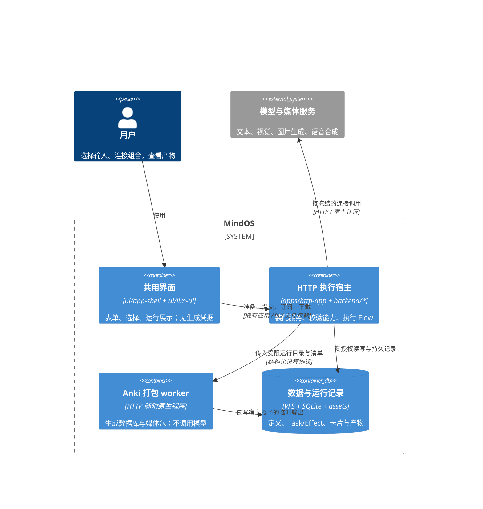
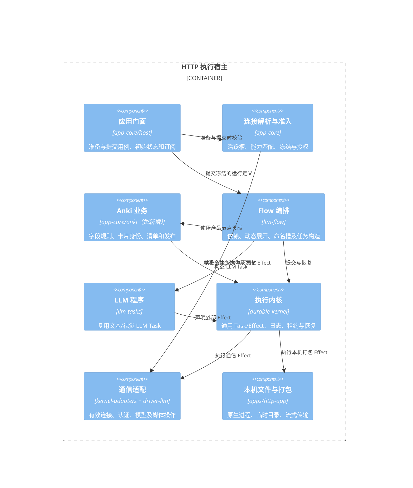
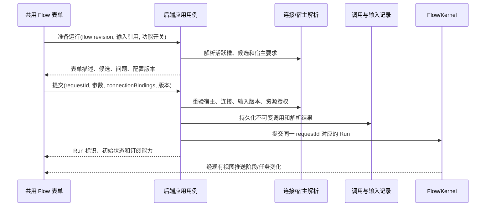
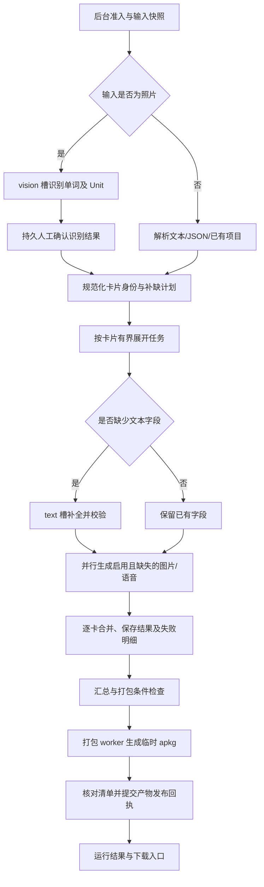

# Anki 制卡 Flow 与运行时连接组合

状态：**待实施的设计方案**。2026-10-15 根据当前源码与相邻仓库 `../pair-x1/tookit/anki-helper/` 核对。原需求中的 `anki_helper/` 实际目录名为 `anki-helper/`。

**目前没有可运行的 Anki Flow、对应内置模板或系统恢复条目。** 本文不代表这些功能已经实现；现有 `.anki` 笔记工作区也不等于本文的单词卡生成和 `.apkg` 导出。

## 1. 结论与范围

以应用层 Flow 串联输入、内容补全、可选媒体生成、卡片合并和 Anki 打包。界面仍使用共用的 Flow 参数表单、工作台、人工输入及运行结果组件；所有生成、文件写入和打包由 HTTP 后端执行。

需要调整 Flow 的连接声明、运行时绑定、调用记录和应用装配端口；需要补充通信适配器对图片生成、语音合成的真实操作契约。**不为 Anki 改写 Durable Kernel 的调度、日志、租约或恢复协议。** 先使用现有版本化 Program、Effect、资源授权、幂等键和 reconcile；若实施测试证明机制不足，再单独提出内核变更。

完整目标包括：

- 读取文本单词表、WordData JSON、已有项目；可选读取照片并确认识别结果。
- 逐字段补全音标、释义、例句、词族、记忆技巧、难度、搭配及配图描述，保留已有内容。
- 音频和配图默认关闭；启用时分别选择满足要求的 Connection。
- 生成可导入 Anki 的 `.apkg`，提供 Markdown 和卡片 JSON 产物。
- 支持后台执行、页面离开后继续、重连、失败项重试和宿主重启恢复。
- 本地 Web、Tauri、直接执行的 CLI 可以查看或编辑定义，但不能在本地运行该 Flow。连接 HTTP 后端的浏览器、Tauri 客户端或远程 CLI 可以发起运行：判断依据是**执行宿主**，不是客户端种类。

首个实施里程碑为“文本/JSON → 补全 → `.apkg`”；照片、媒体及完整恢复验收仍是后续必做范围，不能把首个里程碑称为整个需求完成。

## 2. 当前能力与缺口

| 事项 | 已有能力 | 本需求的缺口 |
| --- | --- | --- |
| Flow 连接 | `FlowConnection` 为命名槽，节点可通过 `config.connectionId` 引用槽；支持默认连接及单一运行连接覆盖 | 槽要求、逐槽运行绑定、逐槽兼容性反馈及冻结结果 |
| 调用记录 | `FlowInvocationService` 保存定义 revision、参数、单一连接解析结果及请求身份 | 保存多槽绑定、解析后的模型/操作和宿主要求，并纳入请求一致性检查 |
| 模型描述 | 模型有 category、vision/structured-output 等标记；Provider 有部分能力声明 | 识图不等于生图，audioOutput 不等于专用 TTS；声明不证明适配器实现或账号可用 |
| Kernel | 版本化 Program/Effect、授权句柄、事件、持久状态、取消和恢复核对 | 应用程序与宿主 Effect 的注册及测试，不是新增 Anki 内核 |
| HTTP 宿主 | 后端先初始化再 listen，浏览器通过应用能力协议访问共用界面 | 可信宿主能力描述、Anki 文件/打包适配及发布产物 |
| 模板与恢复 | 产品 Flow 库、安装回执、只补缺失的初始文件恢复 | Anki 模板、宿主可执行性说明及跨宿主恢复策略 |

核对入口：

- [Flow 定义与连接槽](../../backend/llm-flow/src/contracts/flow-definition.ts)、[槽解析](../../backend/llm-flow/src/flow/connections.ts)、[编译](../../backend/llm-flow/src/flow/to-dag.ts)。
- [调用契约](../../backend/llm-session/src/contracts/flow-invocations.ts)、[持久调用服务](../../backend/llm-session/src/session/flow-invocations.ts)、[当前单连接表单](../../ui/llm-ui/src/components/FlowParameterForm.ts)。
- [通信配置与模型](../../libraries/driver-llm/src/types/connection.ts)、[Provider 通信端口](../../libraries/driver-llm/src/types/provider.ts)。
- [应用装配](../../backend/app-core/src/runtime/create-application-runtime.ts)、[Kernel 装配](../../backend/app-core/src/runtime/create-kernel-runtime.ts)、[HTTP 装配](../../apps/http-app/src/server/application-host.ts)。
- [Kernel Effect 与恢复契约](../../backend/durable-kernel/src/domain/types.ts)、[产品 Flow 库](../../backend/app-core/src/presets/flow-library.ts)、[初始文件恢复](../../backend/app-core/src/presets/initial-files.ts)。

## 3. 从 anki-helper 复用什么

相邻源码的实际业务链为：输入单词/照片 → WordData → 缺失字段补全 → 可选单词/例句语音与配图 → JSON/Markdown → Anki 包。

| 来源 | 复用的语义 | 在 MindOS 中的归属 |
| --- | --- | --- |
| `src/models.rs` | WordData 字段，grade/unit 和额外字段保留 | app-core 的 Anki 业务 DTO 与合并规则 |
| `src/modules/init/utils.rs` | 内容提示词、识图结果校验、媒体有效性及逐项保存 | 产品模板、业务校验和媒体阶段 |
| `src/modules/init.rs` | 单词列表/Unit 解析及缺失项处理 | Anki 输入和计划生成；并发改由 Flow 控制 |
| `src/modules/pack.rs` | 稳定牌组/笔记身份、媒体映射、临时输出及流式打包 | HTTP 原生打包适配器 |
| `src/modules/md.rs`、`template/ankimodel.json` | Markdown 输出与现有卡片样式 | 输出格式化及版本化模板资源 |

不启动 helper 的 Web 服务，不复用它的 `config.toml`、项目列表和模型连接管理。也不直接调用 `helper init`：它自行读取凭据、执行网络请求与并发任务，会绕开 MindOS 的 Connection、预算、授权及 Durable 记录。

推荐从打包实现提取最小 Rust 打包 worker，作为 HTTP 发布物携带的版本化本机组件；输入为已冻结的卡片/媒体清单，职责仅是生成包。不能运行时读取相邻源码仓库或要求用户手工安装 helper。提取、独立构建和发布均未完成。

节点的 manifest 与 UI 描述可以在所有宿主提供，使不支持执行的客户端仍能查看图和限制原因；执行用 Program/Effect 及原生实现只由 HTTP 宿主注册，不能为了显示图而加载原生依赖。

## 4. C4：部署与模块边界





以上为目标结构。产品节点/Program 位于 app-core；Flow 库只处理通用槽、图和任务。app-core 不导入 Node、Rust worker 或 DOM；原生机制在 HTTP 宿主注入。UI 只导入共享契约及前端模块，HTTP 后端不加载 UI。

## 5. 三种要求分别检查

1. **宿主可执行性**：当前执行宿主是否为 HTTP，并已注册所需版本的 Program、Effect 和打包组件。
2. **连接适用性**：所选 Connection 解析到的具体模型、协议和适配器能否完成该阶段。
3. **资源授权**：本次 Run 是否持有读取输入、写卡片/媒体及发布产物的授权。

三者不能相互替代。存在 MCP 连接不等于有 Anki 打包能力；服务器本身有磁盘也不等于任意 Run 可以读写任意路径。

拟增加 Flow 级宿主能力声明，例如 `host.httpd`、`anki.package.v1`。能力由受信宿主装配产生，不接受浏览器自行声明。不要用 `startupMode === 'server'` 或 `ownerKind === 'cli'` 推断授权；这些现有字段分别描述启动策略与租约身份。

准入须覆盖普通提交、会话内调用、远程 CLI、组合 Flow、动态节点和恢复。子图的要求与父图合并，动态节点只能使用已冻结的连接槽及已授予资源，不能扩大权限。HTTP 专有 Program/Effect 不在本地 Web/Tauri/CLI 注册；仅隐藏按钮不足以实现限制。

恢复到不具备能力的宿主时，保留持久记录并报告宿主不兼容，不能自动改用本地 Bash，也不能把缺少适配器误写为业务已完成。具体恢复状态沿用现有协议，实施时需验证“缺少 Program/Effect 版本”的实际行为并补齐应用层分类。

## 6. 运行时多个 Connection 的组合

### 6.1 命名槽与启用条件

| 槽 | 操作要求 | 启用条件 | 模型最低要求 |
| --- | --- | --- | --- |
| `text` | `chat` | 有缺失文本字段时 | 文本输入/输出；输出经业务 JSON Schema 校验 |
| `vision` | `chat` | 输入包含待识别照片时 | 图片输入、文本输出；不接受仅文本模型 |
| `image` | `image.generate` | 用户启用配图且有缺失配图时 | 已实现的图片生成适配、模型与返回格式 |
| `speech` | `speech.synthesize` | 用户启用音频且有缺失音频时 | 已实现的 TTS 适配、模型/资源 ID、音色与音频格式 |

一个 Connection 可以绑定多个槽，只要各槽解析后的要求都成立。多个 Connection 可以来自同一 Provider，凭据仍由 Provider/认证宿主管理。无需为了四个用途复制四份 API Key。

组合示例：

- 仅文本：`text → connection-A`；不要求配置 vision、image、speech。
- 照片加文本：vision 与 text 可绑定同一个支持视觉的 Connection，也可分别选择。
- 完整媒体：text/vision 共用一个模型连接，image 使用图片连接，speech 使用语音连接；三者可来自不同 Provider。
- 已有完整卡片只打包：不调用模型，不要求存在任何模型 Connection。

媒体开关和补缺计划属于业务策略。未启用或无需执行的槽不参与必填校验；启用后找不到适配器/凭据则阻止提交并指出原因，不能静默跳过。

### 6.2 拟议契约

以下 TypeScript **仅描述拟新增/调整的契约，并非现有可用 API**：

```ts
type GenerationOperation = 'chat' | 'image.generate' | 'speech.synthesize';

interface ConnectionRequirement {
    operation: GenerationOperation;
    input: Array<'text' | 'image'>;
    output: 'text' | 'image' | 'audio';
    features?: Array<'structured-output'>;
}

interface FlowConnection {
    name: string;
    connectionId?: string; // Existing field becomes an optional authoring default.
    description?: string;
    requirement?: ConnectionRequirement;
}

interface RunConnectionBinding {
    connectionId: string;
    tier?: 'optimal' | 'standard' | 'fast';
}

interface FlowRunBindings {
    connectionBindings?: Record<string, RunConnectionBinding>;
    connectionId?: string; // Legacy default for nodes without an explicit slot.
}
```

继续使用 `connections` 这一份槽声明，避免再并行增加另一套 slots 配置。新定义允许只声明要求、运行时再选择连接；调整 `connectionId` 可选性时须同步全部读写、校验、编辑器和旧定义兼容代码。

操作与模型能力契约归 driver-llm 的中立 contracts；Flow 槽、引用和运行绑定归 llm-flow/contracts，llm-session 持久调用消费这些契约；面向界面的准备结果经 app-contracts 暴露。应用层实现匹配策略，通信层提供事实，不能让 UI 或 Flow 调度器识别具体厂商。

槽的活跃条件由后台节点计划确定，声明式条件复用现有 `SerializableExpression`，不执行用户 JavaScript。提交时尚不能确定是否会走到的必需分支，须先准备该分支可能使用的绑定，或在分支开始前进入持久交互重新准入；不能先调用付费服务，再发现后续槽未绑定。

新增节点级显式 `connectionSlot` 引用，区分“槽名”和“全局 Connection ID”；现有 `config.connectionId` 的兼容解析保留。新模板统一使用显式槽，不依赖同名字符串猜测。

解析顺序：

1. 节点引用的槽先取本次 `connectionBindings[slot]`，再取定义中的槽默认绑定；都没有则报告该槽未绑定。
2. 节点显式写全局 Connection ID 的旧语义不变；运行时槽映射不覆盖它。
3. 没有显式槽或连接的旧节点，保持原有单运行连接、Flow 默认连接、会话连接的解析顺序。
4. 声明了必需槽的新节点不隐式借用会话默认连接，防止用文本连接代替 TTS/生图连接。
5. 组合 Flow 使用编译后的作用域名称限定槽身份；只有显式映射可以继承父槽。动态展开继承被冻结的映射，不重新读取全局默认值。

绑定属于运行配置，与 `parameters` 分开；不能允许普通字符串参数绕过连接选择与能力校验。一次调用可覆盖多个槽；同一槽在同一 Run 内保持确定性。

### 6.3 兼容性判定与证据

判断对象必须是 `Connection + tier → Provider + model + protocol + operation adapter` 的实际解析结果。

- 先检查 Connection/Provider 存在、启用、模型映射有效及宿主认证就绪。
- 再检查操作适配器、模型输入/输出能力、协议、必要资源 ID/音色/格式及上下文限制。
- Provider 声明、模型目录、适配器实现分别提供证据。明确不支持即拒绝；未知能力显示未知，不把 category 或 Provider 名称当成通过依据。
- 视觉输入不能用“支持生成图片”代替；`audioOutput` 也不证明专用 `speech.synthesize` 已实现。
- 普通文本只要求生成内容可被业务校验。支持严格结构化输出时优先使用；不支持时可采用 JSON 提示、解析及有界修复，不能因此排除所有仅支持普通文本的模型。
- 未知的视觉/生图/TTS 能力须由可信适配器声明或显式测试补足，不能默认放行。付费测试由用户显式触发，打开表单和服务器启动都不自动试调用模型。

前端收到按槽返回的候选、安全状态及拒绝原因，例如 `adapter-missing`、`model-incompatible`、`credentials-required`。候选由后台统一计算；前端筛选只是展示，提交时后台仍重新校验。

能力目录可缓存，键包含 Provider/Connection 配置版本、模型目录版本、适配器版本和认证主体；配置/授权变更使相关缓存失效。认证是否就绪单独更新，绝不在响应、缓存键或日志中包含 token/API Key。

## 7. 准备、提交与冻结

拟新增通用“准备 Flow 运行”应用用例；它不是 Anki 专属的新 HTTP 路由。沿用现有应用能力协议，并同步共享契约、服务端能力描述、RPC 版本及客户端检查。



后台准备尽量一次装配表单所需业务数据，不让前端逐槽、逐模型请求。用户更改媒体开关后，合并一次重新准备请求；准备阶段不运行 LLM。

冻结内容包括 Flow revision/digest、参数、输入内容版本/摘要、槽映射、实际模型/协议/操作、适配器版本、提示词与模板版本、输出策略及授权范围。调用记录和 DagRunSpec 都须能恢复这些信息；只在前端 Map 中保存绑定无效。

`FlowInvocationInput`、记录、同请求一致性校验、RunStart、编译和动态派发都要接通多槽绑定。同一 requestId 携带不同参数或绑定时拒绝，不能复用之前的 Run。HTTP 回复丢失后重试同一请求不重复创建 Run。

连接配置在准备后发生变化时，提交要求重新准备。运行中固定模型、地址语义和认证主体；当前凭据在 Effect 执行时由宿主解析并可正常刷新。删除/禁用连接或撤销授权后阻止新的调用，不能用冻结快照绕过撤销，也不能静默换服务商。需要换模型/主体时显式发起新调用。

## 8. 业务 DAG 与卡片规则



照片分支在确认前不写正式卡片、不生成媒体。确认是持久交互，刷新或断连不能自动同意；修订单词清单后重算计划，在发生付费生成前重新核对所需槽。

节点复用已有控制、输入、人工等待、taskGroup/join 与 `builtin.agent`/LLM 程序；文本/视觉节点使用冻结的连接并禁止任意工具。产品补缺计划、合并、媒体生成和产物发布以 app-core 的小型节点/Program 承载，外部工作均通过 Effect。不能在纯 transform 内直接调用网络或打包进程。

卡片约束：

- 使用持久 cardId；同名单词在不同 Unit 可保留为不同卡片。规范化策略显式记录，不用清洗后的文件名作为唯一身份。
- 保留已有非空字段与未知扩展字段；填补空缺时校验类型、长度、释义、例句及字段间一致性。显式重新生成才替换用户修改。
- 模型只能返回文本数据，媒体引用由已完成的媒体 Effect 生成，不能直接采纳模型伪造的本地路径或 URL。
- 单词和例句语音分别记录依赖摘要；例句或配图提示修改后，对应旧媒体标记过期，但保留原文件至新产物成功。
- 旧字段与新结果合并采用卡片版本/CAS。生成期间有人编辑卡片时保留编辑并报告冲突，不能最后写入者覆盖。
- 首版默认 `require-complete`：启用阶段出现失败时不发布“完整成功”包，保留成功中间结果并允许重试。允许部分导出作为显式策略，产物清单标明缺失项。

复用现有 WordData 字段和模板；导入已有项目保留其 deckId、笔记身份及媒体引用。跨格式导入须有版本化转换和测试，不能仅把文件扩展名改成 `.anki`。

## 9. 持久化、幂等、取消与恢复

推荐在获授权的项目/Session 文件范围内保存 Anki 项目。具体物理位置由宿主现有文件端口决定，不新增未经授权的全局绝对目录。

逻辑布局（待实施）：

```text
anki-project/
  project.json                 # Stable project/deck identity and schema version.
  cards/<cardId>.json           # WordData, field versions and media references.
  assets/<digest>.<ext>         # Immutable generated media.
  runs/<runId>/manifest.json    # Input, binding and output provenance.
  exports/<artifactId>.apkg     # Versioned immutable package.
  exports/<artifactId>.md
```

Kernel 的 Task/Effect/事件继续保存在现有 Kernel 存储中；这些项目文件是业务内容和产物，不另建第二套调度数据库。中间状态保存小对象及资产引用，照片、音频和包体不进入 DAG 参数或每次事件快照。

每个业务操作使用由 Run、cardId、阶段、输入摘要、模板/连接语义版本生成的稳定身份。已提交的卡片/媒体回执可以复用；失败重试只补未完成项。不要只凭“文件名存在”判断某次生成已完成。

- 本地打包写入同一宿主授予的临时目录；核对文件、大小、清单后发布不可变产物，再 CAS 更新最新产物引用。失败保留上一个完整包，原生临时文件不作为下载入口。
- 卡片/资产提交与 Effect 结算存在崩溃窗口，适配器必须通过业务回执 reconcile，不能宣称文件操作与 Kernel 日志天然原子。
- 有远端 jobId 的媒体服务保存身份并在恢复时查询；后台执行等待和状态缓存，浏览器不直接轮询服务商。
- 无幂等接口/查询能力的付费调用，在“远端已执行、结果尚未持久化”的窗口无法保证不重复计费。使用现有 `recoveryPolicy: 'manual'` 和 `reconcile → indeterminate` 表达不确定性，显式决定重试；不能声称 exactly-once 或把所有网络请求标为可安全重试。
- 取消通过 AbortSignal、服务商取消能力和打包进程组终止传播；等清理确认后再报告停止。取消不会删除用户原有卡片或已发布产物。
- 重启时先注册相同版本的 Program/Effect、建立资源映射并取得原有 Session/Run 租约，再执行恢复；浏览器重连只读取/订阅，不重新创建 Run。

## 10. 打包、性能与日志

HTTP 发布流程构建并冻结打包 worker、模板和协议版本，检查可执行性后才声明 `anki.package.v1`。发布物缺少 worker 时显示准确的不可运行原因；不能先显示 ready，再到第一次导出才发现缺少本机依赖。启动检查不执行模型试调用。

现有 release 清单只校验服务端/UI 文件及 Node 主版本；实施时须把 worker、模板、协议版本、操作系统/CPU 架构纳入构建清单、指纹与激活检查。worker 的标准输出只传结构化进度/结果，诊断写标准错误，避免原 helper 的普通输出破坏协议。

打包 worker 不接受浏览器提供的任意宿主路径。后端把已授权文件转换为只读运行清单，约束临时输出范围；原生程序只处理该清单，不包含认证或模型调用。

性能要求：

- 按卡片有界展开与排队，不一次为数千单词创建全部活跃任务；并发同时受 Run、连接/服务商及全局资源限制。
- 已补齐字段不调用模型；音频/图片根据内容摘要复用，不因刷新、切换导航或重连重新生成。
- 语音和配图可并行；已有成功的阶段独立提交，单个媒体失败不使整张卡重跑文本生成。
- 数据库与 ZIP 工作在独立打包进程，避免占用 HTTP 事件循环；媒体流式读写，沿用 helper 的分块、已压缩媒体不重复压缩和临时输出策略。
- 一个 Run 初始快照加增量订阅；进度按阶段变化或节流窗口合并，不逐音频 chunk/逐单词字符发前端请求。终态停止后台状态探测。
- 复用现有应用视图、文件下载与事件传输；不另建 Anki Web 服务、WebSocket 或通用单步骤 REST 接口。

现有通用 Flow 输出窗口仍有按秒刷新的路径，见[当前输出设计](flow-capabilities-and-output.md)。实施本方案时应复用/补齐通用运行订阅并取消该窗口对同一运行的重复轮询，不能声称现状已经全面事件化。

日志关联 requestId、runId、taskId、cardId、slot 和阶段；记录缓存命中、排队、模型调用、文件提交、打包字节及下载开始/结束。性能分别衡量“提交返回”“首个卡片结果”“全量生成”“产物就绪”，不能用 HTTP 202/应用调用返回时间代表生成完成。默认日志不记录凭据、照片、单词正文、模型完整响应和原生私有路径。

## 11. 界面、模板和系统恢复

运行表单展示输入来源、目标项目、媒体开关及当前需要的槽。每个槽列出用途、选中 Connection/实际模型和兼容性原因；未启用的媒体不要求配置，配置入口复用工具箱，不再创建 Anki 专用 Provider 页面。

执行后工作台展示识图确认、阶段/卡片进度、失败明细和产物。`.apkg` 与 Markdown 使用现有受授权文件传输下载；远程浏览器不能把服务器绝对路径当作可直接打开的本地路径。

Anki 模板作为产品定义加入 Flow 库，按既有安装回执补装；定义本身可在所有客户端查看。非 HTTP 执行宿主显示“需要 HTTP 后端”，不自动启动 httpd、不打开任意进程、不删除模板。

系统恢复页的“工作流”折叠组加入 Anki 模板，组名由当前“作文工作流”泛化为“内置工作流”。本组“全选”只选择本组；顶部恢复仅补缺失模板，保留已有修改，与 Provider/Connection/Agent 重置分开。恢复模板不触发模型调用、媒体生成或原生任务，也不恢复/覆盖用户卡片项目。

## 12. 实施顺序与验收

| 阶段 | 改动位置 | 可验收结果 |
| --- | --- | --- |
| A：运行契约 | llm-flow/contracts、llm-session、app-contracts、应用解析、共用表单 | 多槽运行绑定、兼容反馈、持久冻结及请求去重；旧单连接 Flow 继续运行 |
| B：文本闭环 | app-core/anki、产品模板、HTTP 文件/打包适配、release 构建 | 文本/JSON 输入、逐卡补缺、保留修改、可下载且能导入的文本 `.apkg` |
| C：可选阶段 | driver-llm 操作契约、媒体适配、vision/HITL 节点 | 照片确认、图片/单词及例句语音、不同 Connection 组合；关闭功能无需对应配置 |
| D：恢复与完整交付 | 业务回执、运行订阅、产品恢复清单、跨进程测试 | 重连/重启/取消、失败项重试、旧产物保留及模板恢复闭环 |

独立 npm 若在实施中修改，须按独立仓库提交、推送、构建和发布，再记录消费版本；主仓提交不能代替 npm 已发布。设计阶段不修改或发布这些库。

必须覆盖的验收：

1. 同一 Connection 绑定多个适用槽成功；不同 Provider 的组合成功；文本模型绑定 vision、生图模型绑定 text、缺少 TTS 适配时准确拒绝。
2. 文本/JSON/照片输入，以及“完整卡片只打包”；关闭音频/配图不检查未使用的连接。
3. 本地 Web/Tauri/CLI 通过 UI 和直接应用调用均不能执行；远程客户端经 HTTP 执行成功；组合/动态节点和恢复也不能绕过。
4. 同 requestId 重试只得到同一个 Run；改变绑定则拒绝；准备后修改配置、运行中撤销授权和 OAuth 正常刷新分别验证。
5. 保留已有字段、扩展字段、Unit、人工修改及既有媒体；生成期间编辑产生可见冲突；失败重试不重跑已完成阶段。
6. 在媒体返回后/业务提交后/Effect 结算前/打包完成后分别终止宿主，重启后核对回执、计费不确定性和原产物完整性。
7. 导出核对卡片数、字段、稳定 deck/note 身份、媒体引用和 ZIP 完整性，并在真实 Anki 导入与重复导入；格式测试不能替代客户端验收。
8. 大单词表的并发、内存、事件数量和打包吞吐有实测；HTTP 导航不被打包阻塞；关闭前端不取消已授权任务，取消后不继续发布新包。
9. 全新 HTTP release 无相邻源码、开发依赖或额外 helper 安装仍能运行；系统恢复只补模板且不调用模型。

A/B 单独完成只能记为阶段交付。A–D、真实媒体及 Anki 客户端验收完成后，才把原 Anki Flow 需求标为完成。
