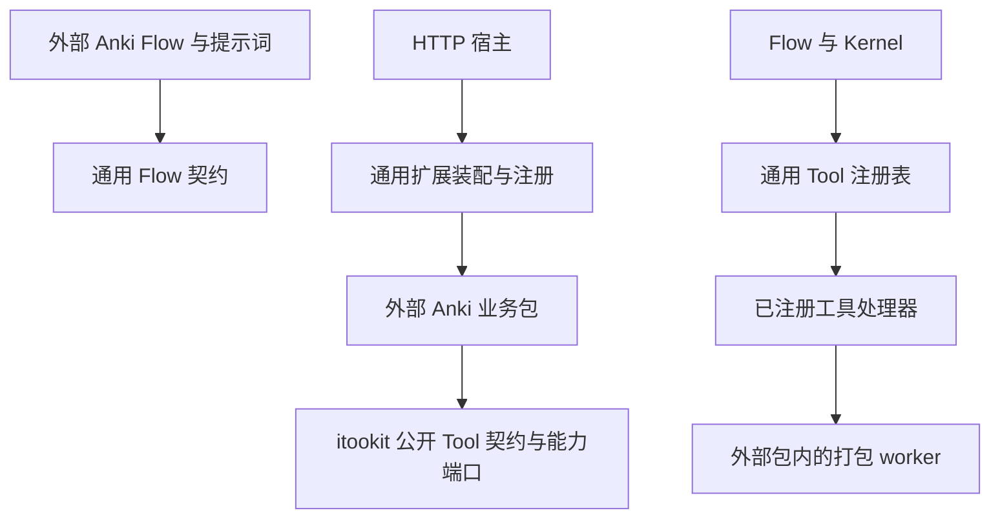
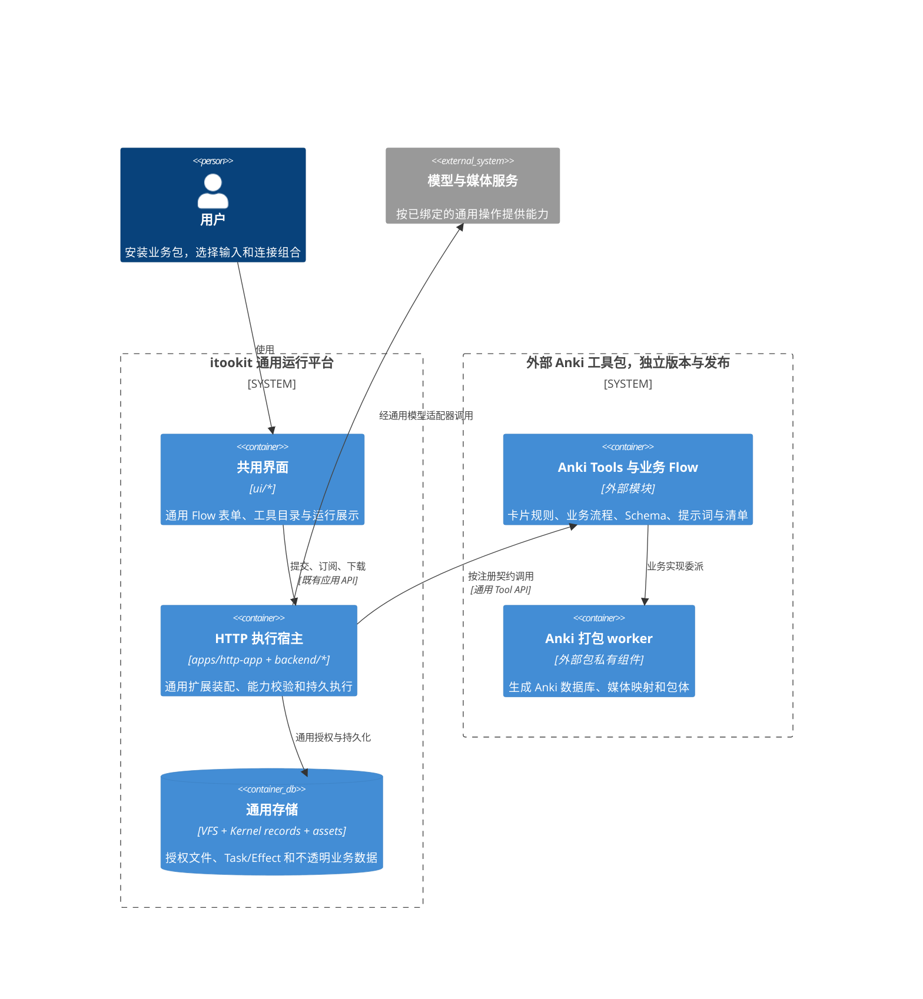
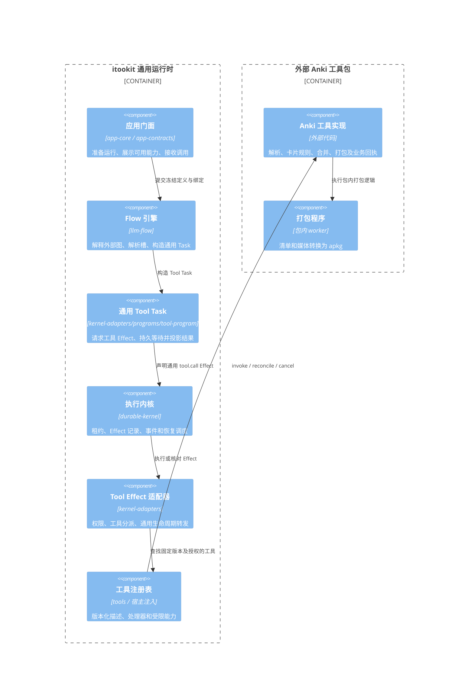
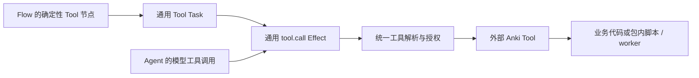
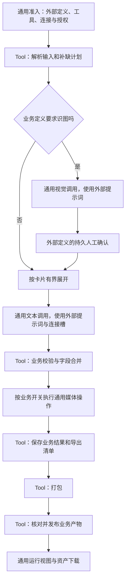

# 外部 Anki Tool 与 Flow：策略和机制边界

状态：**通用执行子集已实施，外部业务包及安装/宿主要求匹配待实现**。2026-10-16，同步到当前主工作区并通过独立进程 CLI 验收；此前的业务分析来自相邻 `anki-helper` 仓库，不要求核心依赖该目录。当前模块边界与工作树审查见[策略与机制](application-policy-boundaries.md)。

**目前没有可运行的 Anki Flow 或对应工具扩展。** 本文按“itookit 仅提供通用机制，非通用功能通过外部 Tool 实现”的要求重新确定归属，替代此前将 Anki 业务放入 app-core、HTTP 宿主和内置模板库的方案。默认 Anki 提示词、工作区、文件模板和演示反馈场景已移除；已有文件不会删除，外部宿主可通过 AppOptions.fileTypes 显式注册自己的文件类型。

## 1. 设计结论

采用 **外部 Anki 业务包提供 Tool 与 Flow 定义，itookit 提供通用执行机制**。

- Anki 的卡片字段、提示词、Unit/牌组规则、补缺/覆盖策略、模板、媒体依赖、导出与打包程序都在外部业务包。
- 外部 `.flow` 定义决定制卡顺序、业务分支、人工确认、连接用途和失败处理；itookit 的 Flow 引擎解释并执行定义。
- Flow 通过通用 Tool 节点调用外部工具，确定性步骤不经过 LLM 决策。模型也可以通过已有 Agent 机制调用获授权的同一工具。
- itookit 提供工具发现/注册/调用、Schema 校验、连接解析、权限、持久执行、取消、恢复、资产引用和结果展示。
- 不在 app-core、kernel-adapters、llm-flow、tools 或 apps/http-app 中新增 Anki 专用服务、节点、Program、Effect、路由或打包代码。
- HTTP 专有运行限制由外部扩展/Flow 声明，框架提供通用宿主要求匹配，不在核心中判断工具名是否为 Anki。

“策略/机制”是相对层次：Anki 工具内部可以再拆字段策略与打包机制，但这两部分都属于外部业务包；不能因为打包是确定性算法，就把它归入 itookit 的通用基础设施。

## 2. 归属表与依赖规则

| 内容 | 归属 | itookit 如何消费 |
| --- | --- | --- |
| WordData、cardId/deckId、Unit、字段合并与完整性规则 | 外部 Anki 工具包 | 不解释内容，通过工具输入/输出 Schema 与资产引用交互 |
| 卡片生成提示词、照片确认、补缺/重生成与部分导出策略 | 外部 Flow/工具包 | 通用 LLM、人工交互、控制与 Tool 节点 |
| Anki 模板、SQLite/媒体映射、`.apkg` 打包程序 | 外部工具包及其 worker | 通用工具执行和文件/进程能力 |
| 工具注册、发现、参数/结果 Schema、版本与授权 | itookit 通用 Tool 机制 | 对所有业务工具一致处理 |
| Flow 图、依赖、并发、分支、失败策略的执行 | itookit 通用 Flow 机制 | 解释外部定义，不内置制卡流程 |
| Connection 槽、运行绑定、能力要求与快照 | itookit 通用机制 | 处理声明的操作、模态和能力，不内置 text/vision/image/speech 四个业务槽名 |
| Task/Effect 日志、租约、请求身份、取消与恢复调度 | Durable Kernel 与通用适配层 | 核心保存执行事实，工具核对业务结果 |
| “哪个字段该补”“包是否符合本次制卡目标” | 外部工具/Flow | 框架只执行 Schema、权限和通用产物约束 |
| 已安装扩展的 Flow 清单、导入/恢复与完整性校验 | 通用扩展资源机制 | 读取扩展清单，不把 Anki 写入产品默认目录 |

依赖方向：



图中的注册调用是依赖倒置：核心依赖 Tool 接口，宿主按配置安装外部实现；核心生产源码不能静态 import Anki 包或按包名写分支。配置中的包 ID、工具 ID、版本和 Schema 是数据，不是领域实现依赖。

## 3. 现状与需要补齐的通用机制

| 事项 | 当前源码事实 | 本方案要求 |
| --- | --- | --- |
| Tool 注入 | `additionalTools`、`configureSession` 可注入工具，工具服务支持外部注册 | 优先复用工厂/宿主注入，补齐版本、受限上下文和生命周期契约；不先建设插件市场 |
| Flow 调用 | `builtin.tool@1.0.0` → `kernel-adapters.tool@1` → `tool.call` | 确定性调用固定版本及参数，节点 capabilities 显式授权 |
| Tool 执行 | 已接通完整有界 JSON、输出 Schema 校验、版本匹配、稳定 operationId | 超大结果返回资产引用；禁止把展示截断当作下游数据 |
| 崩溃核对 | 原生 Tool 可提供 reconcile 并取得相同 operationId | 无核对能力的非只读工具保持 indeterminate，不静默重放 |
| Flow 授权 | Tool / 媒体 Task 延迟到能力句柄绑定后启动 | Tool 只取得工具资源，媒体只取得模型资源 |
| 连接 | 支持节点 connectionId/connectionSlot 和运行 connectionBindings，持久化模型/媒体端点快照 | 准入和执行前校验操作、模态、格式、音色及授权，未知即拒绝 |
| 模型通信 | chat + image.generate / speech.synthesize；媒体使用独立的 OpenAI 兼容端点 | Provider.media 和 model.operations 显式声明，category/audio 标记不等于生成能力 |
| 扩展资源 | 有产品内置 Flow 库和初始文件恢复 | 外部业务 Flow 通过导入/安装清单接入；通用恢复只处理已安装来源 |

源码入口：

- [工具接口](../../backend/tools/src/core/Tool.ts)、[工具服务](../../backend/tools/src/contracts/tool-service.ts)、[工具执行与核对](../../backend/kernel-adapters/src/effects/tool-call-effect.ts)。
- [宿主工具注入](../../backend/kernel-adapters/src/runtime/create-kernel-adapters-runtime.ts)、[现有通用审批 Effect Program](../../backend/kernel-adapters/src/programs/approved-effect-program.ts)。
- [内置 Flow 插件](../../backend/llm-flow/src/flow/builtin-plugins.ts)、[Task 构造](../../backend/llm-flow/src/flow/task-factory.ts)、[Flow Task 授权](../../backend/llm-flow/src/flow/task-capabilities.ts)。
- [连接槽](../../backend/llm-flow/src/contracts/flow-definition.ts)、[槽解析](../../backend/llm-flow/src/flow/connections.ts)、[Flow 编译](../../backend/llm-flow/src/flow/to-dag.ts)。
- [调用记录](../../backend/llm-session/src/session/flow-invocations.ts)、[当前连接表单](../../ui/llm-ui-adapter/src/components/FlowParameterForm.ts)、[Kernel Effect 契约](../../backend/durable-kernel/src/domain/types.ts)。

上表区分当前实现与待补要求；后文的扩展安装、宿主要求匹配和业务流程仍是设计目标。

## 4. C4：部署与组件边界



扩展可以与 httpd 同进程运行；独立业务边界不等于必须启动另一个 HTTP/MCP 服务。原生 worker 随外部包提供，只有工具实现知道其存在。



不新增内置 `anki.package` Effect 或 `app-core/anki`。Anki 工具 ID 可以是 `anki.pack`，但对核心只是一个在注册表中解析的字符串。

## 5. Tool 是业务能力，不限于模型调用

同一个已注册工具可以由 Flow 或获授权的 Agent 调用：



业务层对外只暴露版本化 Tool 契约。Node、Rust 或 Python 是工具内部实现选择；不让模型临时生成打包脚本，也不把任意命令字符串当作制卡接口。

拟增加的 Tool 节点只表达 `toolId`、工具版本/描述摘要、结构化参数或资产引用；运行上下文由宿主提供 operationId、受限文件/模型能力、取消信号和进度通道。模型参数不能伪造执行身份、授权句柄、Provider 凭据或宿主路径。

通用 Tool Task/Program 只负责“校验请求 → 等待授权/审批 → 发出 tool.call → 等待结果 → 校验结果 → 完成/失败”。放在通用适配/程序层，与现有通用 Effect 程序的职责保持一致；Flow 插件只构造其 Task 输入，不依赖 Anki 实现。审批按授权策略决定，不为每个步骤新增强制确认。

必须保持两种调用语义一致：同一注册版本、同一权限、同一超时/取消与恢复契约。Flow 调用直接消费结构化结果，不能从模型可读描述字符串反向解析。超大结果保存为资产/内容引用，展示截断不能使下游丢失业务结果。

工具报告失败时，直接 Tool Task 不能把错误文本当成成功产物；可纠正参数错误与结果不确定分别分类，由外部 Flow 的显式分支决定如何处理。不得用“让 Agent 再调用一次”替代确定性步骤。

## 6. 从 anki-helper 迁移的外部包

推荐在相邻业务仓库演进独立 Anki 工具包，沿用其语言和打包实现；不要把源码搬进 itookit 的 backend、libraries 或 apps 目录。其建议逻辑结构为：

```text
external-anki-package/
  manifest.json             # Package identity, versions and execution requirements.
  flows/anki-generate.flow  # Business orchestration and connection slot declarations.
  tools/                    # Parsing, validation, merge, pack and publish handlers.
  schemas/                  # WordData, input and result schemas.
  prompts/                  # Text/vision instructions owned by the business.
  templates/                # Versioned Anki model templates.
  runtime/                  # Business receipts and optional native worker.
```

| 现有 helper 源码 | 在外部包中复用 |
| --- | --- |
| `src/models.rs` | WordData、grade/unit、未知扩展字段与转换规则 |
| `src/modules/init/utils.rs` | 业务提示词、识图结果校验、媒体有效性规则 |
| `src/modules/init.rs` | 文本/JSON/Unit 输入及补缺计划；Flow 已编排的阶段不再内部重复调度 |
| `src/modules/pack.rs` | 稳定牌组/笔记身份、流式媒体、临时包与 Anki 格式处理 |
| `src/modules/md.rs`、`template/ankimodel.json` | Markdown 与卡片模板 |

示意工具名为 `anki.prepare`、`anki.validate`、`anki.apply`、`anki.pack`、`anki.publish`，均属于外部包，不是平台内置 API；最终粒度按独立重试与业务事务边界确定，不要求每个纯函数都成为 Tool。

业务包使用 itookit 管理的授权连接/资产端口，不再读取 helper 的独立 `config.toml`、项目列表和凭据。原 helper Web 服务不作为必要运行依赖；固定流程不能整个藏进 `helper init`，否则 Flow 看不到阶段、预算和失败边界。

平台执行通用 LLM/媒体节点，业务包提供提示词、输出 Schema 及校验/合并工具。若一个外部工具确实需要自行调用模型，必须使用能保留子操作身份、用量和恢复语义的通用受限模型端口；该端口尚未具备时，先把模型调用保留为显式 Flow 节点，不能直接携带 API Key 绕过框架。

## 7. 多 Connection：机制在平台，用途在业务定义

外部 Flow 声明 text、vision、image、speech 等槽名、各自要求和启用条件。itookit 只解释声明，不在启动代码或通用表单中固定这四个槽。

| Anki Flow 的槽 | 声明的通用操作/模态 | 外部业务启用条件 |
| --- | --- | --- |
| text | chat，文本输入/输出 | 存在缺失文本字段 |
| vision | chat，图片输入/文本输出 | 有待识别照片 |
| image | image.generate | 用户启用且缺失配图 |
| speech | speech.synthesize，音色/格式等操作约束 | 用户启用且缺失语音 |

同一 Connection 可满足多个槽，也可选择不同 Provider。完整卡片仅打包时无模型调用，不要求任何模型连接。业务负责产生补缺计划；平台只按声明的活跃条件判断必需绑定。

拟议的通用扩展：

- 继续使用现有 `FlowConnection` 声明；补充操作、模态、特性要求，允许槽先声明、运行时再绑定。
- 调用输入支持 `connectionBindings: Record<slot, binding>`，与普通业务 parameters 分开；保留原单连接调用兼容。
- 新节点使用显式槽引用，避免与全局 Connection ID 的同名字符串混淆。
- 显式槽按本次绑定、定义默认绑定解析；必需槽缺失即报告，不隐式用会话文本连接替代媒体连接。未指定槽/连接的旧节点保持原解析顺序。
- 组合 Flow 的槽按作用域命名并显式映射；动态节点继承被冻结的映射，不重新读取全局默认设置。
- 条件复用现有声明式表达式；提交前无法确定的分支先准备其可能需要的绑定，或在运行中进入持久交互重新准入，不执行任意用户 JavaScript。

匹配基于 Connection/tier 解析到的实际模型、协议、通信适配器和认证状态。识图不等于生图，模型 category 和 Provider 名称不等于已实现的操作。未知能力返回未知/需要测试，不当作支持；模型输出的领域正确性由外部 Schema/工具判断。

普通文本可以使用提示、解析和有界修复；严格 structured-output 只在声明为必需时强制。付费连接测试由用户显式触发，不在打开表单或后台启动时自动运行。

框架冻结 Flow/工具版本、参数、输入版本/摘要、槽映射、实际模型/协议和通用授权范围；外部包冻结自己的 Schema、提示词、模板及业务清单。调用记录与请求一致性校验必须包含这些绑定/来源，不能只保存在前端。

认证凭据仍由宿主管理，正常刷新不会改变冻结的认证主体；删除/禁用连接或撤销授权后阻止新的调用，不能凭快照绕过撤销，也不能静默换模型。准备后配置变化要求重新准备。

## 8. 仅 HTTP 执行与扩展安装

“仅 HTTP”是本次外部业务的部署策略。扩展/Flow 清单声明 `host.httpd` 等通用宿主要求，框架读取可信执行宿主描述并匹配；不能以浏览器种类、`ownerKind === 'cli'` 或 `startupMode === 'server'` 代替执行能力。

- 安装后的扩展仅在满足要求的执行宿主注册处理器。缺少扩展、版本、能力或授权时，在执行前返回通用的不可用原因。
- 同一用户界面可查看定义，运行按钮说明当前宿主不满足的要求；Tauri/远程 CLI 连接 HTTP 后端时，按实际后端能力执行。
- 普通提交、Agent Tool、组合 Flow、动态节点和恢复使用同一规则，不能只隐藏按钮。
- 生产装配按受信宿主配置选择外部包；不接受前端任意 URL/代码作为插件执行来源。

初期复用已有工具工厂和宿主注入；按实际缺口补充通用的安装清单与装配端口，不为 Anki 单独建立插件框架、路由或常驻服务。外部包既可本地工厂注册，也可后续通过既有 MCP 适配提供；首版不要求额外 MCP 服务。

MCP 的 tools/progress/cancel 不天然提供应用级崩溃核对。通过 MCP 使用可恢复写工具时，仍需该工具提供稳定操作身份和核对协议；不存在时按不确定结果处理。

平台 release 不默认内嵌 Anki worker 和模板。外部包独立构建、发布、安装并锁定版本；部署可以组合平台与选定扩展，但构建/激活逻辑只处理通用扩展清单、内容摘要、运行时/系统架构及协议兼容性。

配置要求必须加载的扩展，在初始化成功后才能 listen；可选扩展失败则不宣告对应能力，并显示失败原因。扩展 ready 检查不调用付费模型。移除 Anki 扩展后，平台仍应能独立构建和启动。

## 9. 外部业务 DAG 与交互



图中的业务逻辑全部来自外部 Flow/工具。完整字段跳过生成、照片确认前不正式写入、媒体默认关闭、失败是否允许部分包，均由外部定义表达；框架没有 Anki 分支。

外部业务验收需覆盖：稳定 card/deck 身份；同词不同 Unit；保留已有非空字段和扩展字段；显式重新生成；编辑冲突/CAS；媒体依赖变化后的失效与替换；不采纳模型伪造的媒体路径；现有项目导入；`.apkg` 和 Markdown 导出。

模型生成卡片数据，外部工具使用预先编写和测试的打包程序。worker 可执行文件、模板和协议由工具包负责，核心不知道其路径和编程语言。工具不能重复编排整个已由 Flow 控制的生成流水线。

对话入口可以增加一个外部 `GenerateAnkiDeck` 工具来提交该 Flow 并返回 Run ID；它不能代替实际执行步骤的 Anki Tools，也不能把整个长流程藏在一次模型调用里。制卡 Flow 不授予递归发起自身的入口。

## 10. 恢复：平台负责调度，Tool 负责业务核对

保留通用 `tool.call` Effect。补充工具生命周期注册与可信执行上下文，使适配器可以按固定工具版本转发 invoke、cancel、reconcile。**不为每个业务新增核心 Effect 类型，也不在通用适配器中添加 Anki 分支。**

职责分开：

| 事项 | 平台机制 | 外部 Tool 的策略/实现 |
| --- | --- | --- |
| 操作身份 | 生成并持久化稳定 operationId；回复丢失后保持同一身份 | 以该身份关联业务回执，不自行每次随机换 ID |
| 核对 | 恢复时解析原版本，调核对端口并消费 completed/retry/indeterminate | 检查自己的清单、内容摘要、远端 jobId、包体和发布记录 |
| 取消 | 传递信号、等待清理确认、维护 Task 状态 | 中止自身请求/进程组，释放临时资源并确认停止 |
| 重试 | 执行已声明且获准的重试策略，保留 attempts | 判断具体副作用能否核对/重放；付费不确定性不能伪造为安全 |
| 持久结果 | 保存完整有界结果/资产引用和 Effect 结算 | 定义领域结果、回执格式和完整包的发布语义 |

现有 Tool 接口不完整提供上述恢复端口，当前非只读工具核对会返回 `indeterminate`。这是需要补齐的通用机制，不能用业务特化 Effect 绕过，也不能因注册了 Tool 就宣称已经可恢复。

平台不默认重试所有写工具；工具没有核对能力就保留不确定状态。付费模型/媒体若缺乏服务商幂等或查询接口，远端已执行、结果未提交的窗口不能保证不重复计费。业务工具核对信息与 Kernel 结算存在崩溃窗口，须由回执/reconcile 处理，不声称跨存储天然原子。

外部打包工具先写临时包、核验并登记业务回执，再由发布工具更新产物引用；失败保留旧包。Flow 在已结算的打包结果上重试发布，不重跑前面的文本和媒体。下载只读取已发布资产。

恢复必须固定原包/工具版本；升级不能让旧调用静默执行新规则。缺少版本时保留记录、报告运行环境不可用，不自动失败归档或换实现。具体阻塞状态需按现有 Kernel 行为验证，由应用层提供准确分类。

## 11. 存储、性能和界面边界

平台拥有通用 VFS、资产、内容引用与 Kernel 日志；外部工具拥有被授权目录中的卡片、业务清单和回执。核心不硬编码 `word_json/`、`.anki-deck-id` 或 `anki-project/` 布局。

- 任务按独立重试边界选择粒度：通常每卡片补全、每媒体资产生成、每清单打包。字段解析等纯函数无需分别创建 Task。
- 并发上限、队列和预算是通用机制；具体批量大小、补缺与媒体复用条件由外部 Flow/工具选择。
- 不为 Anki 新增后台队列或事件总线。工具上报有界进度，平台统一节流与推送；大数据通过资产引用传递。
- 打包工作由外部工具在独立 worker 中执行，流式读写，避免阻塞 HTTP 事件循环；其分块/压缩策略属于工具实现。
- 表单/运行页使用通用 Schema、节点标题、结构化结果和资产下载。需要专用编辑器时由外部 UI 扩展提供，不能让共用设置页引用 Anki DTO。
- 外部工作流经通用导入/安装清单提供；恢复页只补已安装来源中的缺失定义、保留修改。Anki 不加入 app-core 的内置 Flow/初始文件数组，也不因打开恢复页自动安装。
- 平台缓存描述/候选及通用运行状态，业务缓存由工具按内容/规则版本维护；没有核心的 Anki 缓存服务。

现有通用 Flow 输出仍有按秒刷新的路径，见[输出设计](flow-capabilities-and-output.md)。若本轮实现运行订阅，应作为通用改进，不额外给 Anki 创建独立轮询。

日志保存通用 requestId/runId/taskId/operationId/toolId、排队/执行时间和有界诊断。工具可报告业务统计，核心不解析卡片字段；凭据、完整卡片正文与媒体不进入默认日志。

## 12. 实施与验收

| 阶段 | itookit 的通用交付 | 外部 Anki 包的交付 |
| --- | --- | --- |
| A：确定性工具调用 | Tool 节点、通用 Tool Task、授权后启动、结构化结果及失败语义 | 最小解析/打包工具及 Schema |
| B：持久连接与工具身份 | 多槽绑定、版本锁定、请求一致性、通用恢复生命周期 | 连接用途、提示词、回执及业务核对 |
| C：文本闭环 | 通用安装/注入、能力匹配、运行视图与资产下载 | 外部 Flow、补缺/合并、模板、文本 `.apkg` |
| D：媒体与完整交付 | 按实际缺口补通用模型操作、取消/恢复、扩展资源导入 | 照片确认、图片/语音、项目兼容与真实 Anki 导入验收 |

先验证外部工厂注入能否满足装配，再补最小缺口；不为一个用例设计通用包市场、脚本语言、独立调度器或另一套 Runtime。

通用机制必须用与 Anki 无关的测试工具验证，例如表格导出或文件转换 fixture：

1. Flow 直接调用工具无需模型请求；工具名、输入字段和输出格式都不要求 Anki 特征。
2. 参数/输出 Schema、禁用工具、未授权路径、失败状态、大结果引用、进度及取消均正确。
3. 回复丢失/重启时按稳定身份核对；无核对能力不会自动重放写操作；版本缺失不会静默换实现。
4. 多连接、多槽、同 Connection 复用、组合/动态节点、授权变更与恢复保持一致。
5. HTTP 限制由通用要求声明并校验；其他外部工具可声明不同宿主要求，不受 Anki 策略影响。
6. 删除/不安装 Anki 包后，平台独立构建和启动，通用测试全部通过；新增核心代码不包含 Anki 专用类型、分支、模板或数据路径。

外部业务另行验收：文本/JSON/照片输入、保留修改与冲突、媒体默认关闭、不同 Connection 组合、失败项重试、崩溃后的业务回执、稳定 deck/note 身份、ZIP/媒体完整性、真实 Anki 导入和重复导入、独立包发布及无相邻源码依赖。

独立 npm 若在机制实施中修改，分别提交、推送、构建和发布；外部 Anki 包也独立发布。本轮已修改通用机制与 driver-llm 源码并进行构建/本地 tarball 验证；未发布 npm，未实现或发布 Anki 业务包。


## 本轮通用媒体与 CLI 接入

`builtin.media@1.0.0` 支持 `image.generate`、`speech.synthesize`，通过受授权的 LLM
Connection 执行；请求、输出与快照均不包含 Anki 业务字段。准入读取真实连接/tier/模型，
执行前再检查启用状态、凭据和能力。媒体端点使用 API Key，不使用 ChatGPT 订阅授权。
原生 Tool 的业务核对仍由外部实现提供，不把业务幂等判断搬入平台。

二进制保存在所属 Task 的 VFS 资产目录，结果仅包含资产引用及 SHA-256；本地回执在所有
资产写入并校验后发布，恢复核验资产与回执，缺少回执保持 MEDIA_INDETERMINATE。
媒体 Effect 默认 180 秒、传输默认 120 秒，独立于聊天时限，避免恢复核对与内核默认
30 秒租约同时到期。HTTP 错误不自动重试；显式重跑可能再次计费。

CLI 运行 `.flow` 时通过 `--connection-bindings file.json` 绑定独立槽；能力声明从隔离
profile 的 Provider 配置读取。配置示例见 [Flow API](../llm-flow-api.md)，可重复验收脚本见
[verify-media-connections.mjs](../../apps/cli/scripts/verify-media-connections.mjs)。验收使用本地
模拟端点，不调用真实付费服务。外部 Anki 制卡、打包与真实 Anki 导入仍待外部工具包完成。

脚本直接执行 CLI 源码，不依赖旧 dist；普通媒体/工具与连接快照验收由 CLI 的 flow-run 测试执行，
付费请求中断恢复由 crash-matrix 单独执行，两者随现有测试矩阵运行。
