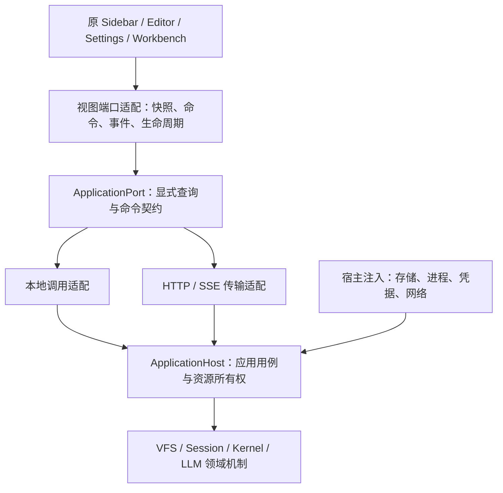

# 应用宿主迁移：边界审查与完成标准

架构选型、接口与流程的完整评审方案见 [应用宿主迁移评审方案](application-host-migration-review.md)。本文记录实现状态、缺口和回归证据。

## 目标与判断

迁移执行位置，不改界面、交互、导航语义和持久 UI 状态。HTTP 宿主持有唯一应用 Runtime；浏览器持有原有 UI 组件和视图状态。本地 Web、Tauri、CLI 的宿主装配继续成立，独立 npm 库不依赖应用协议。

当前迁移方向成立，但尚未完成。最大的偏差是创建了简化 ApplicationWorkbench，与原 SessionWorkbench 并存；其次是为了适应传输，把完整服务强制转换成 UI 服务接口。前者产生功能与界面分叉，后者掩盖同步接口、异步传输和缺失能力之间的差异。

## 四个边界

图示是统一目标。本地 UI 仍有直接接收具体服务的装配路径；HTTP 主会话工作台仍使用简化组件。不能把已存在 ApplicationPort 当作全部 UI 已统一的证据。

| 层 | 应承担 | 不应承担 |
|---|---|---|
| 独立领域库 | 文件、会话、任务的公共机制与契约 | MindOS 工作区规则、HTTP 路由、DOM |
| app-core 应用用例 | 项目归属、授权、配置关联、操作与恢复策略 | UI 模板、确认弹窗、传输分支 |
| app-shell 展示 | 原组件、路由、确认交互、视图缓存与订阅 | 创建 Kernel、持有执行租约、直连宿主存储 |
| apps 宿主 | 本地或远程接线、认证、存储、进程、传输 | 重写业务策略和同一产品界面 |

ApplicationPort 是传输边界，不应成为 UI 直接使用的巨大服务。UI 消费按领域划分的窄端口：文件来源、会话浏览、会话控制、项目导航、配置编辑、偏好与维护。端口按业务能力划分，而不是按 sidebar/editor/settings 三个 DOM 区域划分；同一能力可被多个界面复用。

## 审查发现与处理顺序

| 优先级 | 当前证据 | 处理方式 |
|---|---|---|
| P0 | HTTP 聊天仍用 ApplicationWorkbench，原 SessionWorkbench 已抽离 Kernel/仓储，仍依赖 ProjectService、挂载及远端控制服务 | 从原组件实际读取和操作抽出会话浏览、项目导航、任务检查与文件来源端口；替换依赖，保留原模板与路由。禁止伪造 Kernel 或开放任意方法 RPC |
| P0 | HTTP 设置隐藏存储概况、快照与重置 | 实现宿主维护能力和真实服务端存储语义，再接回原设置 UI；不得把 IndexedDB 维护搬到远端，或复制运行中的数据库充当快照 |
| P1 | 工具箱已复用原组件，Flow 菜单与 OCR 已接入；远端 Agent 详情与 MCP Harness 面板已接入，主工作台远端会话仍未接入 | 迁移对应应用用例，复用原菜单与控制面板；能力不可用必须明确表达，不能用空对象制造已迁移假象 |
| P1 | 标准工作区已复用原 Workbench，文件聊天与部分 AI 菜单未接入 | 复用原动作，通过显式应用命令执行；确认、导航仍在 UI |
| P1 | 配置视图通过 unknown 转换成完整 IAgentManagementService | 让独立编辑器声明实际需要的结构接口，快照读取与异步命令分开；不扩大独立库依赖 |
| P1 | LocalApplicationPort 集中大量领域分发，配置契约引用具体服务类型 | 按文件、会话、配置、项目、维护拆分处理器与 DTO，保留单一传输入口；不为每个方法新增 HTTP 路由 |
| P1 | 工具箱 catalog 获取全分类元数据，并准备远端 profiles | 分离本地目录投影与远端发现；保留原 UI 可见分组，按分类需求准备，有界并发，远端故障不拖住本地目录 |
| P1 | 部分文件缓存使用全局失效，项目来源的事件所有权尚未完整闭环 | 以语义工作区身份和目录范围失效；覆盖其他客户端写入、事件重连与视图关闭 |
| P2 | 生产候选尚未包含最新原组件恢复 | 同一候选构建 UI 与后端，完成界面和功能对照后成套切换 |

本次审查已修正：标准工作区默认选择原 Workbench；文件事件和缓存按语义身份比较，不依赖 JSON 字段顺序；编辑器代理的 getter 在真实实例上执行，避免私有字段访问错误。

## 当前实施证据

本轮保持原模板、菜单布局与交互，完成以下能力的抽离和接线：

| 能力 | 业务执行位置 | 原界面的接入情况 |
|---|---|---|
| 会话任务检查 | `session/task-inspection.ts` 提供分页摘要、关键事件与重置；查询不扫描全部 Kernel 会话，不获取写租约，重置等待授权 | 原 SessionWorkbench 注入 `TaskInspectionPort`；HTTP 查询/命令及视图适配已具备，主会话工作台尚未切换 |
| 会话工作台后端 | `session/workbench-backend.ts` 组装浏览、生命周期、归档、收藏与任务用例 | 原 SessionWorkbench 不再持有 Kernel/SessionRepository，也不自行创建这些业务服务；项目及文件来源仍需继续拆分 |
| 项目导航 | `projects/navigation-view.ts` 一次索引快照投影选择器、当前项目、会话与离线标记 | 原 ProjectNavigation 消费 `ProjectNavigationPort`；本地装配和 HTTP 适配均有测试 |
| OCR | `ApplicationRuntime.ocr()` 按需初始化且共享一次 Promise；服务端完成配置、提示词与识别 | HTTP 工具箱复用原 OCR 弹窗，删除配置仍提示 OCR 关联影响；本地 UI 使用同一 Runtime 能力 |
| Flow 菜单 | 原 Flow 命令由 ApplicationPort 交给宿主 CommandBus | HTTP 工具箱复用原右键运行菜单，未改写一套替代菜单 |
| 工具箱准备 | providers/connections、mcp/tools 共享在途刷新，失败可再次请求 | 减少重复刷新；尚未消除 catalog 的全分类/递归扫描，不能据此宣称折叠加载已完成 |

OCR 图像通过显式命令上传，校验媒体类型和大小；图像识别仍受后端 LLM 的取消能力限制，停止客户端等待不代表撤销识别。HTTP 写入继续走命令回执，不盲目重发。

前一轮回归：app-core 537 用例、app-shell 657 用例（另 30 个需外部环境的用例跳过）、HTTP 44 用例通过；HTTP 集成覆盖认证传输下的任务查询、项目导航、OCR 配置和命令回执。此处是源码与本地回归证据，不是公网首屏耗时或整体验收结果。线上版本尚未切换。

## 远端 Agent 与 Harness 接线

原 `RemoteAgentDetailsEditor` 改为消费 `RemoteAgentDetailsPort`，项目关联与可创建判断由 app-core 投影为导航数据。HTTP 路径不再把远端 Agent 当作本地 Agent 配置加载，避免取得无关配置和文件正文。原按钮、文案和路由保持不变；这些按钮进入主会话工作台后的远端项目路径仍属于 P0 待迁移范围。

MCP 设置的原 `PiAgentMCPControls` 只需 `harness(id)` 能力。HTTP 注入 `createApplicationHarnessClient`，原 Harness 控制面板的列表、历史、创建、恢复、发送、中断、交互响应和回执查询经 ApplicationPort 执行。浏览器不持有远端连接或凭据。通用 HarnessClient 契约与独立库均未增加应用或 HTTP 依赖；该控制面板适配不宣称支持聊天工作台的附件、分支及项目作用域能力。

- `application/harness-contracts.ts`：明确的可传输查询、命令、超时和结果；不存在任意方法 RPC。
- `application/harness-runtime.ts`：连接选择及配置授权策略；每次使用检查所绑定的配置，连接移除或凭据变更后旧视图拒绝访问。
- `application/harness.ts`：每客户端、每视图的连接所有权、在途操作与释放；只释放传输，不隐式中断远端任务。限制活跃连接及已释放标识数量；视图空闲 60 秒后释放连接，避免刷新页面遗留连接。空闲到期不做轮询、不取消任务；仍打开的面板下次操作会重连并重新校验配置，显式关闭则拒绝晚到请求。
- HTTP 查询断开后向后台传递取消信号；已接受写入继续执行并保存回执。结果未知时先核对应用回执，再核对远端回执，禁止自动重发。
- Harness 控制面板随 MCP 设置动态加载，远端 Agent 详情按打开详情加载，不增加无关工作区的首屏模块依赖。
- 聊天视图忽略普通文件事件，避免其他工作区或后台文件变更引起无关聊天快照读取。

本轮验证：app-core 543 项、app-shell 661 项（30 项外部环境用例跳过）、HTTP 45 项通过。认证 HTTP 集成覆盖远端结果未知的回执重放、客户端隔离、关闭面板不取消任务、移除连接拒绝旧视图，以及查询断开传递取消。测试使用隔离数据与模拟远端，不代表真实 8787 或公网性能验收；线上服务未替换。 默认并发复跑曾在 digital-twin-selection 和 projects 的 IndexedDB 用例出现扫描等待与搬迁状态错误；使用 `vitest run --maxWorkers=2` 全部 543 项通过。此结果尚不能证明高并发下的时序问题已消除。

## 启动与性能

readiness 表示某项能力可安全使用，不表示整个应用所有后台任务都结束。每项能力共享一次初始化 Promise，访问者只等待自己的依赖。初始化失败要向访问者传播；重试由明确策略控制。关闭时停止接受新操作，排空已接受操作，再释放资源。

区分三个时间：宿主可接收请求、当前工作区可交互、后台恢复结束。服务器运行已就绪时，浏览器不得重新创建 Runtime；打开文件目录不等待 LLM，进入模型编辑才等待配置，发送消息才等待会话写入门和租约。状态快照读取应尽量避免隐式取得写租约，授权和写入门仍须由后端强制。

并行只沿初始化依赖图执行独立步骤，并限制存储和网络并发。折叠目录不读取后代；目录列表返回展示所需元数据，避免逐节点 stat。UI 组件按工作区动态导入，后端保持共享能力与服务缓存。禁止后台扫描、远端探测与首屏目录查询同时无界抢占同一 SSH 链路。

缓存分三类：后端共享目录/配置快照、前端可见视图缓存、静态资源缓存。所有可变业务缓存必须有提交后失效和事件断流后的重同步；密钥按显式编辑请求获取。缓存不能绕过权限、租约、版本检查或回执核对。超时与取消 UI 等待不等于撤销后端写入，结果未知的命令不能盲目重发。

## 验收门槛

- 同一组件分别注入本地和 HTTP 适配，原菜单、工具栏、标签、分组、弹窗、深链接和 UI 状态保持一致。
- 标准目录首屏只查询必要层级，折叠子目录与未打开正文零请求；后台恢复不阻塞无关工作区。
- 命令、提交后事件、跨客户端更新、重连重同步、隐藏视图和关闭生命周期形成闭环。
- UI 构建图不引入 Runtime、Node 存储或执行模块；独立库在仓库外安装、类型检查与打包验证通过。
- UI 与后端来自同一候选，先完成本地功能验收，再验证公网链路；公网不稳定与迁移缺口分别报告。

只有完成这些门槛，才能宣称 HTTP 迁移完成。当前针对组件和端口的测试通过不等于完整功能或生产验收通过。
