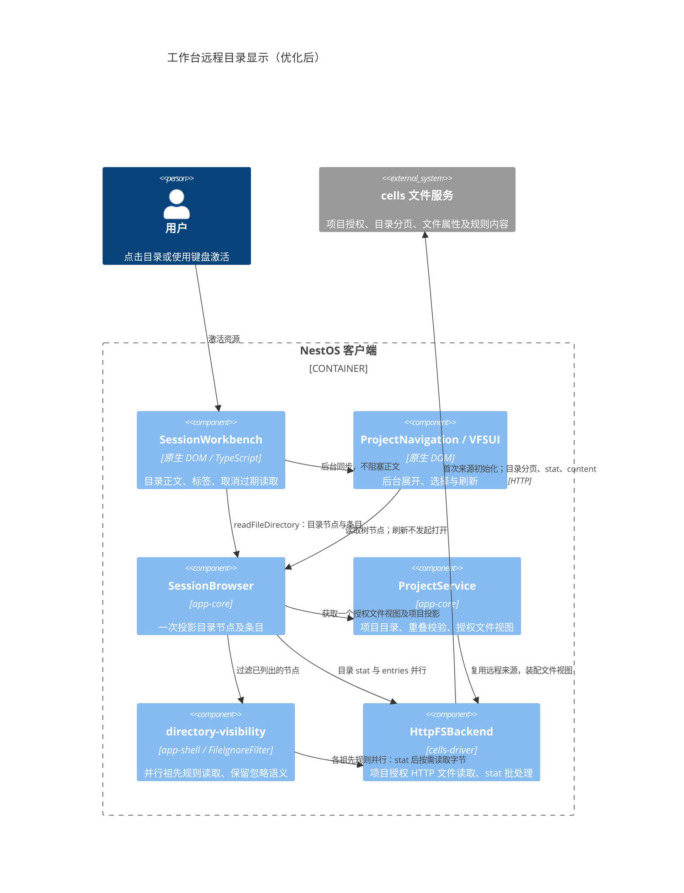
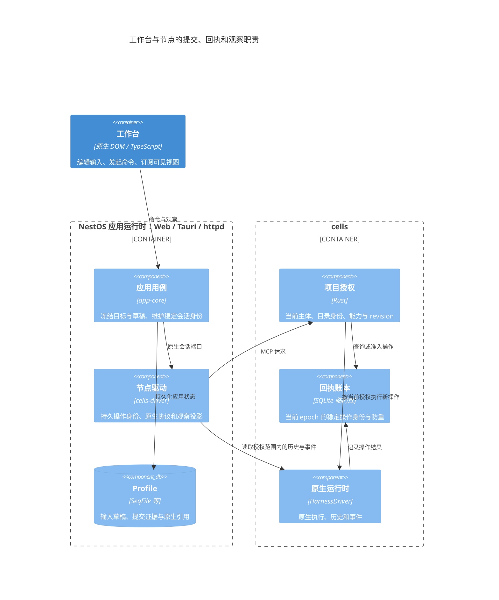
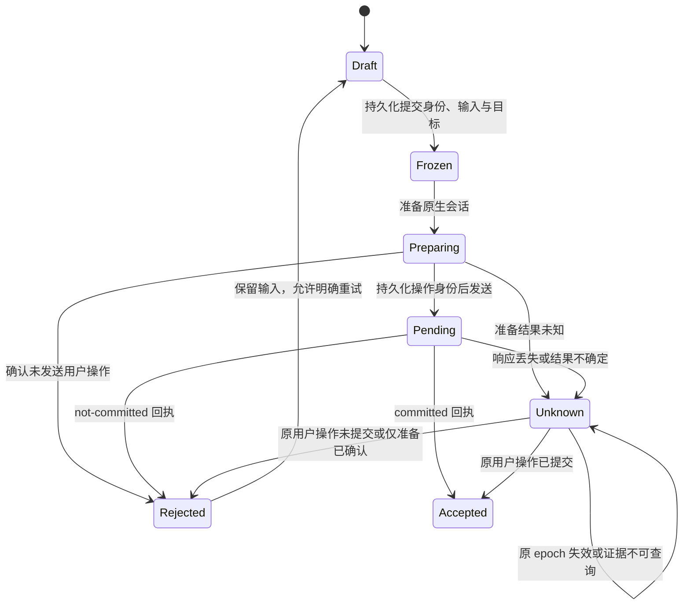
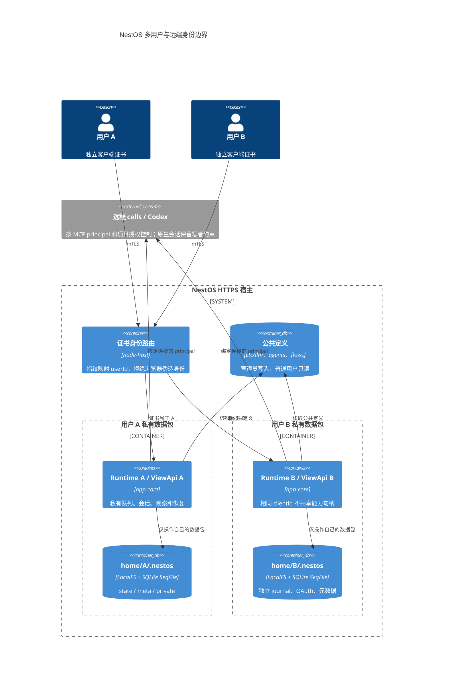
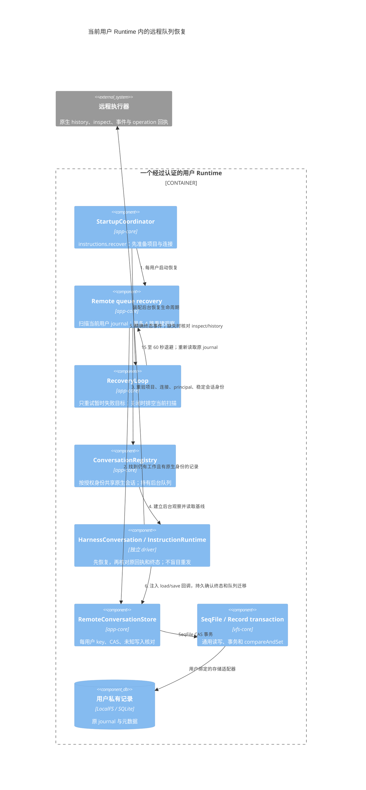

# cells 项目与同步模型

## 结论与重构原因

原实现的文件导出、短命进程、Codex workspace 和 sync project 是不同实体。客户端可选导出目录的子目录，但服务端没有共享项目身份；Codex 直接使用宿主路径，不能继承进程的目录挂载与只读策略。单纯增加 MCP 接口不能解决这个边界。

现在分成两个业务服务：项目管理负责真实目录及其执行授权；sync 负责对象、manifest、replica 和数据集同步。两者共享认证与连接，配置和数据目录互相隔离。sync 的 project ID 不等于可执行目录项目 ID，不自动创建执行授权。

## 目录与身份

```text
cells installation (stable server_id)
├── exports: authorized directory roots
│   └── home = /srv/work
│       ├── team/a -> executable project A
│       └── team/b -> executable project B
├── projects: private project catalog outside exported directories
│   └── project = alias + relative path + access + mount policy + revision
├── harnesses: explicitly configured native runtime homes and executable commands
└── sync: independent object and metadata storage
```

`exports` 是可选择项目根的范围，不要求导出根本身就是一个项目。项目根可以是任意合法层级的子目录。`project_register` 默认绑定已有目录；`createDirectory=true` 只在已有父目录下创建一个新目录，不递归创建未知父目录。路径拒绝遍历、链接、宿主绝对路径，按组件规范化重复和尾部斜杠。

服务端在稳定安装与认证身份内按 alias、相对路径去重，为首次注册生成并持久化项目 ID；重复注册返回已有项目，保留名称、权限和挂载。目录设备/inode/创建时间身份也保存在私有 catalog；原路径被其他目录替换时拒绝访问，不自动改绑。元数据使用单实例文件锁、8 MiB/1024 项上限、原子替换和目录 fsync；替换后持久化状态不明时停止服务该 catalog。

itookit 保存自己的项目 ID 与服务端项目引用，显示「服务器名:项目名」。工作台组织和 NestOS Session 记录仍存客户端 profile；Codex 原生会话仍由 native harness 的 home 管理。新项目协议支持只读和读写文件根，旧无项目协议的远程绑定继续只读。历史 `.nestos/readonly` 元数据路径保留以免迁移已有会话，不再代表文件根必须只读。

服务端导出 `rw` 是授权上限；NestOS 创建远程项目默认保存 `ro` 绑定，修改服务端配置不会自动升权。远程项目菜单只提供重命名、重新挂载和卸载等项目管理操作，不提供根项目的复制/移动/删除入口；项目内文件保留其文件操作。重新挂载使用 `remountProject` 用例：切为 `rw` 时读取服务端登记，必要时调用带 revision 的 `project_remount`；切为 `ro` 只收窄客户端视图，不下调其他客户端的服务端授权。持久绑定更新后撤销旧视图及会话授权，释放旧来源，保留项目 ID、文件和原生会话。切换前保存并关闭本项目编辑视图，本地在途任务由应用层拒绝，服务端权限修改由文件执行门拒绝；响应丢失后重读登记核对，不盲目重放。

卸载经独立 `ApplicationBackend.unmountProject` 用例，仅撤销客户端挂载、移除本地项目接入和本地 Session；离线仍可卸载，不遍历远端树，不调用服务端 `project_forget` 或原生删除。MCP 详情将 ProjectRemoteMountService 的挂载、客户端权限与连通状态投影为列表，不把挂载记录复制进 MCP 配置。cells 启动日志单独展示实际导出权限，避免将导出上限与项目绑定混为一谈。

## 同一项目授权用于三种访问

| 能力 | 授权来源 | 传输 |
|---|---|---|
| 文件、结构修改、SeqFile | projectId + revision + alias/path，读写权限可衰减 | 原 HTTP 文件协议，增加项目上下文 headers |
| bash / tools | 服务端项目根与 mounts，客户端不能自带更多目录 | MCP `project_exec`；HTTP 查询、取消与回收沿用进程协议 |
| Codex 会话 | 同一项目授权、profile 与策略 revision | MCP harness 工具携带 projectId/revision；native stdio 留在服务端 |
| sync | sync principal/namespace/dataset/replica 授权 | 原 sync HTTP 协议 |

文件请求携带 `x-fsagent-project`、`x-fsagent-project-revision`，只读视图还携带 `x-fsagent-project-readonly`。服务端检查批量 stat、列表、内容读写、重命名两端和 SeqFile 路径；只允许项目根与已配置挂载来源。初始化允许必要的祖先目录 stat，不开放祖先目录列表或内容。根目录或挂载身份变化、策略 revision 过期均拒绝访问。未带项目上下文的旧文件接口仍受安装级导出授权约束，是兼容的管理接口，不作为项目的执行授权。

项目根在 bash 里映射到 `/workspace`，在 Codex runtime 里映射到稳定的 `/projects/<projectId>`。后者使同一个 native home 中的会话能够按项目 cwd 区分。项目会话列表只返回该项目 cwd 的会话，历史读取和恢复也检查边界；旧 CLI 的宿主 cwd 只有落在当前项目真实根内才允许映射到虚拟 cwd 后恢复，不将原宿主路径交给沙箱内执行。接管仍拒绝其他客户端正在运行的原生会话。

额外挂载只能来自已授权导出 alias，目标必须位于项目主目录内。目标目录需预先存在，防止 launcher 在创建挂载点时偷偷修改项目文件。只读挂载不允许升权，重叠来源不能同时获得 ro/rw，当前一个执行环境最多写一个导出。客户端绑定会导入服务端额外挂载；服务端策略发生变化后，旧文件版本拒绝访问，旧客户端执行视图也拒绝静默扩大授权，需刷新绑定。

## 执行与后续 VMM

`ProjectLauncher` 是 bash 与 harness 共用的启动端口，输入为已经授权并解析的目录 Plan 与保留锁，输出为受监管的启动命令和能力句柄。当前实现为 bubblewrap，目录通过 fd 挂载并核对持久目录身份。将来 VMM 应实现同一端口及相应生命周期，不能接受客户端提交宿主目录或任意 backend。当前没有实现 VMM。

项目 Codex app-server 在外层项目沙箱中运行；其 native sandbox 设为 danger-full-access，让真正的目录边界由外层沙箱统一执行，native approval 仍为 on-request。审批无法扩大外层挂载。明确的 harness home 挂到 `/harness`，运行时系统目录和 harness 可执行文件也在权限范围内；不会因为配置 executable 而挂载它的整个父目录。部署需使用可独立运行的 native executable。

默认隔离网络；`projects.network=true` 明确允许联网，并只读提供解析器和证书文件。命令和运行时 home 来自部署配置，远程请求不能修改。没有可用的 bubblewrap/user namespaces 时执行拒绝启动，不能退回直接宿主执行。

进程执行和 Codex turn 与文件访问共用 FileGate。Codex 收到完成事件后失效文件 revision 并释放 gate；中断需确认原生完成，断开控制面板不会被当作完成。清理不能确认时保留未知/拒绝状态。原生 turn 只排斥文件修改；stat、目录、内容、SeqFile 查询、项目搜索和 MCP 目录读取可并发进行，只读请求不再使新 turn 准入失败。写保护仍是安装级，其他项目的修改可能收到 EBUSY；project_exec 和挂载变更保留完整排他，未知进程回收仍封闭两类访问。并发读取不是内容快照；弱 revision 额外核对大小、mtime 和 ctime，防止原地修改继续复用旧校验值。项目级写保护、强跨进程 lease 和 VMM guest 回收属于后续工作。

客户端根目录探测收到 `EBUSY` 时保留连接可达，项目状态显示“远程文件暂时忙碌”，不将其投影为离线或阻止新会话草稿；文件操作仍遵守远端 FileGate，任务结束后重试。诊断保存 `root-probe`、`EBUSY`、`busy`、操作关联 ID 与耗时，成功探测清除当前忙碌状态，保留历史日志。项目侧栏的新会话与状态入口使用带 title/aria-label 的图标按钮，为项目选择框保留宽度。项目状态弹窗固定顶部标题和底部操作栏，关闭按钮位于底部右侧，仅内容区随长挂载列表及日志滚动。

诊断日志后台最多留存 500 组，界面每页查询并显示 20 组，按最近更新倒序，提供上一页、下一页、页码及筛选后的组数。查询先按项目、连接、级别和关键词筛选，再通过 `offset` / `limit` 分页；留存裁剪造成原页越界时回到最后有效页。修改筛选回到第一页，实时刷新保留当前页；复制仅包含本页。日志分页记录操作 ID、偏移、数量、结果、错误码和耗时，不记录搜索词或原始异常正文。

同一来源、操作名、阶段和 `operationId` 的开始与终态合为一条，保留 `startedAt` 和耗时；进行中的不同操作各自保留开始，不因其他操作结束而被覆盖。连续同类失败仍按原来源聚合，累计次数只统计操作结果。历史开始／终态在加载时按相同身份合并，存储更新通过原 SeqFile 事务删除冗余条目。单次事件默认仅展示结果、具体错误、耗时和可选开始时间，重复组再展示次数、首次／最近时间与耗时范围。

旧 profile 的显式宿主 workspace 保留历史管理兼容，仍禁止与 exclusive rw exports 重叠；它们不成为新项目的执行路径。新 profile 通过 `projects=true` 授权项目 runtime，原 workspaces 不再需要逐项目列出。未来 harness 继续实现 HarnessDriver，项目授权不放进具体 native adapter。

## itookit 连接诊断

### 目录显示：C4 组件与等待分析



HTTP 关系经过授权 VFS 视图；图中的组件关系不是 UI 绕过 VFS 直接访问远程服务。组织项目页展示“文件、收藏、会话”等入口，物理文件目录页读取项目目录条目，两者不要混为一个请求。

| 阶段 | 原等待或冗余流程 | 当前实现 |
| --- | --- | --- |
| 资源打开 | 点击与刷新共用选中事件；刷新可能重新打开旧资源 | 启动时恢复选中项；之后只用资源激活事件打开。移除 `selectionSync` 及重复导航抑制逻辑 |
| 已知目录 | 先进入文件编辑器查询类型，再切到目录页面 | 从侧栏、目录列表和文件根取得目录提示，直接读取目录；仍由真实源验证类型 |
| 未知深链 | stat 后释放文件视图，再重新打开读取目录 | 识别为目录后保留已开的视图与节点，目录完成或失败时释放一次 |
| 目录头与行 | 分别获取项目投影、收藏、文件视图；串行类型查询再列目录 | `readFileDirectory` 共用一个视图及投影；stat、entries、项目投影并行，已取得的 stat 不再查询 |
| 项目文件视图 | `forFolder`、`openFiles`、重叠检查分别读取目录清单 | 同一次打开共用清单，保留来源与重叠校验 |
| 忽略规则 | 每次过滤递归串行读取祖先；规则文件查询类型、属性，文本读取再触发类型检查 | 祖先规则并行，展示策略每个规则文件只调用一次属性查询及一次原始字节读取；同次调用按路径去重，VFS 保留必要校验 |
| HTTP stat 批次 | VFS 路径校验可能在同一批次多次提交相同祖先路径 | 同一批次按路径去重，向每个订阅者分发对应结果；订阅者取消与期限仍独立，不跨批次缓存 |
| 权限 | 映射节点已有只读状态，正文再查浏览器投影的 capability | 使用授权来源映射出的只读/禁用状态，保留行操作策略；实际写入仍由源授权校验 |
| 刷新 | 列表返回前等待侧栏刷新与展开 | 条目返回后后台刷新侧栏，不再额外展开 |

若有 K 个祖先目录、其中 S 个包含 `.gitignore`，展示策略调用 K 次 `getNode` 和 S 次原始内容读取；不查询每个普通文件的内容。VFS 读取仍验证文件类型，挂载视图仍检查路径中的链接，实际 HTTP stat 数量不能直接等同于 K。祖先请求同时启动，共享同次读取的 Promise，不跨次缓存，因此外部修改、删除规则文件会在下次目录读取生效。挂载的 discovery root 仍限制规则读取范围，保留父规则、否定规则、已忽略父目录及无内置默认排除的语义。投机读取的错误只有在规则实际被过滤器使用时传播；全部读取结束后才释放文件视图。

已知目录的正文路径为：获取授权视图 → 并行目录 stat / entries / 项目投影 → 并行祖先规则 → 节点映射 → 渲染。首次来源初始化与非在线连接的有界探测仍需要等待；大目录仍按协议读完分页，不伪造完成。`projectDirectory.read` 记录正文总耗时，`projectFile.navigation` 记录后台导航耗时。测试验证源获取次数、规则请求数量与并行启动、修改后的刷新、取消与故障、只读创建限制以及侧栏刷新不会打开旧资源；真实远程网络的耗时需现场观测，不能由单元测试推断。

远程项目持久保存 `connectionId`，运行时从工具箱 MCP 配置投影连接。原来的 `[ENOENT] fs: Remote file system not found` 来自本地连接查询，不能据此判断 cells 上的目录或原生 session 已丢失。配置存在但未通过 cells 能力验证时也不会进入连接投影。

连接访问现使用结构化 `RemoteConnectionUnavailableError`，区分 `mcp-not-found`、`catalog-not-loaded`、`auth-missing`、`extension-missing`、`invalid-descriptor`、`endpoint-mismatch`、`invalid-endpoint` 和 `unsupported-transport`。界面显示配置名称与修复提示；目录说明及菜单生成容忍暂不可用的连接。异步 harness、连接检测、能力查询和目录浏览会先恢复当前引用的 MCP 配置，不按名称或服务器地址猜测并重绑项目。

远程项目在项目选择器旁与项目菜单提供“项目状态”。状态窗口独立于远端目录打开，项目离线时仍可查看本地后端记录、重新检查及复制日志。项目菜单及工作台的状态窗口另提供“刷新授权与项目绑定”：以已保存的 MCP 身份重新发现运行时授权，再以原访问级别更新原项目绑定并检查连接，不重写共享 MCP 配置；权限由服务端授予，服务端拒绝时保留原绑定并明确提示管理员处理。相同原生故障只在错误分类变化时发布状态失效通知，避免导航刷新重试形成循环；每次操作的诊断仍可查询。状态区分尚未检查、检查中、已连接、无法连接与部分功能不可用；文件根探测和原生会话目录分别提供证据。原生 profiles/list 失败按 profile 分别保留，只有对应读取成功才清除，不能用 MCP 握手成功或其他 profile 恢复覆盖。项目菜单先打开，不等待同步状态查询成功。

“设置 → 系统日志”首先通过 `ApplicationBackend.diagnostics` 查询当前用户 Runtime 的事件；工具箱所有 MCP 详情均有“连接状态与日志”，cells 详情中的挂载项目可直接打开项目状态。工具箱 MCP 徽标同时参考关联项目状态：握手成功但项目失败/部分不可用时显示异常，待检查时不显示全绿；提示分别说明协议状态和项目数量。HTTP 使用显式 query/subscribe 能力，不读取或转发 Node 进程的全局 MemoryLogger，日志读取失败会显示错误并可重试，不显示为空日志。

`DiagnosticJournal` 在各 Runtime 内按来源合并连续相同事件：记录首次/最近发生时间、次数、恢复或结束时间、耗时范围及最多五个近期关联操作样本；阶段、项目、挂载、profile、会话或错误分类不同不会混合。其他来源插入不打断本来源，恢复、分类改变、超过五分钟间隔或运行时重启会结束旧分组。最多保留 500 组且不超过 512 KiB，单次查询最多返回 200 组，界面每页 20 组，支持项目、连接、模块、级别、关键字及时间范围筛选。事件经用户系统文件能力持久化到 `/var/log/application-diagnostics.seq`，每组使用独立 `event:<id>` entry，以版本化索引及 SeqFile 事务原子提交本次变化和淘汰记录；旧 `events` 整体数组在成功事务中迁移并删除。正常关闭排空写入；刷新或重启后可重读保留事件，但当前可用性仍需要重新检查。初始化/写入失败明确显示仅内存状态。挂载、刷新绑定、卸载、根探测、MCP 连接与能力发现、原生目录失败与恢复均记录重要事件，包含 operationId、阶段、结果、具体错误码、耗时及适用的项目/连接/profile/会话/requestId。MCP JSON-RPC 的数字错误码单独保留 rpcCode；异常原因只提取安全分类与错误链，不记录正文、凭据、认证引用、请求头、端点地址或原始堆栈。

根探测共享一个超时预算，超时记录为无法连接并保留 ETIMEDOUT；主动取消恢复原状态。离线占位保留最初的诊断，不能以笼统 EIO 覆盖授权变化等原始错误。原有 `cells` / `llm:mcp` 内存日志和开发者控制台仍可用于当前进程调试，日志页将浏览器日志与服务端持久事件明确区分；浏览器日志级别设置只影响当前页面，不修改服务端记录策略。状态窗口进一步分开展示协议握手、请求身份认证、当前导出/项目权限和本地绑定版本。授权探测只读 `project_roots` / `project_read`，导出未开放时显示“未获项目授权”，不泛化为网络连接失败；该身份的全局授权 revision 变化不能直接证明某个导出撤权。状态页提供 MCP 配置、remount、绑定刷新及按导出/身份生成的服务端授权修复命令；命令仅供管理员确认执行，不把普通 MCP 连接当作授权管理接口。表单草稿及展开的日志详情在刷新期间保留。显式 MCP 刷新会建立新连接和握手，避免 SDK 缓存旧授权元数据。

同步控制记录也独立保存 MCP `connectionId`。旧同步绑定的失效引用不属于原生 harness session；状态读取只读本地记录，不能因刷新项目菜单而创建远程客户端并抛 ENOENT。项目同步图标、当前项目状态按钮及悬停异常列表展示失效原因，保留显式解绑；实际同步操作才恢复当前引用。未发送命令的绑定可离线解除，结果未知的命令及序号继续保留，不推断为未提交。

工具箱的 MCP 图标显示管理器实际观测的未连接、连接中、已连接或异常状态，悬停显示失败阶段、原因与观测时间。配置刷新不发起网络探测；未连接不能推断为服务器异常。连接与能力发现失败保留诊断，显式测试成功清除旧异常；主动断开显示未连接，意外断开显示异常。状态属于运行时，不随 MCP 配置保存，也不包含凭据或原始错误正文。

## 接口与配置

MCP 增加 `project_roots`、`project_list`、`project_read`、`project_register`、`project_configure`、`project_forget`、`project_exec`。`project_configure` 使用 revision CAS，运行中拒绝修改；项目根不可通过 configure 改绑。`project_forget` 只撤销授权和目录映射，不删除数据；重新注册产生新项目 ID，旧会话不会静默绑定到新目录。文件系统需支持目录创建时间，否则项目目录身份校验拒绝开放。注册可按目录身份查回结果，配置结果未知时读取 project_read 对账，不能盲目重放。进程、harness 继续使用各自 epoch/requestId 与查询/回收机制。

```toml
listen = "127.0.0.1:8787"
server_id = "office-node"
execution = true
api_key_env = "CELLS_API_KEY"

[projects]
root = "/var/lib/cells/projects"
network = true

[[exports]]
alias = "home"
path = "/srv/work"
access = "rw"

[[exports]]
alias = "reference"
path = "/srv/reference"
access = "ro"

[[harnesses]]
id = "codex"
kind = "codex"
command = "/opt/codex/codex"
home = "/var/lib/cells/codex"
projects = true
```

服务端路径需存在且被部署账号授权。catalog、sync 存储、harness home 不能与导出根相互包含。原有纯文件、纯 sync、历史 harness 配置不用开启 `[projects]`。

## 验证与范围

测试覆盖深层目录注册、单级目录创建、目录去重和重启恢复、挂载衰减、版本冲突、运行中拒绝修改、目录替换拒绝、文件路径越界拒绝、项目会话隔离及 turn/file 互斥。MCP SDK v2 → Rust → HTTP 文件链已验证；真实 bubblewrap 验证 bash 写主目录与只读参考目录；真实 Codex CLI 验证临时 home 内的会话创建与跨项目历史拒绝，没有调用模型或读取个人会话。

未声称验证实际模型工具执行、VMM、PTY、Windows/macOS sandbox 或安装级 gate 的并发性能。远程挂载策略更新后需要显式刷新客户端绑定；不自动将新增服务端目录授权发给已有 Session。

## 手动单向同步到项目目录

目录同步由两条独立关系组成：itookit 本地项目 ↔ files 数据集，以及 files 数据集 ↔ 服务器项目中的已有目录。两条关系各自选择方向、预览并确认执行；打开目录面板不会修改本地同步方向。服务端必须同时开启 `[projects]` 和 `[sync]`，sync 存储保持私有。Web 已装配交互；Tauri／CLI 可以使用相同协议，其宿主同步入口仍需单独装配。

默认使用更新模式：复制新增／修改项，保留目标独有文件，不自动传播删除；双向模式将独立编辑收敛，同一路径双方改变时保留冲突。目录类型转换、符号链接、读取不完整和超限项阻塞目录计划，不能通过普通选侧绕过。目录同步不穿透附加挂载和 `.nestos`。镜像删除、自动触发和目录结构转换未开放。

`piagent_capabilities.directorySyncVersion=2` 表示支持完整方向及比较接口；只有旧 directorySync 布尔能力的服务器在界面中限定为数据集落地，并说明升级入口。

| MCP 工具 | 作用 |
| --- | --- |
| `project_sync_directories` | 按执行项目 ID／revision 浏览项目内已有子目录，不允许任意服务器路径 |
| `project_sync_bind/status/unbind` | 建立、读取、解除持久目录映射；解绑保留文件 |
| `project_sync_configure` | 按 policyRevision CAS 改方向，清除旧计划；applying 时拒绝 |
| `project_sync_preview` | 捕获固定数据集 head 与目录内容，返回带 side 的新增／覆盖 actions 及结构化 conflictDetails |
| `project_sync_compare` | 绑定 planId／冲突路径，返回基线、dataset、directory 摘要与最多 256 KiB UTF-8 文本；缺失、二进制、超大／不可用版本明确表示 |
| `project_sync_resolve` | 选择 dataset 或 directory 作为内容来源，仅允许当前方向及可处理冲突，生成新 planId 供再次审阅 |
| `project_sync_execute` | 按当前 planId 应用或恢复；执行前复核目标与来源，存在未解决冲突时保留文件并拒绝目录执行 |

绑定保存稳定 bindingId、执行项目与策略 revision、sync 项目／dataset、authority／namespace／historyEpoch、目标子目录及目录身份。重复／父子重叠目标拒绝，重试 bind 只能返回同一目标。基线、计划、方向 revision、目录回传的 replicaId／nextSeq／publishCommand 保存在私有 catalog。

目录回传直接复用 sync 命令的条件发布、持久序号及回执，不另建发布事务。对象与 manifest 验证后，在发布前保存 applying 意图及精确 command；恢复首先查询同一 replica／序号的回执，后续 head 改变不会覆盖原结果。确定拒绝后计划标记 rejected，可重新预览；未知／过期回执保留原证据并阻塞。下载的逐项持久化／baseline checkpoint 保持原恢复边界；外部 shell 不参与文件锁，内容变化时条件应用拒绝覆盖。

界面先选择服务器项目及相对子目录，可以逐层浏览，再选择“数据集落地／目录回传／双向”。预览展示数量、路径、操作及修改目标，支持按路径筛选。冲突显示原因和两侧摘要，按需读取正文并标出文本差异；可逐项或批量选择来源，选侧只产生新预览，第二次确认才写入。旧预览、已发送操作及关闭面板各自保留明确语义。
## 工作台与 llm-ui 的远程会话

完整远程项目绑定在项目树下增加「远程会话」，再按服务器实际声明的 project harness profile 分类。目录参考挂载不会授权该目录所属项目的会话。会话节点使用远程图标，路由为 `<项目组织路径>/@harness/<profile>/<native-session-id>`，与本地 Session ID 分开。下一页目录使用单个 `@page:<编码游标>` 路径段，每页会话和后续分页目录都是当前目录的直接子项，满足 VFS 列目录边界；分页路径仍解析到相同 profile/native session 身份。离线节点显示不可用，不让整个项目导航失败。

Codex 会话从显式配置的 home 通过原生 `thread/list` 发现，再以项目目录授权过滤；历史记录中的宿主 cwd 先解析真实路径，允许同一目录的符号链接入口，但不能越过项目根。不用会话文件所在路径作为项目归属，也不要求用户把 home 再导出成项目目录。

项目沙箱同时挂载 home 的真实绝对路径和 `/harness` 兼容入口，保留原生索引保存的日志位置。浏览器 stat 使用 `harness_session_info`，不加载完整历史。paginated 历史及摘要请求从受限 JSONL 窗口分页读取，每页最多 100 项/2 MiB，`nextCursor` 继续加载更早记录。JSONL 使用真实 turn_context/task_started 身份和记录时间，兼容 function_call/custom_tool_call，不再把整份历史标为同一个假轮次。session.native 不重复返回 turns。工具摘要在预算前移除详细输入及输出，避免大工具结果挤占消息页。

原生分支通过 `harness_fork` → `thread/fork` 创建，名称存入原生会话，epoch/requestId 回执覆盖创建与未知结果恢复。`parentSessionId` 定义分支家族，界面可查看、切换及创建分支；创建后导航到新原生 session 路由，不生成本地 Session。只读项目、空历史、活动会话或待确认操作禁用创建。会话继续使用原生 resume；CLI 不支持的操作保持明确失败，不自动转换或重放。

工作台用户提问下方提供独立分支图标，含义为保留该完整轮次后继续；编辑图标用于替换该提问并在新分支运行。原生观察快照以 `forkSupport: none | latest | turn` 声明位置范围，以 canFork 表达暂时可用性。当前 driver 将已有原生 fork 能力声明为 latest，不声明未接入的历史 turn 分叉；Claude/dsh 当前未支持 fork。选择旧提问时明确确认是否改从末尾分叉，取消或隐藏视图后不执行；支持 turn 的宿主通过 ConversationControls.forkAt 接收真实 messageId/turnId，不能使用展示卡片 ID 或按提问文字匹配。`/branch [name]` 与 `/branches` 是宿主命令，分别创建末尾分支和打开分支列表，不透传终端导航、不发送模型消息。失败保留输入，成功只清理仍匹配的命令草稿。小屏将分支切换器收进顶部更多菜单。

原生会话节点使用语义标题显示模式，路由和原生 ID 保持稳定。名称优先原生 name，再使用 preview；均为空时显示未命名会话。createdAt 与 updatedAt 独立保留为毫秒，驱动兼容旧服务的原生秒时间和 native.createdAt，未知时间不显示 1970 年。侧栏显示创建／修改时间，目录列表的修改时间列和名称悬浮提示使用真实时间；会话标题悬浮提示也包含两种时间。侧栏和目录列表默认按最后修改时间倒序，未知时间排末尾；新建／分页操作保持独立顺序。

原生会话与本地会话共用 llm-ui 的标题栏、历史展示、输入组件、复制/折叠与历史可见性控制。现代 ChatView 将同一原生 turnId 的不同工具输出实时追加到一条默认折叠记录，跨助手进度文字保留分组；文字仍单独显示，摘要更新数量和运行/失败状态，刷新与分页保留展开状态及原节点。缺失 turnId 时按用户消息边界分组，不跨用户轮次合并；仅改变展示，不修改执行事实。`ConversationWorkspaceView` 装配共享视图，`RemoteConversationEditor` 仅将宿主的 `ConversationControls` 绑定到视图。`remote-rounds` 按原生 turnId 汇总：每轮一个用户请求 MDxEditor 和一个响应 MDxEditor，用户内容数组经 contentParts 保留文字项边界，展示和复制时在各项之间插入 `\n\n---\n\n`；保留同轮全部助手回复及思考，真实重复请求不会按文本去重。工具显示名称、操作、首个非空命令行和目标路径；命令预览最多 240 个字符，不展开后续代码、完整参数或结果；助手正文的代码块仍使用现有折叠控件。时间从原生日志及事件保留为毫秒，未知时间留空。分支标签使用 branchName，根分支为 main；未命名原生分支明确显示未命名，不使用请求预览冒充分支名。缺少 turnId 的旧数据按用户消息边界投影。同一原生轮次的编辑器标识不因分页或增量输出改变，快照刷新保留现有实例。打开会话先显示最近一页，再自动逐页补齐到开头；顶部显示加载进度，失败保留已加载内容并允许手动重试，不随轮询重复失败请求。驱动检测重复和循环游标，并保留已加载的全部页面，刷新和事件缺口恢复不丢弃早期历史。总容量达到 10,000 条或 32 MiB 时明确失败，保留现有历史和游标，不静默裁剪。发送、停止及审批直达远端，不创建本地会话或走本地模型驱动。界面根据原生控制权禁用发送、停止与审批，未知结果保留草稿并提供核对入口。

打开原生会话与创建、切换原生分支均保留项目选择器的当前范围；只有显式选择项目才切换侧栏范围。宿主通过 `hostContext.toggleSidebar` 注入侧栏控制，远程编辑器不把侧栏按钮视为 harness 执行能力。标题栏事件、响应式更多菜单由共享 `EventBinder` 管理；上一条/下一条展开消息、消息导航和打印复用 HistoryView、FloatingNavPanel、MDxRenderer 与 LLMPrintService。原生导航只提供浏览、复制与折叠，不提供本地上下文修改或历史删除。分支按钮和下拉列表使用共同的 BranchIndicatorTemplates，原生 ID 用于切换，分支名称仅用于显示；创建入口收进下拉菜单，未支持的分支删除不显示。状态点经 StatusIndicatorView 显示就绪、运行、待核对和异常。原生 HTML 在屏幕与打印中均按字面呈现。

原生会话输入区通过独立 llm-ui 的通用 composerIndicators 投影与附件加号同一行的上下文分段占用条与预算文字，未知占用以虚线区分；手机点击向上展开明细，不依赖悬停、不挤占发送控件。预算按正向数据互斥选择：有效额度优先，否则显示原生估算或宿主费用估算，仅选一种；都不可得时为未知，不按模型名推断订阅。多窗口摘要取最紧张的剩余额度，明细保留各窗口与重置时间。原生会话信息面板共用同一预算投影，累计 token 独立显示，避免同时列出额度与费用。`capabilities.metrics` 正向协商只读 `harness_session_metrics`，`refreshMetrics` 在独立通道读取，不等待发送 tail，不占提交槽、不消费草稿、不更改观察失败状态。原生绑定就绪及 turn 开始/完成边界读取，信息面板也支持显式刷新；不按文本 delta 查询，不新增轮询、不 resume、不发送 turn，隐藏视图暂停自动读取。Codex 上下文取最近 `thread/tokenUsage/updated.last` 与 `modelContextWindow`，无事件时读取 token_count 历史的 last_token_usage 与 model_context_window；累计 total 不能冒充当前占用。额度取 account/rateLimits/read 的窗口、重置时间及原生额度余额，过滤账号身份与凭据。Claude 用 get_context_usage 查询受控会话的上下文，rate_limit_event 投影额度；result.total_cost_usd 保留最新原生估算，不把多次累计结果相加，也不称为账单。未提供的数据保留未知；部分失败只在指标面板显示安全分类，保留读取时间与上次值，远端不支持时不发送新协议请求。


绑定打开时按其 MCP ID 恢复连接投影；如保存的能力扩展缺失，仅重新验证该配置，验证成功后修复缓存及扩展。不会按显示名称猜测绑定，也不会探测全部 MCP。刷新带版本围栏，较旧异步结果不能覆盖更新后的目录。

工具箱 Agent 将各个已验证的 cells MCP 配置所声明的项目 harness 投影为只读条目，显示服务器、kind 和 profile。条目不保存为本地 AgentDefinition；详情只能选择同一服务器上已绑定的项目浏览会话或创建会话。当前服务端实际实现包括 Codex 与 Claude Code，DeepSeek 等不会凭名称生成虚假的可执行条目；增加驱动后由服务端能力声明决定显示。

项目聊天和草稿的 Agent 选择器通过宿主注入 `RemoteAgentControls` 获取可用远程目标；本地会话仍使用原执行链。选择远程目标后，输入直接进入远程会话，不创建本地 Session、不经本地模型 Provider，也不把本地 Slash 工具提前执行。远程模式隐藏本地模型/执行模式设置，使用原生 harness 的配置。原生 capability 声明附件时可发送内联 UTF-8 文本及 PNG/JPEG/WebP 图片：每次最多 5 个，文本每个 64 KiB、图片解码每个 256 KiB、全部编码内容 512 KiB。浏览器和服务端分别核验格式、容量与文件名，不接受远程 URL 或宿主路径。附件草稿与输入一起保存在客户端，不支持的格式在发送前拒绝并保留输入。

统一草稿视图按当前远程智能体的原生模型目录生成独立模型选择器，思考强度只依赖模型，符合 llm-ui 的单级 variants 约束。切换智能体时保留文字与附件，清除旧模型选择并使用目标目录默认值；目录已缓存或包含相同模型 ID 时仍须隔离。目录读取失败保留可编辑草稿与具体错误，浏览器诊断记录操作 ID、阶段、结果、错误码、模型数量和耗时，不记录正文或原始异常内容。回归见 `ui/app-shell/tests/remote-draft-selectors.test.ts`。

`cells-driver/HarnessConversation` 封装原生会话读取、创建/恢复、turn、事件、审批、中断和回执查询；`app-core` 为它提供项目授权及恢复记录，调用前检查当前本地挂载授权与连接仍与打开时一致。`ui-common/ConversationControls` 是注入 llm-ui 的展示接口，UI 不调用 MCP 或设备协议。远程编辑器显示原生 user/assistant 历史、工具摘要、增量回复及审批/人工输入卡片。内容通过共享 MDx 渲染，远端 HTML 按字面显示。打开历史不自动恢复执行；读档不可恢复、只读绑定、运行中、失联或结果未知时禁用发送，中断与审批按授权和网关原生会话控制权开放。

事件按原生 item ID 合并；完成内容替换增量，迟到增量不覆写已完成卡片。事件游标缺口或 epoch 改变时重读原生历史，避免把已经记录的 delta 再附加一次。关闭编辑器只释放客户端，不隐式中断远程 turn。

客户端 `/etc/fs/harness-conversations.seq` 只记录服务器/项目/profile/native session 引用、未发送的输入草稿和待确认操作，原生历史仍以服务器为准。每个修改操作先以 CAS 持久化 requestId 与 epoch，再发送；结果未知时禁止重发。重新打开或客户端重启后可通过原 epoch 查询 receipt，确认创建后切换到原生 session 路由。若服务器重启导致原 epoch 的回执不可查询，保留未知状态，不把它当作未执行。独立控制面板继续用于安装级诊断，不替代项目会话的授权。

验证包括纯驱动事件/回执恢复测试、项目投影/分页/离线/参考挂载测试、只读工具箱投影，以及应用运行时 → 项目工作台 → llm-ui → 原生会话端口的集成测试。该集成使用可控 harness fixture，没有调用真实模型。

### MCP API Key 认证

服务配置使用 `api_key` 或 `api_key_env`，以 Bearer 认证（兼容旧 `token`/`token_env`）。启动连接提示在 console 输出实际 API Key；结构化事件和 HTTP 响应不携带密钥。itookit 只需填写 MCP endpoint 和 API Key；通用 MCP 发现后，app-core 注册的扩展验证 `server/discover._meta['itookit/cells']` 中的能力描述，同源端点和项目协议符合要求才生成远程连接。旧服务通过同一连接调用已声明的能力工具。名称或 API Key 本身不授予项目绑定资格。

API Key 通过既有 MCP 配置持久保存，启动时恢复到 cells-driver 的凭据解析器；文件、sync、bash 与 harness 共用 Bearer。项目挂载记录只保留 credentialRef，不复制密钥。旧 Basic 连接仍兼容；已被项目引用的连接不能直接改变认证身份，需先解除绑定。

连接 ID 是项目引用，endpoint 是可替换的网络位置。修改已引用连接的地址时，通用 MCP 管理器先对新地址重新发现并验证能力；只有 serverId、principalId 和资源授权 revision 均与原连接一致，且认证模式与凭据引用不变，才允许保留原 ID 保存。旧协议没有授权快照时，只允许保留原凭据和认证头、相同 serverId，并在新地址明确发现为 owner 的兼容迁移；不能同时更换凭据或切换身份。缺少服务器身份时不自动迁移。保存前检查受影响项目的运行保护，保存后释放旧文件来源与派生视图，后续访问使用新地址；不删除项目、会话，也不自动重放操作。httpd 模式下的 127.0.0.1 指 httpd 所在主机。

旧 owner 连接补齐授权快照时，项目挂载也在既有 SeqFile 事务中保存该快照；只有相同 serverId、凭据引用、用户名与认证模式的无授权旧挂载可升级，保留项目 ID、路径与读写权限。已有授权挂载不随目录刷新改写。授权持久化失败保留旧挂载并报告具体存储错误，后续刷新可重试；成功后释放旧文件来源，防止查找项目时一侧仍按凭据、一侧已按 principal 比较而丢失匹配。回归见 [MCP 改址测试](../../backend/app-core/tests/mcp-connection-readdress.test.ts)，包含换凭据拒绝及持久化失败重试。

通用 MCP 管理器负责认证、协议协商、扩展注册及验证缓存。普通 MCP 只执行标准发现；cells 测试后的保存和改名不再单独调用 driver 验证。地址、API Key 或 headers 变化重新验证，错误描述不生成绑定。UI 只按已验证扩展显示控制中心。多个 harness 共用一个 cells MCP 连接，原生协议适配留在服务端插件内。

### Harness 内置插件

`HarnessPlugin` 定义 kind、配置校验及实例创建，`HarnessPlugins` 注册并查找实现。`Harnesses` 通过注册表创建普通和项目作用域的 `HarnessDriver`，不直接引用 Codex。`State::from_config_with_plugins` 允许嵌入宿主注入注册表，默认二进制注册 Codex 与 Claude Code；未知 kind、重复注册及插件配置错误都会拒绝启动。

公共层保留项目目录授权、revision、回执、epoch、请求去重及实例生命周期。插件负责原生历史读取、进程初始化、协议转换，并输出现有统一 session/history/event/interaction 格式；项目实例获得 `ProjectRuntime`，启动参数由插件给出，目录挂载和联网仍由 ProjectLauncher 负责。新增 harness 必须完成其输出与审批格式的适配，不能仅替换 command。

当前采用可信进程内、编译时注册的插件，不提供动态加载或外部插件进程协议。测试用独立 fixture 插件证明配置识别、非 Codex 调用路由、项目作用域、回执去重与关闭；Claude Code 已提供独立 SDK 驱动；DeepSeek CLI 尚未实现。

### 删除被项目引用的 MCP 配置

工作台删除项目时先检查运行保护并持久移除挂载引用，再删除本地会话、导航及项目身份。引用清理失败时保留可见项目，允许重试。启动和 MCP 删除预览会核对本地项目身份，自动清除身份已不存在的远程根项目全部挂载残留；不会因为服务器离线或导航隐藏而清除仍存在的项目，也不自动清除本地项目附加挂载。身份存储读取失败时终止核对，不把读取失败当成项目已删除。清理只修改本地绑定，不访问或删除服务器数据。

删除弹窗基于应用命令生成预览，列出引用的项目与挂载路径；存在引用时必须显式勾选强制移除所有引用。提交重新核对 MCP 配置及挂载 catalog revision，引用变化则要求重新预览。强制操作先检查所有受影响项目的运行保护，再清理确认过的本地远程项目和会话，一次持久提交本地引用移除，释放文件视图并删除 MCP 配置及其运行时凭据。

预览显示 MCP 名称、项目名称、挂载路径和会话标题，不以 UUID 作为展示名称。以目标 MCP 为根目录来源的本地远程项目及其 itookit 本地会话一并删除，其他本地项目只移除相关附加挂载。预览同时包含将删除的本地会话，提交后才经 SessionLifecycleService 关闭并清理；新增会话会使预览失效。服务器目录和原生 harness 会话保留，不调用服务端 project_forget 或文件删除。普通直接删除仍以 EBUSY 阻止遗漏引用；强制路径只处理用户确认过的预览。跨配置删除失败会报告已完成的挂载和配置操作，不能宣称跨文件事务。


## 命名兼容

服务及工具目录为 cells（NestOS 节点），统一接入包为 cells-driver，公开创建函数为 createCellsDriver。标准发现增加 itookit/cells；持久配置扩展键仍为 itookit/cells；读取旧 itookit/fs-agent 配置时保留 serverId、项目、挂载与凭据引用。能力描述优先随标准发现返回，主能力工具为 cells_capabilities，piagent_capabilities 和 fsagent_capabilities 作为兼容别名保留；无标准元数据的旧服务使用工具发现。共享文件／项目协议标识、HTTP 授权头和 fs-agent.files／fs-agent.bundle 规范编码保持原值，避免使已有内容摘要、回执或上游同步库失效。升级继续沿用原配置数据根及原生会话 home。


## 原生状态观察与项目检索

`HarnessObservation` 分离 execution（unknown/idle/running/waiting-approval/waiting-input）、lastResult、原生 systemError、连接、时效、receipt 未知及控制能力。列表保留 statusDetails.activeFlags；未知枚举退化为 unknown。`HarnessStatusObserver` 共享有界列表和 profile 事件，不读取每行完整历史，不 resume/adopt。app-core 的 `RemoteSessionStatus` 按项目完整 grant 身份共享订阅，授权变更立即使缓存失效；隐藏视图和项目退出释放订阅。正文、侧栏及标签使用同一状态解释。独立 Codex CLI 的 `notLoaded` 保持 execution=unknown，界面显示“未加载 · 外部运行状态不可见”；原生 idle 显示“就绪”，active 与审批/输入等待使用原生状态及请求证据。不能推断外部执行已完成或获得控制权。

`project_search` 接收 projectId/revision/query/mode（path/content），固定 rg argv、字面匹配、默认忽略大小写，复用只读 pinned Bubblewrap 项目视图及 mount 遮蔽，禁止网络、隐藏/私有目录、二进制、链接跟随及原生 home。遵守 gitignore，最多 100 条命中、2 MiB 输出、2 MiB 单文件、10 秒和 4 个并发；stderr/隔离失败明确报不可用，无 rg 明确降级。超限返回 truncated，不承诺续页。

`harness_session_search` 通过 Codex 插件遍历授权会话与解析后的用户/assistant 文本及命令摘要，不全扫 home。查询限定 profile/project/archived，最多 20 页会话、每会话 64 页历史、16 MiB、100 条命中、15 秒及 2 个并发。结果保留 sessionId/turnId/itemId；授权和 revision 在返回前再核对。旧服务不支持时返回能力不可用。

工作台共用侧栏搜索输入框，默认筛选已加载树；非空查询时显示范围选项，可切换异步项目检索，清空即收起。异步搜索视图区分文件路径、文件正文、原生标题、原生正文及归档范围，取消旧查询、丢弃旧响应、返回身份校验后导航；较早原生命中自动加载历史并定位。已注册项目的附加挂载通过完整远程身份匹配提供来源导航，普通目录挂载不授予原生控制。远程收藏包含 MCP/server/project/profile/session 身份，失效绑定不回退到同名服务器。归档视图只读；导出 `nestos-native-history` v1 JSON 保留原生来源和摘要历史，executable=false，不是本地 Kernel bundle。侧栏提供只读原生家族导航。Codex 已声明 rename/archive/unarchive/delete 和 text/image 附件能力。原生标题直接通过 thread/name/set 修改；归档允许本服务持有且明确 idle 的会话或 notLoaded 原生历史；未加载不等于外部执行空闲，归档不会停止独立 CLI。运行中的受控会话显示禁用的归档菜单。归档前检查派生子会话的授权与状态，归档后释放所有权；恢复归档不 resume、不发送 turn。以上操作共享 epoch/requestId 回执与客户端 CAS journal，未知结果只核对回执。归档与恢复同步已有收藏的路由和标题。永久删除调用原生 thread/delete，要求受控 idle 或已归档 notLoaded，前置有界检查全部派生子会话的项目授权及可删除状态；保留项目文件，移除原生历史/元数据及对应已有收藏，关闭被删除会话的标签。客户端保存删除 tombstone；丢失响应后先核对 receipt，不读取已删除的历史，不重新提交删除。Claude 尚未声明归档或删除能力。共享观察记录将标题通知用于侧栏及标签；fileChange 完成、turn 完成和重连快照修复触发项目目录有限刷新，文本 delta 不刷新。独立 CLI 的文件变化通过项目目录 watcher 刷新；Claude Code 已接入，DeepSeek CLI 和 VMM 尚未实现。


## Claude Code 与目录 watcher

Claude 配置 `kind="claude"`、显式 command 和私有 home（CLAUDE_CONFIG_DIR），项目实例使用共同授权及 Bubblewrap。SDK stream-json 控制协议独立于 Codex app-server：initialize、原生 user UUID replay、can_use_tool 审批、AskUserQuestion 和 interrupt 映射到统一接口。每会话独立子进程，最多 16 个；断线仅影响对应会话。turn 回执等待相同 user UUID 确认，结果未知不得自动重放。支持 create/resume/history/search/interactions/text/image，未声明 fork/rename/archive/unarchive。

原生 projects JSONL 按实际 cwd/sessionId 核验，拒绝链接与目录逃逸；目录名称只用于缩小扫描，不能决定授权。历史分页最多 100 项/2 MiB，用户 UUID 定义真实轮次；工具摘要和增量消息共用原生 item 身份。目录元信息扫描有 2048 个目录名称、8192 个文件、16 MiB/5 秒上限。恢复使用核验后的日志绝对路径，兼容宿主 cwd 与沙箱虚拟路径；整份恢复日志最多 16 MiB并逐记录核验。独立 CLI 仅返回 notLoaded/owned=false，显式 resume 建立新受控进程，不能接管外部进程。真实 CLI 2.1.209 在临时数据和本地 Anthropic peer 下完成原生审批写文件、图片、历史、独立 CLI 发现与恢复；未做桌面人工视觉验收。

`directoryEvents` 与统一 events 元数据协商 projects SSE 订阅。订阅使用 projectId/revision，推送 version/gap/truncated；owner、revision 与 pinned 根身份在发送前核验。排除隐藏目录、私有 home、链接与挂载遮蔽；新目录及溢出重建 inotify 并重新注册异步等待，溢出报告 gap。最多 16 个目录订阅，关闭流释放；扫描上限 2048 个目录、50000 项、2 秒，覆盖不足明确报告。零会话项目同样接收变化。旧目录轮询工具及 watchId 租约已删除；目录变化不推断外部执行状态或控制所有权。


## 会话活跃提示

共享展示优先采用原生 ready、running、waiting-approval、waiting-input 等观测状态。对于执行状态 unknown（包括 notLoaded）的在线会话，原生更新时间距当前时间不超过 2 分钟时显示“近期活跃（推测）”；超过窗口显示“最近更新于…”；缺失或无效时间保留未加载/未知提示，未来时间不推测活跃。离线及原生错误优先显示。提示注明更新时间不能确认执行状态，使用静态未知图标，不修改 execution、所有权或归档/删除/停止权限。侧栏和标签以单一定时器在窗口到期时刷新，隐藏工作台和销毁时释放；编辑器随现有轮询刷新，不增加原生 API 请求。

## 项目选择与目录正文

侧栏点击项目根及项目选择器显式切换项目范围，复用已打开目录标签时也应用当前选择；文件和会话子项继续保留所在浏览范围。已知范围从当前目录清单立即显示，正文目录读取不等待整个侧栏导航、会话区和文件区展开。侧栏在后台补齐展开与选中状态，旧结果不得覆盖新路由，后台同步期间仍接受显式点击。

目录读取复用已知节点，其他情况下并行读取条目与元数据；正文不重复执行侧栏展开。远程探测和打开错误停留在目标标签，显示原因并允许重试，不隐式回退到本地项目。项目文件、目录和原生会话错误使用统一带时间的 cells 结构化日志，包含阶段、身份和错误码，不记录凭据或正文。

## 2026-10-16：目录共享 ACL 与稳定身份

目录共享采用一个非重叠 export 对应一个权限范围，不为不同用户重复导出同一个真实根。cells 的 `principals` 将凭据映射到稳定 ID；exports 的 public/grants 决定文件 ro/rw 和独立执行权限。匿名请求仅能访问显式公开目录；无效认证不能退回匿名。项目绑定、harness profile/home、历史、事件和回执不因目录公开而共享。项目和目录同步绑定的持久 owner 从数组下标升级为稳定字符串；旧单用户 0 只映射 owner，用户重排与凭据轮换不转移所有权。

`config/authorization.rs` 编译部署策略；`auth.rs` 提供身份解析、权限查询及缓存的授权版本；文件与进程边界消费同一授权。Bearer 使用摘要索引、Basic 使用用户名索引，读取不扫描全部用户。授权版本包含有效操作、可见目录物理身份和原生 home 范围；请求 headers 可绑定 principal/revision，旧上下文在执行前拒绝。文件 revision、项目布局 revision、授权 revision 各自独立。权限配置目前重启生效，没有在线 ACL 修改、组或任意嵌套规则。

cells-driver 的纯 authorization 入口负责校验 DTO，连接支持显式匿名，来源池包含身份、授权版本和认证模式。app-core 持有连接与挂载策略，阻止引用中的连接改为其他 principal；授权变化释放旧来源。服务端 ProjectCapabilities 分别投影 fileRead/fileWrite/run/sessionRead/sessionControl。只读挂载可以显式允许自己的原生会话，旧节点无该能力快照时仍按旧只读行为处理。UI 只展示认证模式、文件能力及会话控制能力，不解释 ACL。

配置示例见 [config.access.example.toml](../../tools/cells/config.access.example.toml)。同一 cells 可由不同用户的独立 itookit 实例连接；单个 httpd 的多租户 profile、凭据和订阅隔离尚未实现，不能把 mTLS 准入作为多人应用隔离。同步仍是单个配置主体的 namespace，不隐式共享。

## DSH 驱动

cells@0.3.1 内置 `kind = "dsh"`，通过 DSH Remote HTTP/WebSocket 适配通用 HarnessDriver。驱动目录 `tools/cells/src/plugin/harness/drivers/dsh/` 持有原生传输、历史投影和进程生命周期；通用 harness 服务继续持有目录授权、epoch/requestId 回执与会话修改队列，itookit 前端不依赖 DSH 协议。

托管模式启动 DSH `web` profile，项目实例使用 ProjectRuntime/launcher 与独立授权的模型 home；多个会话共享该实例的 WS mux，HTTP 只等提交回执。连接已有服务时必须显式配置 origin、令牌环境变量和 legacy workspaces，拒绝声明项目沙箱或多身份隔离。配置示例见 [config.dsh.example.toml](../../tools/cells/config.dsh.example.toml)。

多身份服务的追加式配置模板见 [profiles/dsh.example.toml](../../tools/cells/profiles/dsh.example.toml)，profile 必须绑定现有 principal 并沿用需要读取历史的 DSH_HOME。DSH 会话发现同时校验原生会话 cwd 与 workspace 成员关系；项目运行时通过已有目录授权映射物理路径和虚拟路径，不按路径文本直接相等过滤旧历史，也不扫描其他主体的 home。

默认 profile ID 使用 codex、dsh；改名通过配置 aliases 保留旧引用，客户端按服务端发现的 aliases 解析旧目录和会话路由。别名在服务端先规范化，再执行主体授权、实例选择与回执处理，不能创建重复实例或绕过权限。历史收藏保留原键并继续识别，新发现列表只展示规范 ID。

DSH 原生 workspace 还会按原 cwd 的规范化结果过滤成员；仅将项目挂到虚拟路径时，session/list 能读到日志，但 workspace/follow 成员为空，最终项目列表为空。DSH 驱动通过通用 ProjectRuntime.prepare_with_source_paths 请求已授权目录的等权物理路径别名；运行时从固定目录身份的挂载生成别名，并复制嵌套覆盖和只读限制，不开放父目录、其他共享或运行时保留路径。其他驱动保持默认虚拟命名空间。真实 DSH 原生 API 的对比验收确认同一存储在虚拟路径下为 0 个 workspace 成员，加上授权物理路径后恢复 44 个。

2026-10-16 部署 cells@0.3.4 后，生产 MCP HTTP API 和已发布 cells-driver@0.2.1 均返回 x1 的 41 个未归档 DSH 会话，另有 3 个归档会话，与原生 workspace 的 44 个成员一致。用户提供的 `session-a455bf84-d57b-4817-aad3-ba160e78fa9f` 可读取 243 项历史，保持 owned=false，未恢复执行或调用模型。此次修复不需要前端绕过成员校验或自行读取原生日志。

历史投影按每条持久事件的原生 turn 编号生成稳定身份，分页从轮次中间开始也保留相同 ID；不能将后续所有轮次沿用首轮 ID，否则多轮回复会合成超大卡片并触发 Markdown 编辑器的源码视图降级。实时流保留当前提交的 requestId，历史投影不修改实时回执身份。DSH 的会话 DTO 还返回可选 archiveAllowed，说明原生归档是否适用于当前状态，独立于 owned；cells-driver 统一应用该提示与空闲、归档状态检查，app-core 消费同一判断，UI 只展示结果。旧节点未返回提示时保留既有的保守判断，最终操作仍由节点校验目录权限和原生状态。

已实现新建/继续、历史分页、流式文本/推理、工具摘要、交互确认、中断、重命名和归档；能力描述不声明未实现的分支、永久删除、附件、取消归档或用量。网络结果不明时保留 unknown，不自动重放；WS 断线后实例拒绝续写，节点重启后可显式恢复持久会话。

2026-10-16 的真实 DeepSeek 验收通过已发布 npm 客户端和 MCP 完成新建、追加、4 会话并发及重启续写，10 个模型 turn 均完成并持久记录用量。修复托管绑定被 profile 覆盖、新建响应缺少 updatedAt，以及 SIGTERM 不关闭原生进程而遗留写锁的问题。测试数据使用隔离 home、专用目录和会话，全部归档；永久删除返回 ECAPABILITY，不能以归档替代其验收。

## Claude Code 驱动

项目模板见 [profiles/claude.example.toml](../../tools/cells/profiles/claude.example.toml)，绑定已有 principal 并沿用原 CLAUDE_CONFIG_DIR。原生历史发现与模型执行分开：只读项目的 MCP API 能列出和读取历史，保持 notLoaded/owned=false，不启动模型、resume 或接管外部会话。0.3.4 生产节点已启用 claude profile：x1 的 harness_sessions 列出一个原生初始化日志 `7a5611ba-e806-420a-9efa-f9be534b4e5e`，harness_session_read 成功返回 0 项消息，保持 notLoaded/owned=false。另以已安装的 Claude Code 2.1.209 和本机受控模型 peer 验证新建、审批、写入、历史、恢复及图片链路；该验证使用临时数据，不代表真实模型服务验收。


## 本地目录授权管理

cells 0.3.2 的 `access` CLI 管理 `principals`、exports、grants 与 public，复用运行时授权编译器。CLI 参数与输出归 cli，配置修改用例和安全文件替换归 admin；HTTP 文件访问和原生执行仍在既有机制内校验，不引入在线 ACL 写入口。旧单用户配置通过显式 init 迁到 owner，保留凭据、目录权限、项目身份与会话归属；修改后需重启。

`list` / `validate` / `check` 针对磁盘上的配置，不对运行中进程宣称已应用；只读打开 export 避免争抢运行服务的写锁，且不会初始化项目、同步库或启动模型。itookit 无需复制目录授权管理策略，继续通过 MCP 能力发现读取 principal/grant revision 与有效权限。

## 工作台提交与观察的恢复边界



HTTP 宿主模式由应用 API 连接工作台与运行时；直连模式在本地调用。文件访问、本地 Session 调用远程工具、原生会话、数据集同步保留各自的身份与恢复边界；图中展开原生会话链路。

提交接纳、原生执行、观察新鲜度和视图生命周期独立。`accepted` 只表示用户操作已接纳，模型完成/失败/取消由原生事件与 `lastResult` 表达。create/resume 是准备子操作，确认它们不能接纳尚未发送的用户消息。



回执账本位于 [receipts.rs](../../tools/cells/src/plugin/harness/receipts.rs)，与按 revision/readOnly 缓存的原生运行时分离。项目操作以 owner、projectId、规范 profileId、requestId 定位，同一 epoch 内重新挂载和运行时关闭不删除历史事实。查询仍校验当前主体与项目访问权限，过期 revision 只能用于查原回执，不能授权新执行。账本使用有限缓存和 256 MiB 主库上限的私有临时数据库；并发修改上限为 1024，终态不占并发名额。服务重启仍使用新 epoch，不宣称持久回执恢复；存储失败返回 unknown 并保留防重记录。

工作台和项目观察在存在订阅时保持低频空闲检查：空闲 15 秒，项目活跃观察 1 秒、会话流式观察 200 毫秒；失败有界退避。最后一个订阅释放后停止定时器，隐藏/关闭不取消原生任务。首次观察失败且没有缓存行时同样继续退避重试。

会话列表先暂存分页结果，完整成功后替换旧范围并删除缺失成员；分页失败保留最近快照并标 stale。最多读取 8 页、保留 512 项，截断返回 `HarnessStatusRow.truncated=true`，优先保留已观察的会话，未观察到的旧项标 `LIST_TRUNCATED` 并关闭控制能力；容量已满时暂不接入新项，不把截断当作删除。随后完整枚举成功可以清除旧项。

远程分支操作在保存草稿后、调用原生端口前再次检查生命周期版本、绑定身份和只读状态；隐藏、销毁或权限切换使已排队操作失效，快速重新激活也不能恢复旧操作。宿主斜杠命令的识别与候选位于 `commands/native-branch-command.ts`，编辑器只负责接线和草稿接纳。

公共 [HarnessConversationSnapshot](../../libraries/cells-driver/src/harness/conversation-snapshot.ts) 是独立 DTO，不从实现类返回值派生。操作能力集中计算，发送与分支使用一致的新鲜度条件；顶层 active/pending/disconnected 是 observation 的兼容投影。应用端口显式透传 submissionId，确保冻结提交与回执始终对应同一次用户操作。

## 多用户、事件持久化与队列重启恢复

以下描述当前源码及回归证据，不表示某个线上 release 已部署。指定线上会话的实际阻塞原因必须结合已认证快照、原回执及运行版本判断，不能根据 URL、最后一条消息或界面空闲状态推断完成。

### 用户隔离边界（C4 Container）



多用户模式通过 `http.usersDir` 启用。userId 只来自已登记证书，不从 body、query、clientId 或自报身份请求头选取；启动先初始化 admin/公共定义，再恢复所有已登记用户，完成后监听。用户配置、队列、恢复记录与诊断按 Runtime 和私有文件系统隔离。

NestOS 用户隔离不等于远端身份隔离：公共 MCP 配置若复用同一凭据，两个用户在远端仍可能代表同一 principal，并可观察同一个授权的原生会话。原生写锁、当前执行与审批约束仍生效；遇到占用不能通过放行队列或删除锁绕过。需要远端主体隔离时应使用不同的已授权连接身份。

### 哪些记录需要持久化

| 数据 | 当前归属与位置 | 重启语义 |
| --- | --- | --- |
| 浏览器能力通知、SSE 帧、回调句柄 | node-host 的 `ViewEventStream`，最多 256 帧 / 2 MiB 内存 | 仅续接存活视图；httpd 重启后作废，重新 bootstrap，不重放写命令 |
| 原生流式正文增量 | cells/driver 的 epoch 事件缓冲；正文权威来源仍是原生历史 | 缺口或 epoch 改变时按历史与精确回执重建，不能把过期帧当执行凭据 |
| 待执行指令、冻结输入、提交/控制回执、草稿 | 每用户逻辑 `/etc/fs/harness-conversations.seq` | SeqFile CAS 保存；启动主动恢复，不再依赖打开页面 |
| 已确认队首终态 | 原队列项的 `terminal`，含精确 turnId、结果与 observedAt | 复用原 journal 的 save/load 原子写；重启后可结算同一队首，不能替另一个 turn 解锁 |
| UI 草稿与操作台账 | 用户的 conversation composer SeqFile | 原提交身份不变；观察恢复不重新发送 |
| 用户级精简事件与通知已读状态 | 每用户逻辑 `/var/lib/events/events.seq`，`UserEventService` + 通用 `SeqEventJournal` | 保留 streamId、递增游标与消费源 checkpoint；启动补读 Kernel 事实并追加 `runtime.reset`，过期游标要求重读快照 |
| 安全诊断 | 每用户 `/var/log/application-diagnostics.seq`；宿主请求审计另行记录 userId | 有界保留用于定位，不作为任务完成或接纳证据 |

HTTP 多用户物理根是 `<usersDir>/<userId>/.nestos/state`，元数据位于同一数据包的 `.nestos/meta`，凭据在 `.nestos/private`。逻辑 SeqFile 的记录由对应用户的 SQLite record backend 保存，不能把空 `.seq` 标记文件的字节内容当作完整备份；复制整个 home 才包含相关数据。

当前工作树已增加用户级精简事件日志，路径由 app-core 选择为逻辑 `/var/lib/events/events.seq`，由用户私有 home 的后端持久化，无需另建物理 `home/.nestos/events.seq`。默认保留 1000 条，单条有大小限制；只保存事件类型、资源身份、操作身份、源序号及通知等级，不保存消息正文或凭据。每个浏览器持有独立游标；同一用户的通知已读状态共享并落盘，不能用一个浏览器的消费进度替其他窗口确认送达。

启动时打开原 journal，按持久 checkpoint 补读 Kernel 事件，事件投影与 checkpoint 在同一 SeqFile 事务提交。文件和 repository 回调仍是提交后的提示，不能承诺每个瞬时变化无损落盘；重启追加 `runtime.reset`，消费者据此重新读取领域快照。若领域要求逐项不可丢失的事实，需要把业务状态和 outbox 写入同一事务，普通 afterCommit 通知回调不能单独保证这一点。不得保存原始 SSE 回调或逐 token 正文作为恢复执行依据。

app-shell 通过 `ShellApplicationEvents` 装配 `ApplicationEventFeed`：加载工作区前获取 baseline，首屏挂载后订阅并补读；预加载快照和 baseline 获取失败的恢复路径先标记领域快照失效。在线、焦点和可见性恢复时补读，并每 15 秒对可见窗口核对一次，修复唤醒提示丢失。新工作区装配期间若有事件到达，装配后补一次失效标记。事件按工作区归属分流，隐藏视图只记 dirty；恢复可见时刷新原目录/导航，保留编辑器及未提交草稿。视图读取失败按 1 至 15 秒退避重试，不依赖下一条事件。关闭或恢复替换原 View 时释放订阅和定时器，不取消后台执行。

用户级事件仍只覆盖当前已接入的来源；远程会话流沿自身订阅、原生历史与回执恢复，不能把用户事件提示当作原生执行完成证据。

### 恢复职责与回调边界（C4 Component）



vfs-core 提供文件、SeqFile、Record transaction、通用文件提交事件及不带业务 schema 的 `SeqEventJournal<T>`；不接管用户路由、Codex 状态、队列调度或应用启动策略。`UserEventService`、事件筛选、源 checkpoint 与启动恢复属于 app-core。队列状态机属于 driver，租户与路径选择、授权重验及启动装配属于 app-core，Node SQLite、mTLS 和物理目录属于 node-host。独立 driver 使用已注入的 journal 回调，保持浏览器与其他宿主可复用。

恢复流程只扫描当前用户已有记录；只有当前授权连接、serverProjectId、principal 与稳定会话身份都匹配，才重建同一原生会话观察。暂停、失败、未知提交不会被启动逻辑改成成功；无原生身份或失效绑定会记为 deferred 并保留记录。已成功建立的后台观察沿既有事件/定时核对继续工作。

`RemoteConversationRecoveryLoop` 对暂时性网络/存储错误和尚未加载的连接目录按 15、30、60 秒有界退避，仅重试失败目标；每次重新扫描原 journal 并复验授权，记录已清空时不再打开。授权错误、身份冲突和坏记录不自动重试。重试集合是进程内调度缓存，原 journal 是跨重启恢复索引，因此不另建恢复任务存储；每次启动重新扫描。关闭服务先停止重试并等待本轮回收，再销毁会话 Registry，避免后台打开资源泄漏。重试只重建观察，不直接发送指令。

### 执行基准与显式放弃等待

cells 的原生历史、执行器状态与实际写锁是执行基准；httpd journal 是提交身份、排队及人工恢复决策的基准。两者不同步时保留 unknown，超时不能替代终态。

节点正向协商 executionRecovery，并在原生历史/inspect 返回带 runtimeId、PID、启动时间的恢复证据。Codex 仅在 notLoaded、未受控、无 activeTurnId 且写锁明确释放时报告 detached。driver 对已接纳但等待超过60秒的普通队首投影恢复入口；二次确认后重新读取节点，不用缓存的 active 阻止核查。若原生已有精确终态则正常结算，否则只允许 detached 执行结束等待，按原队列 revision 保存 outcome=unknown、turn/attempt及节点证据到 instructionQueue.recoveries，同时暂停后续队列。保存失败、运行或锁仍占用、证据未知、身份变化均不放行。

恢复记录复用每用户 SeqFile journal，不新增并行的会话状态存储；httpd 重启后保留决策及原接纳身份。恢复不自动重发、不生成原生 cancelled/completed；用户检查已有修改后发送新指令，沿原 Session 的 inspect/resume 继续。单会话正常中断已按 sessionId/turnId 隔离；当前共享 Codex app-server 的进程强杀不能承诺单会话隔离，需独立的每会话进程生命周期才能提供。

### 阻塞分类与剩余限制

队列投影的 `reason` 区分 `paused`、`rejected`、`recovery`、`active-turn`、`awaiting-interaction`、`remote-offline`、`admission-unconfirmed` 与 `terminal-unconfirmed`。原因可在相同队列 revision 下随观察更新；展示更新不能提升编辑 CAS 的旧 revision。

对“原生已空闲，但队首一直 dispatching”的路径，driver 先使用同一 turn 的 inspect 终态；如果 inspect 没有给出精确终态，再有界读取原生历史。只有匹配 turnId 的终态才解除队首屏障，空闲本身不是完成证据。已观察到的精确终态存到原队列项，避免仅内存 turnResults 在 httpd 重启后丢失。

需区分 httpd 重启与远端 cells 重启：前者可从用户 journal 重建观察；后者可能产生新 epoch，使旧操作回执不可查询。旧提交没有可靠原生身份或历史证据时仍保持 unknown，不能仅凭本地落盘或新增 events.seq 自动重发。运行中追加输入由 `capabilities.steer` 正向协商：Codex 通过 `harness_steer` 调用 `turn/steer`，冻结当前 session/turn 与稳定 requestId，沿原 journal/receipt 核对接纳，未知结果不重放、不回退为新 turn。界面在可用时显示“补充到当前执行”，未声明能力、外部未接管会话或暂不可用时继续排队。追加输入不清空既有队列，不用同 turn 的原始用户消息确认补充消息。原生标题修改不要求指令队列为空，仍检查授权、能力、观察新鲜度及未决修改；失败保留具体原因。

验证覆盖：driver 的 terminal-observation、instruction-queue、history-completion；app-core 的 remote-conversation-recovery、conversation-registry、remote-conversation-store；HTTP 的 multi-user、remote-queue-restart、user-events 与 user-events-restart。物理存储测试分别关闭再打开两个用户的 home 数据包，确认相同项目/会话 key 不串户且终态仍在；真实 mTLS 宿主重启测试确认旧事件游标仍可补读，通知已读状态跨 SQLite 关闭重开保留。线上指定会话仍需认证快照与版本核对后才能宣布解除阻塞。

远程侧栏筛选兼容包含 connectionId/serverProjectId/profileId 的编码身份与旧 connectionId/profileId 身份，始终核对连接及可用的项目身份；未命名原生会话仍可见。草稿首次通过队列接纳后也尝试设置固定默认标题，明确拒绝可在后续刷新重试；未知回执先核对，不重发首条消息。

运行中的 Codex/Claude 支持在原生安全时机补充；普通输入可显式 auto 入队并在当前轮接纳，暂停、前置 next-turn、命令和不同模型选择保留下一轮屏障。Claude 使用 streaming priority=next；若原轮先结束，以原生回显的实际轮次持久关联补充，保留请求目标，不伪造同轮执行。模型/推理强度的改变随下一条正常 turn 生效，当前轮配置不被界面覆盖。

补充接纳后不生成 steered: 本地历史消息，宿主撤下对应的台账正文占位并过滤旧合成消息，正文由真实原生事件/历史呈现。没有真实 item 身份时不能以同 turn 第一条用户消息或文本相同确认补充；用户确实重复提交的原生消息不折叠，未知操作继续只读核对，不为消除重复展示重发输入。

上下文读取边界之外，客户端直接消费既有 thread/tokenUsage/updated：按 thread 身份更新最近 last 占用及容量，不因累计 total、缺失字段或低百分比舍入显示为零。指标 RPC 在途遇到新事件时保留新上下文，额度/费用独立合并，不增加轮询。Codex 额度读取兼容 rateLimits 单桶及 rateLimitsByLimitId 中明确的当前 limitId/codex 桶；单桶仅有余额、映射中有窗口百分比时优先窗口，不猜测无关桶的模型归属。有效额度包含剩余 0%，额度缺失才回退价格估算。

上下文详情明确显示“已用”比例和“容量来源：当前会话的原生上报值”，输入占用条与会话信息面板共用同一投影。容量仍使用 limitTokens 原值；未上报时显示未知，不以固定 1M、模型宣传上限或目录默认值替代当前会话容量。

### 远程项目执行环境

远程项目菜单的“执行环境”选择节点管理员定义的执行配置档，并保存项目普通环境变量。配置保存在节点项目目录，与项目修订号一起做 CAS；拒绝未知配置档、未授权 principal、只读项目和旧修订。旧节点未声明 `projectExecutionEnvironment` 时不发送新协议。HTTP 应用通过同一服务端口转发配置。

节点 `[projects]` 的 `execution_profiles` 定义身份、环境来源及只读配置挂载，例如：

```toml
[[projects.execution_profiles]]
id = "li-dev"
name = "Li development"
user = "li"
principals = ["developer"] # Authentication principal ID, not the Unix username.
inherit = ["HTTPS_PROXY", "SSH_AUTH_SOCK"]

[projects.execution_profiles.variables]
GIT_AUTHOR_NAME = "Rain Li"
GIT_AUTHOR_EMAIL = "lizlok@gmail.com"
GIT_COMMITTER_NAME = "Rain Li"
GIT_COMMITTER_EMAIL = "lizlok@gmail.com"

[[projects.execution_profiles.mounts]]
source = "/home/li/.gitconfig"
target = "/home/li/.gitconfig"
```

`user` 是节点机器的系统账号。节点以目标 UID 运行时保留该身份；不同 UID 需要 root 权限，子进程清除附加组后切换 GID/UID。不会加载 `.bashrc` 或登录 shell；`inherit` 读取节点服务进程启动环境，服务管理器需显式注入变量。主目录与配置文件不会因设置 HOME 而自动可见，所需文件由管理员显式只读挂载。SSH socket 等其他资源也需显式可见，本例仅继承其路径不能自动获得 socket。

环境优先级：现有驱动隔离默认值 → 配置档继承值 → 配置档固定值 → 项目覆盖。配置档用户提供 USER、LOGNAME、HOME；配置档或项目可再覆盖 HOME。平台身份变量及驱动状态目录不可覆盖。变量值原样作为进程参数传递，不做 shell 展开。单层最多 64 项，键最长 128 字节，值最长 8192 字节；拒绝 NUL。密钥应由配置档继承节点服务变量，不写项目普通变量；配置档源环境和挂载不返回客户端。

保存执行配置会提升修订并关闭该项目旧的 harness 连接，已有活动执行由项目忙碌边界拒绝配置变更；新启动的会话与项目进程使用新环境。配置变更日志仅记录项目 ID、阶段、结果、错误码和耗时，不记录变量值。

### 项目 ID 与保留本地项目

新建项目使用唯一、易读 ID，规则为 1–64 位字母、数字、短横线或下划线，以字母或数字开头；UUID 不作为新项目 ID。创建对话框允许手填 ID，留空按名称生成 `notes`、`notes-2`，非拉丁名称缺省使用 `project` 及序号。应用项目目录与节点项目 catalog 分别保证大小写不敏感的唯一性。ID 创建后不可修改；重命名仅修改名称及导航路径，不修改文件根和执行身份。

应用 `/etc/project-identities.seq` 事务保留已分配 ID，防止并发创建或删除后重新绑定旧引用；节点 catalog 的 `retired_ids` 记录已撤销身份，重新登记目录分配新 ID。已有项目 ID（包括历史 UUID）保持不变，不批量迁移身份。

系统保留项目由“个人项目”改称“本地”（Local），新安装默认 ID 为 `local`。`/etc/system-local-project.json` 保存保留身份，兼容读取旧 `/etc/system-personal-project.json`；`/etc/personal-project.json` 继续只保存用户选择的默认项目。各项目设置展示所选项目的只读 ID，并允许修改其名称；名称、默认项目选择均不改变其不可删除约束。旧系统保留项目仅迁移显示名称与身份记录位置，不改变 ID、文件或会话。

### 项目设置入口与本地环境

工作台标题的设置按钮、标题“…”菜单和每个项目条目菜单都绑定具体 projectId；选择远程项目时读取其节点执行配置，不读取保留的本地项目。未选择项目的全局设置只管理默认项目选择。设置标题包含当前项目显示名，旧节点缺少执行环境协议时显示具体能力错误，仍允许修改该项目名称。

本地项目环境保存在 `/var/lib/projects/<id>/settings.seq` 的 `environment` 记录，使用独立 revision CAS；不同项目隔离，改名不搬迁配置。普通变量默认应用到新会话执行上下文的 Shell/TTY，单次调用显式环境可以覆盖默认值。CLI native/OCI 与桌面 Session/Flow Bash 通过进程环境参数传递变量，不拼接 shell 文本、不修改宿主 process.env。Web 无本地执行端口时仅保存配置，不提供宿主进程能力。远程项目继续由节点管理环境和配置档。诊断仅记录项目、操作、阶段、修订、数量、错误分类及耗时，不输出变量值。

DSH 展示投影不将明确来源为 agent-instructions、runtime-context、tool-jobs 的注入消息当作用户提问；原生日志与接纳核对仍保留完整事件。reasoning 经驱动标记为 assistant.reasoning，由默认聊天视图作为助手思考默认折叠展示，不再显示为系统正文。命令结果、错误、审批及未知来源记录继续沿用原展示。

远程会话的单项菜单、侧栏多选和右侧目录多选统一经宿主确认与原生管理端口处理，不使用普通文件删除。所选会话不能删除但全部允许归档时，明确询问是否改为归档并说明保留历史和项目文件，确认前不执行。存在既不可删除又不可归档的项时显示原因，不自动删除子集或归档；批量部分成功后保留进度，显式重试跳过已完成项，原生结果未知仍沿用原 journal 核对。
