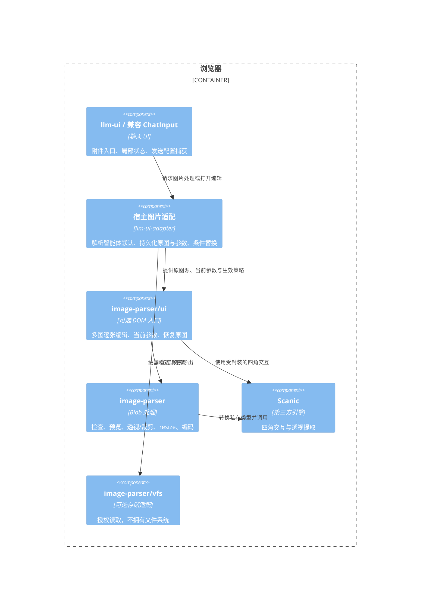
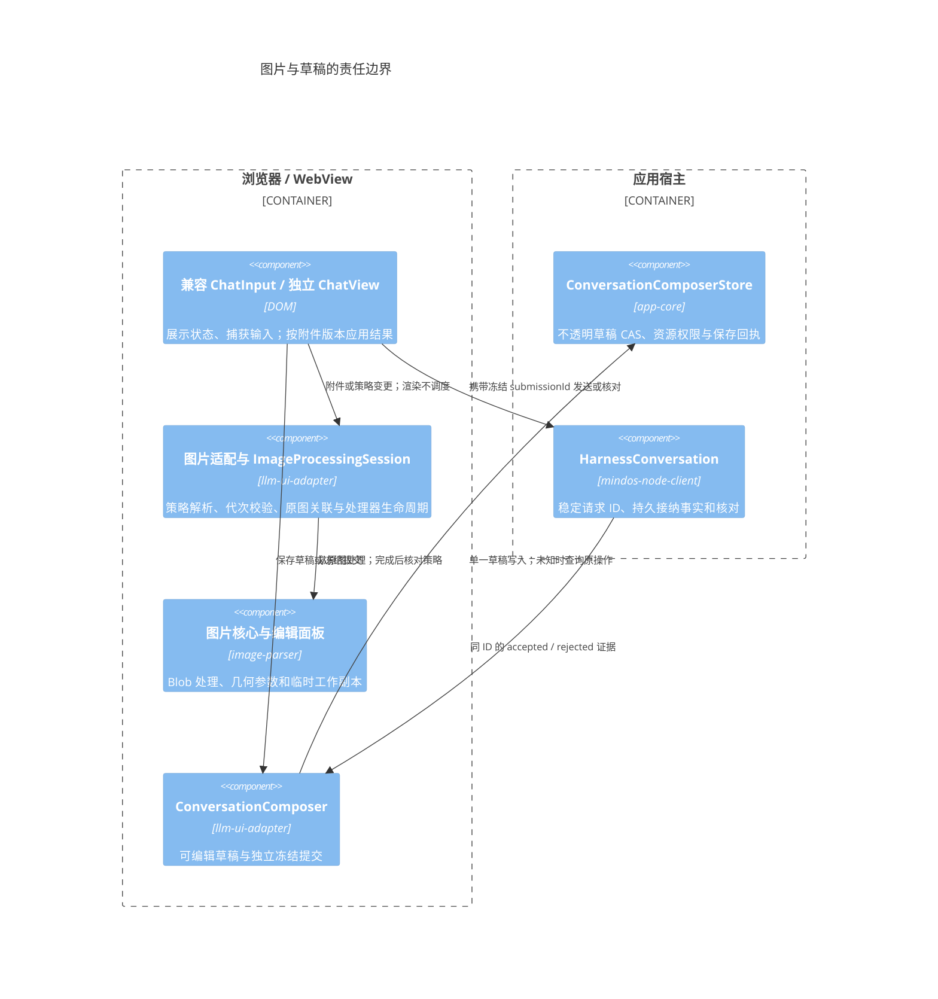

# image-parser 独立库与聊天图片处理设计

状态：图片库、聊天图片适配与远程草稿恢复已实现，本地验证通过；Safari 真机及性能专项待验收。更新：2026-10-18。

本版采用收缩后的需求，替代此前“在 llm-ui 内实现完整图片编辑器”的方案：独立 image-parser 提供扫描校正、矩形裁剪、尺寸调整和多图逐张编辑；llm-ui 通过宿主回调接入。首版不做手写标注、逐步撤销、跨图批量操作或完整图形编辑框架。公开接口以 [库类型声明源](../../libraries/image-parser/src/contracts.ts) 和 [UI 入口](../../libraries/image-parser/src/ui.ts) 为准，下文同时记录实现与后续边界。

## 1 结论与首版范围

源码位于 `libraries/image-parser`，包名 `@itookit/image-parser`，支持 npm tarball 安装与源码工作区引用。Git origin 为 `git@github.com:mushuanli/image-parser.git`；源码按独立 Git 子模块管理，主仓库固定子模块提交；推送与 npm 发布分别进行。名称沿用 image-parser，但 README 需说明它是图片处理与编辑组件，不提供 OCR 或语义识别。

| 能力 | 首版规则 |
| --- | --- |
| 默认处理 | 最长边超过 1024 时等比缩小到 1024，小图不放大；1024 可配置 |
| 扫描校正 | 点击自动扫描先做 Scanic classical 自动找边，再允许拖动四角微调；失败时保留手动选区 |
| 普通裁剪 | 当前已应用结果上的矩形选区，使用受约束的矩形交互 |
| Resize | 在选区处理之后按最长边等比缩小 |
| 多图编辑 | 同一面板逐张处理，切图自动保留参数，“应用”更新当前画布，“完成”统一替换待发送版本 |
| 恢复原图 | 清除当前图片全部手动编辑参数；自动尺寸策略另有独立设置 |
| 取消 | 放弃本次打开以来的修改，保留此前已确认版本 |
| 暂不纳入 | 标注、撤销栈、跨图批量应用、扫描滤镜、ML 自动找边、指定纸张比例 |

每一步几何模式是 `none | rect | quad`，可按“扫描 → 应用 → 裁剪 → 应用”连续处理。ImageSpec v2 保存已应用几何步骤与当前待应用选区，每一步坐标相对上一步结果；resize 始终在最终导出阶段生效。库先合成投影，再从不可变原图导出；透视路径使用有界 Canvas 重采样，不累计有损编码结果，不提供逐步撤销栈。

## 2 Scanic 的核对结果

本次核对 Scanic 1.7.1 的 npm 发布包、类型声明与源码；上游 main 当时的提交为 `dec0cd018899a7e1c5d8f4880223f0e54941f616`。实施已锁定安装该版本，并通过 Chromium 的真实像素、透视与多图操作验证；未执行 Safari 真机或大图峰值性能验收。

- 包许可为 MIT，导出 ESM、CommonJS 和 TypeScript 声明；清单未声明运行时依赖，Node engines 要求 >=22。这不等于整个图片库零资源，也不表示已支持项目的所有浏览器与构建目标。[包清单](https://github.com/marquaye/scanic/blob/dec0cd018899a7e1c5d8f4880223f0e54941f616/package.json)、[许可](https://github.com/marquaye/scanic/blob/dec0cd018899a7e1c5d8f4880223f0e54941f616/LICENSE)。
- `createCornerEditor` 提供角点变更、确认、取消和销毁；角点使用输入图像像素坐标，可关闭内置工具栏并定制样式。它可以覆盖四角交互，不能直接当作受约束的矩形裁剪器。[编辑器文档](https://marquaye.github.io/scanic/guide/corner-editor)。
- `extractDocument` 接收图像与四角，输出 canvas、ImageData 或 data URL；当前声明没有 Blob 输出、AbortSignal 或目标宽高/比例参数，需在适配层编码并管理取消。[类型声明](https://github.com/marquaye/scanic/blob/dec0cd018899a7e1c5d8f4880223f0e54941f616/src/scanic.d.ts)。
- 当前透视实现按对边长度估计输出尺寸，先分配输出 Canvas。最后再 resize 并不能降低前一步的峰值内存；封装须提前检查或缩小处理平面并映射角点。不能将该估计宣称为恢复真实纸张比例。[提取实现](https://github.com/marquaye/scanic/blob/dec0cd018899a7e1c5d8f4880223f0e54941f616/src/index.js)。
- ML 检测是单独的可选路径，默认会取远程模型及运行时资源；当前仍关闭 ML，不隐式访问 CDN；传统自动检测使用包内代码及内嵌 WASM。未来开启需验证资源随包部署、离线和 CSP。[ML 文档](https://marquaye.github.io/scanic/guide/ml-detection)。

下载发布 tarball 后核对了 registry SHA-1：`63d2d08ec0d3caf42c09215c9506452d5e4ffb17`。包内主 ESM 文件为 106662 字节，本地 gzip 后 41909 字节；这是单文件测量，不是最终应用增量、执行内存或所有可选资源之和。不能直接用仓库宣传的体积或速度作为本项目验收。

初步选择：Scanic 封装四角交互与透视；普通裁剪与 resize 使用轻量 DOM/Canvas。首版不同时引入 Cropper.js、OpenCV.js 或通用图形框架。只有实际交互或质量验证不足时再调整依赖。

## 3 包边界与 VFS

包提供三个职责清楚的入口，另提供 `/style.css`：

| 入口 | 职责 | 依赖与边界 |
| --- | --- | --- |
| `image-parser` | 原图检查、规范化参数、预览、处理与编码 | Blob 输入；内部封装 Scanic，不暴露其类型 |
| `image-parser/ui` | 多图条、单图选区、resize 设置、恢复原图 | 原生 DOM；复用根处理能力，不感知聊天 |
| `image-parser/vfs` | 将已授权文件视图适配为图片读取源 | 可选依赖 vfs-core；不创建或释放宿主文件系统 |

可以依赖 vfs-core，但图片几何与编码不需要文件系统。建议 vfs-core 作为可选 peer dependency，由 `/vfs` 入口使用；根入口和 `/ui` 不导入其实现或声明，不通过根 barrel 重新导出 `/vfs`。需要写回 VFS 时由宿主提供目标文件与保存策略，库不推断项目路径。

宿主注入 `IFileSystem` 的授权视图及固定目标，适配器经其公开读取接口处理二进制内容。读取前后核对资源身份/版本，不能把路径或整个文件系统的 revision 当作内容身份；底层缺少可靠版本时，使用宿主提供的不可变附件引用。传入信号不支持真正取消时，仍拒绝迟到结果。权限、存储错误不能转换成文件不存在。

`llm-ui` 不直接依赖 image-parser 或 vfs-core，包括类型导入；继续保持唯一直接运行时依赖 mdxeditor。MindOS 的 llm-ui-adapter 装配图片库，独立 llm-ui 消费注入的图片编辑端口。独立图片库也可供普通文件预览、表单或其他应用复用。



## 4 默认 1024 与配置继承

默认 resize 是输入预处理，不要求用户先打开编辑器。配置按以下顺序逐字段解析：ChatInput 显式覆盖 → 当前智能体默认 → image-parser 默认。模型/远程目标的硬限制随后单独校验，不能被会话设置放宽。

```ts
type ImageResizePolicy =
    | { readonly mode: 'original' }
    | { readonly mode: 'max-edge'; readonly maxEdge: number };

interface ImageProcessingPolicy {
    readonly processorId: 'image-parser';
    readonly resize: ImageResizePolicy;
}

const defaultImagePolicy: ImageProcessingPolicy = {
    processorId: 'image-parser',
    resize: { mode: 'max-edge', maxEdge: 1024 },
};
```

上面是图片库自身的纯数据默认策略。AgentConfig.imageProcessing 只保存可选 resize，不保存处理器名称、实例或 Scanic 对象。智能体编辑器允许跟随库默认或显式设置。ChatInput 设置显示“跟随智能体（当前 1024）/ 自定义最长边 / 保留原始尺寸”，同时说明配置来源。

不将跟随值固化成显式的 1024，避免后来修改智能体默认不生效。ChatInput 覆盖仅保存到当前会话/草稿，不修改智能体；提供恢复跟随入口。参数必须是有界正整数；无效持久值提示修正，不悄悄回退。Agent 配置只保存语义偏好 resize，不保存处理器名称；处理器由宿主装配，库自己的 defaults 仍描述自身实现。

“恢复原图”清除当前图片手动选区；聊天自动尺寸策略仍有效。若要发送原始像素，另选“保留原始尺寸”。界面分别表达“编辑已恢复原图”和“发送时按 1024 缩小”，避免用户恢复后又发现输出仍缩小而误以为恢复失败。

### 4.1 处理规则

若选区处理后的尺寸为 `W × H`，生效上限为 `L`：`scale = min(1, L / max(W, H))`。输出宽高按同一比例取整且至少 1 像素，最长边不超过 L；不裁切、不补边、不放大小图。2400×1600 在 L=1024 时约为 1024×683，800×600 保持原尺寸。

1024 是默认最长边，不是文件字节预算，也不保证某个模型一定节省多少 token。截图、表格或细小文字可以调大或保留原始尺寸。无需变换、无需重编码的文件直接使用原资源，不能仅因进入处理入口就损失质量。

### 4.2 时机、切换与提交

添加图片后立即建立原图项，按生效配置在后台生成预览和待发送派生文件；显示“处理中 / 已缩至 1024 / 失败”，手动编辑为可选入口。未就绪或失败的图片禁止随聊天提交，不在失败时静默发送原图。

切换智能体、修改 ChatInput 设置、更新选区时，未发送图片从原图重新计算，旧处理代次立即作废，在新结果就绪前禁止发送。处理结果按原图不可变身份、参数、生效策略和引擎版本复用；不能对上一次 1024 的结果继续压缩，也不能仅按文件名复用。编辑确认也核对策略代次，避免旧面板在新策略下提交旧导出结果。

发送在任何异步等待前冻结生效策略、附件内容版本与派生资源引用。处理未完成时禁用发送；已经捕获的提交不跟随随后切换智能体或配置的操作改变。结果未知的提交继续核对原版本，不自动换图或重发。

项目切换仅继承仍合法的输入偏好，不复制附件资源；图片处理覆盖可跨项目继承，但不能因现有远程配置过滤逻辑而丢失。远程 harness 同样消费浏览器图片预处理偏好，不把它误当原生模型选择。没有图片输入能力时禁用附件，不展示假的可用处理入口。

## 5 每张图片保存几何配方与当前选区

不建立操作日志或撤销栈。每个编辑项保留原图不可变身份、已确认参数、本次工作参数和打开时的基线参数。切图自动保留参数，不要求逐张点击保存。

```ts
interface Point { readonly x: number; readonly y: number }
type Quad = readonly [Point, Point, Point, Point];

type ImageSelection =
    | { readonly kind: 'none' }
    | { readonly kind: 'rect'; readonly x: number; readonly y: number;
        readonly width: number; readonly height: number }
    | { readonly kind: 'quad'; readonly points: Quad };

type ImageSpec =
    | { readonly version: 1; readonly selection: ImageSelection }
    | { readonly version: 2; readonly steps: readonly ImageSelection[];
        readonly selection: ImageSelection };
```

v1 坐标为方向归一化后原图上的 `[0,1]` 数值；v2 每一步坐标相对前一步结果，selection 相对全部 steps 的结果。quad 顺序固定左上、右上、右下、左下，矩形不越界，四角不自交、不退化；最多保留 100 个应用步骤。导出合成投影变换并计算最终尺寸；透视路径为控制预算可做多次 Canvas 重采样，但只在最终导出编码，不逐步重压缩。Scanic 四角交互使用像素尺寸固定的 Canvas，不以 CSS 缩放后的 image.width 作为角点基准。v1 历史草稿仍可读取，重开时已有选区转为已应用步骤。

Resize 策略不混入选区身份，允许智能体默认改变后复用同一选区。首版多图面板的尺寸设置显示并调整当前图片组的统一上限，明确提示作用于全部待发送图片；不增加逐图隐藏覆盖或批量选择模式。普通单图调用方则直接给该次 process 传不同上限。

首版保持支持的原始编码格式，透明图片不自动转成有损白底图；未来若提供 JPEG 转换，须显式选择背景和质量并扩充输出参数。颜色增强后续可增加版本化参数，不提前宣称已支持。

恢复原图将工作 ImageSpec 设为空选区并清除全部 steps，不覆盖原资源。取消恢复本次打开前的参数与待发送版本，即使之前已经扫描过，也不回到最初原图。重开编辑必须获得最初原图及已确认参数，不能把上次导出结果冒充原图。

## 6 image-parser 对外最小接口

### 6.1 输入、结果与处理器

```ts
interface ImageSource {
    readonly id: string;
    readonly revision: string;
    readonly name: string;
    read(options: { readonly signal: AbortSignal }): Promise<Blob>;
}
interface ImageInfo {
    readonly width: number;
    readonly height: number;
    readonly mimeType: string;
    readonly editable: boolean;
    readonly reason?: string;
}
interface ImageOutput {
    readonly sourceId: string;
    readonly sourceRevision: string;
    readonly blob: Blob;
    readonly width: number;
    readonly height: number;
    readonly mimeType: string;
    readonly byteLength: number;
    readonly changed: boolean;
    readonly purpose: 'preview' | 'export';
}
interface ImageLimits {
    readonly maxInputBytes: number;
    readonly maxDecodedPixels: number;
    readonly maxOutputPixels: number;
    readonly maxCanvasEdge: number;
}
interface ImageProcessor {
    readonly id: 'image-parser';
    readonly version: string;
    readonly defaults: ImageProcessingPolicy;
    inspect(source: ImageSource, options: {
        signal: AbortSignal; limits?: Partial<ImageLimits>;
    }): Promise<ImageInfo>;
    process(source: ImageSource, spec: ImageSpec, options: {
        signal: AbortSignal; limits?: Partial<ImageLimits>;
        resize?: ImageResizePolicy;
        purpose?: 'preview' | 'export';
    }): Promise<ImageOutput>;
    dispose(): Promise<void>;
}
```

这些接口覆盖 llm-ui 所需的读取、处理、预览、实际大小与原始结果复用。首版所有格式与能力在 inspect 中按真实文件检查；类型声明不暴露 Scanic 的 DOM/Canvas 结果。错误具有稳定分类：格式不支持、解码失败、选区无效、超出预算、编码失败、已取消；失败不伪装成原图成功。

ImageLimits 是宿主安全预算，resize 是用户输出偏好，两者语义不同。用户选择原始尺寸仍不能绕过预算；超预算时说明无法处理并允许选择更小上限。预览结果带 purpose=preview，不得被宿主作为正式附件；最终上传只接收 purpose=export。

AbortSignal 表示终止该次等待与拒收过期结果，不能宣称一定中断 Scanic 内部的同步运算。大图处理需要 Worker 或有界降采样；同步主线程处理不可因为函数返回 Promise 就视为可取消。processor 的释放只释放自身资源，不关闭借入的文件视图或共享宿主连接。

### 6.2 多图面板

`/ui` 提供挂载到宿主容器的编辑面板，外层弹层由宿主打开。面板不自行修改草稿、上传或发消息。

```ts
interface ImageEditItem {
    readonly id: string;
    readonly revision: number;
    readonly original: ImageSource;
    readonly spec: ImageSpec;
}
interface PreparedImage {
    readonly itemId: string;
    readonly expectedRevision: number;
    readonly spec: ImageSpec;
    readonly output: ImageOutput;
}
interface ImageEditor {
    apply(options: { signal: AbortSignal }): Promise<void>;
    activate(itemId: string): Promise<void>;
    restoreOriginal(): void;
    getItems(): readonly ImageEditItem[];
    prepare(options: { signal: AbortSignal }): Promise<readonly PreparedImage[]>;
    destroy(): Promise<void>;
}
```

拟定工厂接收 container、items、activeId、processor、生效 resize、预算和本地化。prepare 按顺序生成相对打开基线确实变化的项目；恢复到原图但与打开基线不同也属于变化。首次默认 resize 则直接调用 processor，不需要先创建面板。

getItems 返回工作参数的不可变拷贝，不暴露内部可变对象。prepare 捕获当前全部参数，执行期间禁止继续改参数；任一图片失败则不发布部分替换，保留工作副本重试。导出全成功后，宿主再持久化与条件更新，成功前面板不销毁；恢复原图或切图不调用聊天发送。

### 6.3 llm-ui 注入端口

llm-ui 只需要一个可选的图片能力端口，由宿主装配。已实现的 `ImageEditingPort` 提供 prepare / uploaded / edit / refresh，并通过 getRevision 和 subscribe 接收宿主策略变化，适配工厂为 [createImageEditingPort](../../ui/llm-ui-adapter/src/independent/image-editing.ts)。下列责任中，配置及持久核对仍由宿主承担：

| 行为 | 必要输入/输出 |
| --- | --- |
| 展示配置 | 生效策略、来源、是否允许会话覆盖、处理可用状态 |
| 预处理附件 | 固定草稿项、内容版本、原资源引用及冻结策略；返回派生资源与尺寸状态 |
| 打开编辑 | 当前图片组、活动项 ID、当前绑定；宿主加载原图与参数并挂载 `/ui` |
| 确认替换 | 目标项及 expectedRevision、候选资源；整体条件更新 |
| 核对未知结果 | 宿主持有 editId / submissionId；不由图片处理器重试副作用 |

不让 llm-ui 公开接口出现 ImageSpec、Scanic 或 IFileSystem。通用图片参数由宿主按派生资源引用关联保存；独立聊天库只持有附件项身份、内容版本、资源引用和显示元数据。输入设置通过纯数据端口提供，不能为了复用配置类型引入处理库依赖。

## 7 宿主草稿与提交责任

独立 DraftAttachment 已补充可选 revision，图片替换及接纳清理核对附件 id、资源 id 与内容版本。兼容输入以不可变 File 身份及图片项 id/revision 核对，不按数组下标或文件名定位。AgentConfig.imageProcessing.resize、输入 settings.imageResize 与安全配置投影已接线。项目草稿编码同时保存原图与当前派生文件、ImageSpec 和版本。项目草稿沿用既有 CAS 保存队列；远程会话新增宿主侧不透明 composer 存储，版本冲突拒绝覆盖，保存回执未知时按 operationId 查询核对。

宿主保存：最初原图、ImageSpec、已确认派生资源、生效策略及内容版本。Blob 的临时 URL 不可写进持久配置。图片库只生成结果，不负责创建 Session、切项目、原子更新聊天草稿或管理发送回执。

1. 自动 resize 与手动编辑都以最初原图为输入；处理代次同时包含绑定、项 ID、内容版本和策略。
2. 某图移除、重置、切图或改配置后，旧结果不得覆盖新状态；单靠 abort 不够。
3. 全部候选生成并保存后，宿主整体条件替换相关草稿引用。文字变化或新增无关附件不构成图片冲突，同图被其他窗口修改才拒绝覆盖。
4. 保存失败不关闭编辑器、不标为已保存。结果未知按 editId 核对，不能超时后自动重新应用。
5. 发送接纳时仅清理捕获的附件 ID 与内容版本；等待期间生成的新版本继续留在草稿。
6. 在途及结果未知的提交保留旧资源引用；资源回收核对所有草稿、历史与待核对提交，不因替换一张图立即删除原图。
7. 已确认参数与派生结果可以恢复；未点完成的面板工作副本首版仅保证本次打开期间存在，离开时提示放弃。

远程发送的现有 MIME、单文件、总量与编码验证继续生效。最长边 1024 不能保证文件小于字节限制；若仍超限，保留原图与当前结果，提供继续调整，不偷偷降质量、不自动分拆提交。

## 8 桌面、手机与资源释放

桌面面板由大图、缩略图条、扫描/裁剪/尺寸三个工具及恢复原图组成，外层提供取消、应用和完成。“应用”更新当前图片的工作画布与缩略图，可继续操作；“完成”包含所有图片的待应用选区，整组持久保存成功后才关闭，并更新附件缩略图与“已编辑”标记。手机使用全屏弹层，顶部保留这三个按钮，当前序号显示在画布状态区；工具靠近编辑区域，缩略图条横向滚动。切图保留各图已应用步骤及待应用选区，不增加多图批量选择。

只完整处理当前图，缩略图按需加载；自动预处理与导出共用有界队列，移动端默认串行。角点拖动时优先显示轮廓，预览合并调度，不在每次 pointermove 上做全尺寸透视。保存参数，不保存每一步 Canvas 快照。

方向归一化、透明通道、动画格式、实际编码 MIME 需验收。未确认能保留多帧时禁用动画编辑，不能无提示取第一帧。不能解码的 HEIC 等文件仍保留原附件并提示，不冒充已处理。

销毁释放 URL、位图、Canvas、监听和订阅；首版未引入 Worker。单个 disposer 抛错仍继续其余清理。Scanic 内置 reset 只是其角点重置，不直接等同产品“恢复原图”；禁用其重复工具栏，由面板统一表达。样式、键盘与焦点作用域也需原型检查。

## 9 实施与验收

已实现核心处理器、多图面板、智能体默认和兼容 ChatInput 设置，独立 llm-ui 通过可选端口接入。以下是完整验收目标；当前已验证项与剩余限制见表后记录。

| 验收场景 | 必须满足 |
| --- | --- |
| 2400×1600 / 800×600 默认导入 | 前者约 1024×683，后者不放大；原图保留 |
| 改为 2048、选择原始尺寸、恢复跟随 | 从原图重新处理，来源显示准确，无累计压缩 |
| A 智能体 1024，B 智能体 2048 | 跟随值更新；显式会话覆盖保留，已捕获提交不变 |
| 原生会话、项目草稿和正式本地会话 | 消费同一图片策略，不误用模型设置或丢偏好 |
| 多张同名图切换与取消 | 独立身份；保留工作参数，取消恢复打开基线 |
| 原本已扫描，重开后恢复原图 | 回到最初资源；仍清楚显示生效的自动 resize |
| 扫描后应用，再裁剪并应用 | 当前画布逐步更新，步骤坐标相对前一步；最终合成到原图，无累计压缩 |
| 应用后取消 / 完成 / 关闭重开 | 取消恢复打开基线；完成整组保存；重开显示已确认结果 |
| 快速改角点/设置/移除图片 | 迟到预览和导出不复活或覆盖旧项 |
| 同图双窗口修改、发送中产生新版本 | 条件更新拒绝旧目标；新版本不被旧接纳清理 |
| 其中一图导出失败、草稿保存失败或未知 | 不部分替换；可重试或核对；不自动发送 |
| PNG alpha、EXIF、四角退化、大图 | 结果可核验；超预算在分配前尽可能拒绝 |
| 手机 Safari 真机 | 拍照、触摸角点、切图、后台返回与释放通过 |
| 独立 npm tarball / 源码引用 | 主入口无隐式 VFS；可选入口明确；无 monorepo 私有路径 |
| 断网及严格 CSP | 首版手动扫描/crop/resize 不依赖 CDN；可选资源显式部署 |

### 9.1 本地验证与剩余范围

- 库单测覆盖配置优先级、选区、预算、取消、动画拒绝、VFS 版本和整组导出失败。真实 Chromium 像素测试覆盖 2400×1600 → 1024×683、矩形、Scanic 透视、原字节复用、小图及多图切换。
- 工作台真实 ChatInput 的桌面与 390×844 手机视口验证覆盖同名双图粘贴、整组编辑完成、设置 2048 及从保存原图恢复原尺寸；这是 Chromium 验证，不代替 Safari 真机。
- 项目草稿编码测试验证原图、选区与派生文件可恢复；适配层测试验证迟到移除不复活、原图重新派生与失败不部分替换。独立 llm-ui 测试验证发送接纳保留编辑的新版本。
- 包输出 ESM/CJS、声明和 CSS；tarball 在工作区外安装，根入口及 UI 不要求安装 VFS。`pnpm --filter @itookit/image-parser test:browser` 可重复运行像素与交互检查。

剩余限制：Safari 真机、EXIF/透明度专项及大图性能验收尚未完成；当前用有界 Canvas 处理，Scanic 同步计算不能中途取消。独立调用方仍需提供资源存储与元数据端口；调用 `createSessionChatView` / `createNativeChatView` 时的 images 配置会自动装配图片处理、上传和资源读取，并释放自身图片端口。工作台继续使用兼容 ChatInput，现已复用同一个 createImageEditingPort；这不表示整个聊天工作区已替换为独立 ChatView。

远程原图资源暂保留在宿主，不在接纳时自动删除；尚未提供统一资源回收器。断网与严格 CSP 尚需完整宿主环境验收。ML 自动找边、扫描增强、Worker、逐步撤销和跨图批量操作均未提供；传统自动找边现已提供。

### 9.2 宿主与独立入口的实际集成

- `editImageFiles` 将兼容输入的不可变 File / 图片项版本映射为 ImageEditingPort，通过 commit 在关闭面板前持久保存并整体替换，和独立 ChatView 共享同一图片适配。
- `NativeChatBindingOptions.images` 负责将不透明附件引用读为 Blob，再按当前 harness 能力和字节预算转换；绑定销毁后迟到读取不能发送。原图和 ImageSpec 不进入 harness turn。
- 远程新项目草稿按 profile.capabilities.attachments 开放附件。首次发送前将图片原图和编辑状态保存到正式会话 UUID 所属存储，再执行原生发送；项目草稿提升后的资源清理不会删除会话原图。
- `ConversationComposerStore` 通过 `readComposerDraft/saveComposerDraft/putComposerAsset/readComposerAsset` 提供本地及 HTTP 共用的宿主存储。data 保持不透明，资产按会话隔离，保存使用 expectedRevision CAS 和有界接纳回执。
- 保存回执丢失时查询 operationId，不自动重放；没有核对证据时保持未保存。原生发送前独立记录冻结的提交副本与 submissionId；HarnessRecovery 持久化同 ID 的 submission 回执，重开后只依据该操作的接纳事实清理仍匹配的内容。submittedTurnId 仅用于消息关联，不作为任意待提交草稿的接纳证据。
- 新增真实浏览器验收覆盖远程裁剪、保留 2400 像素原图、关闭重开、只发送派生图片和接纳后持久清空，桌面与手机视口均通过。独立 createNativeChatView 也使用真实处理器验证自动装配、原图关联、裁剪替换、原生发送及接纳清理。RPC 回归覆盖二进制往返、版本冲突和保存去重。


独立宿主的最小装配顺序如下；images 的读写与元数据由宿主实现，不能把临时 URL 当资源 ID：

```ts
const binding = await createNativeChatBinding({
    conversationId, controls, operations, reconcile, images,
});
const chat = await createNativeChatView(container, binding);
// The adapter assembles upload, image editing and asset reading from images.
await chat.destroy();
binding.dispose();
// Close shared storage and controls in their owner's lifecycle.
```


### 9.3 应用、完成与自动识别

“效果预览”只查看结果；“应用”调用 ImageEditor.apply，等待当前识别后验证并更新当前图片的工作画布，将 selection 归入 steps 后清空选区，不写聊天草稿。“完成”调用 prepare，包含每张图片尚未应用的选区，顺序导出全部改动，保存成功后整体替换附件并关闭；失败留在面板内。“取消”放弃本次全部修改，包括已点应用的步骤。恢复原图清除当前图片的全部步骤，自动尺寸策略独立保留。

ImageSpec v2 是有界几何配方，不存 Canvas 快照或压缩中间图。rect/quad 都可以接续前一步；导出先合成四边形投影、计算逐步尺寸，再从方向归一化的原图生成结果。调整 1024/2048/原尺寸始终可以从原图重算，不受编辑预览分辨率限制。宿主原图和配方一起保存；旧 v1 草稿保持兼容。

对照 [Scanic demo](https://github.com/marquaye/scanic/blob/main/demo.html) 和安装的 1.7.1 实现：demo 默认为 classical，直接传原图，内部最长边为 800；ML 由用户单独选择。旧实现先缩到 1024 并把内部检测尺寸改为 1024，会改变边缘及轮廓候选；现直接传解码后的图像，使用默认 800 或更低的宿主预算，按输入像素尺寸归一化返回角点，不使用发送 resize 限制检测。已有应用步骤时检测当前工作图。

Scanic 四角编辑器优先读取 image.width 而非 naturalWidth。现传入像素尺寸固定的 Canvas，避免 DOM 布局尺寸与角点换算基准混用。测试显式将图片显示尺寸缩为十分之一，核验四角在实际画面中的跨度；不能只检查 getCorners 数值没有改变。

官方 test3.jpg（2988×5312）对照验证新检测结果与 demo 默认调用一致；旧参数会改变该图检测边界，但未在该图复现只圈内部很小区域，不能将用户现象全部归因于参数。复杂背景与低对比下 classical 仍可能误识别；当前不启用 ML 或自动下载模型。自动结果不能覆盖识别期间的手动调整、切图或重置，应用/完成等待检测并支持取消等待。

真实 Chromium 桌面及手机视口检查覆盖连续应用、投影后裁剪像素、重开已确认步骤、恢复原图、画布与附件提交边界。Safari 真机和用户原始问题图片仍需实际核验。

### 9.4 问题照片的实测与非 ML 路线

2026-10-18 对用户提供的 3024×4032 `a.jpg` 做本地测试，未将图片上传外部服务。对照结果：

| 检测方式 | 选区占整幅图面积 | 本图观察 |
| --- | --- | --- |
| classical 默认 800 | 9.0% | 选中下部文字区域，评分约 0.555 |
| classical 1024 | 9.7% | 换成上部文字区域，仍不正确 |
| classical 1600 | 8.6% | 增加分辨率没有恢复纸边 |
| classical 膨胀核 11 | 46.9% | 大框包住正文，评分约 0.774；仍漏掉纸边 |
| Scanic ML / DocCornerNet | 71.2% | 接近纸面，底边和超出画面的角点仍有偏差 |
| 纯 TS 长边原型 | 返回画面外的四条边交点 | 更贴近可见纸边，报告 partial，不自动向内裁剪 |

面积占比不是定位准确率。ML score 表示是否存在文档，不代表四角定位误差；其本图高分不能理解为边界完全准确。ML 实验使用本地托管的 scanic-ml 0.2.0 模型与 WASM、单线程，原始文件约 1.9 MiB 模型及 1.5 MiB WASM；不等同于压缩下载量，也未验证 Safari 真机。正式应用未启用或部署 ML。

根因证据：传统路径按边缘、轮廓与几何评分选候选，纸面文字和横线也会构成候选。当前照片的纸张部分超出图框；默认算法选中的内部候选在其几何规则中仍为 valid。Scanic 1.7.1 类型声明中虽有 minDetectionConfidence，安装包及已核对源码均未读取该字段；只设置它不会起到拒绝低分候选的作用。提高 minDocumentCoverageRatio 会改变 valid 排序，但没有保证 success=false；因此未来质量筛选仍需由封装层明确执行。

最初的非 ML 实验保存在 [page-lines-v1.ts](../../libraries/image-parser/examples/page-lines-v1.ts) 与 [paper-edges.html](../../libraries/image-parser/examples/paper-edges.html)。流程为有界灰度/平滑 → 梯度定向 Hough 投票 → 长边候选 → 边界内外亮度差 → 四边求交。当时只验证居中浅色纸张，作为原型保留；没有将单图有效的参数当作生产默认，也不引入 OpenCV 或新的运行时依赖。

本图归一化交点约为 TL(0.229,0.028)、TR(1.004,0.089)、BR(0.914,1.057)、BL(-0.093,0.869)。由可见长边估计，三个角超出图框。它说明 partial 是有实际必要的状态，不能将交点强行夹到 [0,1] 后当作完整纸面，也不能恢复未拍入画面的内容。原型通过完整合成纸张、带文字的边界、部分出画、纯白及纯黑图检查；这不是广泛准确率评测。

不必为此维护完整 Scanic fork：已有 ImageProcessor.detect 是替换点，可在 image-parser 中增加检测器和质量筛选，继续复用 Scanic 的四角编辑与透视。进入正式路径前，应补充 partial 的展示与确认契约，并用不同背景、纸张位置、旋转和弯曲样本验证；只有需要修改不可替换的 Scanic 内部代码时，再评估上游补丁或小型 fork。


## 11 审查后的流程收敛

草稿编辑与已提交内容分属两份记录。ConversationComposer 持有可变草稿、composerVersion 和独立 remoteSubmission（submissionId、冻结编码 base、提交时版本）。后续编辑只更新草稿，不能删除待核对提交。重开后按照冻结资源 ID 和图片 revision 找回仍匹配的附件；正文只在草稿版本仍匹配时清理，包括文字改动后再改回相同内容的情况。

拥有 composer 存储的远程编辑器只写宿主草稿，不再顺序双写原生 saveDraft。没有该能力的兼容宿主继续使用原生草稿。原生 send/command 接受可选 submissionId，作为 turn/command 的 requestId；其 create/resume 子操作保持各自的请求 ID。HarnessRecovery 保存 submission 的 pending/accepted/rejected 回执，UI 只按相同 submissionId 处理结果；最近 turn 变化、空草稿和 pending 结束均不能代替接纳证据。冻结在任何附件读取前排入同一保存队列，后续输入只能排在冻结记录之后，避免慢上传反向覆盖新草稿。reconcile 可接收 submissionId；即使崩溃发生在原生端尚未记录 pending 前，也只查询该请求回执，不重新发送。未知操作只核对，不自动重发；准备会话的回执已确认但 turn 尚未发出时，标记原提交未接纳，允许显式重新提交。

明确 CAS 冲突和权限、格式拒绝不进入未知保存状态；用户显式重新加载后可以继续保存。只有无法确认是否已写入时保留 operationId，随后查询 acceptedOperationIds。已有接纳证据但正文被其他窗口更新时仍报冲突，不能借核对结果覆盖他人的新草稿。

图片处理由共享 ImageProcessingSession 管理处理器所有权及策略核对，兼容 File 输入和独立 ImageEditingPort 共用。附件变化、配置变化和宿主 subscribeResize 通知触发调度；renderAttachments 只渲染，不启动处理。独立宿主应在策略变化时通知 subscribeResize；后续快照更新也会核对 getRevision。导出、上传及整组替换前核对策略、附件身份和内容版本；处理中变化的策略使旧结果失效，上传从原图重算。处理器版本进入派生结果标识。没有实际变换且 MIME 一致的文件复用原 File，不重复上传原图。



资源保留规则：原图、当前派生版本和冻结提交引用必须同时保留；发送接纳只清理匹配的草稿引用，不立即删除原图。当前宿主仍保留不可变资源，尚未提供安全的统一回收器，不能在保存时仅根据最新草稿扫描并删除其他在途上传。宿主持久化通过草稿 CAS 条件提交，独立 UI 对附件身份与版本做整组替换；已上传但未被引用的候选不被当作已发布附件。

新增回归覆盖无效策略的通知重入、过期结果拒收、独立视图策略订阅与重新上传、冻结提交跨重开保留、新附件保留、相同文字的新草稿版本、CAS 冲突后重新加载，以及原生回执 ID 的持久核对。真实浏览器继续覆盖裁剪、原图保留、草稿重开、独立策略重算和发送接纳。

### 9.5 新检测器正式接入验收

2026-10-18 完成68例验收（50合成、17上游标注样图、1用户照片状态检查）。新方案通过45例，现有 Scanic 通过36例；新方案有10例改善、1例回归，仍出现误裁、偏置漏检和 partial 契约不兼容。验收未通过，正式自动扫描没有切换。完整门槛、真实反例、性能和复现命令见 [非 ML 检测器接入验收](image-parser-detector-validation.md)。


2026-10-19 修复后，同一68例开发数据通过66例：完整纸张49/51、出画7/7、拒绝10/10，错误完整框为0。新实现位于 [paper/detect.ts](../../libraries/image-parser/src/paper/detect.ts)，连通区域负责偏置候选，长边提案须经过四边联合核验及更大纸面反证筛选。原始居中 Hough 原型保留用于追溯，不作为默认检测器。

库内通过 `createImageProcessor({detector: 'paper'})` 显式接入；应用默认继续 Scanic classical。ImageDetection 增加 partial（仅可见候选轮廓，不含 spec）与 uncertain（歧义、低证据、预算耗尽）。partial 表示候选不完整或触边风险，不证明实际纸张一定出画。界面保留选区并提供手动调整/补拍提示；全图选区是恒等操作，未经调整的 partial 结果不会生成裁剪步骤或重复编码。应用/完成等待检测，取消、销毁和手动调整优先于迟到结果。

纯 TS 内核以最长边480处理，生成器按小段计算并主动让出事件循环，目标每4ms检查让出，2秒耗时预算到达时返回 uncertain。不是 Worker，也不能中断同步解码或 Canvas；不能将目标时间当作硬实时保证。检测代码按需加载，npm ESM/CJS 和源码引用共用实现，不增加运行时依赖或资源 URL。浏览器验收覆盖公共 processor、离线检测、partial 展示及应用/完成的无变更行为。Safari 真机和独立照片集仍是正式默认切换前的待办，现有68例用于修复回归，不代表独立泛化准确率。


正式 classical 封装也将已有的0.6低可信度提示升级为裁剪保护：低分、缺失或无效分数返回 uncertain，保留手动选区，不让“完成”直接采用低分小框。这是保守拒绝规则，不把分数解释为纸边定位概率；高分候选仍需人工核对。
