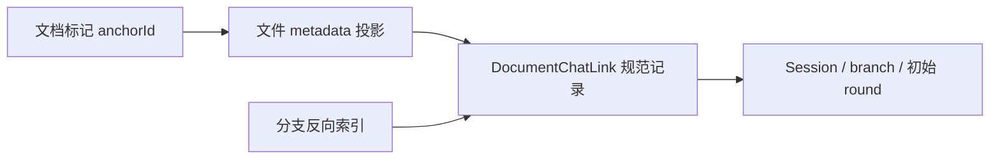

# 文档内 AI Chat：锚点与会话关系

v5.5 在 mdxeditor 保留通用插件/回调边界，itookit 在 app-shell 装配 UI 回调，
app-core 保存关系及接纳回执；llm-ui 继续展示完整 Session，不嵌入文档预览。

## 交互与身份

可写 render mode 的选区浮动菜单与 toolbar 共用插入动作。源码写 `::@<UUID>@`，
预览显示真实 SVG 图标，点击展开一行输入，内容增长时自动增高。选区保留在正文，
插入后立即展开输入并填入选中文字，同时作为该入口固定的引用快照；正文后续修改不会悄悄改变已关联的上下文。

文档身份 documentId 与位置 namespaceId/path 分离；每个 anchorId 对应独立关系。
首发明确分配 Session UUID 和 6 字符短分支名，发送前保存源文档，准备原始请求并持久接纳。
新 Session 标题取首条 prompt 的首个非空行，合并空白后最多保留 30 个 Unicode 字符；空 prompt 回退文档标题或文件名，不额外调用模型生成标题。
再次发送复用 Session/branch，追加到该分支末尾；起始响应仍指向首次接受的 round。
从文档发送后停留文档，显式点击“跳转到分支”才导航。

预览使用库内部独立 MDxRenderer，固定只读，没有模式切换、toolbar、CodeMirror 或 AI 插件。
文字可复制，选区不能再插入 AI，回复内的 `::@` 不生成嵌套入口。
目前是 Markdown 文本预览，有独立滚动条；工具调用、附件解析和完整执行历史在原 llm-ui 页面展示。

## 规范关系与索引

`DocumentChatLink` 是当前用户的私有规范记录，保存在该用户隔离的 `/etc/fs/document-chat-links.seq`：

```ts
{
  schemaVersion: 1,
  id: `${documentId}:${anchorId}`,
  documentId, anchorId,
  source: {namespaceId, path, fileIdentity?, projectId?, projectFolder?},
  selection, defaultPrompt,
  endpoint?: {sessionId, branch},
  binding?: {sessionId, branch, initialRoundId, initialMessageId?},
  status: 'unbound' | 'bound' | 'missing' | 'detached',
  latestRoundId?: string,
  pending?: frozenSubmissionRequest,
  projectionPending?: true,
  revision, createdAt, updatedAt
}
```

initialMessageId 使用 Session 的标准 assistant 投影 ID（`round-<roundId>-assistant`），对应首个 round 的 assistant 文本聚合回复。
起始预览读取该 round 的 assistant 文本。发送后自动展开并跟随 latestRoundId，可切回起始回复。
仅接纳不标记完成：发送图标显示等待/回复中的旋转状态，实际 round 完成或失败后更新。
运行中的部分文本从对应 Session 的现有投影读取，按 round/主任务身份匹配并释放借用句柄；
完成后读取持久 round。预览不包含工具或 reasoning 正文；最多 64 Ki 字符。

同一 SeqFile 事务写入 `edge:<linkId>` 及以下索引，使用 revision 比较防止覆盖：

| 索引 | 指向 |
| --- | --- |
| `document:<documentId>:<anchorId>` | linkId |
| `source:<namespace>:<path>:<anchorId>` | linkId，用于改名后的定位及撤销恢复 |
| `branch:<sessionId>:<branch>:<linkId>` | linkId，仅有效绑定进入反向索引 |

文件 metadata 的 `_mindos_document_chat` 保存 `{schemaVersion, documentId, anchors}`，保留历史键名以兼容现有文件。
每个 `anchors[id]` 仅保存稳定 `linkId`；选区、提示词、状态、Session/branch 绑定及项目归属均只写当前用户的私有 registry。
多个用户可分别绑定同一共享文件的 anchor，不读取或继承其他用户的会话。旧文件在 metadata 写回时以身份白名单重建所有 anchors，清除历史私有字段；各用户已有 registry 保持原记录并继续恢复自己的绑定。
普通 Markdown 读取、保存不会创建这项 metadata 或关系表；用户明确插入 AI 时才记录。
删除最后一个标记并保存时移除该 metadata 键。

分支反向关系通过 `backend.documentChatBacklinks(sessionId, branch)` 查询同一个规范记录，
不再向 BranchMeta 复制一份可独立编辑的文档列表，避免两份列表互相覆盖。



## 回调与端口

mdxeditor 的 `AiChatHost` 提供 `createAnchor/getAnchor/observeAnchor/openConversation/onSubmit`，
配合既有目标目录、默认目标和附件回调；不解释项目、Session 身份或路由。
保存时宿主用 `aiChatAnchorIds(markdown)` 提取活跃锚点，排除代码与原始 HTML。
库内契约详见 [AI Chat 插件](../../libraries/mdxeditor/doc/ai-chat.md)。

app-shell 的 `createDocumentChatFactory` 装配上述回调，调用后端 `documentChatFile({files,path,projectFolder})`：
`create` 登记选区；`reserve` 固定端点；`prepare` 保存不可变请求；`bind` 核对接受回执；
`get(includeResponse)` 读取关系、最新轮次状态和按需回复正文；`reconcile` 处理保存后的删除与撤销；
`subscribe/dispose` 管理观察。文件句柄借用，不随该端口释放。
HTTP 能力表显式导出这些方法，真实 RpcPeer 往返验证生命周期。

## 一致性和恢复

- 规范记录及索引在一个事务内更新，文件 metadata 属于可修复投影；跨 Session/文件系统不宣称分布式事务。
- `prepare` 在发送前保存原始 SubmissionRequest。超时后只核对原身份，不能换 operationId 创建另一次执行。
  未确认时不同内容被拒绝；同一原提示词/目标重试使用已冻结请求。接受回执才允许写 binding。
- 文件 metadata 写入失败不把已接受的执行改判失败；保留 projectionPending，后续读取修复。
- 删除分支后，get/backlinks 核对 manifest 并标 missing、移出反向索引；再次发送显式分配新端点。
  用户激活 AI 入口后的观察/预览刷新会修复 metadata；未打开或离线文件在后续使用/保存/读取时修复，
  当前没有跨所有离线文件的后台同步保证。关系记录保留旧 binding 供诊断，metadata 不继续投影为有效关联。
- 删除入口并保存只标 detached、移除 metadata 和反向索引，不删除 Session、不取消执行。
  撤销后恢复原 binding；删除发生在等待回执期间也不会因接受回执重新插入入口。
- 同一 namespace 内改名且原路径已不存在时更新 source；复制保留原文件时，副本首次使用分配新 documentId。
  来源提供稳定 fileIdentity 时，同一文件在不同深度的 mount 通过该身份识别；其他跨 namespace 移动需宿主显式迁移。
- 当前选区映射支持能与顶层 Markdown 渲染对应的正文；自定义变换无法准确对应时明确提示重选。

## 远程文件 metadata

所有文件操作经 VFS。nestos-node 的每个 export 是 metadata 项目边界，首次写 metadata 才创建
`<export>/.nestos/meta.sqlite`，按真实 export 相对路径保存 metadata 和稳定文件身份，改名跟随。
客户端在明确协商 `metadata: true` 且获得 rw 授权后写入；旧服务不降级为本地副本。
多个 mount 深度映射同一 export 内文件时读取同一份 metadata；重叠 export 根不共享库，配置应避免。
其他后端可读共享引用，但 Session/规范关系仍归原应用后端；缺少该关系时拒绝覆盖远程引用。
备份/迁移必须包含 `.nestos`，CLI/config/README 已明确说明。

普通打开含锚点的 Markdown 也不获取目标、关系或订阅，不加载 Flow 配置；用户操作入口后才激活。

## 与常见双链结构的关系

[Obsidian Backlinks](https://help.obsidian.md/plugins/backlinks) 将包含指向当前笔记的内部链接呈现为 linked mentions；
[Logseq Block Reference](https://github.com/logseq/docs/blob/master/pages/Block%20Reference.md) 用块 UUID 表达引用。
这里借鉴可观察的“稳定身份 + 来源引用 + 反向查询”：文档写稳定 anchorId，宿主保存规范关系，
反向索引提供 branch → 文档查询。这是本项目的数据设计，并不推断这两个产品的内部存储实现。

## 验证入口

- `libraries/mdxeditor/tests/ai-chat-anchors.test.ts`：多锚点、字面代码排除、选区源码映射、render-only 插入、只读子 renderer 与释放。
- `backend/app-core/tests/document-chat-links.test.ts`：无 AI 零 metadata、同分支持续发送、首轮响应、删除/撤销、复制/改名、未知回执及投影修复。
- `ui/app-shell/tests/document-chat.test.ts`：选区上下文、稳定分支、显式跳转与保存时 reconcile。
- `apps/http-app/tests/view-ports.test.ts`：真实 RPC 文档端口、订阅与借用文件生命周期。

2026-10-27 本次验证：mdxeditor 87 项、文档关系/真实 Flow 执行 12 项、宿主提交 3 项、HTTP 全套 207 项通过；
相关包 typecheck、库和 HTTP UI 构建、架构与文档检查通过。浏览器验证 1100px/390px 下无横向溢出，
连续发送复用锚点，预览可滚动且无嵌套 AI。未启动生产模型或部署 httpd。
app-shell 扩展全套检查未全绿（18 项失败）；其中附件草稿格式及 Flow 来源的 8 项失败在修改前提交
`ff404195` 的独立工作树也可复现，其余失败未全部判定为基线问题，不作为本功能通过的证据。

## 编辑临时副本

临时副本现为 httpd 显式启用的 editor swap，默认关闭，其他宿主不创建也不显示查看入口。
小于 512 KiB 的内容在修改后防抖写入服务端独立 swap，正常关闭编辑器时删除自己的文件；大文件不写。
httpd 启动及每小时清理更新超过 48 小时的文件，查看时显示服务端备份时间，不再使用 IndexedDB 保存刷新副本。
配置、目录、兼容规则见 [NestOS 命名与迁移](../nestos-rename.md#httpd-编辑-swap)。
