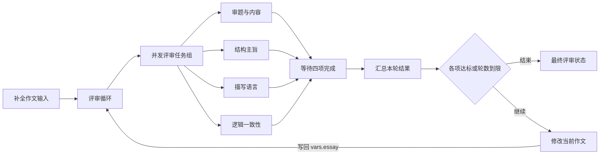

# 作文四维评审 Flow

> 状态：已实现，2026-10-22。当前产品只维护一个作文模板；此前结构化派发模板和旧版作文文件的兼容边界见第 8、9 节。

## 1. 当前定义与执行图

唯一声明源是 [essay-review.json](../../backend/app-core/src/presets/essay-review.json)，安装为 `essay-review.flow`。原新版文件名 `essay-review-isolated.flow` 已统一为此名称，检查和修改任务仍使用隔离上下文。它使用 12 个普通图节点：输入补全、循环、任务组、四项检查、汇合、汇总、判断、修改和最终报告。



| 节点 ID | 插件版本 | 职责 |
|---|---|---|
| collect | builtin.input@1 | 补齐作文要求、作文内容；缺项时等待交互 |
| loop | builtin.loop@1 | 管理评审轮数，将当前轮次写入 vars.round |
| review | builtin.taskGroup@1 | 按 maxConcurrency 派发本轮四项检查 |
| check-content | builtin.agent@1 | 审题与内容检查 |
| check-structure | builtin.agent@1 | 结构主旨检查 |
| check-language | builtin.agent@1 | 描写语言检查 |
| check-logic | builtin.agent@1 | 逻辑一致性检查 |
| join | builtin.join@1 | 等待全部四项，按稳定 key 收集结果；任一失败则失败 |
| aggregate | builtin.aggregate@3 | 使用 latest@1 合并本轮结果，并写入 vars.results |
| judge | builtin.route@1 | 选择结束或改写，并记录停止原因 |
| rewrite | builtin.agent@1 | 根据本轮四维意见返回完整修改稿，写回 vars.essay |
| report | builtin.transform@1 | 确定性输出最终稿件、评分、完成轮数和停止原因 |

每项检查和修改都是普通 Agent Task；loop、taskGroup、join 与 route 负责通用控制。当前模板没有 `builtin.check`、`builtin.judge`、`builtin.revise` 或 route@2/@3 派发作用域。

## 2. 运行参数与输入补齐

| 参数 | 类型 | 默认值与约束 |
|---|---|---|
| requirements | string | 必填；缺失时 interact 补填 |
| essay | string | 必填作文文本；缺失时 interact 补填 |
| maxRounds | number | 默认 10；1–1000 的整数 |
| maxConcurrency | number | 默认 4；1–4 的整数，限制四项检查并发 |
| passScore | number | 默认 9；0–10，每一项都需达标 |
| maxExchanges | number | 默认 4；2–100 的整数，限制每个检查和修改 Task 的模型交互次数 |

`collect.config.param` 为 requirements 和 essay 配置 textarea 与 nonBlank 校验。两项都缺就提示两项，只缺一项就补该项；合法预填值不会被补缺回复覆盖。等待由 Kernel 持久化，输入完整前不调用评分模型。

运行参数通过既有参数表单或 CLI `--params` 传入。`maxRounds` 是业务评审轮数，`maxExchanges` 是单个模型 Task 的交互预算，二者独立；工具续答和格式修复也消耗后者。

## 3. 修改、重新评审与停止

运行变量保存三个独立状态：

```yaml
variables:
  essay: { type: string, initial: '${param.essay}' }
  results: { type: json, initial: {} }
  round: { type: number, initial: 0 }
```

所有检查读取 `${vars.essay}`。四项检查全部成功后，join 按 content、structure、language、logic 收集返回；aggregate 将每项保存为带 value、current、round、inputRevision 的本轮结果，覆盖上轮同项评分，不取历史最高分。

judge 先判断四项 score 是否全部大于等于 passScore，再判断当前轮数是否达到 maxRounds。前者输出 `condition_met`，后者输出 `max_rounds`。第 10 轮仍先判断是否达标；达到上限后直接报告，不生成未经评审的新稿，也不派发第 11 轮。

未达标且尚有轮数时，rewrite 根据当前作文和本轮全部意见返回 `{ essay: string }`，通过顶层 `assign.essay = ${output.essay}` 写回变量，然后回到 loop。**修改后四项全部重新评估，包括上一稿已经达标的项目**；上一稿的评分不能证明新稿达标。`${param.essay}` 保留补齐后的初始稿，`${vars.essay}` 保存当前稿。

默认最多 10 次四维评审和 9 次修改。设置 maxRounds=1 可以只评审当前稿件；输出仍采用当前四维评分和数据报告格式。模型改写和重复评审不保证评分提高。

## 4. 上下文与结构化输出

四个检查与 rewrite 均配置 `invocationContext: isolated`、`historyPolicy: none`、`includeDependencyOutputs: false`。它们只接收自身 system 指令和模板显式读取的作文要求、当前稿件及修改所需的本轮意见，不隐式导入 Session 历史、父任务上下文或其他检查的评分。检查任务使用 temperature=0；模型连接仍经宿主通用连接准入验证。

检查节点使用 `responseFormat: { type: text }`，在 system prompt 中明确要求只返回 JSON 并附上完整 Schema，同时通过 `outputValidation.schema` 做本地严格校验。无需模型声明原生结构化输出能力，也不向服务端发送 `json_schema` 请求；未通过校验的结果不能进入下游。此行为只由 Flow 配置表达，复用通用执行器。

检查结果的 JSON Schema：

```yaml
type: object
required: [score, issues, suggestions]
properties:
  score: { type: number, minimum: 0, maximum: 10 }
  issues: { type: array, items: { type: string } }
  suggestions: { type: array, items: { type: string } }
additionalProperties: false
```

rewrite 使用独立 schema，要求返回完整的 essay 字符串。所有检查和修改节点都配置 `outputValidation: { onInvalid: repair, retries: 3 }`。默认 maxExchanges=4 为初次回答和最多三次格式修复提供预算；若同一 Task 还有工具续答，需同时考虑它们占用的预算。格式修复在同一 Task 内进行，不增加评审轮数；预算耗尽或校验仍不通过会使任务失败。

整值模板引用保留原始类型，字符串模板按文本或 JSON 插值，输入中的 `${...}` 只作为数据传递，不再次解释。变量赋值、参数和命名输出引用使用通用 Flow 模板机制。

## 5. 最终输出与持久执行

report 是普通 transform，不额外调用模型撰写报告。其 result 包含：

```json
{
  "results": {
    "content": { "value": { "score": 9, "issues": [], "suggestions": [] }, "current": true, "round": 2, "inputRevision": 2 },
    "structure": {},
    "language": {},
    "logic": {}
  },
  "completedRounds": 2,
  "stopReason": "condition_met",
  "inputs": { "essay": "初始稿" },
  "vars": { "essay": "最终已评审稿" }
}
```

上例省略了其余三项的评分槽位内容。结果区分初始稿与最终稿；所有最终分数来自对最终稿的同一轮评审。

Kernel 保存 Task 生命周期、输入交互与结果，Flow 保存任务组、join、迭代和变量状态。恢复使用已持久化的执行图和 Task 身份，不重新播种模板或读取最新文件来替换已开始的运行。重复完成事件不重复计入汇合，Task 重试与格式修复也不增加 loop 轮次。任务组并发仍受 Run 全局并发上限约束。

join 配置 failure=fail；任一检查失败时不会把部分新结果当作完整本轮评审，也不会生成成功报告。工具、模型请求和外部副作用的未知结果处理仍遵循 [Kernel 契约](../kernel-api.md)。

## 6. 安装、合一与存量文件

[产品 Flow 库](../../backend/app-core/src/presets/flow-library.ts)、[启动播种](../../backend/app-core/src/presets/default-flows.ts)和初始文件恢复只提供 `essay-review.flow` 这一份作文定义。安装记录独立于 .flow 文件；用户删除模板后，普通启动不重新补装。显式恢复只创建缺失文件，已有用户修改不会被覆盖。

早期 `essay-review.flow` 曾与 `essay-review-isolated.flow` 同时播种，使用另一组参数与不同执行语义。当前源码采用新版实现，并统一恢复为 `essay-review.flow`；已有同名用户文件不会自动覆盖：

| 行为 | 旧 essay-review.flow | 当前唯一模板 |
|---|---|---|
| 作文参数 | 含 title/body 的 JSON 对象 | 作文文本字符串 |
| 评分 | 模型裁决总分 0–60，默认阈值 54 | 四项各 0–10，默认每项至少 9 |
| 改写控制 | mode=review 或 review_and_rewrite，默认最多 2 轮 | 未达标就修改后重评，默认最多 10 轮 |
| 修改后检查 | 回到裁决节点；提示词仍引用原 param.essay | 写回 vars.essay，四项重新评估 |
| 报告 | 额外模型生成可读报告 | transform 返回评分、稿件与停止状态 |
| 上下文和返回校验 | 旧会话继承与文本 JSON 约定 | 显式隔离与严格 schema、本地校验及修复 |

旧版 mode 和模型报告不是当前模板的参数或输出。统一采用新版执行语义，不把旧文件改名后视为等价定义。

已有用户的两种旧 ID、草稿、不可变发布版本和历史记录保留，不自动删除、覆盖或重映射；已有 Agent、组合 Flow 和历史重跑可能仍引用旧 ID。删除旧文件会使其发布版本无法按原 ID 读取，因此不能仅凭草稿未编辑就自动清理。产品源码只维护当前 `essay-review` 实现，默认安装和恢复不再生成 `essay-review-isolated.flow`。已有同名旧版内容保留，恢复仅创建缺失文件；迁移现有内容需核对参数、引用和报告格式后显式更新，已开始的运行继续使用各自冻结的图。

## 7. 源码与验收

| 范围 | 实现与证据 |
|---|---|
| 唯一产品定义 | [essay-review.json](../../backend/app-core/src/presets/essay-review.json) |
| 任务组、汇合与循环 | [control/graph.ts](../../backend/llm-flow/src/flow/control/graph.ts)、[control/join-program.ts](../../backend/llm-flow/src/flow/control/join-program.ts) |
| 输入补齐 | [structured/input.ts](../../backend/llm-flow/src/flow/structured/input.ts) |
| 模板引用与变量 | [flow-templates.ts](../../backend/llm-flow/src/contracts/flow-templates.ts)、[variables.ts](../../backend/llm-flow/src/flow/variables.ts) |
| 当前模板真实 Kernel 回归 | [control-flow.test.ts](../../backend/llm-flow/__tests__/control-flow.test.ts) |
| 安装与恢复保留策略 | [default-flows.test.ts](../../backend/app-core/tests/default-flows.test.ts)、[initial-files.test.ts](../../backend/app-core/tests/initial-files.test.ts) |
| CLI 使用与模型验收记录 | [作文 CLI 验证](essay-review-cli-verification.md) |

当前模板回归覆盖轮数上限、修改稿写回、上一稿达标项重新评估、三次修改输出修复、隔离上下文、实际请求并发，以及作为普通子 Flow 返回最终结果。模型请求使用测试替身；真实模型验收范围与记录以链接文档为准。

## 8. 历史结构化派发兼容

旧作文模板还曾使用 `builtin.route@2` 紧凑派发，或 route@3 → check@1 → aggregate@2 → judge@1 的可视派发作用域。这些通用机制继续支持既有定义和检查点，**不描述当前 12 节点产品模板**。旧紧凑草稿可在编辑器中展开，保存前不改写原文件；兼容实现与回归见 [structured/graph.ts](../../backend/llm-flow/src/flow/structured/graph.ts)、[structured-flow.test.ts](../../backend/llm-flow/__tests__/structured-flow.test.ts)。

历史派发按分支 key 保存结果、轮次、inputRevision 和 Task 身份；可通过 when 选择检查类型，默认阈值策略可跳过已达标项，revision 可在批次间等待人工修订。它们的选择、人工输入版本与单个持久派发作用域语义，不能套用为当前模板“每次改写后四项全部重评”的行为。

当前模板使用 route@1 判断控制边，配合显式 loop/taskGroup/join 管理普通图节点。旧 route@1、route@2 与 route@3 分别保留版本契约，不按插件名称推断相同的调度语义。

## 9. 通用节点契约与历史配置

以下公共能力仍可用于其他 Flow，配置结构以 [dispatch.ts](../../backend/llm-flow/src/contracts/dispatch.ts) 和 [Flow API](../llm-flow-api.md) 为准：

- 历史 route@2/@3 的 `invocationDefaults` 共享 prompt、context、连接和 outputContract；局部输出契约不能绕过公共校验。`requireNoHistory` 约束显式历史策略，branch.instruction 保留既有 system 指令语义。
- `builtin.input` 支持 param 字段，兼容旧 fields；两者不能同时声明。字段支持 type、label、required、nonBlank、default、minimum/maximum、options 和 widget。同一作用域的输入生产者必须唯一。
- `${param.essay}` 与兼容写法 `${params.essay}` 访问参数；`${vars.essay}` 访问当前运行变量；`${nodes.collect.outputs.result.essay}` 访问命名输出。`${state.results.content.value.score}` 属于历史派发状态空间，当前普通图从 vars.results 读取本轮结果。
- 可视 judge@1 的 condition 支持 all/any 和 eq/neq/gt/gte/lt/lte，编译为可序列化表达式；高级 when/until 的选择逻辑由定义作者明确配置。
- 历史派发 join/reducer 通过真实 task-exited 身份汇合，按声明顺序合并，支持 latest/append 和 fail/partial。宿主可注册版本化纯 reducer；当前 aggregate@3 使用 latest@1，不以模型消息决定汇合完成。

这些机制保持既有编译、权限、恢复和检查点边界。产品模板只保存业务提示词、参数与图定义，通用 Session、Flow 和 Kernel 不按作文业务字段或 Flow ID 分支。
