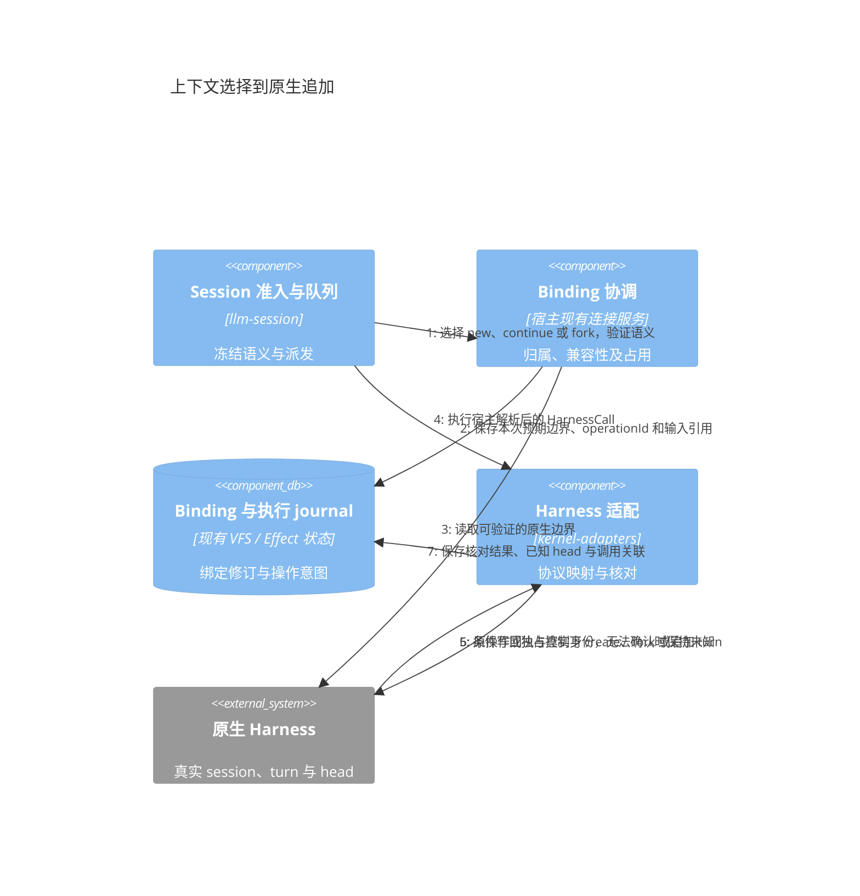
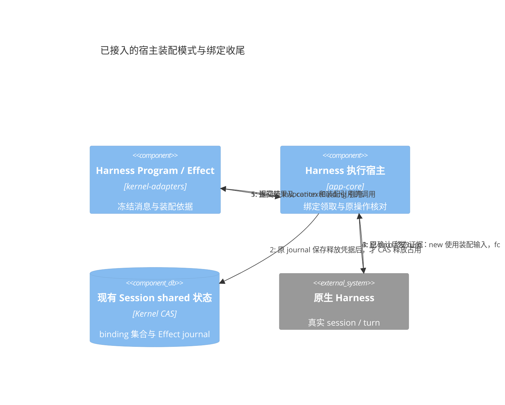
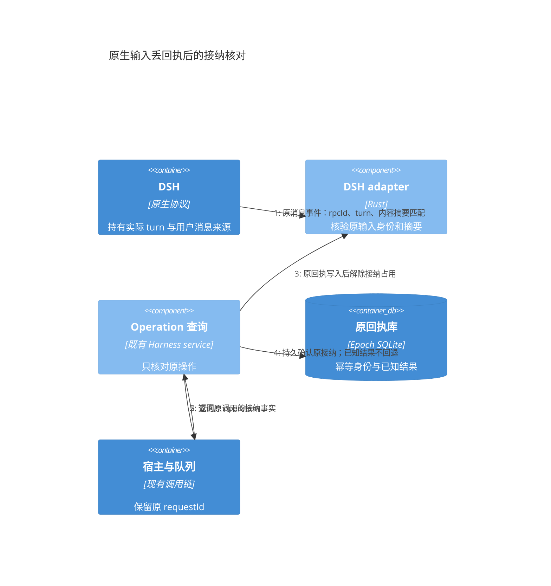
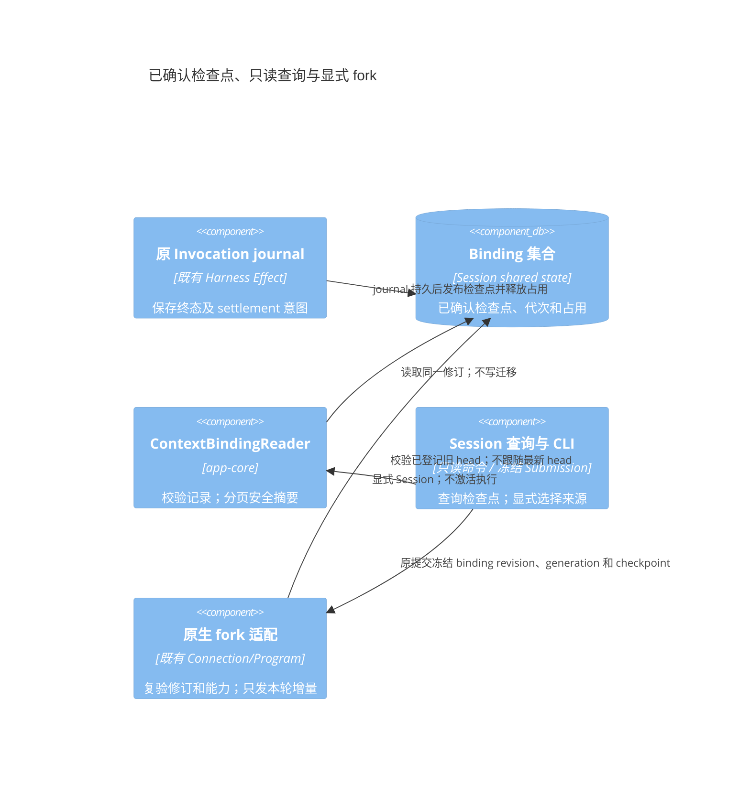
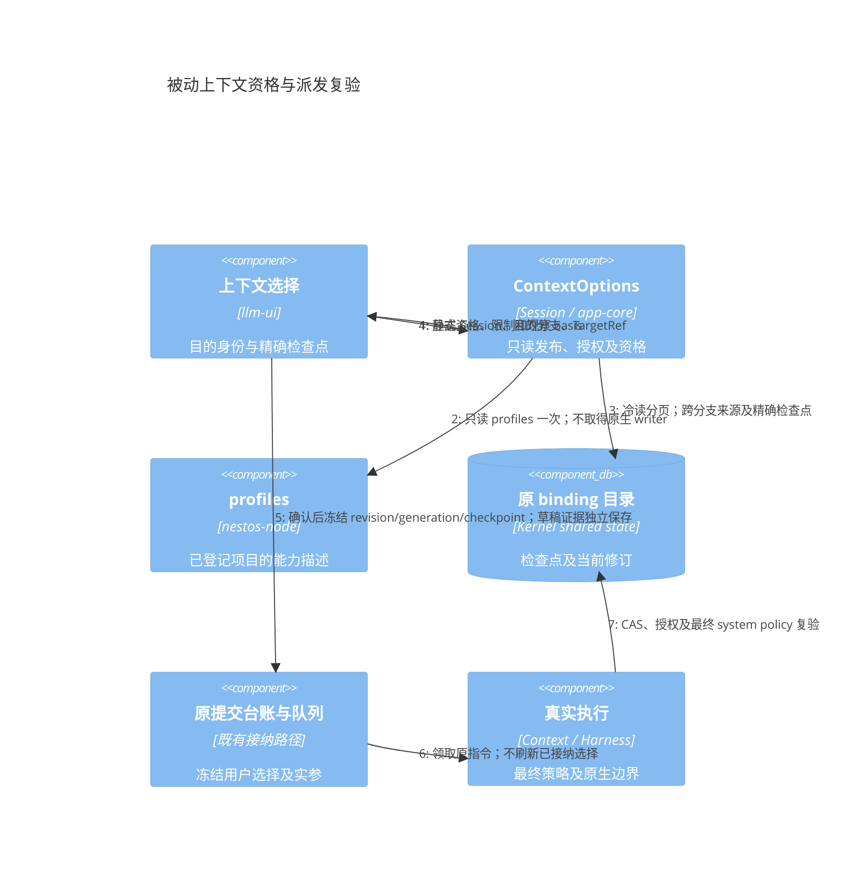

# 执行上下文绑定协议评审稿

状态：目标契约，已接入宿主装配 new 与显式检查点 fork；同一原生 thread 的严格续接仍待能力保障。日期：2026-10-24。具体覆盖见第 8 节。

本协议配套[统一执行模型评审稿](agent-session-connection-review.md)。Connection 选择执行端点，bindingId 选择可持续的原生上下文，Invocation 标识本次业务调用。模型连接的工具循环由本地 Program 管理，Harness 连接的循环由原生端管理；能力统一发现，语义分别验证。

## 1 身份与所有权

| 身份 | 用途 | 跨轮上下文含义 |
| --- | --- | --- |
| connectionId | 模型或 Harness 端点 | 多个调用共用，不能作上下文键 |
| sessionId / branchId | 用户工作容器及历史分支 | 仍需区分 Agent、角色和并行实例 |
| invocationId | 一次业务调用 | 隔离调用的所有者，不承担多轮续接身份 |
| taskId / effectId | Kernel 任务和副作用 | 用于恢复本次执行，可能随新轮次或替代成员改变 |
| operationId | 一次修改及其幂等、核对身份 | 不能复用为下一轮操作 |
| bindingId / generation | 一条持续上下文及其代次 | 跨轮续接的宿主身份 |
| native session / turn | 原生端真实身份 | 由适配器 journal 映射和验证 |

现有 [Harness journal](../../backend/app-core/src/projects/harness-execution-journal.ts) 已从 EffectExecutionContext 的 sessionId/taskId/effectId 派生稳定操作身份，解决的是恢复同一次执行。跨轮 binding 需独立管理，不能以“补传 taskId”取代。

Session 保存绑定集合；一个 binding 可以先后服务多个 Invocation，一个 Invocation 可以使用多个 binding。长期业务工作项可以引用一组 binding，但不复用 Kernel Task 的名字和生命周期。

## 2 宿主与适配器契约

以下类型是安全宿主边界内的目标 DTO；config、授权、原生身份和策略由宿主解析，不能按用户传入的 ID 直接执行。

```ts
type ConversationSelection =
    | { mode: 'new'; seedContextRef?: string }
    | { mode: 'continue'; bindingId: string; expectedBindingRevision: number;
        expectedGeneration: number }
    | { mode: 'fork'; sourceBindingId: string; checkpointRef: string;
        expectedBindingRevision: number; expectedGeneration: number };

type ContextPolicy =
    | { mode: 'host-assembled'; history: 'none' | 'branch'; sourceRefs: string[] }
    | { mode: 'native-continuation'; bindingId: string;
        expectedGeneration: number; onConflict: 'reject' };

interface ContextBinding {
    id: string;
    revision: number;
    generation: number;
    sessionId: string;
    branchId: string;
    connectionId: string;
    connectionRef: string;
    targetRef: string;
    scopeRef: string;
    nativeRef?: {
        nodeConnectionId: string;
        profileId: string;
        workspaceId: string;
        sessionId: string;
        epoch: string;
    };
    knownHeadRef?: string;
    policyRef: string;
    workspaceRef: string;
    memoryPolicyRef: string;
    validity: 'pending' | 'valid' | 'invalid';
    invalidReason?: string;
}

interface HarnessCall {
    operationId: string;
    invocationId: string;
    sessionId: string;
    branchId: string;
    conversation: ConversationSelection;
    inputRef: string;
    workspaceRef: string;
    memoryPolicyRef: string;
    policyRef: string;
}
```

HarnessCall 是经过准入的适配器输入。适配器只把原生支持的 create/resume/fork/turn 字段传给原生端，其余关联留在 journal。模型连接仍按模型契约接收消息，不因接口统一而获得原生会话能力。

new/fork 先保存创建意图，原生身份确认后才发布可续接的有效 binding。回执未知时保留创建 journal，不填入猜测的 nativeRef，也不让下一轮绕过未确认创建继续发送。

scopeRef 区分普通对话、主持角色、worker 或并行实例。worker 的实际实例身份包含调用展开、迭代和批次位置，不能只使用静态 nodeId。nativeRef 包含节点及 profile 命名空间，互斥键最终解析为真实原生 thread，防止同一 thread 被两个宿主 binding 别名绕过锁。

## 3 两种上下文所有权

| 模式 | 发送内容 | contextRef 记录的事实 |
| --- | --- | --- |
| host-assembled | 声明的历史、材料和本次任务；Harness 默认新建隔离 session | 实际装配输入、版本及来源 |
| native-continuation | 指定 binding 上本次增量输入 | 已知 head/checkpoint、策略、追加内容及观察边界 |

原生续接不重复发送整段本地历史。contextRef 记录上下文构造依据，不保证等于完整模型上下文；原生端可能读取项目指令、记忆或执行压缩。界面与审计分别标明宿主持有和原生端持有的部分。

当前 [独立 Harness 执行](../../backend/app-core/src/projects/harness-execution-operations.ts) 与[输入构造](../../backend/llm-session/src/session/direct-conversation.ts) 保留“新原生会话加宿主装配消息”的默认。续接是额外协商能力，不是简单把 create 改成 resume。

## 4 场景规则

| 场景 | 默认规则 |
| --- | --- |
| 普通对话下一轮，目标及策略兼容 | 新 Invocation、新操作和新 turn，继续已确认 binding |
| 同一连接执行无关任务 | 不同 binding |
| Flow 中独立 worker | 默认独立 binding，只读取显式材料 |
| 同一 Flow 的多轮主持角色 | 角色显式续用自己的 binding，不复用 worker binding |
| 同一节点的批量或并行实例 | 每个实际实例独立绑定 |
| 多个 worker 读取同一背景 | 从同一固定快照分别新建，或在能力支持时从同一 checkpoint 分别 fork |
| 切分支或编辑历史后重新生成 | 从确切历史点 fork；不支持时新建并装配所选材料，或拒绝 |
| 更换 Agent、实现、system prompt 或策略 | 校验兼容性；不兼容则新建，不静默续接 |
| 丢回复或宿主重启 | 查询原 operation、原 session/turn，不创建新 turn |
| 用户重新运行 | 新 Invocation，默认新上下文；不自动续用失败后的 thread |
| 用户明确接着继续 | 新 Invocation、新 turn；仅在停止及边界已确认后继续原 binding |
| 清空上下文 | 新代次或新 binding，旧身份和记录保留；不删除历史来伪造清空 |
| 原生会话丢失 | 标记绑定失效并报具体原因，不静默新建冒充原会话 |
| 外部客户端推进或 head 有缺口 | 暂停冲突派发并核对；重新接管、fork 或新建需显式选择 |

latest fork 不等于任意历史点 fork。原生历史无法确定对应基点时，不能自动降级后声称分支上下文一致。

## 5 CAS 派发与原生条件写

接纳队列项时冻结 bindingId、generation、目标及策略摘要；保存用户观察的绑定修订用于核对。它们描述所需上下文，不提前固定默认连续对话的派发 head。

派发时先取得本地 thread 写入所有权，读取最新 binding，验证仅有已登记的本队列前序操作推进，再把本次 expectedBindingRevision 和已知 head 保存到执行 journal。之后才构造 HarnessCall。不同代次、策略漂移或外部推进均不得自动重绑定。

expectedBindingRevision 约束宿主元数据 CAS，不等于原生端的 head 条件。读取 head 到发送 turn 之间，必须使用原生条件写或可证明的独占网关。外部 CLI 仍可绕开网关时，单靠本地 mutex 不足以保证一致性；无法确认的变更保留待核对，不自动重发。

默认不开放需要严格前序条件而适配器无法保证的续接模式。用户显式接管外部原生对话时，保存新的观察来源和控制范围，不冒称恢复为旧宿主分支。



## 6 工作区与记忆隔离

上下文隔离不等于工作区隔离。workspaceRef 明确选择共享、只读、worktree 或 sandbox 策略；两个独立原生 session 仍可能写同一目录。会话 fork 不回滚文件系统，取消也不自动撤销已经发生的写入。补偿由显式 Flow 节点或 Tool 能力提供。

memoryPolicyRef 明确项目记忆继承、固定记忆快照或隔离要求。新 thread 仍可能读取原生项目记忆；评测或并行尝试不能仅凭新 session ID 宣称独立。适配器无法实现声明的隔离级别时在执行前拒绝，不能忽略设置。

## 7 初始化 恢复与验收

初始化完成键包含作用域、初始化版本和步骤。Session 级、binding 代次级及工作区环境级分别记录；页面重开不重新初始化，native session 或环境变化也不能复用旧作用域的完成标记。

同一 thread 的写入串行，不同 thread 可按容量并发；项目文件锁、共享预算与 Session 写租约仍独立生效。恢复使用原 journal；已登记原操作不能因 binding 当前 head 更新而重新提交。

必须验证：同连接独立任务、并行节点实例、多轮主持角色、分支编辑后 fork、失败后重新运行与明确续聊、外部推进竞态、旧操作未结束时接管、原生 session 丢失，以及只恢复 thread 但工作区或记忆未恢复的情况。恢复结果分别报告上下文、文件和记忆范围。

## 8 当前实施覆盖

[契约](../../backend/kernel-adapters/src/llm-management/contracts/context-binding.ts)定义独立 ConversationSelection、HarnessContextRequest、ContextBinding 与 ContextBindingRef，不依赖 Session/Flow 实现。实际记录增加 pending 状态和可选 nativeRef：创建意图已经持久化而原生身份尚未确认时，不能声称存在有效原生会话。binding 的 revision 是元数据版本，与 token 展示版本分离；当前新绑定的 generation 为 1，代次重置入口仍待实现。

[宿主绑定协调](../../backend/app-core/src/projects/harness-context-bindings.ts)复用 Effect 的 fenced Session shared 状态，集合键为 harness.context.bindings。每条记录保存 Session/分支、目标与策略、连接快照摘要、工作区与记忆继承声明、原生命名空间，以及当前操作的 Invocation 和真实 Task/Effect 引用；它不保存第二套任务执行状态。集合 CAS 保留并发独立更新，续接元数据领取校验修订、代次、兼容性和占用；同一服务 epoch/profile/thread 的别名不能在同一集合里绕过占用。跨 Session 和外部客户端的真实 thread 并发仍必须由原生条件写或独占网关保障，不能据此推断已经实现。

普通 Harness Agent 的[直接执行输入](../../backend/llm-session/src/session/direct-conversation.ts)已在派发时保存完整装配依据：Task input.messages 保存实际 canonical 消息，contextSnapshot 保存同一快照的其余字段，context.input 指向该快照 ID 和摘要。Program 拒绝缺少匹配装配依据的 host-assembled 输入，也拒绝将完整 messages 再用于 native-continuation。当前默认仍为 new 原生会话；memoryPolicyRef 明示原生项目记忆继承，不宣称新 thread 隔离了工作区或项目记忆。

[执行 journal](../../backend/app-core/src/projects/harness-execution-journal.ts)在原生创建前保存新的 cb_UUID 身份，[执行上下文接线](../../backend/app-core/src/projects/harness-execution-context.ts)随后持久领取 binding，再调用原有 create/turn journal。未知原生回执保留该 binding 的占用；核对只查询原操作。结果通过 contextBinding 返回独立绑定引用。老请求没有 context 时沿用原 journal，不在读取时臆造绑定。

释放占用必须先准备 binding 收尾，再把预计释放后的 binding 修订写回原 journal，最后释放占用。这样，journal 写入失败时其他调用仍被阻挡；释放后结果写入失败，原调用仍能按已保存的释放凭据恢复，不会清掉后来调用的占用。已知终态与明确未开始分别处理；未知取消、未知提交或存储失败均不能作为释放成功。



[绑定回归](../../backend/app-core/tests/harness-context-bindings.test.ts)覆盖集合并发、同 binding 写入竞争、分支/目标/策略/工作区/记忆不兼容、旧修订及代次、原生别名与存储损坏。[执行回归](../../backend/app-core/tests/harness-execution-context.test.ts)覆盖创建前持久化、丢回执不重放、两处收尾写入失败、旧结果恢复不释放新所有者、明确拒绝及取消无法确认。[真实运行时回归](../../backend/app-core/tests/harness-agent-execution.test.ts)贯通队列、Program、broker、原生适配和结果引用，并验证下一轮宿主装配仍创建独立原生会话。

### 8.1 显式检查点 fork

Codex 0.164.0 的本机生成协议与[官方 app-server 文档](https://learn.chatgpt.com/docs/app-server)均支持 thread/fork.lastTurnId：复制到指定回合并排除后续回合。nestos-node 的[检查点适配](../../tools/nestos-node/src/plugin/harness/drivers/codex/checkpoints.rs)先核验来源回合存在且终结，再发送 lastTurnId，并读取新 thread 的最后回合核对边界。原生返回已创建身份后，验证失败仍保存 committed 回执和真实引用，不能改写为“未创建”，也不能把 latest 当作成功结果。

Profile 通过 checkpointFork 协商此能力，fork 布尔值仍仅表示原有分支功能。驱动[客户端](../../libraries/nestos-node-driver/src/harness/client.ts)对旧节点不发送检查点参数，发现失败归为未发送；远程历史的 forkAt 冻结 sourceSessionId/turnId 并进入原管理 journal。丢回执只核对原 requestId；确认失败会保存 lastFork 和 forkFailure，保留原会话与草稿，界面显示具体原因。切换会话发生在回执持久化之后，不能根据内存中的新身份提前导航。

分支切换中的下一输入目标尚未确认，canQueue 暂停新增接纳并保留草稿；创建中、回执未知和回执尚未持久化都属于该窗口。管理分支操作启动前要求来源队列为空，避免留下指向旧目标的后台指令。普通 turn 的提交未知仍沿用既有队列接纳能力，不能用这条目标切换约束重新引入全局发送锁。

普通 Harness Agent 可通过 ExecutionOverrides.harnessConversation 显式选择 fork，非直接 Harness 目标拒绝该覆盖。队列沿用原指令身份、冻结选择和去重摘要；派发在同一 Session 集合 CAS 中核验来源的 revision/generation、已确认 head、连接和策略，保存不可变 forkedFrom（含真实 nativeRef），然后创建新的 binding。新分支及角色可以有自己的 branchId/scopeRef；目标、策略、工作区和记忆声明必须兼容。来源可以指定同一 binding 目录中已确认的旧检查点，不随当前 head 自动前移；目录的当前 revision/generation 与选定 checkpointRef 分别冻结，见 8.4。

fork 调用的 Task 输入只保存本次规范化 prompt、已核验的增量附件及来源摘要，Program 不再装入完整本地历史或历史附件。无附件时保持原 prompt 的 SHA-256；有附件时对规范化 prompt/attachments 的 JSON 计算摘要，并在 Program 初始化时核对真实输入。宿主装配模式另对真实 canonical messages 核对快照摘要。原生 fork 和随后 turn 使用不同、稳定的操作身份；取消恢复可以只核对已创建的 fork，不能补发尚未发送的增量。未通过边界验证的 binding 保持 invalid，真实原生引用留存，来源 binding 不变。已持久确认未开始 turn 的收尾可直接核对 journal，不因后来授权撤销而重新连接原生端。

新增[宿主回归](../../backend/app-core/tests/harness-execution-fork.test.ts)覆盖丢 fork 回执、来源替换、创建后边界不符、旧修订与不支持能力、取消时未发 turn；[真实运行时](../../backend/app-core/tests/harness-agent-execution.test.ts)覆盖显式选择经队列到 Program/Effect 的增量输入。节点 Rust 回归验证历史截断和原生忽略参数；[原生验收脚本](../../tools/nestos-node/src/plugin/harness/tests/real_checkpoint_fork.py)在临时 CODEX_HOME 与本地拒绝端点生成两个终结失败回合，实际 fork 仅保留指定的第一个回合。该用例不使用个人会话或真实模型服务。

尚未完成：同一 thread 的原生条件追加、外部接管/丢失/内容推进处理、跨 Session 所有权、队列前序推进校验、父 Flow/动态 worker 及离线入口的完整接线，以及初始化、工作区和记忆隔离。绑定检查点目录、分页读取与 CLI 显式选择见 8.4，正式 Session 的被动资格与选择草稿见 8.5、8.6。continue 仍返回 CONTEXT_NATIVE_WRITE_UNSUPPORTED；checkpointFork 只证明原生回合边界复制，不证明项目记忆、工作区或外部修改后的全部实际上下文保持不变。尚未部署。


### 8.2 DSH 观察资源与上下文身份

DSH 的 max_sessions 限制附着观察订阅数，不能用它表示原生历史数或 ContextBinding 生命周期。已复现旧实现的容量问题：限制为 1 时，第一个会话的 turn 已完成，第二次 create 仍返回 DSH_SESSION_LIMIT；这是一项受控 HTTP/WS 协议复现，尚不能证明线上原 Session 的故障原因。

[观察资源回收](../../tools/nestos-node/src/plugin/harness/drivers/dsh/reclaim.rs)在容量不足时寻找已确认完成的会话。候选必须没有活动 turn、未确认或仍运行的命令、待答交互及正在借用该会话的控制操作；创建后尚未开始的会话也不回收。先取消并等待观察任务退出，才释放其容量；未确认退出保留占用并报告 DSH_SESSION_CLEANUP_PENDING。此处只确认本地观察任务退出，远端订阅的取消仍受传输状态影响；不等于确认原生执行停止，不能作为 Effect.cancel 的清理确认。

回收不发送原生 cancel/archive，不删除原生历史、回执或 binding。后续输入的准备阶段重新 inspect，必要时 resume 同一 sessionId，然后才发送冻结队列实参，禁止新建上下文冒充续接。命令结果未知时阻挡后续写入与 profile 空闲卸载，查询仍独立可用。[原生协议回归](../../tools/nestos-node/src/plugin/harness/tests/dsh.rs)覆盖完成后容量复用、历史和回执保留、恢复原会话、未知 prompt/命令不重发；[队列回归](../../libraries/nestos-node-driver/tests/conversation.test.ts)覆盖冷观察重新取得同一原生身份后派发。

DSH 实时 turn 仍使用原 requestId，历史按原生 turn 编号投影；事件 gap 后的持久身份映射和终态核对尚未完整贯通。结果未知的串行命令当前继续保留占用，尚无经过原生身份核验的自动解除路径；需要补齐原生操作身份或独占调用网关及终态对账，不能仅凭超时清掉占用。观察资源回收没有补齐这项恢复契约，也没有处理外部客户端并发写入。线上 node/httpd 版本、原 Session 回执与实际资源占用仍需单独核对；本次未部署或重启。


### 8.3 DSH 原生输入接纳与实际 turn 关联

原生 Session Controller 将普通输入的 requestId 保存为 user/message.source.rpcId。当前[输入接纳适配](../../tools/nestos-node/src/plugin/harness/drivers/dsh/admission.rs)保存冻结文字摘要，收到同一原生会话的消息事件后核对来源身份、原操作 ID、turn 编号及内容。历史替换事件不作为新输入接纳证据；已关联的原生 turn 不因后续消息重新绑定。匹配只证明该输入已进入原生执行，不表示整个调用完成，也不证明原生检查点已刷盘。身份不符继续 unknown；相同身份却内容不符报告 DSH_PROMPT_EVIDENCE_MISMATCH，不用文字相似度猜测归属。

[统一回执入口](../../tools/nestos-node/src/plugin/harness/service.rs)可对未知操作向既有驱动读取证据，先写入原[回执库](../../tools/nestos-node/src/plugin/harness/receipts.rs)，再通知适配器解除该操作的接纳屏障。回执遵守 unknown 到已知结果的单向结算；迟到的原工作者不能用 unknown 或拒绝覆盖既有结果。查询不创建驱动、不续接会话、不重发输入。项目模式按同一主体、项目及 profile 的回执作用域查找已有实例，避免只查询当前观察模式而漏掉原执行。



实际执行与输入接纳分别关联。turn/start 只表示原生端开始了某一轮；只有匹配的用户消息才能将它绑定到本次操作。此前外部轮次的输出保留原生身份，不能使本次调用提前终结。未识别本次输入时取消返回 DSH_TURN_NOT_IDENTIFIED；在途或未知取消有独立屏障，不能因目标已完成就假定该取消请求已释放。取消与完成竞态保留原生真实终态，正常完成仍记 completed。

[协议与运行回归](../../tools/nestos-node/src/plugin/harness/tests/dsh.rs)覆盖未知接纳恢复、错误身份/内容、回执持久后容量释放、迟到响应不清掉仍运行的原轮次或已开始的新轮次、取消身份及成功竞态；项目模式、只读观察模式和 SIGTERM 关闭另有集成回归。

覆盖仍有限：上述证据来自仍存活驱动收到的原生事件；完整连接丢失、跨事件缺口的历史编号映射、未知 slash/取消操作的原生身份核对、严格条件写与条件取消仍需补齐。原生 llm-ui 已接入独立取消台账，实际范围与暂停限制见[控制协议第 8 节](invocation-control-state.md#8-当前实施覆盖)。节点重启后 epoch 变化，不自动重放旧操作。

2026-10-24 14:23 UTC 使用客户端证书只读查询线上 /api/health，返回 ready=true、release 版本 20261024T054307-5e9365ae-dirty。当前补丁尚未部署或重启；节点实际运行版本与原 Session 故障尚未完成核对。

### 8.4 已确认检查点与只读目录

一个 binding 可保存多个已确认 head：`ContextCheckpoint.kind=terminal` 携带真实 operation/Invocation 与因果前驱，`legacy-head` 只表示旧记录曾保存该 head，不补造生产者。检查点与新 knownHeadRef 在原 binding settlement 释放时一并提交，先持久保存原执行 journal，再解除占用；只看到原生终态但 journal 尚未持久时不发布。回执丢失后的旧 release 幂等核对，不追加重复检查点，也不释放后来所有者。后续 not-started 操作更新 lastOperation，但不改变上一检查点的所有者。旧 lastOperation 可能对应拒绝操作，因此不能据它推断旧 head 的生产 Invocation。

terminal 表示已确认原生 head 终结，不等于业务 Invocation 成功、输出 schema 合法或工作区已恢复；这些事实仍从原执行及其结果读取。目录不因存在检查点就声明可继续、可暂停或可控制。

显式 fork 允许选择当前 binding 中已登记的更早检查点；冻结当前 binding revision/generation 和选定 checkpointRef。来源修订、策略、代次或原生边界不符时拒绝，不自动改用最新 head。此功能沿用现有 checkpointFork 能力和 fork/turn journal，不启用原 thread 的条件追加。安装的 Codex 0.164.0 生成的协议 schema 中，turn/start 的 parentTurnId/rootTurnId 是调用归因字段；expectedTurnId 属于 turn/steer，不能用来宣称下一轮具有 head 条件写保证。

`session.context.bindings` 经 ContextBindingReader 只读查询现有 Session shared state。请求显式指定 sessionId，可选 branchId、bindingId、limit 与 cursor；先核对 Session manifest 和分支。未指定 bindingId 时分页列出绑定摘要；指定时分页列出检查点。游标绑定集合修订及 Session/分支/绑定查询范围；集合推进后报 CONTEXT_CATALOG_CHANGED，不能把新旧页拼成一个快照。旧记录的当前 head 可以只读投影为 legacy-head，不为查询写回迁移。

返回的摘要包括 binding 引用、目标、分支、连接、有效性、占用与检查点数，不返回 nativeRef、操作 fingerprint、Effect 凭据或策略正文。有效性描述已保存的绑定事实，不代替原生就绪度与当前控制权核验。空目录只表示现有记录确实为空；授权、存储失败或损坏数据保持具体错误。查询经公开 inspectSession 的 getShared 读取，不调用普通 Kernel.getShared（后者会登记后台观察）或 openSession，不绑定视图、不取得写租约、不创建 Task、不恢复原生 Agent。每个 binding 最多 4096 个检查点，集合继续受既有 8 MiB 限制；达到容量时明确拒绝写入，不自动删除仍用于历史追溯的 head。归档及可达性清理仍待补齐。



CLI 的 `session contexts <session-id> [binding-id] [--cursor '<cursor-json>'] [--branch name]` 复用该只读命令。`session prepare/send ... --context selection.json` 使用公共 ConversationSelection 校验器，把显式选择写入同一冻结 Submission；submit/receipt 不重新读取该文件，也不允许用 --context 覆盖原请求。选择文件不携带原生 sessionId、凭据或 binding 正文；实际 Harness 能力与当前授权仍在派发时复验。

证据见[检查点持久化与故障](../../backend/app-core/tests/harness-context-bindings.test.ts)、[分页与安全摘要](../../backend/app-core/tests/harness-context-catalog.test.ts)、[实际 fork 派发](../../backend/app-core/tests/harness-execution-fork.test.ts)、[真实应用 Harness Agent 查询](../../backend/app-core/tests/harness-agent-execution.test.ts)及[CLI/RPC](../../apps/cli/tests/application-submission.test.ts)。正式 Session 的 UI 选择器已接入 8.5、8.6 的资格及草稿协议。普通队列前序 head 推进、条件续接、代次重置及 worker 的完整 binding 接线仍未完成，不能以目录可读代替这些执行保证。

取消收尾的生产权限缺口已有工作树修复：[createHarnessCleanupState](../../backend/app-core/src/projects/harness-cleanup-state.ts) 仍只允许原执行 journal；[createHarnessContextCleanup](../../backend/app-core/src/projects/harness-context-cleanup.ts) 由 Runtime 另行注入固定 binding 的读取、准备和释放端口。宿主先核对原 Session 租约，再从实际持久 journal 重读归属及停止证明；每次共享记录读写继续检查租约。Effect 不取得 binding 集合的任意写入权限，也不能领取或附着其他 binding。

释放前再次重读原 journal，核对凭据中的 bindingId、修订、代次，以及准备记录的终态类型和 head；凭据持久失败、原生结果未知、失去租约或归属不符均保留占用。已完成释放后的旧操作重核只返回原凭据，不触碰后来所有者。[生产端口故障回归](../../backend/app-core/tests/harness-context-cleanup.test.ts)覆盖提交前失败、提交后丢回复、集合 CAS 并发、错误凭据和日志隐私；[真实 Runtime 回归](../../backend/app-core/tests/harness-agent-execution.test.ts)验证 Kernel stopped/settled 确认、完成与取消竞态，以及暂停队列后取消当前、显式恢复并派发下一条。该修复不代表已部署或完成原线上 Session 验收；取消端口和 C4 事件流见[控制协议 §8.4.1](invocation-control-state.md#841-原执行-binding-的生产清理端口)。


### 8.5 被动资格查询

ContextOptionsQuery / ContextOptionsPage 位于 llm-session/contracts。session.context.options 必须携带目的 Session、branchId 和精确 TargetRef，可附执行模式、追加 system prompt、bindingId、checkpointRef 及分页游标。目的分支与来源分支不同：fork 可以选择同 Session 其他分支的已确认检查点，不能按目的 branchId 过滤来源。

查询先只读核对 manifest 和发布身份，再读取当前本地连接授权及一次 requireRegistered 的 project-scoped profiles。它不调用 AgentResolver.resolveExact、上下文装配、Skill 加载、models、原生 create/resume/fork 或 Session writer。非直接 Harness 目标返回 kind=other；未发布普通 Agent 保留普通聊天，不伪造已发布的原生资格。已有发布而版本或摘要不符仍报告目标变化。

| 返回事实 | 含义与限制 |
| --- | --- |
| modes.new/fork/continue | 声明实际端口支持；continue 仍明确不支持。fork 同时要求原生 checkpointFork 与宿主 client.fork 桥 |
| source.fork.status=static-compatible | 目标、完整连接摘要、工作区及记忆声明、原生 epoch/profile/workspace 和已确认检查点满足静态条件；不代表完整策略或实际资源已经就绪 |
| dynamicPolicy=dispatch-validation-required | 最终 system blocks 包含宿主、Skill、初始化材料及预算裁剪，仍须在真实派发时按原 binding.policyRef 复验 |
| basis | 对目标、目的上下文依据、策略覆盖摘要、目录及连接观察的一致性指纹；不是授权令牌，不进入可执行 ConversationSelection 或提交去重摘要 |
| cursor={basis,catalog} | 同时固定资格观察及既有目录修订/查询范围；漂移拒绝继续拼页，保留原选择 |

初始目录由宿主筛选目标，UI 不解析内部 targetRef 或按连接 ID 猜测兼容。显式 binding/checkpoint 重验保留该 Session 精确来源，即使目标已改变，也返回具体不兼容原因。terminal 检查点可以选择；legacy-head 不冒充已确认 Invocation。查询和静态检查不创建新 binding，不释放占用，也不授予原生控制权。

直接执行与被动资格共用 directHarnessContextIdentity 的 target/workspace/memory 编码。追加 system prompt 在实际直接 Harness 的普通与已接纳路径均生效，并参与最终快照策略摘要；模型及 Flow 入口明确拒绝原生上下文覆盖，不能静默丢弃。派发时发现完整策略变化，保留来源并拒绝原生创建；不得因曾显示静态可选而忽略复验。



回归入口：[被动查询](../../backend/app-core/tests/harness-context-options.test.ts)、[实际宿主接线](../../backend/app-core/tests/harness-context-options-runtime.test.ts)、[真实策略变化拒绝](../../backend/app-core/tests/harness-agent-execution.test.ts)、[挂起发送期间的认证 RPC](../../apps/http-app/tests/view-api.test.ts)。此项不证明原生严格续接、外部 writer 排他、工作区/记忆恢复或原生产 Session 已恢复。


### 8.6 宿主 Session 的上下文草稿

正式 Session 输入区通过可选 ContextOptionsPort 查询原生上下文资格。默认不设置覆盖，继续使用宿主装配的新上下文；只有人工选择并确认的 terminal 检查点才生成显式 fork。普通模型、Flow 和未发布兼容入口不支持原生选择，省略覆盖时仍正常运行。当前独立原生 thread 页面及尚未转正的项目草稿不臆造宿主 binding 身份。

InputContextDraft 位于 UI adapter 的 domain/context-draft，保存独立修订、Session、分支、精确目标和 new/fork 选择；它是一次调用的草稿，不属于 Session 执行设置。正式分支将其作为不透明 inputContext 保存，项目草稿使用严格编解码；跨项目偏好不携带 binding。清除后重新选择同一点仍分配新修订，重开时可以从同一 OperationLedger 的草稿证据取得修订下界，避免旧回执把新选择误认作原草稿。

目录与资格只作为观察缓存。目标、分支、策略或选择变化使观察失效，保留原选择并提示重验；同范围反序返回的旧结果也不能覆盖新结论。分页修订冲突时丢弃整页缓存，保留草稿。读取、刷新和重验不自动更新选择的来源修订、代次或 checkpointRef；用户必须重新选择并确认，已接纳请求始终保留原选择。

提交前复验当前草稿的范围及静态资格，再将精确 selection 写入原 SubmissionRequest.overrides.harnessConversation。发送命令在任何异步准备前复制选择；submitSessionCall 在 OperationLedger 保存前复制完整嵌套请求，台账保存和实际发送使用同一冻结对象。contextDraft 修订及观察 basis 不进入执行去重摘要，台账另存草稿证据用于消费核对。

接纳可以先于原发送回复到达。清理文字、附件、参数或上下文时，必须核对各字段的修订及当前值；旧接纳不能清除后来选择、其他目标或分支的草稿。unknown 仍查询原请求身份，不调用选择器重新挑选最新检查点或重发。这里的接纳只清理匹配编辑输入，不伪造执行历史或宣称调用已完成。

用户清除后重选同一检查点，可能得到相同执行实参但不同草稿修订。主动再次发送时，先核对原 unknown 操作；原操作已接纳而草稿证据不同，台账仍结算原接纳，返回 `CALL_SUBMISSION_PREVIOUS_ACCEPTED`，保留当前输入并释放旧待核对缓存。此操作不重发，也不把原调用标记为失败；用户随后明确发送才创建新调用。原结果仍未知时继续保留原操作屏障，不能靠新草稿修订绕过它。

回归入口：[选择器 DOM 与 RPC](../../ui/app-shell/tests/context-picker.test.ts)、[上下文草稿规则](../../ui/llm-ui-adapter/src/domain/context-draft.test.ts)、[提交冻结](../../ui/llm-ui-adapter/src/commands/submit-session-call.test.ts)、[恢复消费](../../ui/app-shell/tests/submission-reconciliation.test.ts)。完整原生续接、所有 Flow worker 及离线入口的 binding 接线仍未完成。
