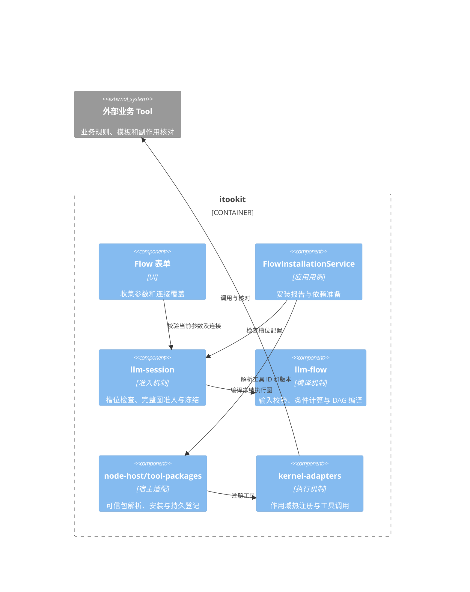
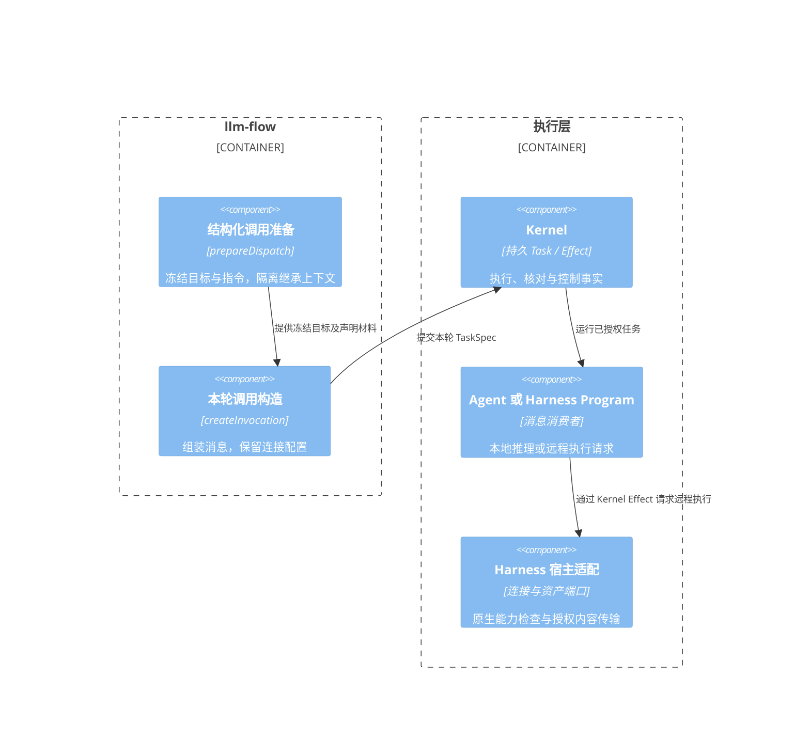

# Flow 能力装配与输出查看

当前新图采用独立的 route、taskGroup、join、aggregate@3、loop 控制节点；作文评审模板已迁移。实现、策略默认值及边界见 [Flow 控制节点](flow-control-primitives.md)。下文 route@2/@3 的派发模型保留用于旧定义兼容。

## 查看执行结果

### History 交互与重新运行

Session 标题栏的「重新运行」读取整个 Session 的最近一次同类 Flow 调用，预填其参数。提交前校验参数；成功提交会创建替代分支并切换展示，原分支的参数和结果不变。使用最新保存的草稿：内容变化时发布新 revision，否则复用最新发布版本；每次 Round 固定自己的 revision。表单打开后定义变化会要求重新打开表单，避免使用过期参数。取消表单不创建分支；运行中不允许再提交；宿主的 Session 写入租约同样适用。每个执行 Round 保存自己的 `flow`，旧 Session 的首次调用兼容读取 manifest.flow。

History 展示交互而不展开 DAG：输入节点与补充输入显示为 user，执行任务和输入请求显示为 assistant；路由、内部汇总和判断不显示逻辑卡片。LLM 默认沿用设备流式能力（节点显式 `stream:false` 时返回完整内容），按 Task ID 投影独立消息，多个并发检查不会混合增量。终态用实际返回值替换该任务的流式文本，支持 JSON、失败及取消状态。

这些消息是 `RoundResult.flowInteractions` 的展示投影，不改变模型 history 策略，也不会把内部交互添加到 Round.input/output。任务即使 `flowHistory=omit` 仍可在界面显示。终态保存后，切换分支或重新打开会话会重建交互；执行中的原始增量仍由 Kernel 事件日志持久保存，本次不增加关闭窗口后自动续订整条 Flow 的机制。

实现：[重新运行](../../backend/llm-session/src/session/flow-rerun.ts)、[History 投影](../../backend/llm-session/src/session/flow-history.ts)。

在 llm-ui 运行 `.flow` 后，打开生成的 Session，点击标题栏的「流程输出」。窗口只列出当前 Session 的 Run，默认打开最新一次，也可以切换历史运行。

- 直接运行或打开完整详情时，每个节点使用独立的只读 mdxeditor 展示请求和输出；节点默认折叠，展开才初始化编辑器。刷新复用同一 Task 的编辑器和展开状态，长正文在独立区域内滚动。顶部最终输出单独展示，运行中每秒刷新一次，终态停止轮询。
- 被调用的 Flow 在调用卡片内使用一个 mdxeditor 展示请求与最终结果，保留“查看详情”按钮进入完整节点视图。独立子调用在终态读取真实 Run 输出，不能把截断摘要当作完整结果；声明 `__flow_return` 时只显示声明的返回值。
- 字符串按 Markdown 展示，结构化结果使用 JSON 代码块，保留 `0`、`false`、`null` 和空字符串。业务对象中的 `content` 字段不会被当作通用文本封装而丢弃其他字段。结果展示不按作文等业务字段生成专用视图。
- 原有任务记录入口保留，可查看模型和工具事件。「流程输出」窗口按节点结果刷新，History 则显示 LLM 的流式文本。
- 打开历史输出只读取持久记录，不自动恢复执行；显式恢复仍使用工作台的恢复操作。切换 Session 或关闭窗口会释放轮询。
- 新完成的 Flow 同时把格式化结果写入会话消息；旧会话中已保存的空消息不会自动重写，但仍可从「流程输出」读取 Run 的持久结果。

源码：[输出投影](../../backend/llm-flow/src/contracts/flow-output.ts)、[会话窗口](../../ui/llm-ui-adapter/src/flows/session-output.ts)、[独立编辑器生命周期](../../ui/llm-ui-adapter/src/components/dag/FlowDocuments.ts)、[子调用结果](../../ui/llm-ui-adapter/src/components/dag/FlowCallDocument.ts)。

## 节点工具与 Skill

设计器工具栏「从工具获取输入」提供工具/MCP 搜索与 Schema 参数表单。确认只新增普通 `builtin.tool` 节点；已选节点具有 `input` 端口时，同一次可撤销编辑添加 `result → input` 数据边。打开与取消表单不执行工具；运行后仍按 Task 审批、授权及持久恢复。节点可在图中移动到开始、中间或结束阶段。

UI 与 CLI 复用 [createFlowCapabilities](../../backend/app-core/src/runtime/flow-capabilities.ts)，在 Session 创建后装配节点的 `config.toolIds` 和 `config.skillIds`。动态派发子任务也经过身份绑定、Skill 选择和工具白名单校验。缺失或禁用的工具、不可供模型使用的 Skill 会明确报错。

隔离 history 只移除消息、记忆及父会话上下文；显式选择的 Skill 指令和持久快照仍保留。宿主可注入 Agent/SystemPrompt 引用解析器；CLI 默认不提供实体引用解析，引用未接入的实体会报错，内联 system prompt 可直接使用。

### MCP

直接工具引用使用 `mcp__<server>__<tool>`。例如服务 `fixture` 的 `lookup` 工具为 `mcp__fixture__lookup`；含特殊字符的名称应通过导出的 `mcpToolId` 构造，不能手工拼接。服务地址、认证和进程配置来自已配置的 MCP Server，模型只提交工具参数。

Skill 可通过工具绑定声明：

```json
{
  "toolId": "lookup",
  "executionType": "mcp",
  "mcpServerId": "fixture",
  "mcpToolName": "lookup"
}
```

适配器按显式工具列表发现并注册 MCP 工具，执行通过 Kernel `tool.call` Effect，沿用批准、取消和恢复机制；结果保留 MCP content 与 structuredContent，`isError` 转为失败。冷启动后重新发现所需工具，不依赖内存中的注册状态。

MCP 注册使用通用 `outputEncoding: json` 声明：模型仍接收完整 JSON 文本，确定性 Flow 节点接收解码后的结果对象，避免二次编码使下游拿到字符串。处理器注册缺省版本统一为 `1`，与内置 Tool 的既有缺省版本一致；不把 MCP Server 自身版本冒充工具版本。YAML 运行仅隔离其模型 Provider/Connection，宿主 MCP、Skill 和 Harness 连接继续可引用。

设备层使用 [MCP 官方 TypeScript SDK](https://github.com/modelcontextprotocol/typescript-sdk/blob/main/docs/client.md) 完成初始化、工具分页与传输。HTTP 使用 Streamable HTTP，另支持 SSE/WebSocket；stdio 仅 Node 宿主支持，浏览器入口明确拒绝 stdio。支持配置 headers、cwd、环境变量和 timeout，取消信号传递给 SDK。远端副作用是否已经发生，仍受远端服务契约约束。

### 其他 Skill 工具

默认适配提供 HTTP 与宿主 nativeShell 执行；自定义 handler 由宿主工厂优先提供，找不到实现即失败，不静默跳过。Shell 推荐显式 `command` + `args` 数组，参数占位符为 `{{field}}`，替换值作为单个 argv 传入，不经额外 shell 解释。

需要先调用工具再生成结论的节点，应把 `maxExchanges` 至少配置为 `2`（更多调用按任务增加）；作文流程的业务 `maxRounds` 是另一层循环参数，不能替代模型交互预算。

## 验证范围

真实模型与构建后 CLI 的跨进程验证见 [CLI 能力与持久化实测](flow-cli-capabilities-verification.md)。执行记录与 UI 所需的聊天 Round 均已保存，等待输入、跨进程恢复和重复导出均有回归覆盖。

- [CLI 集成](../../apps/cli/tests/flow-capabilities.test.ts)：本地模拟模型 + 真实 stdio MCP 进程，直接工具、Skill 工具、独立 history、批准等待、关闭后恢复及再次运行。
- [HTTP MCP 测试](../../backend/kernel-adapters/tests/llm-management/mcp-transport.test.ts)：初始化、认证头、分页、结构化结果和取消。
- [输出测试](../../ui/llm-ui-adapter/src/flows/flow-output.test.ts) 与 [DOM 集成](../../ui/app-shell/tests/flow-output.test.ts)：结构化数据、转义、运行刷新、会话过滤、历史查看和关闭清理。

这些测试不依赖外部模型或用户 MCP 服务，也不等同于真实桌面手工验收。

CLI 使用共享 `FlowRunProjection` 按根 Task 幂等写入 History Round；节点、工具、输入和批准携带 `FlowActor` 身份。Skill 作为节点/工具来源展示，工具调用按 Task 和 call ID 隔离；分支切换保留 Flow 交互。验证见 [CLI 能力验收](flow-cli-capabilities-verification.md)。

### 已关闭 Session 的重新运行

Flow 重跑在参数和原分支校验后、创建替代分支前检查 Kernel Session。closed 会话经显式 `reopenSession` 重新接收新 Task，然后在原 Session 创建新分支；原分支、旧 Task 和结果保留。关闭清理未完成或会话已归档时拒绝，不生成空分支。普通打开 Session 不解除关闭状态。

### Session 级重跑与分支输出

“重新运行”从 Session manifest 的 `flowId` 查找最新保存的流程定义，预填同一流程最近一次运行的参数；没有 Round 时使用 Session 初始参数。查找范围为整个 Session 的 Round 索引，不依赖当前分支或已加载的 History。每次重跑创建无历史父节点的新分支、新 Round 和新 Task；原分支不变。左侧会话右键与顶部按钮复用同一编辑器命令和参数表单。

“流程输出”默认选中当前分支，允许只读切换查看其他分支。`session.flow-branch-executions` 从各分支的 Round 引用解析 Task ID，界面仅展示所选分支引用的 Flow Run，空分支清空旧输出。观察不会切换 History 的当前分支或恢复执行，也不提供取消、注入、重试等写操作。

存储布局保持不变：同一 Session 的分支索引和 Round 都在 `history.seq`，执行记录在 `kernel/tasks/<taskId>/`；不会新增 branch 目录或复制 `.flow` 文件。分支通过 `branches[name] → Round.historyParentIds / executions → taskId` 隔离读取；新建无来源分支的 `branchMeta.sourceRoundId` 可省略。已有数据不需要搬迁。

### 评审预算与租约恢复

四维评审的 `maxRounds` 与检查节点的 `maxExchanges` 独立。内置模板默认单节点 3 次模型交互，并允许通过运行参数设置，最低 2 次以容纳一次 JSON/schema 修复。修复因预算不足失败时保留具体输出校验原因与限额。已有发布版本不修改；旧模板的四个检查节点需保存为至少 2 次预算的新版本，再从 Flow 目录启动。

Web 刷新后若旧宿主写租约仍有效，当前实例保持只读；租约取得后执行在线恢复再开放提交，不再要求再次重启。Task/Effect 的未过期执行租约不被强制接管。

### 版本与自动修改闭环

Flow 发布版本使用递增整数 revision，`.flow` 草稿的 draftVersion 仅表示编辑版本。每个 Round 的 `flow` 保存 flowId、revision、parameters；流程输出的分支与运行选项显示 `flowId@vN`。重新运行不会改写旧 Round 或旧发布版本。恢复未完成运行仍使用原快照。

作文模板按“路由 → 四维检查 → 汇总 → 判断 → 修改作文 → 路由”运行。`builtin.revise` 是通用输入修改节点，fields 定义允许更新的参数，prompt 可读 `${state.results}`；独立 Task 返回结构化字段后更新本轮输入。修改稿件会使历史评分变为非当前评分，下一轮重新检查全部维度。通过阈值或达到 maxRounds 时直接输出，不再修改未评审的稿件。修改 Task 的预算、模型、工具、schema 和 history 策略均可配置。

### 变量与输入分离

新作文模板使用 variables/assign，修改写回 `${vars.essay}`，`${param.essay}` 保留初始输入。普通节点同样可以声明 assign；跨节点读取依赖图确定顺序。流程输出和持久结果包含初始值、当前值和更新来源。详见 [内部变量设计](./flow-variables.md)。

### 实时事件读取

Task.events 使用按 Task 索引的分页事件尾部，避免每个节点反复扫描整个 Session（包含旧分支）的 events.seq。公开 after 仍为 Session sequence；分页内部使用独立 Task index。观察到终态后再排空尾页，防止丢失最终 delta。Session.events 保持全 Session 订阅语义。

验证包含：模型返回首段后暂停且不结束时，实际 LLM Effect → Kernel → FlowHistory 必须已发出正文增量；真实 HistoryView/MDx 在没有完成事件时必须绘制正文。无需将 for-await 消费改成 callback，也不依赖末尾 Promise.all 才刷新。

### Flow 思考内容展示

`FlowHistory` 将 `stream:thinking` 投影为 `message:updated(field: thought)`，即时更新节点思考区域；`stream:content` 继续更新正文。并行节点按 Task 隔离，思考内容保存为 `RoundResult.flowInteractions[].thinking`，历史恢复映射为 `ExecutionNode.data.thought`，不进入节点返回值或模型 history。CLI 的 `FlowRunProjection` 同样读取 thinking 事件，无事件时从 Task 的 assistant messages / output.message 回退恢复；失败或取消前的部分思考也保留。

思考区域直接更新文本，不经正文 MDx 编辑器。临时 StreamTrace 诊断日志已移除，req 面板和请求持久化保留。


### History 分组与刷新恢复

一次 Flow 运行仍对应一个持久 Round，但 History 将可见节点展示为用户输入后的多个独立窗口。调度器同一并行派发批次携带相同 flowHistoryGroup，窗口内分别显示各节点；串行节点、下一轮和不同批次使用独立窗口。工具结果跟随所属节点窗口。运行总结果保留在最后；内部调度 Task 不直接创建窗口，路由内的汇总与判断通过持久事件逐轮显示条件与结果。旧 Task 没有批次记录时逐节点展示，不猜测其并发关系。

运行期间的增量已在 Kernel Task 事件日志持久化，但最终 `RoundResult.flowInteractions` 在运行结束时才完整保存。页面重新绑定或加载分支时，通过 `restoreFlowHistory` 从该 Round 的 primary execution 和 Run 成员索引读取 Task 分页事件，重建尚未保存的交互投影（正文、thinking、工具、输入状态）。重建只读，不回写 Round、不重新执行任务；只恢复已持久化的内容。已有完整终态交互的 Round 直接使用保存结果。

Session 路由未指定 branch 时使用 manifest.currentBranch；显式 branch 参数优先，避免打开已有 Session 时被强制切回空 main 分支。此修复恢复 History 快照，不新增跨宿主实时事件订阅机制。


分支下拉列表提供删除按钮，复用 `branch:delete` 命令和确认流程；当前分支禁用删除，需先切换到其他分支。删除成功后 `log:ref_deleted` 刷新分支列表。运行中仍保留删除保护；删除等操作报错和分支草稿恢复结束时，输入区按 Session 实际生成状态更新，避免隐藏仍在运行任务的停止按钮。上下文丢失导致执行提前退出时将 Session 标为 failed，清除残留 queued 状态。


### 节点请求调试

每个 Flow 节点 thinking 上方提供默认折叠的 `req`。`llm.chat` 适配器调用模型服务前写入 `llm:request` 事件，携带 Effect ID、connectionId、模型服务请求参数（messages、tools、生成参数等）。它是应用交给模型服务的请求，不是 Provider 最终 HTTP body；不包含连接密钥、HTTP headers 或 AbortSignal。同一 Task 的多次 Effect 调用分别保存，历史投影保存于 `FlowInteraction.requests`，实时更新通过 message:updated.metaInfo 传递。req 以纯文本 JSON 展示，正文中的 HTML 不执行；没有记录的历史节点明确显示“尚无模型请求记录”，不从模板伪造请求。

`FlowInteraction.parallelGroup` 持久化并行批次标识，实时与历史恢复共用窗口分组规则。DAG 调度器只给同批多个就绪节点设置分组；route spawn 只给同批多个子任务设置分组，运行级并发上限也约束 route 的派发批次。分组描述调度上的并行批次，不代表网络请求在同一毫秒开始。

Flow 窗口与节点均提供标题、复制和折叠按钮。窗口级复制汇总该窗口中节点的正文，节点级复制只复制自身正文；不混入 req。窗口和节点使用独立折叠 ID，接入全局 fold、视口导航及 UI 折叠状态恢复；并行窗口 ID 由持久化批次标识派生，避免实时与历史投影的父节点 ID 差异导致折叠状态丢失。


结构化输出由 Agent 在结束 Task 前验证：除类型、必填字段与数值范围外，也校验 `additionalProperties`（false 或子 schema）以及布尔 schema。额外字段错误会进入节点的 outputValidation 修复策略，受 retries 和 maxExchanges 双重限制；修复耗尽后仍失败，不静默删除字段。Flow 层继续执行最终契约校验。路由提示明确要求返回匹配 schema 的结果实例，禁止把 schema 关键字当作结果字段；没有自定义 prompt 的节点也会附带 schema 说明。

连接准入从节点 `responseFormat` 推导 `requirements.responseFormats`，合并到共享槽位、节点及冻结连接。有效格式由设备契约按实际协议与模型显式能力取交集：`anthropic-messages` 不支持 `json_object`；原生 JSON 模式不能依靠未知的 `supportsStructuredOutput` 声明通过预检。`FLOW_CONNECTION_OUTPUT_FORMAT_UNSUPPORTED` 会保留槽位、协议和格式原因，在创建会话或发出模型请求前失败，不自动切换协议或删除参数。跨协议提示词 JSON 可显式使用 `responseFormat: {type: 'text'}` 并保留 `outputValidation.schema`；这条路径仍严格解析和校验 JSON，并按原有限额修复，不把本地 schema 当成远端支持原生 `json_schema` 的证据。


### 汇总与判断的执行可见性

可视图中的 aggregate / judge 仍编译到 dispatch 的持久状态机中，执行时每轮提交两个
`flow.logic.completed` 事件。事件保留原节点 ID / 名称 / 轮数：汇总展示 reducer、各类型最新结果及失败项；
判断展示条件表达式、实际结果、matched、当前轮数 / maxRounds，以及 condition_met / max_rounds / continue。
History 为每次汇总、判断建立独立窗口，不与并行评审合并。实时消费、CLI 投影和刷新恢复共用相同事件投影；
历史运行没有这些事件时不补造执行记录。评审失败且策略为 fail 时在汇总前失败，因此没有完成的汇总/判断事件。

流式批次写入失败（例如 Effect claim 已失效）时，适配器保留首个持久化错误、取消模型请求、
停止后续批次，并将错误传回 Kernel；定时 flush 不再产生游离的 Promise rejection。
Session 租约与 Effect claim 是不同层的写入保护，续租过期或其他实例接管的确切原因需要租约记录佐证，
不能通过忽略 Stale effect claim 或取消 fencing 校验恢复写入。


### LLM 请求失败重试

Agent / Chat / Plan 的每次 LLM exchange 默认允许失败后重试 3 次，共最多 4 次调用。
节点 `config.llmRetry` 可设置 `{ retries: 0..3, backoffMs: 1000 }`；0 禁用重试。
网络失败、限流及可重试服务错误进入内核 Effect 的持久重试队列，次数、等待时间及失败记录由内核保存，
事件 `effect.retry.scheduled` 携带下一次 attempt / maxAttempts。取消、认证、权限和失效 claim 不重试。
重试沿用同一份输入，不增加 maxExchanges 或业务 maxRounds；仍受该 Effect 的总 timeoutMs 限制。
底层非流式 transport 被限制为单次调用，避免与 Effect 重试相乘。
流式失败后的重试清除该 attempt 的残片，实时 History 与刷新恢复只展示有效的最新输出。
此策略独立于 outputContract 的 schema 修复重试、node.retry 和宿主丢失后的 reconcile；
LLM crash outcome 默认仍为 indeterminate，不因实时重试开启自动重放。


作文模板的评审与修改节点均设置 outputContract.retries=3；maxExchanges 默认 4，为首次输出和三次格式修复留出预算。
格式修复请求重复提供目标 schema，并要求仅返回完整结果 JSON、转义字符串中的换行/引号/反斜杠。
达到格式修复上限时错误包含实际修复次数；这是输出格式修复，不属于 llmRetry 的请求失败重试。
已保存 Flow 不会因模板文件更新自动覆盖，需更新该 Flow 的 outputContract 和运行参数再重新运行。

`onInvalid: repair` 未指定 retries 时默认修复 3 次；显式次数仍优先，maxExchanges 仍限制总交互。
每次无效结构化响应写入 Kernel `llm.output.invalid` 事件，可通过 `kernel.eventList(sessionId, after)` 查询。
事件包含 taskId（envelope）、effectId、responseId、model、finishReason、usage、JSON 解析错误、响应长度、
最多各 256 字符的首尾片段，以及实际策略、已修复次数和交互预算，用于区分截断、空输出和格式错误。
片段是模型响应内容，会随 Kernel 事件持久保存。能力层 `llm-chat-effect` 的 debug 日志记录响应装配摘要，
不记录正文；可与上述事件按 taskId/effectId 对照，检查流式装配与模型返回是否一致。

## 安装、连接准入与执行边界

Flow 的工具依赖只携带逻辑 ID 和版本。app-core/configuration 拥有安装检查用例；Node 宿主的 runtime/tool-packages/ 拥有可信清单解析、安装文件和注册元数据；kernel-adapters 负责已有与未来作用域的热注册。Flow 与 Session 不读取宿主执行文件位置。

必需连接槽位没有显式覆盖时可使用声明绑定或用途默认连接；前端不能将其直接判为缺失。独立槽位检查与完整图准入共用同一规则，错误返回 code/field/message，前端通过 field 定位。可选槽位显式空绑定继续表示解绑。产品预设仍按既有设计集中在 app-core/presets 的声明资源目录，业务 Tool 规则在外部包，执行核心不按业务 ID 分支。



## 结构化 Harness worker 的输入边界

`structured/prepare` 与 `structured/invocation` 共同识别消费消息的 Program：`llm.agent`、`llm.chat`、`kernel-adapters.harness`。它们复用同一消息装配路径：冻结的身份指令、本轮指令、显式声明的历史、本轮实参或提示词，以及输出 schema 要求。业务实参不能展开覆盖连接快照、消息或执行选项；模板只在声明的位置渲染，插入的数据不再解释为模板。

此机制位于 llm-flow，因为它需要理解派发轮次、worker 输入和修订调用；UI 不装配执行消息，Harness 宿主不解释 Flow 模板。普通 worker 和 revision worker 共用该路径。准备阶段移除继承的本地记忆/会话配置并关闭隐式依赖输出注入；只有声明的材料进入消息。连接、能力和副作用执行仍沿既有 Task/Effect 路径，不增加调度器或状态库。



本切片验证文本消息装配、显式历史、参数隔离和修订 worker；不代表远程资产编码或原生上下文续接已完成。结构化 route 的显式历史目前仍仅支持文本；原生 binding 和多模态材料协议须按各自契约实施，不能将资产引用序列化进提示词便宣称文件已传输。

## 运行记录与长输出展示

独立运行历史默认折叠，每次执行分别显示时间、任务短 ID 和状态；失败记录保留持久错误的分类与具体原因，后续成功不会覆盖先前失败。输出详情只保留一个关闭入口；最终结果与节点文档使用独立滚动容器包裹 MDx 挂载点，避免宿主滚动样式覆盖后内容穿透相邻节点。

代码块工具栏提供逐块“自动换行”开关，适用于 Session 与 Flow 的长 JSON。换行只改变展示，不修改原文或复制内容；相同代码块重绘保留选择，全局换行设置变更时重置逐块覆盖。
