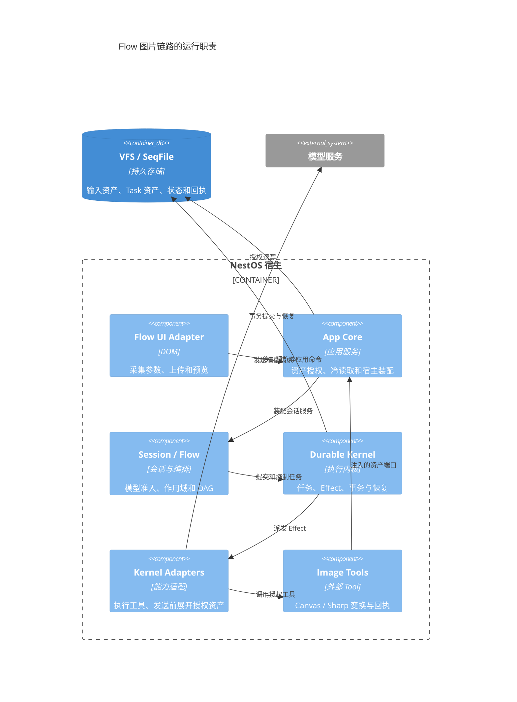

# Flow 图片处理与资产引用

平台提供通用资产端口，图片算法由 `tools/image-tools` 提供；Flow 使用现有 `builtin.tool` 节点调用 `image.process@1`。核心没有 Anki 分支，也没有图片处理专用节点。Web 和 Tauri 经 `@itookit/image-tools/browser` 独立宿主入口装配同一 Canvas 引擎，不依赖其他 app；CLI / HTTP 装配 Sharp 引擎，Node 入口不加载 Canvas 或 DOM。



图中表示运行时调用；资产端口通过宿主注入，外部工具不反向导入 app-core。

## 声明处理配方

```json
{
  "id": "preprocess",
  "name": "处理输入图片",
  "plugin": "builtin.tool",
  "pluginVersion": "1.0.0",
  "inputs": {},
  "capabilities": ["image.process"],
  "config": {
    "toolId": "image.process",
    "toolVersion": "1",
    "approval": "none",
    "args": {
      "images": "${param.images}",
      "recipe": {
        "version": 1,
        "resize": {"mode": "max-edge", "maxEdge": 2048},
        "color": "grayscale",
        "output": {"mimeType": "image/jpeg", "quality": 0.85, "minQuality": 0.65, "maxBytes": 2097152}
      },
      "maxTotalBytes": 6291456
    }
  }
}
```

`resize` 可用 `original` 或 `max-edge`，小图不放大。`color` 可用 `preserve`、`grayscale`、`threshold`；二值化可指定 0–255 的 `threshold`，默认 128。输出支持 PNG、JPEG、WebP。配方由独立 `image-parser/processing` 入口校验，浏览器处理器的 `ProcessOptions.recipe` 消费同一契约。

预算分两层：`imageConstraints` 限制原始输入的数量、合计字节及 MIME；Tool 的 `recipe.output.maxBytes` 和 `maxTotalBytes` 限制处理后发送的图片。Tool 的宿主保护上限为单图输入 20 MiB、40M 解码像素、12M 输出像素、最长边 8192、每批 16 张、合计输出 32 MiB；Flow 可以选择更小的预算。动画及不支持的真实文件格式会被拒绝。

编码最多尝试五档质量，始终编码同一张处理后的像素图；PNG 只编码一次。达到质量下限仍超限则失败，避免继续缩小文字。配方不会隐式自动裁边、透视校正或 OCR；已有图片编辑器仍负责用户选择的裁剪与透视操作。

## 资产与恢复

浏览器表单逐文件上传原图，`app.assets.import` 在系统 VFS `/var/lib/inputs.seq` 保存不可变原图及随机标识，参数只保存小引用。CLI 的运行参数与交互回复也在持久化之前把标准 inline 图片块暂存为引用。直接调用底层执行器的旧调用方仍可传入 inline 图片，Tool 会保留原图副本。

```json
{"type":"image","source":{"type":"asset","asset":{"kind":"input","id":"<uuid>","mimeType":"image/png","bytes":1234,"sha256":"<sha256>"}}}
```

Task 执行时通过可信 `executionIdentity` 绑定 `readAsset`、`writeAsset`、`getAssetRecord`、`putAssetRecord`。写入者不能指定其他 Task 的所有者路径。输入引用必须已经出现在当前 Task 输入或所属 Flow 根输入中；Task 资产只能在同一 Session、同一权威 Flow 运行内跨节点读取；可信 Task 重试链也可读取其前序资产。读取验证字节数与 SHA-256；小回执通过事务保持不可变。

资产授权读取使用冷 Session inspection，同一次读取复用一份 Task 快照，不为每个 Run 重复枚举任务，也不因预览登记执行 worker。快照只在本次读取有效，下一次读取重新核对运行归属与完整性。

Tool 返回 `images`、`items` 和 `bytes`。`items` 保存原图 `source`、派生图 `output`、尺寸、配方和引擎版本；模型节点使用 `${nodes.preprocess.outputs.result.images}`。模型 Effect 在真正发送前解析授权资产，持久请求和诊断事件保留引用。运行节点输出提供按需图片预览，可以查看原图和实际用于识别的派生图。

单图回执以输入 SHA-256、规范化配方及引擎版本生成键。中断或单张失败后复用已完成结果，并重新验证原图与派生资产；Task 重试可以读取 `retryOfTaskId` 链上的既有回执。纯变换的 reconcile 可安全重做未完成项。缓存隔离在 Task / 重试链中，不跨独立运行共享。

浏览器记录 image-parser 版本与浏览器标识，Node 记录 Sharp/libvips 版本。两种引擎实现同一策略，编码字节和灰度数值不承诺跨引擎完全一致。输入暂存资产目前保留在 profile 中，没有自动回收取消上传或历史运行资产；后续 GC 必须追踪持久引用后再删除。

## 验证

- `pnpm --filter @itookit/image-tools test`：Sharp 真实像素、质量预算、单图恢复、缓存校验。
- `IMAGE_PARSER_BROWSER_FIXTURE=examples/processing.html pnpm --filter @itookit/image-parser test:browser`：真实 Canvas 缩放、灰度、二值化、编码及原图保留。
- `node apps/cli/scripts/verify-anki-flow.mjs`：真实图片处理、模型协议桩、人工校对、进程重启及 Rust Anki 打包；不调用付费模型。
