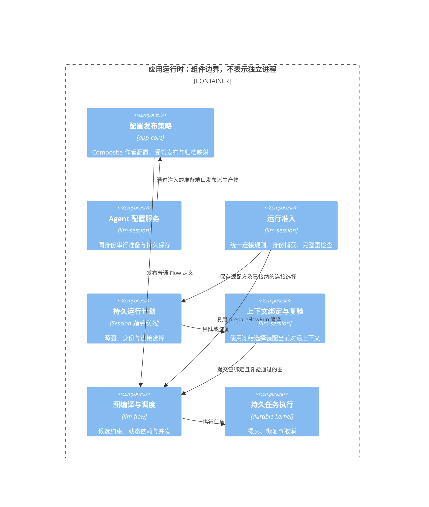
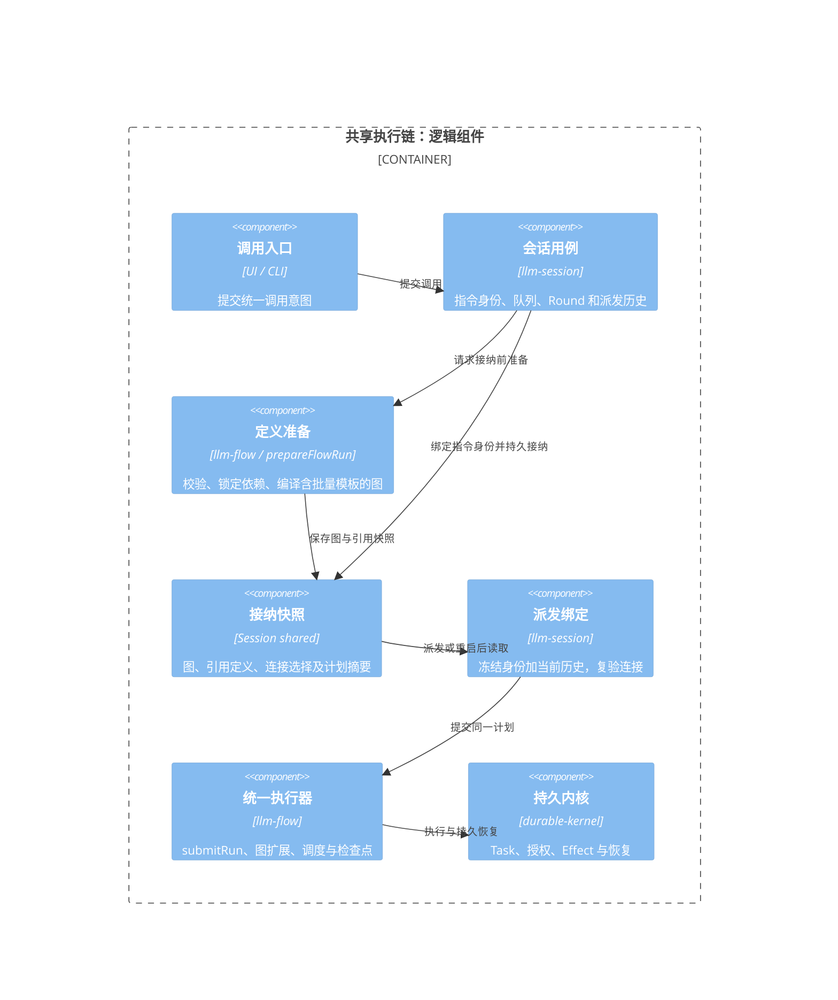

# Flow 函数化、组合与并发调用审查

状态：已实现并发调用、slash 入口和 `builtin.flow@2` 函数式组合。旧版 `builtin.flow@1` 及既有 Flow Session 保持兼容。

## 显式内容来源与独立子会话

每个参数可选择手填、上一条完整助手回复、当前分支全部对话、全部助手回复、所选消息、对话摘要或已完成调用的命名输出。图片仍通过既有资产字段选择。来源需“准备并预览”，修改参数会解除旧来源绑定。首次选择来源捕获当前分支的固定文本与输出；后续回复、分支编辑和运行完成不改变这份快照。只选择 user/assistant 文本，排除系统、工具、思考和未完成助手输出。

`ContentTransferService` 注册 `session.content.capture`、`session.content.resolve`、`session.content.create-child`。捕获及转换材料存放在源 Session 的 Kernel shared；Invocation 的 `inputSources` 引用材料，准入复核参数值后将完整 `inputTransfers` 复制到调用记录。恢复已有调用消费保存的参数与材料，不重新选取“最后一条回复”或重新生成摘要。原始材料不进入诊断日志。

摘要由宿主 `createTransferSummarizer` 注入，检查模型输入预算；不可用、超限和空摘要保留启动表单并显示具体原因。摘要与人工选择都需要预览后再启动；不会把 Flow 参数隐式注入聊天 history。

运行位置可选择当前会话或新独立子会话。后者先持久登记创建意图，以同一请求身份恢复子会话，并在导航前准备 Kernel Session、提交调用。切换或启动其他 Flow 不取消原运行。取消启动配置、隐藏或销毁视图后，不执行尚未发起的后续准入步骤；已提交运行继续归宿主管理。

关联创建也可显式选择初始材料。`ConversationManifest.initialContext` 在身份创建事务中保存且不可变；父子关系与内容来源分开。材料作为 ContextPlan 的显式输入参与装配和预算，不伪造用户 Round，不持续拼接父历史。导入导出保留材料副本，导入不恢复父关系。未选择材料的子会话保持空历史。

调用卡片锚定发起 Round，历史重建保留卡片及交互；输入区保留活动/待处理汇总和当前接收会话。非终态按状态提供暂停、继续、取消；重新附着仅在存储恢复时显示。重试节点仍在运行详情，终态“再次调用”产生新身份。终态结果经显式“用于对话”追加到当前草稿。

回归：`backend/llm-session/__tests__/content-transfers.test.ts`、`ui/app-shell/tests/flow-content-sources.test.ts`、`ui/app-shell/tests/flow-timeline.test.ts`、`ui/app-shell/tests/flow-invocation-polling.test.ts` 和 `backend/app-core/tests/session-bundle.test.ts`。本轮浏览器预览使用模拟端口检查启动表单的桌面和窄屏布局，不代表真实模型及完整应用的端到端验收。

## 当前使用方式

- 聊天输入 `/flow` 选择流程，或 `/flow <id> {"参数名":"值"}` 预填参数表单。提交后仍停留在当前聊天，可以继续调用其他 Flow、重复调用同一 Flow 或发送普通聊天。
- 每次调用有独立卡片，显示参数、运行状态、结果和待处理交互；支持查看完整运行详情、取消、恢复、再次调用、将结果放入聊天草稿。关闭卡片所在编辑器只停止订阅，不取消运行。
- 文件右键和设计器运行按钮通过同一个调用服务在新会话启动；执行发生在导航之前，打开视图不会再自动重复启动。
- 多个后台调用存在时，普通 `/cancel`、`/approve`、`/resume` 会提示使用对应卡片，避免选错目标。复杂输入仍使用参数表单；审批和简单回复在各自卡片中完成，草稿彼此独立。
- 设计器新增 Call Flow（v2）节点，选择已发布的 Flow、填写参数绑定。流程设置中的“返回值声明（JSON）”保存 outputs；命名返回端口在图和连线编辑器显示。

参数在模态表单中填写，不嵌在 ChatInput 中；命令 JSON 优先预填，其余字段采用参数默认值。聊天输入区提供“调用 Flow”入口，slash 与再次调用共用启动配置。每次启动均需提交表单；不会自动从聊天、附件或文件提取值。文件路径作为普通字符串传递，需要读取正文时由 Flow 节点显式调用文件工具。可运行的工具、Skill、MCP 例子见 [Harness 验证例子](../../apps/cli/examples/harness-validation/README.md)。

被调用 Flow 必须声明参数及返回值。例如返回声明：

```json
{
  "result": {"value": "${nodes.report.outputs.result}", "schema": {"type": "object"}},
  "score": {"value": "${nodes.score.outputs.result}", "schema": {"type": "number"}}
}
```

父流程调用节点示例：

```json
{
  "id": "review",
  "name": "Review",
  "plugin": "builtin.flow",
  "pluginVersion": "2.0.0",
  "inputs": {},
  "config": {
    "flowId": "essay-review",
    "revision": 3,
    "parameters": {"essay": "${nodes.extract.outputs.result.text}"}
  }
}
```

后续节点可引用 `${nodes.review.outputs.result}`、`${nodes.review.outputs.score}`。独立调用节点自动并行，显式引用建立串联/汇合依赖。

同一个函数以多组实参调用时，继续使用 `builtin.flow@2`，通过 `parameterSets` 提供参数对象数组：

```json
{
  "id": "calls",
  "name": "Call with argument sets",
  "plugin": "builtin.flow",
  "pluginVersion": "2.0.0",
  "inputs": {},
  "config": {
    "flowId": "parameter-record",
    "parameters": {"detail": 2},
    "parameterSets": [
      {"source": "first document", "language": "zh-CN"},
      {"source": "second document", "language": "en"}
    ],
    "maxConcurrency": 1
  }
}
```

`parameters` 是公共实参，每组对象的同名字段覆盖公共值，再使用子函数声明的默认值。每组都按完整函数签名校验；不是把多个参数分别调用，也不隐式进行笛卡尔积或数组配对。`parameterSets` 可使用整值引用 `${param.jobs}` 或 `${nodes.prepare.outputs.result.parameterSets}`，因此上游确定性 Tool 只需产生参数数据，不必生成执行图。数组为空时返回空数组；非数组、非对象行、未知字段、缺失必填项或类型错误均明确失败。

`maxConcurrency` 默认 1，表示串行完成各组；大于 1 时限制完整子调用的并发数，而非只限制其入口节点。当前使用固定并发通道，后续组等待同通道前一组返回；慢组可能降低通道利用率。父 Run 的并发、节点总数与其他限额仍生效；整批节点容量在展开前验证，不能超限后仅执行前半批。

批量调用只暴露单一 `result` 数组端口，即 `${nodes.calls.outputs.result}`。数组顺序与输入一致，每项是对应调用的全部命名返回，例如 `[{"result": {...}}, {"result": {...}}]`。单次调用继续保留原有命名端口。每组有稳定的调用路径、独立参数、变量和 Agent 上下文；模型/工具的业务副作用仍沿用原 Task/Effect 核对规则。

子函数及其递归依赖在编译时解析、绑定并冻结；运行时展开后的参数作用域、节点、边和汇合状态随检查点保存。`RunDefinition.graph.functionCalls` 保留冻结模板，CLI 往返和恢复不重新读取最新子文件。运行中参数正文只求值一次，数据里的 `${...}` 保持字面值。示例见 [多组调用](../../apps/cli/examples/parameter-calls.flow)与[被调用函数](../../apps/cli/examples/parameter-record.flow)。

已展开调用的图级重试会重新验证实参；相同组数可以重算，改变组数会报幂等冲突，不能静默保留旧图并丢弃新增组。要改变组数，应建立新调用或新 Run。未绑定的可选父连接槽可转发给条件子调用：未选分支不要求绑定，实际执行到 Agent/媒体节点时必须存在连接，不能回退到其他默认模型。子定义原有必需声明和已绑定能力检查保持有效。

## 单文件函数与图片、文本分批

`FlowDraft.functions` 是完整 Flow 定义数组；同一个 `.flow` 可同时保存主入口及其局部函数。调用仍写 `builtin.flow@2.config.flowId`，先查定义处最近的局部函数，再查外部定义库。被调用函数使用自己的定义环境，调用者的同名局部函数不会改变它的依赖。发布主文件时递归冻结函数正文、版本、digest 与依赖锁，只创建一个资源；同级重名、调用环、超过 32 层或 1000 个定义会被拒绝。设计器、恢复及工具箱归档保留内联定义和提示词依赖。

图片使用标准内容块及 Task 输入资产，文字可使用字符串或文本块；一个参数对象可以同时携带多张图片和多段文字。Flow 不解释其中的业务字段。表单的 `widget: images`、多模态消息模板、CLI 输入规范化、连接模态准入与资产权限共用现有机制。

`builtin.transform` 的 `operation: batch` 把任意数组转换为多组命名实参，供后续函数调用使用：

```json
{
  "operation": "batch",
  "value": "${param.content}",
  "batchSize": 2,
  "parameter": "content"
}
```

返回 `[{"content": [前两项]}, {"content": [后两项]}]`，再把整个结果绑定到调用节点的 `parameterSets`。`batchSize` 默认为 1，必须为正安全整数；大于输入长度时一次处理全部输入，空输入不调用子函数。`parameter` 默认为 `items`，必须为安全字段名。

需要保留原分组时，传 `groups`（数组的数组）与 `mode: grouped`。可以只提供 `groups`，自动拼接为输入，图片与文本只需提交一次；也可以同时提供 `value` 供完整性核对。非空 `groups` 的每组必须非空，拼接结果必须与 `value` 的 JSON 值及顺序完全一致，不能遗漏、复制或重排输入。`combined` 为默认模式，跨组统一分批；`grouped` 在各原组内分批；省略 `groups` 或传 `[]` 视为单组。45 项按 21/24 分组且大小为 20 时，combined 得到 20/20/5，grouped 得到 20/1/20/4。分批步骤只生成参数数据，调度、并发、失败传播和恢复仍属于同一函数调用机制。

可独立运行的[单文件图片与文本分批示例](../../apps/cli/examples/parameter-batches.flow)不依赖业务工具或模型服务；[CLI 回归](../../apps/cli/tests/flow-parameter-calls.test.ts)验证混合输入、图片持久资产、字面文本和无相邻子文件运行。[进程强杀回归](../../apps/cli/tests/flow-parameter-calls-crash.test.ts)在实际 CLI 等待时发送 SIGKILL，再由新进程回复并恢复，校验已成功 Task 记录、调用顺序与冻结子定义保持不变。

## Agent 引用内部 Flow

Flow 文件只定义参数、变量、节点和返回值，不反向定义 Agent。Agent 可通过通用执行绑定引用内部注册库中的任意已发布 Flow，源码所在目录不参与运行解析：

```json
{
  "id": "content-assistant",
  "name": "Content assistant",
  "type": "workflow",
  "config": {},
  "execution": {
    "kind": "flow",
    "flowId": "registered-worker",
    "parameters": { "language": "zh-CN" }
  }
}
```

`execution.revision` 省略时，每次新请求采用最新已发布版本；指定正整数则固定该版本。编辑草稿后需要发布，才影响跟随最新版本的 Agent；固定版本需显式升级绑定。Agent 保留引用和参数默认值，不复制 Flow 正文。设置编辑器选择内部 Flow、可选版本、默认参数与连接槽；实际入口由 `execution.kind` 决定，旧 `type: workflow` 标签本身不触发执行。

Composite 采用明确的单轮主持模式：指定普通 Agent 作为主持，并声明可选成员目录；主持根据输入动态选择一个有界任务批次，成员完成后由同一主持汇总答复。主持和成员不能是当前 Composite、其他 Composite 或已绑定 Flow 的 Agent；主持与成员分离。同一成员可以接收不同分工，总任务数受 `maxDelegations` 限制，成员并发数受 `maxConcurrency` 限制；这两个值分别不超过 100 和 32，省略时沿用通用 delegation 的默认值。它不表示多轮循环调度。

```json
{
  "type": "composite",
  "composition": {
    "coordinatorAgentId": "coordinator",
    "memberAgentIds": ["researcher", "reviewer"],
    "maxDelegations": 8,
    "maxConcurrency": 4
  }
}
```

作者配置经 [Composite 保存用例](../../backend/app-core/src/configuration/agent-composition.ts) 校验并编译为受管 Flow：第一阶段为带成员白名单的 `builtin.agent` 主持节点，第二阶段为禁用委派的主持汇总节点。动态成员结果通过通用 `delegation.result.targetNodeId` 数据依赖接入汇总节点，最终返回汇总答复；模型声明的 `agentId` 必须属于 `delegation.agents` 目录，不能借分工参数覆盖身份、连接或授权。所有候选身份在指令接纳时冻结，并复用既有 Flow 调度、重试、任务持久化与回放。

Composite 仍保存 `execution.kind: flow` 和固定受管 revision，不增加执行器。Flow 发布前先持久化 `.agent-composition-<编码 Agent ID>.json` 所有权收据；收据写入失败时不发布，后续 Agent 写入失败时保留已登记 Flow，重试或重启复用原 Flow ID。调用方提供的旧 `execution.flowId` 不能作为受管归属证明，也不会用于覆写用户流程。工具箱导出携带作者配置、主持和成员依赖；导入先重映射并保存普通成员，再为新的 Composite 身份重新编译受管 Flow。

同一宿主内同一 Agent 的准备与保存串行执行，接纳保存请求时复制作者配置。复用受管修订以已发布正文与目标正文一致为条件，草稿相同不能证明发布成功；草稿写入后发布失败，重试仍继续发布。保存只在发布成功后写入 Agent 绑定，不宣称跨文件原子事务。删除 Agent、导入回滚或切换执行方式均保留已经登记的受管 Flow 和所有权收据，使历史绑定与发布失败恢复仍可核对；本次不按 Agent 是否存在自动回收发布资源。

### 配置发布与运行准入的边界

应用策略选择主持模式、成员和提示词，编排层只解释候选约束与动态依赖。预检与会话绑定共用 `flow-agent-connections` 的连接优先级规则；完整准入后把节点及递归委派模板的连接、模型和端点选择投影回源图，保存为运行计划。源图继续保留指令与上下文策略，派发重新装配对话上下文时复用已接纳的连接投影。预检不代替正式准入，派发仍复验当前授权和可用性。



Flow 的 Agent 引用位置由 `llm-flow/contracts` 的 `mapFlowAgentReferences` 定义：Flow 默认 Agent、`builtin.agent` 节点、委派模板和成员目录，以及内联函数。app-core 只提供归档身份替换表，不递归解释任意插件配置中的同名 `agentId`；外部 Tool 参数、转换节点数据和用户正文保持业务原义。Agent 的用途默认和流程连接覆盖在对应连接一并导入时重映射，未包含的外部引用保持原 ID。

聊天中选择该 Agent 并发送提示词，会读取所选版本的当前参数签名，复用 Flow 参数及图片表单。合并顺序是 Flow 字段默认值 → Agent 的 `execution.parameters` → 本次运行参数；连接槽同样允许本次覆盖 Agent 的 `connectionBindings`。未知参数、缺失必填项、类型和范围错误在请求入队前拒绝。确定性 Flow 不要求配置聊天模型，实际模型/媒体节点仍按 Flow 声明检查连接和授权。

提示词通过只读运行输入 `${input.prompt}` 提供，不占用 Flow 的参数名。需要可修改的内部稿件时，可声明：

```yaml
variables:
  prompt:
    type: string
    initial: ${input.prompt}
```

此时 `${vars.prompt}` 是可赋值的当前稿件，`${input.prompt}` 保留本次最初提示词；`${param.prompt}` 仍是用户自行声明的普通参数，三者互不覆盖。未提供运行输入的其他入口默认使用空提示词。输入属于执行快照，不进入 Flow 定义或 digest；嵌套函数、批量调用、动态节点和结构化派发读取同一个冻结输入。用户正文里的 `${...}` 保持字面数据。

`availability` 是 Agent 的只读可用性投影，不写回 Agent 源文件。被引用文件删除、未发布、固定修订缺失或定义损坏时，Agent 显示禁用及具体原因，已有选择保留，发送被阻止，不切换到默认助手。恢复文件并发布所需版本后重新核对可用性。发布及文件变化通知会刷新聊天和草稿选择器。

请求接纳时冻结所选 Agent 身份、Flow 正文、外部 Flow 依赖版本、参数和连接选择；已接纳的排队请求与已启动运行继续使用快照，后续 Flow 文件删除只阻止新请求。连接快照只含安全选择字段，不缓存凭据；模型档位改变仍用已选模型，服务商、协议、端点、授权或能力不再兼容时，在提交前明确失败并持久保存原因。

独立调用的 `DagCommandService.prepareRun` 与会话队列共用 `prepareFlowRun` 完成定义校验和编译。新会话指令的 `flowBinding.plan` 保存版本化图、图中引用的 Agent/Skill/提示词/MCP 配置快照及摘要，覆盖批量调用的冻结子模板。派发仅绑定当前对话历史与宿主上下文，复验连接后经原 `submitRun` 执行，不重读已接纳的源定义或再次展开 Flow。第二条排队指令可以看到第一条的已完成结果；用户文本仍保持字面值。运行时新声明的动态图身份在图扩展时准入并由原检查点持久化，已知身份始终优先使用接纳快照；工具发现和权限检查保持当前授权边界。

Skill 选择仍经过宿主既有版本存储与 Session 操作队列，不能将内容快照当作恢复已撤销授权的凭据。Skill 被删除、禁用或其版本策略要求重新加载时，宿主上下文恢复仍可拒绝执行；拒绝发生在模型请求前。Agent/提示词/Flow 源文件删除与 Skill 授权撤销分别验证。

队列恢复校验定义摘要、Agent/Flow 身份、连接快照和执行计划摘要；损坏计划不能回退为重新编译。无 `plan` 的旧队列保留原冻结定义恢复路径，已有根运行继续使用 Kernel 检查点。`availability` 按 Flow ID/修订号缓存并合并在途查询，资源发布、删除或恢复事件使缓存失效；普通 Agent 读取不重新编译整个目录，新调用仍执行正式准入。

Agent 归档先发现完整发布依赖闭包并检查冲突，再生成所有条目，所选子 Flow 草稿若同时属于 Agent 依赖则采用锁定发布快照。依赖锁按调用节点及其 `children` 读取，不按 Flow ID 扁平合并；同一个归档资源目前只支持一个发布版本，冲突明确拒绝。词法引用遍历、发布转草稿及定义正文投影归 `llm-flow`；`app-core` 协调归档重映射、发布和 Agent 创建。内部 `functions` 的局部 ID 保留，接管模板文件同样保留完整内联声明。



验证见[真实发送与宿主重启](../../backend/app-core/tests/flow-agent-execution.test.ts)、[资源删除恢复与归档](../../backend/app-core/tests/agent-flow-resources.test.ts)、[连接冻结](../../backend/app-core/tests/flow-agent-connections.test.ts)、[准入诊断与损坏记录](../../backend/llm-session/__tests__/flow-agent-binding.test.ts)、[实际发送表单](../../ui/app-shell/tests/agent-flow-input.test.ts)及[运行输入恢复](../../backend/llm-flow/__tests__/runtime-input.test.ts)。命令、范围和源码摘要保存于[机器可读验收记录](fixtures/flow-agent-evidence.json)。

## 已实现的边界

- v2 调用先通过持久入口节点解析父参数、上游结果或变量，再按子参数 schema 验证；只传显式实参与默认值，不隐式继承全部父参数。入口输出作为子作用域的参数来源，恢复使用同一持久 Task 输出，数据不二次插值。
- 子流程变量仍按调用路径隔离；调用会通知宿主 binder 使用隔离上下文。返回节点等待作用域内包括循环后续轮次的工作完成，再按 outputs 声明组装并验证结果；显式 detached 的后台成员沿用既有生命周期，不阻塞返回。`__flow_return` 为编译器保留节点名。组合时同时重映射 taskGroup/loop 成员与路由边，保留 join 对外结果键名。
- 发布新 revision 时保存递归 dependencyLocks（子 id/revision/digest/子锁），计入父 digest。原有已发布版本不会被改写；新版本拒绝循环、过深和过大依赖。重复运行使用原 revision 的锁定依赖。
- `FlowInvocationService` 在 Session shared 的 `flow.invocation.<requestId>` 保存独立调用记录和提交意图，不向普通聊天分支追加未完成 user Round。来源 branch/head 在宿主装配时冻结；Task/Run 是运行状态权威。
- 根 Task 原子提交携带 requestId 及 invocation 元数据。重复请求或丢失记录回执通过根 Task 核对，避免再次启动；同 requestId 不允许更改参数。宿主启动核对已有根并恢复调度，补交尚无根且未记录启动错误的意图。
- 新独立调用在既有记录中保存 invocationId，根携带相同身份，requestId 继续用于接纳去重。用户“再次调用”创建新 Invocation 并保存 retryOfInvocationId/retryOfSessionId；来源必须有已确认根终态，跨会话仅沿持久父子关系。旧调用由 flowInvocationId 提供确定性别名。内部节点新重试只允许未终结 Run；同一旧重试请求的核对仍返回原尝试，不追加副作用。
- 卡片通过 `RunGet` 的任务成员表恢复所有 pending interaction，并以根 taskId、具体 taskId、interactionId 提交。提交前重读待处理状态；停止订阅后拒绝旧回复。
- 原聊天 Session 的单前台运行限制保留；独立 Flow 调用不占用该槽位。Flow 调用卡片的输出仅在用户“用于对话”后进入草稿，不自动注入模型 history。

当前显式限制：v2 不支持子 Flow 自带 runPolicy，运行限额/工作区应配置在父 Flow；调用节点的 retry、compensate、assign、budget、capabilities 也不能隐式传递，非空配置会被拒绝，应配置在子流程执行节点上。尚未实现跨子作用域的独立限额和整个子调用的自动重试。共享目录仍共享文件副作用，可使用既有父 Run worktree 策略。设计器签名按所选发布版本读取；参数表单以定义库字段为引导，最终运行验证仍以发布版本为准。

子 Flow 内部可以使用 taskGroup；函数调用节点不能直接作为父 taskGroup 的 worker，此组合会明确拒绝。多组调用使用函数节点自身的 `parameterSets/maxConcurrency` 控制完整子调用；多个普通函数节点仍可并行，受父 Run 并发上限约束。

恢复不会抢占仍有效的 Session/调度租约。宿主启动恢复失败会保留持久运行，用户可在卡片“恢复此调用”重试。此次新增恢复测试覆盖 Kernel 重建与持久提交意图，并非多个 Flow 调用的真实桌面强杀验收。

## 实现与验证

调用面板首次挂载立即加载；存在非终态调用或读取失败时每秒刷新，空列表或全部终态时改为 30 秒同步，保留其他宿主变更的可见性。窗口获得焦点、页面恢复可见和当前界面发起调用时立即刷新；销毁后解绑监听器、停止轮询并忽略迟到结果。计时与销毁回归见 [调用轮询](../../ui/app-shell/tests/flow-invocation-polling.test.ts)。

- 编译与契约：[function-call](../../backend/llm-flow/src/flow/function-call.ts)、[function-outputs](../../backend/llm-flow/src/flow/function-outputs.ts)、[dependency-locks](../../backend/llm-flow/src/flow/dependency-locks.ts)。
- 会话调用：[FlowInvocationService](../../backend/llm-session/src/session/flow-invocations.ts)。
- UI：[InvocationPanel](../../ui/llm-ui-adapter/src/flows/InvocationPanel.ts)、[invoke-flow](../../ui/llm-ui-adapter/src/flows/invoke-flow.ts)。
- 新增回归：[函数组合](../../backend/llm-flow/__tests__/function-calls.test.ts)、[并发/提交恢复](../../backend/llm-session/__tests__/flow-invocations.test.ts)、[真实 Kernel + DOM](../../ui/app-shell/tests/flow-invocations.test.ts)。
- 已通过 llm-flow、llm-session、llm-ui 整包测试，以及应用层相关回归、全仓类型检查、样式检查。应用层整包中遇到沙箱 Git 子进程拒绝和本地 HTTP 测试超时；对应 workspace-crash 与 host-restart-inflight 在沙箱外单独重跑通过。未进行真实模型或人工 GUI 验收。

## 初始审查与设计记录

以下保留实施前的审查依据及完整设计方向；当前能力和未支持范围以上文为准。

## 结论与目标

建议将 Flow 定位为有输入、返回值和固定版本的可调用定义，将每次调用建模为独立 Invocation。Session 是调用与对话的容器，不应只能绑定一个 Flow。`llm-ui` 负责选择、参数填写和调用卡片；组合语义归 `llm-flow`，调用与会话历史归 `llm-session`，宿主能力继续由 `app-core` 装配。

“同时使用”需要同时满足三个目标：

1. 同一个聊天界面可以启动 A、B，甚至用不同参数重复启动 A；各自运行、审批、取消、查看结果，输入区仍可使用。
2. Flow 可以作为另一个 Flow 的节点；支持串联、并行、汇合，并通过声明的参数和返回值传递数据。
3. 输入 `/flow` 可以发现、选取并调用 Flow；这次调用不会把当前 Session 后续所有消息切换为该 Flow。

跨 Session 分别启动、顺序排队或只增加 slash 按钮，都不能单独满足上述目标。

## 现状与证据

| 层次 | 当前实现 | 对目标的影响 |
| --- | --- | --- |
| UI 启动 | [FlowLauncher](../../ui/llm-ui-adapter/src/flows/run-flow.ts) 收集参数、发布 revision、CreateFromFlow、导航 | 一次运行进入一个新 Flow Session；`pending` 只覆盖启动流程，并非执行期间的全局锁 |
| Session 模式 | [LLMWorkspaceEditor](../../ui/llm-ui-adapter/src/shell/LLMWorkspaceEditor.ts) 读取 manifest.flow，selectFlow；空 Session 打开时自动发送 | 启动执行依赖打开编辑器，Flow 与 Session 模式绑定 |
| 发送准入 | [SessionRunCoordinator.submit](../../backend/llm-session/src/session/session-run-coordinator.ts) 按 sessionId 保存一个 active，重复提交报 SESSION_BUSY | 硬限制是每个 Session 一个活动 Run；代码未在这里施加应用级单 Run 限制 |
| 会话语义 | [RoundOperations.sendMessage](../../backend/llm-session/src/session/round-operations.ts) 拒绝连续 user；[ConversationRunCoordinator](../../backend/llm-session/src/session/conversation-run-coordinator.ts) 按 sessionId 保存一个执行，并通过 appendExpected 写入分支 | 删除 SESSION_BUSY 检查会留下状态覆盖、控制目标不明确和 branch head 冲突 |
| 输入区 | [ChatInputView](../../ui/llm-ui-adapter/src/components/input/ChatInputView.ts) 的 setLoading 禁用 textarea；triggerSend 在插件钩子前检查 loading | 运行时无法输入第二次 Flow 调用，新增 slash 解析仍会被前置条件挡住 |
| 控制与恢复 | [RunAttachmentController](../../ui/llm-ui-adapter/src/shell/RunAttachmentController.ts) 持有一个 handle；[pending-interaction](../../ui/llm-ui-adapter/src/shell/pending-interaction.ts) 只恢复最新一个待交互任务 | 一个焦点 attachment 可以保留，但不能作为全部活动调用和审批的唯一来源 |
| Slash | [SlashCommandPlugin](../../ui/llm-ui-adapter/src/components/input/plugins/SlashCommandPlugin.ts) 支持静态命令和动态 sk 命令；[Router](../../ui/llm-ui-adapter/src/shell/SlashCommandRouter.ts) 装配回调 | 可复用候选、解析和宿主回调模式，目前没有 Flow 调用入口 |
| 底层运行 | [DagCommandService](../../backend/llm-flow/src/flow/commands.ts) 已有 RunStart/List/Get/Cancel/Respond，handles 按根 taskId 保存 | 已有多 Run 控制基础；直接从 slash 调用 RunStart 仍缺会话调用记录、历史归属及恢复协调 |
| Flow 组合 | [builtin-plugins](../../backend/llm-flow/src/flow/builtin-plugins.ts) 注册 builtin.flow；[flowToDag](../../backend/llm-flow/src/flow/to-dag.ts) 递归展开并加节点前缀 | 已能组合成 DAG，不需要另造调度器；已有参数作用域、变量隔离与递归引用检测 |

现有输出窗口也已有按 branch/Run 选择的能力，见 [session-output](../../ui/llm-ui-adapter/src/flows/session-output.ts)。这可复用，但它目前只展示已归属于分支的执行，不能代替新的调用准入和历史记录。

## 现有组合为什么还不等于函数调用

以下前四项通过独立最小探针调用实际 `flowToDag`、`scopedParameters` 验证，非仅根据类型推测。

1. **上游结果不能完整地作为子 Flow 实参。** `config.parameters.text = '${nodes.source.outputs.result}'` 会编译出 source 到子图入口的依赖，但 `scopedParameters` 渲染绑定时只传 `{ param: parent }`，没有 nodes/vars 上下文，实际报 Missing Flow reference。`review(extract(document))` 这样的自然用法尚不完整。
2. **缺少稳定的返回接口。** 当前把父节点的出边接到子图所有叶节点，仅在恰好一个出口时重映射 `${nodes.call.outputs.result}`。双出口时 call 节点已被移除，该引用仍指向 call；编译不会替使用者定义统一返回值。`FlowDraft/FlowRevision` 没有 Flow 级 outputs 声明。
3. **缺少完整调用边界。** 子图 runPolicy 中的 maxConcurrency/maxTokens 没有合入父图作用域；调用节点自己的 retry 也未传递到展开节点。子参数还会混入全部父参数，虽然变量已有隔离，但这不是严格的显式参数契约。不能据此宣称子 Flow 的独立运行策略在组合后仍然生效。
4. **父 revision 不锁定全部子依赖。** 子节点 revision 可省略，解析器加载 latest；同一父定义在子 revision 更新后会编译为不同的图。已开始 Run 的展开图有 checkpoint，问题在新调用及重跑的版本可重现性，不等于恢复一定会切换版本。
5. **UI 仍以通用节点字段呈现组合。** Flow 插件提供 flowId/revision/parameters 通用 schema，缺少 Flow 库选择、根据被调用定义生成参数绑定表单、返回端口和嵌套调用身份展示。

因此，优先补齐输入绑定、返回值与调用边界，再让 UI 广泛暴露组合能力。只增加一个 Flow 选择下拉框，会让简单样例可用，却在真实流水线里遇到上述缺口。

## 建议的定义与编译模型

保留现有 `.flow`、parameters、variables、builtin.flow；新增 Flow 级返回声明和依赖锁定信息，不创建第二套 Flow 语言。下面是**提议语法，当前不可直接执行**：

```yaml
# Child definition: review
parameters:
  - name: essay
    type: string
    required: true
outputs:
  result:
    schema: { type: object }
    value: ${nodes.report.outputs.result}
```

```yaml
# Parent definition, nodes fragment
- id: review
  name: Review
  plugin: builtin.flow
  pluginVersion: 2.0.0
  config:
    flowId: essay-review
    revision: 3
    parameters:
      essay: ${nodes.extract.outputs.result.text}
```

父节点消费 `${nodes.review.outputs.result}`，不依赖子图内部路径。多个返回值使用命名端口，禁止以“最后完成的节点”决定返回值。新语义使用新插件版本；旧 builtin.flow@1 的行为保留或经显式迁移，不能无声改变已发布 revision 的含义。

继续使用现有 DAG 执行器，编译时为每个调用生成持久的入口、子图 scope 和返回节点：

```text
extract ──→ review(input → child nodes → return) ──┐
        └─→ summarize(input → child nodes → return) ─→ report
```

- 入口等待实参依赖，在父调用上下文中解析一次 param/nodes/vars，校验并冻结子参数；数据内的 `${...}` 不再次解释。只传显式参数和子定义默认值；历史、Memory、工作目录继承另设明确策略。
- 每次调用有独立 callPath、参数和变量作用域；同一 Flow 调用两次也不共享变量。保留 callPath 到内部 Task 的映射，UI 能折叠显示子调用。
- 返回节点等待该调用声明的必需工作完成，按 outputs 组装并校验返回值，再解除下游依赖。后台成员是否纳入完成条件必须显式声明，不能仅凭根结果推断所有副作用已结束。
- 发布父 revision 时解析并固定整棵子依赖的 revision/digest，计入父 digest；检测引用环、最大嵌套深度及展开规模。运行时保存展开后的 spec；默认重跑使用相同锁定依赖，升级版本作为另一个显式操作。
- 父预算是总上限；子预算和并发上限作为 scope 限制执行，不能由展开静默丢弃。初版若不支持某种子 workspace/retry/compensation 组合，应在校验时拒绝并说明，不能接受后忽略。
- 整个子调用的重试与内部节点重试分开定义。已有文件修改或工具副作用时，重新运行整个子调用可能重复副作用；幂等键、失败传播及补偿必须归属于调用作用域。

编译展开适合当前静态复用场景，不必先实现每个子调用独立创建 Session、独立调度器。未来若需要运行时选择子 Flow、独立部署或脱离父生命周期，再评估真正的子 Run 调用。

## 建议的调用与会话模型

新增会话层 Flow 调用服务，示意接口为 `invokeFlow({ sessionId, requestId, flowId, revision, parameters, contextPolicy })`。本文中的新服务和字段名称均是建议，不是已有 API。

每次返回 invocationId/rootTaskId，而不是更改 Session 的默认 Flow。持久调用记录至少包含：所属 sessionId、源 branch/head、flowId/revision/digest、锁定依赖、参数快照、rootTaskId、提交幂等 requestId、创建时间及上下文策略。Task/Run 仍是执行状态的权威来源；调用记录保存关系，不能另造一份独立的任务状态机。

推荐把调用卡片锚定在独立调用记录上，与聊天 Round 关联，但不要让并发调用争抢普通对话的最后一轮：

1. 会话层短事务串行登记调用身份、来源和幂等请求；登记后运行可以并发。相同 requestId 重试返回同一次调用，不同 requestId 可以重复运行同一个 Flow。
2. 提交 Task 与写入调用关系之间需要持久提交意图及恢复核对，防止响应丢失产生孤儿 Run 或重复启动。不能靠 UI `pending` 标志保证跨重启幂等。
3. 每次调用冻结提交时的上下文。后台输出写回各自调用卡片，完成顺序不移动当前聊天分支、不自动发送第二条聊天请求。
4. 返回值默认留在卡片，可由用户“用于对话”明确加入后续上下文；Flow 内部节点日志不自动全部进入模型 history。可显式选择继承调用时聊天上下文，函数式子 Flow 默认使用参数输入。
5. 切换聊天、关闭编辑器只解除 UI 订阅，不取消 Run；执行由宿主维持。重新打开从持久调用记录和 Kernel Run 恢复列表与所有 pending interaction。

实现上可复用 DagCommandService 的运行能力和现有 FlowRunProjection/FlowHistory，但需把会话记录、能力绑定、控制和恢复接入同一服务。按钮、文件右键、slash 都调用它；不应各自保留一套启动协议。原 CreateFromFlow 可继续作为“在专用会话打开”的入口，不能继续要求打开视图才启动后台调用。

普通聊天仍可保留一个前台模型生成；它与多个 Flow 调用独立计数。若未来允许普通聊天也并发，则需要另行定义用户轮次和分支语义，不能由本次 Flow 改造顺带隐式放开。

## llm-ui 的具体交互

建议先提供 `/flow` 选择器和明确的 `/flow <id> [参数]`；候选显示名称、说明、输入字段和版本。稳定后可加入 `/fl-<id>` 快捷别名，与现有 `/sk-<id>` 区分。

- 参数解析支持有类型的字段/JSON；缺项复用 FlowParameterForm，多个必填字段不能靠模型猜测。自由文本简写只对声明了默认文本入参的 Flow 开启；附件和 @ 文件需显式绑定字段。
- 动态列表复用 Skill 的 snapshot/refresh 模式，通过命令总线读取 Flow 库；提交时重新核验定义。草稿要先按 draftVersion 发布并显示将执行的版本，参数对话框取消不创建运行。
- 成功提交后，当前聊天里出现独立调用卡片，展示名称、参数摘要、状态、子调用进度、最终返回与展开日志。可连续提交不同 Flow 和同一个 Flow 的多个实例。
- 把全局 loading 拆为聊天生成状态、命令提交状态和调用状态；Flow 在运行不禁用输入框。命令解析先于普通聊天忙碌检查；普通消息是否排队要明确提示。
- 活动调用列表显示运行中、待输入、待审批和终态。已有“流程输出”窗口作为单次调用详情复用，卡片必须准确指定 rootTaskId。
- 所有控制携带 sessionId、rootTaskId；审批/输入再携带具体 taskId、interactionId。保留 attachment revision/pending/终态复验。
- `/cancel`、`/approve` 等只有唯一或明确选中的目标时才直接执行；多个候选时显示选择器。不能按“最近一个任务”静默取消或批准。
- 等待审批的是节点 Task，可能一轮同时有多个；交互列表按完整任务身份管理，恢复不能只选择最新一项。焦点 attachment 切换不丢弃其他待处理项。
- 同 Session 并发沿用既有目录授权。worktree 模式可隔离文件修改；共享目录中的并发写入不会被变量作用域隔离，需要按运行策略串行化冲突写入或明确选择工作副本。

Skill 继续表示指令与能力配置；Flow 表示有类型的执行图。slash 只是它们共享的发现与调用入口，不把 Flow 转成 Skill prompt 发送给模型。

## 实施顺序与完成条件

| 步骤 | 主要范围 | 完成条件 |
| --- | --- | --- |
| 1. 完整组合契约 | llm-flow/contracts、llm-flow | 上游结果/父变量能绑定子参数；多出口有声明返回；两次调用隔离；依赖锁定；不支持的策略显式拒绝 |
| 2. 多调用服务 | llm-session、app-core | 同 Session A/B/A 三次调用可同时存在；记录与提交幂等；关闭 UI 不停止执行；历史及结果不串写 |
| 3. UI 与 slash | llm-ui、app-shell DOM 回归 | /flow 发现与参数校验；持续可用输入；逐调用卡片与控制；多审批正确定位；失败保留用户输入 |
| 4. 持久恢复与资源约束 | flow/session/core/宿主集成 | 多运行崩溃恢复、依赖版本不漂移、预算限额、取消隔离、目录策略均有证据 |

应至少覆盖：`extract → review → report`、并行调用后汇合、同 Flow 不同参数并发、双返回端口、缺参/错类型、调用循环、子失败/重试/取消、两个节点使用相同 interactionId、失焦后旧审批返回、提交响应丢失、重启恢复全部等待项，以及子 Flow 升级后原父 revision 的重跑结果不变。

## 本次验证范围

执行：

```bash
pnpm --filter @itookit/llm-flow test __tests__/connections.test.ts __tests__/flow-contracts.test.ts __tests__/variables.test.ts __tests__/structured-flow.test.ts
```

结果：4 个文件、63 项测试通过，涵盖已有子图展开、单出口引用、参数单次插值和变量隔离。这些测试证明可复用基础，**不证明**本文建议的函数返回、多运行 UI 或 slash Flow 已实现。

另以最小编译探针复现：上游结果参数解析失败、父参数隐式可见、子 runPolicy/调用 retry 丢失、多出口引用保留已删除节点名，以及未锁定子版本使相同父定义编译结果变化。没有调用真实模型，也没有进行 GUI 并发验收。
