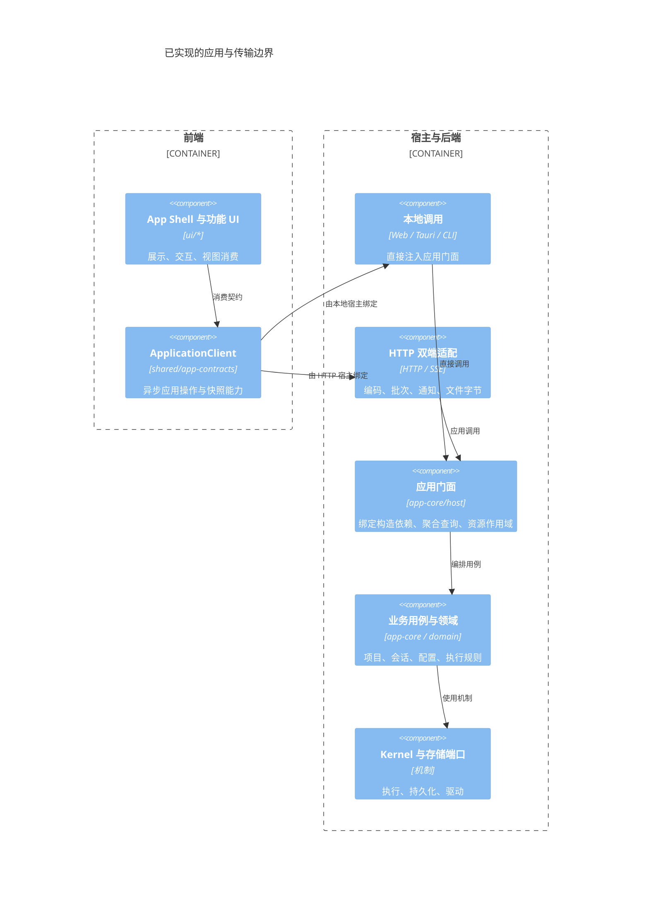

# 前后端目录与模块边界

本规范区分模块加载、应用能力和部署位置。前端负责展示、交互、草稿和视图缓存；后端负责持久数据、业务用例、授权、执行和恢复；宿主选择平台与传输并装配双方。

## 目录归属

所有业务 UI 工作区统一放在 ui/，后端业务工作区统一放在 backend/，app-contracts/common/app-transport 放在 shared/；apps/ 只承担宿主接线。原 packages/ 已清理，不再使用。独立 UI 库 vfs-ui、mdxeditor、llm-ui 位于 libraries/，支持源码工作区与 npm 制品；已有子模块身份不变，但加载边界按前端检查。

| 归属 | 目录 | 入口规则 |
|---|---|---|
| 前端 | ui/app-shell、app-settings、llm-ui-adapter、llm-settings-ui、mdx-adapter、ui-common 的 src | 不导入后端实现，不创建执行 Runtime |
| 前端独立库 | libraries/vfs-ui、libraries/mdxeditor、libraries/llm-ui | 保留通用展示、编辑和注入端口 |
| 后端应用 | backend/app-core/src/host、configuration、settings、projects、session、runtime 等 | 不加载 UI、CSS 或 DOM 组件 |
| 后端领域与能力 | backend/ 下的 llm-context、llm-session、llm-flow、llm-tasks、durable-kernel、kernel-adapters、tools、device-tty、sanbox、sync-adapters | 领域契约与实现入口分开 |
| 后端独立库 | driver-llm、mindos-node-driver、vfs-sync、vfsdriver-* 的实现 | 存储、网络和执行能力由宿主选择 |
| 共享应用契约 | shared/app-contracts/src | 应用 DTO、事件、设置端口、身份与纯变换；无执行或存储实现 |
| 所属领域契约 | 各包公开 contracts 入口及目录 | 类型、命令标识与纯校验；不转发执行类的运行时值 |
| 共享文件机制 | libraries/vfs-core | 文件接口和通用机制；展示文件源可使用 MemoryBackend，不装配应用执行 Runtime |
| 宿主装配 | apps/* 的 main 与平台装配代码 | 本地宿主可同时装配双方，前端模块本身不能反向创建后端 |
| 共享传输 | shared/app-transport | 无 DOM/Node 的 HTTP/SSE、RPC、应用描述与 selector；不执行后端业务 |
| Node 宿主 | apps/node-host | Node 存储、私密授权、锁、日志与 HTTPS；不导入 UI |
| HTTP 入口 | apps/http-app/src/client 与 src/server | client 挂载完整 UI；server 委托 node-host，不复制业务 |
| Web 存储适配 | apps/web-app/src/storage | 浏览器内的后端存储能力，不属于设置 UI |

“后端”是职责归属。Web 本地模式的执行与 IndexedDB 适配可以运行在浏览器内；Tauri 本地模式可通过直接 API。HTTP 浏览器只加载前端。当前未把 Web 的本地后端移到 Worker，也未把 Tauri 的整个执行内核移到 Rust 进程。

## app-shell 与 app-core

app-shell 接收 `ApplicationClient` 的 `services: ApplicationServices` 与 `backend: ApplicationBackend`。前端接口显式声明，不从 Runtime 或后端构造接口派生；UI 不传 repository、kernel、LLM service 或服务工厂。`AppHandle.services` 不提供 Runtime 的 dispose、openConversation、RunCatalog；宿主拥有运行时生命周期。

```ts
import { createApplicationRuntime } from '@itookit/app-core';
import { openApplicationView } from '@itookit/app-core/host';
import { initApp } from '@itookit/app-shell';

const runtime = await createApplicationRuntime(runtimeOptions);
const client = await openApplicationView(runtime);
const app = await initApp({ ...client, workspaces, ui });
app.onDestroy(() => client.close(), 'sources');
await app.destroy();
await runtime.dispose();
```

[应用门面](../../backend/app-core/src/host/application-client.ts) 在后端绑定构造依赖；本地与 HTTP 均使用同一门面。LocalApplicationServices 仅供宿主接线，UI 禁止引用。前端共享契约见 [application-client](../../shared/app-contracts/src/ports/application-client.ts)，本地构造接口见 [local](../../shared/app-contracts/src/ports/local.ts)。

`workbenchView` 返回侧栏文件视图、生命周期、检索、导航/当前项目、可选聊天控制和首目录数据；`openSessionView` 准备元信息与文件租约，activate 在旧编辑器保存后绑定并装配消息/设置；`readUiDocuments/writeUiDocuments` 只存储不透明 UI 文档；`toolboxView` 在后端完成工具箱装配并统一释放资源；`taskDetails/taskEvents` 返回任务状态、摘要与分页关键事件，UI 不把刚读到的任务和事件传回后端加工。界面布局、导航和交互仍归 app-shell。

`ProjectService.navigation` 返回准备好的项目列表、目标归属、会话路径、离线项目、删除待办与不透明分组加载路径；前端不读取全量 Session 清单来判断当前归属，不按内部目录名补载分组。`navigationTransparent` 只表达应用投影的透明容器，通用 vfs-ui 不解释该业务标记。`invalidateNavigation` 是异步失效屏障，列表读取必须等待其确认。`sessionTasks` 在后端完成任务分页与字段裁剪，任务详情和事件分页由独立的 SessionTaskView 展示。

`createSessionDraft` 统一解析来源项目并创建带初始输入的会话；身份与初始输入通过 SessionRepository 同一事务提交。引用文本的排版、页面跳转和未提交输入仍属于前端。ViewRefresh 只协调可见页面刷新，不保存业务真相、不取消后端执行。

宿主会话上下文采用引用计数观察租约；SessionOpenView 持有至释放文件视图。无引用上下文默认闲置 5 分钟或超过 32 个闲置缓存时才进入回收检查，且必须核对任务已结束、无待确认控制和外部副作用。关闭浏览器视图只释放引用，不能取消任务。LocalApplicationServices.acquireConversation 不作为客户端能力暴露。

ConversationViews 将浏览器绑定寿命与执行收尾分开：浏览器关闭立即解绑；尚有运行或排队任务时由 Runtime 继续持有原会话系统和草稿投影监听，终态后排空恢复操作并销毁。Runtime 退出负责统一释放剩余视图，然后关闭 Kernel 与存储。

跨边界操作采用异步接口；同步 selector 只读取已加载快照。收藏身份、项目来源/访问与导航、工具授权默认值、远端会话关联和 Harness 展示状态使用 shared 中的纯规则。后端仍执行实际授权校验，前端 selector 不授予访问权限。



图中的绑定箭头表示运行时接线；shared 契约不导入具体适配器。HTTP 的 rpc/ 只实现机制，通过注入 application/ 的能力描述与共享 selector 工作，不包含项目、收藏或工具授权规则。方法模式、订阅观察、领域和失效关系集中在一份应用能力描述，查询批次与失效使用同一来源。

启动时先安装 bootstrap 快照，再按序处理已缓冲 SSE；服务端在快照建立前不刷新通知描述。资源释放撤销其独占的句柄、子服务与订阅，共享文件句柄保留到其最后一个拥有者释放。宿主 ViewScope 不继续保留已显式释放的对象。见 [HTTP 应用说明](../http-app.md)。

## Settings 与配置导入

- app-settings 保留编辑器、导航投影、表单与展示文件源；SettingsService、LabelStore、导入导出与持久化位于 app-core/settings。
- createSettingsNavigation 不访问后端；SettingsPort 由后端初始化完成后返回。来源描述仅含工作区身份或已有授权视图，openWorkspace 按操作解析；HTTP 的延迟视图沿用原有写保护。OCR 首次读取由服务自行等待，readSettings 与显式 prepareConfiguration 分开，普通文档启动不加载 OCR 或设置数据。
- SnapshotService 位于 Web 存储宿主，通过 SnapshotPort 注入。Node/Tauri 未提供快照适配时，写维护操作明确拒绝；不会误操作浏览器数据库或关闭 VFS 后假成功。
- 存储估计、主题和日志偏好通过设置端口访问。浏览器存储 API 不出现在设置 UI。
- llm-settings-ui 保留文件选择、格式解析提示、冲突选择和结果展示。冲突查询、ID 分配、关联重映射、凭据保留与按依赖顺序保存由 app-core/configuration/configuration-import 执行；ConfigurationImportPort 属于配置领域契约。
- llm-ui 通过自身的 Chat/Flow 展示契约消费宿主 source/actions，仅依赖 mdxeditor。llm-ui-adapter 保留 MindOS 交互命令、投影、视图缓存与完整产品编辑器兼容入口，通过 Session/Task/Conversation 公开端口调用。

连接和原生会话状态由后端按观察需求共享探测；闲置状态缓存有身份、有效期和容量限制。前端读取快照并声明兴趣，不逐项目定时查询；后台执行记录仍以持久 Task 为准，缓存不授予操作权限。见 [业务装配与后台缓存](../http-app.md#业务装配与后台缓存)。

## 策略与机制

项目归属、配置关联、导入冲突、执行授权和产品默认值属于应用策略；存储事务、网络传输、通用格式与任务调度属于机制。页面布局、选择和展示筛选是前端策略。按职责分别组织，再通过契约连接，不能将所有策略都放到前端。

## 验证与限制

`pnpm modules:check` 检查所有前端、后端与共享生产源码的传递运行时依赖，包括 re-export、动态 import 和 require；应用类型引用也受检查：UI 和共享层禁止引用 app-core；后端和共享层禁止引用 UI。领域类型通过中立 contracts 入口引用。检查同时覆盖 HTTP client/server、共享传输、Node 宿主和 CLI 后端入口。通过共享 barrel 间接加载另一端也会失败。

`pnpm modules:buildcheck` 将九个前端包的完整公开根入口一起构建，构建图出现后端实现即失败。HTTP Vite 和服务端 tsup 另检查实际构建输入；这两种检查补充源码守卫，避免只靠 tree shaking 或 package.json 判断边界。

物理目录、独立应用服务接口与加载边界已实施。HTTP 完整工作区现在通过原 app-shell 接线，传输机制位于 shared/app-transport，Node 服务适配位于 apps/node-host；模块加载检查、完整 Shell 回归和真实 HTTPS 服务端口测试分别验证加载隔离、UI 复用与远端行为。平台原生能力由宿主注入，不能把统一 UI 当作各平台权限完全一致。


## 2026-10-14 目录隔离验收

- 六个业务 UI 包位于 ui/；十一个后端包位于 backend/；app-contracts/common 位于 shared/。九个独立库在 libraries/，其中 mdxeditor/vfs-ui/llm-ui 按前端检查；demo 移至 apps/demo。原 packages/ 已删除。
- 冻结锁文件离线安装与工作区实际链接检查通过；包名、公共入口和独立库 Git 子模块身份保持一致。
- 全仓类型检查、架构/目录/应用类型边界、文档和样式检查通过；脚本套件 45 项通过。
- 九个前端公开根入口的聚合构建通过，没有加载后端实现。所有有构建脚本的业务包/独立库、Web、Tauri 前端、HTTP 前后端、CLI 构建通过；llm-ui 的公开声明检查通过。
- pnpm test 完整矩阵退出码为 0：包括 app-core 510、app-shell 640（另 30 跳过）、HTTP 43、CLI 常规 202、CLI 崩溃恢复 22；Rust 沙箱 8、Tauri Rust 62 全部通过。
- npm registry 工作区 prepare-only 与目录迁移用例通过。后续补丁替代发布将 driver-llm 升级到 0.2.2、vfs-ui 升级到 0.5.8，已删除 patches/ 和补丁配置生成逻辑；详见 [独立库发布记录](npm-library-consumption.md)。本轮未执行完整 registry 安装/构建或桌面 GUI 验收。

## 2026-10-15 应用边界复核

- UI 与本地/远程应用门面完成接线；构造依赖不再从 UI 传递，前端不声明后端内部的 llmService、Session registry、Driver.init、VFS 注册/销毁、源注入和恢复回调。
- 新增架构守卫：UI 不引用宿主构造契约，RPC 机制不导入应用描述或业务模块。
- HTTP 回归覆盖 bootstrap/SSE 竞态、收藏写后快照与稳定身份、连续资源创建/释放、共享句柄保留、聚合资源内的服务和订阅释放、poll 后快照更新。
- 当前完整 UI 复用与进程位置仍是两项独立约束；Web/Tauri 本地宿主仍在浏览器/WebView 装配 TypeScript 后端。

本轮验证：全仓 typecheck、architecture:check、docs:check 通过；app-shell 636 通过、30 跳过；HTTP 54 通过；app-core 517 通过（单工作进程）。旧 IndexedDB 启动验收等待公共文件访问成功，避免把后台恢复中的历史文件创建当作提交完成；没有放宽超时或改变恢复行为。并行运行检查时，一项既有 IndexedDB 批量扫描用例触发 5 秒超时，无并行重任务的完整复跑全部通过。Web/Tauri 前端、HTTP 前后端和完整前端公开入口构建均通过；未进行 Tauri 原生安装包或桌面 GUI 验收。

## 事件与性能边界

应用能力描述负责读写分类、资源观察和投影策略。只读命令进入查询批次，不使所有域失效；会话、文件和 Kernel 观察只标记所属能力，未知写入仍保留域级失效。传输层合并域标记，每轮只扫描一次句柄。

会话消息的不可变投影位于 HTTP application/，消息事件定位受影响的分组，结构变化或未知事件从权威快照恢复；rpc/ 不识别 Session 事件类型。快照 DTO 编码、大小和能力引用扫描复用不变子树；历史不再同时编码 getSnapshot.sessions 与 getSessions。原生会话的游标推进和串行化属于 app-core/projects/conversation-view，订阅者共享一个轮询源；UI 接收通知后读取快照。

旧 ApplicationPort、ApplicationHost 和独立持久回执链已移除，相应废弃设计已从文档树清理。当前前端能力以 services.ts 与 application-client.ts 为准。

### 导航的读取与交互边界

后端准备资源元数据、分组、能力和业务读模型，前端通过应用端口消费，不能向后端传入前端实现的数据文件系统再回调读取。工具箱由 `app-core/configuration` 装配完整导航；`SkillsEngine` 从设置 UI 包迁移到后端。前端的一次性目录快照适配与原生 DOM 面包屑不包含资源分类或存储策略。

工作台目录面包屑保存每一级的真实路由和展示名称，复用 `openResource` 及已有异步导航代次同步侧栏展开/选中；返回缓存目录标签也执行侧栏同步。本地与远程项目共用，不额外创建后台数据服务或改动挂载权限。
