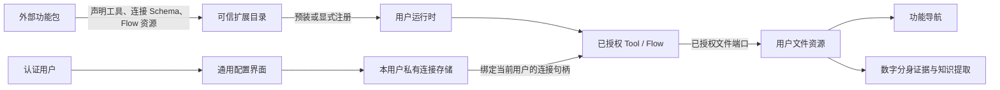

# 外部功能扩展：统一接入边界

NestOS 提供机制，功能包提供策略。邮件、日历、联系人、收藏和业务采集都通过同一接入路径扩展；核心不包含特定厂商的 API、OAuth scopes、连接字段或业务 Flow，也不按工具名称分支。

## 当前机制

| 机制 | 当前实现 | 边界 |
| --- | --- | --- |
| 包注册与版本 | `nestos-tool.json`、NodeToolPackages | 只从宿主可信目录加载，固定版本与内容指纹；不从模型参数安装模块 |
| 使用指南 | 包根目录 `guide.yaml` / ToolPackageGuide | 注册前后均可查看；只显示文本、命令示例与 HTTPS 链接，不执行步骤 |
| 配置声明 | ToolConnectionType / ToolConnectionAccess.register | 外部包声明字段，工具面板生成表单；核心不解释业务字段 |
| 用户连接 | NodeToolConnections | 每用户独立私有目录，秘密字段只写不回传；工具只解析本用户的连接 ID |
| OAuth 授权 | ToolOAuthDefinition / ToolAuthorization | 包声明 HTTPS 端点、字段映射及权限组；宿主处理 PKCE、用户回调、刷新与撤销，令牌不进入 RPC |
| 工作流资源 | manifest.flows / ToolPackages.installFlows | Flow 随外部包发布、复制、校验指纹；显式安装后复用原恢复与发布机制 |
| 执行与调度 | Tool / Flow / Kernel / 扫描器采集阶段 | 一个 Tool 可以用结构化参数选择资源类型；沿用权限、取消、回执与预算 |
| 文件产物 | 已授权 ToolVFSContext | 文件 upsert 与稳定身份；直接 Tool 扫描器可显式绑定一个应用文件工作区，安装工具包不授予目录权限 |
| 导航 | 文件工作区与独立领域视图 | 邮件与日历均用独立模块读取工作区归档；邮件复用 vfs-ui 来源抽屉与列表，不承担在线发送或邀请 |

工具包面板提供系统安装状态、每用户“为我启用／个人默认参数”、使用指南、“添加配套流程”和“我的数据连接”。数字分身中的连接配置保留为同一通用表单的快捷入口；扫描器只绑定已发布目标、普通参数、来源范围及运行策略。工具包安装不自动执行 Flow、网络采集或模型调用。

单个工具的定时采集直接绑定 Tool，不需要额外安装单节点 Flow；新选择采集动作默认只采集，知识提取由用户主动开启或另建规则。扫描器复用工具包声明的名称、账号选项与高级字段；资源分支按实际 JSON Schema 的常量判别字段生成，只提交当前分支参数。兼容工具在新建候选中隐藏，已保存目标仍可编辑和运行。多步骤采集继续使用 Flow；账号授权、资源目标和触发策略不写入共享 Flow 模板。

工具参数声明可用 `optionLabels` 提供枚举或资源分支的显示名称；它与账号选项、名称和高级字段同属展示投影，不改写执行 Schema 或 Tool digest。用户 OAuth 连接按私有数据目录和连接类型保存，与 CLI、宿主及工具包版本独立；兼容升级沿用已保存凭据，令牌失效或新增授权范围才要求重新连接。

分批采集通过版本化 `collection` 回执报告工作量及是否完成，核心不按工具名解释分页。Google 包的游标、查询匹配、同步恢复与归档保留均由外部工具实现；新旧工具身份和连接类型保持兼容。数量参数表示每批预算，不能将整个查询超出单批数量解释为失败。

“添加配套流程”是可选的流程库添加操作。安装中显示进度并阻止重复点击，完成后显示新增数量；重复安装保留已有流程和用户修改。ToolPackageInfo.flowResources 按包模板身份与当前用户流程草稿列表核对是否已加入，刷新或重新打开仍显示真实状态；全部存在时按钮显示“已添加”并禁用，部分存在时显示数量并允许补齐。添加状态仅表示流程库中已有定义，账号授权、发布与运行就绪状态仍由现有 Flow 检查决定。状态读取失败按包投影 flowResourceError，安装失败保留具体原因并刷新已添加部分；缺失宿主能力不可静默成功。

manifest 中的 `flows` 是包内相对路径数组；路径、文件大小、JSON、重复身份与包内容指纹均检查。资源读取不会重新执行工具工厂。核心通过通用恢复命令安装并发布，保留用户已有草稿和发布修订。历史存量定义不会因资源移出内置目录被自动删除或覆盖。

`toolbox.yaml` 标记 `preinstall: true` 的可信包在宿主启动时自动预装；不执行工具调用、网络采集或模型请求。缺少宿主程序时保留明确安装错误，由管理员准备程序后重试，不自动下载或编译。

已有工具包版本不会被静默替换。管理员通过显式 switchVersion 指定当前版本和目标版本，在注册锁内校验可信目录、现有工具身份兼容性并准备不可变快照，准备所有已加载用户运行时后，原子提交持久版本入口并同步发布，新执行立即使用新版；已开始的调用按原实现继续完成。工具调用和 Flow 依赖准备不会隐式升级。资源导入只接受当前运行的精确包版本，不能绕过版本锁选择另一个目录。

扫描器页面通过同一个 ToolPackages 端口展示采集工具所属包的当前版本及升级按钮，只提供可信目录中高于当前版本且有切换权限的版本。操作前重新核对当前版本和权限；持久入口与所有已加载用户实例均发布成功后显示“已升级，立即生效”，并显示旧版本的在途数量。此入口不改变账号、参数、目录或同步游标。

### 即时升级与执行版本绑定

实现语义是“新执行立即用新版，已经开始的执行及其核对继续用原版”。`NodeToolPackages.switchVersion` 以注册文件为协调边界，通过稳定的 `PackageExecutionSlot` 代理发布实现入口；`LiveTools.prepareUpdate` 预先生成元数据并同步更新现有及未来作用域，保留每个作用域显式停用状态。

1. 将可信不可变安装、版本入口切换和实例释放分离。工具目录为同一逻辑 Tool 保留多份实现，通过包 ID、包版本、内容指纹唯一定位；逻辑 `toolVersion` 与实现包版本不能混为一谈。
2. 在执行准入时冻结实现引用，并随 Task/Effect 持久化。入口切换前已准入的执行、重试、取消、恢复和副作用核对均使用原引用；切换后尚未开始的新执行使用新入口。实现引用通过 TaskAssetStore 写入 Task 的不可变记录，重试沿 retryOfTaskId 继承；记录写入失败不得开始业务调用。旧 journal 缺少实现引用时以 TOOL_PACKAGE_LEGACY_EXECUTION_UNBOUND 拒绝核对，不能在恢复时猜测最新版本。
3. 在共享宿主内引入按注册文件/包身份串行的升级协调器。各用户运行时先用各自连接与普通设置准备新版、复验启用与 Schema，再由同一切换屏障原子发布入口。用户初始化与准入经过同一屏障，避免升级过程中创建的运行时遗漏通知。准备失败不修改当前入口；未知提交结果按操作 ID 核对，不自动重做切换。
4. 新旧实现的执行文件与连接绑定必须实例隔离，不能通过改写共享 `process.env` 让旧调用使用新版二进制。旧代码快照在仍有持久执行引用时保留；内存实例在活动调用结束后释放，需要恢复时按原指纹重建。
5. 界面显示“检查中 → 正在升级 → 已升级”，成功条件为持久入口已提交且已加载用户运行时都可解析新版。运行中的旧执行显示实际版本和“完成后释放”，失败显示具体分类并保留原版。参数或状态格式不兼容时提供明确迁移问题，不能静默重置账号、材料目录或同步游标。

定向回归位于 `apps/node-host/tests/tool-package-hot-upgrade.test.ts`，覆盖：升级前已开始的调用跨升级完成；用户运行时重建及真实 Task 存储重试后按旧版核对；升级后立即创建的新调用使用新版；共享宿主多用户与新建用户运行时一致；迁移、注册或持久化失败原子回退；未知切换结果只核对；旧实现与二进制不会被提前释放。此机制属于通用宿主与执行绑定，不能在扫描器或 Google 工具内单独实现另一套热更新。

包含不同可执行路径的包必须在新旧清单中声明 `executionEnvironment: "instance"`，并通过 `createTools({executables})` 捕获只读的可执行路径映射；不再从共享 process.env 动态读取。仍依赖进程环境且二进制路径变化的旧包以 TOOL_PACKAGE_EXECUTABLE_ISOLATION_REQUIRED 拒绝热切换。代码快照与实现回执保留，旧内存实例在最后一个调用结束后调用可选 dispose，需要核对时按原指纹恢复；篡改或缺失明确报错，不回退最新实现。此机制用于同一共享宿主内的已加载用户，不提供跨多个并行宿主进程的内存广播。工具身份不兼容拒绝切换；采集定义或授权摘要变化仍须复核扫描器规则。

## 扫描器输出目标与文件授权

每条采集规则绑定一个固定 Tool/Flow 调用及其参数。目录属于扫描器执行配置，与工具的业务参数分开；邮件和日历分别建立规则，可复用同一 Tool 的不同参数，不根据供应商或参数名称在核心分派目录。

直接 Tool 规则可选择 `destination`（应用工作区）或 `projectId`（已有项目身份），二者互斥，`directory` 是可选的相对子目录。没有显式目标的历史规则保持 Session 原项目授权。宿主解析真实来源，项目通过原 ProjectService 的授权视图获取；目标只挂载为 `/workspace`，工具只获得该目录的文件能力，不能访问兄弟目录、父目录或宿主路径。保存时校验项目权限，每次文件操作重验规则修订及授权；修改配置后旧规则执行不得继续写入。目录拒绝绝对路径、父目录、隐藏路径段、反斜线及空段。输出绑定随扫描 Run 保存，不从迟到的工具返回值重新决定。

新建 Google 直接采集不再提供 directory 参数或连接中的保存目录；只向宿主挂载的 cwd 写入归档、来源描述和私有同步记录。旧工具身份保留原目录参数以兼容已发布 Flow。其普通输出模板留在外部工具中，宿主不按工具名或服务商赋予权限。变更保存位置与迁移历史是两项操作：已有归档、检查点与回执必须一起迁移、校验后切换规则，不能只搬 `.email` 或清空同步状态。

## 邮件与日历展示边界

邮件与日历采用独立导航、独立 UI 模块，共用连接、VFS、调度与工具包管理。领域视图不直接调用供应商 API；Markdown 编辑器适合正文或备注的局部编辑，不承担邮箱列表、日历网格或来源管理。邮件模块位于 `ui/app-shell/src/mail/`，来源分组及邮件列表复用 vfs-ui 的 Drawer / BrowserSource，桌面保留列表和阅读区，手机来源区折叠、列表与阅读切换；当前提供只读归档阅读，尚不提供远端发送、删除及未读状态同步；日历模块位于 `ui/app-shell/src/calendar/`，以独立工作区控制器提供只读月历、当天列表、详情、搜索和多来源选择。

日历视图只读取已授权的 `/home/admin/calendar` 工作区内的 JSON/Markdown 事件快照，不扫描任意项目或宿主目录。每个连接及日历单独建立采集规则；一个邮件规则不隐式附带日历权限或日历执行。来源身份以归档目录为边界，事件身份包含来源路径，相同事件 ID 在不同账号或日历间不合并。来源名称只用于显示，不作为身份或授权依据。邮件来源可在账号归档目录携带 `.mail-source.json`：format 为 nestos.mail-source、version 为 1，provider/account 分别提供稳定 id 和显示 name，name 为可选来源名称；UI 按此元数据组织服务商和邮箱，不解释任何供应商 API。没有描述的历史文件按目录显示，文件路径始终限定消息身份，正文只按文本渲染。

通用快照由 `id`、`summary`/`title`、`start`、`end`、`status`、`location`、`description` 组成；`start/end` 接受含偏移的 `dateTime` 或全天 `date`，全天结束日期不含当天。`source.name` 和 `calendar.id/name/account` 为可选显示元数据；旧快照没有来源描述时沿用目录显示，不按供应商名分支。可选 `.calendar-source.json` 使用 `nestos.calendar-source` 格式版本 1，保存 `name/account/archivedAt`，让空日历也能显示来源。`archivedAt` 只代表归档写入时间，执行是否成功仍查采集记录。隐藏的同步状态和操作回执不进入视图；文件读取与结构错误明确显示分类和部分失败数量，正文及凭据不进入诊断日志。

新增供应商由外部 Tool/Flow 输出相同快照格式；核心不解析其 API 或凭据。当前不实现远端日程编辑、邀请、重复规则编辑或 ICS 导入；供应商的重复事件由采集工具展开成实例。邮件模块已有来源筛选、列表和安全文本阅读，后续可独立扩展线程与草稿，同时保持此多来源边界。



## 工具包使用指南

每个包在 `nestos-tool.json` 同级提供 `guide.yaml`。这是固定约定的只读文档，不需要在 manifest 新增业务字段，也不要将它列入运行 `files`。示例：

```yaml
version: 1
title: 工具使用指南
description: 已注册后仍可查看全部步骤。
steps:
  - title: 注册与配置
    description: 在工具包列表注册，然后配置自己的数据连接。
    command: example --help
    links:
      - label: 官方说明
        url: https://example.com/docs
```

`title`、`steps` 必填；每步 `title`、`description` 必填，`command`、`links` 可选，链接需要 `label`、`url`。文字不解释为 HTML 或 Markdown；命令仅展示，不提供执行入口。指南限 64 KiB、最多 30 步，每步最多 8 个无内嵌凭据的 HTTPS 链接。标题最多 160 字符、说明 4000 字符、步骤说明和命令各 8000 字符、链接 2000 字符。

`connectionTypes` 可选，例如 `connectionTypes: [example-account]`：将本指南同时放在对应连接类型的“本机授权后导入”入口旁。未配置网页授权时默认展开导入入口；管理员网页设置、连接名称、标识和保存目录收在高级设置中。导入只读取浏览器选择的文件内容，保存到当前用户私有连接；不发送本机文件路径，也不执行指南命令。

列表优先读取已配置可信 catalog 中相同 ID 和版本的最新指南，因此旧的已注册包也可以补充指南，无需改变运行代码或重新安装。安装时另外复制经校验的指南供离线读取；未加载源 catalog 的运行时只读已安装副本，更新这类副本需由宿主分发文档。指南不改变已有运行文件指纹，不能据此替换代码或 Flow 资源。缺少指南允许兼容旧包；非法 YAML、超限、符号链接和非法链接分别报告文档错误，不改变工具注册状态。

工具包列表使用可展开的“使用指南”，注册、缺程序或已注册时均保留，刷新后保留展开状态。各包自行描述注册、认证、参数和故障处理，平台没有厂商分支。当前随仓库分发的 Google 和 Anki 包均提供指南。

## 系统预装与个人设置

工具包根目录可增加 `toolbox.yaml`，声明预装与允许保存为个人默认值的普通参数。参数类型、范围和枚举从 Tool 的实际 Schema 派生，不在 YAML 重复定义。示例：

```yaml
version: 1
preinstall: true
tools:
  example.collect:
    parameters:
      - name: connection
        label: 我的连接标识
      - name: directory
        label: 保存目录
```

`tools` 的键必须是 manifest 声明的 Tool ID；`parameters` 只列非敏感参数的 `name`，可附 `label` 和 `description`。秘密字段不得列入此处，账号认证继续使用独立的 `ToolConnections`。参数表单复用通用参数组件，空白表示不覆盖工具默认值。后台按真实参数 Schema 校验、拒绝未声明字段和非法值；失败不改变原配置。不提供配置驱动的任意命令执行。

代码安装按宿主管理、共享；包含 `toolbox.yaml` 的包在每个用户下默认停用，用户保存“为我启用”后才能调用。安装成功与用户停用独立展示，停用不会显示为注册失败。现有 Session、新建 Session、模型调用、直接 Tool、Flow 和扫描器都在调用前检查同一用户开关；Flow 准备依赖不会自动启用停用的工具。现有权限、工作区授权和模型预算继续生效；启用工具不等于授权账号或开启定时任务。无 YAML 的历史外部扩展沿用原行为，平台基础工具不受包开关影响。

工具包页面只管理包、工具、个人配置与账号，包声明的配套工作流作为附带资源按需添加，不展示全局工作流依赖清单。可独立调用的工作流在自身详情提供“检查依赖”，通过 `ApplicationBackend.flowInstallations` 查询该工作流已保存定义的工具、参数和连接，缺少工具时可显式准备；这些动作不运行工作流或改写其定义。仅供内部调用的 `exposure: local` 定义不出现在独立依赖列表中，也不提供该入口；引用保护仍检查全部定义，避免隐藏内部定义后误允许卸载被引用的工具。

普通默认参数按工具 ID 保存，执行时按“明确传入参数 > 用户默认参数 > Tool Schema 默认值”合并。创建或编辑扫描器时预填用户默认值，保存后的显式扫描器参数优先；默认值变化不会改变 Tool 目标身份。持久任务首次调用在已有 Task 记录中冻结默认值（包括空默认值），同操作重试和回执核对复用该快照；历史任务没有快照时，核对不会采用后来新增的默认值。

多用户 HTTP 的配置位于本用户 `.nestos/private/tool-preferences/preferences.json`；单用户 Node 宿主使用自身 `authDir` 下相同子目录，独立的 NodeToolPackages 缺省使用 `XDG_CONFIG_HOME/nestos/tool-preferences/preferences.json`。目录 `0700`、文件 `0600`，不经 VFS 或组织空间共享。请求只带包 ID、精确版本和普通设置，不允许指定用户或存储路径；认证保留在本用户数据连接中。

`toolbox.yaml` 是可信宿主配置，不加入 manifest 的运行 `files`，不改变已有执行指纹。启动恢复时，匹配同 ID 与版本的 catalog 声明分发到已安装包，普通用户随后只读该副本，以兼容旧包；配置分发失败明确报错。更新预装策略或参数声明需重新加载宿主；用户启用和参数修改在保存后立即作用于当前运行时。不同包版本不自动升级；只有管理员显式切换才会准备下次启动的版本。随系统分发的 Google 和 Anki 包均提供此声明。

## 认证

已统一字段声明、按用户保存、脱敏读取，以及 OAuth begin/status/cancel/callback、PKCE/state、访问令牌缓存、单次刷新并发合并和撤销。外部包只声明授权端点、客户端字段映射、权限组及额外授权参数；秘密字段不回传前端。旧宿主和离线部署仍可导入本地授权文件。

应用配置与账号授权分层：管理员在工具包面板保存应用 Client ID、只写的 Client Secret 和完整 HTTPS 回调；普通用户点击“连接账号”、勾选权限并在供应商页面同意。新账号自动分配稳定连接 ID，浏览器尝试直接打开授权页，被拦截时保留可点击链接；用户无需运行脚本、复制 token 或填写应用密钥。应用未配置时提示联系管理员并禁用连接。旧的个人客户端配置和凭据导入仍兼容，不自动切换到共享应用。

应用配置保存于宿主私有 `authDir/tool-oauth-applications/applications.json`，目录 0700、文件 0600，不进入 VFS 或普通配置导出。多用户运行时共享该存储，管理能力由 mTLS 所选用户运行时确定；普通用户的 RPC 修改请求在后端拒绝。普通用户只取得配置就绪和回调元数据；应用 Secret 不返回任何前端，也不通过工具的 resolve 端口返回。每用户的 Refresh Token 仍在自己的私有连接文件中。

每次读取重新检查共享应用配置，无需重启已创建的用户运行时。应用身份、密钥或回调变更会产生新修订，旧访问令牌缓存和 Refresh Token 绑定失效，必须重新授权；授权和刷新过程对连接及应用修订做比较，迟到结果不附着到新配置。停用应用阻止其所有用户继续获取令牌，保留用户本地记录；它不等同于撤销供应商上的历史授权。

回调固定为 `/api/tool-connections/callback`，管理员在供应商客户端中登记完整地址。`nestos.json` 的 `http.publicOrigin` 仍可预填回调，且兼容旧个人客户端；共享应用也可直接在界面配置完整地址，不要求修改 profile。回调验证 mTLS 身份并进入该用户运行时，state 不能跨用户消费，处理后 303 跳转到无参数结果页。前端不接收授权码或令牌。状态有效期十分钟，宿主重启后需重新发起；取消、到期或连接变更拒绝迟到结果。端点拒绝重定向，令牌响应有大小限制，诊断不记录响应正文。

宿主通用机制不保证所有供应商接受任意回调地址，需按外部包说明登记。新增权限通过再次勾选并授权完成；是否支持增量同意由包与供应商决定。撤销端点失败时保留本地凭据并明确报告原因；删除连接仅删除本地记录。

一个用户连接可以授权多个资源类型。是否一次授权取决于授权服务：同时取得需要的权限后可共用连接；新增资源需要额外权限时，应增量授权或重新授权。账号与凭据不能归到数字分身、组织空间或某一次 Flow 中，也不能通过客户端 userId 选择。

## 资源发布与多个账号

采集应区分“得到外部数据”“发布功能资源”“提取知识”：功能资源是权威材料，数字分身是派生消费者。邮件资源应进入邮件导航对应的存储区域；日程进入日程区域，不能统一塞进某一功能的目录。

扫描器将服务商、账号分别配置到独立输出子目录，工具只生成稳定归档文件和来源描述。直接 Tool 扫描器选择“保存位置 → 邮件”并指定子目录后，只取得该子目录的受限视图。数据根由宿主映射；没有显式目标的旧扫描器与兼容 Flow 保留原行为。邮件使用 `.email` 文件，独立 UI 通过 `.mail-source.json` 聚合服务商及邮箱，不按 Google 或其他服务商分支；工具内部管理同步游标，目录迁移同时保存其私有同步文件。当前没有线程、远端未读状态或在线发送能力。

完整的下一阶段机制应是通用 ResourceTarget 注册与绑定：功能模块声明资源类型、目标目录/写入端口和导航投影；用户将连接中的资源类型绑定到目标；执行时取得衰减的目标句柄，不能靠模型参数直接扩大文件范围。资源发布统一携带稳定来源 ID、版本、标题、内容类型、完成范围、删除标记和续传游标，功能模块负责自己的实体语义。核心不解释邮件地址、消息头、厂商标签或日程字段。

ResourceTarget 和完整多邮箱 UI 仍是待实现能力。本次不以任意路径写入或厂商分支替代这些边界。

## 工具列表、设置与最近运行

`toolbox.yaml` 支持 `version: 2`，兼容 v1。`connections` 按连接类型声明可用方式及顺序，例如 `google-workspace: [browser, import]`。界面只展示所选方式；网页应用尚未配置时优先选择可用的导入方式。连接协议、私有凭据及账号授权继续通过 ToolConnections 管理，YAML 不保存密钥。

每个 `tools.<id>` 可增加 `label`、`hidden`、`advanced`。`advanced` 只接受本工具 `parameters` 中的字段名；类型、默认值和校验仍从实际 Tool Schema 派生。`hidden: true` 供历史兼容入口使用；`enableWith: <tool-id>` 可让兼容入口跟随同包的主工具开关，不允许链式或循环引用。个人设置新增 `disabledTools`，包开关与子工具开关共同限制执行。

列表按包 ID 合并版本，优先显示当前运行版本；其他版本显示为可用版本，并按宿主能力与权限提供“切换至”操作。操作成功后立即显示运行版本和在途旧执行；未知持久化结果以 activationId 核对，刷新不能把未确认入口误标为已生效。设置、最近运行、说明分别折叠；账号配置归对应工具包，使用教程按需查看。预装包可停用，非预装包仅在宿主允许时提供卸载。卸载检查工作流引用与当前执行，注销现有和后续会话中的工具，移除注册记录；保留不可变代码缓存和独立账号连接。

Node 工具包调用自动保存用户私有运行元数据，默认显示最近 20 条；记录开始/结束时间、耗时、成功/失败/取消状态、工具版本和执行身份，不保存参数、正文、结果或异常原文。重启时未结束的记录显示“结果待确认”。这些记录覆盖实际进入工具处理器的调用；处理器之前被拒绝的调用仍由原执行任务记录解释。日志与业务执行结果分开，结束记录写入失败不得使已经完成的副作用变成失败。


版本切换按 package ID 保留独立账号连接，不重新授权或复制令牌。注册记录保留 previousVersion，每位用户在切换准备阶段仅迁移自己已保存且通过新 Schema 校验的普通设置；用户显式保存的新版设置不覆盖，未提交迁移副本在重试时重新从旧版读取。任一用户参数不兼容时保留旧设置并拒绝整次切换。工厂校验不读取实时账号连接，连接声明经过 prepareRegistration 准备后与目录同步发布。源环境快照剔除运行时注入的可执行租约，保留宿主明确提供的环境覆盖。

工具包通过 toolbox.yaml 的 connections 或参数 connectionType 声明设置归属；宿主也记录可信工厂 register 的连接类型，兼容缺少 YAML／指南的旧包。界面按同一包身份汇总这些只读连接展示信息，账号设置始终位于包的“设置 → 我的数据连接”中；协议能力仍以实际运行工厂提供的 ToolConnectionType.authorization 为准。缺少定义或旧版未声明网页 OAuth 时提供明确提示，不按具体厂商名称推断协议。


保存数据连接后，工具面板立即显示保存结果并展开新连接、收起新建表单。支持 ToolConnections.verify 的宿主随后验证 OAuth 刷新令牌，显示正在验证、验证通过或具体失败原因；验证失败保留已保存的凭据，可单独重试验证。通用密钥类连接未提供在线验证时只显示“已保存，尚未验证”，不能把字段完整视为服务可用。

ToolConnectionView.verification 是按有效凭据 revision 绑定的最近检查结果与时间；普通配置保存、授权撤销或共享应用身份变化后旧结果失效。OAuth 验证强制刷新令牌，不借用尚未过期的缓存令牌；仅说明宿主可获取访问令牌，具体服务权限、API 启用状态和工具业务条件仍在实际调用时检查。验证端口只返回脱敏状态、时间和错误分类，不返回令牌；结果随当前用户私有连接持久化，校验期间配置变更不得把旧结果写到新凭据上。
