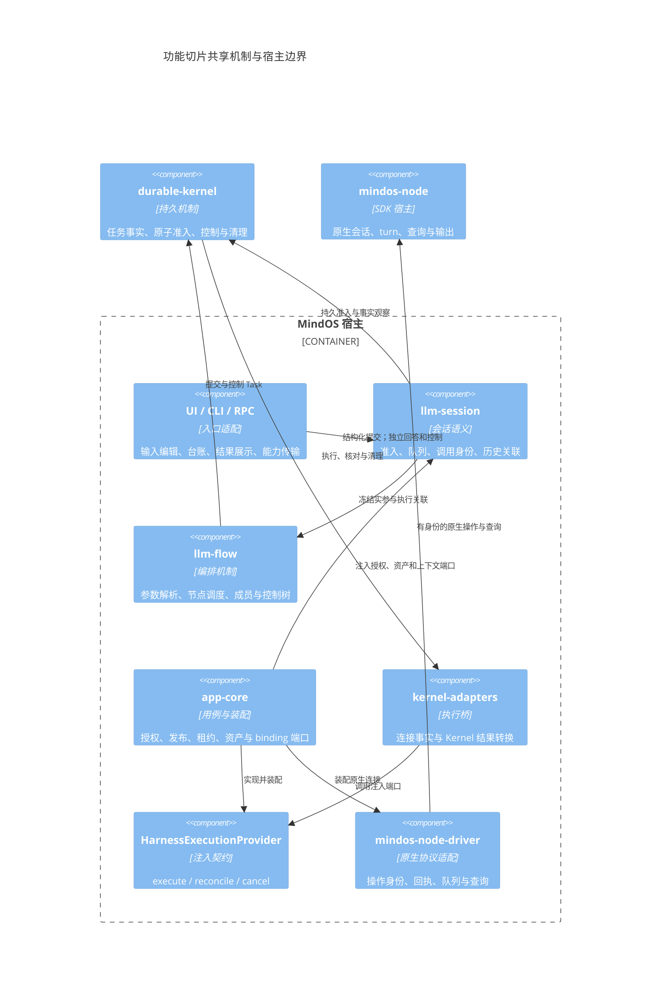
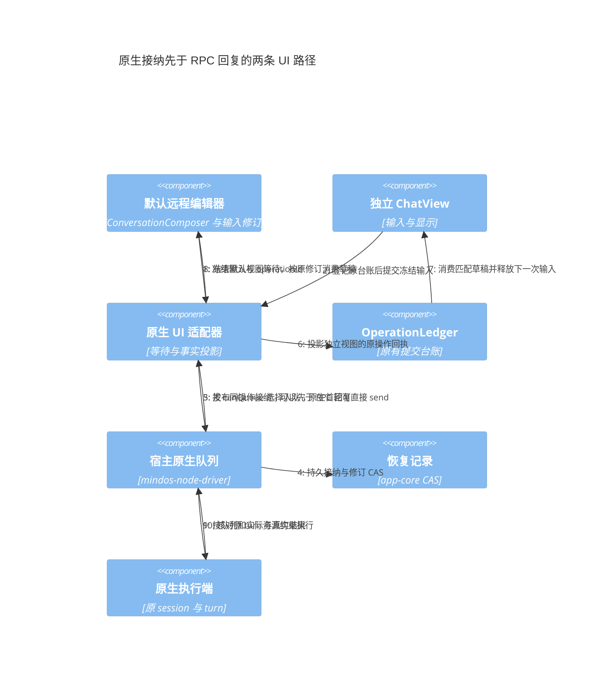

# 统一执行改动的功能合入计划

本计划针对根仓 `6d8d2171` 之后的工作树。按可独立审查、验证和回退的功能拆分；不按目录一次性提交，也不将所有 UI、CLI、RPC 接线留到最后。记录时间：2026-10-25。当前按 25 个能力组管理，F09 拆为四个交付单元，共 28 个功能切片。

## 1. 合入规则

一项功能包含自己的契约、实现、实际消费者、必要回归与文档。公共契约随首个有效消费者进入；共享文件按修改块拆分。纯算法出口等兼容性重构可先行，但不能将尚未接线的可选端口称为功能完成。

每个候选树使用独立索引组装，再在隔离源码检出中测试、检查类型；隔离树使用该提交锁定的独立库版本，不能借用完整工作树中尚未合入的依赖。提交后核对树与候选一致，保留原有用户暂存项。

“子仓已提交”只表示子仓内部有可追溯提交，根仓尚未更新 gitlink 时，不表示应用已消费。合入也不表示已部署，更不能代替原故障 Session 的验收。

## 2. 职责与依赖

图中的连接端口由宿主注入；kernel-adapters 不反向导入 app-core。业务默认值、公开范围和授权策略归宿主与定义，原子控制、租约条件写和幂等事实归机制。UI 不参与释放资源判定，原生 driver 不决定 Session 分支或业务目标。

各功能复用现有 OperationLedger、指令队列、Kernel、journal 与 Session 存储；本次拆分不增加调度器、状态库或 package。

## 3. 已独立提交的基础切片

| 编号 | 功能 | 根仓提交 | 验证边界 |
|---|---|---|---|
| B01 | 构建源变更诊断 | `ef5ef18a` | 9 个构建工具回归；保留原源码冻结保护 |
| B02 | 无运行时依赖的摘要出口 | `9acd6504` | Context 测试、类型、构建及 ESM/CJS 出口 |
| B03 | 当前输入材料去重 | `25a088de` | 文本、附件、结构化内容身份与预算回归 |
| B04 | 已接纳初始化在关闭期间排空 | `12954a08` | 7 个启动回归及 app-core 类型 |
| B05 | 恢复先排空再停止 Kernel | `5aafb3d8` | 19 个启动/恢复回归及 app-core 类型 |
| F01 | 子 Session 执行存储准备 | `9d0eda8b` | 存储/恢复 15 项、内容转交 9 项及 Session/app-core 类型 |
| F02 | Kernel 控制 API 与 Flow/RPC 集成 | `d2ad3268` | Kernel 419 项、Flow 18 项、RPC 3 项及五个消费包类型 |
| F03 | 远程恢复记录 CAS | `3edebe15` | 隔离存储/草稿 13 项、延迟读取故障回归及 app-core 类型 |
| F04 | 原生队列宿主与 RPC | `6d1f090b` | driver 293 项、宿主 893 项、RPC 4 项及消费包类型；跳过项单独记录 |
| F25 | Flow 调度准入所有权 | `0bcfa29e` | 完整 Flow 635 项及 Flow/Session/app-core 类型 |
| F09a | 默认远程工作台队列与接纳等待 | `4df2896d` | 队列库 92 项、适配层 128 项、接纳 6 项、远程 DOM 86 项及消费包类型 |
| F09b | 独立 ChatView 原生接纳台账 | `ceb71d43` | 适配层 133 项、原生及远程 DOM 88 项及消费包类型 |
| F09c | 独立原生视图队列编辑区 | `dd4c04bd` | 适配层 133 项、队列编辑/隐藏及远程 DOM 88 项及消费包类型 |
| F05/F06/F07 | 原生查询、取消核对与结果读取 | `09c122fc` | 适配层 141 项、真实 UI/RPC 118 项、HTTP RPC 5 项及消费包类型；Node 复用同源码已审查证据 |
| F11 | 统一 Flow 实参与公开范围准入 | `fc007454` | 完整 Flow 668 项、构建及四个消费包类型；未知来源字段两项回归从失败到通过 |
| F10 | Agent 不可变发布与队列策略冻结 | `44656133` | 隔离 Session 380 项、设置 UI 162 项、宿主 33 项、认证 HTTP 2 项，类型/构建、边界及 C4 检查 |
| F08 及调用入口必要接线 | 本地队列编辑、后端/CLI 根调用、根 Invocation 与 Session 附件冻结 | `937fe32b` | Context 39 项、Flow 668 项、Session 433 项、完整宿主 933 项、CLI 28 项、队列 DOM 6 项；构建/边界通过，历史切换 8.65 秒 |
| B06 | 历史 DOM 引用与展示身份归属 | `642cb67f` | 隔离历史/原生/窗口 119 项、类型及构建；完整工作树同一 30 秒预算从超时恢复为 8.64 秒通过 |
| F13/F14 | 不可变输入资产、通用文件表单与派发就绪校验 | `a2989fc4` | 完整宿主 947 项（另 13 跳过）、Session 433 项、Flow 668 项；UI 75 项、认证 HTTP 22 项、类型/构建/边界及 C4 通过 |
| F12 及 F09d 必要接线 | 默认工作台/独立视图平级目标、冻结请求台账与恢复 | `630455b4` | 适配层 156 项、相关工作台 146 项、项目草稿 16 项、四包类型与构建/边界；历史切换原预算 8.201 秒；完整附件崩溃消费另列 |

独立仓已有四个提交：Kernel `0c5e7cb`、llm-ui `7910531`、mindos-node-driver `6e32348`、mindos-node `edcaefb`。Kernel 已由 F02 锁定，driver 已由 F04 锁定，llm-ui 已由 F09a 锁定；mindos-node 已由原生查询/控制/输出批次锁定；四个 gitlink 均已接入已验证消费者。保留这些已有提交；根仓锁定版本时必须同时验证受影响消费者，不用未锁定的本地源码冒充集成完成。

## 4. 继续细分的功能单元

以下“待合入”表示当前有实现增量，仍需完成对应候选树的隔离审查。共享同一正确性约束的实现与消费者按依赖链合入，避免公共文件反复拆分；不因一个远期功能未完成而阻塞其他已经闭环的功能。

| 编号 | 独立功能及必要接线 | 主要所有者 | 前置 | 状态 / 验收重点 |
|---|---|---|---|---|
| F01 | 子 Session 执行存储准备 | app-core + Session 端口 | B05 | 已合入 `9d0eda8b`；先 metadata lease，再存储，再恢复；拒租重试保留原身份 |
| F02 | Kernel 控制版本与准入 API 集成 | Kernel + Flow fence + RPC | B05 | 已合入 `d2ad3268`；锁定子仓、撤销未确认暂停不绕过租约、错误原样传输 |
| F03 | 远程恢复记录 CAS | app-core 存储适配 | 无 | 已合入 `3edebe15`；丢写回执核对写前/写后值，真实冲突不可因 load 解除 |
| F04 | 原生可编辑队列 | driver + ConversationView + RPC | F03 | 已合入 `6d1f090b`；宿主/RPC 队列闭环，UI 台账接入仍属 F09 |
| F05 | 原生只读命令目录与查询 | node + driver + RPC + UI | 子仓版本 | 已合入 `09c122fc`；查询不经过写命令 tail，不推进原生 turn |
| F06 | 原生取消与控制回执 | driver + registry + RPC + UI | F03 | 已合入 `09c122fc`；独立 operationId，未知时继续观察原操作；Kernel 事实桥仍属 F19 |
| F07 | 原生命令结果分段读取 | node + driver + RPC + UI | F05 | 已合入 `09c122fc`；执行终态与结果可读性分离，按需读取且可停止后续分页 |
| F08 | 本地 Session 可编辑队列 | llm-session | B03 | 已合入 `937fe32b`；正文/实参 CAS 编辑、冻结定义重编译、附件核验与共享编辑器闭环 |
| F09 | 提交台账与草稿消费 | llm-ui + UI adapter | F04 / F08 | 原生 F09a/b/c 已合入；本地 F09d 台账与附件恢复、原回执消费、台账条件合并已合入；本批补全同分支基线保护及显式恢复，原生故障部署验收另列 |
| F10 | Agent 不可变发布 | Session 仓储 + app-core + 设置 UI/RPC | B02 | 已合入 `44656133`；发布回执独立读取，锁定实现依赖和入队策略，草稿不冒充发布 |
| F11 | 结构化实参、默认值与补参 | llm-flow + Session 准入 | B02 | 已合入 `fc007454`；接纳/消费两阶段校验，显式空值不被默认值覆盖 |
| F12 | Agent/Flow 平级目标入口 | app-core 目录 + Session + UI/CLI | F08 / F10 / F11 | 已合入 `937fe32b` / `630455b4`；后端、CLI、默认工作台、独立视图及本地首次草稿均使用真实平级目标；独立子 Session 路由继续按 F16/第 7 节实施 |
| F13 | 不可变输入附件与内容身份 | Session + app-core | B02 | 已合入 `937fe32b` / `a2989fc4`；Session 冻结、宿主上传核对和 UI 不可变写闭环；远程编码及长期回收另列 |
| F14 | 通用文件参数与就绪预检 | app-core + Flow + UI | F11 / F13 | 已合入 `a2989fc4`；文件表单、默认/空文件、真实上传、接纳/编辑/派发前核验；原回执查询不重读损坏输入 |
| F15 | Harness 资产编码与能力准入 | app-core + adapter + driver | F13 / F14 | 待合入；能力或摘要错误发生在 create/turn 前，旧操作核对不重读输入 |
| F16 | Invocation、重跑及输出身份 | Session + Flow | F08 / F11 | Session/独立 Flow 根身份、重跑与 Round 关联已随 `937fe32b` 合入；内部节点/循环/编排子调用身份与完整投影仍待合入 |
| F17 | Flow 控制树与调度屏障 | Flow + Kernel + UI/CLI | F02 / F16 | 待合入；暂停不冒充原生停止，祖先 hold 保留，控制与队列分开 |
| F18 | 长活 Effect 审批准入 | Kernel + Harness adapter | F02 / F06 | 待合入；新转发与暂停同事务校验，held 不转成 unknown |
| F19 | Connection 取消/核对事实桥 | kernel-adapters + 宿主 journal | F06 | 待合入；确认带原归属凭据，unknown 不释放，日志故障不改变结果 |
| F20 | 独立上下文 binding 与清理 | app-core + adapter | F16 / F19 | 待合入；集合 CAS，journal 与原生身份关联，旧结果不释放新所有者 |
| F21 | 已确认检查点与精确 fork | app-core + driver + node | F20 | 待合入；检查点归属与真实 head，错误边界不补发 turn |
| F22 | Context 目录与工作台选择 | app-core + Session + RPC + UI | F12 / F21 | 待合入；只读目录不取 writer，切目标/分支及迟到接纳保留当前草稿 |
| F23 | Task 产物目录与读取 | app-core + Session 端口 | F13 / F16 | 待合入；从终态输出派生，核对范围和摘要，不另建结果注册表 |
| F24 | 调用组与产物详情展示 | llm-ui + UI adapter + RPC | F07 / F16 / F23 | DOM 引用机制已由 `642cb67f` 合入并修复匹配夹具退化；完整调用组、产物 UI 及复杂输出性能仍待验收 |
| F25 | Flow 调度所有权竞态修复 | llm-flow | 无 | 已合入 `0bcfa29e`；竞争失败者不终结胜者，接纳丢回执不误清理工作区 |

F03 已独立合入原有记录的写入核对，且修复延迟 load 回退 CAS 游标；F04 再加入队列修订保护。查询结果校验仍随 F05 合入。公共能力表只随该功能加入所需方法，避免一次暴露尚未接通的全部端口。

F09 的独立交付边界如下，原生与本地使用同一台账协议，不建立第二套持久状态：

| 子项 | 边界 | 状态 |
|---|---|---|
| F09a | 默认远程工作台直接使用 native port 和共享队列组件；接纳通知结束 UI 等待 | 已合入 `4df2896d` |
| F09b | 独立 ChatView 将原生接纳投影到 OperationLedger；首轮 send 与 canQueue 分开 | 已合入 `ceb71d43` |
| F09c | 独立原生视图挂载队列编辑区，保留工具栏与隐藏/销毁生命周期 | 已合入 `dd4c04bd` |
| F09d | 本地 Session 队列及默认工作台的持久台账与草稿恢复 | 台账基础 `630455b4`、附件恢复 `45e227f2`、并发台账 `776bc8b0`；本批补全分支草稿基线、发送前核对与冲突恢复；不代表原生产 Session 已验收 |

默认远程兼容编辑器沿用既有 ConversationComposer；独立 ChatView 沿用 OperationLedger。两者消费同一后台接纳事实，前者的 awaitNativeAdmission 只是一段视图等待，不保存另一份队列或执行状态。原生首轮没有 canQueue 时仍走 send，不因端口具有 enqueue 方法而拒绝首轮。队列接纳不合成原生历史，真实 turn 到达后再关联。

原 RPC 的迟到成功/失败只结束旧调用，不重新消费草稿。以上为原生兼容入口的实际链路，接纳不等于执行完成；本地 Session/Kernel 统一执行与更完整的原生 Invocation 接线继续按其他能力组验收。F24 中原生结果与普通 Task 产物可各自形成展示闭环，但历史容器重构仍须单独通过性能回归。

## 5. 仍未完成，不能按合入拆分掩盖的范围

| 范围 | 当前限制 | 完成条件 |
|---|---|---|
| 严格原生 continue | binding CAS 和 fork 不提供远端条件写保障 | 原生条件写或独占 writer；外部推进及跨 epoch 可核对 |
| Flow Harness worker 的统一输入与上下文 | 消息装配与参数隔离切片已完成；原生 binding 与结构化材料消费仍待完成 | 本地/Harness worker 共用消息构造，普通与 revision worker 已覆盖；继续验证并行、循环、重试的 binding 与资产实例 |
| 无人值守与离线入口 | 人工补参、审批、连接失联策略尚未完全闭环 | 明确等待/超时/拒绝规则，CLI 与父 Flow 共享输入和控制协议 |
| 历史及资产长期生命周期 | 当前增量不等于永久恢复、导出和回收全部完成 | 保留引用、分页与恢复水位，删除/回收边界及持久故障验收 |
| 工作区、项目记忆与初始化 | 上下文 fork 不等于文件系统或记忆隔离 | 初始化按作用域去重，环境/记忆继承明确，报告实际恢复范围 |
| 历史展示扩展与性能覆盖 | DOM 全树扫描退化已由 `642cb67f` 修复；完整工作树同一单项 8.64 秒通过 | 完整调用组、大报告和产物按需加载仍须扩大验收；不通过提高超时掩盖退化 |
| 原生产故障验收 | 本地测试和构建不证明部署版本或原 Session 已恢复 | 核对运行版本及 node 能力，在授权边界内验证队列、查询与控制 |

原有性能对照已补受控方法剖析与同条件修复验证：新增展示扩大了逐消息全历史 DOM 查找的次数。结论限于当前夹具，不能据此证明复杂报告或完整调用树没有额外开销。已有关闭语义夹具修正也不能替代真实进程崩溃测试。

## 6. 交付顺序与结束条件

先合入基础修复、执行存储准备、Kernel/RPC 边界和调度所有权，再分别推进原生队列链、本地目标输入链、binding 链与产物链。依赖不满足时保留候选，不把缺失消费者用空实现补齐。

前期同时铺开跨层修改，后续过细拆分又造成共享文件反复审查和验证，这是积压的主要过程原因。F12 入口合入后，当前仍有 10 个未完整交付单元，按以下五条依赖链收拢；同批内保留有意义的提交边界，契约与必要消费者一起交付。

| 批次 | 剩余交付单元 | 合入约束 |
|---|---|---|
| 调用身份 | F16 | 平级入口、台账/附件恢复及分支草稿冲突保护已接通；继续完成内部子调用身份及独立子 Session 路由 |
| Harness 资产传输 | F15 | F13/F14 的不可变身份、宿主可读性及 UI 参数绑定已合入；继续完成远程编码与消费能力准入 |
| 执行控制 | F17 / F18 / F19 | 控制屏障、长 Effect 审批与清理确认沿用 Kernel 事实；未知结果不释放资源 |
| 原生上下文 | F20 / F21 / F22 | binding、检查点和选择器一致；严格 continue 的原生能力缺口仍须明确保留 |
| 结果与历史 | F23 / F24 | 先贯通产物读取，再处理调用组；匹配夹具的扫描退化已修复，复杂输出仍需按需渲染回归 |

F10 一批包含 46 个文件；其中普通 Agent 入队冻结是发布语义的必要消费者，因为发布新版本不能改变已经接纳的旧请求。文件数不等于未完成功能数：共享文件中仍有其他切片的未提交修改，不能把该文件整个标为完成。

每项记录实际提交、独立验证范围和仍未覆盖的行为。最终集成再运行跨边界组合：发送回执悬挂时入队、暂停时审批到达、取消与完成竞态、分支切换后 fork、完成后历史写入失败、旧远端操作仍执行时接管。只有这些链路闭环后，才能移除被替代的兼容路径并宣告对应目标完成。

本轮补充证据：F04 的隔离 driver 套件 293 通过、2 跳过，宿主套件 893 通过、13 跳过。完整宿主测试后只修正 RPC 测试替身的 subscribe/refresh；候选差异确认生产代码一致，再通过 4 项 RPC 回归与类型检查，未将完整工作树中其他未合入测试计入这些数字。

F09 证据补充：只等待 RPC 的反向候选使两项默认工作台输入回归失败；修复后通过。独立视图真实 DOM 同时覆盖旧回复迟到成功/失败、队列正文编辑的原修订、隐藏/恢复控制与原生历史不伪造。已合入 UI 候选的历史切换单项为 8.56 秒通过，不能据此声称完整工作树的性能退化已经修复。

原生批次以一个连续契约合入 38 个文件，输入批次合入 25 个文件；两者复用既有执行路径，保留各自失败边界。通用字节拼接/摘要核验已移到 utils/verified-content，原生读取不依赖 DAG 产物模块。ProjectConversationPort 从原端口推导命令、取消及分叉参数，只扩展返回投影，降低新增参数在宿主层丢失的风险。Node 源码版本锁定及回归通过仍不代表运行中的 httpd/native 已更新。

F10 的宿主回归覆盖已有发布与首次发布两种情况下，普通 Agent 队列在重启后保持原策略；认证 HTTP 回归覆盖原发布响应悬挂时独立查询持久回执。注入日志抛错的两项回归先复现失败，再验证成功与拒绝均保留原结果。全部功能测试在隔离候选树完成；架构边界、样式与本次 C4 文档检查也在隔离树通过。全量 docs:check 在完整工作树通过，隔离树的全量文档检查因既有文档引用未准备的 CLI 产物、其他工具仓和本地配置而未通过，不将其记为候选树全量文档通过。

本地根调用批次合入 90 个文件，未增加调度器、状态库或 package。Session 保留准入、队列与历史；Context 只提供材料解析端口；CLI 和共享队列面板消费既有应用端口。Session 附件冻结是队列正确执行的必要依赖，已一并合入；宿主通用文件传输和 Harness 资产协议继续保留明确边界。Agent Flow 重跑的双重参数来源、旧编辑响应回退来源信封的两处回归均从失败验证到通过；面板不再将编译图复制给共享编辑器，重复样式已删除。

该批次的隔离完整宿主为 933 通过、13 跳过；CLI 28 项是本次受影响的四个套件，不是 CLI 全量矩阵。真实模型请求覆盖当前与历史附件、上传后变更、冻结副本损坏、缺失必选材料，以及编辑后新引用文件。其历史切换单项 8.651 秒只证明该隔离树没有退化；完整工作树的受控修复见下段，原生产故障仍未验收。API 中已补 Mermaid C4 调用流；默认工作台的目标/台账和完整子调用树仍未标为完成。

B06 的受控诊断先在完整工作树重新复现同一测试 31.08 秒超时；临时方法剖析显示两次恢复中约 25.2 秒用于按消息 ID 查找整段历史 DOM，剖析文件随后删除。修复用消息 Map 代替原 ID Set，统一维护已拥有的包装节点；Flow 窗口及原生别名从现有引用解析，删除先撤销引用再动画。两项归属/动画回归先失败再通过；完整工作树原测试以原 30 秒预算 8.637 秒通过，隔离候选同项为 8.185 秒通过。该修复不依赖未合入的产物模块，也不修改执行事实；独立模块设计中已补 C4 所有权图。F24 继续保留其他输入/展示及生命周期验收，未因性能修复整体关闭。

F13/F14 一批合入 51 个文件。上传身份与内容存储归 app-core，Session/Flow 通过宿主端口核验，UI 只管理选择、观察与上传；复用既有 inputs.seq、队列和 Kernel，不增加状态库或 package。UI 摘要复用 common，删除不必要的 llm-context 依赖。两个正确性缺口均先复现失败再修正：上传在异步持久化前复制调用方字节；队列新派发复验已选材料，损坏时不创建 Task，但原接纳回执仍可查询。API 中补充 C4 流程。

该批次后仍有 220 个待处理路径（其中 78 个未跟踪，排除用户原有的三个路径）；文件数包含共享文件的其他功能增量及设计材料，不能当成功能数。剩余交付单元为 F09d、F12、F15—F24。后台完整套件证据与最终候选的后台源码和测试逐字节一致；后续仅调整既有 UI 上传测试替身、UI 文件来源控件及文档，再通过最终消费者验证。合入不代表部署，原生产 Session 仍未验收。

## 7. 子会话与函数视图的交付安排

2026-10-25 决策：一个 Session 可以关联多个子 Session；独立任务或 Flow 函数调用默认拥有自己的子 Session，每次独立运行分配不同 Session/Invocation。同一子会话的续聊和重跑仍允许多个 Invocation。普通 DAG 节点不逐个创建 Session，组织树与执行控制树分开。完整定义与 C4 见[子会话与函数调用视图](session-invocation-ui.md)。

以下为 F12/F16/F24 内的实施与验收检查项，不增加新的能力组、调度器或存储模块；现有父子 Session 和调用接口仅算基础，不能据此勾选完整功能。

| 检查项 | 归属与前置 | 状态 | 交付及验收条件 |
| --- | --- | --- | --- |
| 会话与调用关联 | F16；Session/app-core | 已有 parentSessionId 和幂等创建基础；完整调用关联待实施 | 持久保存原调用者、执行所属 Session、Invocation 及真实根 Task；组织关系不授予控制 |
| 独立调用入口 | F16；F12 平级目标和台账基础已合入 | 子 Session 路由待统一接入；普通发送继续在当前 Session | 同 Flow 两次独立运行获得不同子 Session；同请求丢回复/重启返回同一子 Session；父子不重复入队 |
| 最小函数调用组 | F24 基础；依赖 F16/F23 | 待实施与验收，本阶段范围 | 默认输入、状态、最终 value/artifacts；原 Invocation 稳定定位；审批、补参、失败及清理状态可见 |
| 打开真实子会话 | F24 基础；依赖明确的 Session 关联 | 待接线，本阶段范围 | 打开既有 Session UI，不重跑、不复制历史；关闭观察不取消后台执行；不支持时不伪造入口 |
| 高级会话详情 | F24 增强；在基础入口后扩展 | 后续增强；不阻塞最小函数视图交付 | 内嵌会话、完整节点/循环/尝试树、搜索与大历史分页，展开才加载 renderer |
| 组合回归 | F09d/F12/F16/F17/F24 | 待完成 | 分支切换后核对原提交不消费新草稿；父取消只覆盖受管理调用；详情读取失败不改执行终态 |

本地目标/台账链已由 `630455b4` 合入 50 个文件；不增加 package 或状态库。三个回归先失败再通过：相同队列 ID 的实参冲突、旧接纳消费另一分支附件、核对期间接纳通知丢失。独立视图将原 Session/分支请求保存到同一台账，重开另一观察绑定仍查原请求；默认工作台支持首个发送回复悬挂时继续入队。参数详情及重跑复用原历史与 Flow 表单，不依赖未合入的产物或原生上下文模块。

本批次后剩余 191 个待处理路径（其中 68 个未跟踪，排除用户原有三个路径），包括其他功能的共享文件增量和设计材料。适配层 156、相关 UI 146、项目草稿 16 项在隔离源码候选通过，四包类型、构建及架构/样式通过，历史切换单项保持原 30 秒预算并以 8.201 秒通过。最终候选仅做空白格式及三份文档补充，源码忽略空白比较一致，再检查最终类型、C4、链接及 diff；完整工作树 docs:check 通过。当前的完整附件崩溃消费、独立子 Session、函数调用组和原生产故障验收仍未完成。

## 9. 已保存附件草稿的恢复增量

本次附件恢复批次沿用 F09d、F13 的已有台账和 Session assets：分支草稿保存 token、文件引用及摘要，项目/原生兼容草稿复用同一编解码；发送前先等待保存。恢复保留逻辑 File ID，Flow 查询原上传回执，原提交仅只读核对；旧接纳不消费新文字、重选参数或同名同大小新文件。设置保存时间不作为用户输入变化。已接纳但清空草稿写入失败，重开仍能匹配消费。

隔离候选已通过适配层 161 项、相关 UI 202 项（其中真实工作台故障恢复 4 项）、三个包类型、适配包构建、目录边界、UUID 和样式检查。新增回归验证坏摘要、缺失文件、空文件、保存失败不派发，以及安全诊断；项目首次草稿与原生编辑器同时回归。普通输入保留延迟保存窗口，本保证针对发送前已确认保存的草稿。

该批次留下的台账整组覆盖问题由第 10 节的条件合并处理；同分支草稿冲突继续开放，不能以单工作台重开测试证明所有跨客户端一致性。独立子 Session 路由、函数调用组、上下文与控制链、产物详情及原生产 Session 验收继续按前述安排实施；本批次不部署或操作原故障 Session。

## 10. 多视图台账合并增量

独立 llm-ui 提供纯记录合并与实际持久快照发布；宿主 UI 用 Session 原有修订条件保存，后端不解释 OperationRecord。原操作已接纳、拒绝或未知时不再派发。丢写回执通过只读核对确认，八次修订冲突后明确保留错误，不降级为无条件覆盖。原普通 UI patch 接口保留，新增条件写入通过独立方法及真实 RPC 开放，避免旧宿主忽略附加参数。

独立库 107、隔离适配层 172、完整 Session 436、相关工作台 67、认证 HTTP 23 项通过；类型、构建与边界检查覆盖锁定后的消费者。回归包含冻结输入与终态冲突、两个真实工作台的独立提交、HTTP 陈旧修订拒绝、落盘后丢回复、日志故障及正文不泄漏。该批次留下的同分支草稿并发写入与旧接纳清空冲突，由第 11 节的基线保护与显式恢复补齐。独立子 Session、函数调用视图及其余执行链仍待完成。

## 11. 展示与存储边界、草稿冲突闭环

llm-ui 只负责显示、输入编辑与控制请求；临时编辑状态和读缓存留在界面，MindOS 的持久数据经宿主端口写入既有 VFS/SessionRepository，执行事实继续归 Kernel。独立库不绑定文件系统实现。适配层负责 DTO、浏览器文件编解码与恢复交互，不建立新的执行状态库。职责及 C4 见[独立模块的数据边界](llm-ui-independent-module.md#展示输入控制与持久数据边界)。

本批补全 F09d 的同分支草稿基线、冲突提示及加载/替换动作；持久输入与基线不符时不覆盖正文、参数或附件。替换仍校验所显示的冲突快照，加载中的编辑和隐藏会阻止迟到恢复，读取失败不能当作空草稿。偏好写入在草稿条件检查后进行，发送前核对草稿；恢复动作不派发业务调用。

本次隔离源码候选的适配层 180、相关工作台 97、认证 HTTP 23 项及类型、构建/边界通过；另补隐藏时加载的组合回归。F09a—d 的已定义接线与恢复切片可按本批合入，剩余交付单元为 F15—F24 共十项；原生产故障 Session、实际部署、长期资产回收、无人值守和更复杂输入输出等跨能力验收仍按原清单推进。

## 12. 结构化 Harness 消息装配审查切片

发现 route worker 只对本地 LLM 组装消息，Harness 落入普通参数合并分支，会丢失本轮指令，并允许同名业务参数覆盖连接快照。修复集中在 llm-flow 的结构化调用构造层，以共用 Program 分类和隔离输入函数消除两处判定差异；不向 UI、宿主传输层或 Kernel 下沉 Flow 模板规则。流程及模块边界见 [Flow 能力与输出](./flow-capabilities-and-output.md#结构化-harness-worker-的输入边界)。

验收覆盖本地 Agent/Chat 兼容、Harness 连接不可被实参覆盖、声明历史、输出约束、真实 builtin.agent/TaskFactory 路径及 revision worker。该切片独立于尚未合入的子 Invocation、控制树和原生 binding；F15 的附件传输及十项剩余交付单元仍未整体完成。

隔离候选验证：llm-flow 全部 674 项测试及类型检查通过；两份文档的 4 个 Mermaid 图与 17 个本地链接通过解析/存在性检查。未运行真实远端模型，未部署或重启服务。
