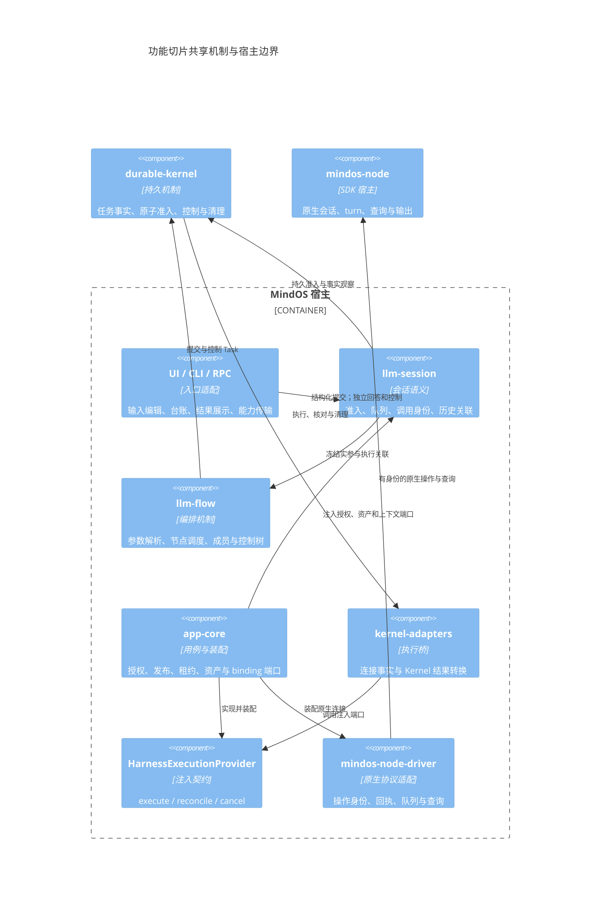
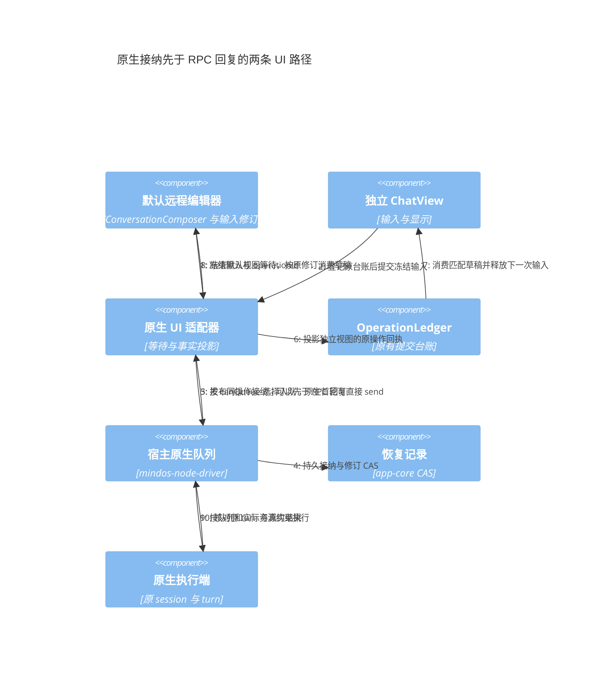

# 统一执行改动的功能合入计划

本计划针对根仓 `6d8d2171` 之后的工作树。按可独立审查、验证和回退的功能拆分；不按目录一次性提交，也不将所有 UI、CLI、RPC 接线留到最后。记录时间：2026-10-25。当前按 25 个能力组管理，F09 拆为四个交付单元，共 28 个功能切片。

## 1. 合入规则

一项功能包含自己的契约、实现、实际消费者、必要回归与文档。公共契约随首个有效消费者进入；共享文件按修改块拆分。纯算法出口等兼容性重构可先行，但不能将尚未接线的可选端口称为功能完成。

每个候选树使用独立索引组装，再在隔离源码检出中测试、检查类型；隔离树使用该提交锁定的独立库版本，不能借用完整工作树中尚未合入的依赖。提交后核对树与候选一致，保留原有用户暂存项。

“子仓已提交”只表示子仓内部有可追溯提交，根仓尚未更新 gitlink 时，不表示应用已消费。合入也不表示已部署，更不能代替原故障 Session 的验收。

## 2. 职责与依赖

图中的连接端口由宿主注入；kernel-adapters 不反向导入 app-core。业务默认值、公开范围和授权策略归宿主与定义，原子控制、租约条件写和幂等事实归机制。UI 不参与释放资源判定，原生 driver 不决定 Session 分支或业务目标。

各功能复用现有 OperationLedger、指令队列、Kernel、journal 与 Session 存储；本次拆分不增加调度器、状态库或 package。

## 3. 已独立提交的基础切片

| 编号 | 功能 | 根仓提交 | 验证边界 |
|---|---|---|---|
| B01 | 构建源变更诊断 | `ef5ef18a` | 9 个构建工具回归；保留原源码冻结保护 |
| B02 | 无运行时依赖的摘要出口 | `9acd6504` | Context 测试、类型、构建及 ESM/CJS 出口 |
| B03 | 当前输入材料去重 | `25a088de` | 文本、附件、结构化内容身份与预算回归 |
| B04 | 已接纳初始化在关闭期间排空 | `12954a08` | 7 个启动回归及 app-core 类型 |
| B05 | 恢复先排空再停止 Kernel | `5aafb3d8` | 19 个启动/恢复回归及 app-core 类型 |
| F01 | 子 Session 执行存储准备 | `9d0eda8b` | 存储/恢复 15 项、内容转交 9 项及 Session/app-core 类型 |
| F02 | Kernel 控制 API 与 Flow/RPC 集成 | `d2ad3268` | Kernel 419 项、Flow 18 项、RPC 3 项及五个消费包类型 |
| F03 | 远程恢复记录 CAS | `3edebe15` | 隔离存储/草稿 13 项、延迟读取故障回归及 app-core 类型 |
| F04 | 原生队列宿主与 RPC | `6d1f090b` | driver 293 项、宿主 893 项、RPC 4 项及消费包类型；跳过项单独记录 |
| F25 | Flow 调度准入所有权 | `0bcfa29e` | 完整 Flow 635 项及 Flow/Session/app-core 类型 |
| F09a | 默认远程工作台队列与接纳等待 | `4df2896d` | 队列库 92 项、适配层 128 项、接纳 6 项、远程 DOM 86 项及消费包类型 |
| F09b | 独立 ChatView 原生接纳台账 | `ceb71d43` | 适配层 133 项、原生及远程 DOM 88 项及消费包类型 |
| F09c | 独立原生视图队列编辑区 | `dd4c04bd` | 适配层 133 项、队列编辑/隐藏及远程 DOM 88 项及消费包类型 |

独立仓已有四个提交：Kernel `0c5e7cb`、llm-ui `7910531`、mindos-node-driver `6e32348`、mindos-node `edcaefb`。Kernel 已由 F02 锁定，driver 已由 F04 锁定，llm-ui 已由 F09a 锁定；mindos-node 的 gitlink 待原生查询等功能集成。保留这些已有提交；根仓锁定版本时必须同时验证受影响消费者，不用未锁定的本地源码冒充集成完成。

## 4. 继续细分的功能单元

以下“待合入”表示当前有实现增量，仍需完成对应候选树的隔离审查。不同项目可以共享先行契约；依赖不要求把多项捆成一个提交。

| 编号 | 独立功能及必要接线 | 主要所有者 | 前置 | 状态 / 验收重点 |
|---|---|---|---|---|
| F01 | 子 Session 执行存储准备 | app-core + Session 端口 | B05 | 已合入 `9d0eda8b`；先 metadata lease，再存储，再恢复；拒租重试保留原身份 |
| F02 | Kernel 控制版本与准入 API 集成 | Kernel + Flow fence + RPC | B05 | 已合入 `d2ad3268`；锁定子仓、撤销未确认暂停不绕过租约、错误原样传输 |
| F03 | 远程恢复记录 CAS | app-core 存储适配 | 无 | 已合入 `3edebe15`；丢写回执核对写前/写后值，真实冲突不可因 load 解除 |
| F04 | 原生可编辑队列 | driver + ConversationView + RPC | F03 | 已合入 `6d1f090b`；宿主/RPC 队列闭环，UI 台账接入仍属 F09 |
| F05 | 原生只读命令目录与查询 | node + driver + RPC + UI | 子仓版本 | 待合入；查询不经过写命令 tail，不推进原生 turn |
| F06 | 原生取消与控制回执 | driver + registry + RPC + UI | F03 | 待合入；独立 operationId，未知时继续观察原操作 |
| F07 | 原生命令结果分段读取 | node + driver + RPC + UI | F05 | 待合入；执行终态与结果可读性分离，按需读取且可停止后续分页 |
| F08 | 本地 Session 可编辑队列 | llm-session | B03 | 待合入；冻结输入、版本 CAS、持久接纳及队列历史关联 |
| F09 | 提交台账与草稿消费 | llm-ui + UI adapter | F04 / F08 | 原生部分 F09a/b/c 已合入；本地 F09d 待 F08；迟到结果不消费新修订草稿 |
| F10 | Agent 不可变发布 | Session 仓储 + app-core + 设置 UI/RPC | B02 | 待合入；发布回执独立读取，锁定实现依赖，草稿不冒充发布 |
| F11 | 结构化实参、默认值与补参 | llm-flow + Session 准入 | B02 | 待合入；接纳/消费两阶段校验，显式空值不被默认值覆盖 |
| F12 | Agent/Flow 平级目标入口 | app-core 目录 + Session + UI/CLI | F08 / F10 / F11 | 待合入；同名目标不混淆，纯参数和零参数可提交，锁定发布修订 |
| F13 | 不可变输入附件与内容身份 | Session + app-core | B02 | 待合入；正文摘要、所有者、上传身份和重试复用 |
| F14 | 通用文件参数与就绪预检 | app-core + Flow + UI | F11 / F13 | 待合入；已声明绑定确定性映射，不丢弃未绑定附件 |
| F15 | Harness 资产编码与能力准入 | app-core + adapter + driver | F13 / F14 | 待合入；能力或摘要错误发生在 create/turn 前，旧操作核对不重读输入 |
| F16 | Invocation、重跑及输出身份 | Session + Flow | F08 / F11 | 待合入；核对沿用身份，用户重跑新建身份并保留关联，终态不回退 |
| F17 | Flow 控制树与调度屏障 | Flow + Kernel + UI/CLI | F02 / F16 | 待合入；暂停不冒充原生停止，祖先 hold 保留，控制与队列分开 |
| F18 | 长活 Effect 审批准入 | Kernel + Harness adapter | F02 / F06 | 待合入；新转发与暂停同事务校验，held 不转成 unknown |
| F19 | Connection 取消/核对事实桥 | kernel-adapters + 宿主 journal | F06 | 待合入；确认带原归属凭据，unknown 不释放，日志故障不改变结果 |
| F20 | 独立上下文 binding 与清理 | app-core + adapter | F16 / F19 | 待合入；集合 CAS，journal 与原生身份关联，旧结果不释放新所有者 |
| F21 | 已确认检查点与精确 fork | app-core + driver + node | F20 | 待合入；检查点归属与真实 head，错误边界不补发 turn |
| F22 | Context 目录与工作台选择 | app-core + Session + RPC + UI | F12 / F21 | 待合入；只读目录不取 writer，切目标/分支及迟到接纳保留当前草稿 |
| F23 | Task 产物目录与读取 | app-core + Session 端口 | F13 / F16 | 待合入；从终态输出派生，核对范围和摘要，不另建结果注册表 |
| F24 | 调用组与产物详情展示 | llm-ui + UI adapter + RPC | F07 / F16 / F23 | 暂缓整体合入；保持稳定 part，按需加载，并定位历史加载性能退化 |
| F25 | Flow 调度所有权竞态修复 | llm-flow | 无 | 已合入 `0bcfa29e`；竞争失败者不终结胜者，接纳丢回执不误清理工作区 |

F03 已独立合入原有记录的写入核对，且修复延迟 load 回退 CAS 游标；F04 再加入队列修订保护。查询结果校验仍随 F05 合入。公共能力表只随该功能加入所需方法，避免一次暴露尚未接通的全部端口。

F09 的独立交付边界如下，原生与本地使用同一台账协议，不建立第二套持久状态：

| 子项 | 边界 | 状态 |
|---|---|---|
| F09a | 默认远程工作台直接使用 native port 和共享队列组件；接纳通知结束 UI 等待 | 已合入 `4df2896d` |
| F09b | 独立 ChatView 将原生接纳投影到 OperationLedger；首轮 send 与 canQueue 分开 | 已合入 `ceb71d43` |
| F09c | 独立原生视图挂载队列编辑区，保留工具栏与隐藏/销毁生命周期 | 已合入 `dd4c04bd` |
| F09d | 本地 Session 队列及默认工作台的持久台账与草稿恢复 | 待 F08 的冻结输入与编辑准入闭环 |

默认远程兼容编辑器沿用既有 ConversationComposer；独立 ChatView 沿用 OperationLedger。两者消费同一后台接纳事实，前者的 awaitNativeAdmission 只是一段视图等待，不保存另一份队列或执行状态。原生首轮没有 canQueue 时仍走 send，不因端口具有 enqueue 方法而拒绝首轮。队列接纳不合成原生历史，真实 turn 到达后再关联。

原 RPC 的迟到成功/失败只结束旧调用，不重新消费草稿。以上为原生兼容入口的实际链路，接纳不等于执行完成；本地 Session/Kernel 统一执行与更完整的原生 Invocation 接线继续按其他能力组验收。F24 中原生结果与普通 Task 产物可各自形成展示闭环，但历史容器重构仍须单独通过性能回归。

## 5. 仍未完成，不能按合入拆分掩盖的范围

| 范围 | 当前限制 | 完成条件 |
|---|---|---|
| 严格原生 continue | binding CAS 和 fork 不提供远端条件写保障 | 原生条件写或独占 writer；外部推进及跨 epoch 可核对 |
| Flow Harness worker 的统一输入与上下文 | 模型节点与 Harness 节点尚未共享完整消息装配与 binding 规则 | 在 Program 分派之前统一冻结 Agent 输入，覆盖并行、循环与重试实例 |
| 无人值守与离线入口 | 人工补参、审批、连接失联策略尚未完全闭环 | 明确等待/超时/拒绝规则，CLI 与父 Flow 共享输入和控制协议 |
| 历史及资产长期生命周期 | 当前增量不等于永久恢复、导出和回收全部完成 | 保留引用、分页与恢复水位，删除/回收边界及持久故障验收 |
| 工作区、项目记忆与初始化 | 上下文 fork 不等于文件系统或记忆隔离 | 初始化按作用域去重，环境/记忆继承明确，报告实际恢复范围 |
| UI 历史加载性能 | 旧基线约 8.3 秒，已合入原生 UI 候选约 8.6 秒；完整工作树同一单项约 33 秒超时 | 在相同夹具与环境定位阶段耗时；不得只提高测试超时 |
| 原生产故障验收 | 本地测试和构建不证明部署版本或原 Session 已恢复 | 核对运行版本及 node 能力，在授权边界内验证队列、查询与控制 |

性能对照只支持“退化待定位”，尚不能把原因归到某个 renderer、存储或新增功能。已有关闭语义夹具修正也不能替代真实进程崩溃测试。

## 6. 交付顺序与结束条件

先合入基础修复、执行存储准备、Kernel/RPC 边界和调度所有权，再分别推进原生队列链、本地目标输入链、binding 链与产物链。依赖不满足时保留候选，不把缺失消费者用空实现补齐。

每项记录实际提交、独立验证范围和仍未覆盖的行为。最终集成再运行跨边界组合：发送回执悬挂时入队、暂停时审批到达、取消与完成竞态、分支切换后 fork、完成后历史写入失败、旧远端操作仍执行时接管。只有这些链路闭环后，才能移除被替代的兼容路径并宣告对应目标完成。

本轮补充证据：F04 的隔离 driver 套件 293 通过、2 跳过，宿主套件 893 通过、13 跳过。完整宿主测试后只修正 RPC 测试替身的 subscribe/refresh；候选差异确认生产代码一致，再通过 4 项 RPC 回归与类型检查，未将完整工作树中其他未合入测试计入这些数字。

F09 证据补充：只等待 RPC 的反向候选使两项默认工作台输入回归失败；修复后通过。独立视图真实 DOM 同时覆盖旧回复迟到成功/失败、队列正文编辑的原修订、隐藏/恢复控制与原生历史不伪造。已合入 UI 候选的历史切换单项为 8.56 秒通过，不能据此声称完整工作树的性能退化已经修复。
