# 统一执行改动的功能合入计划

本计划针对根仓 `6d8d2171` 之后的工作树。按可独立审查、验证和回退的功能拆分；不按目录一次性提交，也不将所有 UI、CLI、RPC 接线留到最后。记录时间：2026-10-25。当前按 25 个能力组管理，F09 拆为四个交付单元，共 28 个功能切片。

## 1. 合入规则

一项功能包含自己的契约、实现、实际消费者、必要回归与文档。公共契约随首个有效消费者进入；共享文件按修改块拆分。纯算法出口等兼容性重构可先行，但不能将尚未接线的可选端口称为功能完成。

每个候选树使用独立索引组装，再在隔离源码检出中测试、检查类型；隔离树使用该提交锁定的独立库版本，不能借用完整工作树中尚未合入的依赖。提交后核对树与候选一致，保留原有用户暂存项。

“子仓已提交”只表示子仓内部有可追溯提交，根仓尚未更新 gitlink 时，不表示应用已消费。合入也不表示已部署，更不能代替原故障 Session 的验收。

## 2. 职责与依赖

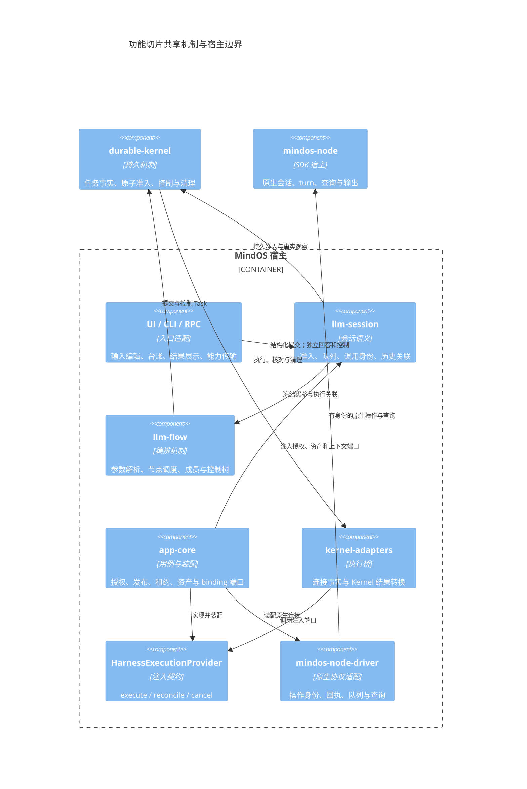

图中的连接端口由宿主注入；kernel-adapters 不反向导入 app-core。业务默认值、公开范围和授权策略归宿主与定义，原子控制、租约条件写和幂等事实归机制。UI 不参与释放资源判定，原生 driver 不决定 Session 分支或业务目标。

各功能复用现有 OperationLedger、指令队列、Kernel、journal 与 Session 存储；本次拆分不增加调度器、状态库或 package。

## 3. 已独立提交的基础切片

| 编号 | 功能 | 根仓提交 | 验证边界 |
|---|---|---|---|
| B01 | 构建源变更诊断 | `ef5ef18a` | 9 个构建工具回归；保留原源码冻结保护 |
| B02 | 无运行时依赖的摘要出口 | `9acd6504` | Context 测试、类型、构建及 ESM/CJS 出口 |
| B03 | 当前输入材料去重 | `25a088de` | 文本、附件、结构化内容身份与预算回归 |
| B04 | 已接纳初始化在关闭期间排空 | `12954a08` | 7 个启动回归及 app-core 类型 |
| B05 | 恢复先排空再停止 Kernel | `5aafb3d8` | 19 个启动/恢复回归及 app-core 类型 |
| F01 | 子 Session 执行存储准备 | `9d0eda8b` | 存储/恢复 15 项、内容转交 9 项及 Session/app-core 类型 |
| F02 | Kernel 控制 API 与 Flow/RPC 集成 | `d2ad3268` | Kernel 419 项、Flow 18 项、RPC 3 项及五个消费包类型 |
| F03 | 远程恢复记录 CAS | `3edebe15` | 隔离存储/草稿 13 项、延迟读取故障回归及 app-core 类型 |
| F04 | 原生队列宿主与 RPC | `6d1f090b` | driver 293 项、宿主 893 项、RPC 4 项及消费包类型；跳过项单独记录 |
| F25 | Flow 调度准入所有权 | `0bcfa29e` | 完整 Flow 635 项及 Flow/Session/app-core 类型 |
| F09a | 默认远程工作台队列与接纳等待 | `4df2896d` | 队列库 92 项、适配层 128 项、接纳 6 项、远程 DOM 86 项及消费包类型 |
| F09b | 独立 ChatView 原生接纳台账 | `ceb71d43` | 适配层 133 项、原生及远程 DOM 88 项及消费包类型 |
| F09c | 独立原生视图队列编辑区 | `dd4c04bd` | 适配层 133 项、队列编辑/隐藏及远程 DOM 88 项及消费包类型 |
| F05/F06/F07 | 原生查询、取消核对与结果读取 | `09c122fc` | 适配层 141 项、真实 UI/RPC 118 项、HTTP RPC 5 项及消费包类型；Node 复用同源码已审查证据 |
| F11 | 统一 Flow 实参与公开范围准入 | `fc007454` | 完整 Flow 668 项、构建及四个消费包类型；未知来源字段两项回归从失败到通过 |
| F10 | Agent 不可变发布与队列策略冻结 | `44656133` | 隔离 Session 380 项、设置 UI 162 项、宿主 33 项、认证 HTTP 2 项，类型/构建、边界及 C4 检查 |
| F08 及调用入口必要接线 | 本地队列编辑、后端/CLI 根调用、根 Invocation 与 Session 附件冻结 | `937fe32b` | Context 39 项、Flow 668 项、Session 433 项、完整宿主 933 项、CLI 28 项、队列 DOM 6 项；构建/边界通过，历史切换 8.65 秒 |
| B06 | 历史 DOM 引用与展示身份归属 | `642cb67f` | 隔离历史/原生/窗口 119 项、类型及构建；完整工作树同一 30 秒预算从超时恢复为 8.64 秒通过 |
| F13/F14 | 不可变输入资产、通用文件表单与派发就绪校验 | `a2989fc4` | 完整宿主 947 项（另 13 跳过）、Session 433 项、Flow 668 项；UI 75 项、认证 HTTP 22 项、类型/构建/边界及 C4 通过 |
| F12 及 F09d 必要接线 | 默认工作台/独立视图平级目标、冻结请求台账与恢复 | `630455b4` | 适配层 156 项、相关工作台 146 项、项目草稿 16 项、四包类型与构建/边界；历史切换原预算 8.201 秒；完整附件崩溃消费另列 |
| F09d 附件草稿恢复 | 已提交附件的草稿恢复与原接纳消费 | `45e227f2` | 冻结文件身份、逐字段修订及重开恢复验收 |
| F09d 并发台账 | OperationLedger 条件合并与 Session UI CAS | `776bc8b0` | 冻结身份冲突、终态单调性及丢回执核对 |
| F09d 分支草稿 | 编辑基线保护及显式恢复；纯 UI/宿主数据边界 | `558f8af4` | 隔离 adapter 180、工作台 97、认证 HTTP 23 项；最终恢复 9 项 |
| 结构化 Harness 消息装配 | 普通/revision worker 消息与连接配置隔离 | `5ff3054e` | 隔离 Flow 674 项、类型及 C4/链接 |
| F15 | 授权附件传输、原操作恢复与队列消费 | `5411bf71`，见第 13 节 | 原始与最终增量证据分别记录，不把默认并发超时隐藏为全套通过 |
| F19 | 原生取消/核对事实桥及失败连接释放重试 | 本批，见第 14 节 | 隔离宿主 987、adapter 362、Session 436 项；类型、构建和架构检查 |

独立仓当前锁定：Kernel `0c5e7cb`、llm-ui `595aaea6`、mindos-node-driver `6e32348`、mindos-node `edcaefb`。Kernel 已由 F02 锁定，driver 已由 F04 锁定，llm-ui 已由 F09a 接入，后续随 F09d 台账合并更新；mindos-node 已由原生查询/控制/输出批次锁定；四个 gitlink 均已接入已验证消费者。保留这些已有提交；根仓锁定版本时必须同时验证受影响消费者，不用未锁定的本地源码冒充集成完成。

## 4. 继续细分的功能单元

以下“待合入”表示当前有实现增量，仍需完成对应候选树的隔离审查。共享同一正确性约束的实现与消费者按依赖链合入，避免公共文件反复拆分；不因一个远期功能未完成而阻塞其他已经闭环的功能。

| 编号 | 独立功能及必要接线 | 主要所有者 | 前置 | 状态 / 验收重点 |
|---|---|---|---|---|
| F01 | 子 Session 执行存储准备 | app-core + Session 端口 | B05 | 已合入 `9d0eda8b`；先 metadata lease，再存储，再恢复；拒租重试保留原身份 |
| F02 | Kernel 控制版本与准入 API 集成 | Kernel + Flow fence + RPC | B05 | 已合入 `d2ad3268`；锁定子仓、撤销未确认暂停不绕过租约、错误原样传输 |
| F03 | 远程恢复记录 CAS | app-core 存储适配 | 无 | 已合入 `3edebe15`；丢写回执核对写前/写后值，真实冲突不可因 load 解除 |
| F04 | 原生可编辑队列 | driver + ConversationView + RPC | F03 | 已合入 `6d1f090b`；宿主/RPC 队列闭环，UI 台账接入仍属 F09 |
| F05 | 原生只读命令目录与查询 | node + driver + RPC + UI | 子仓版本 | 已合入 `09c122fc`；查询不经过写命令 tail，不推进原生 turn |
| F06 | 原生取消与控制回执 | driver + registry + RPC + UI | F03 | 已合入 `09c122fc`；独立 operationId，未知时继续观察原操作；Kernel 事实桥仍属 F19 |
| F07 | 原生命令结果分段读取 | node + driver + RPC + UI | F05 | 已合入 `09c122fc`；执行终态与结果可读性分离，按需读取且可停止后续分页 |
| F08 | 本地 Session 可编辑队列 | llm-session | B03 | 已合入 `937fe32b`；正文/实参 CAS 编辑、冻结定义重编译、附件核验与共享编辑器闭环 |
| F09 | 提交台账与草稿消费 | llm-ui + UI adapter | F04 / F08 | 原生 F09a/b/c 已合入；本地 F09d 台账与附件恢复、原回执消费、台账条件合并已合入；本批补全同分支基线保护及显式恢复，原生故障部署验收另列 |
| F10 | Agent 不可变发布 | Session 仓储 + app-core + 设置 UI/RPC | B02 | 已合入 `44656133`；发布回执独立读取，锁定实现依赖和入队策略，草稿不冒充发布 |
| F11 | 结构化实参、默认值与补参 | llm-flow + Session 准入 | B02 | 已合入 `fc007454`；接纳/消费两阶段校验，显式空值不被默认值覆盖 |
| F12 | Agent/Flow 平级目标入口 | app-core 目录 + Session + UI/CLI | F08 / F10 / F11 | 已合入 `937fe32b` / `630455b4`；后端、CLI、默认工作台、独立视图及本地首次草稿均使用真实平级目标；独立子 Session 路由继续按 F16/第 7 节实施 |
| F13 | 不可变输入附件与内容身份 | Session + app-core | B02 | 已合入 `937fe32b` / `a2989fc4`；Session 冻结、宿主上传核对和 UI 不可变写闭环；远程编码及长期回收另列 |
| F14 | 通用文件参数与就绪预检 | app-core + Flow + UI | F11 / F13 | 已合入 `a2989fc4`；文件表单、默认/空文件、真实上传、接纳/编辑/派发前核验；原回执查询不重读损坏输入 |
| F15 | Harness 资产编码与能力准入 | app-core + adapter + driver | F13 / F14 | 本批合入；普通 Session 与 Flow 声明附件贯通，能力/摘要错误在 create/turn 前拒绝，原操作核对不重读输入；见第 13 节 |
| F16 | Invocation、重跑及输出身份 | Session + Flow | F08 / F11 | 根身份随 `937fe32b` 合入，节点/循环/worker 身份及历史投影由 `1b9734a3` 合入；宿主子 Session 路由见第 26 节；父级 Flow 卡片跨 Session 观察/控制/导航见第 27 节；独立 Flow 提交台账见第 28 节；统一 Agent/Flow 路由与 CLI 见第 37—38 节，父级查询与默认工作台入口见第 39—40 节；独立 ChatView 见第 45 节，父级取消与状态控制已由 `0e7546e3` / `be650ab8` / `5dd6c74c` 合入（第 49—51 节）；完整交互、原子回答回执及父卡片回答见第 52—55 节，跨页面交互草稿见第 56—58 节；同 Session 任务树收尾观察见第 62 节；同 Session 后代控制及剩余树停止见第 63—72 节；裸 Task 入口、原生控制及跨 Session 资源收尾仍未完成 |
| F17 | Flow 控制树与调度屏障 | Flow + Kernel + UI/CLI | F02 / F16 | Flow 控制屏障由 `dc20beb2` 合入；UI 卡片/详情接线见第 18 节，CLI 显式入口见第 19 节；历史回执与卡片跨视图恢复见第 20—21 节；独立 DAG 页共用控制与持久台账见第 23 节；代码及隔离组合验收完成，证据见第 24 节，生产远端单列验收 |
| F18 | 长活 Effect 审批准入 | Kernel + Harness adapter | F02 / F06 | 本批合入；新审批转发与暂停同事务校验，held 不转成 unknown，见第 17 节 |
| F19 | Connection 取消/核对事实桥 | kernel-adapters + 宿主 journal | F06 | 本批合入；归属证据、原操作核对、失败连接释放重试及日志隔离，见第 14 节 |
| F20 | 独立上下文 binding 与清理 | app-core + adapter | F16 / F19 | 执行与清理内核见第 32 节；集合 CAS、journal 与原生身份关联已接线；Session 入口与目录随 F22 继续 |
| F21 | 已确认检查点与精确 fork | app-core + driver + node | F20 | 精确检查点与 fork 执行见第 32 节；选择入口及真实节点验收继续随 F22 推进 |
| F22 | Context 目录与工作台选择 | app-core + Session + RPC + UI | F12 / F21 | 宿主目录、Session 冻结与派发见第 33 节；默认工作台选择及草稿证据见第 34 节；独立 ChatView 控件与冻结草稿见第 59 节；真实远端部署验收保留 |
| F23 | Task 产物目录与读取 | app-core + Session 端口 | F13 / F16 | 宿主读取链路见第 30 节；从终态输出派生，核对范围和摘要，不另建结果注册表；UI 随 F24 验收 |
| F24 | 调用组与产物详情展示 | llm-ui + UI adapter + RPC | F07 / F16 / F23 | DOM 引用机制已由 `642cb67f` 合入并修复匹配夹具退化；按需产物 UI 见第 31 节，独立 Agent/Flow 父级摘要与按需产物见第 40—41 节；完整调用组及复杂输出性能仍待验收 |
| F25 | Flow 调度所有权竞态修复 | llm-flow | 无 | 已合入 `0bcfa29e`；竞争失败者不终结胜者，接纳丢回执不误清理工作区 |

F03 已独立合入原有记录的写入核对，且修复延迟 load 回退 CAS 游标；F04 再加入队列修订保护。查询结果校验仍随 F05 合入。公共能力表只随该功能加入所需方法，避免一次暴露尚未接通的全部端口。

F09 的独立交付边界如下，原生与本地使用同一台账协议，不建立第二套持久状态：

| 子项 | 边界 | 状态 |
|---|---|---|
| F09a | 默认远程工作台直接使用 native port 和共享队列组件；接纳通知结束 UI 等待 | 已合入 `4df2896d` |
| F09b | 独立 ChatView 将原生接纳投影到 OperationLedger；首轮 send 与 canQueue 分开 | 已合入 `ceb71d43` |
| F09c | 独立原生视图挂载队列编辑区，保留工具栏与隐藏/销毁生命周期 | 已合入 `dd4c04bd` |
| F09d | 本地 Session 队列及默认工作台的持久台账与草稿恢复 | 台账基础 `630455b4`、附件恢复 `45e227f2`、并发台账 `776bc8b0`；本批补全分支草稿基线、发送前核对与冲突恢复；不代表原生产 Session 已验收 |

默认远程兼容编辑器沿用既有 ConversationComposer；独立 ChatView 沿用 OperationLedger。两者消费同一后台接纳事实，前者的 awaitNativeAdmission 只是一段视图等待，不保存另一份队列或执行状态。原生首轮没有 canQueue 时仍走 send，不因端口具有 enqueue 方法而拒绝首轮。队列接纳不合成原生历史，真实 turn 到达后再关联。

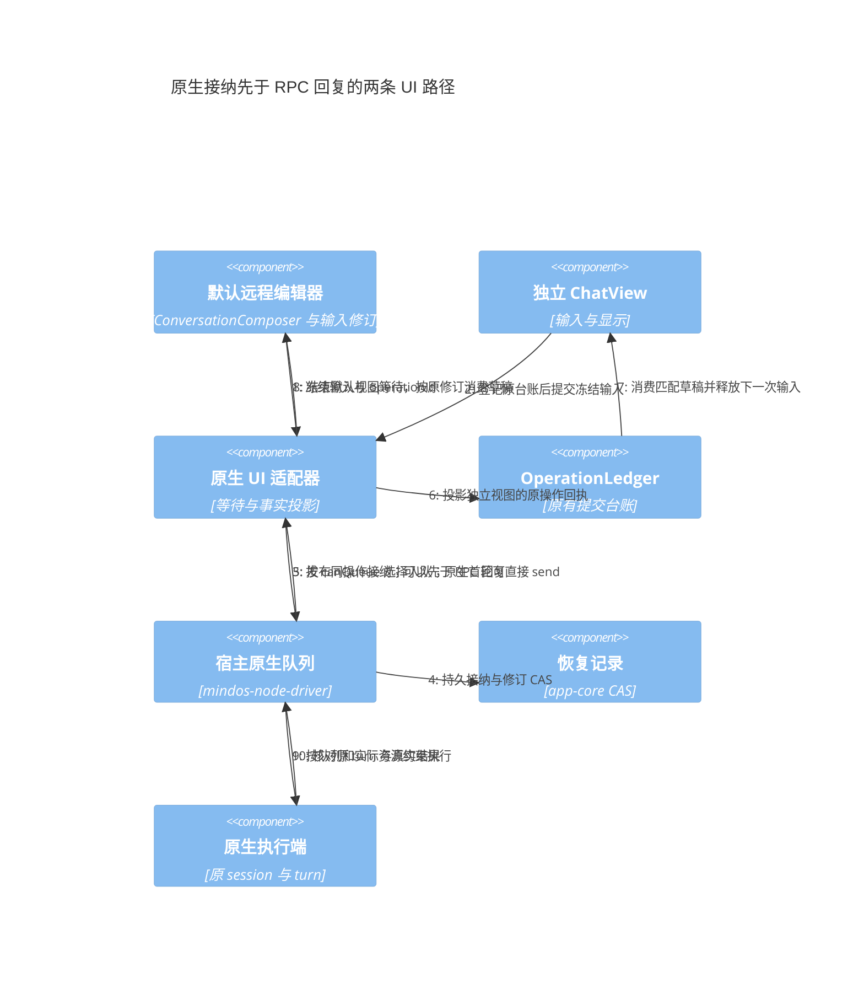

原 RPC 的迟到成功/失败只结束旧调用，不重新消费草稿。以上为原生兼容入口的实际链路，接纳不等于执行完成；本地 Session/Kernel 统一执行与更完整的原生 Invocation 接线继续按其他能力组验收。F24 中原生结果与普通 Task 产物可各自形成展示闭环，但历史容器重构仍须单独通过性能回归。

## 5. 仍未完成，不能按合入拆分掩盖的范围

| 范围 | 当前限制 | 完成条件 |
|---|---|---|
| 严格原生 continue | binding CAS 和 fork 不提供远端条件写保障 | 原生条件写或独占 writer；外部推进及跨 epoch 可核对 |
| Flow Harness worker 的统一输入与上下文 | 消息装配与参数隔离切片已完成；原生 binding 与结构化材料消费仍待完成 | 本地/Harness worker 共用消息构造，普通与 revision worker 已覆盖；继续验证并行、循环、重试的 binding 与资产实例 |
| 无人值守与离线入口 | 人工补参、审批、连接失联策略尚未完全闭环 | 明确等待/超时/拒绝规则，CLI 与父 Flow 共享输入和控制协议 |
| 历史及资产长期生命周期 | 当前增量不等于永久恢复、导出和回收全部完成 | 保留引用、分页与恢复水位，删除/回收边界及持久故障验收 |
| 工作区、项目记忆与初始化 | 上下文 fork 不等于文件系统或记忆隔离 | 初始化按作用域去重，环境/记忆继承明确，报告实际恢复范围 |
| 历史展示扩展与性能覆盖 | DOM 全树扫描退化已由 `642cb67f` 修复；完整工作树同一单项 8.64 秒通过 | 完整调用组、大报告和产物按需加载仍须扩大验收；不通过提高超时掩盖退化 |
| 原生产故障验收 | 本地测试和构建不证明部署版本或原 Session 已恢复 | 核对运行版本及 node 能力，在授权边界内验证队列、查询与控制 |

原有性能对照已补受控方法剖析与同条件修复验证：新增展示扩大了逐消息全历史 DOM 查找的次数。结论限于当前夹具，不能据此证明复杂报告或完整调用树没有额外开销。已有关闭语义夹具修正也不能替代真实进程崩溃测试。

## 6. 交付顺序与结束条件

先合入基础修复、执行存储准备、Kernel/RPC 边界和调度所有权，再分别推进原生队列链、本地目标输入链、binding 链与产物链。依赖不满足时保留候选，不把缺失消费者用空实现补齐。

前期同时铺开跨层修改，后续过细拆分又造成共享文件反复审查和验证，这是积压的主要过程原因。F12 入口合入后，F15/F19 合入后仍有 8 个未完整交付单元，按以下五条依赖链收拢；同批内保留有意义的提交边界，契约与必要消费者一起交付。

| 批次 | 剩余交付单元 | 合入约束 |
|---|---|---|
| 调用身份 | F16 | 平级入口、台账/附件恢复及分支草稿冲突保护已接通；继续完成内部子调用身份及独立子 Session 路由 |
| Harness 资产传输 | F15 已合入 | 文本/图片与显式资产引用传输完成；格式转换、结构化 route 材料扩展及长期回收按第 5 节另行验收 |
| 执行控制 | F17 / F18；F19 已合入 | 控制屏障、长 Effect 审批与清理确认沿用 Kernel 事实；未知结果不释放资源 |
| 原生上下文 | F20 / F21 / F22 | binding、检查点和选择器一致；严格 continue 的原生能力缺口仍须明确保留 |
| 结果与历史 | F23 / F24 | 先贯通产物读取，再处理调用组；匹配夹具的扫描退化已修复，复杂输出仍需按需渲染回归 |

F10 一批包含 46 个文件；其中普通 Agent 入队冻结是发布语义的必要消费者，因为发布新版本不能改变已经接纳的旧请求。文件数不等于未完成功能数：共享文件中仍有其他切片的未提交修改，不能把该文件整个标为完成。

每项记录实际提交、独立验证范围和仍未覆盖的行为。最终集成再运行跨边界组合：发送回执悬挂时入队、暂停时审批到达、取消与完成竞态、分支切换后 fork、完成后历史写入失败、旧远端操作仍执行时接管。只有这些链路闭环后，才能移除被替代的兼容路径并宣告对应目标完成。

本轮补充证据：F04 的隔离 driver 套件 293 通过、2 跳过，宿主套件 893 通过、13 跳过。完整宿主测试后只修正 RPC 测试替身的 subscribe/refresh；候选差异确认生产代码一致，再通过 4 项 RPC 回归与类型检查，未将完整工作树中其他未合入测试计入这些数字。

F09 证据补充：只等待 RPC 的反向候选使两项默认工作台输入回归失败；修复后通过。独立视图真实 DOM 同时覆盖旧回复迟到成功/失败、队列正文编辑的原修订、隐藏/恢复控制与原生历史不伪造。已合入 UI 候选的历史切换单项为 8.56 秒通过，不能据此声称完整工作树的性能退化已经修复。

原生批次以一个连续契约合入 38 个文件，输入批次合入 25 个文件；两者复用既有执行路径，保留各自失败边界。通用字节拼接/摘要核验已移到 utils/verified-content，原生读取不依赖 DAG 产物模块。ProjectConversationPort 从原端口推导命令、取消及分叉参数，只扩展返回投影，降低新增参数在宿主层丢失的风险。Node 源码版本锁定及回归通过仍不代表运行中的 httpd/native 已更新。

F10 的宿主回归覆盖已有发布与首次发布两种情况下，普通 Agent 队列在重启后保持原策略；认证 HTTP 回归覆盖原发布响应悬挂时独立查询持久回执。注入日志抛错的两项回归先复现失败，再验证成功与拒绝均保留原结果。全部功能测试在隔离候选树完成；架构边界、样式与本次 C4 文档检查也在隔离树通过。全量 docs:check 在完整工作树通过，隔离树的全量文档检查因既有文档引用未准备的 CLI 产物、其他工具仓和本地配置而未通过，不将其记为候选树全量文档通过。

本地根调用批次合入 90 个文件，未增加调度器、状态库或 package。Session 保留准入、队列与历史；Context 只提供材料解析端口；CLI 和共享队列面板消费既有应用端口。Session 附件冻结是队列正确执行的必要依赖，已一并合入；宿主通用文件传输和 Harness 资产协议继续保留明确边界。Agent Flow 重跑的双重参数来源、旧编辑响应回退来源信封的两处回归均从失败验证到通过；面板不再将编译图复制给共享编辑器，重复样式已删除。

该批次的隔离完整宿主为 933 通过、13 跳过；CLI 28 项是本次受影响的四个套件，不是 CLI 全量矩阵。真实模型请求覆盖当前与历史附件、上传后变更、冻结副本损坏、缺失必选材料，以及编辑后新引用文件。其历史切换单项 8.651 秒只证明该隔离树没有退化；完整工作树的受控修复见下段，原生产故障仍未验收。API 中已补 Mermaid C4 调用流；默认工作台的目标/台账和完整子调用树仍未标为完成。

B06 的受控诊断先在完整工作树重新复现同一测试 31.08 秒超时；临时方法剖析显示两次恢复中约 25.2 秒用于按消息 ID 查找整段历史 DOM，剖析文件随后删除。修复用消息 Map 代替原 ID Set，统一维护已拥有的包装节点；Flow 窗口及原生别名从现有引用解析，删除先撤销引用再动画。两项归属/动画回归先失败再通过；完整工作树原测试以原 30 秒预算 8.637 秒通过，隔离候选同项为 8.185 秒通过。该修复不依赖未合入的产物模块，也不修改执行事实；独立模块设计中已补 C4 所有权图。F24 继续保留其他输入/展示及生命周期验收，未因性能修复整体关闭。

F13/F14 一批合入 51 个文件。上传身份与内容存储归 app-core，Session/Flow 通过宿主端口核验，UI 只管理选择、观察与上传；复用既有 inputs.seq、队列和 Kernel，不增加状态库或 package。UI 摘要复用 common，删除不必要的 llm-context 依赖。两个正确性缺口均先复现失败再修正：上传在异步持久化前复制调用方字节；队列新派发复验已选材料，损坏时不创建 Task，但原接纳回执仍可查询。API 中补充 C4 流程。

该批次后仍有 220 个待处理路径（其中 78 个未跟踪，排除用户原有的三个路径）；文件数包含共享文件的其他功能增量及设计材料，不能当成功能数。剩余交付单元为 F09d、F12、F15—F24。后台完整套件证据与最终候选的后台源码和测试逐字节一致；后续仅调整既有 UI 上传测试替身、UI 文件来源控件及文档，再通过最终消费者验证。合入不代表部署，原生产 Session 仍未验收。

## 7. 子会话与函数视图的交付安排

2026-10-25 决策：一个 Session 可以关联多个子 Session；独立任务或 Flow 函数调用默认拥有自己的子 Session，每次独立运行分配不同 Session/Invocation。同一子会话的续聊和重跑仍允许多个 Invocation。普通 DAG 节点不逐个创建 Session，组织树与执行控制树分开。完整定义与 C4 见[子会话与函数调用视图](session-invocation-ui.md)。

以下为 F12/F16/F24 内的实施与验收检查项，不增加新的能力组、调度器或存储模块；现有父子 Session 和调用接口仅算基础，不能据此勾选完整功能。

| 检查项 | 归属与前置 | 状态 | 交付及验收条件 |
| --- | --- | --- | --- |
| 会话与调用关联 | F16；Session/app-core | Flow 宿主关联见第 26 节；统一 Agent/Flow 宿主路由见第 37 节；裸 Task 入口仍待实施 | 持久保存原调用者、执行所属 Session、Invocation 及真实根 Task；组织关系不授予控制 |
| 独立调用入口 | F16；F12 平级目标和台账基础已合入 | 独立 Flow 表单已接宿主子 Session 路由及台账（第 28 节）；Agent/Flow 宿主调用端口见第 37 节；CLI 消费见第 38 节；默认工作台和独立 ChatView 已接线（第 40、45 节），裸 Task 入口待统一；普通发送继续在当前 Session | 同 Flow 两次独立运行获得不同子 Session；同请求丢回复/重启返回同一子 Session；父子不重复入队 |
| 最小函数调用组 | F24 基础；依赖 F16/F23 | 输入、摘要、按需产物及控制已接线（第 40—45、49—51 节）；审批/补参卡片已接线（第 55 节）；整树清理与未提交交互草稿的重开恢复仍待完成 | 默认输入、状态、最终 value/artifacts；原 Invocation 稳定定位；审批、补参、失败及清理状态可见 |
| 打开真实子会话 | F24 基础；依赖明确的 Session 关联 | Flow 调用卡片与统一 Agent/Flow 调用组均已接线（第 27、40、45 节）；裸 Task 入口仍待实施 | 打开既有 Session UI，不重跑、不复制历史；关闭观察不取消后台执行；不支持时不伪造入口 |
| 高级会话详情 | F24 增强；在基础入口后扩展 | 后续增强；不阻塞最小函数视图交付 | 内嵌会话、完整节点/循环/尝试树、搜索与大历史分页，展开才加载 renderer |
| 组合回归 | F09d/F12/F16/F17/F24 | 待完成 | 分支切换后核对原提交不消费新草稿；父取消只覆盖受管理调用；详情读取失败不改执行终态 |

本地目标/台账链已由 `630455b4` 合入 50 个文件；不增加 package 或状态库。三个回归先失败再通过：相同队列 ID 的实参冲突、旧接纳消费另一分支附件、核对期间接纳通知丢失。独立视图将原 Session/分支请求保存到同一台账，重开另一观察绑定仍查原请求；默认工作台支持首个发送回复悬挂时继续入队。参数详情及重跑复用原历史与 Flow 表单，不依赖未合入的产物或原生上下文模块。

本批次后剩余 191 个待处理路径（其中 68 个未跟踪，排除用户原有三个路径），包括其他功能的共享文件增量和设计材料。适配层 156、相关 UI 146、项目草稿 16 项在隔离源码候选通过，四包类型、构建及架构/样式通过，历史切换单项保持原 30 秒预算并以 8.201 秒通过。最终候选仅做空白格式及三份文档补充，源码忽略空白比较一致，再检查最终类型、C4、链接及 diff；完整工作树 docs:check 通过。当前的完整附件崩溃消费、独立子 Session、函数调用组和原生产故障验收仍未完成。


## 9. 已保存附件草稿的恢复增量

本次附件恢复批次沿用 F09d、F13 的已有台账和 Session assets：分支草稿保存 token、文件引用及摘要，项目/原生兼容草稿复用同一编解码；发送前先等待保存。恢复保留逻辑 File ID，Flow 查询原上传回执，原提交仅只读核对；旧接纳不消费新文字、重选参数或同名同大小新文件。设置保存时间不作为用户输入变化。已接纳但清空草稿写入失败，重开仍能匹配消费。

隔离候选已通过适配层 161 项、相关 UI 202 项（其中真实工作台故障恢复 4 项）、三个包类型、适配包构建、目录边界、UUID 和样式检查。新增回归验证坏摘要、缺失文件、空文件、保存失败不派发，以及安全诊断；项目首次草稿与原生编辑器同时回归。普通输入保留延迟保存窗口，本保证针对发送前已确认保存的草稿。

该批次留下的台账整组覆盖问题由第 10 节的条件合并处理；同分支草稿冲突继续开放，不能以单工作台重开测试证明所有跨客户端一致性。独立子 Session 路由、函数调用组、上下文与控制链、产物详情及原生产 Session 验收继续按前述安排实施；本批次不部署或操作原故障 Session。


## 10. 多视图台账合并增量

独立 llm-ui 提供纯记录合并与实际持久快照发布；宿主 UI 用 Session 原有修订条件保存，后端不解释 OperationRecord。原操作已接纳、拒绝或未知时不再派发。丢写回执通过只读核对确认，八次修订冲突后明确保留错误，不降级为无条件覆盖。原普通 UI patch 接口保留，新增条件写入通过独立方法及真实 RPC 开放，避免旧宿主忽略附加参数。

独立库 107、隔离适配层 172、完整 Session 436、相关工作台 67、认证 HTTP 23 项通过；类型、构建与边界检查覆盖锁定后的消费者。回归包含冻结输入与终态冲突、两个真实工作台的独立提交、HTTP 陈旧修订拒绝、落盘后丢回复、日志故障及正文不泄漏。该批次留下的同分支草稿并发写入与旧接纳清空冲突，由第 11 节的基线保护与显式恢复补齐。独立子 Session、函数调用视图及其余执行链仍待完成。


## 11. 展示与存储边界、草稿冲突闭环

llm-ui 只负责显示、输入编辑与控制请求；临时编辑状态和读缓存留在界面，MindOS 的持久数据经宿主端口写入既有 VFS/SessionRepository，执行事实继续归 Kernel。独立库不绑定文件系统实现。适配层负责 DTO、浏览器文件编解码与恢复交互，不建立新的执行状态库。职责及 C4 见[独立模块的数据边界](llm-ui-independent-module.md#展示输入控制与持久数据边界)。

本批补全 F09d 的同分支草稿基线、冲突提示及加载/替换动作；持久输入与基线不符时不覆盖正文、参数或附件。替换仍校验所显示的冲突快照，加载中的编辑和隐藏会阻止迟到恢复，读取失败不能当作空草稿。偏好写入在草稿条件检查后进行，发送前核对草稿；恢复动作不派发业务调用。

本次隔离源码候选的适配层 180、相关工作台 97、认证 HTTP 23 项及类型、构建/边界通过；另补隐藏时加载的组合回归。F09a—d 的已定义接线与恢复切片可按本批合入，剩余交付单元为 F15—F24 共十项；原生产故障 Session、实际部署、长期资产回收、无人值守和更复杂输入输出等跨能力验收仍按原清单推进。

## 12. 结构化 Harness 消息装配审查切片

发现 route worker 只对本地 LLM 组装消息，Harness 落入普通参数合并分支，会丢失本轮指令，并允许同名业务参数覆盖连接快照。修复集中在 llm-flow 的结构化调用构造层，以共用 Program 分类和隔离输入函数消除两处判定差异；不向 UI、宿主传输层或 Kernel 下沉 Flow 模板规则。流程及模块边界见 [Flow 能力与输出](./flow-capabilities-and-output.md#结构化-harness-worker-的输入边界)。

验收覆盖本地 Agent/Chat 兼容、Harness 连接不可被实参覆盖、声明历史、输出约束、真实 builtin.agent/TaskFactory 路径及 revision worker。该切片独立于尚未合入的子 Invocation、控制树和原生 binding；F15 的附件传输及十项剩余交付单元仍未整体完成。

隔离候选验证：llm-flow 全部 674 项测试及类型检查通过；两份文档的 4 个 Mermaid 图与 17 个本地链接通过解析/存在性检查。未运行真实远端模型，未部署或重启服务。

## 13. F15 附件传输与后续可审查候选

F15 以冻结消息/资产引用 → HarnessProgram → 授权 TaskAssetReader → 原生附件协议组成完整功能；复用现有队列、journal、存储和取消链，不需要先合入 F19 的新取消结果类型或 F20 的 binding。普通 Session、Flow 上传参数、同 Flow 的 Tool 文件转交与队列编辑都包含实际消费者测试。模块职责及 C4 见 [不可变附件的执行传输](./remote-harness-connections.md#不可变附件的执行传输)。

下表的“可继续审查”只表示实现可抽取为下一候选，不能代替隔离验证和提交。不能仅凭文件已写好就批量合入。

| 顺序 | 候选 | 当前可抽取范围 | 尚需确认的边界 |
|---|---|---|---|
| 1 | F19 | Connection 取消/核对事实到 Effect 的映射，宿主清理证据及日志 | unknown/cleaning 不得正常返回并确认释放；剥离 binding 清理增量 |
| 2 | F16 的调用身份切片 | 节点、循环、动态 worker 的持久调用关联及只读投影 | 内部重试保持身份，旧运行指纹兼容；独立子 Session 路由仍未完成 |
| 3 | F17 / F18 | 根/子调用控制屏障、暂停时审批转发准入 | 实际 Kernel 事务和动态子任务覆盖，独立控制回执与 UI 接线 |
| 4 | F20 / F21 / F22 | binding、检查点 fork、上下文目录及选择器 | 依赖身份与清理事实；严格 continue 缺少原生条件写保障，不能宣称完成 |
| 5 | F23，随后 F24 | 产物归属读取/RPC，再接按需展示 | F16 的身份归属；函数调用组和真实子 Session 导航不能用空入口替代 |

本批完成后，剩余能力组为 F16—F24 共九项。子 Session 创建/路由、结构化 worker 的多模态材料与 binding、严格 continue、无人值守及原生产 Session 部署验收仍按第 5、7 节推进。

验证记录：宿主默认并发全套有一项 IndexedDB 批量兼容测试超过原 5 秒预算；单独同预算约 1.8 秒通过，限制为两个 worker 后全套 970 项通过、13 项显式 live 跳过。它使用 fake-indexeddb 验证浏览器后端兼容性，不连接 httpd；资源竞争只是基于对照结果的推测，未做 CPU/GC 归因。Kernel adapters 330 项、Session 436 项、相关 Flow 21 项、三包类型、构建和架构检查通过。最终另补 Task 资产错误分类及包装后的权限/缺失原因回归；均保留旧错误消息，只增加安全错误码，不引入产物目录模块。

最终错误分类增量验证：Kernel adapters 335 项、宿主 Harness 27 项及两包类型、adapter 构建通过；C4/链接和 diff 检查通过。其他生产源码与上述全套通过候选保持一致。

## 14. F19 取消事实桥与本地释放故障

本批只交付 Connection 事实与既有 Effect/Kernel 的适配：归属证据不符、unknown 或仍在清理不能转成成功取消；running 不映射为再次执行。真实 Runtime 的取消同时核对持久原生终态、连接释放及 Kernel stopped/settled；取消与完成竞态保留远端真实 completed 事实。租约丢失在打开清理 Session 前拒绝，每次 journal 读写仍复验。

审查发现并复现两个释放故障：关闭失败后下一次取消没有重试原连接；持续关闭失败时却返回 cleanup confirmed。现已由宿主保存原 Effect 的失败关闭句柄，关闭成功前保持清理未确认；同时修复连接 release 永久缓存失败 Promise 的问题。此机制不接管原生执行状态，不新增 package、调度器或持久状态库。职责及 C4 见 [Connection 取消和核对事实桥](./remote-harness-connections.md#connection-取消和核对事实桥)。

下一批优先 F16 的调用身份与只读投影；其独立子 Session 路由尚未完成。随后 F17/F18 控制屏障、F20—F22 上下文、F23/F24 产物展示。当前剩余 F16—F18、F20—F24 共八个能力组；第 13 节候选顺序中的 F19 已由本节交付。

隔离候选验证：宿主全套 987 项通过、13 项显式 live 跳过（两个 worker，原超时不变）；Kernel adapters 362 项、Session 436 项通过。三包类型、adapter 构建和架构检查通过；5 个 Mermaid 图及 15 个本地链接检查通过。未部署、未重启服务，也未用本地夹具替代原生产 Session 验收。

## 15. F16 调用身份与只读投影切片

本批在 llm-flow 内补齐节点、循环实例和结构化 worker 的 Invocation 关联。子身份由父调用、节点或派发键、业务轮次确定；Kernel Task ID、内部尝试和图恢复代次不参与身份计算。用户重新运行使用新的根 Invocation；内部 Task 重试保留原调用关联。旧 Run 不补写新身份协议，恢复时检查 checkpoint 与根输入中冻结的协议版本一致，避免已接纳 Task 的请求指纹变化。

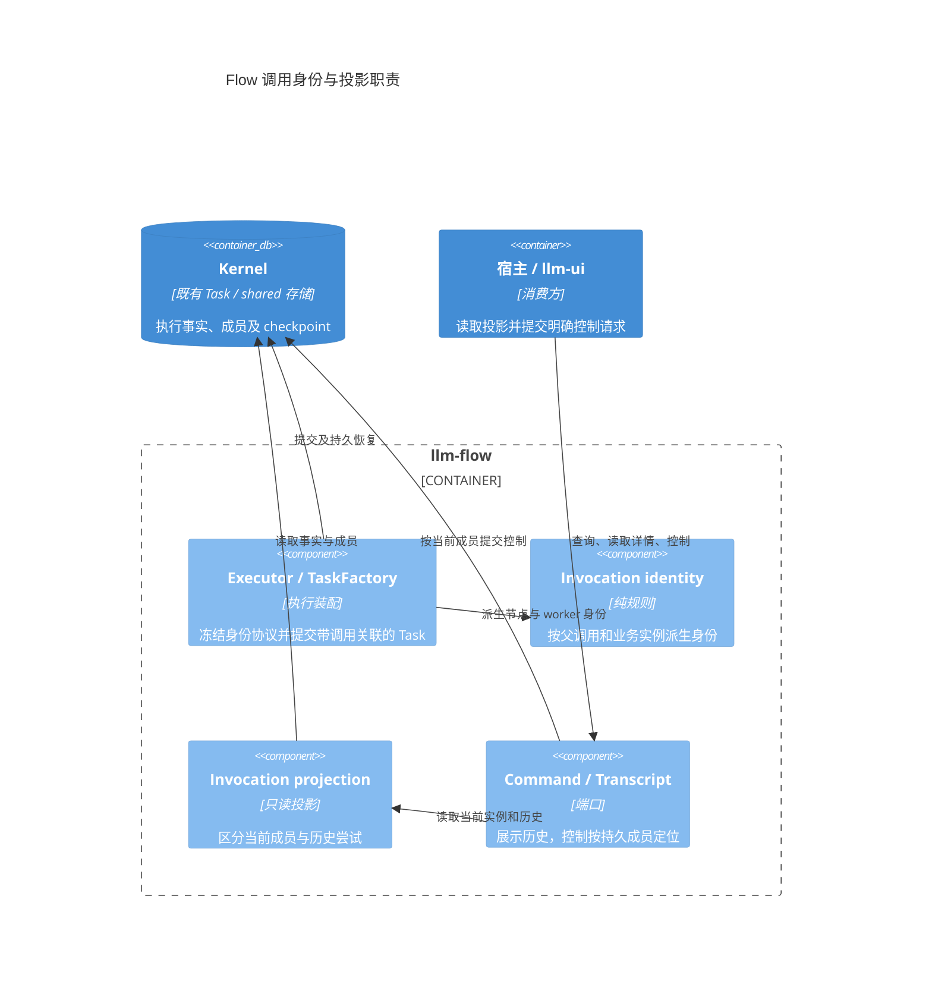

身份规则属于 Flow 调用装配，不应放在暂停屏障或 UI。投影只组合既有 Task、成员和标签，不增加状态库或 Session 存储。相同轮次的替代成员以持久成员记录为准，不能被进程内旧 handle 覆盖；历史可包含已替换尝试，但显示缓存不扩大控制范围。取消、信号、回答及原有暂停/恢复路径均不得仅凭历史缓存选择目标。

这里的“当前成员”是既有持久成员及重试成员契约，不表示已完成终态重试准入、控制树或原子暂停屏障迁移。跨操作竞态和动态子调用控制仍由 F17/F18 补齐；只读快照不成为控制事务。独立子 Session 的创建/路由、函数调用视图仍未完成，因此 F16 只合入本切片，剩余能力组仍为八项。

隔离源码候选验证：Flow 682 项、Session 436 项通过；Flow、Session、app-core 类型检查通过。专项回归覆盖旧指纹恢复、冻结身份协议不匹配拒绝、同轮替代成员投影、旧成员控制拒绝及历史详情仍可读。未部署、未重启，未宣称完成原生产 Session 验收。

## 16. F17 Flow 根控制屏障切片

新 Run 冻结 `controlTreeVersion=1`，节点以根 Task 为控制父级，结构化 worker 延续既有 Kernel 父子链。暂停/恢复操作只改变根控制，成员自己的暂停和 Session 暂停仍独立有效。调度前等待用于减少无效提交；真正阻止暂停后新增子任务的是 Kernel 提交事务。Flow 不另建控制状态库，也不通过遍历 UI 缓存模拟树级暂停。

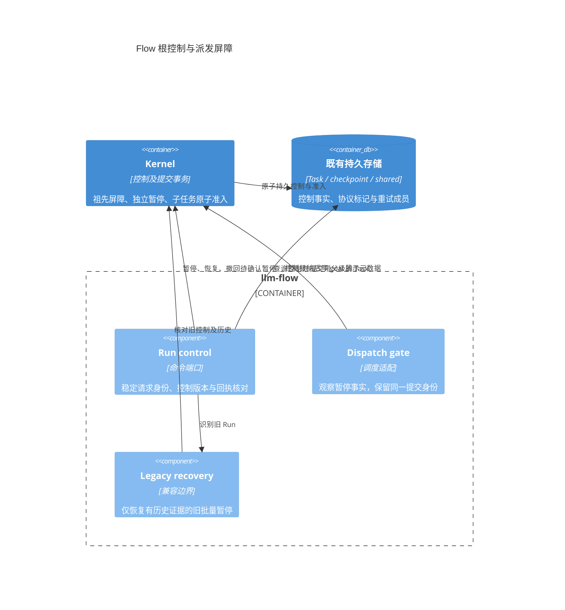

控制接纳和实际暂停确认是不同事实；goal 只是兼容展示元数据，不能替代 Task 控制事实。goal 写入失败后使用原 requestId 核对；已被新控制覆盖的旧回执不能再次改写 goal。撤回尚未确认的暂停要求已观察的控制 epoch，不等于恢复被取消的调用。旧 Run 不补写新父级或改变提交指纹；拒绝新建 Run 级暂停，仅允许有前态证据的有限恢复，不能证明的成员继续保持暂停。

内部重试归属原根，已接纳的请求可核对；新重试拒绝终态根，用户重新运行须创建新 Invocation。重试模式和来源参与冲突检查。根在延迟启动前终结时取消尚未执行的尝试。join-detached 仅表示不等待结果，不自动脱离控制所有权。

审查发现待合入代码恢复了按历史缓存取消的旧路径；新增真实 Kernel 回归先复现失败，再恢复按持久成员定位。根取消仍由 Kernel 传播到已有控制子树，历史缓存不额外授权目标。派发等待的日志失败不得中断执行，诊断不记录输入正文。

本批仅交付 Flow 层及其与已锁定 Kernel 的接线。F17 的 UI 控制回执/按钮接线、F18 Harness 审批转发与暂停能力尚未交付，不能据此宣称远端原生 Agent 已暂停。F16 子 Session 路由及 F20—F24 保留原安排，剩余能力组仍为八项。

隔离验证：Flow 710 项、Session 436 项及 Flow/Session/app-core 类型检查通过；7 个 Mermaid 图、15 个本地链接通过校验。取消历史缓存回归先失败后通过；原生远端与 UI 端到端验收不包含在本批内。未部署、未重启。


## 17. F18 长活 Harness Effect 的审批转发准入

本批连接既有 Kernel `EffectSessionState.setIfRunning` 与宿主 native operation journal。审批回答保存和远端转发分开：新的 respond 操作必须在检查 Session/Task/祖先控制的同一事务中写入 pending 身份；遇到暂停只返回 held，不新增 pending，也不把等待当作结果未知。恢复或撤回待确认暂停后沿用同一操作身份。

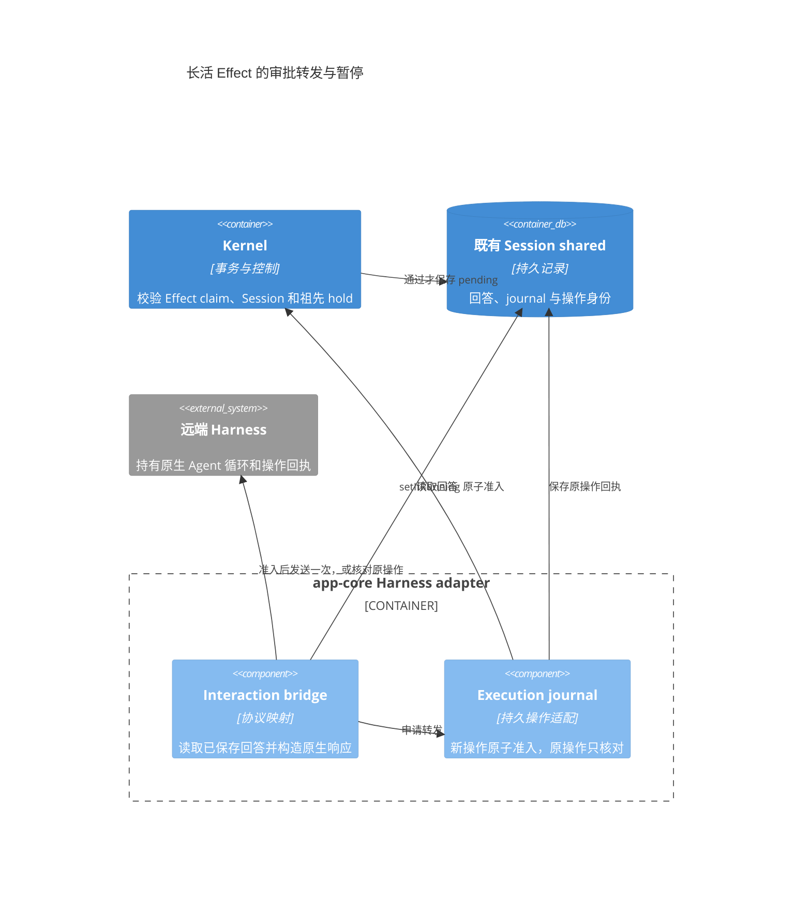

原子准入是排序点，不是远程暂停确认：先准入的操作可能在随后暂停期间完成，不能声称远端已停止工具循环。已保存 pending 的操作只查询原回执，不因当前暂停重新发送；unknown 保留待核对事实。取消或失去 Effect claim 会阻止迟到的新准入。缺失原子端口时明确报 `NATIVE_CONTINUATION_GUARD_UNAVAILABLE`，不能退化为先查状态再普通写入。

模块放置：Kernel 继续拥有通用原子控制检查，宿主 adapter 负责 native requestId、journal 和协议响应；Flow、Session UI 不实现远端转发规则。本批不引入 binding/fork 修改，不新增存储。held/committed 诊断复用 Effect 事件通道并按操作去重，不能记录回答或消息正文。

F18 此项完成后，剩余 F16/F17/F20/F21/F22/F23/F24 共七个能力组；F16/F17 已交付切片与未完成部分以主表为准。原生产 Session、真实远端与 UI 端到端验收继续单列，不能以本地原生协议夹具代替。

隔离候选验证：宿主全套 999 项通过、13 项真实环境测试显式跳过（两个 worker，未放宽超时）；app-core 类型检查通过。专项覆盖缺失原子端口、暂停与回答读取竞态、祖先/Session 屏障、先准入后暂停、取消迟到回答、原操作未知结果及日志不泄漏回答。8 个 Mermaid 图、15 个本地链接与 diff 检查通过；未部署或重启。

## 18. F17 调用卡片与 DAG 控制视图切片

调用卡片按根控制、当前成员集合和 Kernel 停止事实生成按钮。`DurableFlowSnapshot.controlStats` 是后端对同批 Task 调用 `taskStat` 的只读投影，不新增执行状态；UI 不复制 Kernel 的 stopped 算法。成员或统计缺失时不能确认整个调用已暂停。暂停待确认允许撤回请求，已确认暂停才允许恢复；Session/祖先 hold 不因恢复本调用而解除。宿主调度重挂与解除暂停使用不同入口。

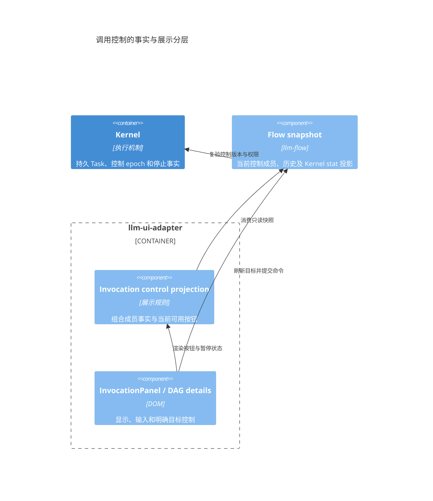

暂停、恢复、撤回在当前视图内按目标、动作、已观察 epoch 复用 requestId；逐 token 版本变化不重建按钮，也不改变控制版本。响应丢失后以真实 Task 控制刷新展示，迟到 goal 元数据不能反转状态。每种动作独立限制重复点击，悬挂的暂停响应不能禁用取消。隐藏或销毁使原视图的待发控制失效。

审查回归先复现了两项错误：历史成员的旧审批误显示为当前等待，以及隐藏后仍发送迟到取消。修复后审批展示、状态摘要和提交前核对均使用当前控制成员；历史详情仍可读取。DAG 控制入口同样限制成员归属，终态根不提供节点重试；调用卡片重新运行保留 retryOf 关联并创建新 Invocation。

本批是 UI 展示与控制接线，不宣称跨视图重建持久控制台账已经完成。CLI 没有现成的专用 Flow 暂停/撤回入口，仍需明确命令及回执恢复契约；F17 因此仍保留未完成项。F16 子 Session 路由、F20—F24 与原生产 Session 验收继续按主表推进。

隔离候选验证：Flow 全套 710 项、相关工作台 60 项、适配层全套 180 项通过；Flow/适配层类型检查与适配层构建通过。旧审批及迟到取消两项回归先失败后通过；冻结控制身份、终态重跑、真实 Kernel 暂停中回答、宿主重启和未知回复均有覆盖。未部署或重启。

## 19. F17 CLI 显式控制入口

`flow-run` 将应用 Session/根 Task 定位与离线 run-id 分开，暂停、恢复、撤回暂停均要求调用方提供稳定 requestId 和观察到的 epoch；取消与调度重挂独立。参数校验先于命令查询，目标查询失败不提交控制。所有执行走既有 ApplicationClient/FlowCommand，本地和 HTTP 仅由宿主选择传输。

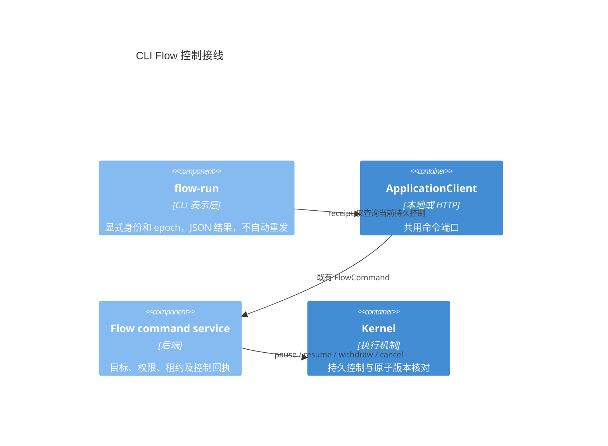

receipt 只在当前控制身份匹配时返回 observed，保留 acknowledged/stopped 事实；身份不匹配返回 unknown，不推断未执行、不查询后触发重发。调用方可保存原参数跨 CLI 进程继续核对，但完整历史回执查询和 UI 跨视图持久控制台账仍未完成，F17 不整体标为完成。命令及本地宿主生命周期说明见 [Flow 控制 CLI](../http-mode.md#flow-调用控制-cli)。

隔离验证：CLI 专项与本地应用客户端共 17 项通过，CLI 类型、构建和架构检查通过，10 个 Mermaid 图及 16 个本地链接通过。真实 Kernel 夹具覆盖原身份核对、同请求重试、陈旧 epoch 拒绝与取消；未运行生产远端控制、未部署或重启。

## 20. F17 原控制接纳记录的只读查询

复用 Kernel 已有 `control/<requestId>` 回执，不另建应用台账、不改变旧写入或去重指纹。Kernel 冷查询返回原 action、expectedEpoch、accepted 控制，以及独立 current 控制；原暂停未确认的事实不会被后来的恢复或撤回重写。查询不返回请求 fingerprint 或信号正文，不开启执行 Session、不提交控制、不唤醒调度。

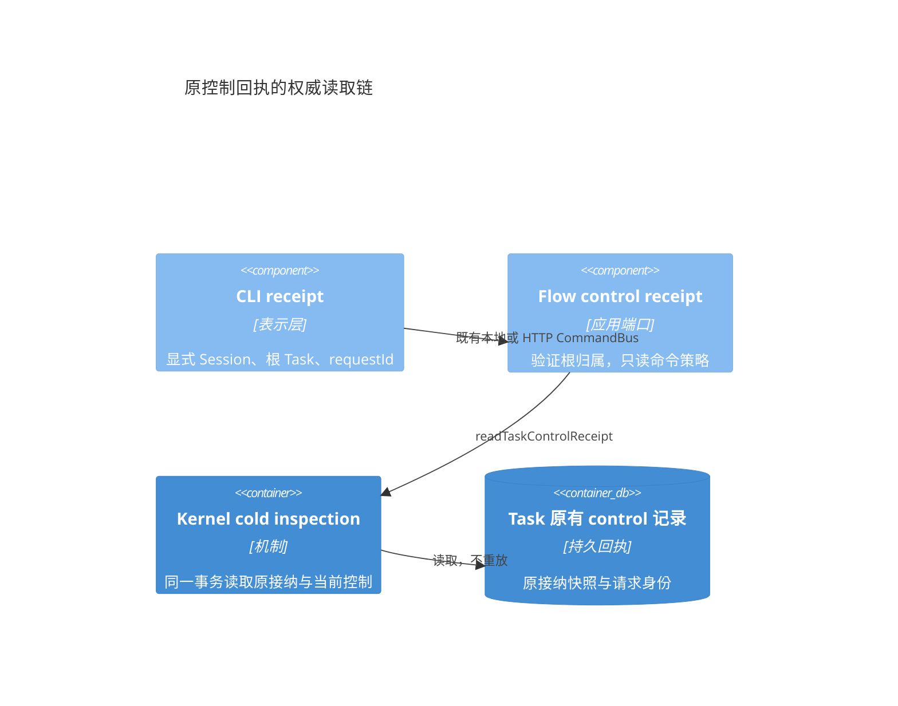

CLI receipt 升级为原记录查询，替代第 19 节仅核对当前身份的限制；原 Task 已终结或控制已被覆盖仍可 observed。缺失保留记录只返回 unknown，不推断从未接纳。accepted 是历史接纳证据，current 是当前观察，二者都不能单独替代当前整棵树的停止统计。

F17 的 Kernel/Flow/CLI 历史查询链在本批交付；UI 跨视图持久控制请求与核对恢复仍未完成。认证 RPC 验收同时覆盖暂停、暂停中回答、陈旧 epoch 拒绝、完成后读取旧回执、错误 Session 拒绝、查询不改 Task 版本和队列，以及审计不泄漏消息/回答。

验证：Kernel 单元 368 项，补充接口契约 22 项及类型、构建、独立 ESM/CJS/声明消费通过；隔离 Flow 710 项、CLI 13 项、认证 HTTP 24 项通过。Flow/CLI/HTTP 类型、架构和 11 个 Mermaid 图、16 个本地链接检查通过。Kernel 提交 `8bb4606`，宿主同步锁定；无部署、重启或生产控制操作。

## 21. F17 调用卡片的持久控制与跨视图核对

暂停、恢复和撤回暂停沿用 Session UI 的 OperationLedger，注册成功后才发送。冻结输入只含协议标记、根 Task、动作和观察到的 epoch；Session/Task/动作/epoch 确定稳定 operationId，同一控制在多个视图使用相同身份并由既有条件合并保存。它是用户操作意图，不是第二套执行状态；执行接纳仍以 Kernel 回执为准。

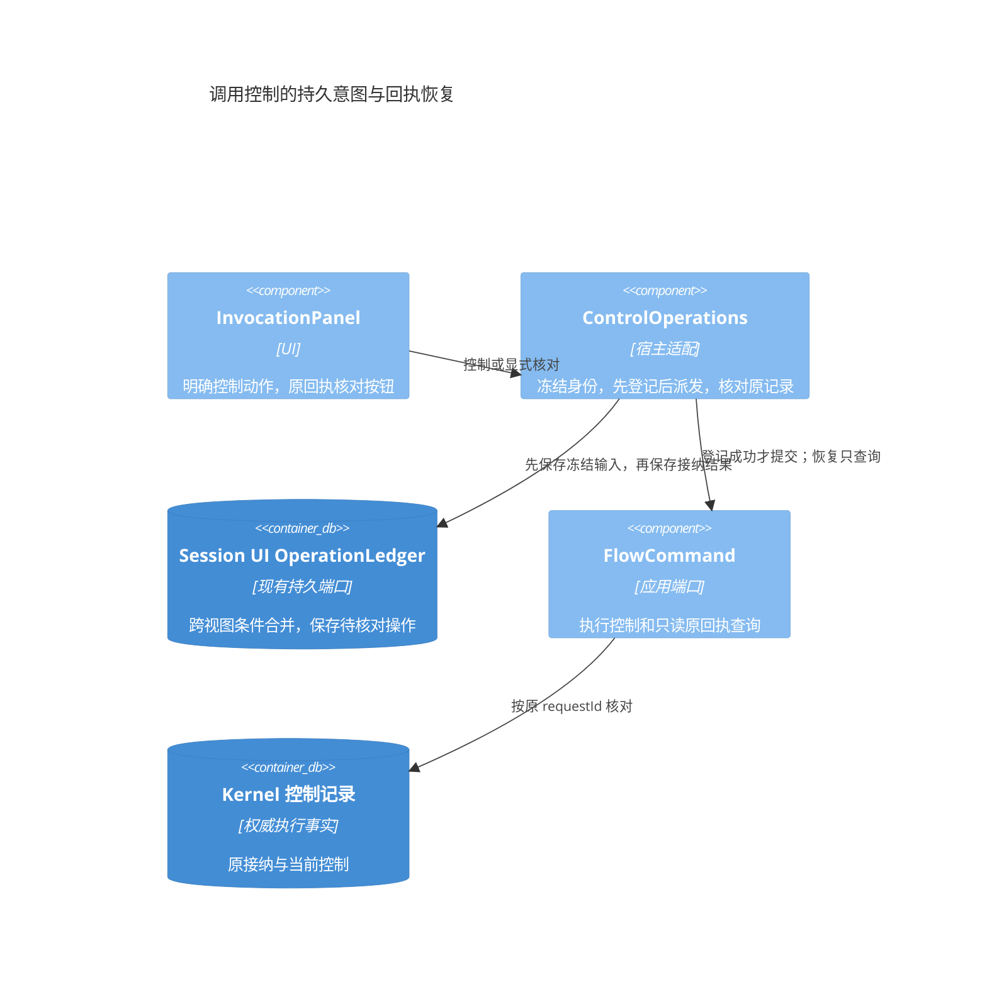

重新打开显示原操作的核对入口，不自动重发。缺失回执保持 unknown；请求、动作或 epoch 不匹配不能标记 accepted。用户明确再次点击相同动作时可使用原身份重试，Kernel 继续负责幂等和陈旧 epoch 拒绝。远端已接纳但本地结果写入失败时，保留登记记录供下次查询。存储失败不能先发送，登记期间关闭视图也不能迟到派发。取消保持独立，不受待核对暂停阻塞。

独立 Session ChatView 的核对优先识别此协议，不能误路由到 composer 命令或消息提交核对；不会清理聊天草稿，也不会伪造历史消息。默认工作台注入现有持久 ledger；直接嵌入 InvocationPanel 的宿主若需要跨视图恢复，也必须提供持久 operations 端口。

本批补齐调用卡片链路，但审查发现旧 DAG Goal 编辑器仍可用 status 字段触发执行控制，尚需收敛到同一控制入口。F17 保留该迁移与组合验收项；F16、F20—F24 仍按原计划推进，不将整个实施目标标为完成。

验证：隔离候选适配层 187 项、UI 控制/调用/轮询/提交核对 57 项通过，适配层类型检查及 12 个 Mermaid 图、16 个本地链接检查通过。同批生产代码已通过构建和架构检查；新增回归覆盖接纳后本地回执保存失败、登记期间关闭视图，以及并发视图通过既有 CAS 保存同一操作。无部署、重启或生产控制操作。

## 22. F17 Goal 文字编辑与执行控制分离

旧 DAG Goal 对话框保存文字时总会发送 status（默认 active），后端将 active/paused 映射为执行控制。因此文字编辑可能意外恢复执行。编辑器改为仅发送 objective，并显式携带原 Session/根 Task；不将目标元数据解释为用户的暂停、恢复或完成意图。后端既有部分字段更新机制无需新增存储或调度器。

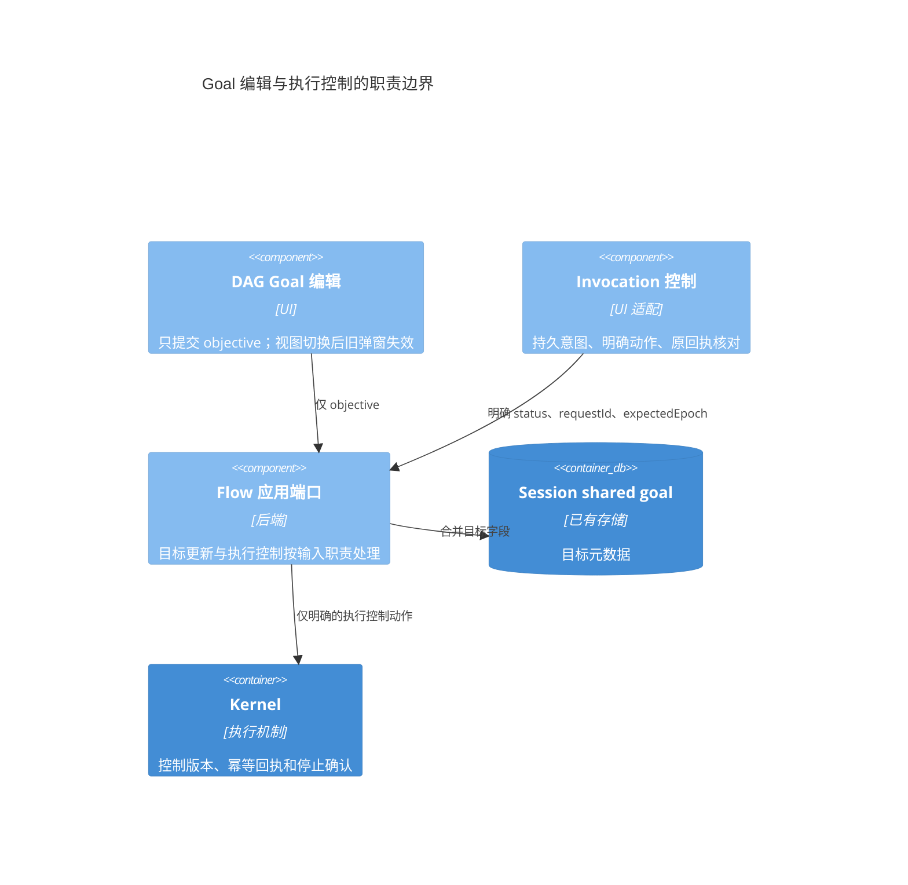

关闭视图或切换运行后，不提交旧 Goal 弹窗；已经发出的保存仍可完成，但迟到回复不刷新或覆盖新视图。独立 DAG 运行页的暂停/恢复/撤回按钮与持久 operations 注入仍需接到统一控制链，本节不将移除隐式入口等同于完成该迁移，F17 保留未完成状态。

验证：新增行为先在旧实现复现 3 项失败；隔离候选 DAG 与调用控制共 55 项通过，适配层类型检查、13 个 Mermaid 图及 16 个本地链接通过。覆盖保存失败的具体提示、切换/销毁后禁止提交、迟到保存不刷新旧运行。仅提交本节对应修改，其他未完成产物代码保留。

## 23. F17 独立 DAG 页共用持久控制协议

调用卡片与独立 DAG 运行页共用 `FlowRunControl`：注册冻结意图后读取最新执行事实，核对 epoch/能力/停止确认；需要重挂时先重挂并再次核对，最后提交明确控制。生命周期检查贯穿登记、查询和重挂，旧视图不能继续派发。共同的诊断日志保留 operationId、阶段、结果分类和耗时，不记录目标文字或参数。

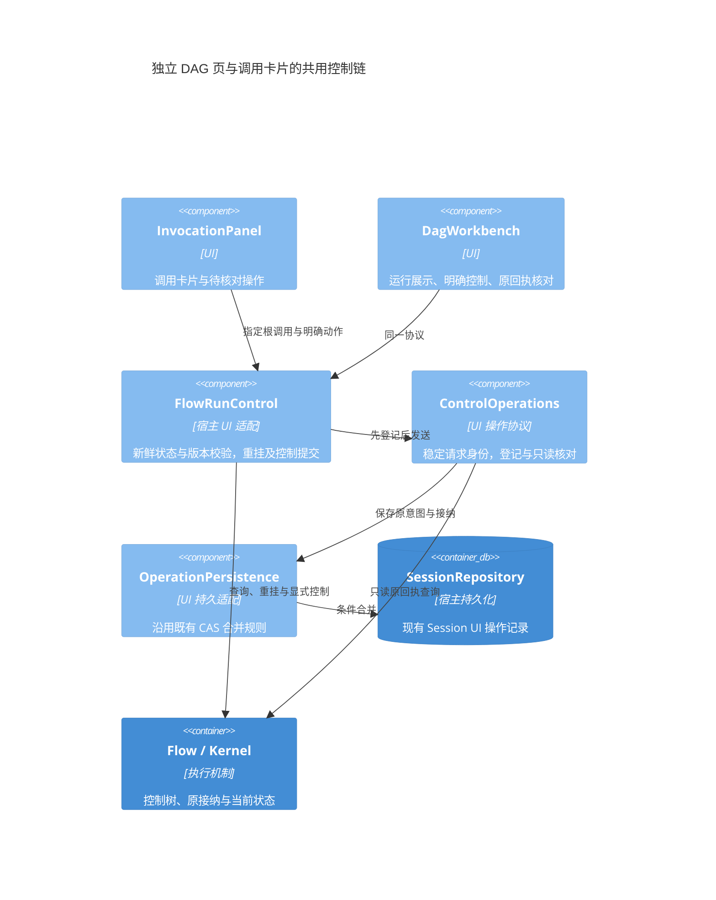

宿主 bootstrap 将已有 SessionRepository 注入 FlowsEditor；打开某个 Run 时读取该 Session 台账，重开继续核对原记录，恢复过程不重发控制。缺少持久端口的直接嵌入者不启用新增暂停/恢复操作；只读详情不读写台账。台账读取失败保留具体原因，同时仍显示运行和独立取消入口，不能把读取失败当成空台账继续发送。隐藏、切换或关闭使在途视图操作失效；已发送操作保留真实持久结果。

本节完成独立 DAG 页的控制接线，不增加调度器、状态库或 package。F17 仍保留跨边界组合验收；F16 子 Session 路由与 F20—F24、真实远端和原生产 Session 验收继续按主表推进。

验证：隔离候选 UI 控制、DAG 重试/视图竞态、调用与参数入口共 92 项，适配层 187 项通过；适配层与 app-shell 类型检查通过。同批构建和架构边界检查通过，最终补充的重挂/恢复显示区别另经回归与类型验证；14 个 Mermaid 图及 16 个本地链接通过。真实 Kernel 调用回归沿用原控制屏障，新增独立页回归覆盖持久端口接线、未知回执、陈旧 epoch、登记时隐藏/销毁、台账读失败仍可取消及只读详情不访问台账。未部署或操作生产 Session。

## 24. F17 执行、台账和视图的组合验收

新增验收使用真实 Kernel、FlowInvocationService、DagCommandService、SessionRepository 和 FlowsEditor，底层为隔离 VFS MemoryBackend。它不是模拟控制状态，也不表示物理磁盘崩溃恢复或生产环境验收。仅在真实暂停命令返回后注入响应丢失，重新创建仓储与 UI，读取原持久操作并查询 Kernel 原回执；核对期间 RunGoalUpdate 次数保持一次。

| 组合边界 | 验证证据 |
|---|---|
| 暂停已接纳但 UI 未收到回复 | Session 台账保留 unknown；重开通过原 operationId 核对为 accepted，不重发 |
| 一个调用暂停、另一调用等待输入 | 回答另一调用后它独立成功；被暂停根仍无终态 |
| 暂停期间保存回答 | 回答被持久接纳，根仍 stopped；显式恢复后成功 |
| 保存回答后取消暂停调用 | 根实际 cancelled；另一已成功调用不变；旧暂停回执仍可读取 |
| 动态子任务、Session/祖先 hold、重试与宿主恢复 | 隔离执行现有 flow-control-barriers 22 项，保留控制成员和原身份边界 |
| HTTP 队列、审批和控制分离 | 认证 view-api 24 项，包含陈旧 epoch 拒绝、原控制回执查询和敏感内容不进审计 |

本批 UI 真实执行与独立 DAG 控制共 17 项、Flow 屏障 22 项、认证 HTTP 24 项及 app-shell 类型检查通过。主实现与 C4 沿用第 23 节，无新增机制模块。F17 的代码交付和本地/认证 RPC 隔离组合门槛完成；生产原 Session、实际远端工具循环和部署后端到端验收仍单列，不能用此结果替代。后续实现重点为 F16 子 Session 路由与 F20—F24，共六个能力组；其涉及上下文、产物和历史的最终组合验证仍保留。

## 25. F16 路由实施前的调用恢复索引修复

审查子 Session 链路发现既有 `flow-invocations.json` 索引先更新内存 Set、后写文件。写入失败后，同进程重试会因 Set 已含 Session 而跳过写入；旧索引仍缺少该 Session，重启恢复可能跳过真实调用。这是 Session 持久化缓存发布顺序的问题，不属于 UI 路由或 Flow 调度策略。

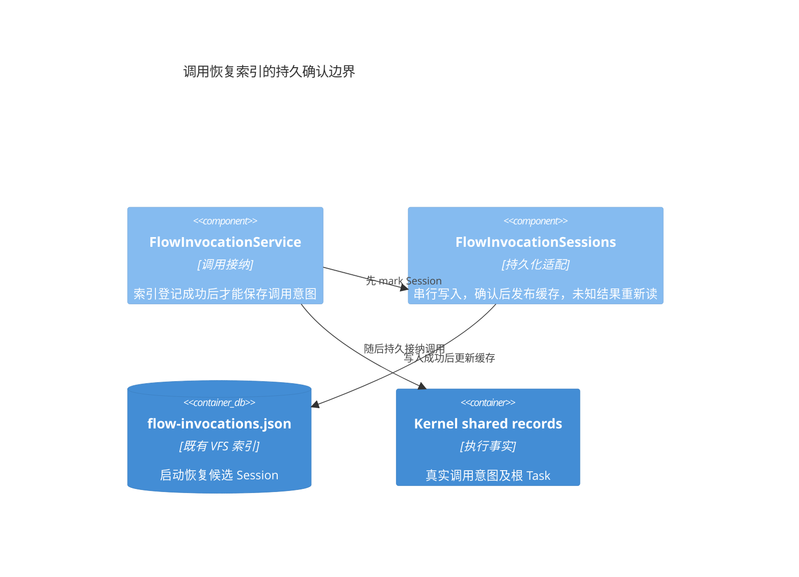

修复按副本构造候选集合，写入成功后才发布缓存；失败保留原错误并使缓存失效，后续重读确认文件。已写入但回复丢失的情况也通过重读核对，不盲目重复写入。仍使用现有串行写队列和索引文件，不把优化索引变成新的执行状态库。调用接纳失败沿用既有 traceAdmission 的 requestId/Session、阶段、错误码和耗时日志。

本批只修复这一已复现的恢复缺口；F16 的统一独立子 Session 路由、持久调用者关联和函数视图仍未交付。现有 UI 的 create-child 再 invoke 两步流程不能作为完整统一接纳协议，下一步仍须收敛到宿主调用入口，不能仅修改默认下拉框。

验证：首次创建、已有索引追加、扫描结果写入三个故障先在旧实现失败；修复后新增四项回归（含已写入丢回复）通过。隔离 Session 全套 440 项、类型检查、ESM/CJS/声明构建、15 个 Mermaid 图和 16 个本地链接检查通过。未部署或重启。

## 26. F16 宿主持久子 Session 路由

FlowInvocationService 的既有 invoke 入口增加显式 `execution: 'child'`。父 Session 持久保存冻结路由意图；复用 ContentTransferService 的幂等创建、存储准备和授权，再在子 Session 保存调用及编译计划。父级只保留执行引用，不入队、不创建根 Task，也不复制执行终态。父子引用共用同一个 Invocation 身份，重跑另建 Invocation 并保留原来源 Session。

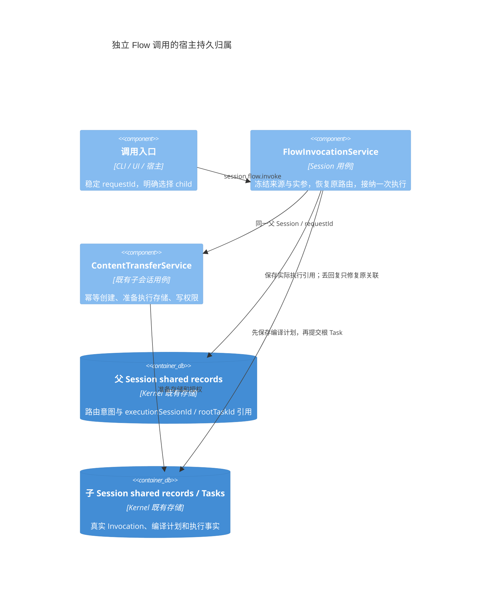

父级路由意图不等于执行已接纳：根发布修订、来源与实参先冻结，实际子 Session 的连接绑定、依赖及编译计划在子级调用接纳前固定。接口成功返回原根 Task 后，才证明该次执行已接纳。父意图写回失败时可从子级持久记录定位原根并修复；恢复先处理原路由，不把子级调用再次路由到孙 Session。已记录的子 Session 不可写或已失效时拒绝，不静默改到另一个执行位置。

读取结果和校验重跑来源同样沿 executionSessionId 定位真实根；父记录只投影子级事实。调用者不能注入 executionSessionId/callerSessionId 或冻结计划；组织关系不授予控制、不继承完整上下文。接口不默认改变普通调用目的地。

本批交付宿主协议及运行时接线，尚不把 F16 标为完成。默认工作台与独立视图还需把分两步的 create-child/invoke 改为本入口，并将所属 Session 固定到 OperationLedger；父级函数卡片、打开真实子会话、不同执行 Session 的控制与审批投影也仍需接线。F20—F24 及生产验收继续保留。

验证：隔离 Session 448 项、宿主 Flow 23 项通过（包含真实 ApplicationRuntime 的子会话存储与写授权准备），Session/app-core 类型检查、Session ESM/CJS/声明构建及 16 个 Mermaid 图、16 个本地链接通过。新增回归覆盖同请求幂等、两次独立运行、创建丢回执、父级根引用写回失败、原重跑来源、父级读取子输出、子级写权拒绝和伪造路由字段。子级已记录的启动失败只向父级投影，恢复不会自动重试，用户显式重试保留原身份。未部署或重启。

## 27. F16 父级 Flow 卡片的执行归属、控制回执和导航

父级卡片沿宿主持久返回的 executionSessionId 读取实际根 Task，详情、取消、重挂、暂停/恢复/撤回和审批补参使用同一执行归属。读取到其他 Session 的快照不能展示为可操作的调用。父级仍以原 Invocation/请求锚点展示输入与结果，不复制子会话消息或创建另一执行。已有子会话在根 Task 尚未关联时也可打开；没有宿主导航端口则不生成入口，打开或关闭详情不启动或取消调用。

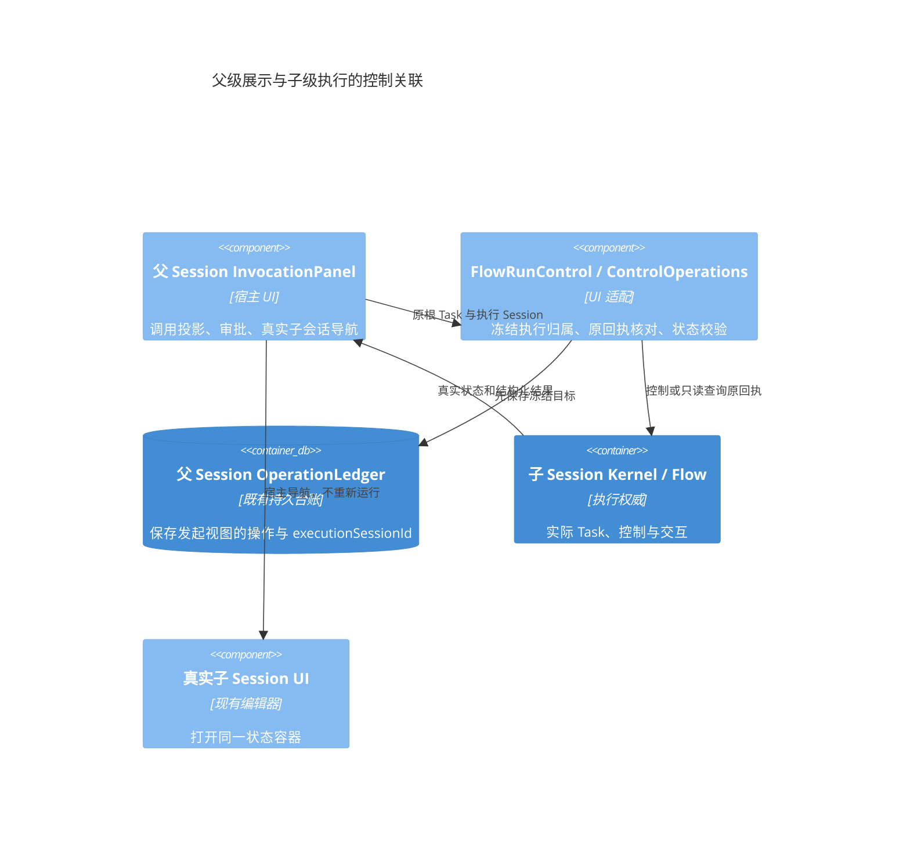

控制台账继续属于发起操作的视图 Session；跨 Session 请求在 input 中保存 executionSessionId。请求身份由实际执行 Session、根 Task、动作及 epoch 确定，因此父/子视图明确提交同一控制时使用相同 Kernel 身份。普通同 Session 控制省略该字段，保持旧台账冻结格式；重开时只读原字段，不从当前页面推导执行位置。查询记录缺失仍保持 unknown，空的执行 Session 被拒绝，不能静默回退到父会话。

验证：真实 Kernel/VFS/SessionRepository 的 UI 回归覆盖两个子调用、父级暂停丢回复、重开父台账只读核对、暂停中保存回答后恢复、独立取消另一个调用、打开子会话和关闭详情不重跑。另验证错误归属拒绝、无导航端口不伪造入口、尚无根 Task 的准备中子会话可打开，以及父/子视图同控制身份与旧格式兼容。隔离适配层 189 项、相关 UI 79 项，双包类型、适配层构建和架构边界检查通过。

本批不切换提交默认值。独立调用表单仍需将旧 create-child/invoke 两步接到第 26 节宿主入口，并持久保存冻结提交与接纳恢复；普通聊天仍在当前 Session，重跑入口的目的地策略随该批统一。F16 及 F20—F24、生产验收继续保留。


## 28. F16 独立 Flow 表单的子会话接纳与提交核对

斜杠调用与重新运行共用表单，默认使用独立子会话，也可显式选择当前 Session。UI 不再先创建子会话再调用 Flow；一次冻结请求交给第 26 节宿主路由。所属 Session、目的地、版本签名、参数、材料引用与连接选择先保存在既有 OperationLedger，持久登记成功后才派发。宿主负责准入、子会话与真实根 Task，UI 不复制执行状态。

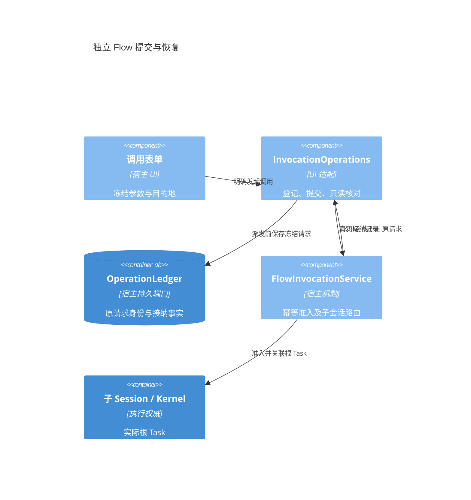

父级卡片显示待核对提交，重开后按原 Session/requestId 查询；独立 ChatView 同样识别该协议，不将它当作斜杠命令或普通消息核对。仅有子会话路由、没有根 Task 时保持 unknown。核对不重新发布、创建子会话或调用 Invoke；显式重试沿用同一请求身份，已保存 accepted 不重发。导航失败只报告打开失败，不将已接纳调用改成提交失败。

工作台注入现有持久台账；直接嵌入表单的调用方须提供 operations 才有跨视图恢复，缺省内存台账仅保证当前视图身份。未知提交稍后核对成功尚不自动消费旧斜杠草稿；普通聊天队列的草稿协议独立保留。本批不宣称 F16 全部完成，Agent/Task 入口统一、分支切换组合验收及 F20—F24 继续保留。未部署或重启生产服务。

验证：隔离候选适配层 196 项、相关 UI 63 项通过，两包类型检查、适配层构建、架构边界检查及 18 个 Mermaid 图、16 个本地链接通过。回归包括持久登记失败不发送、登记期间取消、提交丢回复后重开核对、无根路由保持未知、冻结实参不匹配拒绝、显式重试身份复用、导航失败不改变接纳，以及未知核对后按钮仍可再次使用。


## 29. F16 分支切换与迟到接纳的草稿边界

独立 Flow 表单观察归当前编辑器分支。收到分支切换事件时，先中止旧表单观察，再恢复新分支草稿；隐藏视图不会因此重新激活。已经派发的宿主调用仍按原冻结身份执行和核对，取消表单观察不发送取消执行命令。旧分支迟到的 accepted 不返回为当前输入的可消费回执。

斜杠命令复用 ChatInput 现有单调草稿修订号，消费时同时核对原文字与修订。文字改写后改回、或新分支拥有相同文字，都不允许被旧回执清除；没有改动的原输入仍可正常消费。插件接口只增加可选修订读取端口，不引入存储、调度或业务分支策略。未知接纳后重开核对的旧斜杠草稿自动消费仍待统一，不据此标记 F16 全部完成。

验证范围：真实 ChatInput 覆盖文字改写后还原、切到同文字分支及原草稿未改动三种接纳路径；编辑器事件接线覆盖可见/隐藏状态下先中止旧观察、再恢复分支、迟到接纳不消费当前草稿。表单取消与真实 Kernel 子会话执行回归一并验证。


## 30. F23 已提交 Task 产物的宿主读取链路

产物不是新的执行状态或注册表：TaskArtifacts 从 Kernel 终态 output 的已知封装派生目录，引用固定实际 Session、Task、输出位置与内容摘要。分页读取重新核对原输出，资产正文交给现有 TaskAssetReader 授权与完整性检查。该职责属于 app-core 宿主；纯 DTO/只读命令分类属于 app-contracts，Session 仅接受 ArtifactLoader，通用 RPC 不理解产物业务。

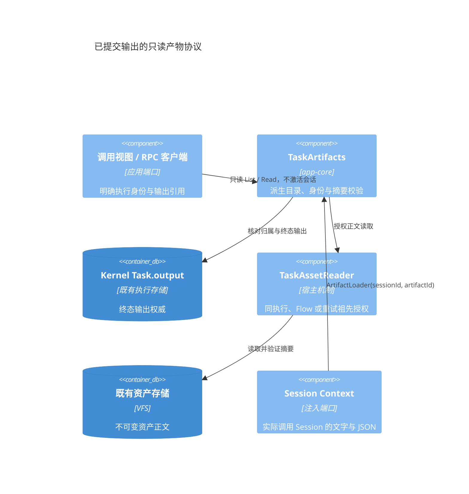

未导入远端 file 只报告不可用，不获取其 URI；二进制不能把路径/元数据当作文字 Context。终态尚未提交、范围或引用伪造、内容损坏、跨执行归属、存储权限失败分别报告明确错误。日志不输出正文、路径或未筛选的存储错误信息；宽二进制数组也消耗目录遍历预算。

本批交付宿主命令、Session/Context 接线及真实认证 HTTP ArrayBuffer 传输。分页只限制传输大小，现有资产 API 仍需每页完整读取/核验；不宣称大文件随机读取或远端文件导入已完成。F24 的按需 UI、产物显示性能，以及 F16 其余函数入口和 F20—F22 继续保留。原生产 Session 未操作，未部署。

验证范围：真实 Kernel/VFS 的目录分页、中文/JSON 字节恢复、输出指纹与 Session/Task 归属、未终态读取不启动、二进制授权/损坏/权限失败、远端 URI 不抓取；真实 ApplicationRuntime 的命令与 Session 读取端口；认证 HTTP 的分页 ArrayBuffer 与跨 Session 拒绝。全量 Session 回归、类型、构建和架构检查一并执行。


## 31. F24 调用卡片、运行页与历史的按需产物展示

父级 Invocation 卡片、DAG 运行详情和正式 Session 的终态助手历史共用 TaskArtifactBrowser。父卡片以已验证的真实 executionSessionId/rootTaskId 读取；历史以宿主投影的执行引用定位，不解析气泡文字。默认只显示入口，点击才读取目录、预览或下载；同一执行重绘保留已读展示，不自动重读正文。移除旧的逐次渲染图片读取器，避免两个资产展示机制并存。

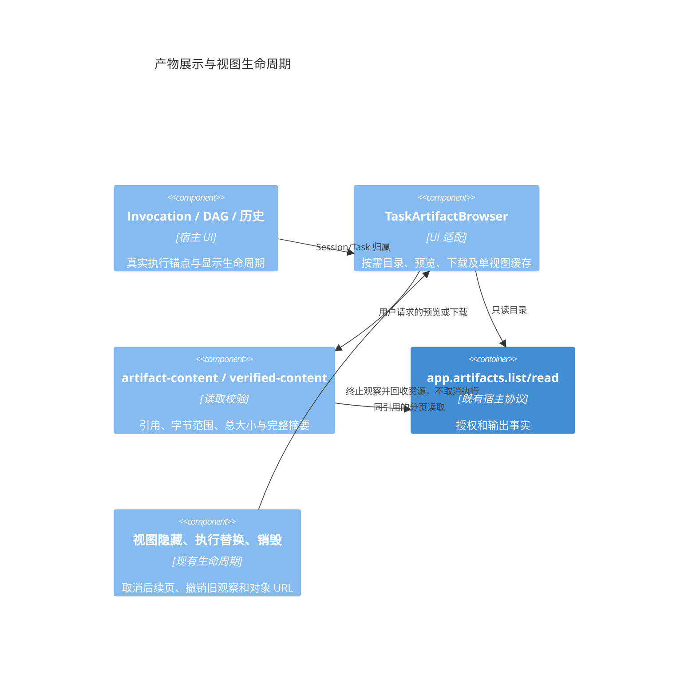

文字转义显示；图片只使用宿主返回字节创建的对象 URL。完整下载验证摘要，截断预览标明截断，不声称已验证整份文件。默认文字预览 64 KiB、完整下载上限 32 MiB，超过限制明确报告错误。目录先验证归属、条目元数据和连续分页位置，异常结果不部分展示。隐藏不继续读取下一页；显示后由用户重新加载，旧响应不污染新执行；同作用域的嵌套浏览器隔离事件。

错误只出现在对应产物区，不修改执行终态、队列或提交台账，也不清除草稿。诊断记录操作身份、阶段、结果和安全错误码，不记录文件正文。目录与下载继续使用第 30 节宿主实现，未导入远端文件保持不可用。

隔离验证包括中文/多页拼接、摘要损坏、大小限制、DOM 转义、迟到读取、隐藏停止分页、显示后重载、执行切换 URL 回收、嵌套事件隔离，以及真实子 Flow 的父卡片读取执行归属。完整调用组的信息层级、复杂输出性能和 F16 其余入口仍需验收；本节不将 F24 标为全部完成，未部署。


## 32. F20/F21 原生 binding、确认检查点与清理执行契约

Harness 上下文身份独立于 Invocation、Task 与单次远端操作。binding 集合保存在既有 Session shared state，以条件版本更新；同连接可有多个独立 binding，同一原生 thread 不能被别名绑定绕过写入归属。输入记录区分宿主装配快照与原生增量，HarnessProgram 校验快照身份/摘要和真实消息，拒绝续接输入重复携带完整历史或未冻结依赖输出。

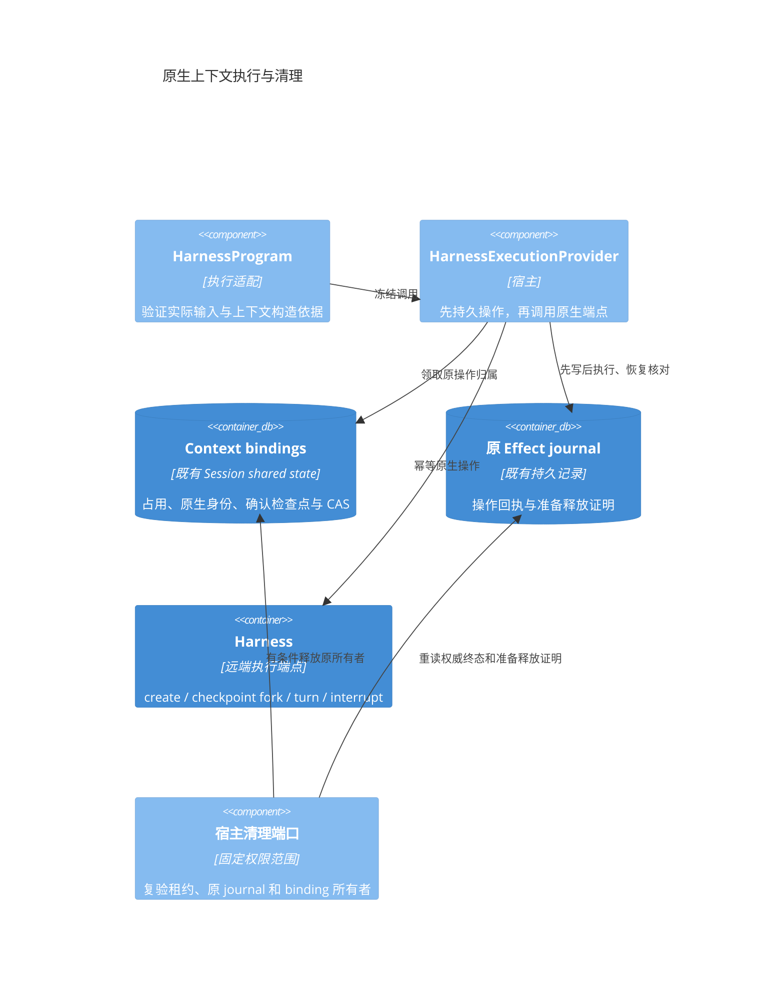

终态先准备 binding 结算，再把预期释放版本写回原 journal，最后释放占用并发布确认检查点。写回失败保留原占用；丢失释放回执时核对原版本，旧操作不能释放新所有者。清理端口只允许固定 binding 的读取/准备/释放，不能领取其他 binding；每次存储访问复验宿主写权。Kernel Effect.cancel 仍只有物理停止和清理确认后才能正常返回。

检查点保留真实生产操作与因果前驱。fork 可以选择较早的已确认检查点，必须复验源 binding 版本/代次、目标策略、连接、workspace 与记忆策略，再要求原生返回独立 session 及对应检查点确认。fork 回执丢失只核对原操作；不确认的分叉保留追溯记录，不发送增量 turn，也不再次 fork。上下文 fork 不恢复工作区文件。

当前原生协议缺少条件写入保障，严格 continue 明确返回 CONTEXT_NATIVE_WRITE_UNSUPPORTED；宿主 CAS 不能替代远端条件写。此批交付 Program、Provider、journal、真实宿主清理接线与检查点执行，不假装普通 resume 已满足安全跨轮续接。普通 Session 的上下文选择与 UI 目录仍按 F22 接线，真实节点/生产验收未完成。

隔离验证：Harness 执行/恢复/清理 144 项、Kernel 适配层 366 项通过；补充真实 Kernel 的正常完成与取消 2 项，核对 Effect 状态端口、宿主清理写权、检查点落盘及占用释放。App-core/适配层类型检查、适配层 ESM/CJS/声明构建及架构检查通过。故障覆盖 CAS 冲突、持久写回丢失、旧所有者、终态未知、检查点归属错误、输入摘要错误与不支持能力。未访问生产 Session，未部署。


## 33. F22 Session 上下文选择、宿主目录与派发复验

普通 Harness Agent 的调用输入保存 HarnessContextRequest，并保持真实 Invocation、分支、目标、工作区和策略依据。默认新调用以宿主装配快照为权威输入，Task 保存对应快照和 canonical messages；显式 checkpoint fork 只发送本轮物化后的增量文字/附件，历史引用继续用于展示和追溯，不重复注入完整本地历史。

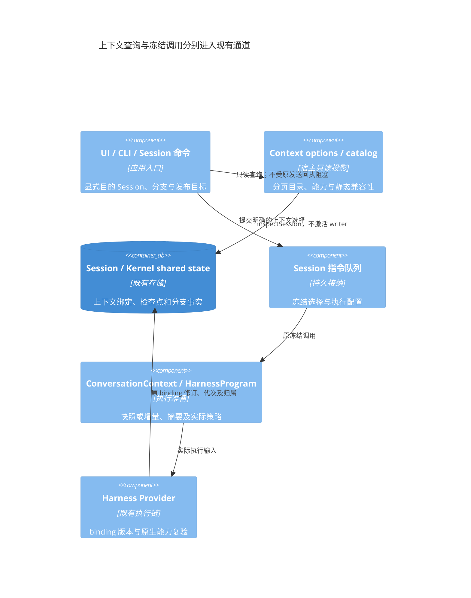

目录查询绑定显式 Session/分支、目标与观察 basis，分页范围或观察依据变化时拒绝旧游标；不读取原生消息正文，不暴露原生控制身份、策略正文或操作指纹。连接 inspect 只读取必要的 profile/capabilities 并释放连接，不领取原生执行。查询上的 static-compatible 仅表示静态条件满足，dynamicPolicy 始终是 dispatch-validation-required。

队列冻结用户选择和提示词追加值；调用方随后改写对象不改变已入队实参。真正派发时重新核对 binding 修订、检查点、实际系统策略与连接授权，不兼容则明确失败，不能静默新建并声称续接。原生上下文选择不能用于模型或 Flow 目标；严格 continue 仍拒绝，不以宿主 CAS 假冒原生条件写。普通后续轮次默认新 binding，明确保留 host-assembled 语义。

隔离验证：宿主目录/真实 ApplicationRuntime 的 Harness 执行、附件、取消与队列组合，Session 全量回归，以及认证 HTTP 下原发送响应悬挂时的只读目录查询。补充暂停队列后修改调用方选择、源 binding 修订漂移再恢复派发的组合，要求保留原选择且拒绝 stale source，不额外创建原生会话。类型、Session 构建与架构边界检查通过。

本批不包含工作台选择控件与分支草稿持久化，继续作为 F22 未完成项；F16/F24 剩余入口/显示验收与真实远端生产验收保留。未操作生产 Session，未部署。


## 34. F22 工作台上下文选择、草稿与提交证据

默认工作台通过可选 ContextOptionsPort 查询目的 Session/分支/发布目标的只读目录，用户显式选择并确认已确认检查点。选择器属于 MindOS 的 UI adapter：宿主负责兼容性与执行授权，独立 llm-ui 不导入 binding 存储或原生协议。选择和查询观察分开，旧响应、分页 basis 变化及视图销毁不能覆盖新选择。

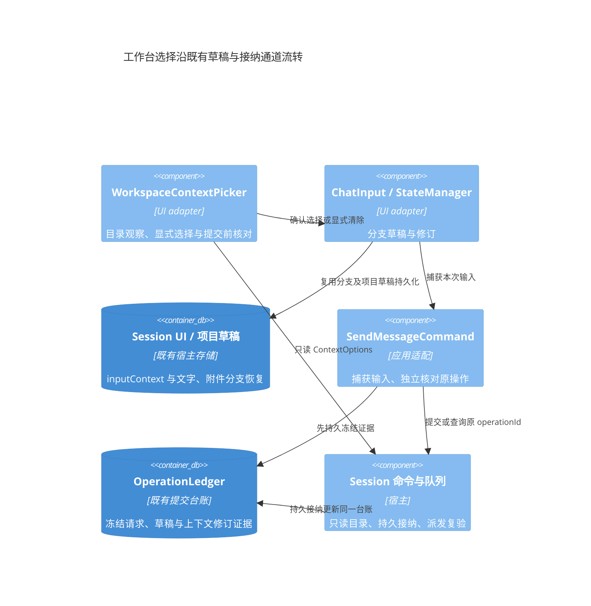

InputContextDraft 保存选择修订及 Session/分支/目标作用域；执行请求只携带冻结选择，不携带目录观察元数据。已有 draftConfig 必须优先于当前输入框，避免异步提交混入稍后的检查点。文字、附件、上下文与目标匹配时才消费草稿；清除后重新选择同一点仍增加修订，重开从台账恢复修订下界。显式查询旧提交保留新草稿，再次发送新草稿创建新操作，不能按文字或检查点相同合并身份。

选择变得不兼容时保留原草稿并报告原因，用户可以核对或清除；无目录端口的普通聊天不被锁住，直接命令不解释原生选择。收到持久接纳即可继续选择和入队，不等待原 RPC 返回。静态目录核对不替代宿主派发复验；严格 continue 仍不开放，fork 不宣称恢复文件系统。

隔离验收覆盖目录漂移、分页与迟到响应、分支/目标/Session 变化、草稿重开、同点重选、旧回执、冻结配置和原 RPC 悬挂时继续入队。项目草稿与正式 Session 复用既有宿主存储，不增加 IndexedDB、调度器或上下文状态库。独立 ChatView 的选择控件、F16 其他函数入口、F24 完整调用组与复杂输出性能、真实远端验收仍保留；未部署。


## 35. F22 CLI 目录观察与上下文选择文件

CLI contexts 接既有 Session.ContextBindings，只读目录先于 openSessionView；分页对象及显式分支交给宿主校验。prepare/send 的 --context 使用公共 ConversationSelection 校验器，冻结到原 Submission 文件，submit/receipt 禁止覆盖；Flow 在读文件前拒绝该选项。UI 和 CLI 使用同一 binding 身份与派发复验，不新增执行或存储机制。

```mermaid
C4Component
  title CLI 上下文接入沿用宿主协议
  Component(cli, "CLI session", "应用表示层", "解析参数、输出与安全诊断")
  Component(query, "ContextBindings", "宿主只读端口", "安全摘要与检查点分页")
  ContainerDb(file, "call.json", "既有提交文件", "冻结选择、目标与 operationId")
  Component(submit, "Session submit / receipt", "宿主", "持久接纳或只读核对")
  Rel(cli, query, "contexts，不打开 Session view")
  Rel(cli, file, "prepare；独占保存后再发送")
  Rel(file, submit, "原冻结请求和身份")
```

隔离验收覆盖本地和 RPC 查询不激活 Session、非法游标不出客户端、选择文件修改后恢复仍使用原冻结选择、注入原生身份拒绝、Flow 覆盖拒绝，以及诊断不泄露游标和远端错误正文。此入口不是原生条件写能力，也不等同真实远端验收；F16/F24 及独立 ChatView 剩余项保持开放。


## 36. F16 子 Session 创建的并发与丢回执恢复

独立 Flow 与后续 Agent/Task 路由共用 ContentTransferService.createChild。本批补齐其身份前提：调用时冻结输入；同一 requestId 的意图写入冲突或丢回执后，只读核对原持久输入与子 Session ID。字段顺序不改变身份，标题或材料来源不同则拒绝，未知身份字段也拒绝。没有持久证据时保留写入失败，不新建子会话冒充成功。

```mermaid
C4Component
  title 子会话身份与文件初始化分层
  Component(entry, "独立调用入口", "Flow 与后续 Agent/Task", "稳定请求身份")
  Component(child, "ContentTransferService", "Session 语义", "冻结请求、核对原创建意图")
  ContainerDb(intent, "content.child 原记录", "Kernel shared state", "CAS 决定唯一子 Session ID")
  Component(repository, "SessionRepository", "持久化机制", "同一实例按 Session ID 串行初始化文件与元数据")
  Component(execution, "宿主执行准备", "既有 lease 与 Kernel", "准备执行存储后才返回")
  Rel(entry, child, "createChild")
  Rel(child, intent, "条件写入；冲突或丢回复只读核对")
  Rel(child, repository, "ensureSession 原身份")
  Rel(child, execution, "原子会话准备")
```

回归先复现了等待期间输入变化、写入成功但回复丢失、JSON 字段顺序差异三个失败；并发测试继续发现同一仓库初始化文件竞态，修复下沉到 SessionRepository。不同 Session 不共享初始化锁，进程内串行不能替代跨宿主 lease 与持久 CAS。覆盖同输入并发、冲突输入、无落盘证据的写入失败和真实子会话归属。

这只完成 F16 的共用创建前提，Agent/Task 独立调用的路由、父级投影和控制仍未完成，不能以子会话创建成功宣称完整函数调用交付。


## 37. F16 统一独立调用的宿主路由与接纳查询

session.call.submit 接收原 SubmissionRequest、标题及可选显式材料；Agent 与已发布 Flow 进入同一路由，普通 session.submit 仍在当前 Session 执行。父 Session 仅持久保存冻结输入和子 Session 路由，真实接纳来自子会话的原指令队列，真实 Invocation/Task 来自子历史，不另外维护执行状态或在父级重复入队。

```mermaid
C4Component
  title 独立调用经宿主专用上下文接入原队列
  Component(caller, "调用方", "UI / CLI / 上层程序", "原请求身份与明确材料")
  Component(route, "IndependentCallService", "Session 语义", "冻结请求、幂等子会话关联")
  ContainerDb(record, "父 Session shared state", "原持久记录", "输入与路由，不存执行状态")
  Component(host, "ConversationContexts", "app-core 宿主", "独立 lease，不切换调用方 UI 绑定")
  Component(queue, "子 Session queue", "既有机制", "校验、接纳、执行与恢复")
  ContainerDb(history, "子 Session history / Kernel", "既有事实", "真实 Invocation 与执行引用")
  Rel(caller, route, "submit 或 inspect 原请求")
  Rel(route, record, "CAS 冻结并核对原身份")
  Rel(route, host, "提交冻结的子请求")
  Rel(host, queue, "SessionManager.submit")
  Rel(queue, history, "原执行链")
  Rel(route, queue, "只读接纳核对")
  Rel(route, history, "只读实际执行引用")
```

路由保存并不等于接纳；绑定创建后、队列接纳前的失败仍为 unknown，同请求可按原身份核对或明确重试，不能另建子会话。创建与提交回复丢失分别核对原持久意图和原接纳事实。新 requestId 表示另一次独立调用。父分支只用于准入范围；子会话从 main 开始，不将父 baseRoundId/新分支覆盖解释为子分支。组织关系不授予父级取消子调用的权力。

附件先在调用方冻结，再按内容身份复制到子会话，已接纳后的查询/同请求重试不依赖原附件再次可读。显式 initialContext 继续经既有 ContentTransferService 校验；不自动继承父聊天历史。默认参数和 Agent/Flow 执行配置仍在真正的子队列接纳时冻结。

真实 Runtime 验收覆盖普通模型 Agent、Flow Agent、已发布 Flow、两个不同请求创建不同子会话、同请求并发与冲突、丢失接纳回复、附件以及原 RPC 回复悬挂时只读查询。关闭调用方观察不取消执行。独立调用 UI/CLI 操作入口、父级调用组投影和跨会话控制消费尚未接线；裸 Kernel Task 入口及真实远端验收继续开放。本节不将 F16/F24 标为完成。


## 38. F16 独立调用 CLI 入口与观察

CLI call-prepare/call-submit/call-receipt 接入第 37 节统一宿主端口，Agent/Flow 共用目标和输入解析。文件持久化复用普通提交的大小限制、wx/0600、文件及父目录同步，不另建请求台账；独立文件冻结 request/title/transfer。查询只读原身份，丢回执不自动重发，也不重读参数和材料来源文件。

```mermaid
C4Component
  title CLI 独立调用与子执行观察
  Component(cli, "CLI call commands", "表示层", "准备输入、明确提交、查询原请求")
  ContainerDb(file, "call.json", "既有冻结文件机制", "原调用身份、标题与显式材料")
  Component(host, "IndependentCallService", "宿主", "子 Session 路由和持久接纳")
  Component(observe, "watchSubmissionExecution", "已有 CLI 观察", "读取子调用的 Round 与执行身份")
  Rel(cli, file, "独占同步保存或读取")
  Rel(cli, host, "submit / inspect")
  Rel(cli, observe, "本地默认等待，远程显式 follow")
  Rel(observe, host, "使用真实子 Session 身份，不重发")
```

本地 CLI 不能收到接纳就关闭执行宿主，因此默认等待子调用；远程默认只返回接纳，--follow 才继续观察。等待人工交互以子调用持久成员为准，复用已有等待输入/失败退出语义。仅 CLI 的观察作用域导航到子会话，不切换其他客户端视图；call-receipt 不激活任何视图。诊断区分准备、接纳与观察失败，不记录标题、参数或远端错误正文。

验收覆盖本地/RPC 纯参数 Flow、Agent 冻结输入、文件禁止覆盖、跨调用方文件拒绝、原回执查询、丢回复不重发、远程 follow 和子调用补参。UI 独立操作入口、父级函数卡片与控制、裸 Task 入口和生产验收继续开放。


## 39. F16 独立子调用的只读展示投影

`session.calls.list` 按调用方 Session 与可选分支读取已持久路由，返回原输入、发起锚点、接纳回执及子 Round 的真实状态、主执行引用和至多 2,000 字符的终态文字摘要。未准备 Kernel 存储的有效 Session 返回空列表，不创建执行上下文、不获取 writer、不切换绑定。旧路由无时间或锚点时返回 0/null，不伪造历史位置。

```mermaid
C4Component
  title 父级调用展示的事实来源
  Component(view, "调用展示消费者", "UI / RPC", "展示输入与摘要，打开真实子会话")
  Component(query, "IndependentCallService.list", "Session 语义", "按调用方和分支核对关联")
  ContainerDb(route, "父 Session 路由", "Kernel shared state", "原输入、子会话身份、发起锚点")
  ContainerDb(child, "子会话队列与历史", "现有持久事实", "接纳、Round 状态与主执行身份")
  Rel(view, query, "只读查询")
  Rel(query, route, "读取已有路由")
  Rel(query, child, "核对调用身份后投影")
```

查询不另存执行状态；路由存在不代表子调用已接纳。Round 的会话、提交、来源和调用方必须全部匹配，错误归属明确拒绝。主执行按 role 选取，不能假设 executions 第一项就是主任务。摘要仅用于显示，不作为 Flow 输出端口或后续上下文。查询失败记录阶段、分类与耗时，不记录输入、输出或原异常正文。

验收覆盖普通模型 Agent 的实际终态与输出、只读查询、未初始化调用方、错误分支/未知字段、调用方隔离、返回对象隔离、摘要上限及伪造 Round 归属拒绝。本接口是展示基础，尚未接通父卡片与独立运行按钮；父级控制、分页及大历史性能验收仍待实施，不将 F16 标记为完成。


## 40. F16 默认工作台独立调用入口与父级卡片

默认工作台提供显式「独立运行」，普通发送/Enter 继续在当前 Session 提交。两者复用 ChatInput 参数确认、附件准备、草稿保存和 SendMessageCommand；独立模式写入同一 OperationLedger 的冻结输入，再调用 session.call.submit，不另建发送台账或执行状态库。只接收已发布 Agent/Flow；直接命令和显式原生上下文选择要求使用普通入口或先清除选择，不静默改变含义。

```mermaid
C4Component
  title UI 独立调用接纳与展示
  Component(input, "ChatInput", "输入表示", "同一草稿与参数确认，显式独立运行")
  Component(send, "SendMessageCommand", "应用适配", "冻结调用模式及请求")
  ContainerDb(ledger, "OperationLedger", "既有宿主持久 UI 记录", "原操作、草稿证据、接纳回执")
  Component(host, "IndependentCallService", "宿主 Session 语义", "持久路由与子队列接纳")
  Component(panel, "IndependentCallPanel", "通用展示组件", "只读事实、原输入、终态摘要、子会话导航")
  Component(child, "子会话视图", "既有 UI", "完整历史、审批和执行控制")
  Rel(input, send, "共享输入准备后提交")
  Rel(send, ledger, "先登记冻结输入")
  Rel(send, host, "submit / inspect")
  Rel(panel, host, "按调用方分支 list")
  Rel(panel, ledger, "完整请求与标题匹配后确认接纳")
  Rel(ledger, send, "释放仍悬挂的提交 RPC 等待")
  Rel(panel, child, "打开实际 executionSessionId")
```

父队列通知不证明独立子调用接纳。父卡片只根据原 request/title 与真实接纳核对同一台账，不为清空草稿伪造父历史；不等待父队列查询。迟到回执只消费匹配的草稿证据，保留后来编辑的输入。卡片按原发起锚点挂载，结果明确为摘要；等待交互提示打开真实子会话。Agent/Flow 共用展示，组件放在 components 层；不能将普通 Agent 的 Task 交给 Flow 专属运行控制器。

轮询由视图持有，活跃/未核对时每秒、空闲每 30 秒，焦点恢复刷新。隐藏不继续派发查询，销毁释放订阅/卡片，分支切换清理旧卡片，迟到响应不得重挂载。列表失败保留诊断分类，不记录输入或原异常正文。

验收覆盖原 submit RPC 悬挂时从持久列表接纳、完整请求/标题/归属不符不消费、HTML 作为文字展示、子会话导航、纯参数提交复用表单、等待期间新草稿保留、普通发送行为不变及轮询生命周期。父卡片直接暂停/取消、产物专用展示、独立 ChatView 对等接入、分页/大型历史、真实远端部署验收仍未完成；不据此宣称 F16 或整体实施完成。


## 41. F24 独立调用父卡片的按需产物

IndependentCallPanel 按宿主投影的 executionSessionId 和主 ExecutionRef 复用 TaskArtifactBrowser。只有已接纳且 Round 已终结的调用提供产物入口；不从卡片正文、父 Session 或数组位置猜测输出归属。目录、预览和下载仍使用原只读 ArtifactCommand 链；轮询不自动读取目录，也不重建同一执行的预览 DOM。

```mermaid
C4Component
  title 独立调用产物展示复用现有读取链
  Component(card, "IndependentCallPanel", "UI 适配", "选择真实子 Session 主执行")
  Component(browser, "TaskArtifactBrowser", "共享展示机制", "按需目录、分页核验、预览与下载")
  Component(host, "TaskArtifacts", "宿主读取机制", "范围校验及持久输出解析")
  ContainerDb(output, "Kernel Task 输出与资产", "已有存储", "不可变结果与文件内容")
  Rel(card, browser, "传入实际执行 scope，管理视图生命周期")
  Rel(browser, host, "ArtifactCommand.List / Read")
  Rel(host, output, "只读范围及内容核验")
```

隐藏视图取消正在读取的目录/内容并回收对象 URL；卡片移除、分支切换和销毁释放对应 browser。主执行改变时清理旧 scope；同一主执行轮询保留已读结果。读取错误只在产物区显示，不更改调用终态或接纳台账。未导入远端原生 URI 继续显示不可用，不在浏览器自行抓取。

验收覆盖按需读取真实子 scope、预览转义与轮询保留、隐藏/销毁/重置时丢弃迟到目录、主执行改变、运行中不读取终态输出及错误归属拒绝。真实 Runtime 用例从独立 Flow 的列表取主 Task，再经产物命令读取结果，确认调用方绑定不变且不取得 writer。此批不新增产物存储或注册表；大型调用列表分页、复杂报告编辑、父级直接控制、独立 ChatView 对等入口和真实远端部署验收继续开放。


## 42. F16 父卡片的主执行控制事实与清理状态

session.calls.list 在真实子 Session 的主 ExecutionRef 上读取 Kernel Task，并复用 taskStat 派生 executionState：控制代次、请求/确认、运行阶段、阻塞来源、活跃操作数量及 stopped/settled。只读查询不获取 writer，不持久保存第二份状态，不向 UI 复制 Task 输入、Effect 参数或 exit 输出。Round 状态仍属于历史层，不被控制投影改写。

```mermaid
C4Component
  title 调用历史与执行事实分别投影
  Component(panel, "IndependentCallPanel", "UI", "历史状态与主执行控制提示并列")
  Component(query, "IndependentCallService", "Session 语义", "核对路由和主执行身份")
  ContainerDb(round, "子 Session Round", "历史", "业务调用状态与真实执行关联")
  Component(stat, "Kernel taskStat", "机制", "请求、确认、stopped、settled")
  ContainerDb(task, "Kernel Task", "执行事实", "控制版本及 Effect 收尾")
  Rel(panel, query, "只读 list")
  Rel(query, round, "原调用及执行身份")
  Rel(query, task, "读取主执行记录，不获取 writer")
  Rel(query, stat, "派生公开安全状态")
```

主 Task 的 stopped/settled 不代表整棵子调用树已停止。卡片明确标注主任务；暂停请求尚未达到停止条件时继续提示等待安全边界或操作收尾。Round 已终结但主 Task 未 settled 时继续快速观察，收尾后恢复空闲轮询。产物展示和历史终态均不因等待清理而回退。

控制入口审查结论：现有 FlowRunControl 还承担运行目标、调度租约及控制树协调，不能直接用于普通 Agent；Kernel pause/resume/withdraw 有持久请求回执，但 cancel(reason, options) 没有同样的 requestId 契约，interrupt 也不是 cancel。后续父卡片按钮必须保持这些语义，并复用真实执行所有者的租约与控制协调；本批不把状态投影伪装成可执行控制能力。

验收覆盖真实模型 Effect 未结束时提交 pause，再只读查询主 Task：请求已保存但 stopped/settled 仍为 false；终态无副作用内容泄漏、UI 清理继续观察、确认停止和请求暂停区分、其他 Task 状态拒绝。父级直接控制与独立 ChatView 接入仍未完成。


## 43. F11 离线 RunDefinition 根入口的公开范围

审查剩余工作树发现 createRunDefinitionFromFlow 缺少根调用范围校验，离线 CLI 可以绕过 Session 根准入直接编译 local Flow。本批保留并验证该必要修改，同时把 CLI 拒绝提前到参数文件读取与运行存储创建之前。复用 assertRootCallable，不新增规则副本；已有 CLI traceRuntimeStage 保留具体校验错误的诊断。

```mermaid
C4Component
  title 公开范围属于根调用入口，不属于通用加载器
  Component(cli, "CLI runFlowCommand", "入口适配", "在运行副作用前校验根范围")
  Component(root, "createRunDefinitionFromFlow", "应用根运行用例", "复验 global 或兼容旧定义")
  Component(rule, "assertRootCallable", "Flow 契约", "唯一公开范围校验")
  Component(compiler, "flowToDag", "通用编译机制", "允许内部 local 调用")
  Component(loader, "siblingFlowResolver", "文件适配", "读取明确引用的子定义")
  Rel(cli, rule, "提前校验")
  Rel(cli, root, "生成运行定义")
  Rel(root, rule, "应用入口校验")
  Rel(root, compiler, "编译已准入根定义")
  Rel(compiler, loader, "解析内部子 Flow")
```

验证直接调用应用入口时 local/非法 exposure 都在连接准备与节点绑定前拒绝；CLI local 根入口先于缺失参数文件报 CALLABLE_LOCAL_ONLY，且没有创建运行存储；显式 global 与旧定义均能真实执行 local 子 Flow 并读到最终输出。通用加载器仍可读取 local 定义。该批仅合入根准入缺口，不把目录隐藏当作执行约束，也不把公开范围规则扩散到 Kernel 或文件读取机制。


## 44. F16 独立 ChatView 的调用模式与原回执恢复

SessionChatBindingOptions.independentCalls 显式开启已发布目标的「当前会话 / 独立调用」选择器，要求 targetSelection。通用 llm-ui 只保存选择与原输入，适配层在原 OperationLedger 登记阶段冻结 sessionRequest 和 independentTitle，再走 session.call.submit。默认标题来自稳定 target.id，不受界面语言改变影响。未开启时保持原发送行为；旧独立操作的核对仍使用冻结记录。

```mermaid
C4Component
  title 独立 ChatView 的模式与接纳协议
  Component(view, "独立 ChatView", "通用 llm-ui", "选择器、输入编辑、接纳后消费草稿")
  Component(binding, "SessionChatBinding", "业务适配", "冻结调用模式和明确分支")
  ContainerDb(ledger, "宿主 OperationLedger", "原台账", "原请求、模式及恢复证据")
  Component(host, "IndependentCallService", "宿主", "真实子会话路由与接纳")
  Rel(view, binding, "send + selection.callMode")
  Rel(binding, ledger, "先持久登记冻结输入")
  Rel(binding, host, "submit / inspect 原请求")
  Rel(binding, view, "投影 operationReceipts，不伪造父历史")
```

普通 Session 快照可能没有 loaded view；宿主应通过 branch 回调提供当前观察分支，或使用已有 view.manifest。独立模式缺少明确分支时在台账登记前返回 CALL_BRANCH_REQUIRED，不默认猜测 main。切分支后旧绑定不得派发新输入，原操作仍可用冻结分支核对。

仅在当前分支存在未确认独立操作时每秒核对原接纳，不重新发送；其他分支原操作仍可显式查询。父队列通知不确认子调用。隐藏/销毁停止后续观察；重开清除旧在途查询占位，悬挂旧请求不挡住新核对。createSessionChatView 将视图 active/destroy 生命周期传给绑定，宿主继续拥有 binding.dispose。读取失败诊断仅记录操作身份、阶段、分类与耗时。

真实 ChatView 的本地/RPC 组合验收覆盖原 submit 回复悬挂时持久接纳释放输入、随后切回当前会话发送、子会话身份独立且父绑定不变；绑定验收覆盖模式冻结、unknown 路由不冒充接纳、错误调用方拒绝、隐藏重开查询及缺少分支准入拒绝。独立 ChatView 的父卡片、产物和直接控制仍需复用默认工作台展示接线；本节只完成输入和回执协议，不将整体视图对等接入标记完成。

## 45. F16 独立 ChatView 的调用卡片、产物和子会话导航

独立 ChatView 复用 IndependentCallPanel 与 TaskArtifactBrowser：SessionCallPresentation 把同一张宿主卡片挂入既有 extension part，按原 head 放在对应轮次之后，同锚点按 createdAt/operationId 稳定排序；空 head 在历史之前，未加载锚点暂放末尾。一次建立历史锚点索引，避免逐调用扫描历史。卡片只在视图快照中存在，不写入父 Session 历史，不进入模型上下文，也不携带 submissionId/acceptance 充当接纳证据。扩展消息的 complete 仅表示渲染块完整，执行状态仍由卡片投影真实子调用。

```mermaid
C4Component
  title 独立调用展示复用宿主协议
  Component(view, "ChatView", "独立 llm-ui", "历史位置与 extension 生命周期")
  Component(presentation, "SessionCallPresentation", "宿主 UI 适配", "锚点投影与既有 DOM 挂载")
  Component(panel, "IndependentCallPanel", "共享宿主组件", "状态、输入输出、原回执核对")
  Component(artifacts, "TaskArtifactBrowser", "共享宿主组件", "按需读取真实子任务产物")
  Component(host, "宿主命令端口", "Session / Kernel", "只读调用投影与产物")
  ContainerDb(ledger, "OperationLedger", "同一台账", "持久接纳与草稿消费")
  Rel(view, presentation, "挂载或释放扩展")
  Rel(presentation, panel, "复用状态观察与卡片")
  Rel(panel, host, "session.calls.list")
  Rel(panel, ledger, "核对冻结请求后 settle")
  Rel(panel, artifacts, "实际子 session/task 身份")
  Rel(artifacts, host, "按需读取")
```

绑定在挂载卡片后停用独立的 inspect 轮询，使用共享面板的 list 观察核对同一台账；无视图的 binding 保留原 inspect 恢复路径。面板兼容默认工作台的 request 与独立 ChatView 的 sessionRequest 冻结记录。openChild 由宿主提供真实子会话导航；未提供时隐藏入口，不生成无效按钮。隐藏/销毁停止观察，销毁后迟到响应不能重建卡片；更新结果保留 details、产物浏览器和卡片 DOM，旧 renderer 的清理不能移除已迁往新容器的卡片。

本批覆盖本地与真实 RPC 的悬挂接纳、子会话导航、卡片复用、父历史不被污染，以及锚点排序、迟到结果和具体读取错误提示。产物继续使用第 41 节已经验证的共享组件与实际子任务作用域。直接取消/暂停控制、上下文选择、裸 Task 入口和大历史分页仍未完成；不将整体 F16 标记完成。

## 46. F16 控制前置：Kernel 取消的持久接纳回执

审查直接调用控制时确认 pause/resume/withdraw 已有持久控制回执，但 cancel 尚无对应冷查询。本批在机制层补齐取消请求身份：Task.cancel 可携带 requestId/expectedEpoch，Kernel 将回执与原终态写入同一事务；上层不能先写「已取消」再请求 Kernel，也不能使用 UI 台账代替执行接纳事实。

```mermaid
C4Component
  title 取消接纳与清理确认分离
  Component(host, "宿主控制用例", "待接线", "冻结目标与独立控制请求身份")
  Component(kernel, "Kernel.cancel", "通用执行机制", "持久终态、fence、清理与后代取消")
  ContainerDb(store, "原 Task 存储", "Session 事务", "终态与 cancellation 回执原子提交")
  Component(adapter, "EffectAdapter.cancel", "执行适配", "物理停止确认")
  Component(query, "readTaskCancellationReceipt", "冷查询", "原接纳事实与真实终态")
  Rel(host, kernel, "requestId / expectedEpoch / lease")
  Rel(kernel, store, "同键核对与事务提交")
  Rel(kernel, adapter, "请求物理清理")
  Rel(adapter, kernel, "物理停止确认")
  Rel(kernel, store, "记录 cleanup.confirmed")
  Rel(query, store, "只读回执，不激活执行")
```

同键异原因/控制版本冲突；过期控制版本不产生回执；lease 在事务内检查。取消与完成竞态保留真实 succeeded/failed，不为按钮反馈改写终态。重启后可冷读原回执；重放不重复终态或提升 Task 版本。父请求 ID 和 expectedEpoch 不传给具有独立控制版本的子任务。

取消回执可以在适配器清理挂起或失败时先被查询，它不代表资源已释放，也不代表整树 settled；清理仍复用 journal、Effect cleanup 和 taskStat/taskStats。日志区分 admission/cleanup/terminal-observed，记录请求与耗时，不记录取消原因或远端错误正文。库公开 API、事件说明与 Kernel API 文档同步更新。该批是宿主控制协议的前置机制；子调用命令授权、UI 控制台账与按钮接线仍待完成，不将 F16 整体标为完成。

## 47. F16 控制前置：Flow 取消遵守调度所有权

Flow 取消的显式请求扩展既有 RunCancel，不增加调度器或状态库。Session、根任务、独立 requestId 与 expectedEpoch 明确传入；先冷核对根和冻结控制树，再由 withFlowControl 复用本机租约或按原规则获取租约，禁止借用其他宿主的调度权。新路径无需缓存 Run handle。持久控制树覆盖动态与 detached 成员；只有旧 `{taskId}` 入口保留原成员集合取消语义。

```mermaid
C4Component
  title Flow 控制入口复用已有调度与 Kernel 机制
  Component(caller, "宿主调用方", "控制适配待接线", "明确 Session 和根执行身份")
  Component(command, "RunCancel", "Flow 端口", "冷验证归属与控制树")
  Component(lease, "withFlowControl", "已有调度所有权", "本机租约、串行化、写权限")
  Component(kernel, "Task.cancel", "Kernel", "原子回执与真实终态、物理清理")
  Component(query, "RunCancellationReceipt", "只读端口", "核对根后读取原回执")
  Rel(caller, command, "requestId / expectedEpoch")
  Rel(command, lease, "复用已有控制屏障")
  Rel(lease, kernel, "携带租约取消整个控制树")
  Rel(caller, query, "原请求身份核对")
  Rel(query, kernel, "冷读取，不重发取消")
```

取消与完成竞态返回真实 status，只有 status=cancelled 时返回 cancelled=true；此字段仅说明逻辑终态。清理挂起时原回执仍可读，根 Task 自身 settled 不代表子任务收尾，stats() 也只是计数。验证覆盖无缓存句柄、清理挂起、重启冷读、重复请求、错误控制版本、无写权限、错误根和旧控制树拒绝；旧 RunCancel 当前成员取消回归保留。新的只读命令进入共享 query 策略；应用宿主/父调用归属校验和 UI 操作台账仍需接线，不能据此标记 F16 全部完成。


全量回归发现根终态后调度器释放租约与子任务取消并发，原借用控制可能遭遇 STALE_SHARED_LEASE。withFlowControl 现在在本机租约上登记在途借用；调度器请求退休后不再接受新借用，原控制成功或失败都会释放借用，最后才执行原 lease.release。心跳与事务 fencing 继续使用原租约；没有延长外部接管权限或忽略真实失权。确定性测试验证退休期间仍可持有租约写入，控制结束后立即释放，随后新控制可以按原规则重新获取租约。

## 48. F16 独立调用控制的归属与授权入口

IndependentCallControls 在 llm-session 承担调用归属与授权适配；路由仍由 IndependentCallService 唯一读取，不新建控制状态库。session.call.cancel 明确 parent session/branch/call、child session、primary task、独立 requestId/expectedEpoch。后端依次核对原路由、原子调用接纳、Round primary 与 Kernel 身份；不接受 UI 提供的任意任务，也不把父子关系当作可控制所有子任务的授权。

```mermaid
C4Component
  title 独立调用取消的端到端归属边界
  Component(ui, "调用方 / RPC", "控制入口", "冻结原调用及独立控制身份")
  Component(control, "IndependentCallControls", "Session 用例", "校验归属、父子写权限、协议路由")
  ContainerDb(route, "原调用路由和子 Round", "原持久记录", "caller / child / primary 唯一关联")
  Component(flow, "Flow RunCancel", "Flow 控制机制", "原调度租约与控制树")
  Component(kernel, "Kernel.cancel", "通用机制", "取消接纳事务与清理")
  Component(read, "CancellationReceipt", "只读核对", "相同归属检查，冷读原结果")
  Rel(ui, control, "session.call.cancel")
  Rel(control, route, "验证冻结路由与主执行")
  Rel(control, flow, "Flow 主执行")
  Rel(flow, kernel, "持有原调度权限")
  Rel(control, kernel, "普通 Agent / Task 主执行")
  Rel(ui, read, "查询原请求，不重发")
  Rel(read, route, "同一归属检查")
  Rel(read, kernel, "读取原取消回执")
```

查询不调用写权限获取，也不打开执行 Session；父绑定和草稿不受影响。父/子任一会话只读则取消拒绝；回执仍可读取。没有主执行身份的待派发调用明确不可按 Task 取消，队列操作保留自身入口。Flow 取消依然服从第 47 节控制树与租约规则。

真实 Agent/Flow 验证覆盖取消与完成竞态、原接纳重放、错误 caller branch/child/task/call、父子写权限、丢回复后只读恢复；真实 ChatView 的本地/RPC 链增加控制与回执传输验证。失败诊断脱敏、错误回执身份拒绝与日志回调失败不替换结果由独立用例覆盖。UI 操作台账和控制按钮、暂停/恢复入口仍未完成，下一批继续接线。

## 49. F16 调用卡片取消与持久操作台账

IndependentCallPanel 在默认工作台与独立 ChatView 共用 IndependentCallControl；宿主投影 controlCapabilities.cancel 明确协议支持，缺省不开放按钮。能力不代表当前写权限，派发时仍由第 48 节复验。UI 不按目标类型猜测支持，也不把显示版本当作控制版本；已终态主任务隐藏新取消，已有未知请求仍保留核对入口。

```mermaid
C4Component
  title 卡片取消与输入入队使用独立操作身份
  Component(card, "IndependentCallControl", "共享宿主 UI", "按能力显示取消或查询，不拥有执行状态")
  Component(ops, "CallControlOperations", "台账适配", "冻结调用身份与控制 epoch，先保存再发送")
  ContainerDb(ledger, "原 OperationLedger", "宿主持久化", "command 操作，不携带草稿")
  Component(host, "独立调用控制端口", "Session 用例", "真实归属、授权与 Kernel 回执")
  Component(composer, "输入栏", "llm-ui / 工作台", "新输入继续进入原队列")
  Rel(card, ops, "取消 / 查询原请求")
  Rel(ops, ledger, "先登记；有持久证据再 accepted")
  Rel(ops, host, "session.call.cancel / cancellation.receipt")
  Rel(composer, ledger, "独立 send 操作与草稿修订")
```

每次明确新取消分配 requestId 并冻结 caller/branch/call/child/task/expectedEpoch；同 ID 再次调用只能读原回执，不能重新派发。收到原取消回执、但 RPC Promise 仍悬挂时，查询可独立结算同一台账。迟到失败不让 accepted 回退；accepted 只表示原控制结果已核对，不宣称整树停止或资源已释放。取消记录不携带 composer draft，不消费下一条文字或参数。

卡片复用已有 list 观察节奏核对 pending command，不增加独立轮询器；重复 missing 回执不反复写相同 unknown 台账，防止刷新自激循环。隐藏/销毁停止新查询；重开可发起新查询，不等待悬挂旧查询。登记期间视图关闭则明确记录未派发的 rejected，保存失败保留可重试提示并且不发送命令。独立 ChatView 的通用 reconcile 同样识别这类控制记录。

验收包含台账持久化失败、同键异目标、错误回执身份/epoch、隐藏重开、能力缺失与终态、原响应悬挂、迟到失败，以及真实本地/RPC ChatView 取消后保留新草稿并继续第二次独立提交。暂停/恢复、原生会话控制与整树资源收尾展示仍是后续范围，不将 F16 整体标记完成。

## 50. F16 独立调用的暂停、恢复与撤销暂停端口

`session.call.control` 接受原 caller/branch/call/child/task 身份、独立 requestId、expectedEpoch，以及 pause/resume/withdraw。Session 复用取消入口的持久归属验证与父子写权限检查；不接受任意 signal、goal 或执行参数。`session.call.control.receipt` 按原身份和动作只读核对，分类为共享 RPC 只读命令，不获取写会话或重新派发控制。

```mermaid
C4Component
  title 独立调用控制复用现有执行权威
  Component(port, "IndependentCallControls", "Session 用例", "校验原路由、父子授权与回执身份")
  Component(flow, "Flow 控制命令", "编排机制", "恢复已有句柄，控制树屏障与租约")
  Component(kernel, "Kernel 控制", "持久机制", "epoch、接纳回执与实际确认")
  ContainerDb(store, "原执行存储", "Task / Flow shared", "不增加控制状态库")
  Rel(port, flow, "Flow 根：pause / resume / withdraw")
  Rel(port, kernel, "普通 Task：controlTask / withdrawTaskPause")
  Rel(flow, kernel, "现有控制树协议")
  Rel(kernel, store, "原子持久控制事实")
```

pause 只声明 boundary 能力；不能据此宣称远端工具循环已停止或停止计费。resume 对应同一次 Task 的 run，必须满足原暂停确认条件；withdraw 只撤销尚未确认的暂停，不中止或重跑正在执行的 Effect。cancel 继续使用独立端口。controlCapabilities 表达协议支持，授权仍在每次写入时复验。

回执保留不可变 accepted 与当前 current，后续恢复不会改写原暂停接纳；查询核对 requestId/action，写返回另核对 expectedEpoch。控制回执不是历史写入完成或整树资源释放证明。Flow 先用现有 RunGet 恢复冷句柄，再调用既有目标控制；回执查询不恢复写执行。暂停期间的交互回答照常持久化，不能绕过暂停屏障。

验收覆盖真实 Flow 暂停后保存回答、恢复并完成；原暂停回执保留旧 epoch；长模型 Effect 暂停待确认时拒绝恢复、允许撤销且不重复请求；错误归属、父子只读、无效动作、脱敏失败日志及错误回执拒绝。历史查询验证在 Round 持久完成后进行，避免把执行收尾的写入误算为查询副作用。

本批只完成宿主协议。UI 暂停/恢复/撤销按钮与持久台账接线、原生会话控制、整树资源收尾投影仍未完成，F16 不标记整体完成。

## 51. F16 独立调用卡片的状态控制与取消通道隔离

卡片按宿主 `controlCapabilities` 与真实 `executionState.control` 显示暂停、恢复或撤销待确认暂停。未声明能力或根任务终态时不开放新状态控制；旧未知操作继续可查询。暂停与取消使用独立的 pending 通道，暂停响应悬挂不阻塞取消，也不阻塞下一条输入入队。

```mermaid
C4Component
  title UI 状态控制与取消共用持久机制，分别核对操作
  Component(card, "调用卡片", "宿主 UI", "按能力、请求状态与确认状态提供按钮")
  Component(ops, "CallControlOperations", "台账机制", "冻结身份与 epoch；保存后派发；只读恢复")
  ContainerDb(ledger, "原 OperationLedger", "Session UI 存储", "取消协议保持兼容；状态控制使用独立协议")
  Component(host, "Session 控制端口", "宿主用例", "归属授权后进入 Flow / Kernel")
  Rel(card, ops, "取消与状态控制分开选择 pending")
  Rel(ops, ledger, "command 接纳，不附带或消费输入草稿")
  Rel(ops, host, "control / cancel；各自查询原回执")
```

原 CallCancellationOperations 扩展为 CallControlOperations，保留已存 `independent-call-cancel-v1` 记录兼容性；新状态操作使用 `independent-call-state-v1`。两个协议复用登记、错误分类、持久核对和诊断代码，不增加状态库或轮询器。通用 ChatView reconcile 与原卡片观察节奏均识别新协议。

按原 requestId/action/expectedEpoch 核对接纳；accepted 不代表暂停已生效。UI 继续读取宿主确认状态，旧 epoch 快照不能再次发起控制。原 RPC 悬挂时，查询确认且宿主 epoch 更新即可发起下一动作；迟到错误或较早查询的 missing 结果均不能让 accepted 回退。每次新动作分配新 requestId，恢复查询不重发。暂停确认前只提供撤销，确认后提供恢复；不将取消显示为可恢复。

验证包括持久记录重开、错误动作/epoch/回执身份、迟到 missing、缺失能力、隐藏恢复、未知暂停期间独立取消，以及真实本地/RPC ChatView 的暂停响应悬挂→核对→恢复→取消→继续提交。所有控制记录不携带 draft。整树资源收尾、原生会话控制和更完整的交互卡片仍是未完成范围。

## 52. F24 独立调用的待答交互摘要

父级调用组现在直接展示所属执行树的待审批/补参摘要，不藏在详情折叠区；点击打开既有子 Session，不创建新调用、不复制历史，也不自动发送回答。没有导航能力时不伪造按钮。直接在父卡片填写/回答仍未完成，需独立的回答操作身份、持久核对与权限契约；现有子会话交互入口继续工作。

```mermaid
C4Component
  title 交互事实由原 Kernel 持有，调用卡片只展示有界摘要
  ContainerDb(store, "原 Kernel 交互记录", "Task interactions", "pending / resolved / cancelled")
  Component(read, "readIndependentCallInteractions", "Session 只读投影", "pending 索引加任务父链归属校验")
  Component(card, "IndependentCallPanel", "宿主 UI", "突出待答数量与摘要，不解释业务 payload")
  Component(child, "原子会话 UI", "已有交互入口", "查看完整请求并按原协议回答")
  Rel(read, store, "inspectSession；只读 pending 索引")
  Rel(card, read, "复用 session.calls.list")
  Rel(card, child, "打开既有 executionSessionId")
```

投影同时验证 sessionId、rootTaskId 与真实 parentTaskId 链；同 Session 的另一根或同根的兄弟调用不能冒充当前调用成员。损坏父链循环明确报 CALL_INTERACTION_TREE_INVALID，由原查询日志记录阶段、分类和耗时；不记录提示正文。输出最多 50 项、每项提示最多 1024 字符并标记截断，total 保留全部匹配 pending 数量；交互 payload、回答及执行内部输入不进入摘要 DTO。

UI 使用文本节点显示提示，响应后重新读取原事实，不维护第二份交互状态。暂停时回答被原 Kernel 保存，pending 摘要消失不代表恢复；控制状态继续由原控制通道投影。验证覆盖跨调用隔离、嵌套成员、损坏父链、有界输出、提示注入防护、只导航不派发，以及真实 Flow 暂停回答后的摘要变化和本地/RPC 卡片展示。

## 53. Kernel 回答身份与原子回执

Kernel `a4b4ea4` 在原 InteractionRecord 上增加可选 responseRequestId，与回答、待消费事件及索引在同一事务保存。Task/Session.respond 和 Kernel.respondInteraction 接受 InteractionResponseOptions，原 Promise<void> 与无 requestId 的同值重放兼容。没有新增回答存储或 Session journal。

```mermaid
C4Component
  title 回答操作身份随原回答原子持久化
  Component(caller, "回答调用方", "Session / UI 适配", "冻结 task、interaction、requestId 与回答")
  Component(kernel, "Kernel.respondInteraction", "通用机制", "租约、取消屏障及请求身份冲突校验")
  ContainerDb(record, "原 Task.interactions", "事务存储", "回答正文与 responseRequestId 同时提交")
  Component(query, "readTaskInteractionResponseReceipt", "只读核对", "不打开写会话、不重发、不返回正文")
  Rel(caller, kernel, "respond(response, options)")
  Rel(kernel, record, "原子保存回答与单次输入事件")
  Rel(caller, query, "核对原 requestId")
  Rel(query, record, "返回 taskId / interactionId / resolvedAt")
```

requestId 在目标 Task 内唯一。同键异回答、同键改交互、新键冒认其他客户端或旧无身份回答均返回 CONFLICT；缺失回执保持未知。原键同值可在任务完成后重放，不产生第二个交互事件。取消先完成时拒绝新回答且不产生回执；暂停期间允许保存回答，但不解除暂停。回执随 Task 记录保留，不是执行完成或清理确认。

验证：379 项 Kernel 单元测试、52 项 LocalFS/SQLite 多进程集成测试、类型检查、构建、独立 ESM/CommonJS 和 NodeNext 声明消费通过。新用例覆盖冷重启核对、竞争回答只接纳一个身份、跨 Task/Session 范围、旧调用兼容、取消竞态与脱敏失败诊断。Session 的回答归属授权端口和父卡片直接回答仍待接入，不能将本节作为端到端完成证明。

## 54. Session 独立调用回答归属与只读核对

`session.call.respond` 固定 caller/branch/call/child/root task、实际 targetTaskId、interactionId 和回答 requestId；会话层从原持久路由核对根，再沿真实 parentTaskId 链验证交互成员。不能只凭共享子 Session 或调用方提供的 taskId 转发回答。写入复验父子两侧权限，控制/分支切换不会改写原请求作用域。

```mermaid
C4Component
  title 回答授权与执行机制分层
  Component(port, "IndependentCallResponses", "Session 用例", "输入、原路由、成员与父子权限验证")
  Component(flow, "RunRespond", "Flow 机制", "保留调度租约与成员范围检查")
  Component(kernel, "Kernel.respondInteraction", "通用机制", "回答与 requestId 原子保存")
  Component(query, "session.call.response.receipt", "只读用例", "原归属校验与原回答回执")
  Rel(port, flow, "Flow 根：interaction ID 与 responseRequestId 分开")
  Rel(flow, kernel, "透传 requestId 与原租约")
  Rel(port, kernel, "普通 Task 回答")
  Rel(query, kernel, "只读 readTaskInteractionResponseReceipt")
```

Flow 的旧 RunRespond.requestId 仍表示交互 ID；新增可选 responseRequestId 作为回答操作身份，避免改变旧调用语义。新 Session 入口只接收 JSON 值（深度最多 64），拒绝 undefined、非有限数、循环、稀疏数组及非 JSON 对象，错误为 CALL_RESPONSE_VALUE_INVALID；不通过 JSON.stringify 悄悄把回答改成 null 或删掉字段。输入字段非法与身份缺失另报 CALL_RESPONSE_INVALID。

回答回执读取归入共享只读命令表，不获取写权限、恢复 Flow 句柄或重发回答。返回原作用域与可选 Kernel 回执；核对 requestId、实际 targetTaskId 和 interactionId，缺失保持未知。回执不携带回答正文；写入及失败诊断只记录安全身份、阶段、分类和耗时。父子任一只读时写入拒绝，查询仍可用。

验证覆盖实际 Flow 暂停时回答、原回答变更冲突、完成后只读核对、父子权限拒绝、其他执行树拒绝、无交互拒绝、输入与回执错误，以及本地/RPC 回答已保存但回复丢失后的查询恢复。恢复不再次派发，也不解除暂停。父卡片的完整交互读取与回答 UI/台账仍待接线。

## 55. 父调用卡片的完整交互与持久回答

`session.call.interaction` 复用第 54 节的原调用/成员归属校验，冷读取完整请求的 prompt、payload、kind、requestedAt 和 status，不返回已保存回答或其他内部字段。它属于只读命令，不获取写权限或打开 Flow 写句柄。单项完整详情上限 1 MiB，超过时明确报 CALL_INTERACTION_DETAIL_TOO_LARGE，不能用截断预览进行批准；原子会话导航继续可用。

```mermaid
C4Component
  title 父卡片回答复用独立 UI 与原操作台账
  Component(rows, "IndependentCallInteractions", "宿主 UI 适配", "稳定行、按需详情、生命周期与核对")
  Component(card, "InteractionCard", "独立 llm-ui", "输入字段与批准/拒绝按钮")
  Component(ops, "CallControlOperations", "通用操作适配", "独立回答协议，保存后派发")
  ContainerDb(ledger, "原 OperationLedger", "Session UI 持久化", "冻结目标与回答，不携带 composer draft")
  Component(host, "Session 回答端口", "宿主", "真实归属与 Kernel 原子回执")
  Rel(rows, card, "完整详情载入后挂载，普通刷新不重建")
  Rel(rows, ops, "respond / reconcile")
  Rel(ops, ledger, "independent-call-response-v1")
  Rel(ops, host, "回答或只读查询原回执")
```

宿主 capability.respond 声明端口支持，不代表当前写权限。缺少能力时保持原子会话导航。已有多问题交互复用 agentQuestionFields/agentQuestionAnswer；普通输入使用文字模式，显式 JSON 模式才解析参数；批准/拒绝按既有 approved 对象提交。完整 payload 以文本展示，不作为 HTML 或代码执行，也不把任意 payload 猜成 schema。领域校验仍由原交互消费机制负责。

回答协议与取消、暂停独立，但共用登记、持久核对和脱敏诊断；通用 ChatView reconcile 自动识别该协议。未知或已接纳回答不能重新分配 ID 再发送；同 ID 异输入拒绝。读取回执不携带回答正文。当前 pending 摘要已消失但回答回执未知时，行由原台账保留并继续核对；重开可显示已冻结回答的有界预览，不创建新回答。完成回执不会消费下一条聊天草稿，也不解除暂停。

普通观察刷新保留现有编辑器、格式选择和未提交文字；隐藏/销毁隔离迟到详情和核对结果。这里没有宣称页面重开后恢复尚未提交的交互草稿：该持久编辑能力仍待后续实施。JSON schema 专用表单、超大详情分页/Artifact、整树清理和原生外部交互控制也仍未完成。

验收包括完整详情去除回答正文、超限拒绝、JSON 解析失败不派发、字面 JSON 仍作为文字、完整审批材料及显式拒绝、普通刷新不丢编辑器、交互消失后的原台账核对、重开未知回答预览，以及真实本地/RPC ChatView 回答丢回复后持久结算并保留下一条草稿。没有新增轮询器或执行状态库。

## 56. 未提交交互草稿的宿主持久化基础

本批仅交付 `InteractionDraftStorage` 与 `InteractionDraftPersistence`，界面的编辑捕获、恢复及回答接纳后的清理尚待接入，不能据此宣称跨页面编辑已经完成。该端口保存文字/JSON 编辑模式、字段值和审批备注；无效 JSON 也可作为编辑文本保存，不触发回答准入。

```mermaid
C4Component
  title 交互编辑草稿复用 Session UI 条件存储
  Component(editor, "交互编辑器", "UI 调用方，待接入", "读取基线，提交编辑身份与期望修订")
  Component(policy, "InteractionDraftPersistence", "宿主 UI 适配", "作用域、并发冲突、清理修订及未知写核对")
  Component(cas, "writeUIStateConditionally", "已有条件写机制", "只重试明确的版本冲突；未知写只读核对")
  ContainerDb(store, "原 Session UI 文档", "宿主仓储", "interactionDrafts 不透明字段")
  Rel(editor, policy, "InteractionDraftStorage")
  Rel(policy, cas, "读取最新文档并合并本条草稿")
  Rel(cas, store, "getManifest / compareAndSetUIState")
```

草稿键覆盖父 Session、分支、调用、执行 Session、根任务、目标任务、交互 ID 及 requestedAt；不与聊天输入或已提交回答台账共用身份。每次编辑带 editId 与 expectedRevision。其他草稿的并发修改可以合并，同一草稿的过期编辑或清理明确拒绝；清理保存 content=null 的新修订，旧页面不能以空基线复活已清除内容。该清理记录随原 Session UI 文档保留，不擅自回收并破坏并发基线。

失去写入回执后仅在重新读取到完全一致的编辑身份、修订和内容时确认成功；若已被后续编辑替换则保留未知，不重新应用旧编辑。条件写最多重试八次明确的文档版本冲突，不降级为无条件写。诊断保留阶段、耗时、安全身份和错误分类，不输出回答正文、备注或原异常文本。

验证覆盖不同分支并发合并、旧修订编辑/清理拒绝、清除后防复活、丢失回执核对、未知写后被新编辑替换、存储失败不误确认、异步前冻结输入、作用域隔离、重试上限、非法编辑及损坏记录拒绝。下一批需验证实际编辑器重开恢复、并发冲突提示和接纳后仅清除匹配修订，继续复用原 OperationLedger 回答通道。

## 57. 独立交互卡片的编辑状态端口

独立 llm-ui 的 `InteractionCard` 提供可选初始 draft、onDraftChange 和 getDraft。编辑快照保留文字、选项身份、未勾选的自定义文字及审批备注；不能仅从最终回答值反推这些状态。密码字段不捕获、不恢复。初始恢复不触发提交或编辑通知，返回快照不与 DOM 共享可变对象，挂起/销毁后不产生编辑通知。

本节只扩展第 55 节 C4 中的 InteractionCard → 宿主 UI 适配边界，不增加存储或业务授权。宿主须按交互身份与 requestedAt 校验恢复范围，再连接第 56 节条件存储；表单与存储之间的转换、串行保存、失败提示和接纳后清理仍待接入。原回答校验、审批决定及 OperationLedger 准入语义保持不变。

验证：独立库 109 项测试、类型检查、构建及发布依赖扫描通过；新增 DOM 回归覆盖未完成 JSON 文本、未勾选自定义文字、秘密字段排除、快照复制、审批备注与生命周期。父应用还需验证宿主端到端恢复，不能以独立库测试代替。

## 58. 交互草稿的宿主编辑器接线

默认工作台向调用卡片注入 InteractionDraftPersistence；独立 SessionChatBinding 通过可选 interactionDrafts 端口接入同一能力，宿主可从独立入口导入既有仓储适配器。没有注入端口时保持原来的内存编辑行为，不能宣称持久恢复。独立 llm-ui 不访问 Session 仓储或 IndexedDB。

```mermaid
C4Component
  title 交互编辑恢复与回答接纳共用既有宿主链路
  Component(card, "InteractionCard", "独立 llm-ui", "编辑快照与输入通知")
  Component(host, "IndependentCallInteractions", "宿主 UI", "完整请求、格式、生命周期和错误提示")
  Component(editor, "InteractionDraftEditor", "单编辑器保存协调", "串行写入、明确重试、修订条件清理")
  Component(store, "InteractionDraftPersistence", "原 Session UI 仓储适配", "条件合并与未知写只读核对")
  Component(answers, "CallControlOperations", "原回答台账", "持久登记、发送及回执核对")
  Rel(host, card, "完整请求和已恢复编辑快照")
  Rel(card, host, "编辑通知；密码字段排除")
  Rel(host, editor, "保存文字、JSON 模式、选择与备注")
  Rel(editor, store, "原 editId 与 expectedRevision")
  Rel(host, answers, "等待当前草稿保存后回答")
  Rel(answers, host, "持久接纳证明")
  Rel(host, editor, "仅清除提交前捕获的修订")
```

完整交互详情读取后，按原调用作用域和 requestedAt 载入草稿，再挂载表单；迟到读取不能恢复已关闭视图。编辑捕获立即复制，串行保存合并同一事件循环的连续编辑；关闭不取消已经捕获的保存。读写失败保留本页文字，显示草稿专用错误。未知写冻结原提议，后续编辑不会偷偷重试；用户显式重试时先核对原身份，再保存后续本地编辑。修订冲突不覆盖其他页面，提示先复制本页内容再重新打开核对。

提交前保存并等待当前编辑，JSON 解析失败不发送；恢复文本本身不进行 JSON 解析。回答已持久接纳后按提交时草稿修订清理；其他页面的新修订导致清理拒绝。清理丢回执保留相同 editId 供显式核对，不恢复旧正文。草稿保存/清理结果不改变回答终态，不解除暂停，也不消费聊天输入。未知回答继续使用原 OperationLedger 核对。

边界：跨页面重开的尚未提交编辑已接通；若页面在回答接纳后、草稿清理前退出，已解决交互的残留草稿仍留在 Session UI 文档中，不再作为新交互恢复。跨页面自动回收此类残留尚未实现，不能从 pending 列表消失推断接纳并清除。没有新增定时器、执行状态库或无条件保存回退。

验收覆盖重开恢复未完成 JSON、格式保持、分支隔离、保存失败阻止回答、显式重试、提交后条件清理，以及保存协调器的丢回复同身份核对、并发编辑保护和诊断回调异常隔离。

第 58 节并发补充：清理和保存进入同一编辑器串行队列；清理启动前出现新本地编辑时跳过清理，清理已开始时后续保存等待清理回执并使用新修订。清理失败仍保留原身份供显式核对，不能让后续编辑以旧修订并发写入。新增两项确定性并发回归覆盖这两个时序。

## 59. F22 独立 ChatView 上下文选择与冻结草稿

宿主启用 `SessionChatBindingOptions.contextSelection`（并提供已发布目标目录）后，独立 ChatView 通过 SessionContextPicker 复用 WorkspaceContextPicker。目录仍由 session.context.options 读取，不把 binding、检查点或授权知识引入独立 llm-ui；未启用的宿主拒绝携带上下文选择的新提交。

```mermaid
C4Component
  title 独立上下文控件沿原草稿和操作台账提交
  Component(picker, "WorkspaceContextPicker", "宿主 UI", "目录观察、显式检查点确认和核对")
  Component(bridge, "SessionContextPicker", "独立视图适配", "范围、显示与生命周期")
  Component(composer, "ChatView / ComposerDraft.context", "独立 llm-ui", "不透明 JSON 值与独立修订")
  ContainerDb(ledger, "原 OperationLedger", "宿主持久台账", "冻结输入及 sessionRequest")
  Component(session, "Session 原提交入口", "宿主", "接纳校验、队列与派发复验")
  Rel(bridge, picker, "复用目录和检查点控件")
  Rel(picker, composer, "setContext；显式选择或清除")
  Rel(composer, ledger, "原输入、上下文值及草稿修订")
  Rel(ledger, session, "冻结 harnessConversation；原身份提交或查询")
  Rel(session, composer, "持久接纳后仅消费匹配修订")
```

通用 ComposerDraft.context 包含 revision/value，ChatSubmission.context 只携带捕获的 JSON 值。setContext 在修改时复制数据；null 为清除且保留修订下界。ChatView 的 initialDraft/saveDraft 负责宿主恢复和保存；选择不会被塞进文字、业务参数或隐藏 selector。命令不消费上下文草稿，发送只在原操作持久接纳后消费完全匹配的上下文修订。

Session 适配在台账登记前调用原 prepareInputContextDraft 验证父 Session、分支和发布目标，生成 request.overrides.harnessConversation；表单签名仍保留在同一 overrides 中。发送与核对从台账读取原请求，不在延迟 RPC 返回或恢复时重新读取当前选择。目录的显式“核对”与发送前检查复用提取到 domain/context-options 的同一组纯校验；新操作在持久登记前查询并核对冻结选择，过期检查点不登记为未知发送。原操作核对不重新解释目录。静态资格不替代宿主接纳与派发校验。宿主未提供草稿保存时只能内存保留，不能声明跨页持久恢复。

选择器保留错误草稿并提供显式清除，隐藏或销毁使迟到目录读取失效。切换目标不自动抹掉原选择；再次提交须通过作用域检查。仅支持已实现的 new/fork，严格 continue、工作区恢复和真实远端部署验收仍不在本批完成范围。

验证覆盖共享控件实际选择检查点、独立草稿保存与重开、隐藏/恢复、发送悬挂期间清除并重新选择、旧回执保留新修订、命令不消费、原冻结请求派发、分支/目标/宿主能力不匹配时拒绝登记。独立库 112 项测试和构建通过；宿主隔离验证记录在本次提交验收清单。

## 60. 远程观察边界的补充验收

本批收敛两项此前未提交的集成验证，不修改执行或存储机制。HTTP 测试文件的既有测试调序和 import 调序不随本批提交。

```mermaid
C4Component
  title 两种远程边界分别提供证据
  Component(client, "HttpViewClient", "真实 mTLS 回环连接", "显式源 Session 的只读上下文查询")
  Component(http, "HTTP 宿主与 ApplicationRuntime", "临时 LocalFS / SQLite", "保持另一个已绑定 Session 的暂停队列")
  Component(rpc, "应用 RpcPeer 双端", "进程内协议集成", "二进制/分页结果与错误传输")
  Component(view, "observeConversation", "宿主观察层", "输出读取独立于发送串行队列")
  Component(source, "HarnessConversationPort 夹具", "受控挂起与失败", "发送未返回，输出仍可读")
  Rel(client, http, "认证后的 context.bindings；核对绑定和队列不变")
  Rel(rpc, view, "readCommandOutput / loadCommandOutput")
  Rel(view, source, "原发送仍挂起时读取；失败不重发")
```

真实 HTTP 用例在临时文件系统和 SQLite 宿主上创建源 Session 与当前 Session，暂停当前队列并入队一条私有文本，然后查询另一个 Session 的上下文目录及非法分支。断言当前绑定、暂停状态和队列内容均不变，并检查审计日志不含消息正文；这里没有使用 IndexedDB。

原生命令输出用例连接真实应用 RpcPeer 与 observeConversation，使用受控 Harness 端口挂起发送。挂起期间验证完整二进制读取、分页读取、大小/偏移参数透传，以及权限拒绝和输出过期错误传递；原发送仍未完成，草稿、命令终态和结果引用不变，不调用 refresh 或重复 send。此用例不覆盖 HTTPS/mTLS、真实 Harness 网络传输或节点文件存储，不作为生产远端验收证明。

## 61. Flow 调用身份与 local 暴露范围的组合验收

本批合入此前未提交的五项用例，并强化非空观察断言，复用真实 Flow 编译器、Kernel、Session 队列和应用宿主，不增加运行机制。

```mermaid
C4Component
  title 调用身份跨队列、历史与子 Session 保持可追溯
  Component(queue, "Session 队列", "宿主入口", "纯参数输入、认领 Invocation")
  Component(flow, "Flow 编译与执行", "既有机制", "确定性节点和 internal local 调用")
  ContainerDb(history, "Session 历史与 Kernel Task", "原权威记录", "原调用终态与新调用身份")
  Component(child, "宿主子 Session", "既有父子关系", "新 Invocation 指向原调用")
  Rel(queue, flow, "空正文及结构化参数；冻结 Invocation")
  Rel(flow, history, "同一 Invocation 贯穿 Task 和历史")
  Rel(queue, history, "重新生成创建新身份，保留原终态")
  Rel(child, flow, "新调用与 retryOfInvocationId / retryOfSessionId")
```

纯参数 Flow 经真实 Session.Send 和队列执行，历史保存空正文与有效参数，确定性执行不调用模型；队列认领身份与根 Task、冻结输入、历史执行引用一致。重新生成创建新 Invocation 并关联原调用，原 Task 保持原终态；测试要求已捕获认领事件且历史投影非空，不能让空数组 every 或两个 undefined 相等误报通过。

跨 Session 重跑先通过既有 ContentTransferCommand.CreateChild 创建实际子 Session，再调用原 FlowInvocation 端口；验证持久 parentSessionId、新根任务、新 Invocation 与跨 Session 重试关联，原成功任务不被改写。本批不等同于裸 Task 的独立调用入口已完成。

local 范围分别在两层验证：Flow 编译器允许 local 发布定义被内部 Flow 调用，但拒绝直接作为根；应用宿主持久保留 local Agent 供内部查找，从聊天配置目录移除，并拒绝非法 exposure。当前规则继续禁止 Agent 直接包装 local Flow，不能仅靠隐藏 UI 放行。范围策略由原宿主与编译入口执行，未新增授权例外。

这些用例属于内存宿主组合验收；不据此声明文件系统崩溃恢复、真实原生执行器或生产 HTTP 部署已验证。

## 62. 同 Session 任务树的收尾观察

调用卡片增加只读 executionTree 投影。Session 复用 Kernel.inspectSession().snapshot() 的既有事务快照，在同一水位取得根 Task 与后代事实，再按真实 parentTaskId 链和 rootTaskId 归属统计。根 executionState、任务树汇总及待答摘要从同一快照派生，不增加状态库、索引、调度器或一次额外的交互扫描。

```mermaid
C4Component
  title 根终态与后代收尾分开展示
  ContainerDb(kernel, "原 Kernel 事务存储", "Session tasks / events", "Task、Effect、父链与事件水位")
  Component(snapshot, "inspectSession.snapshot", "既有只读机制", "同一事务取得任务集合与 asOfSequence")
  Component(project, "readIndependentCallTree", "Session 投影", "归属校验、taskStat 汇总和有界待答摘要")
  Component(card, "IndependentCallPanel", "UI 适配", "根结束后继续展示后代待收尾，复用原刷新器")
  Rel(snapshot, kernel, "冷读取，不获取执行写权")
  Rel(project, snapshot, "一次读取，原根与后代共用水位")
  Rel(card, project, "session.calls.list 的 executionTree")
```

executionTree 包含 taskId、asOfSequence、tasks、unsettledTasks、activeOperations、stopped、settled。统计覆盖指定根本身及同一执行 Session 内的实际后代，排除兄弟调用和其他根。每个 Task 的 stopped/settled 沿用 Kernel.taskStat；根任务终态不覆盖子任务事实。父链缺失、循环、跨根边或调用身份不一致明确报 CALL_EXECUTION_TREE_INVALID，不能返回虚假的 settled=true。投影只返回计数和有界交互摘要，不返回 Task 输入、输出或 Effect 参数。

根任务完成但后代仍有未终结任务或清理操作时，卡片继续显示未收尾数量并维持原活动刷新频率；暂停/中断展示使用任务树 stopped，不能只凭根停止宣称后代已停。旧宿主缺少 executionTree 时仍沿用明确标识为根任务的状态。控制操作继续使用原执行身份和控制版本，本批不扩大终态根的控制权限。

范围与成本：该事实证明 Kernel 已确认的同 Session 任务/Effect 收尾，不证明工作区回滚或所有外部业务副作用撤销；独立持久所有者、其他执行 Session 的资源及终态根下仍运行子任务的控制入口继续单独实施。现有快照读取会扫描执行 Session 的任务集合，投影为线性归属遍历；超大任务树的成本优化仍需独立验收，不能将浏览器 DTO 很小等同于存储读取很小。

验证覆盖根已 settled 而后代 cleanupPending、子树/兄弟隔离、原根与快照根版本变化、父链异常及输出隐私；真实应用宿主验证冷读取不打开写会话、终态树收尾和运行模型 Effect 暂停未停止。DOM 验证后代收尾提示消失条件，以及根暂停但后代未停止时仍显示暂停中。


## 63. 取消传播跨越终态中间任务

复现：根任务仍有效，中间任务已成功，孙任务仍待启动；原 Kernel.cancel 仅选择非终态直接子任务，导致取消返回后孙任务仍为 created。恢复扫描存在祖先取消补救，但不能代替当前取消调用的后代遍历。

```mermaid
C4Component
  title 取消传播修复位于 Kernel 通用机制
  Component(control, "原调用控制入口", "Session / Flow", "固定根身份、requestId 与控制版本")
  Component(cancel, "Kernel.cancel", "执行机制", "持久接纳、原清理路径与诊断")
  Component(frontier, "cancellationFrontier", "纯任务树遍历", "跨过 settled 中间节点，选择未收尾后代")
  ContainerDb(store, "原 Task 存储", "Session 事务与回执", "原终态、父链及清理事实")
  Rel(control, cancel, "既有取消命令")
  Rel(cancel, store, "保存接纳；保留真实终态")
  Rel(cancel, frontier, "复用既有任务集合读取")
  Rel(frontier, cancel, "后代沿原取消/清理路径处理")
```

遍历只在现有取消调用中执行，不新增调度器、状态库或轮询扫描；使用一次父子索引跨过已 settled 的中间任务，避免对每个已结束节点重复调用取消和读取整个 Session。未收尾节点仍交给原取消方法，其后代由原递归机制处理。后代不继承根的 requestId 或控制 epoch，保持自己的控制身份；中间任务的成功输出与无关任务保持不变。

边界保持：带 requestId 的请求若发现指定根已经成功/失败，仍返回其真实终态，不取消其后代。本批不开放终态根的“停止剩余后代”UI，也不改变跨 Session 所有权与物理清理确认。根清理与后代取消的既有顺序保持不变；大规模活动任务树的重复读取优化仍不在本批范围。

回归先在原实现复现孙任务仍为 created，修复后验证取消可穿过成功节点、保留成功结果、隔离无关根与后代请求身份；另验证迟到取消成功根不会偷偷取消子任务。


## 64. 显式后代取消与目标回执

原调用控制协议增加可选 targetTaskId，仅用于取消与取消回执查询。taskId 始终是父级持久路由记录的 primary，不能替换成任意子任务。宿主先验证原路由，再按执行 Session、rootTaskId 和真实 parentTaskId 链验证目标；与回答交互共用成员校验机制，保留两种入口的具体错误分类。

```mermaid
C4Component
  title 根调用身份与后代取消身份分离
  Component(ledger, "CallControlOperations", "UI 适配台账", "冻结根、目标、requestId 和目标 epoch")
  Component(session, "IndependentCallControls", "Session 归属与授权", "原调用路由、目标父链、父子写权限")
  Component(flow, "原 Flow 控制端口", "编排机制", "后代 Flow 仍使用调度租约和 fence")
  Component(kernel, "Kernel.cancel", "执行机制", "目标取消与原持久回执")
  Rel(ledger, session, "取消或只读核对同一目标")
  Rel(session, flow, "目标为 Flow 根时")
  Rel(session, kernel, "目标为普通 Task 时")
  Rel(flow, kernel, "既有取消路径")
```

expectedEpoch 属于目标，回执内部 taskId 也必须是目标；返回信封保留原根 taskId 和显式 targetTaskId。根已结束可以控制其仍有效后代，不改写根结果；若目标自身已成功/失败，仍返回真实终态。冷查询先校验同一作用域，不打开写会话、不重新发送；父或子 Session 只读仍允许核对原事实，但拒绝新的取消。

同一 OperationLedger 保存完整目标。latest 查询按根/目标区分，未知后代操作不能锁住根或其他后代控制，丢响应继续只读核对。旧请求省略 targetTaskId 保持原根取消语义；状态暂停/恢复入口拒绝 targetTaskId，不因扩展取消而隐式扩大其他控制能力。

验证包含真实宿主中根 Flow 已成功、后代独立暂停后的版本冲突与定向取消，原根结果及无关任务不变；父/子只读、目标不属于调用、后代 Flow 控制路由、错误回执身份、丢响应台账恢复与操作目标冲突均覆盖。

本批完成后端与 UI 台账协议，不将现有根取消按钮改成整树停止。后续需要按需后代列表与对应控制入口；“停止全部剩余后代”还需要明确持久意图、动态子任务屏障和部分取消失败的核对协议，不能用前端循环取消冒充原子整树控制。跨执行 Session 的独立所有者仍不在该授权范围。


## 65. 后代活动列表与定向取消入口

独立调用卡片提供可展开的后代活动区域，复用 session.calls.list 的同一次 Kernel 事务快照。Session 投影选择真实后代中尚未 settled 的任务，排除主任务与无关根，按任务身份排序后最多返回 50 项，同时保留完整 total。每项包含 taskId、parentTaskId、执行状态、目标 controlEpoch 与取消协议能力；不返回输入、输出、工具参数或原生控制凭据。

```mermaid
C4Component
  title 后代控制复用快照与台账
  Component(snapshot, "原 Kernel 快照", "执行事实", "根与后代同一水位")
  Component(projection, "readIndependentCallTree", "Session 投影", "收尾统计与有界后代活动列表")
  Component(panel, "IndependentCallDescendants", "UI 展示", "可展开状态列表与恢复行")
  Component(control, "IndependentCallControl", "既有控件", "按目标复用取消和回执查询")
  ContainerDb(ledger, "原 OperationLedger", "宿主持久 UI 状态", "原目标与未知操作")
  Rel(projection, snapshot, "同一次事务读取")
  Rel(panel, projection, "仅消费显示事实与能力")
  Rel(panel, control, "明确后代目标，不改写根身份")
  Rel(control, ledger, "冻结目标 epoch；丢回复只查询")
```

根已完成时，未终结后代仍显示取消入口；终态但清理未确认的后代只显示收尾状态，不能伪装成可恢复执行。后代取消不创建状态暂停/恢复控件，不改变根控件含义。所有取消继续由第 64 节的宿主归属、权限和控制版本复验决定。

目标完成后可能从活动列表消失，而原取消回执仍未知。组件从同一台账补出恢复行，只允许核对原操作；隐藏、销毁、重建继续使用原身份，已接纳响应不会成为“已停止”的证明。主调用、不同后代的控制互不占用发送槽。运行与清理事实仍由任务快照提供，UI 不保存第二份执行状态。

验证覆盖同快照的有界列表、完整数量、目标控制版本、输出隐私、旧 Flow 不支持取消；真实宿主中已完成根的暂停后代可见。DOM 覆盖根按钮保持隐藏、目标 epoch 正确发送、目标消失后重建页面仍可查询、悬挂发送不重派发、错误任务身份拒绝挂载。

范围：首版列表有 50 项展示上限，超出时明确显示已展示/总数；完整后代分页与详细执行树继续待办。该入口用于明确单个目标，并非原子“取消所有剩余任务”。独立拥有者和跨 Session 子调用的控制仍需另行协议。


## 66. 后代活动分页与只读传输

补齐第 65 节的 50 项后续访问：session.call.descendants 接受原调用作用域与可选 afterTaskId，不接受参数、控制动作或 requestId。先核对持久路由和 primary，再复用既有 Kernel 快照及父链验证；每页最多 50 项，返回当前 asOfSequence、完整 total 与可选 nextAfterTaskId。调用列表继续内嵌首页，UI 依据游标提供下一页和返回首页，不为了翻页切换当前 Session。

```mermaid
C4Component
  title 同一后代投影支持首页和后续页
  Component(card, "后代活动区域", "UI", "下一页、返回首页、隐藏代次屏障")
  Component(transport, "应用命令只读策略", "RPC / HTTP 通用边界", "不等待悬挂提交的写屏障")
  Component(reader, "IndependentCallDescendants", "Session 查询", "冻结范围、核对调用根、诊断读取失败")
  Component(tree, "readIndependentCallTree", "既有投影", "一次快照、父链筛选、任务 ID 游标")
  Rel(card, transport, "session.call.descendants")
  Rel(transport, reader, "只读调用，不产生控制意图")
  Rel(reader, tree, "读取当次实时页")
```

游标按任务 ID 的固定字符序比较推进，不使用会随任务完成而偏移的数组 offset。游标任务本身已结束仍可读取后续任务；新出现且排序位于游标之前的任务通过返回首页查看。各页各有一次快照水位，不声称多页属于同一历史快照，不新增分页快照存储或执行状态库。首页不含游标的旧宿主仍可显示；后续页必须验证根作用域、游标回显、顺序、唯一身份和推进位置，拒绝错误页后不得挂载取消按钮。

UI 保持当前页，原调用列表刷新不会重置到首页；只允许同一页一个在途读取。折叠活动区域后不再随外层刷新重复读取后续页，重新展开再读取当前页。返回首页、隐藏、重开或销毁提升观察代次，迟到页面不替换当前行；错误保留具体代码，下次刷新可重新读取。选中页的目标取消仍冻结目标 epoch，未知取消独立来自同一台账，不因翻页丢失。即使后续页已空，也保留返回首页入口。

验证包含超过 50 个实际子任务、同 Session 无关任务隔离、错误分支拒绝、冷读不 openSession；游标任务结束后继续推进；DOM 跨页目标取消、普通刷新保持当前页、返回首页/隐藏重开时丢弃迟到页、坏游标拒绝及读失败恢复；RPC 原提交回执悬挂时分页仍作为 query 执行。该 RPC 验证为进程内真实 RpcPeer 与应用宿主组合，不代替生产 HTTP 或远端 Harness 验收。

成本边界：每页传输与展示有界，但当前 Kernel 快照仍读取执行 Session 的任务集合，成员筛选与排序仍在 Session 投影完成；该批不宣称底层索引查询或超大任务树的存储性能已解决。整树停止、跨 Session 所有者控制和完整执行详情仍为后续任务。

## 67. 取消分支失败隔离与事务清理集合

整树控制审查发现两个现有 Kernel 缺口，并先在原实现复现：根 Effect 清理挂起会挡住后代取消；某个先处理子任务的清理挂起会挡住兄弟取消。另一个并发用例在提前观察任务后、取消事务前接纳新 Effect，原取消路径按旧观察选择清理对象，可能在新 Effect 尚未确认停止时提前返回。

```mermaid
C4Component
  title 取消从原事务事实独立推进清理分支
  Component(cancel, "Kernel.cancel", "通用控制", "校验原身份与租约，保留完成优先语义")
  ContainerDb(task, "原 Task 事务记录", "取消接纳与 cleanupPending", "返回事务提交时的实际清理责任")
  Component(own, "当前任务清理", "既有 EffectCleanupRunner", "按 Effect 去重、超时、确认")
  Component(children, "后代取消", "既有父链遍历", "兄弟分支独立发起，原请求身份不下传")
  Component(join, "取消结果汇合", "Promise.allSettled", "等待已发起分支各自有结果，汇总失败")
  Rel(cancel, task, "先持久取消及祖先执行屏障")
  Rel(task, own, "事务返回的 Effect 集合")
  Rel(cancel, children, "与当前任务清理并行推进")
  Rel(own, join, "成功或保留清理责任的失败")
  Rel(children, join, "每个取消分支的实际结果")
```

取消路径移除提前读取任务来确定 Effect 集合的步骤，以 store.cancelTask 返回的同一事务结果为准；取消事务前接纳的 Effect 不会因旧快照遗漏。当前任务清理与后代取消通过同一结果汇合辅助函数推进，兄弟取消并发发起；单分支失败不会短路其他分支。该辅助函数也复用在原单任务多 Effect 清理中，不新增调度器、状态库、控制回执或重试队列。

每个 Effect 继续使用原清理 runner 的去重与超时机制；只有适配器确认后才清除 cleanupPending。失败仍记录具体 task/effect 和执行阶段，父取消最终汇总失败，不丢失原取消接纳。重放原 requestId 继续核对并处理尚未完成的责任，不重新运行 Effect。原根成功/失败先于取消时的真实终态回执保持不变。

回归覆盖根清理挂起、先处理子任务清理挂起、根清理失败时等待其他停止确认、失败责任保留与原请求重放、取消事务前并发接纳 Effect、日志不泄露原因或适配器错误正文。两个挂起用例与并发接纳用例均先在旧逻辑失败，再验证修复。

范围：修复现有非终态根取消的传播和清理路径，不等同于增加“已完成根的剩余任务整树停止”命令；后者仍需明确持久意图及动态任务屏障。现有恢复 sweep 的逐任务清理顺序、跨 Session 所有者、超大树读取成本仍需继续审查；本批不承诺外部副作用回滚，也不将取消 Promise 或接纳回执当作整树 settled 证明。

## 68. 恢复与 Session 关闭共用清理分支隔离

第 67 节完成主动任务取消后，进一步验证发现恢复扫描和 Session.close(cancelRunning=true) 仍逐任务等待清理。重启恢复测试先在原实现复现：排在首位的适配器等待确认时，第二个独立任务的清理尚未发起；直接关闭 Session 也存在同类取消传播阻塞。

```mermaid
C4Component
  title 主动取消、恢复扫描和关闭使用同一清理机制
  Component(close, "Session.close", "既有关闭入口", "先持久 closing，再取消最外层任务子树")
  Component(poll, "Kernel 恢复扫描", "既有 poll 生命周期", "整理持久责任与关闭取消事务")
  Component(cancel, "Task.cancel", "既有任务控制", "任务取消与后代传播")
  Component(cleanup, "EffectCleanupRunner", "既有清理机制", "按 Effect 去重、超时、适配器确认")
  Component(join, "settleCancellations", "结果汇合", "各分支有结果后汇合，不短路其他分支")
  ContainerDb(state, "原 Task / Session 记录", "持久事实", "closing、取消终态、cleanupPending")
  Rel(close, cancel, "按父链选择互不重叠的最外层任务")
  Rel(poll, state, "原事务维护；关闭取消取返回记录")
  Rel(cancel, cleanup, "原 Effect 清理")
  Rel(poll, cleanup, "独立发起待清理任务")
  Rel(cleanup, join, "确认或失败")
  Rel(join, state, "失败保留责任；原关闭判定继续核对")
```

Kernel.poll 复用原任务读取，将维护步骤归入 maintainPolledTasks：先处理原程序可用性与关闭取消，再收集实际 cleanupPending。关闭取消直接使用 store.cancelTask 返回的事务记录，避免本轮仍按旧快照漏掉新清理责任。收集结束后统一附加结果处理并发起清理，不在循环中启动一个可能拒绝、却尚未有接收者的 Promise。

Session 关闭复用 cancellationFrontier 选择互不重叠的最外层未收尾任务；穿过已 settled 的终态祖先，保留终态但有清理责任的任务。避免对父、子同时发起完整子树遍历，不新增任务索引。

清理继续调用原 cancelTaskEffects、EffectCleanupRunner 和 effect.cleanup 诊断；复用第 67 节 settleCancellations，不新增调度器、重试表、并发控制状态或存储。扫描仍等待本轮各分支的结果并保留现有超时边界；失败责任留在原记录，后续扫描重试。既有快照缓存失效、后续派发和关闭判定保持原位置。

验证覆盖已持久取消的任务重启恢复、只持久关闭意图后重启、首个适配器挂起时其他任务先确认、适配器失败时其他任务仍确认、后续只重试未完成责任、执行器不重新执行，以及显式 Session 关闭时取消请求独立发起。日志验证仍保留阶段/任务关联，不包含适配器错误正文。

本批修复恢复和关闭的清理阻塞，不新增已完成根的整树停止语义。跨 Session 所有权、受管资源回收与业务补偿仍沿各自协议；Session 关闭结果继续以原持久状态核对，不能把清理请求已发出或单个任务已确认当作整体完成。

## 69. 已终结根的剩余任务停止：Kernel 原子机制

普通 cancel 在根调用已经完成时必须保留实际完成结果，不能把迟到取消隐式扩大为剩余后代停止。本批增加显式 cancelRemainingTaskTree 和冷读取 readTaskTreeCancellationReceipt，仅接纳已终结根，要求 requestId 与 expectedEpoch，并在同一事务校验可选的调度共享租约。

```mermaid
C4Component
  title 已终结根的剩余工作停止，不新增树状态机
  Component(entry, "Kernel.cancelRemainingTaskTree", "显式控制入口", "终态根、稳定请求身份、控制 epoch、可选调度租约")
  Component(tx, "Session 原事务", "SeqFile", "按真实父链选树；保留终态；原子取消未终结成员")
  Component(finish, "共享任务终结机制", "task-terminalization", "失效 claim、撤销等待、取消交互、清理缓存、推进依赖")
  Component(cleanup, "原 EffectCleanupRunner", "清理机制", "各分支独立确认；失败保留责任")
  Component(recovery, "原恢复扫描", "Kernel poll", "恢复同一 cleanupPending，不重新执行")
  ContainerDb(records, "原 Task 与事件记录", "SeqFile", "既有终态、Effect cleanupPending、稳定接纳回执")
  Rel(entry, tx, "校验请求并原子接纳")
  Rel(tx, finish, "复用普通取消的终结步骤")
  Rel(finish, records, "保留旧结果；取消活跃后代")
  Rel(tx, records, "围栏终态成员的剩余 Effect；记录一次接纳事件")
  Rel(tx, cleanup, "返回最终事务记录后开始清理")
  Rel(recovery, cleanup, "继续持久清理责任")
  Rel(cleanup, records, "仅适配器确认后清除责任")
```

动态任务屏障由原事务中的实际状态构成：根在准入前已终结，所有现存后代在同一事务内终结。先提交的子任务进入本次选树，后提交的子任务被原父任务终态检查拒绝；在途 reducer 与 Effect claim 同时失效。无须新增屏障字段、树状态库或调度器，旧执行者也不能凭旧 claim 继续提交。终态根和中间节点保留原 output/exit；仍活跃的 Effect 改为 cancelled 并保留 cleanupPending。

任务终结步骤抽到 SeqFile 的通用事务辅助模块，由普通取消与整树停止共用；树读取与已有暂停控制共用原索引扫描。依赖推进可能在事务内部改变另一成员，因此每个成员取消前重读，最终再读取事务结果供清理使用，避免旧快照覆盖依赖传播结果。树选择仍扫描同 Session 任务集合，本批不声称已优化大树读取。

接纳回执与 task.tree-cancellation.requested 事件同事务提交，记录根原终态、任务数和控制身份；同键异内容冲突，重放仅继续已有清理。查询不登记 worker。回执不是 stopped/settled 证明；适配器挂起或失败时其他分支继续，失败责任留在原记录。restore 保留原回执，fork 采用新 Task、不复制旧回执。诊断区分 admission/cleanup，不记录原因正文或适配器错误正文。

验证覆盖完成中间节点、同树/树外隔离、旧 Effect 和 reducer claim 拒绝、并发边界子任务、终态节点剩余 Effect、错误 epoch/租约/身份零写入、重启恢复、回执重放与冲突、事件关联、独立清理及失败后续清理、日志脱敏。Kernel 全套检查与根仓隔离消费验证随本批提交记录。

**交付边界**：本批为可独立验证的 Kernel 机制前置项，不表示用户入口已完成。下一批接入 llm-flow 原调度租约、Session 精确调用归属与权限、独立 OperationLedger 控制通道，再开放 llm-ui“停止剩余任务”。跨 Session 所有权、外部副作用补偿、受管资源回收仍按独立协议处理；不将 F16 整体标记完成。

## 70. Flow 剩余任务停止与调度所有权接线

第 69 节 Kernel 机制现在经 Flow 命令服务接入：RunCancelRemaining 对应 dag.run.cancel-remaining，明确区别于普通 RunCancel；RunTreeCancellationReceipt 对应独立冷查询。输入复用显式 Session、根 Task、稳定 requestId 与 expectedEpoch，禁止调用者传 lease、reason 等覆盖字段，不依赖已缓存的 Run 句柄。

```mermaid
C4Component
  title Flow 剩余任务停止的原调度租约与独立回执查询
  Component(command, "DagCommandService", "Flow 命令入口", "校验精确根身份与控制树版本")
  Component(control, "withFlowControl", "既有控制协调", "宿主写权限、原调度租约、控制串行化")
  Component(kernel, "Kernel.cancelRemainingTaskTree", "原子控制机制", "同事务验证租约与 epoch；保留根结果")
  Component(read, "RunTreeCancellationReceipt", "冷查询", "不恢复 Run、不打开执行、不获取调度租约")
  Component(transport, "共享命令分类", "RPC / HTTP", "回执读独立于挂起写请求")
  ContainerDb(state, "原持久任务记录", "SeqFile", "任务事实、清理责任与接纳回执")
  Rel(command, control, "确认控制能力后请求操作")
  Rel(control, kernel, "传入不可变的当前租约条件")
  Rel(kernel, state, "原子接纳；继续清理")
  Rel(transport, read, "query，不等待原清理响应")
  Rel(read, state, "核对原请求接纳事实")
```

withFlowControl 将已取得的调度租约条件作为第二个内部回调参数提供，并冻结该条件；既有消费者仍使用原 fenced Session。新命令通过 Kernel 原子事务再次核验租约，不以事务外 assertOwned 代替持久写围栏，也不新增租约获取路径。控制期间仍保持原借用租约心跳；返回接纳 receipt，不以 cancelled 布尔值暗示资源已释放。

验收覆盖已完成根下的运行 Effect、原结果保留、同请求重放、未缓存 Run、错误目标/epoch/字段、旧控制树拒绝、只读宿主、租约在进入 Kernel 前被接管、清理挂起期间冷查询，以及重启后不打开执行 Session 的原回执读取。RPC 回归使用真实 RpcPeer 和应用能力表验证原写响应未返回时查询完成。诊断沿用 flow.run 控制通道，新增 cancel-remaining 分类。

本批完成 Flow 协议和只读传输分类，Session 调用归属/授权、OperationLedger 与 llm-ui 按钮仍待下一批；不能把底层命令可调用等同于产品入口已完成。文档同步更新 llm-flow API，未改生产运行版本。

## 71. 独立调用剩余任务停止：Session 归属与权限

新增 session.call.cancel-remaining 和 session.call.tree-cancellation.receipt，控制输入冻结 caller Session、分支、callId、execution Session、主 Task、requestId 与 expectedEpoch。新操作只以调用主执行为树根，不接受 targetTaskId；已有后代单任务取消保持原契约。

```mermaid
C4Component
  title 独立调用控制复用原归属与授权链
  Component(command, "IndependentCallControls", "Session 命令", "取消、状态控制、剩余任务停止共用准入")
  Component(route, "原 controlTarget", "调用归属", "持久 route、分支、调用与主执行身份")
  Component(auth, "原 canWrite", "宿主授权", "父与执行 Session 分别验证")
  Component(flow, "Flow 剩余任务停止", "调度控制", "原控制租约与能力标记")
  Component(kernel, "Kernel 剩余树停止", "持久机制", "终态保留、原子围栏、清理责任")
  Component(read, "独立回执查询", "冷读取", "原身份核对；不激活执行")
  Rel(command, route, "校验身份后复用原解析")
  Rel(route, auth, "写请求检查两侧权限")
  Rel(auth, flow, "Flow 根沿调度控制")
  Rel(auth, kernel, "其他根沿 Kernel 原机制")
  Rel(flow, kernel, "携带原调度租约条件")
  Rel(read, route, "查询也核对完整归属")
  Rel(read, kernel, "读原接纳回执")
```

原 IndependentCallControls 用明确的控制类型区分三条协议；dispatch 只选择执行端口和对应回执校验，结构化复制、身份解析、权限复验与诊断仍共用原路径。不增加并行权限实现、持久路由、状态库或调度器。普通取消和状态控制行为保留；新写请求若没有接纳回执明确报错，读请求缺失仍表示未知。

调用投影增加可选 cancelRemaining 协议能力标记；实际按钮还需根终态与剩余树事实，不能仅凭能力开放。回执读取在共享传输契约中标为 query；RPC 测试同时检查命令读写分类和原写响应挂起时独立查询。Session 查询不取得写租约，不触发 Flow RunGet 或核对重发。

验证覆盖 Flow/其他执行端口路由、拒绝 targetTaskId 与策略注入、回执身份和结构、日志脱敏、真实 Agent/Flow 独立调用、父/子只读、伪造分支/调用/执行身份、树内后代与树外任务隔离、保留根结果、丢写回执后只读恢复与当前视图不切换。原用户暂存和无关工作树修改继续保留。

本批完成 Session 后端协议及能力投影，UI OperationLedger 新操作类型与“停止剩余任务”按钮仍待下一批；真实远端验收、跨 Session 子调用控制、工作区补偿不在本批完成声明内。

## 72. “停止剩余任务”UI 与原操作台账闭环

第 69—71 节后端协议现在接入默认/独立视图共用的 IndependentCallControl。根已终结、调用已接纳、树未收尾且宿主明确声明 cancelRemaining 时显示“停止剩余任务”；旧宿主没有能力或树事实时不推断支持。普通取消、后代单任务取消、暂停/恢复仍是独立操作。

```mermaid
C4Component
  title 剩余任务停止的展示、持久意图与执行事实
  Component(view, "IndependentCallControl", "llm-ui-adapter", "只按能力和原任务事实展示；隔离隐藏/销毁代次")
  Component(ledger, "原 OperationLedger", "通用 UI 机制", "独立协议标记；冻结请求后才发送")
  Component(adapter, "CallControlOperations", "应用适配", "固定协议表选择提交/核对；验证原回执")
  Component(session, "Session 控制命令", "后端", "原调用归属、权限、Flow 租约与 Kernel 原子取消")
  Component(projection, "executionTree", "原 Kernel 事实投影", "实际执行与清理状态")
  Rel(view, ledger, "保存独立控制意图；不携带输入草稿")
  Rel(ledger, adapter, "成功登记后派发；重开只核对")
  Rel(adapter, session, "cancel-remaining / tree-cancellation.receipt")
  Rel(session, ledger, "经适配器确认接纳；迟到结果不回退")
  Rel(projection, view, "事实决定收尾展示，不由接纳推断")
```

台账新增 independent-call-tree-cancel-v1 标记，复用原记录保存与恢复链，不建立另一套存储。协议标记和冻结请求共同参与同 operationId 冲突判断，避免普通取消与剩余树停止实参相同而被错误混同。命令映射由小型固定协议表统一，原取消、状态控制和交互回答保持原协议。Panel 将新协议纳入既有待核对刷新。

按钮复用原取消控件的生命周期实现，以独立模式实例管理新通道；状态控制区域与剩余任务按钮使用各自容器，已完成根隐藏暂停按钮时不会连带隐藏剩余任务操作。接纳后提示核对真实清理状态，既不显示假“已停止”，也不改下一条 composer 草稿。

验证包含台账保存失败零发送、同 ID 跨协议冲突、普通回执不可冒充树回执、错误 epoch、重开查询、迟到失败不回退、能力/终态/树事实门槛、保存期间关闭视图，以及真实本地和 RPC ChatView：停止剩余后代、保留原根结果及树外任务、原响应悬挂时查询接纳、下一条文字草稿保留。该切片贯通本地/RPC UI 到原 Kernel 机制，未部署生产，也不宣称真实远端 Harness 验收、跨 Session 子调用所有权或工作区补偿已完成。


## 73. Flow 控制诊断接入宿主日志

审查剩余工作树确认 DagCommandService 的 onControlDiagnostic 尚未在 Session 装配时注入；Flow 自身的安全诊断只能进入默认控制台，无法通过宿主日志通道统一定位。原未提交草稿还将所有事件的日志名称固定为 flow.task.retry，会使暂停、取消、剩余树停止和调度准入被错误归类。

本批在 createDagCommands 的既有装配点注入宿主 logger，沿用 Flow 已验证的安全诊断字段，以 event.operation 作为实际操作名；失败进入 warn，已接纳进入 info。Flow 仍负责阶段、分类、耗时与身份脱敏，Session 只桥接日志，不重新拼装执行状态或复制事件策略。诊断回调异常继续由原 Flow 诊断机制隔离，不能覆盖持久结果或真实控制错误。

真实宿主验收覆盖错误 epoch、适配器错误正文不进入日志、正确操作名/Session/根 Task/operationId/耗时、成功接纳日志，以及日志写入自身抛错时原结果和错误保持。该改动不新增日志存储、事件总线或包。F16 汇总同时更新至已完成的同 Session 后代控制与剩余树停止，不将跨 Session 或原生控制标为完成。

本轮只读探测本机与原地址 192.168.31.10:2000 均连接失败；这仅证明当前环境无法访问服务，不能推断 dsh 资源泄漏或原 Session 状态。未部署或重启服务，原生产验收继续待办。

## 74. 既有上传、重开与人工交互验收夹具对齐

以当前已合入源码运行三个测试的原 HEAD 版本，11 项中 2 项失败：chat-execution-mode 仍模拟已替换的 uploadFiles，实际发送器使用 prepareUpload，导致上传门闩从未建立；host-restart-inflight 调用的是正常 dispose，却固定断言重开必有运行中断标记。该关闭路径可能已持久保存真实失败，固定中断假设与现有状态权威不符。

本批修正测试，不调整生产状态或放宽超时：上传替身使用真实的 references/files 结果形状，继续验证上传等待期间执行模式已冻结、Flow 路由保持明确；重开测试明确命名为 dispose/reopen，从真实持久 Round 状态推导对应的执行投影和 interruptedAssistantId，仍要求助手位置保留、禁止假成功且下一次发送不被连续用户消息拒绝。该测试不再冒充进程被杀；真正 SIGKILL 位于已有 CLI crash matrix，本批未运行该矩阵。

minimal-skill-dag 的原测试在本轮通过，但检查 Task 已创建不保证交互已持久登记。测试改为通过 RunGet 等待实际 pending interaction 并取得目标 Task 身份后提交回答，保留一次/重复问答、下游成功、输出与恢复检查。准备阶段与实际可回答阶段沿现有异步机制区分，不用延时睡眠猜测。

三个修正后的测试共 11 项通过；候选提交另在隔离检出验证。所有改动留在原应用组合测试层，不向 Kernel 或编排层加入测试专用行为。原工作树中的纯重排、其他文档和用户暂存项仍保留，不能按文件数量推断剩余功能数量。
