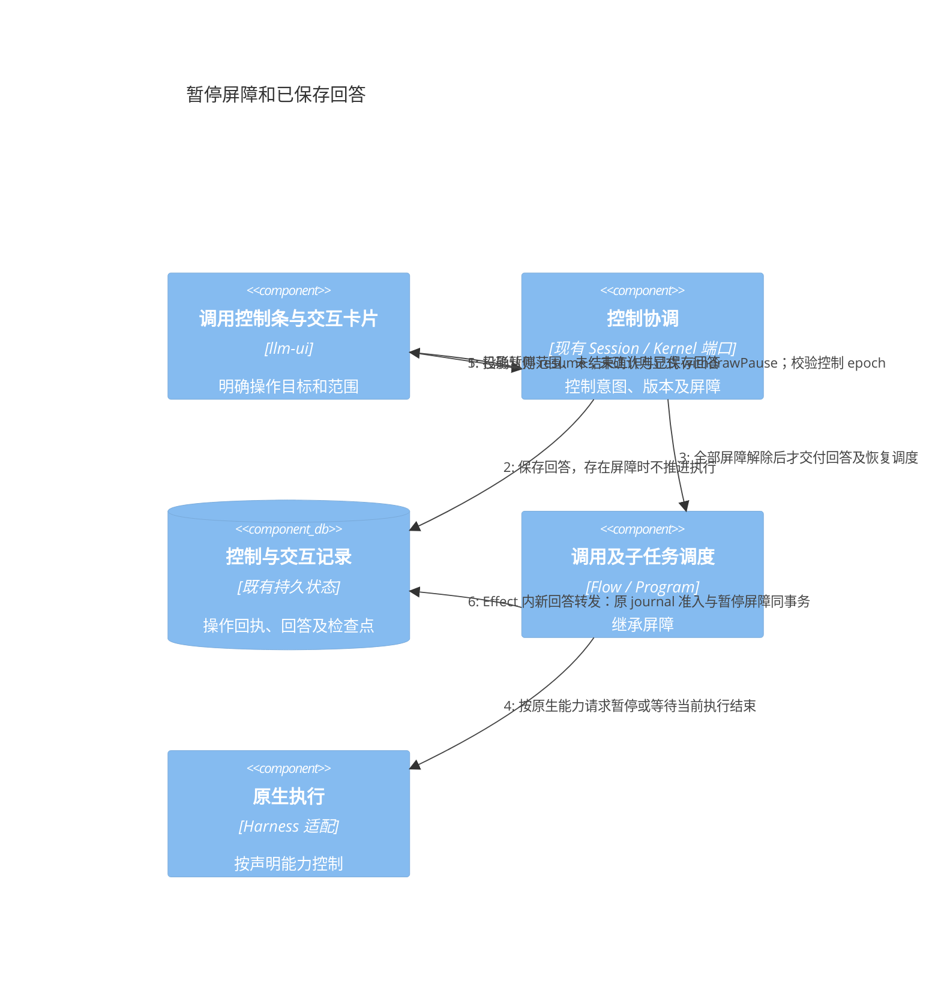
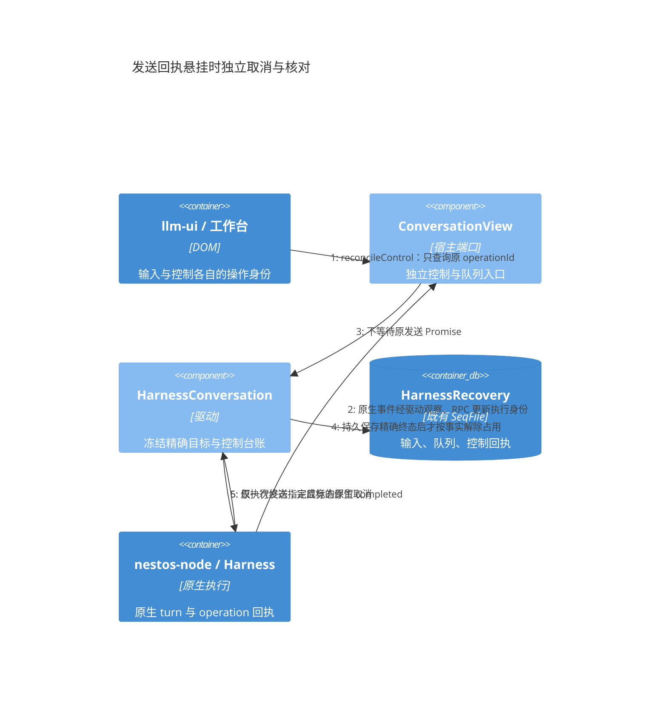
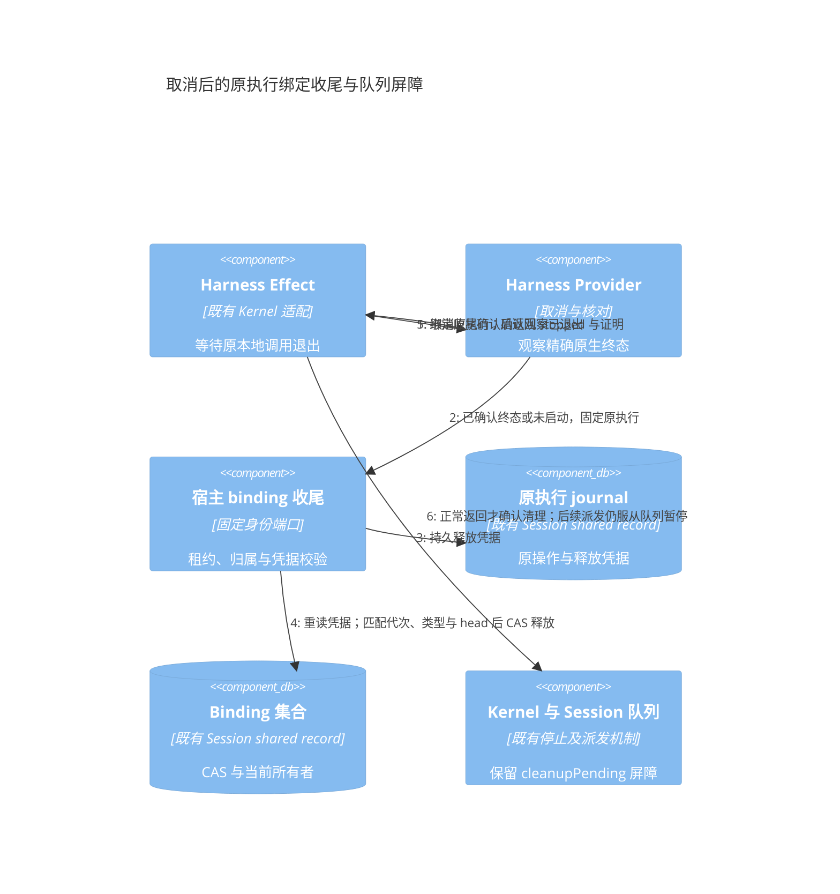
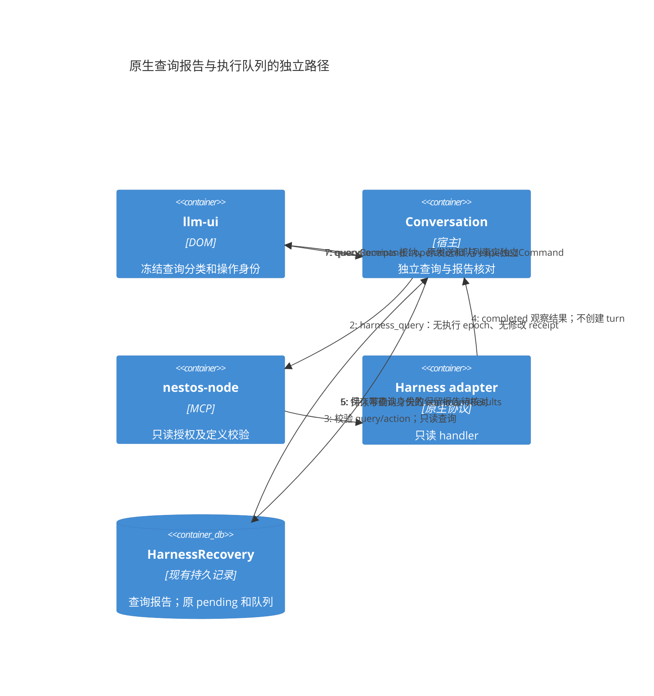
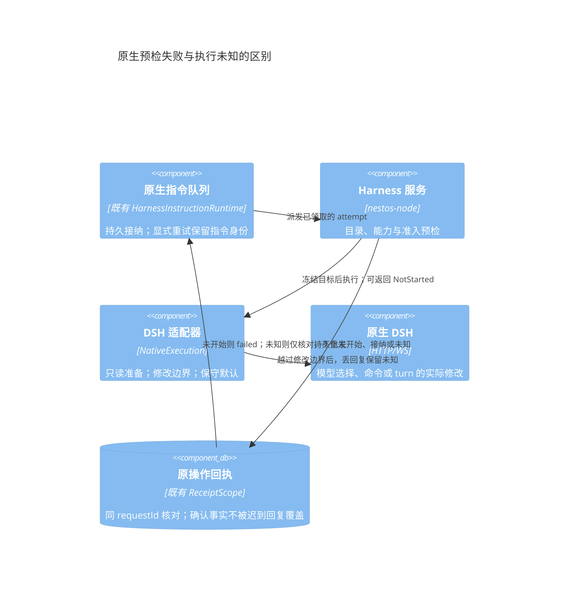
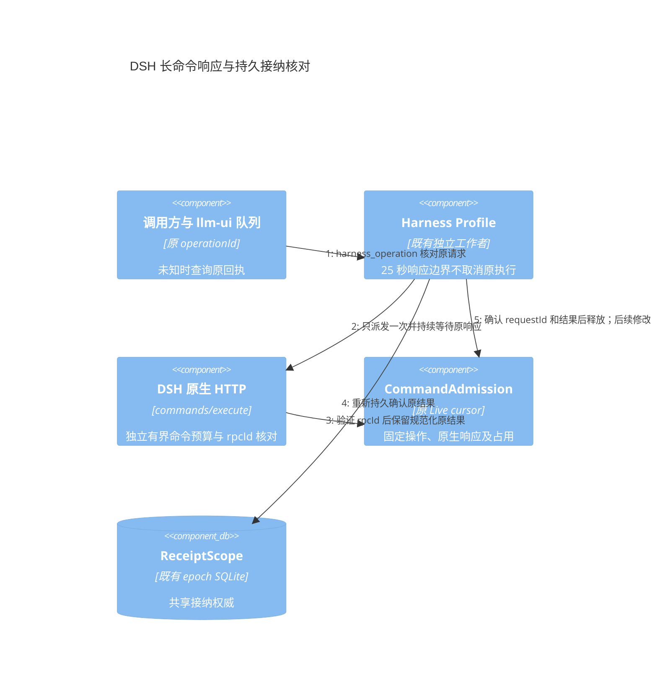

# Invocation 控制与状态矩阵评审稿

状态：目标契约；原生精确目标取消、独立回执及队列并行编辑已接入，完整暂停屏障仍待实施。日期：2026-10-25。实施边界见第 8 节。

本协议配套[统一执行模型评审稿](agent-session-connection-review.md)。输入主按钮表达下一次输入，运行控件作用于指定 Invocation。按钮由能力、权限与实际事实派生，不按 Agent、Flow 或 Workflow 名称硬编码。

## 1 独立的状态维度

| 维度 | 权威事实与用途 |
| --- | --- |
| Session 生命周期与权限 | 开放、归档、只读及当前授权，约束允许的写入 |
| Invocation 执行状态 | 各调用的 Task、Effect、交互及终态，不能合成一个 Session running 值 |
| 控制意图与确认 | 请求动作、范围、版本、是否真正生效 |
| 发送队列 | 暂停、待发送条目、领取状态和派发屏障 |
| 观察与所有权 | 在线、陈旧、失联、受控、仅观察，以及可验证的执行身份 |
| 收尾 | output 校验、history-pending、cleanupPending 和资源占用 |

顶部可显示“运行 2 · 待交互 1 · 排队 3”等摘要，它只是读模型。现有 [Kernel taskStat](../../libraries/durable-kernel/src/domain/status.ts) 的 control.requested/acknowledged、activeOperations、stopped/settled 是事实来源，不另建 Session 状态机来反推按钮。

```ts
type PauseCapability =
    | { kind: 'unsupported' }
    | { kind: 'boundary'; scope: 'scheduler' | 'agent-loop'; inFlight: 'drain' }
    | { kind: 'native-checkpoint'; scope: 'thread' };

interface InvocationControlView {
    invocationId: string;
    controlRevision: number;
    requested: 'run' | 'pause' | 'cancel';
    acknowledged: boolean;
    scope?: 'scheduler' | 'agent-loop' | 'thread';
    activeOperations: number;
    stopped: boolean;
    settled: boolean;
    holdOwnerRefs: string[];
}

interface AvailableAction {
    id: string;
    targetRef: string;
    enabled: boolean;
    reason?: string;
    expectedControlRevision?: number;
}
```

Connection 能力声明与 Invocation 当前可操作性分开。支持模型推理不推出可续接，支持取消不推出可暂停。动作至少验证权限、具体目标、声明能力、观察可信度、相应控制版本和冲突操作。

scope 只标记已经声明或请求的暂停范围；没有该能力时不能用 scope 字段伪造暂停支持。controlRevision 随控制资格或屏障变化，不随 token 更新。UI 依据宿主提供的动作及原因显示，服务端对每次请求再次核对。

## 2 五条写入与控制通道

| 通道 | 目标与含义 | 不能隐式替代 |
| --- | --- | --- |
| submit | 新输入，持久入队或新建 Invocation | 不自动回答审批或注入当前执行 |
| respond | 指定 interactionId/revision 的审批或补参 | 不解除暂停，不默认为同意 |
| steer | 指定活动 Invocation 的运行中追加指令，仅能力支持时开放 | 不偷偷使用普通发送或取消后重跑模拟 |
| control | 指定 Invocation 的暂停、恢复或取消 | 不自动改变队列或无关调用 |
| queueControl | 指定 Session 队列的暂停或恢复派发 | 不暂停、恢复或取消当前执行 |

query 是另外的只读观察通道。queueControl 在实现上可映射既有 editQueue 的 pause/resume 操作，共用同一队列 revision；不建立第二份队列控制状态。停止当前并暂停后续属于显式复合意图，先保存队列暂停，再取消选定 Invocation，分别报告结果。

每次操作有独立 operationId。respond、steer、control 不被等待完整执行结果的 submit Promise 阻塞，彼此按具体目标和冲突规则协调。steer 缺少能力时隐藏或显示具体原因，不能降级为新 turn 并声称影响原执行。

```ts
interface InvocationControl {
    operationId: string;
    invocationId: string;
    action: 'cancel' | 'pause' | 'resume';
    expectedControlRevision: number;
}

interface InteractionResponse {
    operationId: string;
    interactionId: string;
    expectedRevision: number;
    value: JsonValue;
}

interface SteeringRequest {
    operationId: string;
    invocationId: string;
    expectedControlRevision: number;
    input: JsonValue;
}

interface QueueControlRequest {
    operationId: string;
    sessionId: string;
    expectedQueueRevision: number;
    action: 'pause' | 'resume';
}
```

InteractionResponse 的 expectedRevision 属于交互，其他控制使用独立控制或队列版本。steer 输入按适配器声明的追加输入契约校验。ID 只用于关联，宿主仍核对所属 Session、授权及当前可用动作；secret 回答按交互策略持久化，不进入日志或默认上下文。

“继续”拆成：恢复执行表示同一个已暂停 Invocation；提交回答解决原交互；接着发送表示同 binding 上的新 Invocation 和新 turn。取消后的续聊属于新发送，不能 resume 已终结调用。

## 3 ChatInput 与运行按钮

输入栏始终用于下一条提交，Enter 的语义不随当前运行状态变成停止或恢复。明确交互表单内的提交操作例外，仍绑定其 interactionId。运行控制位于选定调用卡片或独立控制条；多个活动调用时要求选定目标。

| 当前事实 | 输入主按钮 | 运行或交互控件 |
| --- | --- | --- |
| 空闲且输入有效 | 发送或运行 | 无活动运行控制 |
| 运行中 | 加入队列 | 停止，具备能力时暂停 |
| 等待审批或补参 | 可加入后续队列 | 交互卡片显示回答、批准或拒绝 |
| 暂停请求中 | 编辑或加入队列 | 显示具体暂停范围及等待边界，停止独立可用 |
| 暂停已确认 | 编辑或加入队列 | 恢复执行及停止，仍受其他屏障限制 |
| 停止或清理中 | 可编辑；接纳允许时入队等待 | 显示进度，按同一操作核对 |
| 结果未知或失联 | 保留原草稿；新草稿在可持久接纳时入队，但不越过未知屏障派发 | 核对或重连；身份及授权可信时可提交待核对取消 |
| 已完成、失败或取消 | 新发送 | 按策略重新运行；新 Invocation 保留 retryOfInvocationId |
| 归档、只读或接纳校验无法完成 | 保留可编辑草稿，禁止对应写入 | 仅提供当前权限允许的动作 |

输入有效性遵守[输入解析规范](invocation-input-resolution.md)，可以是纯参数、纯附件或零参数。上传或 schema 错误影响这次草稿，不把无关后台调用的状态压成全局禁用。

原操作 unknown 时不能自动复制成新发送；新输入必须有明确的新草稿或用户新提交身份。是否可以接纳它，由宿主队列能力决定。入队不等于越过原未知操作执行，离线且不能完成准入时只保存草稿。

## 4 暂停范围与确认条件

| 动作 | 对当前工作的影响 | 对后续工作的影响 |
| --- | --- | --- |
| 暂停队列 | 当前 Invocation 继续 | 不领取新 Instruction |
| 暂停调用 | 在声明的安全范围持有屏障；等待已启动工作按策略到边界 | 不继续创建受屏障约束的节点、工具或子调用 |
| 撤销暂停请求 | 仅撤销指定版本、尚未确认的自身暂停，不中止或重发当前工作 | 释放本控制所有者的屏障，其他暂停仍有效 |
| 取消调用 | 请求停止并核对终态、清理占用 | 该调用终结，不能再 resume |

| 执行体 | 暂停能力与 UI 含义 |
| --- | --- |
| 确定性 Flow | scheduler 边界屏障，当前节点按声明 drain；期间显示等待当前节点结束 |
| 本地 Agent loop | 在模型或工具调用之间的可恢复边界暂停；活动外部副作用未确认结束时不能标 stopped |
| 原生检查点 Harness | 等待原生确认与可恢复检查点后显示相应暂停已生效 |
| 仅有长活执行及取消的 Harness | 可以暂停外层调度，不能暂停内部工具循环；显示远端仍运行或不支持内部暂停 |

外层 scheduler 持有屏障但远端仍运行时，调用不显示“整体已停止”或“停止计费”。只在声明范围真正确认后显示相应状态；要显示 Invocation 已暂停，还需满足该调用可恢复边界及活动外部操作条件。stopped、settled 与单纯有暂停意图分开投影。

## 5 屏障 交互和控制竞态

暂停根 Flow 覆盖其受管理子调用，动态创建成员也继承祖先屏障。检查屏障和启动节点须在现有带 fencing 的调度或提交边界内完成，不能只在前端点按钮时检查一次。原生内部调度只有在其明确支持该控制时才受同样保证。

暂停期间可以持久保存审批或补参回答。未满足所有屏障时不向会导致运行继续的原生端转发，也不启动后继节点；显示回答已保存、待恢复。只有原生能可靠保留暂停时才可提前投递回答，实际交互是否完成和回答是否已保存分别呈现。

恢复只解除该控制所有者的 hold，祖先、Kernel Session 或其他持久屏障继续有效。恢复队列只恢复派发，不恢复暂停调用。调用级暂停默认映射根 Task 范围，不能为方便而暂停整个 Kernel Session，进而影响无关后台任务。

原生长活 Effect 等待审批时，暂停尚未确认，回答可以保存但暂不转发；普通 resume 不能跳过确认条件。用户可以显式“撤销暂停请求”，以独立 operationId 和精确控制 epoch 释放这次未确认的自身 pause。该动作不称为“恢复已暂停执行”，不能撤销 interrupt 或绕过树内 cleanupPending。若暂停已在竞态中确认，拒绝撤销并刷新，用户再选择正常恢复；不自动换一种控制操作重试。

长活 Effect 内向原生端转发新回答，也需要现有 journal 的持久准入。Kernel 的 EffectSessionState.setIfRunning 将新操作 pending 记录和 Session、祖先及当前任务暂停屏障在同一事务检查；被屏障挡住时不写 journal、不发原生请求，继续观察原调用。恢复或撤销本控制后，仍使用原交互和 operationId 申请准入。已在暂停之前准入的操作允许收尾或按原回执核对，并继续计入在途 Effect；这里保证事务准入顺序，不承诺物理网络发送的时钟顺序。结算和只读观察继续使用普通共享写入，不能因暂停丢失终态。

取消与完成竞态保留真实执行终态：原调用已完成时不改写为 cancelled；取消控件显示未生效或执行已完成，清理仍按事实核对。取消与回应并发时，按持久控制顺序和交互修订决定接纳或拒绝；取消优先屏障一旦建立，不再发送会重新启动工作的迟到回应。

若 Kernel 根任务已取消而原生端稍后返回完成，分别保留根任务出口与原生终态。调用层按冻结的取消语义投影结果，不能改写 Kernel 终态，也不能把已经完成的外部写入显示成已撤销；后续是否使用产物或续接由新的显式操作决定。

现有 Kernel 的 cancel 正常返回后确认清理；桥必须检查 Connection 结果。stopped 且停止及清理满足条件才允许返回 void；pending/unknown 继续保留 journal 和 cleanupPending。详细映射沿用[主稿第 5.5 节](agent-session-connection-review.md#55-与现有-kernel-的取消和核对适配)。



## 6 其他运行决策

| 场景 | 必须保存和执行的策略 |
| --- | --- |
| 无人值守遇到交互 | 准入拒绝、超时失败，或有明确期限及通知目标的等待；不默认批准 |
| 部分节点失败 | 按定义选择 fail-fast、继续独立分支或允许部分结果；根成功条件显式声明 |
| 一条分支等待输入 | 只阻塞有依赖或共享屏障的工作，独立分支按图及资源约束继续 |
| 停止前已发生写入 | 保留已发生效果；补偿是显式节点或工具，不把取消当成回滚 |
| detached 子调用 | 仅在明确策略允许且有独立持久所有者时存活，预算及清理责任同时转交 |
| 平台预算与原生用量 | 标明可强制的 token、时间、并发限额与只能观察的远端 usage；缺失用量不等于免费 |
| 输出 schema 失败 | 保存受授权访问的原始产物和验证原因；修复调用须显式、有预算且有尝试记录 |
| 配置或授权变化 | 冻结计划保持可追溯，后续副作用继续复验当前授权 |
| 外部原生会话接管 | 分别验证读取、续接、执行控制和冲突占用；旧操作仍活动时不能启动新冲突操作 |
| 远端主持调用本地 Flow | 需受限调用桥、目标目录和预算；Harness 连接本身不授予能力 |
| 不完整恢复 | 分别报告 thread、工作区和记忆恢复范围，不能以其中一项成功代表完整恢复 |

允许部分结果时，根输出包含已成功与失败成员的可追溯引用，满足声明的结果契约才算成功。fail-fast 也需等待取消及清理，不因为根状态先结束就放行冲突调用。

## 7 验收要求

按钮矩阵同时测试单调用与混合 Session：后台 Flow 运行、前台等待审批、队列有条目及另一个调用清理中可以共存，互不靠全局 running 值误禁用。

重点组合包括：暂停时动态创建子任务、暂停期间回应审批、祖先屏障下恢复子节点、取消与审批同到、取消与完成同到、一个分支等待输入而其他独立分支运行，以及接管时旧远端操作仍活动。任何组合均不能越过屏障、扩大授权或重复副作用。


## 8 当前实施覆盖

### 8.1 原生执行的独立控制回执

[HarnessControlLedger](../../libraries/nestos-node-driver/src/harness/control-ledger.ts)复用 HarnessRecovery 的 controls 字段，保存原生控制请求及观察恢复点，不替代 Kernel Task/Effect 状态。当前落地取消，统一 InvocationControl、控制版本、steer 和分层暂停屏障仍是目标契约。

```ts
interface HarnessInterruptRequest {
    sessionId: string;
    turnId: string;
    operationId?: string;
}
interface HarnessControlProjection {
    operationId: string;
    sessionId: string;
    turnId: string;
    receipt: 'unknown' | 'accepted' | 'rejected';
    effect: 'unconfirmed' | 'completed' | 'failed' | 'cancelled';
    code?: string;
}
```

宿主先冻结目标、epoch 和 operationId，保存 pending，再发送原生 interrupt；独立 UI 使用自己的取消 OperationContext.operationId。核对只查原 requestId 与 epoch，不重新发出取消。同 ID 重入返回原记录，即使原 turn 已结束；同 ID 换目标拒绝。控制回执不覆盖输入 pending/submission，不消费草稿，也不产生伪造的用户历史。原生 completed/failed/cancelled 由精确 turn 事实确认并持久保存，不从取消接纳推导。

| 控制回执 | 精确原生终态 | 当前派发约束 |
| --- | --- | --- |
| unknown | 未知或已知 | 仍核对原控制请求，阻止冲突派发 |
| accepted | 尚未观察 | 显示停止待确认，继续保留占用 |
| accepted | completed / failed / cancelled | 保存实际结果，按队列原有成功或失败策略收尾 |
| rejected | 任意 | 不声明停止；原执行仍活动时继续阻止新 turn |

canInterrupt 不依赖正在等待的发送 Promise，仍要求已授权、观察新鲜、受控且已知 activeTurnId。DSH 额外投影 interruptible：输入身份未识别或原控制待确认时不开放停止；节点再次验证真实所有权。支持取消并不声明支持暂停。

### 8.2 队列与运行控制各自推进

原生队列只在领取、编辑和结算期间持有编辑串行锁。远程发送或 receipt 查询在锁外等待，回来后重新核对队首 id、attemptId 和状态；迟到响应合并当前记录，不覆盖后续编辑。已执行后保存回执失败，不作为原生未执行或可自动重试的依据。

[宿主视图](../../backend/app-core/src/projects/conversation-view.ts)使入队、队列编辑、草稿保存、读取、回应、取消及控制核对独立于原发送等待；队首派发悬挂时仍处理原生事件观察。HTTP RPC 通过既有视图失效通知推送 activeTurnId 和可用动作。[工作台](../../ui/llm-ui-adapter/src/shell/RemoteConversationEditor.ts)在原发送悬挂时仍可停止和核对控制；[独立适配](../../ui/llm-ui-adapter/src/independent/native.ts)按操作通道分别结算台账。

取消入口自身不改变队列暂停状态。需要“停止当前并暂停后续”时，先显式 editInstructionQueue(pause)，持久成功后再 interrupt，分阶段报告结果。控制待确认会暂时阻止冲突派发；这与队列持久 paused 标志分开。实际失败或取消后的默认队列失败策略仍有效。



### 8.3 存储未知与视图生命周期

[RemoteConversationStore](../../backend/app-core/src/projects/remote-conversation-store.ts)在事务回复丢失后保留原写前、写后内容。下次保存先读取持久记录：等于写前则原写未生效，等于写后则恢复己方已提交的 CAS 游标；其他内容视为并发写入冲突，阻止旧实例继续覆盖，即使它随后执行 load。该核对只恢复存储写入，不重放原生操作。队列入队回执丢失后，控制与草稿保存先同步原队列；存储层拒绝较旧队列修订或同修订的不同内容，防止用内存回退覆盖已持久接纳的条目。输入接纳补记 submittedTurnId 时也先核对，并保留已确认的控制事实。

旧 @new 草稿清理不会删除仍有控制待确认、待发送队列、待回应交互或后续输入的恢复记录。宿主注册表在控制 unknown 或 accepted 且未观察终态时继续保留后台观察，最后一个页面关闭不会令停止自动成功。原始异常和正文不写入新增日志；日志保留 operationId、阶段、安全错误码与耗时。

[驱动回归](../../libraries/nestos-node-driver/tests/conversation.test.ts)、[台账回归](../../libraries/nestos-node-driver/tests/control-ledger.test.ts)、[真实 RPC 组合](../../apps/http-app/tests/conversation-composer-rpc.test.ts)、[工作台 DOM 回归](../../ui/app-shell/tests/remote-conversation-editor.test.ts)覆盖悬挂发送时入队、编辑、显式暂停和取消，以及迟到回复、真实完成竞态和精确目标去重。[存储故障注入](../../backend/app-core/tests/remote-conversation-store.test.ts)与[草稿集成](../../backend/app-core/tests/remote-draft-conversation.test.ts)覆盖事务提交前失败、提交后丢回复、同实例核对及并发胜者保护。

仍未完成：全入口控制版本、分层暂停及审批屏障、原生控制跨节点 epoch 核对、完整事件缺口下的 turn 映射，以及各类连接的完整独立就绪度。原生只读命令通道的本轮接入见 §8.6；当前队首悬挂场景的独立观察，不等于所有长期挂起网络请求均已实现无阻塞投影。


### 8.4 Connection 取消结果与 Kernel 清理确认

[ConnectionCancelResult](../../backend/kernel-adapters/src/llm-management/contracts/connection-control.ts)将停止、清理和证明分开。Harness Provider 继续使用原有 journal、停止观察及绑定收尾流程，成功时返回 stopped/cleanup=confirmed，以及当前 Session/Task/Effect、journal 引用和 terminal/not-started 证明分类；失败仍抛出具体原因，保留原 journal。

HarnessExecutionEffect 显式检查结果及证明归属，再等待所有本地 in-flight 调用退出。pending、unknown、stopped 但清理尚未确认、旧实现返回 void、缺少证明或归属不符均不能使 Effect.cancel 正常返回。Kernel 沿原路径保留 cleanupPending、未确认控制和恢复问题；恢复确认后才清除占用，不增加新的 Kernel 状态库。

[真实 Kernel 回归](../../backend/kernel-adapters/src/programs/harness-program.test.ts)证明：unknown 和 cleanup pending 后，任务虽已 cancelled，stopped/settled/控制确认仍为 false；session.recover 核对成功后才能确认停止，原 execute 只调用一次。另覆盖停止已确认而本地观察尚未结束、错误目标证明，以及私有 prompt 不进入诊断。[宿主回归](../../backend/app-core/tests/harness-execution-recovery.test.ts)继续验证未知 interrupt 不重发及实际终态恢复。

这是 Harness 路径的接口迁移：注入式 Provider 的 cancel 必须返回上述证明，不能继续返回 void；Kernel EffectAdapter.cancel 仍返回 Promise<void>，请求、执行结果和既有持久格式不变。ConnectionReconcileResult 已由下一节描述；其他连接类型及完整控制版本仍在迁移范围内。


### 8.4.1 原执行 binding 的生产清理端口

取消时普通 Effect state 可能已经失效。Runtime 同时注入两项能力：stateForCleanup 只读写原 journal；settleContextForCleanup 使用宿主固定 binding 的收尾方法，不把共享集合端口交给取消后的 Effect。两者在打开 Kernel Session 前核对原租约，每次记录读写继续续验；不触发重新取得租约或恢复执行。

收尾从实际持久 journal 重载原 Session/Task/Effect、请求摘要、原生身份及 terminal/not-started 证据，不信任调用方修改的内存副本。仅原所有者能准备 settlement；journal 释放凭据持久后，才核对 binding 修订、代次、终态类型和 head 并释放。未知原生接纳不能伪报 not-started。已释放后遇到新所有者只核对原操作，不释放新操作。缺少专用收尾能力的上下文调用明确报 CLEANUP_BINDING_UNAVAILABLE，不能用更宽模拟 state 隐式放行。



[真实应用回归](../../backend/app-core/tests/harness-agent-execution.test.ts)经实际 Runtime、Program、Kernel 与生产工厂运行：当前调用取消后 stopped/settled 为 true，原生 interrupt 只发一次；队列已暂停时第二条不会派发，显式恢复后使用新 binding 执行。原生 completed 与取消竞态保留 journal 的 completed 事实，不能为了控制反馈改成原生 cancelled。Task 的取消事实与原生实际终态分别保留。

[收尾故障回归](../../backend/app-core/tests/harness-context-cleanup.test.ts)覆盖原凭据持久前失败及丢回复、释放丢回复后新所有者领取、并发独立 binding、失租、错误原生身份、篡改内存及持久准备记录。新增日志只保存安全阶段、错误码、耗时和宿主关联身份，不写原输入、存储异常正文或原生 session/turn 正文。

真实 Runtime 另外在 Kernel 的 journal 写入前、binding 释放已提交后分别注入存储错误。取消报错后 stopped/settled 和控制确认仍为 false，cleanupPending 保留；移除故障并调用既有 Session recover 后才确认清理，原生 turn 与 interrupt 均只调用一次。此验收同时覆盖生产清理端口、Kernel 持久事实及恢复路径，不以完整模拟 state 的局部通过替代。

### 8.5 连接核对结果与原执行观察

HarnessExecutionProvider.reconcile 现在返回 ConnectionReconcileResult，不再直接返回 Kernel 的 retry/indeterminate。Effect 桥在 [connection-reconcile](../../backend/kernel-adapters/src/effects/connection-reconcile.ts)显式转换：

| Connection 事实 | Kernel 结果 | 副作用约束 |
| --- | --- | --- |
| completed | completed，保留原结果 | 不调用 execute |
| running | indeterminate / CONNECTION_STILL_RUNNING | 继续核对原 handle，不创建新调用 |
| unknown | indeterminate，保留安全错误码 | 不从断线、epoch 变化或未知 receipt 推导重试 |
| not-started | 验证原 Session/Task/Effect、证明引用及 not-started 分类后才 retry | 仍复用同一业务与原生操作身份，旧尝试须受 fencing 阻止后续启动 |
| 旧 retry 枚举、缺少或冲突证明 | indeterminate 或可分类的待核对错误 | 不自动执行 |

宿主仍从原 journal 恢复同一会话、turn 和操作回执；活动执行通过原生事件继续观察，恢复预算耗尽时返回 unknown。缺少 journal 只有在先持久登记、后执行且当前恢复拥有写 fence 的约束下，才能作为未启动证据；它不表示可以丢弃本次调用身份。确定的原生失败或取消仍保留真实终态。日志区分仍在运行、epoch 变化、证明冲突和无效结果，不合并成一个笼统的未知类别。

[宿主回归](../../backend/app-core/tests/harness-execution.test.ts)新增未启动证明与原运行观察的组合验收：核对既有活动 turn 后中止恢复预算，结果仍为 unknown，原生 turn 仅发送一次。[Effect 回归](../../backend/kernel-adapters/src/programs/harness-program.test.ts)覆盖 running/unknown/旧 retry 不触发新执行、正确未启动证明、错误所有者及终态证明不能冒充未启动。

当前验证：适配层全量 352 项通过，含 34 项 Harness Program/真实 Kernel 回归；最后的等价辅助函数提取后，34 项重点回归再次通过。宿主执行/恢复/上下文/fork/Agent 集成 69 项通过。工作区类型检查、架构检查、适配库构建、隔离 HTTP 构建和制品清单校验通过；五份设计文档的 13 张 Mermaid 图通过语法解析。

最终制品为 20261024T164234-6d8d2171-dirty，已核对其中同时包含取消证明、待清理、原运行观察、未启动证明及无效核对结果的检查逻辑。2026-10-24 16:44 UTC 的线上 health 仍为 20261024T155957-6d8d2171-dirty；本任务未重启服务。构建期间发现的源码变化仍会拒绝产物，新诊断报告具体变更路径且不输出源码；对应 14 项工具回归通过。

线上原 Session 的 Project Harness 接入成功，但原生命令目录请求返回 EIO/remoteCode=EBUSY；具体原生失败端点尚待区分。历史 idle/canSend 投影不能代替原生可用性验收，不能据此宣称原页面已经恢复。

### 8.6 原生只读命令与查询报告

`capabilities.commandQueries` 正向协商独立的 `harness_query` 读取端口。调用携带授权项目的 revision、原生 sessionId、requestId 和冻结的 expectedCommand；requestId 仅关联本次观察，不进入原生修改 receipt。节点只允许适配器明确实现的 query/action handler，复验定义修订并拒绝参数、模型覆盖及串行命令；查询不取得修改串行锁，不 resume、adopt 或提交 prompt。旧节点未声明能力时沿用原有保守端口，不发送新协议请求。查询就绪不要求原执行观察新鲜或在线；显式读取可在原观察陈旧时重新取证，执行派发仍保留可信状态要求。CLI 的 conversation query / reconcile-query 使用同一端口，不先加载完整历史或原生全量目录。

DSH 的 `commands/list` 依赖原生 Agent lookup，可能隐式恢复会话及取得写入权。因此未附着或已归档会话只返回适配器自有只读目录，并以 `observation.complete=false` 和具体 code 声明不完整；附着记录在原生目录读取期间保持借用。原生目录冲突仍保留只读项；权限及协议错误不降级为空目录。独立状态查询直接读取会话摘要，不依赖全量目录查询成功。该修复阻止一种隐式写入路径，不证明原生产 EBUSY 的唯一来源或原生资源已经全部释放。

宿主的 [HarnessCommandQueries](../../libraries/nestos-node-driver/src/harness/conversation-queries.ts)将已取得的查询结果保存到既有 HarnessRecovery.commandResults，附加查询 operationId、原生 sessionId、定义身份和修订。只有持久保存确认后才投影 queryReceipts；查询不会替换 pending/submission/submittedTurnId，不消费原生草稿、不覆盖队列回执。重复的同一身份复用已保存报告，同身份不同定义拒绝。网络读取失败只表示没有可接纳报告，不产生执行 unknown 屏障；报告写入丢回复保留原观察结果，通过 pendingQueryReports 暴露精确报告身份，宿主注册表在页面关闭后保留它，reconcileQuery 只重试保存，不重新读取原生状态。旧工作台的核对按钮同样优先核对该报告，不替换原输入提交。重开后找不到已保存报告时保持报告未知，不调用 harness_operation，不据此宣称原执行未发生。

独立 llm-ui 冻结 CommandSubmission.execution，并将查询报告接纳更新到同一 OperationLedger。查询目录刷新和原发送 Promise 均不阻挡已知只读命令；真实派发的定义复验归节点。报告未知时允许用户显式提交新的只读观察，保留旧报告身份；执行修改仍禁止自动重放。旧工作台的查询不使用原输入的 ConversationComposer.submit/accepted，不清除其 remoteSubmission 标记；接纳查询报告后只按当前文字修订清理匹配输入，并保存仍待核对的原提交。旧输入组件按明确的只读命令能力放行，其他发送限制不变。



验证入口：[驱动及恢复](../../libraries/nestos-node-driver/tests/conversation.test.ts)、[客户端协议](../../libraries/nestos-node-driver/tests/harness.test.ts)、[真实 RPC 组合](../../apps/http-app/tests/conversation-composer-rpc.test.ts)、[旧工作台点击](../../ui/app-shell/tests/remote-conversation-editor.test.ts)。节点回归覆盖 Codex、Claude、DSH 的只读端口、拒绝串行命令、无修改 receipt、DSH 不触发 Agent lookup，以及项目只读授权。线上节点尚未配套发布，不能用这些替身和协议测试代替原 Session 的实际验收。 当前报告保留沿用最近 64 条 commandResults 恢复窗口；统一历史的长期保存、分页及产物归档仍在迁移范围内，不能将此窗口当作完整历史归档。

### 8.7 未开始执行的预检失败

命令目录读取失败、模型目录读取失败与修改请求丢回复可能具有相同 EIO/超时错误码，但只有后一种情况表示执行结果未知。[节点服务](../../tools/nestos-node/src/plugin/harness/service.rs)在执行端口之前的失败保存明确未派发回执；[驱动契约](../../tools/nestos-node/src/plugin/harness/driver.rs)增加 `NativeExecution.NotStarted/Dispatched`，DSH 据此报告内部预检边界。旧驱动默认 Dispatched，不能凭错误码推测未开始；此证据不是 Kernel 的停止或清理确认。

DSH 的只读模型目录准备在取得 prompt 占用前完成；命令目录包括服务预检及适配器派发前复验。确切未发出修改时，保存原 operationId 的 not-committed、原安全错误码和 `stage=prepare/executionStarted=false`。回执保存成功后，现有队列记 failed 并暂停，保留原接纳身份及草稿；重开不自动重发，用户显式 retry 创建新的 attemptId。保存回执失败继续 unknown，沿原身份核对，不拿内存中的未派发标志替代持久事实。



[HTTP/WS 回归](../../tools/nestos-node/src/plugin/harness/tests/dsh_preparation.rs)覆盖两次命令目录读取分别失败、模型目录失败后无修改、原回执不变及显式新 attempt。模型选择请求已发出但结果未知时，即使 prompt 尚未发出，也保留原占用并阻止下一修改；本轮没有实现该阶段的完整后续核对。[真实客户端与持久队列回归](../../libraries/nestos-node-driver/tests/conversation.test.ts)证明 not-committed EIO 不会变成 uncertain，重开后等待显式重试。

安装的 DSH 0.2.0-rc.2 命令事件没有调用方 requestId，不能按相同命令、参数或时间邻近推断原生 commandId。未知串行命令的权威身份映射、跨 epoch 核对及外部写入隔离仍未完成，不因这项预检修复而自动解锁旧未知操作。

### 8.8 DSH 长命令与原响应核对

普通读取和串行命令使用不同等待预算：request_timeout_ms 仍默认 25 秒；command_timeout_ms 默认 10 分钟，宿主配置允许 100–1800000 毫秒。服务对调用方的 25 秒响应上限不改变，原已派发工作者继续等待同一原生 HTTP 响应。响应的 rpcId 由传输层验证，规范化 commandId、结果和失败标志始终关联原 operationId；不能按命令历史文本推测。

原生响应到达后，CommandAdmission 继续保留原占用和响应；先经现有 ReceiptScope.finish 持久保存，再由 operation_settled 以匹配的 requestId、结果和终态解除占用。持久写入未确认时，harness_operation 只读取已有存活驱动的原响应并重试保存，不初始化驱动或再次执行命令。unknown、结果冲突、其他操作回执或旧操作回调不能释放当前所有者；已观察到的原生结果不能被未提交回执否定。项目运行所有权同步在持久确认之后释放。

Profile 的原修改串行锁由 execute_native 返回给原工作者，持续持有到回执保存及 operation_settled 完成。排在原命令后的修改首先等待该锁；原工作者退出但结果仍未知时，原 CommandAdmission 继续拒绝冲突修改。只读查询、精确控制和回应保持原来的独立准入，不等待这一修改锁。



[HTTP/WS 回归](../../tools/nestos-node/src/plugin/harness/tests/dsh_command_recovery.rs)覆盖短查询超时与长命令预算分离、调用方丢弃、服务真实 25 秒响应上限、独立查询、后续修改屏障及真正原生超时不重发。[原生占用回归](../../tools/nestos-node/src/plugin/harness/drivers/dsh/commands.rs)覆盖回执未确认时保留原响应、错误结果或 requestId 不释放、旧回调不释放新操作，以及相同 command/done 文本不能作为原操作证据。

这项修复限于仍存活的原 HTTP 调用及已取得响应：连接断开、超过原生命令预算且响应丢失、节点重启后 epoch 改变，仍需保留未知。DSH 事件中的请求关联、原生持久历史身份和外部写入隔离继续属于未完成项；本轮不执行原用户 Session，也不声明线上问题已恢复。

### 8.9 已提交回执与结果校验

匹配原 requestId 的持久 committed 封套是接纳事实。随后 commandId、终态或正文解码失败，不能将该事实降为 unknown，更不能把它当作 not-committed 后重新执行。Driver 保留已提交事实，按以下层次处理：

| 已知事实 | 展示与派发 | 恢复及重试 |
| --- | --- | --- |
| 执行身份、终态有效，正文预览及引用有效 | 正常投影真实执行结果，正文按需读取 | 只重读原产物；不重新执行 |
| 执行身份、终态有效，旧节点正文超限或内容暂不可用 | 接纳及终态保持，显示该正文的具体问题 | 适用原执行成功/失败策略；读取问题不成为全局发送错误 |
| 回执已 committed，但执行身份或终态本身不合法 | 显示已提交、结果待核对；保留冲突派发屏障 | 按原 operationId/epoch 核对；不能创建新 attempt 自动重放 |
| 没有可信接纳回执，或原生操作本身未知 | 继续显示提交未知，保留原提交身份 | 继续原回执核对，不从内容读取推断执行未发生 |

结果错误保存在既有恢复记录的独立事实中；它不覆盖原草稿、输入回执或 Kernel 状态，也不伪造 native commandId 或 completed。已提交但关联未确认时仍可编辑并接纳后续队列，只阻止有冲突的实际派发。查询与核对原结果使用独立读通道。修复后的原回执可按同一身份解除结果屏障；队列的普通 retry 不得为该已提交操作分配新 attempt。

最近 64 条 commandResults 是展示恢复窗口，不能淘汰仍在运行的命令或尚未核对的 resultError。新查询报告只淘汰已结算展示项；未核对事实达到明确容量上限时报告容量问题，不通过丢弃它们解除派发屏障。关闭重开后仍使用原 operationId/epoch，连续查询也不能使旧未知执行自动变成可重试。

执行封套和队列持久化对原生 commandId/turnId 使用相同长度约束，避免“先接纳，重开再报存储损坏”。来自已提交回执的内部错误凭据只供原请求处理，核对本次 requestId 后使用；完整原文不进入错误日志、广播或公开错误 DTO。

正文读取能力、引用、分页和显示协议见[展示协议 §7.3](invocation-presentation.md#73-原生命令正文与接纳事实)。产物缺失、摘要不符、权限撤销、旧 epoch 或取消读取均属于该产物的可用性，不改变原执行终态。该区分同样适用于以后统一 Invocation 的输出校验，但本轮原生命令实现不能代替全部连接和父子调用的迁移。


### 8.10 Flow 暂停与原生审批

新 Flow 根把 controlTreeVersion=1 冻结在初始检查点，普通、动态派发及重试 Task 保留实际 Kernel 父子关系。Run 的整体 pause/resume 只改变根拥有的 hold；后续节点提交经父状态事务屏障，暂停竞态保留同一 spec/requestId 等待，不进入失败清理。当前 detached 仍由原 Run 持久监督，只脱离 join 等待；独立所有权转交不在这项实现内。

旧运行保持原接纳指纹，不能通过补写 parent 冒充原有控制树。新强范围暂停明确拒绝；已存在旧批量暂停的有限恢复只释放历史可证明原先为 run 的匹配成员，独立暂停和证据不足的成员保留，并向 UI 报告数量。控制操作使用精确 epoch 和稳定 requestId；控制未确认或版本冲突不把 goal 提前改成 active，原控制已生效而 goal 写入失败时，按原控制回执恢复。

[调用卡片](../../ui/llm-ui-adapter/src/flows/InvocationPanel.ts)依据当前 controlTaskIds 和实际 Kernel 事实区分暂停中、已暂停、外部约束及终态。goal 是描述信息，不能覆盖真实控制状态。令牌展示更新不重新创建按钮，控制确认及 epoch 变化会刷新操作；迟到的旧控制快照不能替换新状态。未确认 pause 可显式撤销，取消始终按确切执行目标独立处理。暂停前已在原 journal 准入的回答允许收尾；暂停后尚未准入的回答保持保存，不向原生转发。

回归入口：[Flow 屏障与旧版本恢复](../../backend/llm-flow/__tests__/flow-control-barriers.test.ts)、[Kernel 撤销和事务准入](../../libraries/durable-kernel/src/pause-withdrawal.test.ts)、[真实 Flow 与 Harness 适配组合](../../backend/app-core/tests/harness-pause-continuations.test.ts)、[卡片与 DOM 控制](../../ui/app-shell/tests/flow-invocation-control.test.ts)、[认证 HTTP/RPC 与队列独立性](../../apps/http-app/tests/view-api.test.ts)。测试使用隔离存储和原生端替身，不等同于线上原 Session 验收。

这项增量未增加原生暂停工具循环的能力；严格原生续接、外部写入隔离、跨 epoch 控制核对、控制台旧操作的完整台账迁移、Session 级未确认暂停的显式撤销，以及所有入口的统一五通道迁移仍需继续完成。
