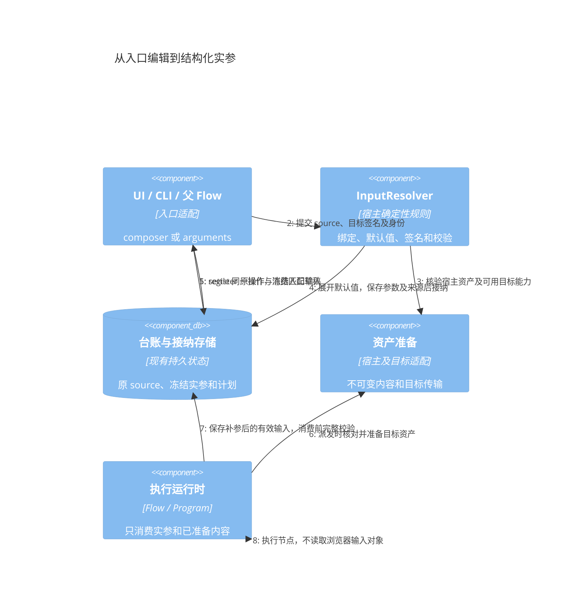
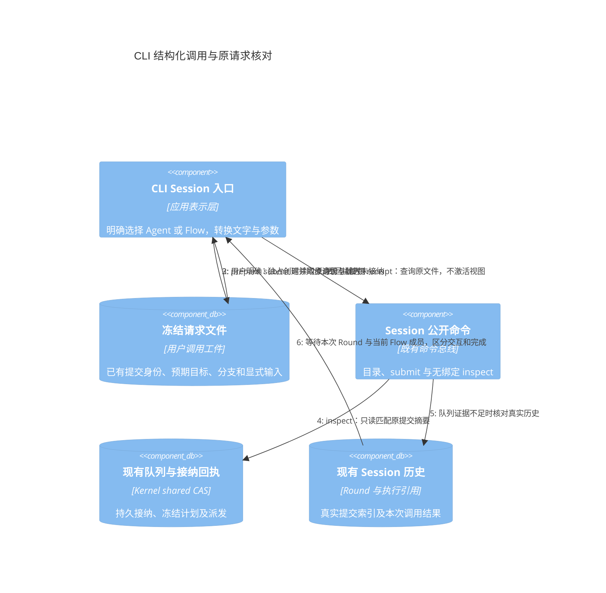
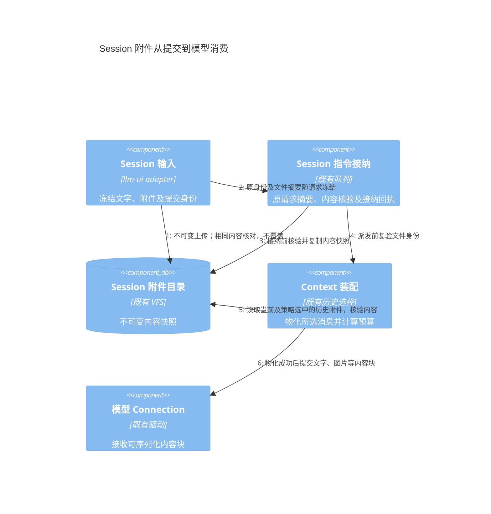
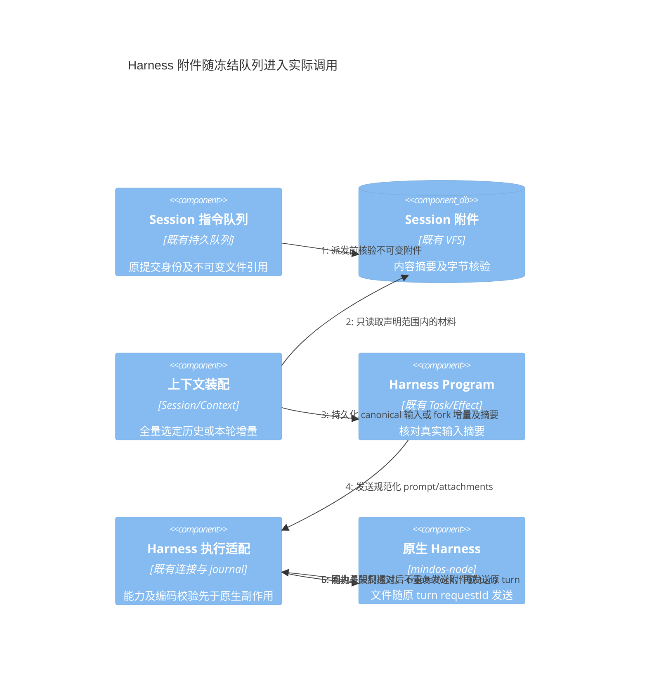
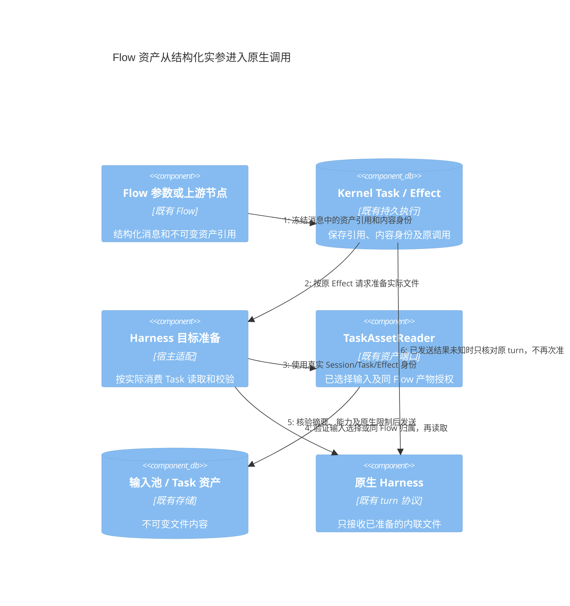
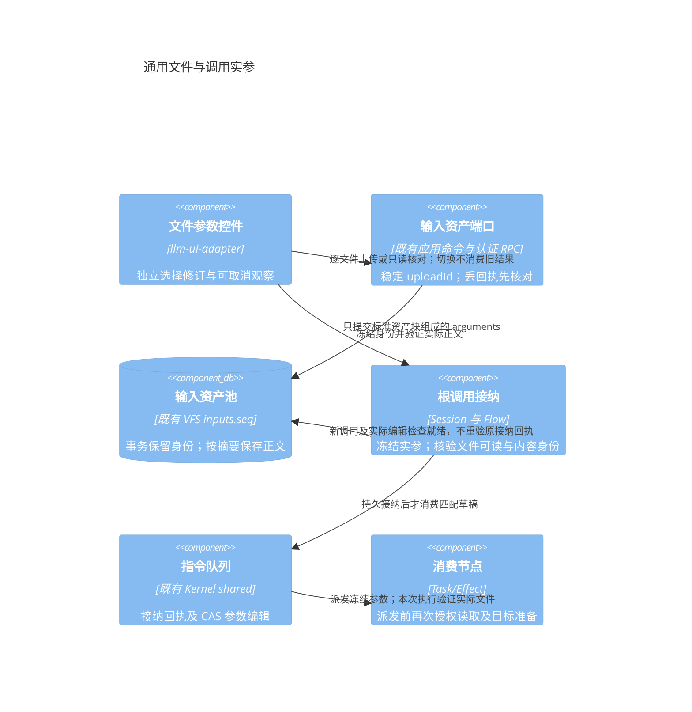

# 调用输入解析与资产传输规范评审稿

状态：目标契约，已开始分阶段实施；当前覆盖与缺口见第 7 节。日期：2026-10-24。

本协议配套[统一执行模型评审稿](agent-session-connection-review.md)。UI、CLI、定时任务和父 Flow 使用同一个宿主解析规则：编辑或入口输入经过确定性绑定与默认值处理，生成冻结的结构化调用实参。执行层不认识 ChatInput、浏览器 File 或表单控件。

共享规则不要求父 Flow 导入 Session 或 UI 服务。纯默认值和参数校验复用现有 llm-flow 函数，资源、目标与授权解析由宿主注入准备端口，遵守既有向下依赖边界。

## 1 输入源与解析结果

```ts
type CallSource =
    | { kind: 'composer'; text: string; attachments: AssetRef[];
        values: Record<string, JsonValue> }
    | { kind: 'arguments'; value: JsonValue };

interface SignatureRef {
    version: string;
    digest: string;
}

interface ResolvedCallInput {
    signature: SignatureRef;
    arguments: Record<string, JsonValue>;
    assetRefs: AssetRef[];
    provenanceRef: string;
    deferredFields: string[];
}

interface InputReadiness {
    target: TargetRef;
    signature: SignatureRef;
    draftRevision: number;
    canSubmit: boolean;
    deferredFields: string[];
    assetState: 'preparing' | 'host-ready';
    issues: Array<{ path: string[]; code: string; message: string; blocking: boolean }>;
}

interface InputResolver {
    resolve(request: SubmissionRequest,
        context: InputResolutionContext): Promise<ResolvedCallInput>;
}
```

SubmissionRequest 保存原 source 及目标选择；ResolvedCallInput 保存实际实参及来源。两者通过 submissionId 关联，原始提交摘要不因默认值展开或后续补参而改变。接纳前取得的目标发布版本、签名和最终实参一起冻结。

第一版 Flow 参数根值限定为对象。arguments 的 value 可使用通用 JSON 类型传输，但非对象根值须明确拒绝；任意 JSON 根值和复杂嵌套编辑以后按版本扩展。字符串内容不再次解释成模板。

所有交互界面提交，包括 composer 和 JSON 编辑器，都必须携带其编辑签名 expectedSignature；宿主按同一个发布版本解释。机器调用可以指定版本，或显式跟随最新发布；省略签名时宿主仅解析一次并保存实际版本，不在派发时重新采用新签名。是否允许省略由可信入口策略决定，不能通过把 source.kind 改成 arguments 绕过。

## 2 绑定与默认值的确定性规则

绑定由发布签名声明，普通 Agent 可以声明默认的消息输入映射。Flow 的参数名是业务接口，文字无需命名为 prompt。

| 来源 | 示例目标 |
| --- | --- |
| composer.text | request |
| composer.attachments | documents |
| 表单语言 | language |
| 表单详细程度 | detail |

例如冻结为以下结构化实参，文件元数据以宿主核验的 AssetRef 为准：

```json
{
  "request": "检查接口设计和异常恢复",
  "documents": [{
    "assetId": "asset-123",
    "name": "design.pdf",
    "mimeType": "application/pdf",
    "digest": "sha256:..."
  }],
  "language": "zh-CN",
  "detail": "full"
}
```

| 问题 | 规范 |
| --- | --- |
| 自动绑定 | 只读取显式 inputSource 与字段映射，不按字段名推测 |
| 正文看起来像 JSON | composer.text 仍为字符串；仅显式 JSON 编辑模式解析 |
| 正文和表单绑定同一参数 | UI 编辑同一个字段状态；外部请求出现不同显式值时报告冲突，相同值保留来源 |
| 未绑定正文或附件 | 明确显示无法使用并拒绝提交，或由用户显式移除；不能静默丢弃 |
| 不同类型文件绑定不同参数 | 使用显式分类或用户选择，不能仅凭扩展名猜测业务用途 |
| 纯参数、纯附件、零参数或全默认值 | 满足签名和接纳约束即可提交，空文字不构成禁用原因 |
| 切换目标 | 保留原草稿和不兼容字段，显示待处理项并重新校验 |
| JSON 编辑器与表单互换 | 编辑同一份有效参数状态；无效 JSON 原文单独保留且阻止提交旧有效值 |

默认值按以下次序解析，右侧仅覆盖已明确提供的字段：

**Flow 发布默认值 → Agent 默认实参 → 本次调用显式值。**

“未提供”依据属性是否存在判断。false、0、空字符串、null、空数组都是显式值，由 schema 判断合法性，不用 truthy/falsy 回退默认值。“恢复默认”移除显式覆盖，“设置为空”保存显式空值。

composer 未触及的空文字/附件面视为没有提供该来源，不覆盖默认值。若用户明确将绑定参数设置为空字符串或空数组，则通过同一参数状态中 values 的显式属性表达，不能依据空编辑面的外观推断已经清空参数。

固定参数和权限限制不是默认值。用户提供的冲突覆盖必须拒绝；不能通过高优先级实参扩大授权。默认值由 InputResolver 显式展开，JSON Schema default 只作声明，不把填充行为藏在校验器内。接纳后修改定义默认值不影响旧队列。

互斥输入组保留现有签名语义；组的“有效输入存在”与默认覆盖的“属性已提供”分开判断。某个分支以有效显式输入选中时，清除其他候选的继承默认值；冲突不自动选第一个。现有 [输入规则](../../backend/llm-flow/src/contracts/flow-inputs.ts) 和 [UI 预填](../../ui/llm-ui-adapter/src/flows/agent-flow-input.ts) 是兼容起点，不能把目前表单预填等同于所有入口已统一解析。

## 3 两阶段校验与无人值守

接纳阶段校验外形、非延后字段、签名、资产、目标及权限。onMissing=interact 的缺失字段或声明可交互纠正的初值可以延后，写入 deferredFields。

消费前，显式输入节点完成补参并保存有效输入快照，相关字段必须通过完整类型和取值校验。新资产、模态或调用目标继续复验授权及连接能力。补参来源追加到交互记录，不重写原 Submission 的摘要。

无人值守入口必须冻结交互策略：已知会缺参时可准入拒绝；运行中遇交互可选择超时失败，或持久等待并通知指定通道。等待必须具有可用通知路径和明确期限；通道不可用则按声明失败或拒绝。不能默认批准，也不能无限静默等待。普通 UI 关页不自动改变已经接纳的交互策略。

## 4 可提交性与 UI 操作台账

宿主提供与目标签名、草稿修订绑定的输入 readiness，包括有效、可延后补参、资产准备中、字段冲突或不可用原因。UI 可做同构校验反馈，提交时宿主仍复验。旧签名的迟到 readiness 不能覆盖新目标或新草稿。

主按钮依据目标签名、参数、资产、权限及接纳能力决定。不能仅检查 text.trim() 或附件数量，也不能因某个后台 Invocation 在运行就禁止新输入。

评审基线中的 [Composer.update](../../libraries/llm-ui/src/composer.ts) 和 [ChatController.submit](../../libraries/llm-ui/src/chat-view.ts) 都存在“文字或附件非空”的限制。当前已通过 inputContract 与参数草稿同时迁移这两处判断；完整异步 readiness、表单与 JSON 的共享值状态仍待接线。按钮放开但 submit 仍提前返回，不能算支持结构化 Flow。

提交前由现有 OperationLedger 保存原 source、目标、签名和细粒度草稿修订。接纳证据更新同一台账；实参准备及资产上传的异步结果均绑定原操作。准备期间切换目标后，迟到结果只更新原准备记录，不覆盖新草稿；没有引用的临时内容按现有资产回收规则处理。

## 5 资产从宿主到执行端

AssetRef 提供身份，不保证执行端可访问。资产准备区分宿主已保存和目标已准备两个阶段，不能把本地路径或临时 URL 当成文件传输协议。

| 阶段 | 宿主及适配器责任 | 完成依据 |
| --- | --- | --- |
| 宿主接收 | 保存不可变内容，核对摘要、大小、MIME、顺序和访问范围 | 返回可核验 AssetRef；满足条件后可入队 |
| 目标准备 | 按能力转换为原生附件、图片块或已授权工作区文件 | 持久保存目标引用、传输回执及对应内容身份 |
| 实际调用 | 确认输入所需文件均 target-ready，再启动模型、Tool 或 Harness | 输入清单、目标准备状态与调用 journal 一致 |
| 重试或核对 | 在同目标及授权范围内按内容身份复用，核对原传输操作 | 不因新传输 Promise 重复上传或覆写内容 |
| 输出产物 | 把远端文件登记或导入宿主 Artifact，验证读取能力和寿命 | UI 得到可用产物引用，失效或传输失败有明确状态 |

目标准备发生在派发或执行准备阶段，可以晚于队列接纳，但必须早于实际消费。上传成功并不代表模型任务已执行。文件准备失败不伪装成空附件继续调用，也不触发自动模型重跑。

超大输入按签名声明使用 Artifact 引用；不允许把要求字符串的字段偷偷改写成文件对象。超过内联限制且签名不支持引用时，给出大小及字段原因，由用户选择支持文件的入口或显式提取步骤。

传输复用键包含目标命名空间和授权范围，不能只按全局 digest 共享私有文件。文件读取和派发均使用受限能力；输出的原生路径需要映射或导入后才能展示。远端引用短暂有效时须声明可用期和恢复方法。

OCR、格式转换和正文提取作为显式 Flow 节点或 Tool 步骤，有自己的输入、结果、成本和错误记录；附件字段绑定不隐式执行这些操作。现有图片绑定限制只作为兼容能力，不宣称已经支持任意文件。



## 6 验收要求

各入口对同一显式输入生成相同规范实参及来源；默认值只在未提供时生效，互斥组规则保持兼容。验证纯参数、零参数、全部默认、false/0/null/空值、正文像 JSON、未绑定附件、冲突字段及旧签名提交。

跨边界验证：纯参数接纳后断线、资产准备期间切换目标、远端传输丢回执、输出文件不可达、补参新增不支持模态，以及无人值守运行遇交互。每种失败均保留原操作身份、可定位阶段和未消费草稿。

## 7 当前实施覆盖

| 范围 | 已接入的路径 | 证据与限制 |
| --- | --- | --- |
| 共享输入解析 | [prepareFlowCallInput](../../backend/llm-flow/src/flow/call-input.ts)、prepareFlowRun | 显式绑定、默认值分层、冲突/未绑定拒绝、来源记录及 onMissing 延后；[回归](../../backend/llm-flow/__tests__/call-input.test.ts) |
| 持久调用 | [FlowInvocationService](../../backend/llm-session/src/session/flow-invocations.ts) | 原 source/parameters 与冻结 inputResolution 分存，重试不重读默认值；摘要为损坏检测，不是安全签名；[回归](../../backend/llm-session/__tests__/flow-invocations.test.ts) |
| Flow Agent 队列 | [flow-agent](../../backend/llm-session/src/session/flow-agent.ts)、instruction-queue | 保存解析结果，空文字须有后端验证的 Flow binding；[回归](../../backend/llm-session/__tests__/instruction-queue.test.ts) |
| 工作台输入 | ChatInput → prepareAgentFlow → Session.Send | 纯参数/默认/零参数可以打开参数确认，表单签名传入后端；[DOM 回归](../../ui/app-shell/tests/agent-flow-input.test.ts) |
| 统一根目标 | 正式 Session 与本地项目首次草稿 → prepareCallTarget → session.submit | Agent/Flow 平级选择，首次 Flow 复用草稿 UUID，不创建包装 Agent；[首次提交回归](../../ui/app-shell/tests/draft-promotion.test.ts) |
| CLI Session 根调用 | session targets/prepare/send/submit/receipt | 同一公开目录、TargetRef、composer/arguments 解析、Flow Agent 签名及 Session 队列；请求文件在派发前独占持久化，丢回执只查原文件；[真实队列及 RPC 回归](../../apps/cli/tests/application-submission.test.ts) |
| 参数草稿及独立核对 | WorkspaceArgumentDraft、分支 inputArguments、session.submission.receipt | 表单确认值持久恢复，核对原冻结请求无需重新填表；接纳只消费匹配分支及修订的无附件草稿；[恢复竞态](../../ui/app-shell/tests/submission-reconciliation.test.ts) |
| 独立 llm-ui | inputContract、draft.input、ChatSubmission.input、Session binding | JSON 原文与修订恢复、签名变更重新确认、细粒度清草稿；[UI 回归](../../libraries/llm-ui/tests/chat-view.test.ts)、[适配回归](../../ui/llm-ui-adapter/src/independent/session-input.test.ts)；本地队列接纳与正式历史确认分别投影 |
| Session 附件完整性 | AssetService.prepareUpload → 队列捕获 → 派发核验 → ContextAssembler.resolveMessage | 同批上传摘要随原提交冻结，宿主独立保存内容快照；读失败、缺失及摘要不符阻止执行；当前及历史文本/图片进入真实模型请求；[回归](../../backend/app-core/tests/instruction-queue.test.ts) |
| 既有调用展示 | InvocationPanel 输入详情及再次调用表单、独立 JSON part | 使用冻结实参；普通原始 parameters 不被覆盖，JSON 按需展开而非嵌入 MDX |

真实运行时[参数调用回归](../../backend/app-core/tests/flow-agent-execution.test.ts)覆盖无文字、无需模型的 Flow，从队列接纳、Kernel 执行、历史提交直到队列排空；独立 UI 另覆盖参数提交断线后重开、持久回执确认且不重发。此证据不扩大为远程资产或原生上下文续接验收。

结构化队列实参编辑已按原冻结计划重新校验，冲突或无效参数不修改持久队列；未声明参数合并规则时拒绝文字合并。[真实运行时回归](../../backend/app-core/tests/flow-target-submission.test.ts)覆盖发布变化后的队列编辑与旧计划派发。

CLI 的 session.submission.inspect 无需激活视图，复用现有队列与历史核对，不创建 Kernel Session、不唤醒队列或改变其他会话绑定。提交结果等待按本次 Submission 的 Round、执行引用及当前 Flow 成员判断，不以全局 Session 状态或无关审批代替本次结果；运行时补参继续允许先接纳再等待交互，返回明确的等待事实。目录、历史确认及两类回执命令均按只读 RPC 分类。



仍需完成：远程原生草稿、父 Flow、定时入口及旧 YAML/RunDefinition CLI 根调用的统一身份迁移，异步 readiness 与表单/JSON 共用实时参数状态，附件及接纳后崩溃窗口的完整草稿消费，无人值守交互策略、通用资产传输与远端 Artifacts。独立参数编辑入口和兼容工作台分别验收，不能把新增接口视为整套协议已经落地。完整范围保存在[实施记录](fixtures/unified-execution-progress.json)。

### 7.1 Session 附件当前执行链

新提交的 `ChatAttachment.content` 表达内容预期，宿主必须读取字节核验，不能只相信调用方摘要。运行时 Blob 在请求去重前确定内容身份；已持久化附件引用和显式 `@asset` 引用在接纳前复制到现有 Session 附件目录，记录内容摘要和大小。队列编辑新增附件引用也走同一捕获，失败不保存队列修订。

原提交摘要、接纳回执与冻结附件引用分别保留：正文中宿主快照名称的替换不会重写原摘要。同身份同内容的上传可读取核对；同身份不同内容拒绝。写成功但回执丢失时，只有读取到完全相同的内容才确认准备成功。旧附件没有摘要时保留兼容读取，不补造历史内容身份。



这条实现链覆盖 Session 附件与普通模型调用；普通 Agent→Harness 的内联文本/图片接线见下节。通用远端文件准备、授权工作区传输、远端输出 Artifact 导入及超大内容分页仍未完成，不能由内联附件测试代替验收。


### 7.2 Harness 内联输入与旧恢复记录

普通 Harness Agent 复用上述不可变 Session 附件与队列。宿主在历史选择后核验并物化文件，Program 生成保留文件边界的 `prompt/attachments`，实际 Effect 请求及 journal 摘要覆盖附件内容。附件正文不再同时拼入 prompt。只有附件而无正文时，生成确定性的文件名称提示，不要求用户额外输入无意义文字。

host-assembled 模式发送选定历史与本轮输入；显式 checkpoint fork 只发送本轮增量，禁止重新注入历史文件。两种模式都核对实际输入与声明摘要；有已冻结上下文时，自动注入依赖输出会被拒绝，调用方须先将依赖纳入实际装配。原生继承的项目记忆仍由原生端持有。



目标准备按 `profile.capabilities.attachments` 正向声明；支持一种 Harness 不意味着支持全部附件。当前原生内联契约为：最多五个文件，单文本 64 KiB、单图片 256 KiB，编码内容合计 512 KiB；prompt 为 128 KiB UTF-8。文本必须为有效 UTF-8，图片仅 PNG/JPEG/WebP 且核对实际签名。PDF、音视频、任意远端路径等需显式转换或后续授权文件传输，不能静默省略。

读取旧 `HarnessRecovery` 草稿及队列保留原先形状和容量约束，不用新图片签名或 Unicode 规则阻断整个会话恢复。旧字节与操作身份保持原样；新提交、队列文本编辑、合并及真正发送才严格校验。旧待发送文件不合法时明确失败并暂停，可移除或修复；已提交且结果未知的操作仍只核对原身份。底层客户端及纯输入校验失败返回 `not-committed` 和可跨 RPC 保留的具体 `remoteCode`，不查询或修改原生会话。独立 llm-ui 将此类明确拒绝结算为 rejected，不转换成 unknown。

[驱动回归](../../libraries/mindos-node-driver/tests/conversation.test.ts)覆盖旧草稿读取、查询、删除坏队列、未知操作不重放及编辑失败不改修订；[真实运行时回归](../../backend/app-core/tests/harness-agent-execution.test.ts)覆盖文本/图片、256 KiB 图片、fork 仅本轮文件，以及原 turn 回执悬挂时接纳并编辑下一条文件指令。直接原生输入端口和兼容工作台也支持纯附件提交：队列、草稿和 pending.inputText 保留原始空正文，实际 turn 使用确定性的文件名称提示；回执恢复仅消费原修订，后续同名新附件保留。通用 Flow 文件输入准备、远端工作区传输、远端产物导入及线上原会话验收仍未完成。


### 7.3 Flow 资产引用与 Harness 目标准备

Flow 的 `builtin.agent` Harness 节点保留结构化消息，不再在图编译层限定字符串。`messageTemplates` 可将参数或上游输出作为完整内容数组传入。图片表单保存原始文件名与选择顺序，资产内容身份独立于显示名称；旧未命名图片仍兼容。标准图片资产块与文件资产块中的 `source={type:'asset',asset:...}` 被纯规范化器转换为带稳定名称的资产附件；Task 输入和 Effect 请求保留引用、MIME、字节数及 SHA-256，不复制文件正文。引用字段按固定顺序规范化，字段顺序不改变自动名称或增量摘要；不接受正文与资产来源冲突。

宿主使用真实 `EffectExecutionContext` 中的 Session/Task/Effect 身份调用既有 `TaskAssetReader`：输入池资产必须已被该 Task 或根 Flow 选择，Task 产物遵循同 Flow 或重试祖先的范围。调用方不能通过引用中的 owner 或目标 Connection 扩大读取权限。读取后复核真实字节数和 SHA-256，再将 UTF-8 文本或 PNG/JPEG/WebP 转成原生内联数据。能力、文件名、大小、编码或格式不满足时，在原生 create/fork/turn 前拒绝；PDF、音视频等仍须显式转换。



journal 的幂等摘要继续绑定原资产引用，资产读取不生成新的操作身份或状态库。原 turn 已有持久操作记录时，恢复直接核对原回执并观察结果；宿主文件之后不可用不会阻止核对或取消，也不会导致重复发送。尚未发送 turn 时必须有准备结果，内部原生入口也拒绝绕过准备而静默丢文件。日志仅包含关联身份、准备阶段、文件数量和字节数，以及安全的 scope/integrity/missing/storage 错误分类，不记录文件正文或宿主路径。

[实际运行时回归](../../backend/app-core/tests/harness-agent-execution.test.ts)覆盖图片参数经 Session 队列到原生附件、同 Flow 的 Tool 产物交给远程 worker，以及未转交的跨调用 Task 文件被拒绝；[适配器回归](../../backend/app-core/tests/harness-execution-assets.test.ts)覆盖内容不符、权限、缺失、目标限制，以及丢 turn 回执后源文件丢失时仍可核对或取消。测试使用真实应用 Runtime、Kernel 与资产存储，原生端为受控协议替身，不代表线上模型调用验收。

通用文件上传、表单和根调用就绪校验继续见 7.4。授权工作区传输、大文件分段交付及远端输出导入尚未完成；原生 thread 的条件续接、worker binding 和工作区/记忆隔离仍按上下文协议单独推进。

### 7.4 通用文件上传与结构化提交

`InputAssetCommand.ImportFile` 接收 `{uploadId, name, mimeType, bytes, sha256, data: ArrayBuffer}`；`Inspect` 使用同一身份、不携带正文，返回 missing、preparing 或 ready。uploadId 为首次准备分配的稳定 UUID v4。宿主在既有 inputs.seq 事务中保留不可变身份，正文按摘要保存；正文尚未完成时保持 preparing，不能伪报 ready。重复请求只允许相同名称、MIME、字节和摘要。元数据或正文写回执丢失时先读实际事实核对，不创建第二份上传或执行状态库。旧图片资产仍按原 id.bin 格式读取。

当前单文件宿主上传上限 20 MiB，经已有认证 RPC 传输二进制。它不代表 Harness 支持相同大小或格式：原生内联能力及前述限制仍在副作用前验证；PDF 可保存为 Flow 输入，但交给只接受文本/图片的 Harness 时须显式转换或使用后续授权文件传输。

运行参数与 builtin.input 共用 `type: json, widget: files, fileConstraints: {minItems?, maxItems?, maxBytes?, mimeTypes?}`。值为有序标准 file 内容块，保留名称和不可变资产引用；零字节文件合法，空列表是否有效由数量约束决定。普通运行对话框、设计器运行面板及交互补参均使用同一控件。Flow 设置可编辑控件、composer 来源和文件约束；清除产生显式 `[]`，不触发默认值复活。



上传端口取消的是当前观察者，不取消其他表单共用的不可变上传。每次文件选择固定自己的 AbortSignal，迟到结果不覆盖新修订，也不能使用新选择的取消信号继续旧批次。重开同一 File 的准备复用 uploadId，但重新 inspect 实际就绪，不以永久内存缓存代替持久事实。

composer 仅在一个明确附件字段时自动预填；多个字段需要用户选择分类。提交前逐个核对原附件与实参中的文件名、MIME、字节和摘要，未绑定附件保留并报告错误。确认的 Flow 参数文件不再重复上传为 Session 聊天附件，不追加 @asset 文本；历史保存冻结参数，执行只消费结构化实参。普通聊天附件继续使用原 Session 协议。

宿主的 validateCallAssets 接到当前 Session Flow/Flow Agent、结构化队列编辑、独立 FlowInvocation 和公共 Flow RunStart 的准备边界，校验声明的标准 image/file 资产块，不猜测任意业务 JSON。未显式转交的其他 Task 文件不能用作新根调用实参。原提交或无变更编辑的回执核对先于新就绪检查：接纳后正文丢失不会抹掉原事实；新操作及实际参数变更仍须校验，派发阶段继续独立核验。

验证覆盖[存储故障与并发身份](../../backend/app-core/tests/input-file-assets.test.ts)、[根接纳与队列](../../backend/app-core/tests/generic-input-admission.test.ts)、[实际 Harness 消费](../../backend/app-core/tests/harness-agent-execution.test.ts)、[文件表单与取消竞态](../../ui/app-shell/tests/flow-file-input.test.ts)、[发送不重复上传](../../ui/app-shell/tests/send-failure-consistency.test.ts)，以及[认证 HTTP 二进制传输](../../apps/http-app/tests/view-api.test.ts)。原生端为受控协议替身，未调用用户会话。

剩余边界：授权工作区文件交付、远端输出导入和持久传输收据、分段大文件、其他定时/父调用入口迁移，以及包含附件的崩溃后草稿精确消费仍待完成。根调用已有就绪校验不替代这些跨边界保证。
