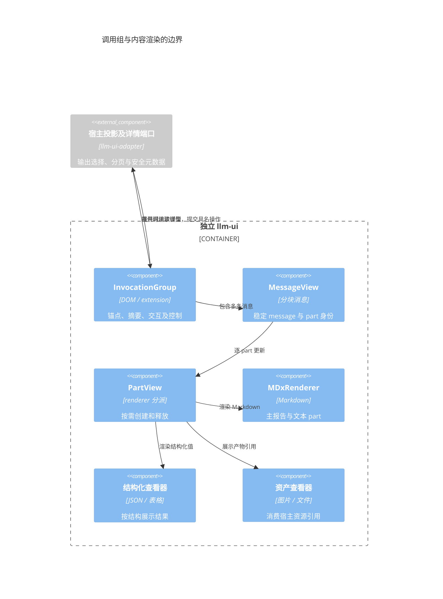
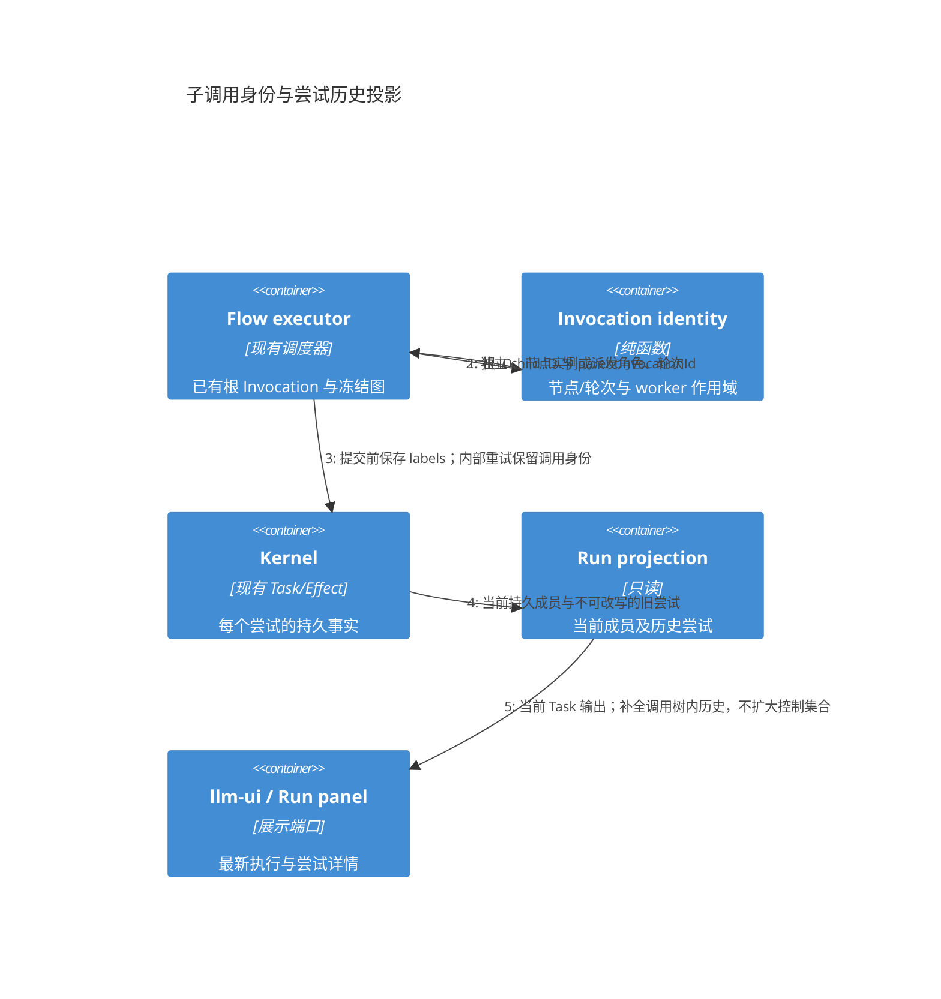
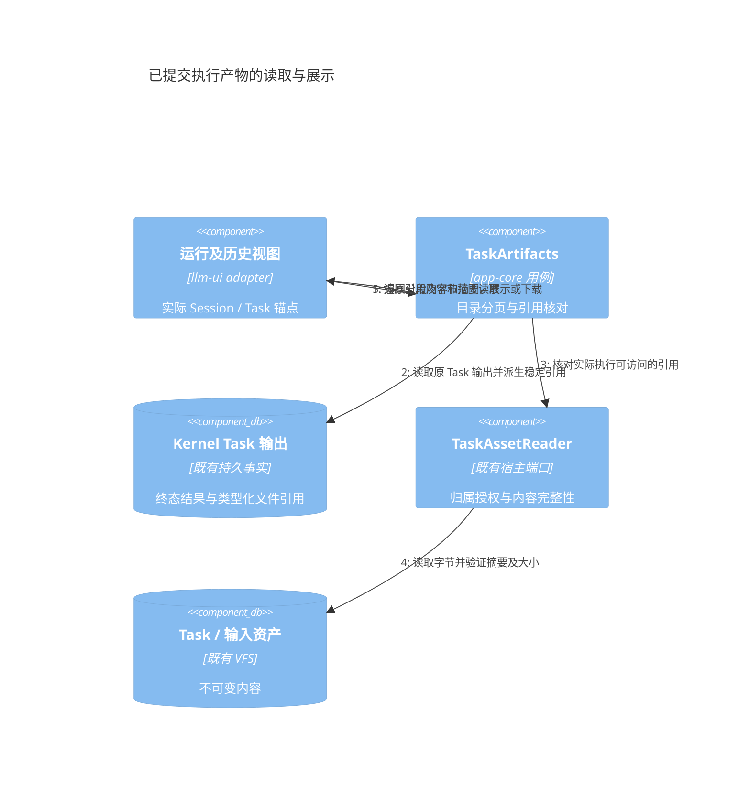
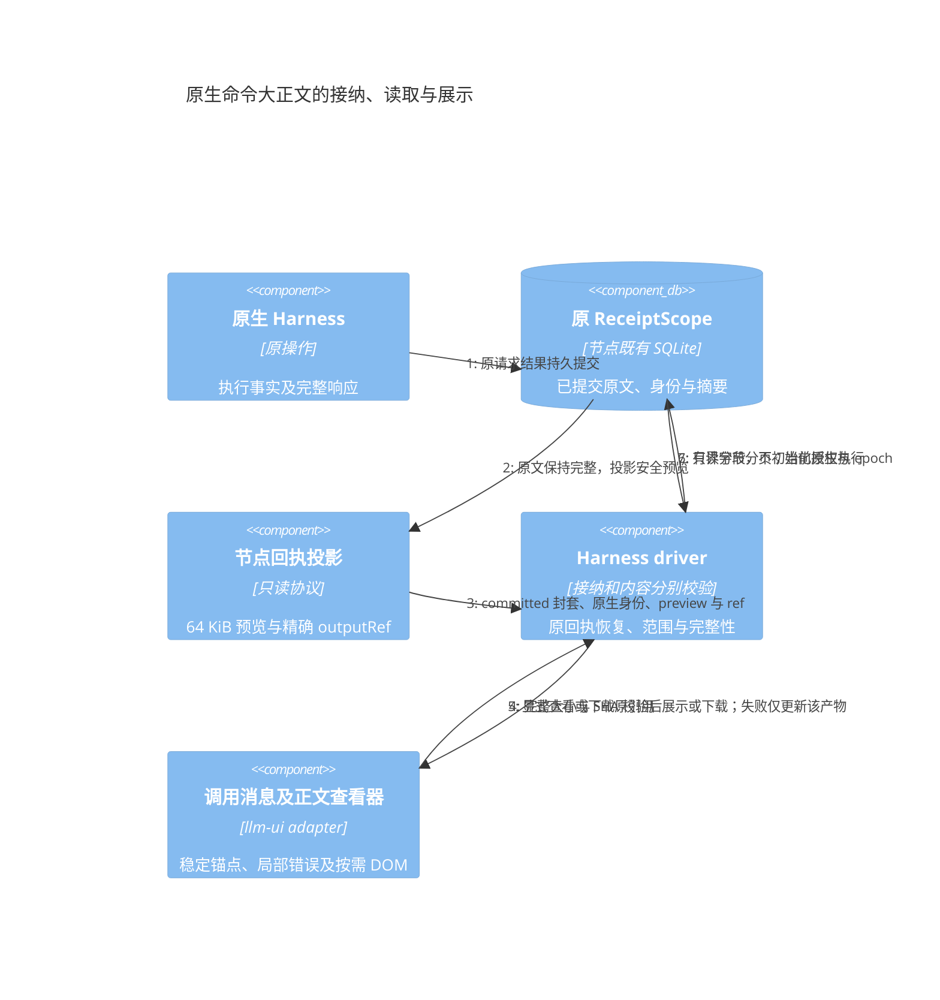

# Invocation 展示与历史投影协议评审稿

状态：目标契约，已实施基础 JSON 内容块与冻结参数投影；统一调用组仍待实施与验收。日期：2026-10-24。

本协议配套[统一执行模型评审稿](agent-session-connection-review.md)。历史以根 Invocation 组织调用组，组内保留消息、内容块、节点及子调用身份。结构化输出属于执行事实，显示内容由宿主投影；下游调用从输出端口读取，不读取聊天气泡。

## 1 展示层次

| 层次 | 默认显示 | 展开后显示 |
| --- | --- | --- |
| 用户提交 | 原文字、附件及参数摘要 | 冻结有效参数、来源、默认与补参说明 |
| 根 Invocation | 名称、状态、主结果、产物、突出交互及控制 | 节点与子调用树 |
| 节点或子调用 | 名称、状态和简短摘要 | 输入、输出、工具过程、错误、循环与尝试实例 |
| 内容块 | Markdown、JSON、表格、图片或文件 | 对应专用查看器 |

每个 Flow 默认一个根调用组，多个消息和 part 放在组内。普通单 Agent 可以保留简洁的助手消息外观，逻辑分组不强制增加卡片边框或复杂控制面板。

2026-10-25 分期：最小调用组先显示输入、状态、最终输出和产物，审批/补参/失败保持可见；有真实子 Session 关联时可打开既有 Session UI。内嵌消息、完整调用树和大历史详情后续增强，不能为了基础视图而删掉关联或过程事实。Session/Invocation 区别、同 Flow 多次运行及前置任务见[子会话与函数调用视图](session-invocation-ui.md)和[合入计划第 7 节](functional-merge-plan.md#7-子会话与函数视图的交付安排)。

已接纳而未创建 Invocation 的输入继续使用 Instruction 队列展示。不能为了显示调用组或清理草稿，创建假的已执行用户 Round。Invocation 创建后继承来源锚点，晚完成的后台调用仍留在发起位置。

## 2 读模型与稳定身份

```ts
interface InvocationGroupView {
    invocationId: string;
    parentInvocationId?: string;
    anchorRef: string;
    revision: number;
    title: string;
    status: InvocationStatus;
    inputSummary: MessagePart[];
    primaryParts: MessagePart[];
    artifactRefs: AssetRef[];
    pendingInteractionRefs: string[];
    progress: { completed: number; running: number; waiting: number;
        failed: number; total?: number };
    children: { count: number; nextCursor?: string };
    controls: AvailableAction[];
}

interface InvocationDetailsQuery {
    invocationId: string;
    parentItemRef?: string;
    cursor?: string;
    limit: number;
}
```

这些是展示 DTO 的结构示例，独立 llm-ui 保留自己的公开类型和 renderer 注册；适配层映射业务对象，不把 Kernel、VFS 或 native journal 类型导入 UI。

| 对象 | 身份要求 |
| --- | --- |
| 根调用组 | invocationId；重开视图、分页或流式更新不改变 |
| 历史位置 | 持久 anchorRef、分支及来源提交，不以完成时间排序 |
| 子调用 | 独立 invocationId 和 parentInvocationId |
| 节点实例 | 实际 taskId、展开实例、迭代或 retryOfTaskId，不能只按 nodeId |
| 消息与内容块 | 稳定 messageId/partId，流式与最终结果更新同一个 part |
| 交互 | interactionId、所属 Invocation 和独立交互 revision |
| 资产或派生报告 | 不可变 Artifact 身份及来源引用 |

submissionId 仅关联一次提交，不能把整个调用中的 user、assistant、tool 消息合并成一个消息身份。相同节点的循环、批量和重试实例各有细节记录；根最终输出使用自己的稳定位置，不覆盖旧尝试事实。

## 3 内容块与渲染器

当前独立 llm-ui 的 [MessageView](../../libraries/llm-ui/src/message.ts) 按 ChatMessage.parts 组织历史，[PartView](../../libraries/llm-ui/src/parts.ts) 为 Markdown 内容创建 MDxRenderer。历史单位并非单个 MDX editor，目标模型继续复用分块与扩展机制。

| 内容 | 渲染选择 | 加载及生命周期 |
| --- | --- | --- |
| 调用组外壳 | 普通 DOM 或已注册 extension renderer | 轻量常驻，保存展开状态和稳定身份 |
| 主报告或文字回复 | MDxRenderer | 按 Markdown part 挂载与流式更新 |
| JSON 与表格结果 | 结构化查看器 | 使用 value 或产物引用，避免先转为巨大 Markdown |
| 文件与图片 | 资产查看器 | 由宿主解析可访问引用、权限及临时 URL |
| 节点详情与工具过程 | 按需专用 renderer | 展开时读取详情和创建重型实例，支持分页与释放 |

不把所有节点过程拼成一份 Markdown，不为未展开节点预先创建编辑器。详情加载失败显示其自己的错误和重试入口，不改变 Invocation 结果。关闭视图释放 renderer、异步读取和观察；后台执行继续由宿主持有。

当前独立 llm-ui 新增 json part：默认折叠，展开才填充纯文本 JSON，更新保留 details 身份与展开状态；复制包含结构化值，打印当前 DOM 只包含已经展开加载的正文。临时提交和 Session 用户消息从同一 OperationLedger 的冻结输入投影参数；InvocationPanel 的输入详情与再次调用表单读取 inputResolution.parameters。[回归](../../libraries/llm-ui/tests/chat-view.test.ts)覆盖字面 HTML、安全呈现、稳定 part 更新及参数提交断线后确认。

这一步没有建立新的持久历史：临时卡片仍属操作状态。Invocation 分组、锚点、子树分页、结构化队列合并/删除后的临时项替换及派生报告仍在[实施记录](fixtures/unified-execution-progress.json)中追踪。



## 4 输出选择与历史语义

Flow 返回 value/artifacts；发布的展示配置选择主正文、主产物与仅详情可见字段。配置使用明确的输出路径和已注册 renderer，不把可执行 UI 代码或业务解析器放入通用核心。

节点结果默认进入详情，只有声明 publishToHistory 的输出进入主历史。显示到历史、加入下一轮上下文和提供下游端口是三种独立策略。隐藏过程不会删除下游所需数据，展示全文也不自动授予模型读取资格。

原生外部历史保持来源与观察范围；有 native turn 不代表宿主已持有控制权。适配层先完成身份及输出核对，再投影相应 part，补读历史不重复创建临时消息。

编辑报告生成有 sourceOutputRef 的派生产物或派生版本，保留原执行结果和 digest。选择派生版本继续对话属于新的内容来源选择，不改写旧 Invocation 的输出或历史执行事实。

## 5 交互 进度与大内容

待答审批与补参在根调用组、输入区控制摘要或固定交互区突出显示，并可定位到所属节点。折叠详情不能使审批入口消失。已保存但被暂停屏障阻挡的回答显示“回答已保存，待恢复”，不误报执行已继续。

动态 Flow 未必知道最终节点总数。默认显示完成、运行、等待和失败数量；只有总量确定且含义一致时才提供百分比，后续动态展开不能被伪装成已知固定总量。

超大输入输出以 Artifact 引用保存，历史窗口、节点详情与过程均分页。事件只携带必要增量或引用，宿主可以合并展示刷新；完整结果仍可核对。流式最终提交更新原 part，保持用户阅读位置及搜索锚点。

## 6 验收要求

验证一个根 Flow 包含多种 part 和独立节点尝试；普通 Agent 外观保持简洁；展开详情才挂载重型 renderer，销毁后没有迟到 DOM 写入。

跨边界验证：后台任务乱序完成但锚点稳定、交互藏在折叠节点时仍突出、失败节点重试后保留旧实例、流式重放不重复 part、输出巨大时分页、编辑报告生成派生版本，以及执行完成但历史提交失败时仅补投影和历史。

## 7 当前实施覆盖

### 7.1 子调用与 Task 尝试的持久关联

[调用身份](../../backend/llm-flow/src/flow/invocation-identity.ts)为已有根 Invocation 的节点与每次循环派发生成独立 child ID，动态 worker 再以所属派发调用、分支 key 和轮次区分。使用固定版本域的 SHA-256 派生，避免分隔符、Unicode 或长节点名形成身份碰撞；不依赖浏览器 WebCrypto，也不以 Task/Effect 身份作为跨轮 binding。新运行在初始 checkpoint 的不可变部分保存 invocationIdentityVersion=1；恢复按该版本生成身份。旧运行缺少版本时沿用原 Task 提交格式，不能因增加 labels 改变已接纳 Task 的幂等摘要，未知版本明确拒绝。根身份及派发状态已持久化，恢复不重新分配子调用；标签在 Task 提交时保存，发布的派发输入另保存控制器身份。定义中的 DispatchConfig 不得注入宿主身份。

内部重试替换 Task 时，调用 ID 保持不变，真实 Task ID、retryOfTaskId、图代次及尝试终态各自保留。用户重新运行创建新根 Invocation，因此子调用树也改变。这里保存的是关联事实；子调用的业务终态尚未形成统一投影，不能把一项 Task 的失败直接当成整个子 Invocation 的终态。

[成员读取](../../backend/llm-flow/src/flow/run-members.ts)与 [Run 查询](../../backend/llm-flow/src/flow/commands.ts)公开 invocation 关联。[展示投影](../../backend/llm-flow/src/flow/invocation-projection.ts)以当前持久成员选择最新执行实例，避免只读面板因缓存轮次相同或回退而继续显示旧 Task；节点状态、输出和错误仍来自该 Task。历史细节另外沿已持久父调用关联补全旧尝试，按发起顺序稳定排序，重开也不丢已替代的任务。该读取不修改调度器的节点映射，历史集合也不成为控制授权来源。controlTaskIds 仅表达当前持久成员范围，UI 据此隐藏历史尝试的审批、停止和重试入口；后端仍重新核对成员、Session 写权限及实际执行状态。旧尝试的 transcript 走同一只读归属投影，包含真实 Kernel parentTaskId 的内部详情，但不借此授予控制。



[执行器回归](../../backend/llm-flow/__tests__/durable-flow-executor.test.ts)验证循环实例、新根调用树、图重试后的源身份及重新打开的旧尝试；[结构化派发回归](../../backend/llm-flow/__tests__/structured-flow.test.ts)验证并行控制器、同名 worker、多轮恢复及配置注入拒绝。

尚未覆盖：无根身份的任意 DAG/CLI 的统一接纳、所有 Flow/Agent 调用边界的完整树、统一 Invocation 卡片与分页、永久历史与 Artifact、派生报告，以及可安全冻结预算和能力的嵌套动态派发。现有编译器对此类嵌套仍明确拒绝，不能因身份接口可表示父子关系就声称可执行。

### 7.2 已提交产物目录与读取

产物目录从真实终态 Task.output 派生，引用绑定 Session、Task、输出 JSON Pointer 与内容摘要。Task/尝试替换后保留旧引用，不能把旧产物改指向新尝试。目录只解释已声明的输出封套与类型化二进制引用，不按业务字段名猜测文件路径。

| 接口 | 输入 | 返回与约束 |
| --- | --- | --- |
| app.artifacts.list | sessionId、taskId、offset、limit | 最多 100 个描述项及 nextOffset；读取现有 Task，不激活执行 |
| app.artifacts.read | reference、offset、limit | 最多 1 MiB 字节、总大小、摘要和下一位置；每次重新核对引用及资产归属 |
| session.artifact.get / ArtifactLoader | 固定 Session 与 artifactId | 文字/JSON 语义值和实际渲染摘要；二进制须显式转换 |

默认工作台的 Flow 根/节点输出，以及正式 Session 已终结助手消息，使用同一 TaskArtifactBrowser。目录按用户操作加载，读状态按实际 Task 保留，重绘不重复读取；清空或销毁取消后续分段并回收对象 URL。完整下载核验 SHA-256，文字预览默认最多 64 KiB 并标明截断，完整下载默认内存预算 32 MiB，可由组件宿主调整。它不消费输入草稿、不伪造历史，也不授予运行控制。



现有本地二进制引用可读取；远端 Harness 文件仍需导入宿主 Task 资产后再发布引用。任意 URI、路径或未导入的 file 输出只显示不可用，不能由浏览器代取。完整 Invocation 历史分页、大结果正文折叠及所有独立显示端口迁移仍待完成。

### 7.3 原生命令正文与接纳事实

原生 Conversation 的命令未必有 Kernel Task，不能为下载正文伪造 TaskArtifact 身份。命令完整正文继续保存在原节点同一 ReceiptScope 的已提交结果中；支持正文引用的客户端显式选择引用模式后，对外回执才投影最多 64 KiB UTF-8 的字符边界预览，以及指向原正文的不可变引用。引用不携带 URL、文件路径、凭据或原生执行权限。

```ts
interface HarnessCommandOutputRef {
    version: 1;
    epoch: string;
    requestId: string;
    bytes: number;
    sha256: string;
    mimeType: 'text/plain';
}
interface HarnessCommandOutputPage {
    ref: HarnessCommandOutputRef;
    offset: number;
    data: string; // Canonical base64 of the requested bytes.
    nextOffset: number | null;
}
```

`capabilities.commandOutputs` 正向声明此读取协议。客户端只在能力存在时，给 harness_command/harness_operation 增加 outputMode=reference；缺省仍返回原完整正文，避免旧客户端忽略引用后把预览当成全文。展示模式不进入执行指纹、不传入原生驱动；同一 requestId 切换回执读取模式不会重新执行或改变原业务身份。未知模式在接纳前拒绝，私有正文元数据在两种对外模式中均不返回。

`harness_command_output` 按原 profile、项目授权、epoch、requestId、摘要、大小和字节范围查询；每页 1–65536 字节。读取只查已有回执，不创建 not-committed fence，不启动或附着原生会话，也不从产物可读推导执行控制权。跨 scope、旧 epoch、原记录缺失和引用不符均明确拒绝；读取失败不修改原接纳或执行结果。

内部原生收尾仍接收完整原回执，不能把预览交给要求原结果相等的 CommandAdmission。大正文的摘要元数据与原回执在既有事务中保存，避免逐页重新散列全文；正文仍归原回执，不另建产物状态库。临时回执的 epoch 生命周期及容量限制仍然适用，该引用不承诺节点重启后或完整历史归档中的永久可用性。

Driver 的 readCommandOutput 检查返回引用、范围、规范 base64、长度和游标进度；loadCommandOutput 显式有界收集并核验完整 SHA-256 与字节数。它与 input submit、control 和全局 refresh 错误分开，支持取消。默认完整读取预算 8 MiB，宿主可显式选择最多 32 MiB；超过预算不把原执行改写为失败或未提交。

命令消息保留稳定原生身份和独立的 commandOutput 描述。原生历史或流式消息替换同 ID 的临时结果时，保留已确认引用与预览，不重复创建消息，也不因迟到更新缺少引用而丢失下载入口。正文过大或读取失败只影响该产物行；不设置 Session 的全局 refreshError、不消费输入草稿、不阻止无冲突的新输入。

默认工作台和独立 ChatView 复用同一按需查看器。外层显示预览截断及读取状态；浏览器优先以最多 64 KiB 的字节页逐次读取，取消、隐藏或销毁后不再发出后续页，已在途的一页可以完成。完整大小与摘要验证后，展开正文按有界文本页写入纯文本 DOM，页面边界保留完整 Unicode 码点。销毁或切换后拒绝迟到写入并释放对象 URL，不预先将所有正文转为 Markdown。旧节点的超限正文显示具体不可用原因；不调用未声明的范围读取，也不声称已保存完整宿主产物。



实现入口见[节点正文协议](../../tools/nestos-node/src/plugin/harness/command_outputs.rs)、[Driver 范围及完整读取](../../libraries/nestos-node-driver/src/harness/command-output.ts)和[共用查看器](../../ui/llm-ui-adapter/src/components/history/NativeCommandOutput.ts)。具体实施与验收结果由[进度记录](fixtures/unified-execution-progress.json)单独列明，不能由类型或图表推断已部署。
