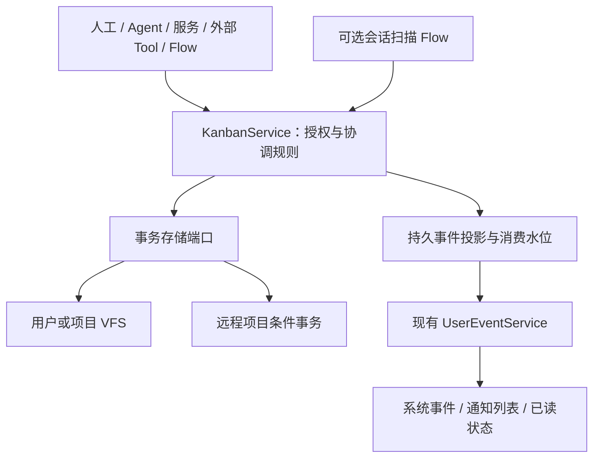

# 通用 Kanban 协调模块

## 定位与模块边界

`@itookit/kanban` 是独立协调库（`libraries/kanban/`），唯一运行依赖为 vfs-core，支持个人事务、研究、运营、支持工单和软件开发。核心管理工作项、责任、依赖、在制额度、交付验收、持久派发意图和历史；具体业务规则与工具副作用由外部 Tool / Flow 负责。

纯契约在 `libraries/kanban/src/contracts/`；应用端口直接引用库的 KanbanClient。`@itookit/app-core/kanban` 的 createNestOSKanban 负责 NestOS 的 Session、Flow、Kernel、远程连接、调度与系统事件接线，不代转出库 API。扫描状态机、条件事务存储、执行桥、可选活动投影及 DOM UI 均位于独立库；NestOS UI 只注入文案、图标、资源路由和激活事件。核心不依赖这些实现、不调用模型、不启动 Session。历史 sessionId/messageId 仅为不透明来源字段；来源扫描 DTO、状态解释及检查点提交归独立库；实际会话内容读取与正式模型执行归应用适配层。



| 文件 | 职责 |
| --- | --- |
| `configuration.ts` / `identity.ts` | 工作类型、默认策略、名册与主体身份 |
| `module.ts` / `ports.ts` | 显式工厂、授权、诊断和宿主端口 |
| `planning.ts` / `planning-commands.ts` | 层级、依赖、准备队列、阻塞与安全释放 |
| `transitions.ts` / `reducer.ts` | 所有权、交付、验收、升级及追加事件 |
| `queries.ts` / `archives.ts` | 摘要分页、进度、保留期归档和恢复 |
| 核心 `store.ts` / `conditional-store.ts` | 本地与远程原子提交、回执和历史正文 |
| 核心 `workflow.ts` / `workflow-plans.ts` | 计划发布、依赖解锁、派发身份与验收 |
| 核心 `execution-bridge.ts` / 应用 `published-work.ts` | 冻结执行请求、提交前日志、发布 Agent/Flow 的正式 Task 调用与只读核对 |
| `notifications.ts` | 对接系统事件与 notify，幂等投影和恢复 |
| 核心 `discovery.ts` / `scan-context.ts` / `scan-commit.ts` | 扫描准入、恢复、有界模型上下文 |
| `flow.ts` / `published-executor.ts` | Flow 资源与正式独立调用适配 |
| `local-source.ts` / `harness-source.ts` | 本地/原生会话精简读取 |
| 核心 `monitor.ts` | 注入调度源、触发合并、停止与排空 |

## 独立接口与接入

根入口的 `createKanban` 按 boards/items/records/planning/references 分组查询，通过单一 execute 写入并返回轻量 Commit；旧 `createKanbanModule` 仍返回 KanbanService，现有 RPC 无需改变。存储、执行、来源发现、活动与 UI 分别使用 `/storage`、`/execution`、`/discovery`、`/activity`、`/ui` 入口。

来源发现的批量变更与水位统一由核心内置 apply-discovery 校验、提交；不再允许宿主以 reducer extension 任意改状态。远程 Store 的布局、编号、正文摘要、回执和条件事务编码也归独立库，NestOS 仅注入授权 HttpSeqClient。库无 mechanisms 入口。版本化内容经 install-content 授权后，由 installKanbanContent 原子安装；应用只提供内容定义，不调用 reducer 或 codec。

UI 按实例注入 presentation（文案、可信图标、日志及链接生成）、selected/openSession 和可选执行引用转换。NestOS 不复制模板、命令映射或 CSS。无活动端口不展示执行筛选、不安装活动轮询。当前活动筛选仍为有界扫描（最多 10000 个候选项），尚未引入持久活动索引，不能宣称大型看板查询为常数成本。

独立验证入口和可运行示例见 [库 README](../../libraries/kanban/README.md)；示例只依赖 VFS 与假执行端口，不启动应用 Runtime。

NestOS 的服务与执行引用绑定集中在 app-core/kanban/module.ts，公开 createNestOSKanban 与 createNestOSKanbanExecutionBridge。执行桥的持久状态机仍归独立库，不另建应用包装文件。通用活动绑定、分页、游标和过期状态测试位于 libraries/kanban/tests/activity-projection.test.ts；应用的 kanban-session-activity.test.ts 使用真实 Runtime、Session 与 Kernel 人工交互验证接入，不复制通用机制断言。

## 数据模型与通用配置

### 归属与主体

scope 支持 system、project，以及 `{kind:'collection', namespace, id}`。项目/集合拥有唯一工作项记录；全局视图聚合原服务，不能维护第二套状态。看板寿命独立于聊天 Session。

新定义优先使用 members / eligiblePrincipals；每个主体为 `{kind:'agent'|'human'|'service', id}`。members 记录职责及 worker/reviewer/coordinator 角色。角色帮助路由和协调，不替代宿主授权。agents / eligibleAgentIds 保留为兼容输入，同一个主体不能重复登记。

人和服务无需虚构 Agent 或 Session。独立 Agent Actor 可以只提供自己的 ID；NestOS 适配边界仍要求绑定真实 Session/Task 身份。兼容原 agentId，也可使用 kind=agent + id。Actor 由可信宿主注入，命令 payload 不能覆盖。项目访问、角色登记、结果引用、外部资源及控制权都在每次操作重新授权。

### 工作类型、列与业务引用

workTypes 配置 `{id,label,rank,executable}`，defaultWorkType 指定缺省类型。默认兼容 initiative/feature/task，显示为 Goal/Group/Action；业务可替换为课题/实验、活动/执行项或请求/处理项。父类型 rank 必须小于子类型，避免循环；是否可认领由 executable 决定，核心不按软件功能名分支。

columns 只定义名称及标准阶段的展示映射，必须恰好覆盖全部阶段。执行机制保持固定，业务的多轮审批、跨系统动作或复杂路由由 Flow 表达。

planning 携带类型、父项、area、milestone、priority（0 最高，4 最低）、dependencies、references 和可选 dueAt。area/milestone 是通用分组/周期标签。externalRefs 用 `{system,id,revision?}` 关联工单、实验、文档或业务系统记录，可按 system/id 查询；它们不授予外部读取权限。领域正文仍归原业务工具维护。

## 规划、执行与验收

| 阶段 / 视图 | 用途 |
| --- | --- |
| proposed | 尚未确认的提案 |
| backlog | 已接受的长期规划和待细化事项 |
| ready（open） | 范围与验收明确、依赖满足，可领取 |
| claimed | 唯一负责人正在处理 |
| review | 等待验收，继续占在制额度 |
| completed / cancelled | 关闭事实，取消保留原因 |
| archive | 从工作集移出的历史视图，保留原关闭状态 |

手工 create-item 和 publish-proposal 默认进入 backlog。显式 set-stage(open) 后才开始领取计时。未来事项不会因为暂时没有负责人而触发无人领取告警。backlogReviewMs 可产生独立的定期梳理提醒；dueAt 是真实业务截止时间，不依赖是否提供执行估算。

默认 Ready 上限 20、WIP 上限 3、每主体 WIP 上限 1；maxInProgressPerAssignee 是新配置，旧 maxInProgressPerAgent 兼容但不能与之冲突。review 计入 WIP；领取和接受转交都复验额度。依赖必须已完成，缺失、自引用和循环均拒绝；取消不满足依赖。

领取绑定主体及 token/租约。Agent 还复验 Session/Task 身份；不同人或服务不会因为缺少 agentId 而共享身份或额度。request-transfer 保留原负责人，接收者接受才原子切换；拒绝、超时或接收者满负荷都不丢弃原责任。咨询使用消息或关联子项。

默认要求复杂度/工作量/时间估算，且独立验收。项目可设置 requireEstimate=false，仍保留租约、进展和截止检查；review=assignee 允许本人提交后完成。独立验收时，已登记验收 Session 或 members 中 reviewer 才能接受，且不能验收自己负责的工作。

阻塞保留原因、时间和原生命周期。block/unblock 不代表暂停 Kernel 或撤销外部副作用；已认领事项需要本人 token。阻塞项不可被新领取。cancel-item 只取消未执行事项；release-item 可以将责任项退回 backlog 或取消：人可显式释放自己拥有的手工事项，自动主体及代理释放必须经宿主 verifyRelease 确认原执行已经结算。租约过期不自动授权重新派发。

父项进度包含已归档后代，子项计数不等于父目标验收。close-plan 及有子项的交付都要求子项已终态，并由宿主验证结果引用和业务验收条件。

### 管理主体、计划与执行协议

决策可带 `coordination: {manager, executor?}`；主体必须在名册，manager 具备 coordinator 角色。决策确认后，关联计划只能由指定 manager 发布。executor 表达初始执行责任，不额外授予权限；每项任务最终指定 assignee，管理 Agent 可拆解给其他已授权成员。未指定 coordination 的历史决策保持兼容。

```json
{
  "schema": "kanban.plan/1", "id": "delivery", "revision": 1,
  "decisionId": "decision-1", "sealed": true,
  "items": [
    {"id": "contract", "title": "确认接口", "responsibility": "发布约定", "acceptance": "评审通过", "assignee": {"kind": "service", "id": "builder"}, "dependsOn": [], "outputs": ["schema"]},
    {"id": "implementation", "title": "实现", "responsibility": "实现已确认接口", "acceptance": "检查通过", "assignee": {"kind": "service", "id": "builder"}, "dependsOn": ["contract"], "inputs": {"schema": {"fromItemId": "contract", "output": "schema"}}}
  ]
}
```

publish-plan 一次最多 100 项，校验版本、循环、跨计划身份和悬空依赖，拓扑排序后原子建项；sealed=false 不进入自动派发队列。definitionDigest 固定定义；修改定义使用新任务 ID。活动派发未结算时禁止替换其计划或转交/释放责任，不能用普通 claim/submit/review 绕过已封闭计划的派发和验收。

prepare-dispatch 在同一事务中提交认领、估算、attempt、fence、计划版本、依赖产物引用和事件/回执。独立 execution 桥随后冻结宿主 prepare 返回的请求，不从界面当前设置重建。observe-execution 只接受原派发与 fence，成功输出先由宿主 verifyOutputs 核对实际内容、权限、摘要和字节数。默认进入 review，独立 accept-execution 才算完成并解锁后续；review=assignee 是明确启用的自动验收策略。失败/取消保留 blocked，unknown 保留责任；均不自动重派。

workflow(boardId) 读取计划、派发、ready 和 completedPlans。核心只确定性推进已发布 DAG，不调用模型分析下一项。管理 Agent 可在原执行结算后发布后续计划；completedPlans 仅表示已封闭任务集合完成，根目标仍需单独验收。

## 看板 AI 协作

个人看板的更多菜单提供「AI 协作」：选择已发布的规划与执行 Agent/Flow 后启用。默认关闭，不因绑定执行 Session 或打开页面启动模型；启用会处理该看板已有及新增的可执行待办。看板配置保存冻结的发布版本与摘要、协调/执行主体及验收模式，RPC 公开 automationCatalog 和 analysisStatus；核心只保存通用外部引用，不导入模型或 Session。

规划调用通过现有 IndependentCallService 执行，产品分析指令位于 `backend/app-core/src/presets/kanban-planning.json`。输入包含当前事项及最多 200 项的活动看板快照；超过上限明确报告 AUTOMATION_CONTEXT_LIMIT，不静默截断后声称已分析全部依赖。规划者应返回 JSON `{ready, dependencies, reason, estimate?}`；Flow 可从返回节点的 analysis/result 输出此对象，Agent 使用消息正文。ready=false 保留待澄清原因，不派发；格式、引用、自依赖、环路和估算失败保留具体错误。规划结果只能增加前置依赖，不能移除人工依赖。角色提示要求只分析，所选发布目标仍使用其正式授权与工具配置，宿主不把提示词当作权限隔离。

分析记录位于用户 `/var/lib/kanban/automation.seq`，冻结调用身份、原输入、事项修订、规划快照签名、阶段与结果。先保存 prepared，再原子取得 submitting，才提交模型调用；响应丢失及重启仅核对同一身份，不重新发送。事项或规划快照变化时拒绝迟到结果，再按新修订分析。已在途的原分析优先观察，不同时为同一事项启动替代分析。分析依据由 analysisStatus 返回，不写入诊断正文。

ready=true 后以 publish-plan 原子接纳既有未认领事项：expectedRevision 校验原事项修订，保留 ID、编号、创建时间、优先级及人工依赖，再绑定执行主体。已进入计划的定义继续冻结；不能用接纳入口改写原计划。执行桥按依赖和 WIP 原子认领，走正式发布调用，保存真实执行 Session。依赖任务已接受的产物经摘要/字节与来源核对后传给下游；累计输入超过 128 KiB 明确拒绝。产物正文与每次派发归属保存在同一用户 journal，不凭外部 URI 任意读取。

默认独立验收，成功执行进入 review，界面的接受/退回使用对应 accept-execution。只有接受后才释放下游；用户显式勾选自动验收时，执行成功且产物完整才自动完成。这项自动校验只证明执行终态、产物归属与完整性，具体业务验收应由执行 Flow/Tool 检查，或继续使用独立验收。失败、取消、unknown 均不自动重复执行；已知失败需要用户核对后解除阻塞。缺少信息的未执行事项可通过「修改任务内容」补充责任与验收，再重新分析。

Runtime 使用既有 Kanban monitor 的事件合并与 5 秒补偿扫描，不额外建立执行调度器。页面隐藏或关闭不停止后台执行。暂停配置停止新分析和派发，已有分析与执行继续观察；未结算执行期间只能切换启停，不能改写执行绑定与验收策略。关闭先停止新准入，执行桥有界排空，journal 等待在途事务结束；不会为退出重放外部动作。

当前默认接线覆盖用户个人看板；项目存储仍通过 configureKanban 显式接入。暂不提供自动拆解新任务、跨看板依赖、独立 AI 验收者选择、预算扣费与自主返工循环。规划目标需遵循 JSON 输出契约，执行 Flow 所需的额外参数和连接需在发布定义中配置；看板界面不替代通用 Flow 参数编辑器。

## 查询与内容增长

query 默认 Ready，只返回摘要，支持领域、周期、父项、类型、Session、业务引用及搜索筛选。最多 200 条一页；游标绑定筛选和修订，变化后报 CURSOR_STALE，要求刷新。普通列表按优先级排序，归档按时间倒序。overview 给出可见/活动数量、阶段分布、待梳理数与额度；item 按身份读取正文。read 是协调器的完整活动快照，不作为界面默认列表。

archive-items 每批至多 50 项，只允许 completed/cancelled，整批校验和提交。完整正文位于同一个 SeqFile 内的 archive/<board>/<item>；archiveIndex 仅保存查询、Session、依赖和进度所需摘要。来源、讨论、结果及幂等事实不删除，归档 ID 不能重新用于新事项。

restore-item 只恢复可见性，不把完成事实改成待执行。新要求建立后续事项并引用历史。archiveAfterMs 配置保留期后，健康检查自动归档过期关闭项；未配置则仅手动归档。恢复后获得新的可见保留期。

归档不等于压缩或清除磁盘数据。远程适配按键读取当前板和所需行，事件分页只读取精确序号；节点已有数据库原地执行 SQLite 事务，不再受整库 16 MiB 限制。单次最多 256 条变更，响应最多 16 MiB、单份外置正文最多 1 MiB，容量限制与数据库总容量分开。历史事件、回执和未引用正文保留，不通过删除恢复依据换取空间；自动分段、回收尚未启用。

## 相关 Session 与来源

### 工作项的执行 Session

执行关系为 WorkItem → 执行 Session；看板中类型为 task 的条目仍是 WorkItem。Dispatch 保存一次执行尝试，Kernel Task 仅由集成层用于回执核对，不进入看板的执行 DTO 或界面。Decision 可关联 WorkPlan，计划再创建工作项；讨论、来源、验收 Session 不等于执行 Session。

NestOS 用通用 externalRefs 保存 `{system:'nestos-execution-session',id:sessionId,revision:bindingId}`。手动绑定的 bindingId 为稳定表单身份；自动派发使用 dispatchId，并从正式执行接纳回执取得真正的 executionSessionId，不能使用 caller Session 代替。引用随工作项、事件及回执同 SeqFile 事务保存。最后一条有效绑定为当前执行者，旧绑定保留历史；新 attempt 尚未绑定时不沿用上一 attempt 的执行状态。未结算派发禁止更换其绑定。

界面详情支持「绑定／更换执行会话」、状态、最近活动、观察时间、跳转和执行历史；卡片只显示 Session 汇总，不列出内部 Task。普通 register-session 继续用于上下文。应用 related(sessionId) 同时包含执行绑定及其历史；核心库仍只理解不透明外部引用。绑定校验当前责任/名册与源端 Session 权限，不启动会话、不发送消息、不改变工作项交付状态。

app-contracts 的应用 KanbanService 增加可选 queryActivity 和 executionSession；独立库 API 不增加 Session 能力。queryActivity 的 execution 支持 all/running/recent/active，active 为正在运行或最近 10 分钟活跃。执行筛选先作用于完整匹配集再分页，游标绑定看板修订和匹配集合；活动变化使游标失效。最多检查 10000 条匹配事项，超限要求缩小条件；同一执行 Session 合并读取，并发至多 8。

本地来源通过 SessionRepository.getManifest 和 Kernel.sessionActivity 冷读汇总，不 activate/resume/recover。最近活动直接读取 Session 活动摘要的 lastActivityAt；该时间与执行事件同事务持久化，不读取事件正文或 Task 正文。旧存储缺失时仅使用可确认的最后结算时间；读取、文件关闭、租约心跳、改标题和日志清理不计活动。没有时间证据则显示未知，不使用 manifest.updatedAt 推断。会话运行与最近活跃分别判断；10 分钟无活动不代表完成，会话执行结束也不自动验收工作项。

状态观察超过 90 秒或源端声明 stale 时标为过期，不计入正在运行/最近活跃筛选。暂时网络/存储错误可保留本进程最近状态并明确标过期；权限撤销或 Session 缺失不回填旧标题。远程项目注入绑定原 authority 的 KanbanSessionSource，在同一授权连接核对；不能回退其他项目或本地状态。缺少能力时报告待核对，不能当成空闲。

可见看板每 15 秒补读执行状态，隐藏、正在操作或有草稿时暂停，销毁时注销；系统事件仍负责已有变更失效。教学示例 v5 增加真实 Session 绑定与活跃筛选练习，不预置虚构执行者。

看板和事项可以记录 participants：Session、可选 Agent、角色、加入时间和订阅状态。Agent 创建/领取/转交时自动登记，其他上下文显式 register-session。历史关联保留；当前负责人以 owner 为准，不根据历史 owner 角色猜测。

related(sessionId) 同时查活动与归档摘要；来源引用也保留 Session、消息和读取修订。人或服务可以只使用 externalRefs，不必创建聊天会话。订阅只决定消息目标，不授予权限，也不启动模型。

## 系统事件与 notify

复用现有 `UserEventService` 的 journal、事件订阅、通知列表和已读状态。宿主通过模块 options.notifications 注入 `{sourceId,journal:runtime.events.journal}`。sourceId 必须是绑定当前用户、存储/项目及远端 authority 的稳定非秘密身份。

事务先提交看板，再由 projectKanbanEvents 读取持久事实。系统事件 ID 基于 sourceId/boardId 的 SHA-256 及源 sequence。消费水位与投影 append 在系统 journal 同一个事务提交；多实例、重启、丢回复及重复扫描不会重复发布。每轮最多 10 页，每页 200 条，剩余事件由后续健康扫描继续处理。

默认：升级及执行 unknown/failed/cancelled 进入 error 通知；执行成功待验收、待接受转交、提案显式发布为 Ready 以及新的待确认提案进入 info。其他状态变化保留系统事实；续租、进展和普通讨论不默认刷屏。notifications.rules 可按事件或升级原因配置 info/error/none。已经解决的旧升级不会在迟到连接时重新提示；事实仍保留用于视图失效与追踪。

系统事实仅含类型、资源身份、操作身份和源序号，不复制标题、需求正文、讨论、估算或凭据。通知不等于执行授权，不启动 Agent。读取事件也不标记通知已读；由用户显式 setNotificationRead。

通知写入失败不撤销已提交工作，日志保留操作、阶段、具体安全错误码和耗时；源事实继续保留，下一次命令/监控扫描补投。跨存储投影没有伪装成一个分布式事务。源流异常倒退/手工清理必须由宿主修复或使用新的 sourceId，不能重置水位后盲目重复旧动作。

`kanban.*` 已接入 Shell 看板工作区事件路由。可见时刷新，隐藏或有未保存表单时保留草稿并标记失效；事件不会自动标记通知已读。没有新增系统桌面弹窗。

## 存储与显式装配

本地项目使用 `.nestos/kanban/boards.seq`（openProjectKanbanStore）；远程为 RemoteKanbanStore + 已绑定授权的 HttpSeqClient，默认使用授权 export 内的 `kanban/boards.seq`，由宿主提前准备目录，也可显式指定其他授权路径。节点通用文件协议保留 `.nestos` 供节点私有元数据使用，因此远程默认路径不再使用该保留目录。远程事务仍限定在一个 SeqFile 内。系统收件箱可使用用户 SeqKanbanStore。collection 的物理位置同样由宿主选择，不强制依赖项目或 Session。

独立库默认目录为 `/kanban`，NestOS 的 openPersonalKanbanStore 明确绑定 `/var/lib/kanban`，这些默认值互不混用。所有控制记录、事件/outbox 与幂等收据同文件事务提交；计划和派发位于 board 清单 state.workflow 内。具体键约定见 [核心库协议](../../libraries/kanban/README.md)。宿主授权的强类型命令接口是写入口，不监视任意 JSON 文件来采信其中的 actor。产物正文先保存并核验，再发布引用；孤立正文保留待以后回收。

远端 export 不等于项目根时，宿主传入经授权解析的路径。prepareDirectory 只准备授权目录，只读项目拒绝写入；不会静默改存本地。凭据、连接秘密和模型定义不写进项目。实时状态不是 Git 多人合并的普通 JSON。

```ts
const kanban = createKanbanModule({
    store: await openProjectKanbanStore(authorizedRoot),
    actor: {kind: 'human', id: authenticatedUserId},
    authorize: authorizeKanbanOperation,
    verifyRelease: verifyExecutionSettled,
    notifications: {sourceId: canonicalStoreIdentity, journal: runtime.events.journal},
    log: reportKanbanDiagnostic,
});
```

create 接受部分 policy 并补齐默认值。业务名册、工作类型及列映射由创建配置提供。所有命令带稳定 operationId 和 expectedRevision；同键不同内容报幂等冲突，竞争报修订冲突。配置、持久化及通知仍在同一用户服务图中，不另建跨用户全局事件。

### 提交、关停与恢复

ApplicationRuntimeOptions.configureKanban 是可插拔的应用接线钩子，提供 fs、核心服务、Kernel、IndependentCallService、SessionRepository 和原有租约准备入口。宿主可以返回 createNestOSKanbanExecutionBridge 等适配器；默认不绑定 Agent，不发起模型调用。自动派发默认关闭；开启时通过 worker 解析可信执行主体，estimate 提供估算，authorize 在 prepare/start/inspect 分别复验权限。

应用执行桥在自己的 `executions.seq` 中，以 dispatchId 为键持久保存 `{schema:1,fence,request,digest,phase}`。request 在 prepare 中冻结；SeqFile CAS 将 prepared 切为 submitting，只有胜出者调用 start。重启后的 submitting 只 inspect 原身份，回执缺失保持 unknown，即使可能从未发出也不盲目重试。这份日志与核心数据库、外部执行器之间不宣称原子提交。

createPublishedKanbanWorkExecutor 复用正式发布 Agent/Flow 的 IndependentCallService，原 submission ID 等于 dispatchId。检查 caller 和执行树都 settled，并读取 Kernel Task 的真实 exit；executionPolicy 在请求准备时冻结，默认 maxDepth=4，执行超时由宿主显式配置，不把看板告警阈值当作取消指令。模型总结、普通文件关闭和单个父 Task 退出均不能替代整体结算。产物读取仍经宿主权限及内容核验。

startKanbanMonitor 接宿主调度源；Runtime 监听本地 boards.seq 的 seq:committed，并每 60 秒补漏。content:finished 在读句柄关闭时也会触发，不能表示任务完成。启动先扫描持久状态和未投影事件；配置执行桥后再核对原派发。通知失败不重放业务命令。

关停先 quiesce 核心准入、注销事件与定时监听，等待已接纳事务；执行桥有界等待当前观察（默认 5 秒），迟到结果不写回，原 submitting 日志留给重启核对。随后停止其他后台能力，最后释放 VFS。关闭某个适配器失败仍继续其余清理。扫描/恢复错误通过既有 global event/notify 报告，同一故障周期只发一次，恢复后下一故障重新报告；不记录正文或原始异常。

## 可选的会话需求扫描

会话扫描是已实现的一个来源适配器，目前要求明确项目归属。其他业务通过外部 Tool/Flow 调用通用 API，并用 externalRefs 关联原系统；本轮不新增万能采集器。

createKanbanDiscoveryFlow() 提供本地 analysis 槽；远程使用 createKanbanDiscoveryFlow(agentId,'remote')，分析 Agent 必须绑定对应 Harness Connection。createPublishedKanbanExecutor 复用正式 IndependentCallService，冻结目标版本/digest和 runId，不另起执行器。计划只允许一个模型节点及 Return/Transform，复验实际连接，禁止静默回退。跨执行边界传输正文要显式授权。

本地来源读取当前分支已结算的用户/编辑轮次，仅保留 user 与 assistant text。宿主负责项目、归档、队列/Task 活动判断，其他分支须单独登记。

原生来源正向协商 sessionDigest：harness_session_digest / digest() 不调用模型，仅投影来源明确的 user.text 和可见助手文字；metadataOnly 不加载历史。工具、reasoning、analysis/commentary 和自动上下文排除。缺少原生来源证据报告 omittedUnclassified，暂缓而非猜测；旧节点不回退全历史。接口继承原项目 ID/revision 和读取权限，不 resume/adopt。

默认持续空闲 5 分钟、包含归档、单批 20 个会话、总输入 128 KiB，文本模型单次输出 4096 token。活动、等待、未知或 scannerOwned 来源跳过；修订/活动变化重置静默计时。归档不代表完成，notLoaded 也需要独立不活动证据。成功补扫后保存修订水位，删除源会话不自动删除工作项。

模型工作集最多 50 个活动事项和 20 条历史摘要，明确总量与遗漏数。上下文不完整时自动创建降级为 proposed。Flow 可按 workTypes 提出层级，不能修改未展示/归档项；语义去重仍需核对与验收。

扫描流程：定界读取 → 持久租约 → 冻结 Flow → 校验用户依据和引用 → 复验来源 → 保存完整提交请求 → 原子提交整批变更与水位。源或看板变化使结果失效；未知执行未确认结算前不丢弃身份创建新运行。已结算无效结果可由授权 reset(runId) 后重做；仍在运行的执行使用原独立调用控制入口。

## NestOS 的使用方式与场景映射

| 场景 | 类型与分组示例 | 执行/验收选择 |
| --- | --- | --- |
| 软件开发 | 发布目标 → 功能 → 实现/验收任务 | Agent/服务；独立验收 |
| 研究 | 课题 → 问题 → 实验 | 人/Agent；证据引用 |
| 运营 | 活动 → 工作包 → 执行项 | 人/服务；周期与截止时间 |
| 支持 | 请求 → 处理项，关联外部工单 | 适配责任人、阻塞和 SLA |
| 个人事务 | 目标 → 行动 | 可选估算、本人完成 |

对 NestOS 使用一个项目数据源，按 execution、remote-projects、knowledge、collaboration 等领域与候选里程碑筛选。领域是长期标签；目标/功能要有可验收边界，不为每个源码包复制看板。

初始化先核对 doc/todo.md、有效设计和当前实现。已完成基础能力保留为文档/发布引用，不反向生成数百张待办；旧失败记录经复验才决定是否仍是当前问题。延期事项保留在远期 backlog，不自动提升。

例如“项目看板可用”先作为一个功能：准备开发时再拆为授权服务接入 → 分页/领域视图 → 状态操作和 Session 跳转 → 远程及恢复验收，声明依赖、验收、候选主体和文档引用。Ready 至多 20、WIP 至多 3；其他远期功能保持粗粒度目标，不提前制造上百张零碎执行卡。

日常：会话/业务输入形成提案 → 梳理并关联已有功能 → 接受为 backlog → 按容量准备少量事项 → 认领与交付 → 验收 → 按保留期归档。定期梳理失效规划并记录取消原因。

不会自动给实际 NestOS 项目建板或批量导入历史。用户存储中的教学看板仅演示用法，不认定真实开发进度，不启动执行或会话扫描。

## 可见界面与默认宿主装配

Web、HTTP 浏览器界面和 Tauri 的桌面侧栏及手机导航都有「看板」入口，对应 `kanban-workspace`，路由为 `#/kanban`；事项资源路径为 `/board/<boardId>/<itemId>`，由 Shell 对完整资源路径编码后生成可分享的 hash 深链。启动时创建「NestOS 示例看板 · 从这里开始」，包含 17 张教学卡片、3 条日志/决策记录和 1 条教学修改建议；旧版示例增量补入新练习，已有内容不覆盖。用户也可点击「新建看板」创建正式看板。

界面位于 `ui/app-shell/src/kanban/`，通过共享契约消费 `ApplicationServices.kanban`，不直接导入 app-core。左侧选择看板，右侧在「工作看板／工作日志／决策记录」间切换；支持工作/归档视图、搜索、领域/里程碑筛选和每页 50 项。详情显示工作内容、验收条件、负责人、阻塞、关联会话及有界事件记录；可以规划、认领、续租、提交结果、验收、归档和恢复，关联会话复用原工作台导航。

默认创建的是当前用户的个人看板，位于 `/var/lib/kanban/boards.seq`。宿主绑定当前单用户布局的 admin 人员身份，前端通过 currentPrincipal 读取，不从命令中接受操作者身份。个人存储拒绝 project scope 和未绑定的 apply-discovery；项目看板仍须使用项目存储及授权适配，界面不会静默降级存到个人数据。每用户独立 Runtime，sourceId 仅在该用户 journal 内稳定。

个人建板表单允许本人完成、默认无需估算；可显式启用估算。独立验收仍由通用模块支持，但必须经可信宿主绑定不同的验收身份，当前个人界面不提供无法完成的独立验收配置或身份切换。已有独立验收看板按原策略处理。当前 UI 不负责 Agent 自动派工、原生远程项目绑定或自动扫描 Flow 配置。

应用后台启动后通过既有监控每 5 秒补偿检查与通知补投；看板 AI 协作未启用时不调用模型。关闭先停止监控并排空在途检查，再释放存储。业务提交失败保留表单，响应丢失重试保留创建身份及原操作 ID；修订冲突要求刷新核对，不自动重发。未保存表单拒绝路由恢复和会话重连替换。新入口需要运行包含这些变更的前后端构建；源码变更不会替换已运行的 httpd release。

## 人工录入、Flow 发现与项目记忆的边界

多种写入入口共享同一份工作项状态。人工可以直接明确意图；Flow 扫描只是从 Session 提取候选和证据。Session 原始记录仍留在原会话系统，项目摘要/已确认决策归项目文档，Kanban 管理可行动工作及其交付。一个事项可以关联多段会话，一段会话也可以关联多个事项，不按每段会话机械创建一张卡片。

autoCreate 默认 false，新增扫描结果进入 proposed。扫描只能直接维护同一主体创建、且仍处于 proposed 的提案。对人工事项、已接受规划、运行中或关闭事项，update 生成带基础修订/正文摘要、字段差异、来源与生产者的修改建议，不直接改正文。只有已登记 coordinator/reviewer 可以审核；自动主体不能批准自己的建议。合并复验原正文摘要，正文已变化报 AMENDMENT_STALE；运行中/关闭事项不能直接合并。Ready 事项接受正文变化后退回 backlog 重新准备。拒绝保留原因和内容指纹，相同建议不会在下一轮重新出现。依赖、优先级和负责人仍不能被扫描静默替换。

operationId 防技术重试重复；正文及工作类型、领域、里程碑、依赖等规划范围一致的精确指纹合并重复创建，已拒绝或归档的扫描提案保留指纹，不因新提取 ID 重新开启。这不是完整的语义去重，表述不同但含义相同的提案仍需人工核对。

项目上下文记录保存在同一数据源中，但独立于卡片生命周期。records/record 提供分页摘要与正文读取；append-record 创建日志或决策，review-record 确认或拒绝草稿，link-record 关联多个事项。记录可以没有关联事项，原始 Session 只保存引用，不复制整段聊天。人工直接记录的日志为 confirmed；所有扫描生成的日志/决策均为 draft，即使扫描调用者绑定人类身份也不能绕过。人工决策也先保存为草稿，再显式确认。

确认决策不会修改任务状态。新的决策可以声明 supersedes，确认时原子地将旧决策标记 superseded 并保留双向引用；旧版本和原因不删除。归档卡片不删除关联日志/决策，仍可从记录跳回原卡片。日志、决策的标题、正文、原因和来源不进入系统通知，通知只保留事实与标识。

扫描 Flow 可返回 {changes, records}，仍兼容旧的 changes 数组适配器。记录引用需精确匹配输入中的真实用户消息，关联项必须来自可见工作集或本次新增项。上下文记录按正文、关联事项与来源消息身份精确去重，相同文字来自另一条消息仍可成为新的日志，不把不同工作经过合并。新增记录、工作项/修改建议及 Session 水位在同一事务提交；无效来源或关系使整批回滚。默认读取最多 10 条已确认、未被替代的相关记录，优先当前决策，再按会话关联与时间选取；与事项/Session 共享总输入字节预算。projectContext 明示未展示的已确认记录数，以及排除的草稿、拒绝和旧版记录数；上下文不完整时自动入板降级为待确认。执行 Agent 的上下文装配仍由宿主负责，不能假定所有 Agent 已自动加载项目历史。

当前每板最多 200 条上下文记录，每项最多 20 条修改建议。查询默认 50 条、最多 200 条，游标绑定看板修订与筛选。正文没有改为独立文档分片，因此仍受现有远端 SeqFile 容量限制；长周期项目应把正式设计/ADR 保存在项目文档中，记录保存结论及来源。未实现全文语义索引、任意 Markdown 自动双向同步或无限日志容量。

界面固定工具栏与筛选，阶段横向滚动、每列独立纵向滚动；提供前后阶段按钮和操作提示。卡片详情/表单使用独立滚动抽屉，顶部关闭按钮固定，支持键盘焦点约束和关闭后焦点/滚动恢复。手机详情占满工作区，打开时遮蔽宿主重复返回栏。未保存表单不会被 Escape、背景点击或事件刷新静默丢弃；显式关闭可放弃草稿。卡片可创建/读取关联记录，记录可跳转卡片和原 Session；历史和次要操作折叠显示。

事项详情、日志/决策详情与新建表单共用紧凑标题栏：左侧返回看板、居中单行名称、右侧更多菜单；编号和复制入口进入标题菜单，不在正文前另占一行。长标题显示省略号并保留完整可访问名称与悬停文本。返回仅关闭详情，不修改工作项、不丢失看板筛选与滚动位置；表单仍使用原有显式关闭及草稿保护规则。

参考：[GitHub Projects 的人工及自动录入](https://docs.github.com/en/issues/planning-and-tracking-with-projects/managing-items-in-your-project/adding-items-to-your-project)、[讨论成熟后创建 Issue](https://docs.github.com/en/discussions/managing-discussions-for-your-community/managing-discussions)。这些是分离讨论、需求整理与工作流的实例，不表示 NestOS 已实现其全部能力。

## 搜索选择与 SeqFile 数据查询

suggest 是已授权看板上的只读元数据查询，支持 item/parent/dependency/area/milestone/decision/session。默认 20 项、最多 50 项；多选在分页前排除已选 ID。返回稳定 ID、标题、状态与必要的分组信息，不返回工作正文、决策原因或聊天历史。父项按当前工作类型的层级过滤，依赖排除自身、反向依赖和已取消项；替代决策仅列出当前已确认决策。命令提交仍重新校验，不将旧的候选结果视作执行授权。

界面使用可搜索、可键盘选择的组合框；单选显示名称、提交 ID，多选显示可移除标签。未确认的搜索文字不能被当作事项 ID 提交。领域和里程碑允许直接输入新名称。会话候选由宿主注入当前用户/项目范围内的元数据源，个人看板使用 SessionRepository.listSummaries，不读取消息历史；已有显式关联也可作为候选。未登记会话只有经用户明确选择后才按输入 ID 关联，不能因为输入了一个标题而自动猜测 Session 身份。消息级来源仍要求真实消息 ID 和修订。

查询采用短暂防抖，忽略迟到响应，替换表单时释放监听与定时器；失败保留输入并提供重试。Escape 先关闭候选列表，未保存表单仍受抽屉保护。候选列表限制高度、支持上下滚动，并在可用空间不足时向上展开，避免被筛选栏或详情边缘裁切。

存储使用 SeqFile 的键值和事务接口。`board/<id>` 保存 layout=2 清单、看板元数据、摘要索引和事项/记录 ID；`item/<board>/<item>` 与 `record/<board>/<record>` 各保存独立记录。`event/<board>/<sequence>` 保存事件，`archive/<board>/<item>` 保存归档记录，`receipt/<board>/<operation>` 保存 SHA-256 幂等核对值，`index` 保存看板目录。旧版整板 JSON 和原文回执继续可读；第一次有效更新在同一事务迁移到 layout=2，失败不发布半成品。清单携带独立 generation，内容行变化也会改变 CAS 基线。

超过 8 KiB 的事项、日志/决策及归档记录外置为不可变 JSON 正文；SeqFile 行仅保存版本、SHA-256 和 UTF-8 字节数。本地复用 SeqFile 的 VFS assetdir；远程保存在 `<seqpath>.assets/<sha256>.json`，与数据库处于同一授权项目。读取校验大小与摘要，缺失/损坏明确报错。先写入并读回核验正文，再在事务内提交引用；资产 I/O 不持有 SeqFile 事务，避免同一后端嵌套锁。并发冲突留下的无引用文件暂时保留，不回收在途文件。备份须包含数据库及其正文目录；本地 sidecar 后端仍须备份完整数据根及 sidecar，不能只复制逻辑 `.seq` 标记。

看板目录使用 catalog，只返回看板配置和事项 ID/标题；界面不再为导航调用完整 list。事项/日志列表、自动补全与统计读取摘要索引，不加载正文；详情、修改和扫描仍按所需看板聚合领域状态。分页游标继续绑定板修订与筛选条件。目前摘要筛选和排序在应用侧执行，索引不是 SQL 全文/多字段二级索引；全板领域规则也仍使用板级 CAS，200 条上下文记录的业务上限保持不变。这些限制与数据库容量分开。

远程新增 `/seq/query`：明确 keys（最多256）或 prefix/after/limit（最多1000），返回 revision/entries/next。后续页或批量补行带 expectedRevision，修订变化拒绝混合快照；前缀按主键范围检索，百分号和下划线按普通字符处理。看板读写不调用完整 snapshot，也不为旧节点降级拉取全库。节点 capability 的 seq.query/nativeTransactions/bodies 声明支持；旧 snapshot 保留为有界兼容入口，超过1000条或16 MiB返回 SEQ_RESPONSE_LIMIT。

节点直接在经目录描述符授权的 SQLite 文件上执行原生事务，使用回滚日志、FULL 同步及与文件替换共用的 revision 锁；写入使旧文件修订失效。只首次创建通过 staging 原子发布 SQLite 文件，已有库不再整库反序列化、序列化或替换 inode。专用 capability VFS 保留描述符路径，避免 SQLite 路径规范化重新跟随可变绝对路径；数据库写入拒绝符号链接、多硬链接、非当前用户所有及组/其他用户可写的文件，旁路 journal/WAL/SHM 同样核验。提交 I/O 错误保留具体错误码并报告 unknown，客户端核对原回执，不重放业务修改。

直接下载 SQLite `.seq` 时通过 SQLite backup 生成固定只读快照，避免原地事务使流式下载混合不同修订。只有明确下载整库才需要复制所有页；常规查询按键/按页读取，更新只修改相关数据库页。上述机制不提供跨 SeqFile 事务，也不支持绕开节点写入门并发修改数据库文件。

## 教学看板、启动初始化与恢复

产品内容源为 `backend/app-core/src/presets/kanban-demo.json`，初始化/恢复适配为 `KanbanExamples`。数据含使用指南、可认领入门项、依赖、会话关联、完成/归档、目标与工作组拆解和阻塞示例。已完成卡片明确标注教学状态，不伪装为真实开发交付；不伪造活动负责人或 Session，超时通知对示例关闭。

首次初始化在同一看板事务内经通用 reducer 创建全部卡片、事件及归档，失败全部回滚。并发启动复验当前数据，稳定看板 ID 与初始化回执防止重复创建。安装版本随同一事务保存；同版本后续启动直接跳过，不补齐用户移除的旧示例。升级仅添加新版本引入的练习、记录和建议，不覆盖已修改的正文、确认/拒绝状态或归档；显式恢复才补全缺失资源。

「设置 → 系统恢复 → 看板」使用现有恢复清单，默认不勾选，支持独立勾选。恢复只补回缺失的卡片、日志、决策模板 ID，保留用户名称、正文、状态、自建事项及归档。归档卡片算已存在，不自动恢复显示。若用户已关闭/归档父项，补回缺失子项时不改父项，而将新项保留为独立规划。恢复提交后尝试补投系统事件，失败由健康检查补投，不回滚恢复数据。教学内容与策略归产品资源，通用内核不内置 NestOS 示例分支。

## 验证与限制

核心测试覆盖认领竞争、幂等、转交、规划层级/依赖、Ready/WIP、归档/恢复/历史查询、多人/服务身份、阻塞与安全释放、截止提醒、系统通知重放/故障/脱敏、扫描静默/归档/恢复和有界上下文。Shell 另验证可见操作闭环、草稿保留、Session 跳转、未知响应重试与事件路由；HTTP 测试通过真实 RpcPeer 核对命令、查询、通知和项目存储准入。

应用 Runtime 默认装配用户存储中的个人看板，通过 ApplicationServices.kanban 和真实 RPC 公开。Web 与桌面共享看板界面；项目存储绑定和自动安装扫描 Flow 尚未接入界面。大量并行事项仍受 board 级 CAS 竞争影响；查询索引在应用侧计算，事件与远程存储没有宣称无限容量。个人看板可显式启用 AI 依赖分析与自动派发；未实现业务专用字段/审批引擎、外部消息推送、语义索引、预算扣费或跨系统强一致快照。


## 自动编号与引用

内部 ID 仍是资源、会话关联、幂等和深链的稳定身份。存储提交为看板分配递增 number，显示为 KB-1；看板内事项显示 KB-1#2，日志显示 KB-1/L-1，决策显示 KB-1/D-1。日志和决策各有独立计数器，草稿、提案同样分配编号。改名、审核、归档、恢复保留编号，删除不回收号码；不要求编号连续。

本地 counter/board、reference/board/<number>、看板清单、创建回执在同一 SeqFile 事务提交。远程从同一 revision 读取计数器并用条件事务提交，真实并发冲突必须按原稳定资源身份重试；unknown 只核对原回执，不自动重放。事项/日志/决策高水位位于 state.numbering，与记录同事务保存；人工创建、扫描补充及示例播种使用相同规则，调用方不能指定编号。失败和幂等重试不消耗新的身份。备份必须保留计数器及引用索引，不能把它们视作可删除的缓存。

编号只在绑定存储空间内唯一；不同项目存储可以各自拥有 KB-1。resolve(reference) 只在当前存储内查找，复验看板访问权限，返回内部 boardId/itemId/recordId 及 scope；事项包括归档记录。跨空间交接需携带项目/连接身份和内部 ID，不能只传裸编号。

界面展示编号，支持复制编号及基于内部 ID 的现有资源链接，左侧按编号定位看板/事项/日志/决策；事项搜索和相关自动补全可按编号检索。只读列表与解析使用摘要索引，不额外读取正文。复制失败保留编号供手动选择，并明确提示剪贴板权限问题。

旧数据继续可读，下一次成功写入才补齐缺失编号；只读查询不会隐式写入或临时猜测号码。旧归档记录的正文若尚未包含编号，读取使用同一看板的归档索引恢复编号。示例预设版本4新增编号操作指南，启动升级只补新指南，不覆盖已有用户内容或重新分配既有编号。


## 看板页面布局

侧栏顶部集中看板标题和新建入口，中间列表单独滚动，底部的按编号定位与存储说明默认折叠。主区标题突出看板名称，编号、刷新及复制编号/链接收进同一更多菜单；桌面保留当前页新建操作，手机新建进入菜单。宿主通过 mountNavigation、mountWindowList 插槽复用 WorkbenchTabs 的返回、向上和窗口清单，沿用工作台导航历史并隐藏重复返回行。目录、看板与事项/记录各自保留已打开视图、筛选、滚动和草稿；隐藏窗口暂停读取。向上从详情回到所属看板，从看板回到目录，目录隐藏向上；窗口可切换、固定和关闭，未保存表单不能被批量关闭丢弃。看板、日志、决策页签位于页头下方，切换后保留看板身份及一致的操作位置。搜索与提交单行排列，状态、执行状态、领域和里程碑收进筛选面板；已有筛选显示状态标记，折叠不影响提交。手机横滑切换阶段并按列吸附，不常驻额外的滚动提示与前后阶段按钮；分页入口仍保留。详情中的引用操作也使用同一菜单。

菜单支持原生键盘操作、Escape 关闭并返回触发点，点击外部关闭；菜单内 Escape 不触发详情抽屉关闭。窄屏页头操作换行，页签不折行，菜单及高级筛选限制在视口内；看板列和列内条目继续独立滚动。窄屏有事项时只展示有内容的阶段，避免空列占满首屏；空看板仍保留阶段空态。
