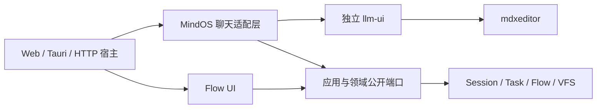
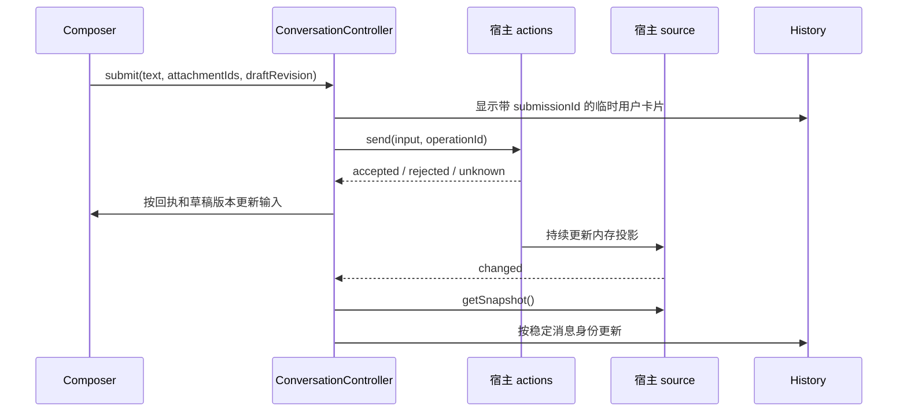

# llm-ui 独立模块与协作接口设计

状态：设计提案，待实施。日期：2026-10-17。

将 `@itookit/llm-ui` 变成原生 DOM 聊天组件库，唯一直接运行时包依赖为 `@itookit/mdxeditor`。宿主通过异步操作接口提交命令，通过只读快照和订阅提供状态。MindOS 的 Session、Task、Flow、VFS、配置与权限由适配层连接，不进入独立库的公开类型或实现。

**协作方式采用组合：操作用 callback / Promise，状态用 snapshot / subscribe，局部交互直接调用，跨组件通知才用实例事件。** SSE、WebSocket、Observable、AsyncIterable 是适配层接收外部数据的方式，不成为聊天 UI 的必需依赖。

本文描述目标边界；当前实现仍按 [现有设计](../../ui/llm-ui/design.md) 和 [前后端模块边界](frontend-backend-modules.md) 工作。

## 1 现状与拆分动机

当前 `llm-ui` 已通过注入端口接入执行能力，但仍是 MindOS 业务 UI。独立发布不等于独立于业务契约。

| 当前耦合 | 源码依据 | 目标归属 |
| --- | --- | --- |
| Session 仓储、绑定、设置与快照 | [SessionService](../../ui/llm-ui/src/services/SessionService.ts)、[聊天工厂](../../ui/llm-ui/src/chat.ts) | MindOS 适配层 |
| 发送时构造业务 intent 和 Session 命令 | [SendMessageCommand](../../ui/llm-ui/src/commands/SendMessageCommand.ts) | MindOS 适配层 |
| Task 挂接、恢复与审批控制 | [RunAttachmentController](../../ui/llm-ui/src/shell/RunAttachmentController.ts) | MindOS 适配层 |
| Markdown 创建与 VFS 文件接口 | [MDxController](../../ui/llm-ui/src/components/mdx/MDxController.ts) | 库直接调用 mdxeditor；文件能力由宿主注入 |
| Flow 编辑、参数、启动与输出 | [DagWorkbench](../../ui/llm-ui/src/components/DagWorkbench.ts)、[FlowLauncher](../../ui/llm-ui/src/flows/run-flow.ts) | 单独 Flow UI |
| 图标、翻译、弹窗与应用编辑器协议 | [依赖声明](../../ui/llm-ui/package.json)、[RemoteConversationEditor](../../ui/llm-ui/src/shell/RemoteConversationEditor.ts) | 通用资源归库；应用协议归适配层 |

已有 [ConversationControls](../../ui/ui-common/src/interfaces/ConversationControls.ts) 和 [createConversationEditor](../../ui/llm-ui/src/conversation.ts) 是起点：前者同时具有操作方法、快照与订阅，后者已经从外部接收控制端口。提取其展示语义，原生轮询、回执核对和连接生命周期继续由适配层承担。

## 2 目标模块与依赖



箭头表示代码依赖。运行时通知可以从适配层流向 UI，独立库仍不导入适配层。

建议保留 `@itookit/llm-ui` 作为通用库包名，新建 `@itookit/llm-ui-adapter` 承接 MindOS 接入，`@itookit/llm-flow-ui` 承接 Flow 界面。后两个名称是拟议名称，尚无对应工作区。先在现有目录内提取边界，独立仓库、目录迁移和 Git 子模块身份在验收后另行处理。

| 能力 | 独立 llm-ui | MindOS 适配层或宿主 |
| --- | --- | --- |
| 对话正文 | 消息卡片、Markdown、思考、工具摘要、引用、复制与折叠 | 将本地或原生历史投影为统一消息 |
| 输入 | 草稿、附件选择、IME、提交反馈、移动端布局 | 上传、OCR、提交准入、持久化 |
| 控制 | 发送、停止、重试、编辑、审批等通用控件 | 执行命令、授权核验、恢复和幂等 |
| 历史 | 提问目录、定位、分页入口、滚动锚点 | 加载页面、分支选择、历史查询 |
| 配置 | 可选选择器和扩展插槽 | Agent、连接、模型档位、Skill、工作目录 |
| 应用集成 | 通用 toolbar / menu 插槽 | 项目导航、设置页面、文件管理与执行器切换 |
| Flow | 显示投影后的消息与交互请求 | DAG、参数 schema、启动、流程库、节点输出 |
| 生命周期 | 自身 DOM、MDx 实例、订阅和定时器 | 观察租约、运行时、连接与任务 |

单依赖约束同时覆盖源码、JavaScript 制品和 `.d.ts`：

- 除 mdxeditor 外不引用其他 `@itookit/*` 包，也不通过构建内联掩盖业务依赖。
- mdxeditor 自身的第三方传递依赖继续由其管理；独立 UI 不额外直接依赖 `marked`、`js-yaml`、RxJS 或框架。
- Flow YAML 处理随 Flow UI 迁移；Markdown 处理使用 mdxeditor 公开能力。
- 少量 DOM、转义、翻译和图标资源由库自身提供。默认图标使用可复用 SVG 资源，保留适用许可，不硬编码 emoji。
- 包含自身完整的中文和英文文案，可注入翻译函数、图标覆盖和 CSS variables。MindOS 通过适配层映射已有 i18n 与图标。
- 聊天、Session、Task 和 VFS 语义不迁入 mdxeditor；它继续只负责通用 Markdown 编辑与渲染。

## 3 Callback 与事件的取舍

callback 是函数注入形式，事件是通知语义。事件 listener 本身也是 callback；需要区分的是“请求操作并取得结果”和“告知状态已经改变”。

| 场景 | 机制 | 返回与错误语义 |
| --- | --- | --- |
| 发送、停止、审批、切换分支 | 具名异步方法，即 callback / Promise | 单个明确执行者，返回操作回执 |
| 历史、生成状态、权限可用性变化 | `getSnapshot()` + `subscribe()` | 通知后读取最新状态，可多个观察者 |
| 上传、搜索、保存草稿、打开资源 | 可选具名 callback | 请求有结果，可取消读取，可呈现失败 |
| 复制完成、焦点、可见性等观察通知 | 可选类型化事件 | 不参与业务成功判定，不承担授权 |
| 模型或 Agent 输出 | 宿主消费 AsyncIterable / SSE / Observable | 先更新宿主投影，再通知 UI |
| 父组件协调输入、历史和工具栏 | Controller 的直接方法调用 | 调用链明确，无全局消息总线 |

不采用 `emit('send', payload)` 后等待另一个 `send-success` 事件的请求机制。那会引入请求关联、超时、多个处理者和清理协议，而 Promise 已提供对应调用关系。审批等有副作用的操作尤其需要明确结果。

只有 `onSend(text): Promise<string>` 的接口也不足以支撑当前功能：历史分页、多个回复、工具交互、后台执行、其他窗口变更及断线恢复都需要独立状态来源。

快照订阅是独立库唯一的会话事实输入。第一版不再并列提供 `appendDelta`、`setMessages`、`onChunk` 等修改同一事实的公共通道，避免顺序和覆盖规则分散。内部渲染器仍可根据前后快照对 MDx 实例做增量更新。

## 4 公开接口草案

以下类型由独立库定义，只表达展示与用户意图，不重导出 Session、Kernel、Provider 或 VFS 类型。实现时以最小适配用例收敛类型和字段。

### 4.1 展示模型

```ts
export type JsonValue = null | boolean | number | string
  | readonly JsonValue[] | { readonly [key: string]: JsonValue };

export interface AttachmentRef {
  readonly id: string;
  readonly name: string;
  readonly mimeType?: string;
}

export type MessagePart =
  | { readonly id: string; readonly kind: 'markdown'; readonly text: string }
  | { readonly id: string; readonly kind: 'reasoning'; readonly text: string }
  | { readonly id: string; readonly kind: 'tool'; readonly name: string;
      readonly summary: string; readonly state: 'running' | 'succeeded' | 'failed';
      readonly detail?: string }
  | { readonly id: string; readonly kind: 'attachment'; readonly file: AttachmentRef }
  | { readonly id: string; readonly kind: 'extension'; readonly type: string;
      readonly data: JsonValue };

export interface ChatMessage {
  readonly id: string;
  readonly revision: number;
  readonly role: 'user' | 'assistant' | 'system' | 'tool';
  readonly parts: readonly MessagePart[];
  readonly state: 'pending' | 'streaming' | 'complete' | 'failed' | 'cancelled';
  readonly submissionId?: string;
  readonly timestamp?: number;
}

export interface InteractionView {
  readonly id: string;
  readonly revision: number;
  readonly kind: 'approval' | 'input';
  readonly title: string;
  readonly detail: string;
  readonly state: 'pending' | 'submitting' | 'resolved';
  readonly fields?: readonly {
    readonly id: string; readonly label: string;
    readonly choices?: readonly { readonly id: string; readonly label: string }[];
  }[];
}

export interface ConversationSnapshot {
  readonly viewId: string;
  readonly revision: number;
  readonly title: string;
  readonly messages: readonly ChatMessage[];
  readonly interactions: readonly InteractionView[];
  readonly loading: boolean;
  readonly execution: 'unknown' | 'idle' | 'running' | 'waiting-input';
  readonly executionRef?: string;
  readonly connection: 'online' | 'offline' | 'reconnecting';
  readonly hasEarlier: boolean;
  readonly allowed: readonly ('send' | 'cancel' | 'retry' | 'edit' | 'respond')[];
  readonly error?: { readonly code: string; readonly message: string };
}
```

`viewId` 标识一次固定会话与分支的观察绑定。切换时创建新绑定，UI 不接受旧绑定的迟到更新。`revision` 在同一绑定内单调递增；消息和 part 身份稳定，未变对象保持引用，更新同一消息时递增其 revision。

`extension` 用于引用来源、用量或宿主专有块。自定义 renderer 由宿主代码显式登记；模型文本不能通过同名 fenced block 获得插件身份。未知类型显示安全摘要或占位，不执行 data，不提供任意 HTML 注入入口。

`allowed` 表达当前可用操作；方法是否存在表达宿主是否支持该能力。按钮需同时满足两者，消息级编辑/重试范围由可选能力补充，后端仍进行实际授权校验。审批只投影请求，不在 UI 执行工具。

### 4.2 状态源与操作端口

```ts
export interface ConversationSource {
  getSnapshot(): ConversationSnapshot;
  subscribe(listener: () => void): () => void;
  refresh?(): Promise<void>;
}

export interface OperationContext {
  readonly viewId: string;
  readonly operationId: string;
}

export type OperationReceipt =
  | { readonly status: 'accepted'; readonly operationId: string }
  | { readonly status: 'rejected'; readonly operationId: string;
      readonly code: string; readonly message: string }
  | { readonly status: 'unknown'; readonly operationId: string;
      readonly message: string };

export interface ChatSubmission {
  readonly text: string;
  readonly attachments: readonly AttachmentRef[];
  readonly selection?: Readonly<Record<string, string>>;
}

export interface ConversationActions {
  send?(input: ChatSubmission, context: OperationContext): Promise<OperationReceipt>;
  cancel?(executionRef: string, context: OperationContext): Promise<OperationReceipt>;
  retry?(messageId: string, context: OperationContext): Promise<OperationReceipt>;
  edit?(messageId: string, text: string,
    context: OperationContext): Promise<OperationReceipt>;
  respond?(request: { id: string; revision: number; response: JsonValue },
    context: OperationContext): Promise<OperationReceipt>;
  loadEarlier?(options: { signal: AbortSignal }): Promise<void>;
  reconcile?(context: OperationContext): Promise<OperationReceipt>;
}

export interface ComposerDraft {
  readonly revision: number;
  readonly text: string;
  readonly attachments: readonly AttachmentRef[];
}

export interface ChatOptions {
  source: ConversationSource;
  actions: ConversationActions;
  initialDraft?: ComposerDraft;
  onDraftChange?(draft: ComposerDraft): void;
  saveDraft?(draft: ComposerDraft): Promise<void>;
  onOpenResource?(id: string): Promise<void>;
  upload?(file: File, options: { signal: AbortSignal }): Promise<AttachmentRef>;
  translate?(key: string, values?: Readonly<Record<string, string>>): string;
}

export interface ChatView {
  setActive(active: boolean): void;
  focus(): void;
  getDraft(): ComposerDraft;
  flushDraft(): Promise<void>;
  destroy(): Promise<void>;
}

export declare function createChatView(
  container: HTMLElement, options: ChatOptions,
): Promise<ChatView>;
```

`send` 的 operationId 同时作为 submissionId，关联乐观用户卡片和持久消息。`selection` 只传递宿主登记的选择器 ID 与值，例如模型和助手，不定义 Provider、模型档位或 Flow 字段。

选择器展示、资源读取、扩展 renderer 和 toolbar 插槽作为按需的小端口补充，不构成必填的大型宿主接口。所有操作均为可选能力；只读使用方传入空 actions，UI 隐藏对应入口，无需伪造操作实现。

### 4.3 快照与订阅规则

1. `getSnapshot()` 同步读取已准备的内存投影，不发网络请求。首次未加载时返回 `loading: true` 的空投影。
2. 无变化时返回同一快照对象；有变化先原子替换快照，再通知 listener。不能原地修改已发布对象。
3. UI 先安装订阅，再读取快照，避免读取与订阅之间漏更新。通知只表示“重新读取”，不要求逐条处理所有通知。
4. 每次绑定拥有独立 source；刷新、分页和切换的异步结果必须核对绑定代次，旧结果不得发布到新 source。
5. refresh、分页与操作回执不另行返回消息数组；所有事实统一发布到 source。操作 Promise 可以先于或晚于相关快照到达。
6. 网络增量的游标、重放、缺口、重复和断线恢复由适配层处理，不能把未知状态伪装成运行结束。
7. 无消息数据变化时不增加消息 revision；UI 按稳定 ID 与 revision 跳过无关消息。

初版不要求每个 token 复制整段历史。适配层聚合当前活动消息，按帧或短时间窗口发布不可变版本，复用其余消息。UI 按消息 ID 更新已有 DOM / MDx 实例，终态前排空尚未发布的正文。分页保留已读位置，流式更新仅在原本跟随末尾时贴底。

### 4.4 回执与输入规则

`accepted` 只表示宿主已接收操作，不表示模型回复完成或任务已经停止。运行与审批终态继续由快照提供。`unknown` 表示操作可能已产生副作用，但回执未确定，需要核对。

- UI 发送时捕获文本、附件和草稿 revision，生成稳定 operationId，禁止同一提交的重复点击。
- 仅在 accepted 或快照明确关联同一 submissionId 后清理对应提交；草稿仍等于提交版本才清空文字，附件只移除已提交 ID。等待期间新增的文字与附件保持原样。
- rejected 保留输入并展示原因；unknown 保留输入和待核对标记，通过 reconcile 或后续快照确认，不自动重发。
- 宿主应返回类型化回执。未预期的 Promise rejection 按结果未确定处理；不能据此假定写入失败并回滚持久消息。
- operationId 的幂等约束、持久记录与重试核对由宿主负责。若远端不支持幂等，适配层限制自动重发，不能承诺跨进程恰好一次执行。
- 宿主拒绝过期 viewId；审批还核对 request id、revision、挂接身份与 pending 状态。UI 隐藏按钮不能替代该校验。
- cancel 捕获快照中的 executionRef。该值是宿主提供的、不透明的执行身份或版本，宿主核对后才停止；新任务不得复用旧值，避免迟到请求取消后来启动的任务。无法可靠核对身份时不开放取消能力。
- 读取与上传可以使用 AbortSignal；中止等待或销毁 UI 不等于取消后端运行，取消执行必须显式调用 cancel。

## 5 内部组件如何协作

独立库内部由会话 Controller 协调 History、Composer、Toolbar 和 InteractionPanel。子组件通过窄接口提交意图；Controller 调用 actions，再更新本地提交反馈。source 通知触发状态读取与渲染，不穿过外部命令总线。



图示仅为一种到达顺序；快照可能先于回执，Controller 按 submissionId 关联，避免两次清空输入或重复气泡。

内部事件只用于多个观察者需要的通知，例如焦点、复制完成与折叠变化。事件有明确 TypeScript map、实例作用域和解绑函数；不建立全局 EventBus，不用事件请求授权、上传或发送。现有实例 EventBus 可逐步收敛，不要求为拆包重写所有局部组件。

提交错误在输入区，审批错误在对应卡片，历史读取错误在历史区，扩展渲染错误在对应块。listener 异常应隔离，不能改变宿主回执或阻塞其他观察者。

## 6 Markdown 与宿主扩展

MDxController 改为直接调用 mdxeditor 的公开 createMDxEditor / MDxRenderer。其 [通用契约](../../libraries/mdxeditor/src/editor/contracts.ts) 已提供 AssetProvider、EditorHost、StoreFactory、translate 和 HTML 策略，可承接资源与持久化注入。

- 展示使用 `scrollMode: 'host'`；非可信正文使用 `htmlPolicy: 'literal'`，保持当前原生历史策略。
- 用 AssetProvider 解析附件；文件搜索 callback 返回候选，不传入 IFileSystem。
- 工具和系统事件由结构化 part 决定角色；普通 Markdown 不根据正文关键字识别为工具输出。
- 打印由库组织展示消息，使用 mdxeditor 通用打印能力。MindOS 的 LLMPrintService 所含会话投影拆回适配层，不整类复制进 mdxeditor。
- 插槽只收到必要展示上下文及通用视图 handle，返回 disposer。目录授权、设置与项目导航由插槽绑定宿主行为。
- 自定义 renderer 负责自己创建的 DOM，框架调用 update / destroy，销毁覆盖全部 disposer。

onDraftChange 是编辑通知，不表示持久化成功。配置 saveDraft 后，同一绑定内串行、合并保存，flushDraft 等待已登记保存并报告失败；未配置时 flushDraft 直接完成，宿主自行管理未提交输入。宿主销毁前显式调用 flushDraft；destroy 无论保存是否成功都必须清理资源，失败草稿由宿主保留以便恢复。

## 7 生命周期与所有权

| 对象 | 创建者与释放者 | UI 关闭的语义 |
| --- | --- | --- |
| ChatView、MDx、本地订阅与定时器 | llm-ui | destroy 幂等释放 |
| source、共享连接与观察租约 | 宿主适配层 | 宿主在视图解绑后释放自己的租约 |
| Task、原生执行、持久会话 | 后端与宿主 | 继续运行，用户显式停止才取消 |
| 临时上传资源与 object URL | 创建该资源的一方 | 中止或回收；已持久引用不误删 |
| 项目、全局设置与导航 | 应用宿主 | 不受 ChatView 生命周期控制 |

setActive(false) 暂停昂贵渲染和抢焦点，保留 DOM、输入与阅读位置；可只标脏，重新激活时读取最新快照。它不关闭共享连接、不取消执行。重新激活可请求 refresh，但不自动补齐全部历史或重发写操作。

destroy 先标记销毁与递增异步代次，再解绑监听、停止本地工作和释放 MDx / 插槽；迟到的刷新、分页、上传和回执不能恢复 DOM。UI 不调用 source.close 或 runtime.dispose。初始化失败同样释放已创建资源。

## 8 公开方案采用的模式

比较针对公开组件接口或传输协议，不代表产品网页内部实现；参考日期为 2026-10-17。API 名称可能随版本变化，实施适配时以锁定版本为准。

| 项目 | 可核实的协作方式 | 对本设计的启发 |
| --- | --- | --- |
| assistant-ui ExternalStoreRuntime | 外部提供 messages、isRunning 和 onNew / onEdit / onCancel 等 handlers；convertMessage 转换消息；能力按 handler 开启 | 外部状态归宿主，意图通过 callback，适配自身消息格式。[官方文档](https://www.assistant-ui.com/docs/runtimes/custom/external-store) |
| Vercel AI SDK UI | useChat 提供 sendMessage / regenerate / stop、messages / status，以及 onData / onFinish / onError；ChatTransport 负责请求与消息流 | 操作、状态、通知与传输分工，无需把传输内置进展示组件。[useChat](https://ai-sdk.dev/docs/reference/ai-sdk-ui/use-chat)、[Transport](https://ai-sdk.dev/docs/ai-sdk-ui/transport) |
| Microsoft Bot Framework Web Chat / DirectLineJS | postActivity 返回 Observable，可订阅发送 ID 或错误；activity$、connectionStatus$ 提供消息与连接状态 | Observable 可承载操作结果和持续通知；本库用 Promise 与 subscribe，无需强制 RxJS。[官方源码与示例](https://github.com/microsoft/BotFramework-DirectLineJS) |
| AG-UI | 定义运行、消息、工具与状态等事件，包含消息开始、增量内容与结束 | 可作为 Agent 与适配层间的事件协议，先投影为 source 再进入 UI。[官方事件文档](https://docs.ag-ui.com/concepts/events) |
| Grok 公开 API | xAI 文档提供 SSE 流式输出及 SDK 流迭代示例 | 说明服务输出可以是事件流，不能据此推断 Grok 网页的组件通信。[官方流式说明](https://docs.x.ai/developers/model-capabilities/text/streaming) |

用户提及的 Muse 和 Bots 未确定具体产品或仓库，暂不将它们作为网页内部通信的事实依据；Microsoft Bots 是明确的公开框架参照，并不等同于所有 Bots 产品。

基于这些公开接口的设计判断：请求响应和持续状态通常需要不同接口。这些例子不能证明某一种模式在所有产品中占多数。对已有持久执行和多窗口同步的 MindOS，外部状态驱动加异步操作比单轮文本回调更贴合当前需求。

## 9 迁移步骤

| 阶段 | 交付内容 | 完成条件 |
| --- | --- | --- |
| 1 展示契约 | 定义独立展示类型、source 与 actions；建立内存模拟宿主 | 无 Session / Kernel / VFS 的宿主能演示发送、流式、错误与审批 |
| 2 适配层 | 迁移 SessionService、发送策略、Task 挂接、原生投影与恢复接线 | 本地、原生与 HTTP 消费同一 ChatView，回执与草稿行为保持一致 |
| 3 能力拆出 | Flow 与设置工厂迁到各自包；目录、模型、Skill 通过小端口与插槽接入 | 功能保留，通用源码不按具体工具名或 Provider 分支 |
| 4 单依赖与入口 | 直接消费 mdxeditor，替换 common / ui-common；迁移旧入口调用方 | 根入口、CSS 与 .d.ts 仅引用自身或 mdxeditor，无 workspace 外泄 |
| 5 发布验证 | 仓库外安装 tarball；确定独立仓库与版本策略 | 无 monorepo 别名、源码链接或业务包即可构建运行 |

迁移期旧 createLLMFactory、ConversationControls 兼容映射、settings 和 startup 入口放在适配层，最终独立库根入口不重导出它们。先迁移宿主调用方，再清理旧 exports；懒加载入口同步调整，避免 Flow / 设置加载回首屏。

保留 app-shell 集成回归，新增测试聚焦跨边界风险，不按每个 callback 编写镜像测试。对外 ABI 与纯 DOM 展示在独立包验证，真实 Session / Kernel 行为在适配层或宿主验证。

## 10 验收标准

1. **依赖与制品**：仅安装 llm-ui 与 mdxeditor 即可消费。扫描源码、构建图和 .d.ts，无其他内部包引用；TypeScript 使用 mdxeditor 约定的 bundler 解析。若发布 CJS，另验证 require 入口。
2. **双宿主**：内存宿主与 MindOS 真实适配器运行同一 UI；本地与远端不复制 History / Composer。
3. **流式与身份**：一次提交可投影多条回复及工具状态；回执先到、快照先到和重复通知不重复卡片。终态前正文完整，替换内容不被旧 delta 回填。
4. **输入与不确定结果**：拒绝和未知回执保留输入；期间的新编辑不被清空；断线不自动重发，停止请求返回不伪造已停止。
5. **审批与切换**：过期 request、revision、viewId 在宿主被拒绝；切换、销毁和隐藏时的迟到响应不影响新视图。
6. **生命周期**：订阅、MDx、插槽和定时器全部释放；destroy 幂等；关闭视图不取消后台任务或释放共享运行时。
7. **现有体验**：附件、OCR、文件提及、模型/助手选择、提问目录、分页、复制、打印、移动端与 IME 可通过适配保留。Flow 拆包后入口与参数校验有效。
8. **性能与呈现**：增量不重建全部历史和 MDx，分页保留锚点，阅读旧消息不抢滚动；未知扩展与工具输出按文本或受控 renderer 呈现。

落地时同步更新 [包结构](../pkgstructure.md)、[前后端模块边界](frontend-backend-modules.md)、[接口契约](../interface-contracts.md)、[集成链](../integration-chains.md)、[事件流](../event-flows.md) 和包开发说明。本文提案不改变它们对当前实现的描述。
