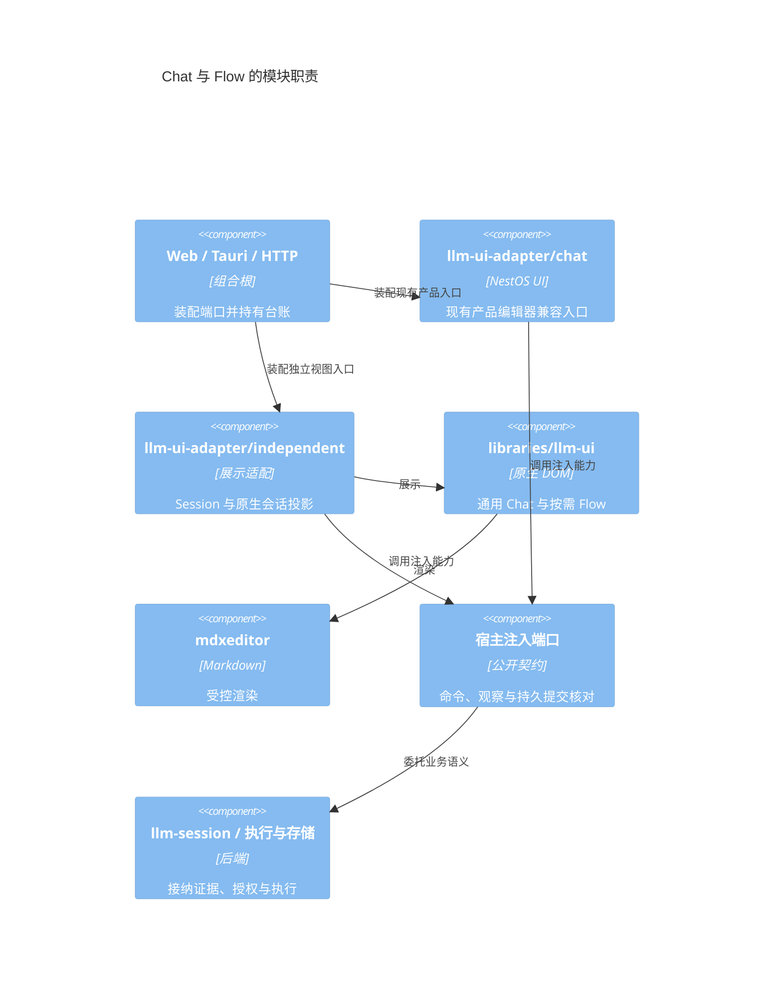
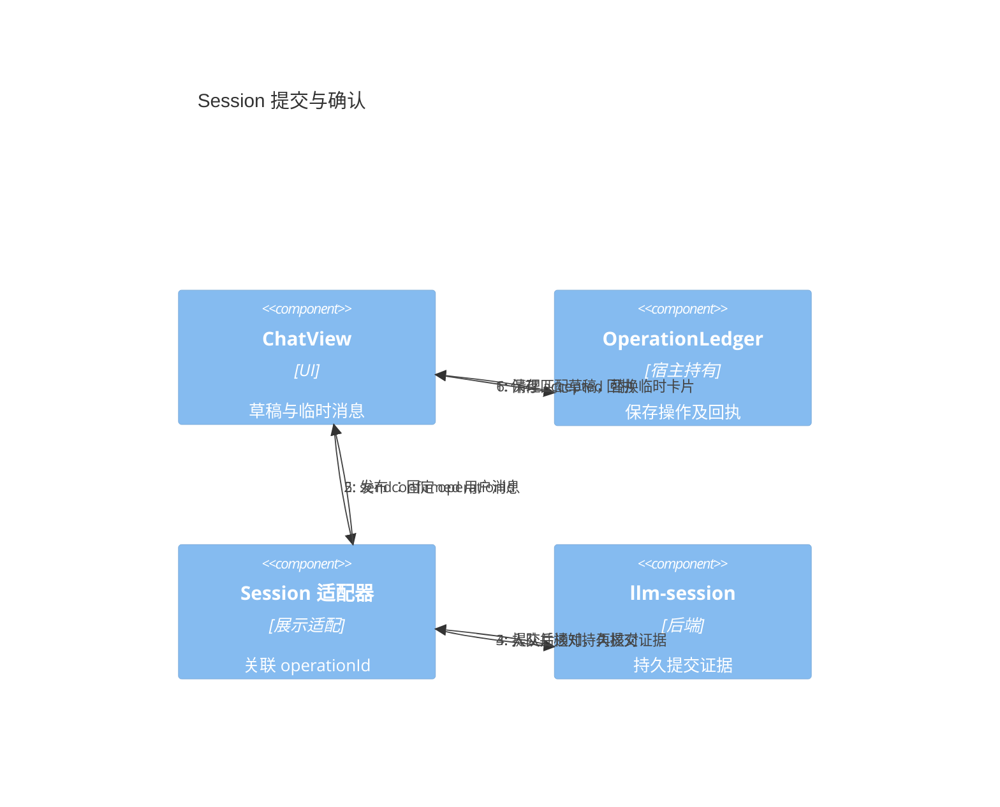
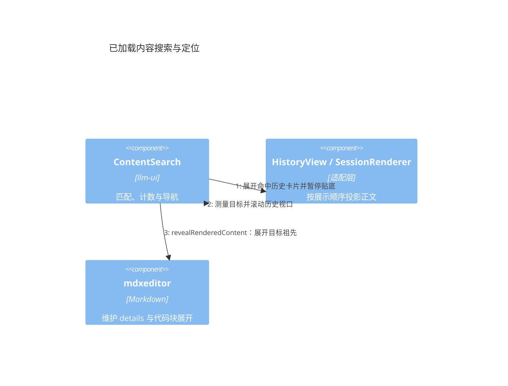
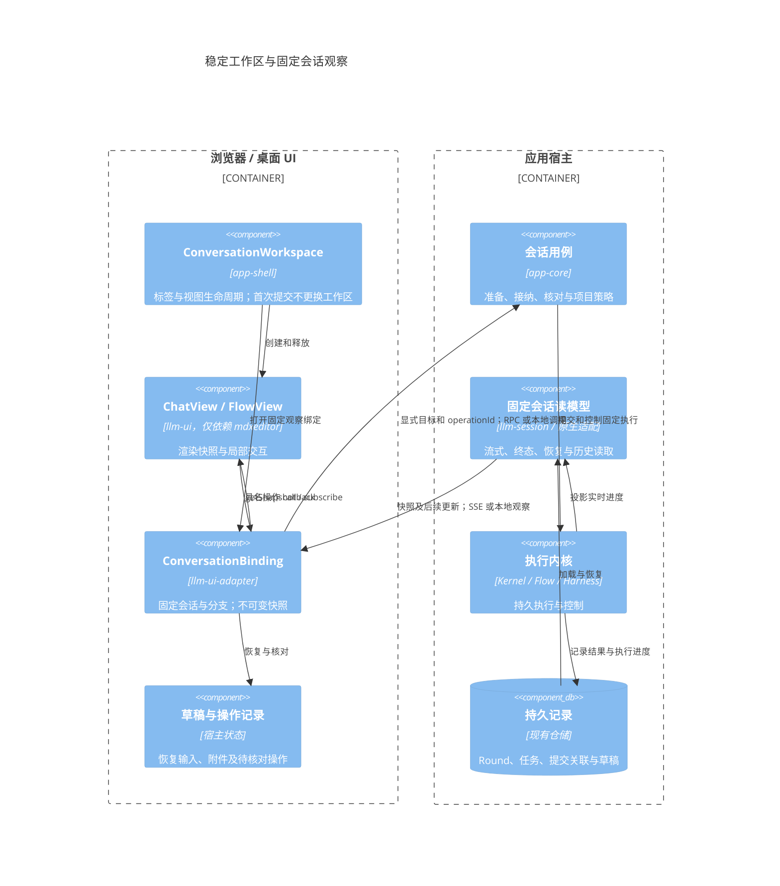
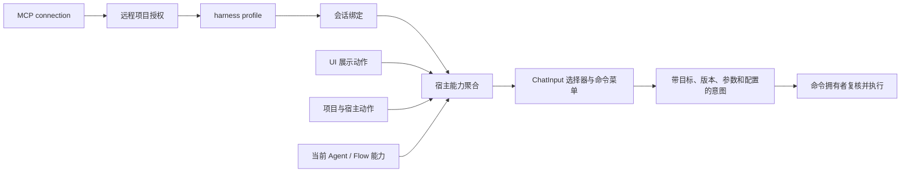
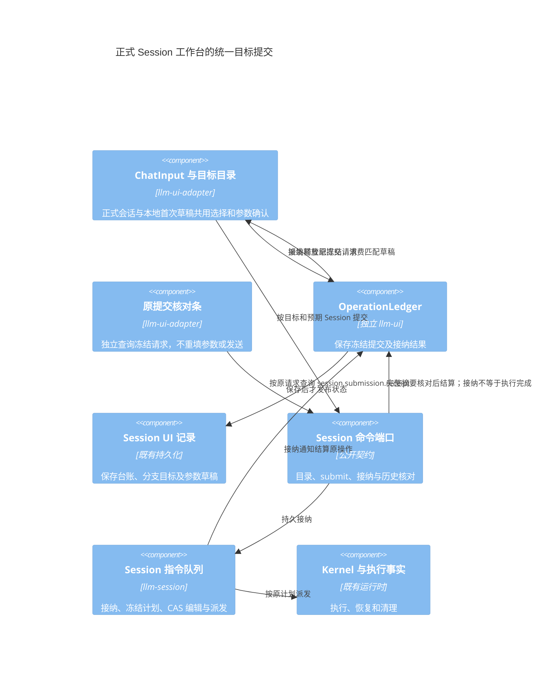
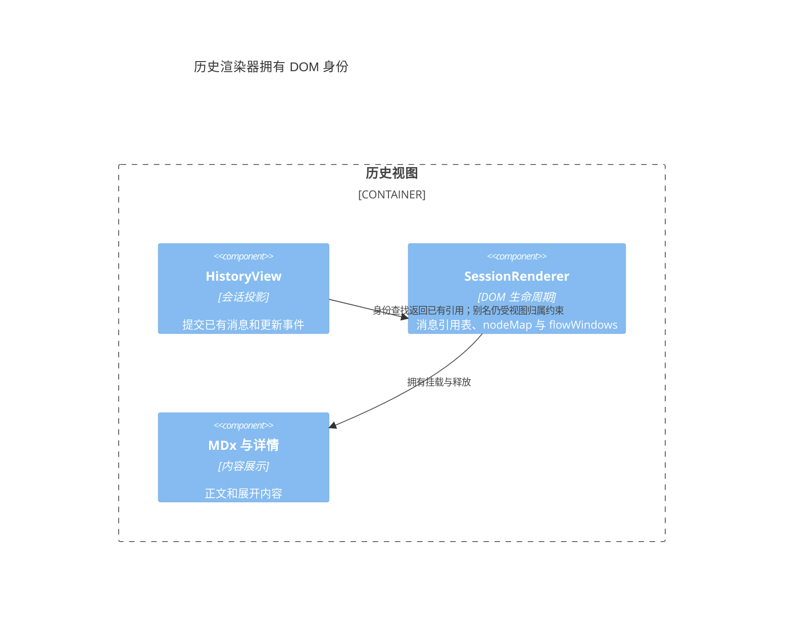
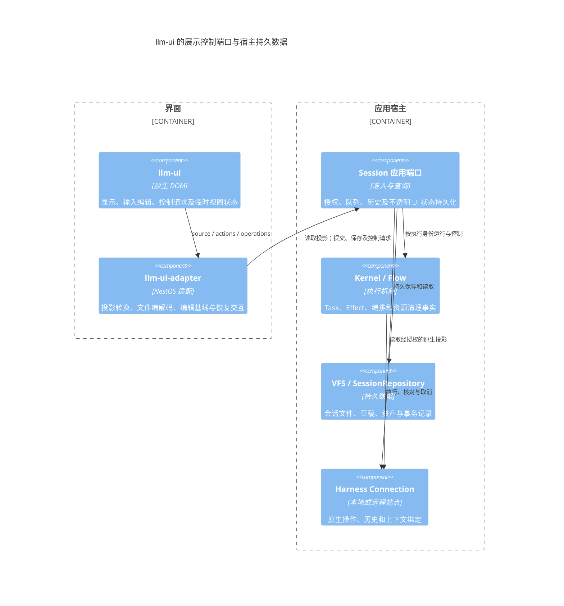

# llm-ui 独立模块与协作接口设计

状态：已建立独立包与宿主适配边界，现有产品编辑器保留兼容入口。日期：2026-10-17。

`@itookit/llm-ui` 是原生 DOM 的 LLM 界面库，**同时包含 Chat 和 Flow 功能**，唯一直接运行时依赖为 `@itookit/mdxeditor`。Flow 通过同一包的 `/flow` 子入口按需加载，不建立单独的 Flow UI 包。

NestOS 的 Session、Task、Flow 执行、VFS、配置和权限由 `@itookit/llm-ui-adapter` 及宿主连接，不进入独立库的类型或实现。后端 `@itookit/llm-flow` 继续负责 Flow 执行语义，与 UI 的包划分是不同边界。

## 1 模块与当前实施范围

箭头表示代码依赖；状态通知在运行时由宿主流入 UI。

| 模块 | 公开入口 | 职责 |
| --- | --- | --- |
| 独立 llm-ui | 根入口 createChatView、createOperationLedger | 聊天展示、已加载内容搜索与定位、草稿附件、消息操作、交互卡片、提及候选、选择器和扩展 |
| 独立 llm-ui | /flow 的 createFlowView | 节点与端口、连线、检查器、布局、运行状态及输出 |
| NestOS 适配 | llm-ui-adapter/independent | Session 与原生会话投影到同一 ChatView |
| NestOS 兼容入口 | llm-ui-adapter/chat、/conversation、/settings、/startup | 保留完整产品编辑器、Flow 业务表单、菜单、项目草稿与设置接线 |

现有 Web/Tauri/HTTP 的产品编辑器改从适配包导入，保留原来的产品行为。兼容工厂目前仍使用原业务编辑器；新的 Session/native 绑定提供独立 ChatView 接入，不宣称所有产品插槽都已经迁入通用组件。复杂 NestOS Flow 配置也保留在适配层，通用 Flow 通过宿主描述字段或检查器接入。

原生会话的诊断展示也归适配层：ConversationInformation 将已有快照中的被动状态、累计 token 和宿主估价收进「更多 → 会话信息」，说明外部运行观察范围及估价与实际账单的区别；不读取定价目录、不发探测请求。基础字段与本地 SessionFamilyActions 统一为创建时间、最后活动，复用相同文案与 ui-common.setTimePresentation 时间展示；缺失值显示「暂无记录」，不以页面刷新时间替代远端活动。运行和等待保留标题栏指标，离线、错误、缺口与未知回执保留直接提示。详情更新只修改自身文本，不替换历史或输入 DOM；销毁释放弹层。

独立源码、JavaScript 和声明均不得引用其他内部包，不通过内联构建掩盖依赖，也不把聊天或 Flow 执行职责迁入 mdxeditor。独立仓库、子模块与发布操作未在本次实施中进行。

### 1.1 通用机制与默认外观的收敛状态

提问目录由独立库 `PromptNavigator` 提供一套视图和交互；独立 ChatView 与兼容产品编辑器都消费它。adapter 的同名类只接入产品文案、图标、历史身份与目标展开。目录 CSS、最近优先排序、过滤、键盘操作、按需分页状态及生命周期归独立库，不依赖 Session 类型。原先独立 ChatView 的简易提问按钮列表已删除。

历史滚动共用独立库 `ScrollController`；输入共用 `shouldSubmitMessage` 与 `resizeMessageInput`。原生和 Session 产品编辑器通过既有 HistoryView/ChatInput 消费这些规则，独立 ChatView 也直接消费。旧 common 路径仅保留转导出，避免破坏兼容导入。输入、气泡、标题栏与目录的默认外观归独立库，adapter 只保留宿主控件样式及主题/图标注入。

这不表示产品已全部迁入 ChatView：默认工厂仍使用兼容编辑器，项目草稿仍通过 WorkspaceHandoff 原位转正。切换默认入口前必须接齐草稿转正、历史编辑/分支、配置通知及恢复能力，并验证首次提交期间输入 DOM、焦点、Session UUID 和 operationId 稳定；不能通过重建输入框或静默回退到另一套视图绕过这些要求。独立库可操作预览见 [chat-preview.html](../../libraries/llm-ui/examples/chat-preview.html)。

### 1.2 保留视图与绑定替换

ChatView 通过 `replaceBinding` 更换宿主 source/actions/operations、草稿保存、资源端口及展示扩展，保留输入框和历史容器。省略 draft 时保留当前输入；显式 draft 用于恢复目标分支草稿，不重建 DOM。另一个 conversationId 必须显式提供草稿。主题、语言与 Flow 功能等视图级配置不随绑定改变。

替换先保存旧输入，包括等待期间的新编辑，再安装新源。保存或订阅失败保留旧绑定，错误以 bindingCommitted 标识是否已完成安装。旧操作在登记前冻结原动作和台账；登记完成前视图已更换时不再派发，已派发操作的迟到结果只结算原台账。旧分页被中止，不得改变新历史的滚动和错误。操作诊断不记录正文；onBindingDiagnostic 单独记录 flush/subscribe/commit/cleanup 阶段、关联身份、结果、耗时及安全错误码。

Session/native 适配分别提供 `replaceSessionBinding` / `replaceNativeBinding`，将队列、上下文、命令输出与图片端口等展示钩子换入同一 ChatView，不关闭宿主共享连接。IndependentSessionEditor 切分支和重新激活时已消费此能力，旧草稿保存捕获原分支 store，目标草稿以 inputToken/scopeId 隔离。兼容字段变化时优先恢复兼容编辑器的新输入，不能用陈旧 inputView 覆盖。显式核对旧 operationId 可读取原分支冻结请求，自动观察仍按当前分支过滤。

此阶段尚未更换默认 Chat 工厂，也未将项目 SessionDraftEditor 的 WorkspaceHandoff 切换到独立 ChatView；草稿转正、完整历史操作和配置接线仍需后续迁移与验收。

## 2 协作方式

- 操作用具名 callback / Promise，返回与请求关联的 OperationReceipt。
- 会话与 Flow 事实只通过 getSnapshot / subscribe 输入；无 appendDelta、setMessages 等并行公共事实通道。
- Controller 直接协调内部组件。通知不承担发送、授权或业务成功判定。
- SSE、WebSocket、轮询和持久恢复属于适配层，不是 UI 的通信协议依赖。

公开类型以源码为准：[Chat 与操作契约](../../libraries/llm-ui/src/contracts.ts)、[Flow 契约](../../libraries/llm-ui/src/flow-contracts.ts)。不在本文重复维护第二份 TypeScript 定义。

## 3 接纳、核对与恢复

accepted 表示宿主正式接纳操作，并接管提交内容、后续处理和失败恢复责任，不表示回复完成或任务已停止。内存宿主只保证实例寿命；持久宿主须以持久接纳记录或可靠待发送记录提供相应恢复保证。

UI 生成 operationId。宿主持有 OperationLedger，生命周期长于单个视图。register 保存操作及完整提交后才派发动作；settle 保存结果后再发布。可通过 createOperationLedger 的 initial/save 接入宿主持久化。台账未提供 save 时不承诺进程崩溃后的恢复。

只有用户消息的 acceptance=confirmed 且 submissionId 匹配时，快照才能确认该发送。optimistic 用户消息不构成接纳证据。submissionId 只关联临时用户卡片与正式用户消息，不合并同次提交的 assistant/tool 消息。

清理草稿与替换气泡分别处理：接纳确认后清理对应草稿；正式用户消息已经出现后才移除临时卡片。两者的顺序不必相同。

unknown 表示副作用可能已经发生。有写操作的宿主必须提供 reconcile(operationId)，读取不能因旧 viewId 失效而无法核对原操作。查询不到不自动等于 rejected。UI 保留输入与操作记录，不自动重发，也不为同一待核对提交生成新 ID 再发送。

edit/retry 共用目标消息的待核对锁；respond 按请求 ID 与 revision 锁定，accepted 后仍等待权威请求更新，局部 Promise 完成不会重新启用按钮。Flow 的 submitting 与 unknown 均提供核对入口，覆盖 register 已持久化、回执未保存即崩溃的恢复窗口。

权威确认先到，迟到网络错误不降级 accepted；接纳后的执行失败由事实投影呈现，不改写提交接纳状态。相互矛盾的终态回执报告给宿主核对，不按最后到达者覆盖。原生会话适配必须由宿主把 operationId 映射到原生持久请求，不能把“最近一次 submittedTurnId”猜作任意旧操作的回执。

Session 适配要求注入 `hasCommittedSubmission(submission)`，宿主委托后端 llm-session 的同名函数核对完整提交身份、执行引用与已提交历史索引。适配层不读取 Round 文件，也不复制持久化协议。`SessionCommand.Send` 返回内存请求 ID 不构成接纳证据；未见持久证据时返回 unknown，后续 Session 通知触发去重核对。confirmed 投影依据后端证据，独立于台账当前状态，避免“台账未接纳所以消息永远不能确认”的循环。

## 4 身份、版本与快照

conversationId/flowId 是跨绑定稳定关联，viewId 标识一次固定资源与分支的观察实例。多个窗口可以各自拥有有效绑定。旧绑定失效限制后续写操作与更新，不撤销已经接纳的操作。

getSnapshot 同步读取内存，不发网络请求。先安装订阅，再读取快照；无变化返回同一对象，有变化先原子发布不可变对象，再通知监听。消息身份稳定，只在该消息变化时递增消息 revision。通知不是必须逐条处理的事件日志。

snapshot revision 只表示本地发布顺序，不证明上游数据新旧。适配层负责 refresh、分页和增量之间的竞争，依据上游版本、失效代次或明确合并规则处理。分页合并到最新消息集合，不能用请求开始时的数组覆盖流式更新。

原生 send/respond 与 refresh 同样捕获观察代次；期间有更新通知或新的读取时，迟到操作响应只提供关联回执，不覆盖更晚的会话正文或请求状态。

编辑和重新生成携带目标消息 expectedRevision，不要求整个 ConversationSnapshot.revision 相等。retry 表示重新生成回复，不表示重发未知发送。edit 的分支策略由宿主决定；新分支由宿主建立新 source 与视图。

cancel 捕获固定 executionRef，宿主在执行端核验。取消旧执行后出现新执行，不能据此判定旧取消失败。没有可靠身份核验时不开放取消能力。

## 5 交互、草稿与附件

交互使用明确的小集合：approval 的决策 ID 与标签，input 的 text、single-choice、multi-choice 字段，以及必填和选择数量限制。请求事实状态为 pending/resolved/cancelled/expired；本窗口 submitting/unknown/error 属于局部状态。宿主校验请求 ID、revision、归属和 pending 状态，UI 按钮不是授权边界。

文字用独立 textRevision 判定提交后是否修改；附件按提交时捕获的草稿项 ID 清理。资源 ID 与草稿项身份分开，新增附件不阻止已提交文字清理。上传中不能提交；上传完成必须核对原上传项仍存在，AbortSignal 不代替迟到结果校验。

saveDraft 串行合并。flushDraft 覆盖调用前仍在防抖等待中的最新编辑；保存失败不推进已保存版本。onDraftChange 不是保存成功通知。宿主保存并恢复完整草稿与台账，视图销毁不承担宿主持久状态的最终所有权。

发送前的图片处理另见 [image-parser 独立库与聊天接入设计](chat-image-editing.md)。独立图片库封装 Scanic、矩形裁剪及默认最长边 1024 的等比缩小，智能体默认与 ChatInput 覆盖由宿主解析；llm-ui 通过可选 ImageEditingPort 接入，继续只依赖 mdxeditor；宿主适配工厂 createImageEditingPort 负责原图读写与元数据。原生独立绑定通过 images 读取资源并按 harness 声明转换附件，视图工厂自动装配图片端口；工作台兼容输入也复用该适配。图片替换需要草稿项内容版本，接纳清理须保留等待期间生成的新版本。宿主负责原图、处理参数、派生资源的持久化和条件替换。

## 6 Flow 是 llm-ui 的一部分

Flow 的 UI 契约使用通用 FlowSnapshot、节点类型、字段、端口与边，不导入后端 FlowDraft/FlowRevision/Kernel 类型，不按具体插件或工具名分支。

- 通用视图提供节点面板、端口连线、拖动、节点名称/参数检查器、保存/运行/停止和执行输出。
- 宿主描述节点类型和字段，复杂参数表单通过显式 mountInspector 注入可信代码。
- 节点修改携带节点 expectedRevision；连线、保存、运行使用独立 graphRevision，不受运行流式状态更新影响。
- 检查器保存期间禁用表单；accepted 后等到节点变更快照，再以新版本重建检查器。保存前的外部更新保留本地草稿与原 expectedRevision，继续由宿主检测冲突；切换检查器后不被旧提交重新打开。
- Flow 操作复用宿主持有的操作台账；unknown 不自动重发，运行结果经 source 输入。
- 业务模板、参数业务规则、编译、连接授权和持久执行继续归宿主。关闭 Flow 视图不停止后台运行。

Chat 通过 features.flow 控制 Flow 入口，默认关闭。启用后点击入口才动态加载同包的 Flow 子入口；setFlowEnabled 支持运行时切换，关闭释放视图但不取消执行。异步加载期间关闭或销毁，迟到结果不得重新挂载界面。

NestOS 工作台的调用目标选择器完整展示 `session.targets.list` 返回的目录，不受通用弹层默认十项截断限制；高度受限时在列表内滚动。入口提供全部与各类别筛选，搜索同时匹配名称、描述和类别，Flow 可直接通过类别按钮或搜索 `flow` 找到。搜索忽略大小写，按空白分词并要求每个词匹配任意一个可搜索字段，例如 `flow 作文` 同时匹配类别与名称。

聊天工作台的智能体入口通过 vfs-ui `createVFSBrowser` 展示，复用显式选择模式、触屏复选框及批量操作栏。宿主负责单次删除确认、最新本地目录校验及抽屉归组；原生远程条目只开放配置，混合选择不开放删除或移动。工具箱在搜索下方常驻全部、模型、流程、工具、MCP、技能、提示词类别，能力筛选仍在搜索旁的面板内，已选条件可逐项清除；窄屏分类换行，筛选面板使用底部布局。

工具箱使用内联搜索动作布局：隐藏侧栏重复标题，搜索、筛选图标、新建图标和更多菜单共用一行；新建保留可访问名称。更多菜单不再单设“多选”，由“整理条目”统一提供勾选、删除所选与移动归组；整理类型排除智能体，默认流程。删除复用宿主确认与依赖核对，取消、失败保留选择和分组输入；工具引用不开放定义删除。配置删除确认期间暂时释放整理弹窗的原生模态层，结算后恢复原弹窗，避免确认按钮被挡住。智能体列表继续保留独立的批量操作入口。

### 6.1 配置表单共用与宿主定制

智能体的 Flow 默认配置、Flow 运行参数面板及独立 llm-ui 的节点检查器共用 `@itookit/llm-ui/forms`，不在设置包中重新实现一套类型控件。公共层只接受轻量 `FormParameter`、JSON 值和展示选项，不引用 FlowDraft、AgentDefinition、Session、注册服务或配置存储。NestOS 适配层将领域定义投影到公共字段；公开 `/forms` 入口可独立使用，不加载 Chat、Markdown 或 Flow 执行代码。

| 层次 | 职责 | 定制方式 |
| --- | --- | --- |
| llm-ui/forms | text、textarea、number、boolean、choice、JSON 的渲染、取值、类型与约束校验 | `labels`、`classes`、`optionLabel`、`renderField`、`parseField` |
| 智能体配置 | 选择已注册 Flow、读取发布版本、保存默认参数和槽位绑定 | 宿主注入 `listFlows`、`listFlowRevisions`、`getFlowRevision`、`listConnections` |
| Flow 运行面板 | 必填校验、图片读取/上传、连接可用性与能力检查、提交运行 | 图片通过字段 hooks 接入；连接与授权仍由宿主检查 |
| 独立 Flow 节点检查器 | 当前节点值、带 expectedRevision 的修改、操作回执 | `parameterForm` 定制通用字段，`mountInspector` 可替换整个检查器 |

公共表单分两种使用方式：`mode: 'defaults'` 的空值表示继承定义默认值，运行时必填也允许暂不填写，布尔值提供“继承/开启/关闭”；`mode: 'run'` 预填定义默认值并执行本次必填检查。显式 `false`、`0` 与未设置分别保留。单个 JSON 类型参数仍使用 JSON 编辑，普通字符串、数字、选项和连接无需手写 JSON。嵌入智能体表单时通过 `namePrefix` 隔离参数与连接控件，避免 Flow 参数名与 systemPrompt、temperature 等智能体字段重名而覆盖配置。

智能体选择 Flow 执行时必须绑定一个注册流程，有可用项时预选首项。版本选择器始终提供 `latest`，保存时以省略 revision 表示跟随当前发布；固定版本来自真实的 `flow.revision.list`，`latest` 的定义通过 `flow.revision.get` 读取，不以未发布草稿替代已发布版本。未发布时可预配置草稿参数，但明确提示发布前不能运行。默认连接按所选版本定义的具名槽位逐项选择，留空继承 Flow 绑定；旧配置中未展示的参数和连接保留，避免编辑时静默丢失。

编辑器按 Flow 与版本保留当前窗口的表单 DOM 草稿，切换回来能继续修正无效 JSON。异步读取携带界面代次，切换、关闭后旧结果不能更新当前界面；切回普通 Agent 也不等待已失效的 Flow 请求。读取失败提供具体原因和重试，保存等待当前加载完成；诊断仅记录阶段、错误分类、operationId、数量与耗时，不记录参数值或提示词。

表单布局遵循 [Carbon Forms](https://www.carbondesignsystem.com/building-blocks/core/patterns/forms) 的相关字段分组与渐进展示，以及 [GOV.UK Question pages](https://design-system.service.gov.uk/patterns/question-pages/) 的顶部标签与简短辅助说明。Agent 分成基本与执行、行为与模型、工具与授权、高级四页，名称与描述共用，页头与页签常驻，只有活动页面滚动；切页不销毁字段，保留草稿及各页滚动位置。校验仍覆盖全部配置，失败自动切到对应页面并展开字段，只读模式保留导航。手机页签自身横滚，不撑宽页面。连接/参数定义采用字段卡片，窄屏单列；弹窗标题与底部操作固定、正文独立滚动。

### 6.2 Agent、Composite 与 Workflow

基本页的三个入口表达实际行为：Agent 使用自身指令与授权；Composite 由主持 Agent 动态选择白名单成员分工，再由同一主持汇总；Workflow 运行指定发布的 Flow，编辑版本、默认参数与连接槽。旧 `type` 仅在高级页作为只读兼容元数据，不能代替执行配置或作为已绑定证明。

Composite 的作者配置为 `composition`，包含主持者、允许成员和可选分工/并发限制。主持者与成员均为普通 Agent，排除自身与嵌套 Composite/Flow。应用层将其编译为受管 Flow，并以既有 `execution.kind: 'flow'` 绑定不可变发布；运行端根据候选目录限制动态 agentId，冻结全部候选身份与连接。主持先选择一个有界任务批次，成员执行完毕后汇总节点读取结果产生最终答复；本轮不提供多轮反复调度。已登记 Agent 的保存必须进入管理服务的校验与编排准备，不能直接写 JSON 绕过准备。

「行为与模型」是页面分类，其「模型选择」按对话、绘图、语音合成分别配置 Agent 用途默认，候选由用途能力筛选；不另设同级「默认连接」入口。没有显式选择时遵循 Agent 默认再系统默认，Session 或 Flow 的显式配置优先；继承值不写回会话选择，已失效的 Agent 默认报具体错误，不静默替换。Workflow 基本页的具名槽位称为「流程连接覆盖」，独立于用途默认：同类用途可以声明多个槽位，各自绑定不同连接；未绑定的可选槽不因用途默认而启用。输入图片处理是发给模型的图片缩放，界面名称应与图像生成输出尺寸区分。

自定义字段是可信宿主代码，必须提供相同 `data-parameter` 索引的原生 input/select/textarea 作为值通道；公共层继续执行类型与数值约束。图片上传、特殊选择器的事件绑定和释放由注入它们的宿主负责，公共组件不拥有后台执行或存储服务。独立使用时可导入 `@itookit/llm-ui/forms.css`，也可通过 classes 使用宿主主题。

## 7 Markdown、扩展与生命周期

mdxeditor 的 [公开契约](../../libraries/mdxeditor/src/editor/contracts.ts)提供 AssetProvider、EditorHost、StoreFactory、翻译、HTML 和滚动策略。独立库直接消费公开 API，资源权限由宿主把关。

已加载内容搜索属于 llm-ui；适配层按当前 DOM 展示顺序投影稳定身份与正文，向前分页后保留当前命中。导航先通过宿主展开历史卡片，再调用 mdxeditor 的 `revealRenderedContent(target, root)` 展开目标祖先 details 与代码块，最后测量并滚动历史视口。代码块控件维护自身展开状态，搜索层不读取其内部样式，也不展开无关代码块。搜索 DOM 标识使用实例序号，不依赖 Web Crypto。

非可信 Markdown 使用 literal HTML 策略；链接/图片另外限制 URL 协议。结构化 extension 必须由宿主登记 renderer，普通代码围栏不能冒充扩展；未知类型显示占位，不执行 data。宿主 renderer 是可信代码扩展点，不是沙箱。打印使用同一份受控渲染内容。

视图隐藏暂停昂贵呈现，不暂停必要的接纳/草稿处理；重新激活读取最新快照。销毁后迟到操作仍可更新宿主台账，但不得恢复 DOM 或影响新绑定。

destroy 返回同一 Promise，先阻止本地新工作，再解绑并清理全部订阅、Markdown、renderer、插槽和读取。一个 disposer 失败仍尝试其他清理，最后统一报告异常。UI 不关闭 source、共享连接或 Runtime，不隐式取消任务。初始化失败同样清理。

## 8 验收与发布

| 验收 | 必须满足 |
| --- | --- |
| 依赖与制品 | 源码、JS、声明只引用自身或 mdxeditor；tarball 在仓库外消费 |
| 回执顺序 | accepted 先到保留临时卡片；confirmed 先到不被迟到错误降级 |
| 乐观与未知 | 乐观消息不确认接纳；unknown 后重开仍能核对且不重复发送 |
| 并发编辑 | 消息和 Flow 节点使用捕获的目标版本，不静默覆盖新对象 |
| 刷新与分页 | 同绑定乱序不回退正文，分页不丢流式新消息 |
| 交互 | 另一窗口处理或撤销后拒绝旧请求 |
| 草稿上传 | 新文字/附件保留；已移除上传的迟到结果不复活 |
| 生命周期 | renderer/插槽销毁异常不阻断其他清理，关闭不停止执行 |
| Flow | 未知运行不重发；graphRevision 与运行 revision 分离；取消固定 executionRef |
| 兼容回归 | 原产品编辑器、Flow 参数/模板/启动、移动输入和 IME 回归继续通过 |

测试位于 [独立库测试](../../libraries/llm-ui/tests/)、[适配实现](../../ui/llm-ui-adapter/src/)、[app-shell 回归](../../ui/app-shell/tests/)。[内存宿主示例](../../libraries/llm-ui/examples/memory-host.ts)展示最小接入。

构建执行 check-llm-ui-entrypoints，边界检查禁止独立源码及类型导入其他包。目录、公共契约和宿主集成同步记录于 [包结构](../pkgstructure.md)、[前后端模块边界](frontend-backend-modules.md)、[接口契约](../interface-contracts.md)、[集成链](../integration-chains.md)与[事件流](../event-flows.md)。

## 9 产品流程收敛方案（2026-10-18，待实施）

本节是架构方案。当前已修复绑定前登记失效、订阅相互替换的问题，并补充真实 Kernel → RPC → 页面回归。提交目标已从可编辑偏好中分离并持久冻结；控制器创建改为显式工厂注入，移除全局 WeakMap 交接注册。产品仍使用既有编辑器控制器，统一 ChatView 和完整单一快照路径的迁移尚未完成。

### 9.1 问题与证据

会话 `09ebfaf7-67eb-4048-b722-3f81b955e803` 的输入、Task、持久 Round 输出使用同一会话身份，Task 成功且重新打开能显示回复。UUID 关联正常不能证明实时观察链路正常。

修复前 SessionRegistry.onEvent 在尚未绑定时返回空 disposer，新增订阅会移除已有订阅；ViewObservation 正需要在打开/绑定前登记。集成回归只替换模型 HTTP 响应，实际运行草稿创建、Kernel、投影、RPC、OpenedViewProjection 和渲染：旧实现只显示提问，修复后显示回复。解绑还曾清除通道上其他所有者的监听。

此前另一个缺陷是草稿控制器销毁时清空共享历史容器，导致正式控制器持有脱离 DOM 的消息节点。两者是不同缺陷，但共同暴露出控制器、可变当前会话、观察和 DOM 的多重所有权。

产品工厂仍选择 SessionDraftEditor / LLMWorkspaceEditor / RemoteConversationEditor；独立 ChatView 的固定 source、snapshot 契约尚未覆盖产品全部行为。独立包已经建立，不等于产品迁移完成。

### 9.2 C4 组件目标

箭头表示运行时交互；以下是现有进程内的职责边界，不新增微服务、消息中间件或业务数据库。

### 9.3 唯一所有权

| 对象 | 所有者 | 边界 |
| --- | --- | --- |
| 工作区与 DOM | app-shell 装配的同一视图 | 转正更新阶段、标题、图标与能力，不交接共享 DOM |
| 草稿、附件与待核对操作 | 宿主状态及现有保存端口 | 生命周期长于渲染视图；乐观消息不冒充持久事实 |
| 历史、执行状态与审批事实 | 后端读模型 / 原生适配 | UI 消费统一快照，不维护事件驱动的第二份业务历史 |
| 观察绑定 | ConversationBinding | 会话和分支固定；独立 disposer，多窗口互不替换 |
| 接纳与恢复 | app-core 会话用例 | 持久证据决定 accepted；未知操作按原 ID 核对 |
| Task / Flow / 原生执行 | 执行宿主 | 关闭、隐藏、切换 UI 不隐式停止执行 |

允许持久历史、后端实时投影、传输快照缓存各自存在。约束是同一层有唯一事实写入者，UI 只有一份可恢复的会话状态，首次加载和实时更新使用同一投影语义。传输可继续采用增量补丁；UI 不再同时依赖 append/replace/clear 事件作为第二条公共事实通道。

### 9.4 身份与生命周期

| 身份 | 含义 | 不承担的职责 |
| --- | --- | --- |
| conversationId | 草稿到正式会话稳定身份，沿用 UUID | 不证明订阅有效或执行已接纳 |
| branchId / branchRef | 固定观察分支 | 分支名称不是消息版本 |
| operationId / submissionId | 单次操作的关联与幂等核对 | 不合并多个 assistant/tool 消息 |
| executionRef | 一次具体执行目标 | 不依赖可变的“当前任务”定位取消 |
| viewId | 一次观察绑定实例 | 不是多个窗口共享的会话身份 |
| cursor / revision | 各自作用域的水位或版本 | 不证明上游数据新旧，不替代目标消息版本 |

工作区阶段是草稿、提交待确认、正式会话；结果未知保留为操作状态。接纳后即使执行失败，仍是正式会话。任务的 queued/running/waiting/terminal 与视图的 active/hidden/disposed 分别管理，不合并成一个 loading。

统一流程：

1. 打开项目草稿时取得已有 UUID，创建稳定工作区和指向该身份的宿主观察绑定；尚无正式 Session 时发布草稿投影，不因此创建任务。
2. 发送先保存可恢复内容与 operationId；宿主准备正式资源并接纳。空 Session 已创建不等同于首个有效提交成功，跨记录步骤按同一操作核对恢复。
3. 接纳证据更新原工作区的阶段、标题、图标与能力；项目服务补建下一个草稿 UUID。不销毁旧控制器再接管 DOM。
4. assistant、tool、Flow、审批进入同一读模型，再发布到绑定；正式用户消息出现后才移除临时气泡。
5. 关闭视图只释放自身观察；操作核对与任务继续；重开从同一读模型恢复。

观察初始化须有屏障：宿主先建立观察并取得匹配水位的快照，之后从该水位补发。不得先读快照、再无水位订阅。缺口重建只读投影，不重放发送。会话或分支改变时建立新观察实例；已接纳操作继续按原身份核对。

### 9.5 迁移顺序与验收

1. **基线与止损**：保留已验证的订阅修复，覆盖首次创建、既有会话、前后台切换、断线补发、多窗口与终态恢复。
2. **收敛宿主端口**：复用 openSessionView、ConversationContexts、ViewObservation 和 ConversationSource，形成固定 session/branch 的观察生命周期；写操作显式指定目标。旧 Bind/Unbind 留作兼容实现，逐步退出产品公共路径。
3. **收敛工作区**：同一工作区消费草稿和正式投影，移除首次提交时的控制器交接。从产品入口逐步接入独立 ChatView，补齐已使用的配置、资源、审批、搜索和 Flow 插槽；每迁移一项就删除对应旧状态通道。
4. **删除兼容层**：验收通过后移除旧 renderer/事件接线与 handoff，避免永久维护两套产品路径。Flow 执行继续在后端，通用视图仍在 llm-ui 可选子入口。

完成标准：不刷新能看到首个回复；刷新前后持久消息身份与终态正文一致；中途恢复最终收敛；未知提交不重复发送；关闭视图不停止任务；旧绑定不污染新绑定。性能覆盖流式批处理、分页合并和隐藏暂停呈现，不能把统一快照做成每 token 重建全部 DOM。

诊断仅记录 conversationId、operationId、executionRef、viewId、cursor 和阶段时间，用于区分接纳、执行、投影、传输和 UI 应用水位；不在审计中记录消息、附件或凭据。HTTP 200 不代表业务成功。

## 10. 输入能力、连接与命令聚合

### 10.1 当前缺口与实现边界

工作台仍使用 `ui/llm-ui-adapter` 的 LLMWorkspaceEditor / RemoteConversationEditor 兼容入口。独立 ChatView 经 independent/session、independent/native 接入；不能用兼容组件的测试宣称独立输入契约已经覆盖，也不能用独立绑定测试宣称工作台已整体迁移。未更新的 nestos-node 不会因只更新前端就宣称新的模型或命令能力。

本轮补齐独立输入的 commands / actions.command、命令来源与版本、模型依赖选择器，以及 native/session 绑定的命令贡献与路由。工作台整体切换仍按 9.5 逐项迁移，不另建第三套输入组件。

### 10.2 连接与执行目标

| 概念 | 当前职责 | 输入层边界 |
| --- | --- | --- |
| LLMConnection | 直连 Provider 的模型配置与档位解析 | 不作为远程 harness 的配置容器 |
| MCP connection | 远程节点的通信、凭据和服务发现；nestos-node 能力复用这份连接记录 | 不直接决定模型或可用 slash |
| 远程项目与 harness profile | 目录授权、执行隔离和具体原生执行器选择 | 宿主绑定并投影当前能力 |
| 会话绑定 | 固定观察与操作目标；持有 session/branch/view 身份 | UI 不解析 remote: 字符串或 endpoint |
| Composer 能力投影 | 选择器、当前可用命令、来源与版本 | ChatInput 只展示和提交意图 |

### 10.3 有效命令并集

菜单是当前上下文内各功能**公开且可用**命令的并集。宿主按目标、授权、运行状态及初始化条件过滤贡献；不可因为位于调用链中就公开所有函数或 MCP 工具。UI 保留独立的来源 ID、命令 ID、名称、revision 和 prompt/action 语义。不同来源可以同名，不能按注册顺序覆盖，也不能在执行失败后尝试另一来源或把未知命令发给模型。

独立库通过 composeCommandCatalogs 形成稳定身份；source.commands 提供纯数据，actions.command 按明确目标执行。NativeCommandProvider 接入宿主贡献，原生目录属于 harness 来源；Session 的 composerCommands 接入应用侧聚合并由自己的 reconcile 查询操作结果。界面动作可在原生运行中或离线时可用，原生命令的可执行性仍由原生适配器判断。公开目录不等同于授权，执行方再次校验目标版本及权限。

模型与推理选项同样来自当前执行目标，不让 UI 猜测固定档位。selectors.variants 只支持一个独立父选择器的条件选项；更复杂业务表单仍由宿主扩展，不扩张为通用表单引擎。提交捕获当时的 selection，后续修改只影响下一次意图。

### 10.4 原生提交与恢复的共同路径

兼容输入与独立 ChatView 通过 independent/native-command 共享解析和提交语义。两者都捕获原始输入、命令目标、参数和模型选择；解析后的 slash 文本不作为清理草稿的依据。nestos-node-driver 的 HarnessConversation 为消息和 prompt 命令共用 prepareSession、接纳清理和提交后刷新；新草稿中的会话级 action 标为不可用，不为查看候选提前创建会话。

HarnessRecovery 保存 draftRevision，turn/command 的 pending 捕获当时的 inputText 与 draftRevision。接纳或核对回执后仅清理匹配版本；等待期间编辑再恢复为相同文字也属于新版本。create、resume、turn、command 各自持有稳定 requestId，unknown 只核对既有回执，不重新提交。app-core 的 draftHarness 同时记录 turn 与 command 的首轮接纳，只有持久确认后发布正式会话身份。

接纳与执行结果分开：failed 的命令结果仍是已提交操作。最近 64 个有 commandId 的本地命令结果随恢复记录保存，不复制原生历史；历史刷新后仍可展示，原生同 ID 记录到达后以原生记录为准。每条 output 上限为 128 Ki 个字符。Claude compact 及其别名属于 action，即使返回 turnId 也不生成临时用户气泡；SDK 未回显用户消息时由完成帧确认接纳。

能力发现失败保留最后可用目录，相同快照按 1/2/4/8/15 秒退避允许重试，显式刷新可立即重试。原生命令执行前单独刷新命令目录，不为校验命令重读完整历史或模型目录。兼容输入的连续补全共享在途读取，候选最多缓存 1 秒；发送时仍重新校验。DSH 目录始终来自当前 agent，Claude 未接管会话按已授权 cwd 启动不持久化的 SDK 发现进程，保留合法别名。

远程项目模型查询通过 app-core 的 projectModels 用例完成 profile 能力检查、授权绑定及客户端释放，app-shell 只选择候选并调用应用端口。模型选择与原始命令输入通过 app-contracts 和 app-transport 完整传递，不进入传输层策略。

### 通用指令队列视图

`InstructionQueueView` 从独立 llm-ui 根入口导出，接收展示投影、标签与 read/edit 端口，提供正文编辑、排序、相邻合并、删除、暂停/继续与失败重试。组件不依赖 Session 或应用类型，不负责持久接纳、续发、回执核对或共享连接。NestOS 的 InstructionQueuePanel 只做本地/远程命令适配；远程输入复用相同可编辑视图。正文编辑保持原 revision，版本冲突刷新投影并保留待处理文本，不重放编辑。

### 正式 Session 工作台的目标选择与提交

默认工作台从 `session.targets.list` 读取发布元数据，使用独立 `TargetRef` 区分 Agent 和 Flow；UI 选项键只用于选择，不作为 Agent ID。选择及切分支只改变下一次输入，保留文字、附件和模型偏好，已入队调用使用原冻结计划。已发布 Flow 的参数表单复用现有 Flow 输入及连接校验，未声明用途的文字、附件明确拒绝；表单确认后 arguments 是唯一可执行实参，presentation 只保留原编辑文字。

工作台通过 `createOperationLedger(initial/save)` 保存到已有 `ConversationUIState.operationRecords`，不建立另一套执行状态。队列通知触发原冻结请求的完整摘要核对；只读核对确认接纳后结算同一操作，即使原发送 Promise 仍悬挂，也释放该提交限制。查询失败保留观察和原操作，迟到响应只核对原身份。未知提交重开后不自动重发；独立核对条无需重新填写参数或仍能选择旧目标。即使队列条目已经移除，仍可从既有接纳回执核对；不能据此伪造历史消息或执行完成。

表单确认后的参数使用同一 `WorkspaceArgumentDraft` 保存 JSON、修订、发布签名和目标，composerText 只记录预填依据，不另存一份参数权威。正文未变化时重新打开表单保留用户确认的参数；正文改变时只重新绑定声明为 composer.text 的字段。分支恢复保存参数草稿；切分支增加输入修订，旧回执不能消费另一分支的同文草稿。当前独立查询仅自动消费明确匹配的无附件草稿；附件身份、接纳后崩溃窗口的完整细粒度消费和表单/JSON 共用实时编辑状态仍在迁移。

本地项目首次草稿已从同一目录选择已发布 Flow，使用同一参数表单和 session.submit，不需要包装 Agent。首次准备与提交沿用草稿 UUID，原地转正复用输入 DOM；Flow 不写入 createdWithAgentId。显式刷新会等待旧目录读取完成后再读取最新目录，避免发布期间复用旧在途结果。历史参数详情使用普通 DOM，更新事实不重建 Markdown 编辑器；参数编辑针对所选历史来源的新调用，保留原结果及发布版本。

正式 Session 与本地项目首次草稿已接通统一选择和发送；CLI Session 根调用也复用目录、SubmissionRequest 和原队列，位置文字与参数文件不引入另一套解析规则。CLI 通过无绑定 session.submission.inspect 读原回执，不为查询激活视图；普通绑定内 receipt 继续保留绑定保护。远程原生草稿、父 Flow、旧 YAML/RunDefinition CLI 根身份和其他兼容组件仍需继续迁移，不代表所有工作台视图都已替换为独立 ChatView。

### 历史 DOM 的身份与查找

SessionRenderer 统一拥有消息包装 DOM、节点和 Flow 窗口的引用。消息表以 Map 同时表示已渲染身份及包装节点，替代仅记录 ID 的 Set；按已知消息 ID 查找不扫描历史内容树。原生 historyId 与 Flow 窗口别名从既有 DOM 引用表中解析，并排除已经脱离本视图的元素，保留复制、折叠及导航语义。移除消息先撤销引用，再播放 DOM 删除动画；相同 ID 的新包装节点不会被旧动画元素遮蔽，clear/destroy 清空所有拥有的引用。

该变更只管理展示对象，不创建执行状态缓存。新产物同步扩大了原有全树查找的调用次数：完整工作树的两次恢复中，约 25.2 秒落在该查找上；换用引用表后，同一 A → B → A 测试从约 31 秒超时降到约 8.64 秒通过，仍使用 30 秒预算。该证据只覆盖当前夹具；大报告的按需渲染、完整调用组和产物 UI 仍按各自边界验收。

## 展示、输入控制与持久数据边界

独立 llm-ui 负责显示、输入编辑及控制请求。组件保留当前编辑值、选择、展开状态、渲染缓存和在途请求等临时状态；持久历史、指令队列、发布定义、执行事实、文件内容及原生上下文由宿主提供。宿主通过 source 投影数据、actions 接收带身份的操作、operations 保存请求与回执。组件不直接读写 Session 目录，也不拥有执行线程、自动调度或后台资源释放。

NestOS 宿主将会话、草稿、资产及关联记录存入既有 VFS/SessionRepository；Kernel 保有 Task/Effect 与执行 journal 的事实。VFS 的文件、SeqFile 事务元数据及其底层存储由宿主管理，独立 llm-ui 不限定具体文件系统或数据库。原生 Harness 的真实历史和上下文仍由原生端持有，宿主保存 binding、操作 journal 与观察结果，UI 读取投影。

输入区的参数检查只提供即时反馈；目标、实参、权限与资产的最终准入归宿主。UI 操作台账记录请求接纳与核对，不替代 Kernel 终态。草稿基线和冲突提示属于适配层的编辑协调：通过 Session 的原子条件写入持久保存，不创建浏览器权威状态库，不自动重发业务操作。

同分支草稿保存须匹配已观察的持久基线。另一视图改变正文、参数、目标或附件时保留当前输入，并提供加载已保存草稿或用当前草稿替换的明确动作；替换仍核对用户看到的冲突快照，加载期间有新编辑或视图切换则丢弃迟到恢复。读取失败不能被当成空草稿。普通关闭不覆盖另一个视图的新草稿，发送前须完成当前输入的保存与核对。两种恢复动作都不创建 Invocation，也不控制已有执行。

独立调用卡片的取消控制复用宿主 OperationLedger：command 记录冻结 parent/branch/call/child/task/control epoch，派发前持久保存；查询原回执可以独立于悬挂的发送响应完成，迟到失败不回退 accepted。controlCapabilities.cancel 由宿主投影协议支持，UI 缺省关闭，权限仍在写入时复验。卡片控制不携带输入草稿、不阻塞新输入入队。隐藏/销毁停止后续查询，重开仍使用原 requestId；记录保存失败时明确不发送。取消回执不证明整树物理停止。

## 独立调用的“停止剩余任务”入口

IndependentCallControl 复用既有取消按钮的视图生命周期，以独立 remaining 模式展示“停止剩余任务”。
只有宿主声明 controlCapabilities.cancelRemaining、主执行 phase=done、executionTree.settled=false
且原调用已接纳时，才开放新操作。普通取消与暂停/恢复维持独立状态；未知的旧普通取消不能
被重新解释为剩余树停止，旧宿主缺少能力或树投影时不猜测支持。

CallControlOperations 在原 OperationLedger 保存 independent-call-tree-cancel-v1 与完整请求；
该标记是 UI 恢复协议，不是 Kernel 状态。登记成功后才发送，保存失败或登记期间视图关闭则
不发送；同 operationId 必须同时匹配协议和冻结请求，不能跨控制类型复用。新命令与核对命令
由固定协议表映射；重开、隐藏恢复和未知结果只查询原回执，不自动再次派发。

接受回执仍校验调用范围、根 Task、requestId、epoch 和树回执结构。迟到响应不覆盖已确认
接纳；按钮明确提示接纳与物理清理的区别，清理完成仍来自 executionTree。独立操作不携带
composer draft，不消费文字、参数或附件，也不以循环取消后代模拟后端原子操作。

业务命令、身份与台账适配位于 llm-ui-adapter；独立 llm-ui 继续提供通用展示和 OperationLedger，
不导入 Session 或 Kernel 执行实现。真实本地/RPC ChatView 回归覆盖挂起写响应后核对、原结果
保留、树外任务隔离与下一条草稿保留；此处不表示真实远端 Harness 生产验收或跨 Session 控制完成。

## 11. 产品迁移实施状态（2026-10-26）

用户要求先完成正常主线发布收尾，再完成 llm-ui。前一阶段已发布到实际 HTTPS 服务并确认子会话目标恢复；它证明兼容工作台主线可用，不作为独立 ChatView 产品迁移已完成的证据。后续复用现有独立绑定和通用 Chat/Flow 组件，小功能完成后提交，不增加第三套视图或执行状态。

首项补齐独立 Session/native 消息投影：失败、取消和中止不再统一显示 complete；排队、暂停和等待输入保持未完成，工具卡片使用已有 running/failed/succeeded 状态。Session 执行节点的具体错误保留为用户可见内容，终态切换日志仅记录 conversation/view/message 身份、状态、阶段、数量和耗时，不记录正文或参数。该小项已进入本轮主线发布，按用户要求不单独追加测试矩阵。

| 产品迁移工作 | 当前状态 |
|---|---|
| 独立绑定保留执行终态与具体错误 | 本项代码已补齐 |
| 固定 Session/branch 的消息操作、审批与执行控制 | 已接队列、审批、输入和停止；未知取消不推断物理结束 |
| 正式/原生/草稿产品入口接入同一 ChatView | 适配入口已实现；因原标题栏、消息操作和手机输入配置尚未完整对齐，产品默认恢复原工作台，统一 ChatView 默认迁移未完成 |
| 配置、附件、资源、搜索和 Flow 插槽 | 主线复用已有附件、上下文、搜索、模型选择、Flow 参数表单和产物入口；高级配置及兼容入口清理继续保留 |
| 移除旧 renderer/事件接线和 handoff | 待产品路径替换后清理，不凭独立绑定存在标记完成 |

独立库配置草稿已补齐：ComposerDraft.selection 保存当前选择，用户变更触发正常草稿版本与保存通知；重开时先恢复独立选择器，再按父项实际作用域恢复从属选择。只恢复当前目录仍允许的值，禁用项遵循宿主投影，移除项不进入发送实参。异步目录尚为空时保留待恢复值，后续首次有效目录再核对；不是恢复后无条件覆盖远端模型。独立库提交 a74e2e0，根仓同步 gitlink；该小项未追加独立验证；正式/原生会话产品入口已消费，首次项目草稿仍保留兼容路径。

当前 Markdown 输入按用户最新范围落地：独立行 ::@ 显示目标、提示词与附件；提交通过稳定 Session/branch 身份及宿主上下文进入原持久队列，确认后切换到普通 user/LLM 会话继续聊天。::> 折叠结果及文档内回复暂缓。实现与诊断见 [Markdown 聊天输入](../ai-chat.md)。本轮按用户要求不追加功能测试或重复浏览器验收；必要发布构建和健康就绪不作为全部迁移验收。
