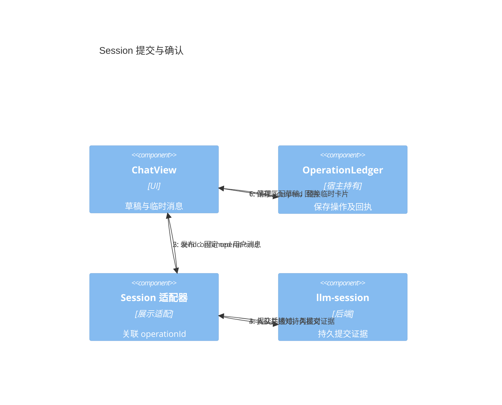
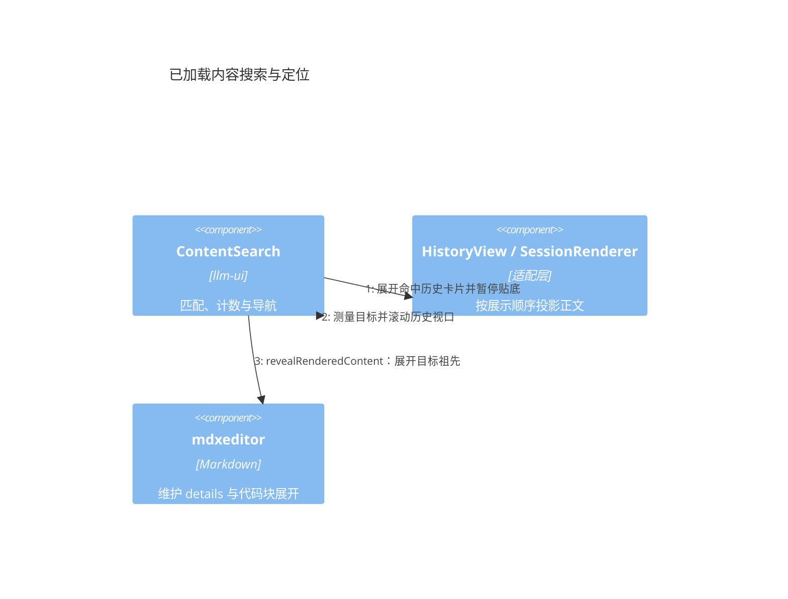

# llm-ui 独立模块与协作接口设计

状态：已建立独立包与宿主适配边界，现有产品编辑器保留兼容入口。日期：2026-10-17。

`@itookit/llm-ui` 是原生 DOM 的 LLM 界面库，**同时包含 Chat 和 Flow 功能**，唯一直接运行时依赖为 `@itookit/mdxeditor`。Flow 通过同一包的 `/flow` 子入口按需加载，不建立单独的 Flow UI 包。

MindOS 的 Session、Task、Flow 执行、VFS、配置和权限由 `@itookit/llm-ui-adapter` 及宿主连接，不进入独立库的类型或实现。后端 `@itookit/llm-flow` 继续负责 Flow 执行语义，与 UI 的包划分是不同边界。

## 1 模块与当前实施范围

箭头表示代码依赖；状态通知在运行时由宿主流入 UI。

| 模块 | 公开入口 | 职责 |
| --- | --- | --- |
| 独立 llm-ui | 根入口 createChatView、createOperationLedger | 聊天展示、已加载内容搜索与定位、草稿附件、消息操作、交互卡片、提及候选、选择器和扩展 |
| 独立 llm-ui | /flow 的 createFlowView | 节点与端口、连线、检查器、布局、运行状态及输出 |
| MindOS 适配 | llm-ui-adapter/independent | Session 与原生会话投影到同一 ChatView |
| MindOS 兼容入口 | llm-ui-adapter/chat、/conversation、/settings、/startup | 保留完整产品编辑器、Flow 业务表单、菜单、项目草稿与设置接线 |

现有 Web/Tauri/HTTP 的产品编辑器改从适配包导入，保留原来的产品行为。兼容工厂目前仍使用原业务编辑器；新的 Session/native 绑定提供独立 ChatView 接入，不宣称所有产品插槽都已经迁入通用组件。复杂 MindOS Flow 配置也保留在适配层，通用 Flow 通过宿主描述字段或检查器接入。

独立源码、JavaScript 和声明均不得引用其他内部包，不通过内联构建掩盖依赖，也不把聊天或 Flow 执行职责迁入 mdxeditor。独立仓库、子模块与发布操作未在本次实施中进行。

## 2 协作方式

- 操作用具名 callback / Promise，返回与请求关联的 OperationReceipt。
- 会话与 Flow 事实只通过 getSnapshot / subscribe 输入；无 appendDelta、setMessages 等并行公共事实通道。
- Controller 直接协调内部组件。通知不承担发送、授权或业务成功判定。
- SSE、WebSocket、轮询和持久恢复属于适配层，不是 UI 的通信协议依赖。

公开类型以源码为准：[Chat 与操作契约](../../libraries/llm-ui/src/contracts.ts)、[Flow 契约](../../libraries/llm-ui/src/flow-contracts.ts)。不在本文重复维护第二份 TypeScript 定义。

## 3 接纳、核对与恢复

accepted 表示宿主正式接纳操作，并接管提交内容、后续处理和失败恢复责任，不表示回复完成或任务已停止。内存宿主只保证实例寿命；持久宿主须以持久接纳记录或可靠待发送记录提供相应恢复保证。

UI 生成 operationId。宿主持有 OperationLedger，生命周期长于单个视图。register 保存操作及完整提交后才派发动作；settle 保存结果后再发布。可通过 createOperationLedger 的 initial/save 接入宿主持久化。台账未提供 save 时不承诺进程崩溃后的恢复。

只有用户消息的 acceptance=confirmed 且 submissionId 匹配时，快照才能确认该发送。optimistic 用户消息不构成接纳证据。submissionId 只关联临时用户卡片与正式用户消息，不合并同次提交的 assistant/tool 消息。

清理草稿与替换气泡分别处理：接纳确认后清理对应草稿；正式用户消息已经出现后才移除临时卡片。两者的顺序不必相同。

unknown 表示副作用可能已经发生。有写操作的宿主必须提供 reconcile(operationId)，读取不能因旧 viewId 失效而无法核对原操作。查询不到不自动等于 rejected。UI 保留输入与操作记录，不自动重发，也不为同一待核对提交生成新 ID 再发送。

edit/retry 共用目标消息的待核对锁；respond 按请求 ID 与 revision 锁定，accepted 后仍等待权威请求更新，局部 Promise 完成不会重新启用按钮。Flow 的 submitting 与 unknown 均提供核对入口，覆盖 register 已持久化、回执未保存即崩溃的恢复窗口。

权威确认先到，迟到网络错误不降级 accepted；接纳后的执行失败由事实投影呈现，不改写提交接纳状态。相互矛盾的终态回执报告给宿主核对，不按最后到达者覆盖。原生会话适配必须由宿主把 operationId 映射到原生持久请求，不能把“最近一次 submittedTurnId”猜作任意旧操作的回执。

Session 适配要求注入 `hasCommittedSubmission(submission)`，宿主委托后端 llm-session 的同名函数核对完整提交身份、执行引用与已提交历史索引。适配层不读取 Round 文件，也不复制持久化协议。`SessionCommand.Send` 返回内存请求 ID 不构成接纳证据；未见持久证据时返回 unknown，后续 Session 通知触发去重核对。confirmed 投影依据后端证据，独立于台账当前状态，避免“台账未接纳所以消息永远不能确认”的循环。

## 4 身份、版本与快照

conversationId/flowId 是跨绑定稳定关联，viewId 标识一次固定资源与分支的观察实例。多个窗口可以各自拥有有效绑定。旧绑定失效限制后续写操作与更新，不撤销已经接纳的操作。

getSnapshot 同步读取内存，不发网络请求。先安装订阅，再读取快照；无变化返回同一对象，有变化先原子发布不可变对象，再通知监听。消息身份稳定，只在该消息变化时递增消息 revision。通知不是必须逐条处理的事件日志。

snapshot revision 只表示本地发布顺序，不证明上游数据新旧。适配层负责 refresh、分页和增量之间的竞争，依据上游版本、失效代次或明确合并规则处理。分页合并到最新消息集合，不能用请求开始时的数组覆盖流式更新。

原生 send/respond 与 refresh 同样捕获观察代次；期间有更新通知或新的读取时，迟到操作响应只提供关联回执，不覆盖更晚的会话正文或请求状态。

编辑和重新生成携带目标消息 expectedRevision，不要求整个 ConversationSnapshot.revision 相等。retry 表示重新生成回复，不表示重发未知发送。edit 的分支策略由宿主决定；新分支由宿主建立新 source 与视图。

cancel 捕获固定 executionRef，宿主在执行端核验。取消旧执行后出现新执行，不能据此判定旧取消失败。没有可靠身份核验时不开放取消能力。

## 5 交互、草稿与附件

交互使用明确的小集合：approval 的决策 ID 与标签，input 的 text、single-choice、multi-choice 字段，以及必填和选择数量限制。请求事实状态为 pending/resolved/cancelled/expired；本窗口 submitting/unknown/error 属于局部状态。宿主校验请求 ID、revision、归属和 pending 状态，UI 按钮不是授权边界。

文字用独立 textRevision 判定提交后是否修改；附件按提交时捕获的草稿项 ID 清理。资源 ID 与草稿项身份分开，新增附件不阻止已提交文字清理。上传中不能提交；上传完成必须核对原上传项仍存在，AbortSignal 不代替迟到结果校验。

saveDraft 串行合并。flushDraft 覆盖调用前仍在防抖等待中的最新编辑；保存失败不推进已保存版本。onDraftChange 不是保存成功通知。宿主保存并恢复完整草稿与台账，视图销毁不承担宿主持久状态的最终所有权。

## 6 Flow 是 llm-ui 的一部分

Flow 的 UI 契约使用通用 FlowSnapshot、节点类型、字段、端口与边，不导入后端 FlowDraft/FlowRevision/Kernel 类型，不按具体插件或工具名分支。

- 通用视图提供节点面板、端口连线、拖动、节点名称/参数检查器、保存/运行/停止和执行输出。
- 宿主描述节点类型和字段，复杂参数表单通过显式 mountInspector 注入可信代码。
- 节点修改携带节点 expectedRevision；连线、保存、运行使用独立 graphRevision，不受运行流式状态更新影响。
- 检查器保存期间禁用表单；accepted 后等到节点变更快照，再以新版本重建检查器。保存前的外部更新保留本地草稿与原 expectedRevision，继续由宿主检测冲突；切换检查器后不被旧提交重新打开。
- Flow 操作复用宿主持有的操作台账；unknown 不自动重发，运行结果经 source 输入。
- 业务模板、参数业务规则、编译、连接授权和持久执行继续归宿主。关闭 Flow 视图不停止后台运行。

Chat 通过 features.flow 控制 Flow 入口，默认关闭。启用后点击入口才动态加载同包的 Flow 子入口；setFlowEnabled 支持运行时切换，关闭释放视图但不取消执行。异步加载期间关闭或销毁，迟到结果不得重新挂载界面。

## 7 Markdown、扩展与生命周期

mdxeditor 的 [公开契约](../../libraries/mdxeditor/src/editor/contracts.ts)提供 AssetProvider、EditorHost、StoreFactory、翻译、HTML 和滚动策略。独立库直接消费公开 API，资源权限由宿主把关。

已加载内容搜索属于 llm-ui；适配层按当前 DOM 展示顺序投影稳定身份与正文，向前分页后保留当前命中。导航先通过宿主展开历史卡片，再调用 mdxeditor 的 `revealRenderedContent(target, root)` 展开目标祖先 details 与代码块，最后测量并滚动历史视口。代码块控件维护自身展开状态，搜索层不读取其内部样式，也不展开无关代码块。搜索 DOM 标识使用实例序号，不依赖 Web Crypto。

非可信 Markdown 使用 literal HTML 策略；链接/图片另外限制 URL 协议。结构化 extension 必须由宿主登记 renderer，普通代码围栏不能冒充扩展；未知类型显示占位，不执行 data。宿主 renderer 是可信代码扩展点，不是沙箱。打印使用同一份受控渲染内容。

视图隐藏暂停昂贵呈现，不暂停必要的接纳/草稿处理；重新激活读取最新快照。销毁后迟到操作仍可更新宿主台账，但不得恢复 DOM 或影响新绑定。

destroy 返回同一 Promise，先阻止本地新工作，再解绑并清理全部订阅、Markdown、renderer、插槽和读取。一个 disposer 失败仍尝试其他清理，最后统一报告异常。UI 不关闭 source、共享连接或 Runtime，不隐式取消任务。初始化失败同样清理。

## 8 验收与发布

| 验收 | 必须满足 |
| --- | --- |
| 依赖与制品 | 源码、JS、声明只引用自身或 mdxeditor；tarball 在仓库外消费 |
| 回执顺序 | accepted 先到保留临时卡片；confirmed 先到不被迟到错误降级 |
| 乐观与未知 | 乐观消息不确认接纳；unknown 后重开仍能核对且不重复发送 |
| 并发编辑 | 消息和 Flow 节点使用捕获的目标版本，不静默覆盖新对象 |
| 刷新与分页 | 同绑定乱序不回退正文，分页不丢流式新消息 |
| 交互 | 另一窗口处理或撤销后拒绝旧请求 |
| 草稿上传 | 新文字/附件保留；已移除上传的迟到结果不复活 |
| 生命周期 | renderer/插槽销毁异常不阻断其他清理，关闭不停止执行 |
| Flow | 未知运行不重发；graphRevision 与运行 revision 分离；取消固定 executionRef |
| 兼容回归 | 原产品编辑器、Flow 参数/模板/启动、移动输入和 IME 回归继续通过 |

测试位于 [独立库测试](../../libraries/llm-ui/tests/)、[适配实现](../../ui/llm-ui-adapter/src/)、[app-shell 回归](../../ui/app-shell/tests/)。[内存宿主示例](../../libraries/llm-ui/examples/memory-host.ts)展示最小接入。

构建执行 check-llm-ui-entrypoints，边界检查禁止独立源码及类型导入其他包。目录、公共契约和宿主集成同步记录于 [包结构](../pkgstructure.md)、[前后端模块边界](frontend-backend-modules.md)、[接口契约](../interface-contracts.md)、[集成链](../integration-chains.md)与[事件流](../event-flows.md)。
