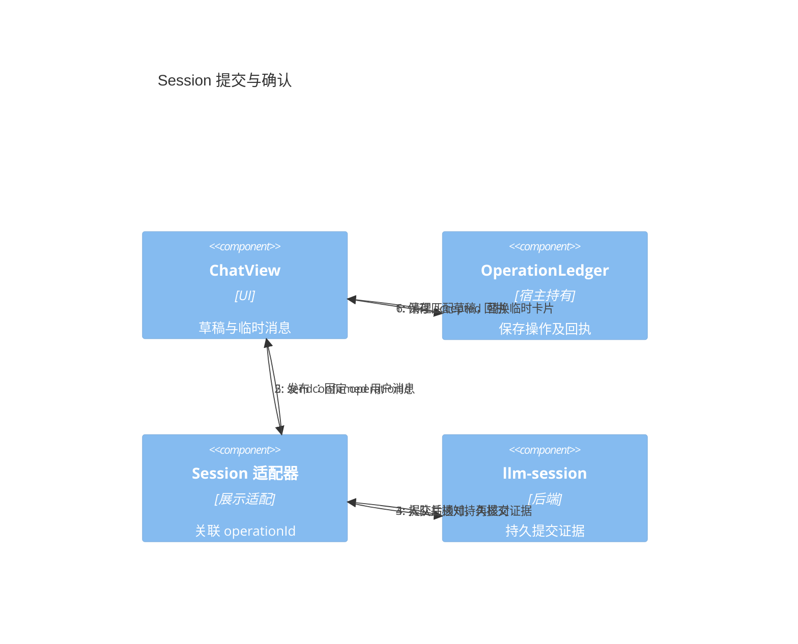
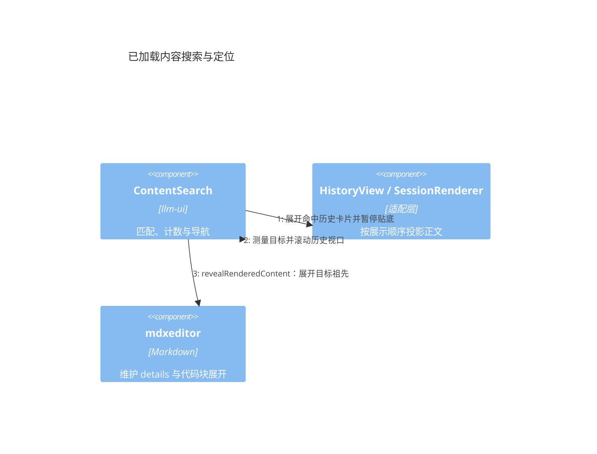
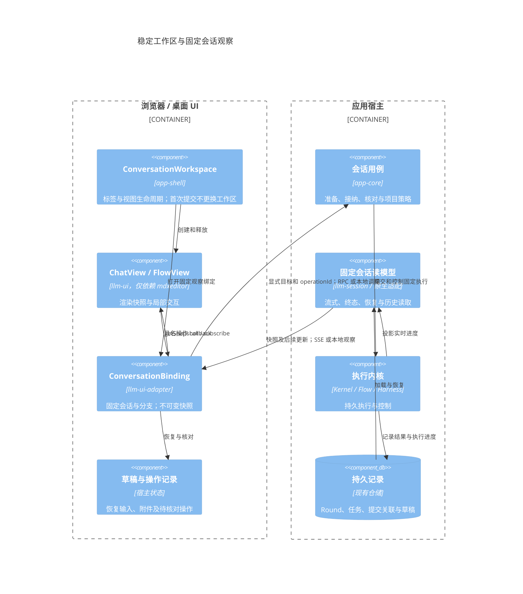
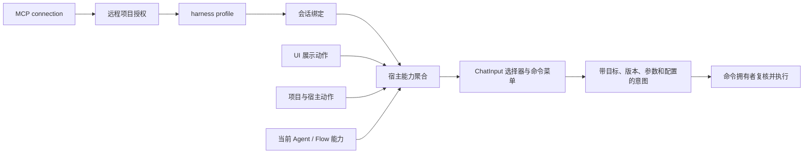
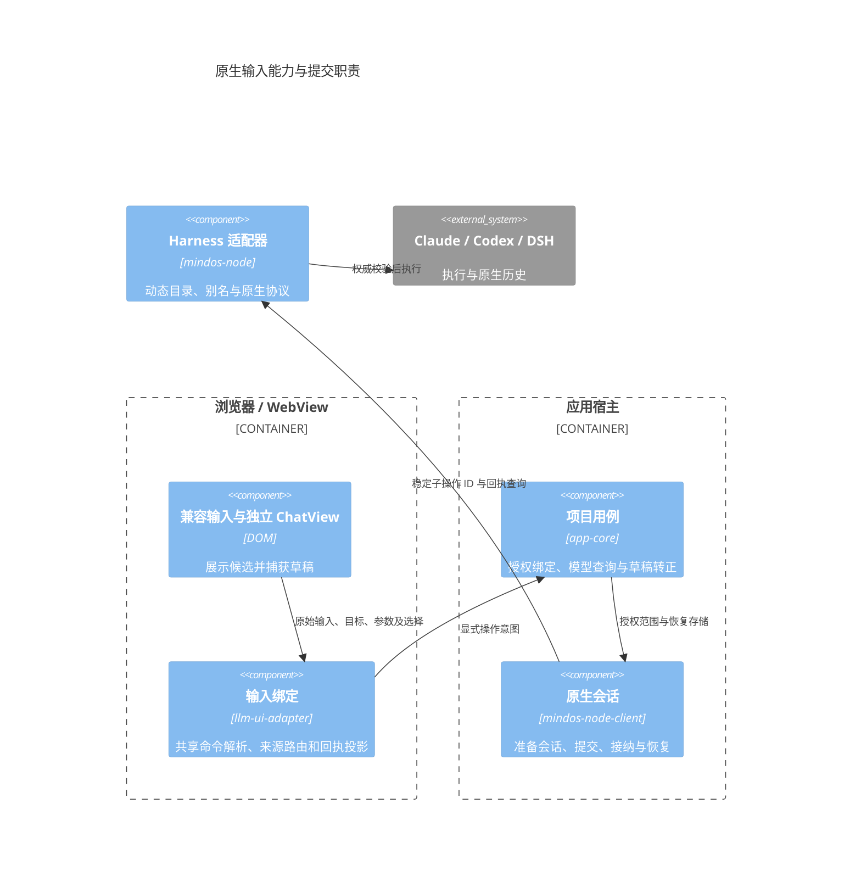

# llm-ui 独立模块与协作接口设计

状态：已建立独立包与宿主适配边界，现有产品编辑器保留兼容入口。日期：2026-10-17。

`@itookit/llm-ui` 是原生 DOM 的 LLM 界面库，**同时包含 Chat 和 Flow 功能**，唯一直接运行时依赖为 `@itookit/mdxeditor`。Flow 通过同一包的 `/flow` 子入口按需加载，不建立单独的 Flow UI 包。

MindOS 的 Session、Task、Flow 执行、VFS、配置和权限由 `@itookit/llm-ui-adapter` 及宿主连接，不进入独立库的类型或实现。后端 `@itookit/llm-flow` 继续负责 Flow 执行语义，与 UI 的包划分是不同边界。

## 1 模块与当前实施范围

箭头表示代码依赖；状态通知在运行时由宿主流入 UI。

| 模块 | 公开入口 | 职责 |
| --- | --- | --- |
| 独立 llm-ui | 根入口 createChatView、createOperationLedger | 聊天展示、已加载内容搜索与定位、草稿附件、消息操作、交互卡片、提及候选、选择器和扩展 |
| 独立 llm-ui | /flow 的 createFlowView | 节点与端口、连线、检查器、布局、运行状态及输出 |
| MindOS 适配 | llm-ui-adapter/independent | Session 与原生会话投影到同一 ChatView |
| MindOS 兼容入口 | llm-ui-adapter/chat、/conversation、/settings、/startup | 保留完整产品编辑器、Flow 业务表单、菜单、项目草稿与设置接线 |

现有 Web/Tauri/HTTP 的产品编辑器改从适配包导入，保留原来的产品行为。兼容工厂目前仍使用原业务编辑器；新的 Session/native 绑定提供独立 ChatView 接入，不宣称所有产品插槽都已经迁入通用组件。复杂 MindOS Flow 配置也保留在适配层，通用 Flow 通过宿主描述字段或检查器接入。

原生会话的诊断展示也归适配层：ConversationInformation 将已有快照中的被动状态、累计 token 和宿主估价收进「更多 → 会话信息」，说明外部运行观察范围及估价与实际账单的区别；不读取定价目录、不发探测请求。基础字段与本地 SessionFamilyActions 统一为创建时间、最后活动，复用相同文案与 ui-common.setTimePresentation 时间展示；缺失值显示「暂无记录」，不以页面刷新时间替代远端活动。运行和等待保留标题栏指标，离线、错误、缺口与未知回执保留直接提示。详情更新只修改自身文本，不替换历史或输入 DOM；销毁释放弹层。

独立源码、JavaScript 和声明均不得引用其他内部包，不通过内联构建掩盖依赖，也不把聊天或 Flow 执行职责迁入 mdxeditor。独立仓库、子模块与发布操作未在本次实施中进行。

## 2 协作方式

- 操作用具名 callback / Promise，返回与请求关联的 OperationReceipt。
- 会话与 Flow 事实只通过 getSnapshot / subscribe 输入；无 appendDelta、setMessages 等并行公共事实通道。
- Controller 直接协调内部组件。通知不承担发送、授权或业务成功判定。
- SSE、WebSocket、轮询和持久恢复属于适配层，不是 UI 的通信协议依赖。

公开类型以源码为准：[Chat 与操作契约](../../libraries/llm-ui/src/contracts.ts)、[Flow 契约](../../libraries/llm-ui/src/flow-contracts.ts)。不在本文重复维护第二份 TypeScript 定义。

## 3 接纳、核对与恢复

accepted 表示宿主正式接纳操作，并接管提交内容、后续处理和失败恢复责任，不表示回复完成或任务已停止。内存宿主只保证实例寿命；持久宿主须以持久接纳记录或可靠待发送记录提供相应恢复保证。

UI 生成 operationId。宿主持有 OperationLedger，生命周期长于单个视图。register 保存操作及完整提交后才派发动作；settle 保存结果后再发布。可通过 createOperationLedger 的 initial/save 接入宿主持久化。台账未提供 save 时不承诺进程崩溃后的恢复。

只有用户消息的 acceptance=confirmed 且 submissionId 匹配时，快照才能确认该发送。optimistic 用户消息不构成接纳证据。submissionId 只关联临时用户卡片与正式用户消息，不合并同次提交的 assistant/tool 消息。

清理草稿与替换气泡分别处理：接纳确认后清理对应草稿；正式用户消息已经出现后才移除临时卡片。两者的顺序不必相同。

unknown 表示副作用可能已经发生。有写操作的宿主必须提供 reconcile(operationId)，读取不能因旧 viewId 失效而无法核对原操作。查询不到不自动等于 rejected。UI 保留输入与操作记录，不自动重发，也不为同一待核对提交生成新 ID 再发送。

edit/retry 共用目标消息的待核对锁；respond 按请求 ID 与 revision 锁定，accepted 后仍等待权威请求更新，局部 Promise 完成不会重新启用按钮。Flow 的 submitting 与 unknown 均提供核对入口，覆盖 register 已持久化、回执未保存即崩溃的恢复窗口。

权威确认先到，迟到网络错误不降级 accepted；接纳后的执行失败由事实投影呈现，不改写提交接纳状态。相互矛盾的终态回执报告给宿主核对，不按最后到达者覆盖。原生会话适配必须由宿主把 operationId 映射到原生持久请求，不能把“最近一次 submittedTurnId”猜作任意旧操作的回执。

Session 适配要求注入 `hasCommittedSubmission(submission)`，宿主委托后端 llm-session 的同名函数核对完整提交身份、执行引用与已提交历史索引。适配层不读取 Round 文件，也不复制持久化协议。`SessionCommand.Send` 返回内存请求 ID 不构成接纳证据；未见持久证据时返回 unknown，后续 Session 通知触发去重核对。confirmed 投影依据后端证据，独立于台账当前状态，避免“台账未接纳所以消息永远不能确认”的循环。

## 4 身份、版本与快照

conversationId/flowId 是跨绑定稳定关联，viewId 标识一次固定资源与分支的观察实例。多个窗口可以各自拥有有效绑定。旧绑定失效限制后续写操作与更新，不撤销已经接纳的操作。

getSnapshot 同步读取内存，不发网络请求。先安装订阅，再读取快照；无变化返回同一对象，有变化先原子发布不可变对象，再通知监听。消息身份稳定，只在该消息变化时递增消息 revision。通知不是必须逐条处理的事件日志。

snapshot revision 只表示本地发布顺序，不证明上游数据新旧。适配层负责 refresh、分页和增量之间的竞争，依据上游版本、失效代次或明确合并规则处理。分页合并到最新消息集合，不能用请求开始时的数组覆盖流式更新。

原生 send/respond 与 refresh 同样捕获观察代次；期间有更新通知或新的读取时，迟到操作响应只提供关联回执，不覆盖更晚的会话正文或请求状态。

编辑和重新生成携带目标消息 expectedRevision，不要求整个 ConversationSnapshot.revision 相等。retry 表示重新生成回复，不表示重发未知发送。edit 的分支策略由宿主决定；新分支由宿主建立新 source 与视图。

cancel 捕获固定 executionRef，宿主在执行端核验。取消旧执行后出现新执行，不能据此判定旧取消失败。没有可靠身份核验时不开放取消能力。

## 5 交互、草稿与附件

交互使用明确的小集合：approval 的决策 ID 与标签，input 的 text、single-choice、multi-choice 字段，以及必填和选择数量限制。请求事实状态为 pending/resolved/cancelled/expired；本窗口 submitting/unknown/error 属于局部状态。宿主校验请求 ID、revision、归属和 pending 状态，UI 按钮不是授权边界。

文字用独立 textRevision 判定提交后是否修改；附件按提交时捕获的草稿项 ID 清理。资源 ID 与草稿项身份分开，新增附件不阻止已提交文字清理。上传中不能提交；上传完成必须核对原上传项仍存在，AbortSignal 不代替迟到结果校验。

saveDraft 串行合并。flushDraft 覆盖调用前仍在防抖等待中的最新编辑；保存失败不推进已保存版本。onDraftChange 不是保存成功通知。宿主保存并恢复完整草稿与台账，视图销毁不承担宿主持久状态的最终所有权。

发送前的图片处理另见 [image-parser 独立库与聊天接入设计](chat-image-editing.md)。独立图片库封装 Scanic、矩形裁剪及默认最长边 1024 的等比缩小，智能体默认与 ChatInput 覆盖由宿主解析；llm-ui 通过可选 ImageEditingPort 接入，继续只依赖 mdxeditor；宿主适配工厂 createImageEditingPort 负责原图读写与元数据。原生独立绑定通过 images 读取资源并按 harness 声明转换附件，视图工厂自动装配图片端口；工作台兼容输入也复用该适配。图片替换需要草稿项内容版本，接纳清理须保留等待期间生成的新版本。宿主负责原图、处理参数、派生资源的持久化和条件替换。

## 6 Flow 是 llm-ui 的一部分

Flow 的 UI 契约使用通用 FlowSnapshot、节点类型、字段、端口与边，不导入后端 FlowDraft/FlowRevision/Kernel 类型，不按具体插件或工具名分支。

- 通用视图提供节点面板、端口连线、拖动、节点名称/参数检查器、保存/运行/停止和执行输出。
- 宿主描述节点类型和字段，复杂参数表单通过显式 mountInspector 注入可信代码。
- 节点修改携带节点 expectedRevision；连线、保存、运行使用独立 graphRevision，不受运行流式状态更新影响。
- 检查器保存期间禁用表单；accepted 后等到节点变更快照，再以新版本重建检查器。保存前的外部更新保留本地草稿与原 expectedRevision，继续由宿主检测冲突；切换检查器后不被旧提交重新打开。
- Flow 操作复用宿主持有的操作台账；unknown 不自动重发，运行结果经 source 输入。
- 业务模板、参数业务规则、编译、连接授权和持久执行继续归宿主。关闭 Flow 视图不停止后台运行。

Chat 通过 features.flow 控制 Flow 入口，默认关闭。启用后点击入口才动态加载同包的 Flow 子入口；setFlowEnabled 支持运行时切换，关闭释放视图但不取消执行。异步加载期间关闭或销毁，迟到结果不得重新挂载界面。

## 7 Markdown、扩展与生命周期

mdxeditor 的 [公开契约](../../libraries/mdxeditor/src/editor/contracts.ts)提供 AssetProvider、EditorHost、StoreFactory、翻译、HTML 和滚动策略。独立库直接消费公开 API，资源权限由宿主把关。

已加载内容搜索属于 llm-ui；适配层按当前 DOM 展示顺序投影稳定身份与正文，向前分页后保留当前命中。导航先通过宿主展开历史卡片，再调用 mdxeditor 的 `revealRenderedContent(target, root)` 展开目标祖先 details 与代码块，最后测量并滚动历史视口。代码块控件维护自身展开状态，搜索层不读取其内部样式，也不展开无关代码块。搜索 DOM 标识使用实例序号，不依赖 Web Crypto。

非可信 Markdown 使用 literal HTML 策略；链接/图片另外限制 URL 协议。结构化 extension 必须由宿主登记 renderer，普通代码围栏不能冒充扩展；未知类型显示占位，不执行 data。宿主 renderer 是可信代码扩展点，不是沙箱。打印使用同一份受控渲染内容。

视图隐藏暂停昂贵呈现，不暂停必要的接纳/草稿处理；重新激活读取最新快照。销毁后迟到操作仍可更新宿主台账，但不得恢复 DOM 或影响新绑定。

destroy 返回同一 Promise，先阻止本地新工作，再解绑并清理全部订阅、Markdown、renderer、插槽和读取。一个 disposer 失败仍尝试其他清理，最后统一报告异常。UI 不关闭 source、共享连接或 Runtime，不隐式取消任务。初始化失败同样清理。

## 8 验收与发布

| 验收 | 必须满足 |
| --- | --- |
| 依赖与制品 | 源码、JS、声明只引用自身或 mdxeditor；tarball 在仓库外消费 |
| 回执顺序 | accepted 先到保留临时卡片；confirmed 先到不被迟到错误降级 |
| 乐观与未知 | 乐观消息不确认接纳；unknown 后重开仍能核对且不重复发送 |
| 并发编辑 | 消息和 Flow 节点使用捕获的目标版本，不静默覆盖新对象 |
| 刷新与分页 | 同绑定乱序不回退正文，分页不丢流式新消息 |
| 交互 | 另一窗口处理或撤销后拒绝旧请求 |
| 草稿上传 | 新文字/附件保留；已移除上传的迟到结果不复活 |
| 生命周期 | renderer/插槽销毁异常不阻断其他清理，关闭不停止执行 |
| Flow | 未知运行不重发；graphRevision 与运行 revision 分离；取消固定 executionRef |
| 兼容回归 | 原产品编辑器、Flow 参数/模板/启动、移动输入和 IME 回归继续通过 |

测试位于 [独立库测试](../../libraries/llm-ui/tests/)、[适配实现](../../ui/llm-ui-adapter/src/)、[app-shell 回归](../../ui/app-shell/tests/)。[内存宿主示例](../../libraries/llm-ui/examples/memory-host.ts)展示最小接入。

构建执行 check-llm-ui-entrypoints，边界检查禁止独立源码及类型导入其他包。目录、公共契约和宿主集成同步记录于 [包结构](../pkgstructure.md)、[前后端模块边界](frontend-backend-modules.md)、[接口契约](../interface-contracts.md)、[集成链](../integration-chains.md)与[事件流](../event-flows.md)。

## 9 产品流程收敛方案（2026-10-18，待实施）

本节是架构方案。当前已修复绑定前登记失效、订阅相互替换的问题，并补充真实 Kernel → RPC → 页面回归。提交目标已从可编辑偏好中分离并持久冻结；控制器创建改为显式工厂注入，移除全局 WeakMap 交接注册。产品仍使用既有编辑器控制器，统一 ChatView 和完整单一快照路径的迁移尚未完成。

### 9.1 问题与证据

会话 `09ebfaf7-67eb-4048-b722-3f81b955e803` 的输入、Task、持久 Round 输出使用同一会话身份，Task 成功且重新打开能显示回复。UUID 关联正常不能证明实时观察链路正常。

修复前 SessionRegistry.onEvent 在尚未绑定时返回空 disposer，新增订阅会移除已有订阅；ViewObservation 正需要在打开/绑定前登记。集成回归只替换模型 HTTP 响应，实际运行草稿创建、Kernel、投影、RPC、OpenedViewProjection 和渲染：旧实现只显示提问，修复后显示回复。解绑还曾清除通道上其他所有者的监听。

此前另一个缺陷是草稿控制器销毁时清空共享历史容器，导致正式控制器持有脱离 DOM 的消息节点。两者是不同缺陷，但共同暴露出控制器、可变当前会话、观察和 DOM 的多重所有权。

产品工厂仍选择 SessionDraftEditor / LLMWorkspaceEditor / RemoteConversationEditor；独立 ChatView 的固定 source、snapshot 契约尚未覆盖产品全部行为。独立包已经建立，不等于产品迁移完成。

### 9.2 C4 组件目标

箭头表示运行时交互；以下是现有进程内的职责边界，不新增微服务、消息中间件或业务数据库。

### 9.3 唯一所有权

| 对象 | 所有者 | 边界 |
| --- | --- | --- |
| 工作区与 DOM | app-shell 装配的同一视图 | 转正更新阶段、标题、图标与能力，不交接共享 DOM |
| 草稿、附件与待核对操作 | 宿主状态及现有保存端口 | 生命周期长于渲染视图；乐观消息不冒充持久事实 |
| 历史、执行状态与审批事实 | 后端读模型 / 原生适配 | UI 消费统一快照，不维护事件驱动的第二份业务历史 |
| 观察绑定 | ConversationBinding | 会话和分支固定；独立 disposer，多窗口互不替换 |
| 接纳与恢复 | app-core 会话用例 | 持久证据决定 accepted；未知操作按原 ID 核对 |
| Task / Flow / 原生执行 | 执行宿主 | 关闭、隐藏、切换 UI 不隐式停止执行 |

允许持久历史、后端实时投影、传输快照缓存各自存在。约束是同一层有唯一事实写入者，UI 只有一份可恢复的会话状态，首次加载和实时更新使用同一投影语义。传输可继续采用增量补丁；UI 不再同时依赖 append/replace/clear 事件作为第二条公共事实通道。

### 9.4 身份与生命周期

| 身份 | 含义 | 不承担的职责 |
| --- | --- | --- |
| conversationId | 草稿到正式会话稳定身份，沿用 UUID | 不证明订阅有效或执行已接纳 |
| branchId / branchRef | 固定观察分支 | 分支名称不是消息版本 |
| operationId / submissionId | 单次操作的关联与幂等核对 | 不合并多个 assistant/tool 消息 |
| executionRef | 一次具体执行目标 | 不依赖可变的“当前任务”定位取消 |
| viewId | 一次观察绑定实例 | 不是多个窗口共享的会话身份 |
| cursor / revision | 各自作用域的水位或版本 | 不证明上游数据新旧，不替代目标消息版本 |

工作区阶段是草稿、提交待确认、正式会话；结果未知保留为操作状态。接纳后即使执行失败，仍是正式会话。任务的 queued/running/waiting/terminal 与视图的 active/hidden/disposed 分别管理，不合并成一个 loading。

统一流程：

1. 打开项目草稿时取得已有 UUID，创建稳定工作区和指向该身份的宿主观察绑定；尚无正式 Session 时发布草稿投影，不因此创建任务。
2. 发送先保存可恢复内容与 operationId；宿主准备正式资源并接纳。空 Session 已创建不等同于首个有效提交成功，跨记录步骤按同一操作核对恢复。
3. 接纳证据更新原工作区的阶段、标题、图标与能力；项目服务补建下一个草稿 UUID。不销毁旧控制器再接管 DOM。
4. assistant、tool、Flow、审批进入同一读模型，再发布到绑定；正式用户消息出现后才移除临时气泡。
5. 关闭视图只释放自身观察；操作核对与任务继续；重开从同一读模型恢复。

观察初始化须有屏障：宿主先建立观察并取得匹配水位的快照，之后从该水位补发。不得先读快照、再无水位订阅。缺口重建只读投影，不重放发送。会话或分支改变时建立新观察实例；已接纳操作继续按原身份核对。

### 9.5 迁移顺序与验收

1. **基线与止损**：保留已验证的订阅修复，覆盖首次创建、既有会话、前后台切换、断线补发、多窗口与终态恢复。
2. **收敛宿主端口**：复用 openSessionView、ConversationContexts、ViewObservation 和 ConversationSource，形成固定 session/branch 的观察生命周期；写操作显式指定目标。旧 Bind/Unbind 留作兼容实现，逐步退出产品公共路径。
3. **收敛工作区**：同一工作区消费草稿和正式投影，移除首次提交时的控制器交接。从产品入口逐步接入独立 ChatView，补齐已使用的配置、资源、审批、搜索和 Flow 插槽；每迁移一项就删除对应旧状态通道。
4. **删除兼容层**：验收通过后移除旧 renderer/事件接线与 handoff，避免永久维护两套产品路径。Flow 执行继续在后端，通用视图仍在 llm-ui 可选子入口。

完成标准：不刷新能看到首个回复；刷新前后持久消息身份与终态正文一致；中途恢复最终收敛；未知提交不重复发送；关闭视图不停止任务；旧绑定不污染新绑定。性能覆盖流式批处理、分页合并和隐藏暂停呈现，不能把统一快照做成每 token 重建全部 DOM。

诊断仅记录 conversationId、operationId、executionRef、viewId、cursor 和阶段时间，用于区分接纳、执行、投影、传输和 UI 应用水位；不在审计中记录消息、附件或凭据。HTTP 200 不代表业务成功。

## 10. 输入能力、连接与命令聚合

### 10.1 当前缺口与实现边界

工作台仍使用 `ui/llm-ui-adapter` 的 LLMWorkspaceEditor / RemoteConversationEditor 兼容入口。独立 ChatView 经 independent/session、independent/native 接入；不能用兼容组件的测试宣称独立输入契约已经覆盖，也不能用独立绑定测试宣称工作台已整体迁移。未更新的 mindos-node 不会因只更新前端就宣称新的模型或命令能力。

本轮补齐独立输入的 commands / actions.command、命令来源与版本、模型依赖选择器，以及 native/session 绑定的命令贡献与路由。工作台整体切换仍按 9.5 逐项迁移，不另建第三套输入组件。

### 10.2 连接与执行目标

| 概念 | 当前职责 | 输入层边界 |
| --- | --- | --- |
| LLMConnection | 直连 Provider 的模型配置与档位解析 | 不作为远程 harness 的配置容器 |
| MCP connection | 远程节点的通信、凭据和服务发现；mindos-node 能力复用这份连接记录 | 不直接决定模型或可用 slash |
| 远程项目与 harness profile | 目录授权、执行隔离和具体原生执行器选择 | 宿主绑定并投影当前能力 |
| 会话绑定 | 固定观察与操作目标；持有 session/branch/view 身份 | UI 不解析 remote: 字符串或 endpoint |
| Composer 能力投影 | 选择器、当前可用命令、来源与版本 | ChatInput 只展示和提交意图 |

### 10.3 有效命令并集

菜单是当前上下文内各功能**公开且可用**命令的并集。宿主按目标、授权、运行状态及初始化条件过滤贡献；不可因为位于调用链中就公开所有函数或 MCP 工具。UI 保留独立的来源 ID、命令 ID、名称、revision 和 prompt/action 语义。不同来源可以同名，不能按注册顺序覆盖，也不能在执行失败后尝试另一来源或把未知命令发给模型。

独立库通过 composeCommandCatalogs 形成稳定身份；source.commands 提供纯数据，actions.command 按明确目标执行。NativeCommandProvider 接入宿主贡献，原生目录属于 harness 来源；Session 的 composerCommands 接入应用侧聚合并由自己的 reconcile 查询操作结果。界面动作可在原生运行中或离线时可用，原生命令的可执行性仍由原生适配器判断。公开目录不等同于授权，执行方再次校验目标版本及权限。

模型与推理选项同样来自当前执行目标，不让 UI 猜测固定档位。selectors.variants 只支持一个独立父选择器的条件选项；更复杂业务表单仍由宿主扩展，不扩张为通用表单引擎。提交捕获当时的 selection，后续修改只影响下一次意图。

### 10.4 原生提交与恢复的共同路径

兼容输入与独立 ChatView 通过 independent/native-command 共享解析和提交语义。两者都捕获原始输入、命令目标、参数和模型选择；解析后的 slash 文本不作为清理草稿的依据。mindos-node-client 的 HarnessConversation 为消息和 prompt 命令共用 prepareSession、接纳清理和提交后刷新；新草稿中的会话级 action 标为不可用，不为查看候选提前创建会话。

HarnessRecovery 保存 draftRevision，turn/command 的 pending 捕获当时的 inputText 与 draftRevision。接纳或核对回执后仅清理匹配版本；等待期间编辑再恢复为相同文字也属于新版本。create、resume、turn、command 各自持有稳定 requestId，unknown 只核对既有回执，不重新提交。app-core 的 draftHarness 同时记录 turn 与 command 的首轮接纳，只有持久确认后发布正式会话身份。

接纳与执行结果分开：failed 的命令结果仍是已提交操作。最近 64 个有 commandId 的本地命令结果随恢复记录保存，不复制原生历史；历史刷新后仍可展示，原生同 ID 记录到达后以原生记录为准。每条 output 上限为 128 Ki 个字符。Claude compact 及其别名属于 action，即使返回 turnId 也不生成临时用户气泡；SDK 未回显用户消息时由完成帧确认接纳。

能力发现失败保留最后可用目录，相同快照按 1/2/4/8/15 秒退避允许重试，显式刷新可立即重试。原生命令执行前单独刷新命令目录，不为校验命令重读完整历史或模型目录。兼容输入的连续补全共享在途读取，候选最多缓存 1 秒；发送时仍重新校验。DSH 目录始终来自当前 agent，Claude 未接管会话按已授权 cwd 启动不持久化的 SDK 发现进程，保留合法别名。

远程项目模型查询通过 app-core 的 projectModels 用例完成 profile 能力检查、授权绑定及客户端释放，app-shell 只选择候选并调用应用端口。模型选择与原始命令输入通过 app-contracts 和 app-transport 完整传递，不进入传输层策略。

