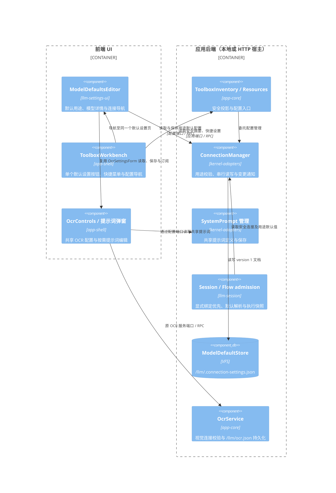
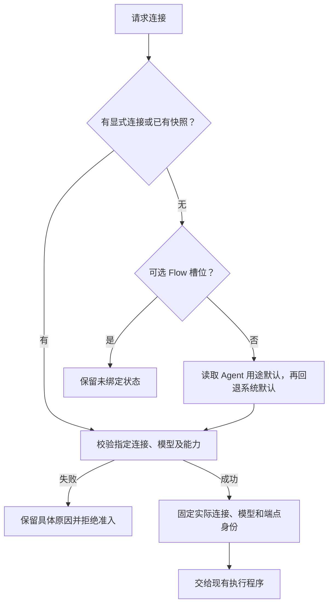

# 按用途配置默认模型

## 当前实现

「设置 → 模型与服务」管理对话、图像生成和语音合成三个用途的默认连接。工具箱模型页顶部仅提供一个「默认模型」按钮，复用原文字识别设置按钮的位置，不常驻三条用途摘要。文字识别在同一页直接选择支持视觉输入的默认连接，选择后经原 OCR 端口自动保存；缺少凭据或停用的视觉连接禁用选择，已失效的选中项保留以说明原因。下拉框右侧提供连接配置和提示词图标，前者进入对应连接，后者打开弹窗编辑引用的共享提示词，确认保存时保留名称、描述及快捷项，取消或原文未改动不写入，空内容、并发修改和持久化失败保留草稿并提示原因。OCR 继续保存独立的视觉连接和识别提示词，不映射为图像生成用途。连接菜单只提供兼容用途的设为默认／清除默认操作。凭据、模型目录及连接配置继续复用工具箱原有编辑器，不复制配置存储。

默认值引用现有连接 ID。对话使用连接的 optimal 主力档；standard、fast 未指定时均直接使用主力模型，显式模型仍优先；媒体按 optimal、standard、fast、连接 model 的顺序查找支持该操作的模型。候选模型必须存在于所属 Provider 的目录，媒体还须声明操作并具有受支持的适配器；音频输入能力不表示语音合成。配置默认值不会调用模型；缺失凭据、停用、模型缺失和用途不兼容分别呈现。验证与诊断由模型服务商配置入口提供，用途默认页不提供验证操作。

默认连接下拉框仅显示连接与服务商名称，选中项下方展示该用途实际模型的能力图标和价格，合并重复图标，价格保留目录中的原币种、计费单位、来源及核对日期；缺失时明确未知或待核实。用途候选直接展示全部兼容连接，不显示页顶搜索；说明中的模型配置链接跳转工具箱连接分类，底部不再显示管理按钮和优先级与外部执行器说明。页面通过宿主容器独立滚动，长内容可滚动至底部；主力模型及高级路由仍在各自候选弹层内搜索。

每个 Agent 可通过顶层 `modelDefaults?: ModelDefaults` 分别声明 `chat`、`image.generate`、`speech.synthesize` 的连接 ID。未声明的用途继续使用系统默认；旧 Agent 无需迁移。字段进入 Agent 版本摘要、VFS 文档、导入导出和聊天安全配置投影，只保存连接身份，不携带凭据。保存时检查用途名称、连接及 Provider 是否存在和启用，并复用 `modelForOperation` 检查配置的模型能力；保存不探测凭据，运行准入继续核验当前可用性。

## 模块边界（C4 Component）

共享配置契约位于 kernel-adapters/contracts；工具箱读模型位于 app-contracts。app-transport 显式声明新查询、写入及投影字段，本地与 HTTP 使用相同端口。driver-llm 继续只负责模型通信及媒体协议适配。

Provider 使用 modelsPath:false 声明不提供在线模型目录；豆包语音预设关闭目录刷新，保留预置资源 ID 和手动新增入口。有内置目录时 UI 提供“更新预置模型”，合并资源模型及音色声明并保留凭据、自定义模型与名称；该操作不查询账户授权或私有音色。无内置目录时禁用刷新并说明原因，driver-llm 同时在发请求前校验，避免误向原生媒体域名请求 /v1/models。旧内置配置缺失声明时继承预设，显式自定义目录地址仍优先，导入导出保留该声明。

目录字段及厂家格式归 `driver-llm/src/providers/`：`catalog-capabilities.ts` 处理通用声明，`catalog-ark.ts` 转换火山 Ark 的 `modalities`、`features`、`token_limits` 和显式 embedding 任务类型。Seedream 按输出模态归为 image，Seedance 归为 video，缺失字段继续保持未知；设置表单不能在保存时将未知用途写成 chat。刷新可修正旧目录中的错误分类，并保留厂商未返回的操作配置。

目录能力与可执行操作分开：`media/` 负责已实现的厂家调用协议，kernel-adapters 的 `llm-management/catalogs/` 支持目录负责有文档依据的模型格式、尺寸、音色等约束。接口只返回模态时，不凭模型名称捏造 `operations`。图片生成已有 `volcengine-images`，豆包 TTS 已有 `doubao-speech`；当前没有视频生成执行协议，video 分类不代表可以生成视频。新增厂家时同时核对目录字段、鉴权、请求/响应、约束与错误码。目录日志记录图片/视频数量、未知能力及媒体操作声明数量，便于区分识别问题和执行能力缺失。

## 解析与稳定性

- 普通对话按本次连接覆盖 → Session 显式连接 → Agent 对话用途默认 → 系统对话默认解析；用途默认不覆盖已有显式选择。界面展示的默认候选不自动写成 Session 显式选择。
- Flow 自身的节点连接、槽位绑定及 Agent 的 `execution.connectionBindings` 保留原有显式语义。未绑定的必填槽位使用调用 Agent 与系统默认合并后的用途表；可选槽位仍保持关闭，显式空值不重新补默认。启动表单按相同规则预填，并将用户确认的选择提交为显式绑定。
- 引用普通 Agent 的 Flow 节点在无显式 Flow 连接或槽位时使用该 Agent 的对话用途默认；本次或 Session 显式选择仍优先。动态委派的候选成员也在准入时解析并捕获各自连接。没有显式 Agent 上下文的独立 Flow 使用系统用途默认，不从界面草稿或创建时的 Agent 推断执行策略。Agent Flow 的连接预检显式传入 `agentId`。
- Flow 在准入时固定实际模型与端点；重放已有连接快照不重新选默认，显式无效配置不静默替换服务。
- Session 指令入队时保存实际对话连接、来源、合并后的用途默认表，以及安全连接快照中的模型、档位、Provider、协议与端点身份。出队和恢复继续使用已接纳的模型选择；修改 Agent 默认、系统默认或同一连接的档位不会改变排队请求。当前凭据、启用状态与能力仍须通过核验，身份变化或不可用时明确拒绝，不改选其他服务。重复提交的内容摘要保持原格式，不将宿主派生快照纳入请求身份；合并指令须同时具有相同的连接快照。旧队列记录没有此字段时保持原有行为。
- 远程原生 harness 的模型和凭据由其宿主管理，此配置不修改原生执行器模型。

## 持久化、迁移与诊断

默认表保存为 `{ version: 1, defaults: { chat?: connectionId, 'image.generate'?: connectionId, 'speech.synthesize'?: connectionId } }`。旧 `defaultConnectionId` 仅在连接支持对话时映射到 chat，不推测媒体默认；首次保存写新格式。读取失败或文档损坏直接报错，不把错误当空设置覆盖。旧 getDefaultConnection/setDefaultConnection 接口保留对话语义；删除连接清理其全部用途默认引用。

同一宿主的默认表读写、连接保存、删除及重新加载使用同一个修改队列。删除先一次性持久清理全部用途引用，再删除连接；不允许并发默认写入越过删除检查。引用清理失败保留连接和先前默认值；后续连接或设备删除失败可能已有部分步骤完成，日志标明 defaults/connection/device 阶段，不宣称跨文件原子事务。写入成功后才安装内存状态并发布通知。日志记录 operationId、用途、validation/persistence/read 阶段、结果、分类和耗时，不记录凭据或验证输入。用途默认页只配置默认值并导航到对应连接，不显示已配置提示或运行验证；验证与诊断由模型服务商配置入口提供。

Agent 保存日志通过现有 Session 宿主通道区分初始化、准备、校验和持久化失败，保留操作 ID、Agent ID、错误分类与耗时，不记录定义、提示词、参数或原始存储异常正文。Agent 默认引用被删除的连接时保留该声明，后续调用给出明确不可用原因；不把 Agent 的显式用途选择静默改成系统默认。

Flow 槽位用途和能力需求通过 llm-session/contracts 的 inferFlowConnectionRequirements 统一推导，启动表单和后端准入共用同一纯规则；UI 不再独立查找第一个媒体节点猜测用途。

预检、入队准备和节点绑定共用 `flow-agent-connections` 的连接优先级规则；本次或 Session 显式连接是实际选择，不能仅抑制 Agent 默认后再回退系统默认。完整准入生成的模型选择通过 `freezePlannedFlowConnections` 保存到源图，覆盖节点、委派候选及批量子调用；模板投影只保存连接与模型字段，不保存准入时的空对话消息。派发时重建上下文并复验冻结选择，保持可选槽位的显式未绑定状态。归档导入同步重映射 Agent.modelDefaults 与 execution.connectionBindings 的连接 ID。

声明委派候选目录时只准入目录中的模板，不创建或复验未使用的通用子模板；主持与成员都有独立选择时，无关的系统聊天默认缺失或停用不影响运行。确定性 Flow 的连接快照由实际图捕获，不额外读取无关的聊天默认元数据。

回归覆盖持久化与重载、并发用途更新、兼容性拒绝、旧默认迁移、读写失败、删除引用、UI 保存失败恢复、连接导航与无验证副作用、Flow 显式/默认/可选绑定、准入重放及队列快照与幂等。

连接与模型选择的收起状态仅显示名称：用途默认下拉框显示连接与服务商，模型名称、能力和价格位于下方；连接档位的候选弹层内支持名称、ID、能力的多关键词交集过滤，并展示能力、价格，确认前不改选、不保存。连接名称在标题处直接编辑，提供商只读；标准、快速的空值显示“（与主力模型相同）”，执行层复用相同回退规则。

用途默认页在每个已选连接的下拉框右侧提供配置图标，按实际连接 ID 跳转工具箱；图标保留原生链接语义、键盘焦点及包含连接名的提示；模型缺失或不兼容时仍可进入已有连接配置。未设置、停用、凭据缺失等可操作问题保留提示，正常已配置状态不再重复显示。
