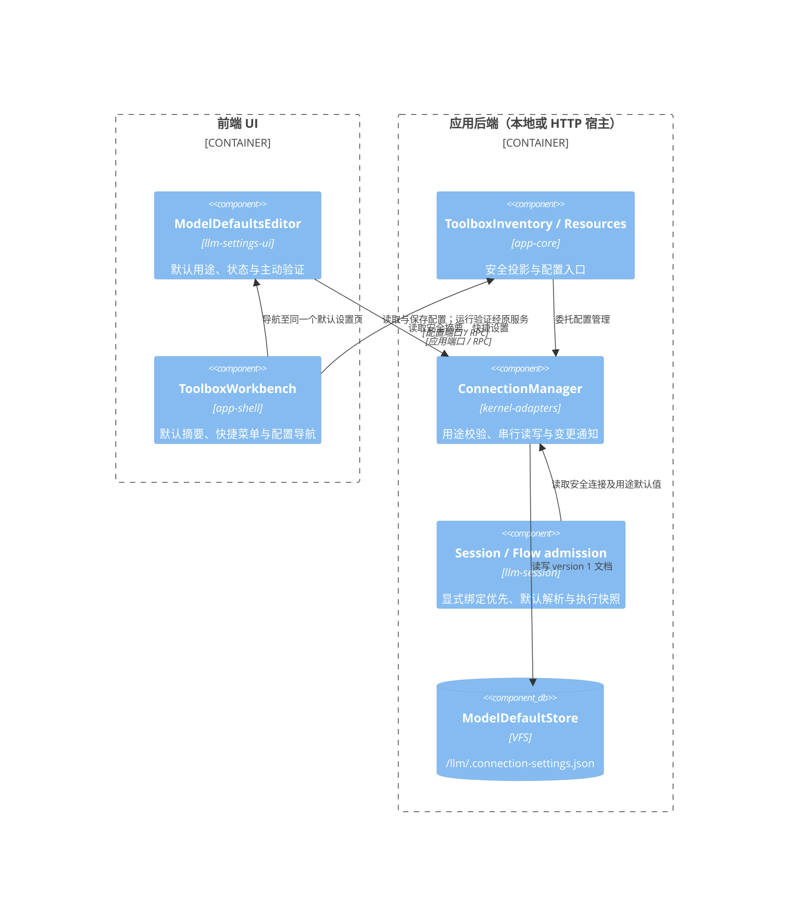
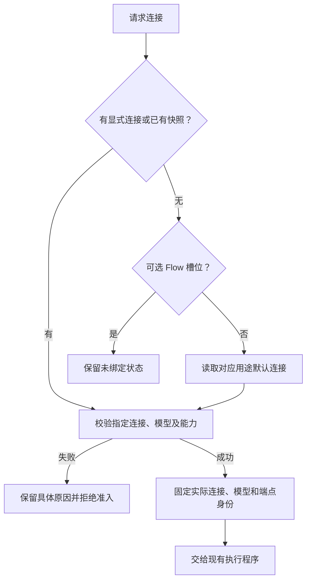

# 按用途配置默认模型

## 当前实现

「设置 → 模型与服务」管理对话、图像生成和语音合成三个用途的默认连接。工具箱顶部提供对应摘要与设置页快捷入口，连接菜单只提供兼容用途的设为默认／清除默认操作。凭据、模型目录及连接配置继续复用工具箱原有编辑器，不复制配置存储。

默认值引用现有连接 ID。对话使用连接的 optimal 档及既有回退规则；媒体按 optimal、standard、fast、连接 model 的顺序查找支持该操作的模型。候选模型必须存在于所属 Provider 的目录，媒体还须声明操作并具有受支持的适配器；音频输入能力不表示语音合成。配置默认值不会调用模型；缺失凭据、停用、模型缺失和用途不兼容分别呈现，运行验证为用户主动操作并标明可能计费。

## 模块边界（C4 Component）

共享配置契约位于 kernel-adapters/contracts；工具箱读模型位于 app-contracts。app-transport 显式声明新查询、写入及投影字段，本地与 HTTP 使用相同端口。driver-llm 继续只负责模型通信及媒体协议适配。

## 解析与稳定性

- 对话沿用本次覆盖、Session 配置与系统默认的既有优先级；用途默认不覆盖显式配置。
- 必填 Flow 槽位未绑定时读取用途默认；可选槽位仍保持关闭，显式空值不重新补默认。启动表单预填必填槽位，并将用户确认的选择提交为显式绑定。
- Flow 在准入时固定实际模型与端点；重放已有连接快照不重新选默认，显式无效配置不静默替换服务。
- Session 指令入队时保存实际对话连接及用途默认表；出队使用该快照。重复提交的内容摘要保持原格式，不将宿主派生快照纳入请求身份；合并指令须同时具有相同的连接快照。旧队列记录没有此字段时保持原有行为。
- 远程原生 harness 的模型和凭据由其宿主管理，此配置不修改原生执行器模型。

## 持久化、迁移与诊断

默认表保存为 `{ version: 1, defaults: { chat?: connectionId, 'image.generate'?: connectionId, 'speech.synthesize'?: connectionId } }`。旧 `defaultConnectionId` 仅在连接支持对话时映射到 chat，不推测媒体默认；首次保存写新格式。读取失败或文档损坏直接报错，不把错误当空设置覆盖。旧 getDefaultConnection/setDefaultConnection 接口保留对话语义；删除连接清理其全部用途默认引用。

同一宿主的默认表读写、连接保存、删除及重新加载使用同一个修改队列。删除先一次性持久清理全部用途引用，再删除连接；不允许并发默认写入越过删除检查。引用清理失败保留连接和先前默认值；后续连接或设备删除失败可能已有部分步骤完成，日志标明 defaults/connection/device 阶段，不宣称跨文件原子事务。写入成功后才安装内存状态并发布通知。日志记录 operationId、用途、validation/persistence/read 阶段、结果、分类和耗时，不记录凭据或验证输入。设置页复用原有探测及诊断展示，包括请求编号、模型、阶段、网络与 HTTP 错误；保存本身不发起探测。

Flow 槽位用途和能力需求通过 llm-session/contracts 的 inferFlowConnectionRequirements 统一推导，启动表单和后端准入共用同一纯规则；UI 不再独立查找第一个媒体节点猜测用途。

回归覆盖持久化与重载、并发用途更新、兼容性拒绝、旧默认迁移、读写失败、删除引用、UI 保存失败恢复、主动验证、Flow 显式/默认/可选绑定、准入重放及队列快照与幂等。
