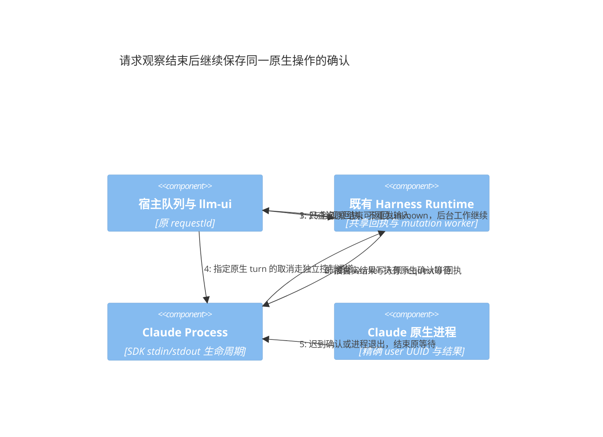

# 原生 Harness 队列与控制验收：2026-10-26

本记录使用当前运行的 httpd 20261025T232317-cada401f-dirty 与 nestos-node 0.4.1；本轮新增的源码修复没有部署。所有真实输入均发送到新建验收 Session，只要求输出标记、不读取或修改文件、不调用工具。未向用户原 Session 试发消息。

## Codex：顺序执行、状态查询与精确取消通过

验收 Session 为 01a1758b-116d-7821-bc5d-b0fc27618b23。暂停队列后接纳两条输入，再恢复派发。原操作身份为 verify-a-79157c1d-33f6-4d94-9c84-7f23933e91a3 与 verify-b-e047e825-0a9d-4907-a84c-fa2d9fce0562。实际先观察第一项 dispatching、第二项 pending，再进入第二项，最终两项均结算；两个预期标记出现，每个用户输入各一次、工具消息为零、active=false、pending=false、队列为空且 canSend=true。

随后单独验证第三条输入的精确取消。控制 operationId 为 verify-interrupt-be156612-0de3-4a0d-8da2-de14e4e872b1，原生 turnId 为 01a17591-636a-7543-a7ba-70a357a3f692。先观察到 receipt=accepted/effect=unconfirmed，之后才确认 effect=cancelled；最终 active=false、pending=false、队列为空且保持暂停。

模型目录返回 7 项，命令目录在原生初始化后有刷新。status 只读查询 verify-status-adb8cc75-450a-447b-9868-a7681c64d9e1 的接纳回执可独立核对，待持久报告数为零。本轮只执行这项查询，没有把目录存在扩大为所有 slash 命令已成功运行。

## Claude：目录与独立查询通过，真实顺序执行未通过

验收 Session 为 c305b394-fdc8-4c10-8bc2-7f7c676a1ce5。原第一项为 verify-a-9a4b6e2f-c28e-4b9d-9636-c0d401df197b，第二项为 verify-b-6672a0ff-b3b6-4d7c-b601-1f7704814626。第一项提交约 25 秒后进入 uncertain，初始派发诊断为 EIO；继续查询原生操作得到 unknown/ETIMEDOUT。没有收到预期助手标记，因此不能记为通过。

队列已持久暂停，仅移除尚未发送的第二项，保留第一项的原身份。独立读取证明原生 activeTurnId 为 66d5f172-fb04-40a4-8a46-ef1d137fe7fa。精确取消 verify-stop-26202c12-f9d6-443e-95e8-9a9cb98e5837 已接纳，并在后续只读核对确认 effect=cancelled、原生 idle；原提交仍 unknown，宿主 pending=true。因此实际工作已停止与原接纳回执缺失是两件事，不能据此抹除未知记录。

模型目录返回 5 项，slash 目录为 47 项。原提交未知时仍可完成独立 status 查询 verify-status-31539e89-38ec-4091-b264-ed7adbe5eec6，接纳回执可核对且待报告数为零；该查询没有改变原 pending 或队列暂停状态。无法从本轮证据确定实际模型首响应慢的原因，不能把回执缺口当作模型服务本身已正常。

## 已确认的机制缺口与修复

Claude Process.send 原来对控制请求与原生 user 确认统一使用 25 秒 oneshot 等待。外层 Runtime 已将 mutation worker 与 HTTP 连接分开，但内层超时会先丢弃 user 确认接收器，使后来的精确 replay 或结果无从更新共享原回执。这是适配器生命周期问题，不属于 UI、队列策略或模型重试策略。

0.4.3 将 turn 的确认接收器持续交给既有后台 worker，控制与管道写入仍保留有界等待。迟到确认可持久更新原回执；进程退出使等待返回错误并保留 unknown，不冒充已接纳。取消与回答仍通过既有独立通道，不被原提交的 Session 写串行锁挡住；不增加状态库、调度器或新的 RPC。

新增原生替身回归先在旧实现失败：25 秒后精确取消成功，但原回执始终不能变成 committed。修复后同一反例通过，原生输入只出现一次；另覆盖进程关闭释放未确认 worker 且不得伪造接纳。诊断包含原 operationId、Session/turn、确认阶段、结果、错误分类和耗时，不包含输入、输出或凭据。

修复提交 c8a8fb0；格式检查、全量 Rust 测试 391 通过/2 个既有忽略、debug/release 离线构建均通过。已安装 Claude Code 2.1.209 对本地模型 peer 的真实协议验收也通过，覆盖审批/Write、原生状态与历史、图片、外部 CLI 读取和恢复、目录监听。合入记录见 [计划第 78 节](./functional-merge-plan.md#78-codexclaude-真实验收与迟到接纳的生命周期)。本地 peer 是协议与生命周期验收，不能替代 Claude 真实模型的顺序执行验收。升级前已经丢失的 waiter 不会因新进程启动而自动恢复；旧 Claude 未知项继续保留。DSH 的另一条历史结算修复见 [DSH 验收记录](./dsh-remote-acceptance-20261026.md)。
