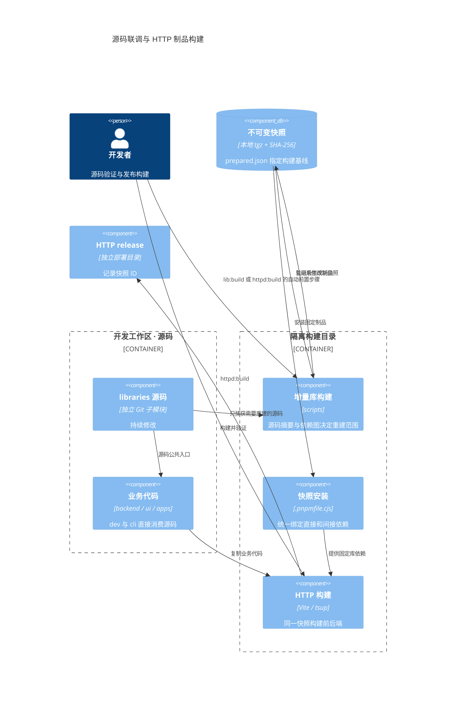

# 独立库本地快照、源码开发与 npm 构建

MindOS 日常开发默认使用源码，HTTP 发布构建单独消费固定本地制品快照；可选的全工作区快照模式用于制品验收。十二个独立库均位于 `libraries/`（包括 mdxeditor、vfs-ui、durable-kernel、device-tty），保留 npm 发布能力；durable-kernel、llm-ui、device-tty 和其他库统一使用各自独立仓库与 Git 子模块。libraries 下的子模块目录是唯一开发工作树，不维护另一份发布源码。业务包按前端、后端、共享职责位于 `ui/`、`backend/`、`shared/`；`apps/` 保存宿主。所有目录统一由 pnpm workspace 安装、排序和链接。

| 库 | 源码目录 | npm 构建版本 |
|---|---|---|
| @itookit/durable-kernel | `libraries/durable-kernel` | 0.1.0（目标版本，以 registry 为准） |
| @itookit/vfs-core | `libraries/vfs-core` | 5.3.3 |
| @itookit/vfs-ui | `libraries/vfs-ui` | 0.6.0 |
| @itookit/vfsdriver-indexeddb | `libraries/vfsdriver-indexeddb` | 5.3.4 |
| @itookit/vfsdriver-local | `libraries/vfsdriver-local` | 5.3.1 |
| @itookit/mindos-node-driver | `libraries/nestos-node-driver` | 0.3.1 |
| @itookit/vfs-sync | `libraries/vfs-sync` | 0.1.1 |
| @itookit/mdxeditor | `libraries/mdxeditor` | 0.5.8 |
| @itookit/driver-llm | `libraries/driver-llm` | 0.4.0 |
| @itookit/llm-ui | `libraries/llm-ui` | 0.2.1 |
| @itookit/device-tty | `libraries/device-tty` | 0.1.0（目标版本，以 registry 为准） |
| @itookit/image-parser | `libraries/image-parser` | 0.3.0（待发布） |

## 开发源码与 HTTP 制品

日常开发使用源码；HTTP 发布构建在独立目录消费制品快照，两者不共享安装目录。

| 命令 | 行为 |
|---|---|
| `pnpm dev` | 源码开发，库修改无需先打包 |
| `pnpm cli <参数>` | 通过 tsx 运行 CLI 源码，直接消费库源码 |
| `pnpm cli:built <参数>` | 运行已有 CLI 编译产物 |
| `pnpm lib:build` | 构建修改过的库及其依赖方，复用未修改制品 |
| `pnpm lib:build driver-llm` | 指定库及其依赖方；也接受完整包名 |
| `pnpm libraries:snapshot` | 强制全量生成所有库的快照 |
| `pnpm httpd:build` | 先增量 lib:build，成功后在隔离目录消费快照并构建独立 release |
| `pnpm libraries:status` | 查看开发依赖模式与 HTTP 构建快照 |

```bash
pnpm dev                            # 日常源码联调，不需要 lib:build
pnpm cli help                     # CLI 源码验证
pnpm lib:build                      # 可单独准备或检查库制品
pnpm lib:build driver-llm            # 只更新指定库及需要重建的依赖方
pnpm httpd:build                     # 自动增量准备库并构建 HTTP，不改开发依赖
```

首次没有快照时构建全部库；之后以最近准备的快照为基线（没有准备记录时兼容使用已启用快照）。源文件摘要或共享构建配置变化触发重建，按依赖图向上重建所有受影响的库；首次迁移旧快照时，缺少摘要的库会重建一次。没有变化时不安装、不构建、不打包，继续使用同一快照。指定参数是库名而非快照 ID；指定库时，未选择的库即使存在未完成修改，也使用基线中的制品，必要的 API 更新应一并准备。缺少需要重建的源码时明确失败。

构建只捕获选中的源码（含未提交修改），未选中的库在隔离工作区从基线 tarball 解包，避免源码依赖意外泄漏。安装后按拓扑顺序构建，复用 npm 发布的 manifest 规范化、exports 校验和 pack，不查询内部库的 npm 版本，也不发布。第三方依赖仍可能需要网络和 pnpm 缓存。不可变 tarball 与摘要清单位于 `release/local-libraries/snapshots/<ID>/`；源摘要、构建配置摘要、依赖关系与制品摘要共同区分同版本的不同快照。

只有构建成功才原子更新 `release/local-libraries/prepared.json`。生成制品不修改开发依赖、根锁文件或正在运行的服务；失败保留原先可用快照。`httpd:build` 复制当前业务代码及选定制品，在隔离目录安装、编译 UI 与服务端，记录 release.json 的 librarySnapshot。HTTP 隔离编译阶段不读取库源码；上游 lib:build 捕获修改后生成不可变快照，库构建失败立即停止 HTTP 构建。整个命令不重启正在运行的 httpd。Node 宿主显式声明外部原生依赖，复制同版本已构建运行文件，并在激活前验证 SQLite 内存读写、PTY 加载与 Sharp 图像编码。

源码联调不需要每次运行 lib:build；验证制品或发布 HTTP 服务时才需要。CLI 修改后可直接用 pnpm cli 验证；验证打包结果时先执行 pnpm cli:build，再用 pnpm cli:built。

### 可选的全工作区快照模式

`pnpm libraries:use <完整快照ID>` 仍保留为显式的全工作区制品验收入口；它会同时影响 dev、CLI 源码入口、类型检查及业务构建，而非只影响 HTTP。日常开发应使用 `pnpm libraries:source` 恢复源码模式，再重启开发服务。恢复时保留 HTTP 构建快照。

该可选模式由 `.pnpmfile.cjs` 统一覆盖直接、间接库依赖，peer 保留版本号；Vite 不再指向 libraries/src，库源码不参与业务安装。选择记录在 active.json，每个快照使用 `release/local-libraries/locks/<ID>/pnpm-lock.yaml` 及 `node_modules/.pnpm-libraries/<ID>/`。安装验证成功才更新选择，失败尝试恢复原模式。锁包含本地绝对路径，换 checkout 路径后需重新 use。制品损坏时可显式执行 `MINDOS_LIBRARY_SNAPSHOT=source pnpm libraries:source` 恢复。architecture 等全仓静态审查仍可包含库源码。

捕获、切换命令使用 operation.lock 互斥；进程被强制终止后，确认记录中的 PID 已退出再删除锁。不要修改或清理正在使用的制品。prepared.json、active.json 和快照均是当前 checkout 的本地状态，不会随 Git 提交分发。



## 源码开发

```bash
git submodule update --init --recursive -- libraries tools/nestos-node
pnpm install --frozen-lockfile
pnpm workspace:check --installed
pnpm dev
```

应用和业务包对内部库声明 `workspace:*`。根 `pnpm-workspace.yaml` 同时将独立库保留的 npm 依赖版本覆盖为 workspace，从而保证库间也只有一份实现；各库在自己的独立仓库仍可安装和发布。第三方依赖仍从 npm 安装。

源码入口、契约子路径和 CSS 由各库的 package.json exports 定义；发布入口由 publishConfig 指向 dist。mdxeditor 同样采用源码入口，不需要先构建才能开发。Web/Tauri/HTTP 的 Vite 别名从公开 exports 自动生成，避免漏掉 contracts、mcp-contracts 或编辑器适配包。CLI 构建打包内部 TypeScript，better-sqlite3 和 node-pty 保持原生外部依赖。

安装前的 `scripts/check-workspace.mjs` 检查源码是否齐全及消费方协议；`--installed` 进一步检查实际链接。源码缺失会明确失败。目录存在与否不再触发 npm/source 切换，旧自动改写和反向迁移脚本已删除。

## 可选 npm 构建

```bash
pnpm build:registry --prepare-only
pnpm build:registry
# 也可以选择另一个宿主或检查命令：
pnpm build:registry --filter @itookit/cli build
```

build:registry 先验证 `scripts/npm-libraries.json` 中的版本是否可从注册表取得，再在 `release/registry-*` 创建独立工作区。该目录不包含独立库源码、node_modules、dist 或环境文件；独立库依赖改为明确的 npm 版本，业务包仍使用 workspace。修复随独立库新版本发布，不再复制 patches/ 或生成 patchedDependencies。

默认构建 Web 应用，不部署或发布。日常开发的 package.json、pnpm-lock.yaml 和 node_modules 保持原来的选择模式。首次成功构建保存独立的 `pnpm-lock.registry.yaml`；后续构建冻结此锁文件，升级版本时使用 `--update-lock` 并审查更新。

`--prepare-only` 生成可检查的目录而不查询注册表、安装或构建。缺少已发布版本时，正常 npm 构建明确失败并指出包名；应用依赖新 API 或源码修复时，也必须先发布匹配版本并更新清单。新命名 @itookit/mindos-node-driver@0.3.1 已完成本地制品验证，尚未发布；旧名 mindos-node-client@0.3.0、vfs-ui@0.6.0 与 image-parser@0.2.0 的历史发布与制品核对不变。下方历史发布记录沿用当时的真实包名。

## 独立库发布

```bash
pnpm npm:prepare
# 可只准备一个库：
node scripts/release-npm-libraries.mjs prepare ./libraries @itookit/mindos-node-driver
# 明确决定对外发布时执行：
pnpm npm:publish
```

prepare 默认从 libraries 构建、检查发布 exports，固定库间 npm 版本并保存 tarball 和 SHA-256。 发布时使用 prepare 生成的 tarball；库源码的入口指向 src，publishConfig 指向 dist，直接从源码目录执行 npm publish 可能保留源码入口而不携带 src。应先检查打包后的 package.json 和所有导出目标，并在仓库外验证 ESM/CJS 与声明。源码消费与制品发布使用各自的入口。publish 校验制品未变后发布；已发布版本不可覆盖。发布后更新 npm 构建清单，无需改动日常源码工作区。

升级源码时提交独立库的改动，再在主仓库更新 submodule 指针。新提交需要推送到相应仓库，其他 checkout 才能取得该提交。旁边的 `../pair-x1`、旧 packages 库目录或 priv checkout 不参与当前依赖选择。

## 验证

源码模式验证冻结安装、工作区链接、类型检查、库与宿主构建，以及跨库集成测试。源码模式的根测试矩阵会运行 libraries 的单元测试，各库仍可单独测试。快照模式额外验证完整性、同版本更新、直接/间接依赖唯一性、源码修改隔离、切换失败恢复和 HTTP 捕获。npm 模式在隔离工作区验证固定发布版本，保留独立锁文件和构建目录用于审查。

发布前额外验证 ESM、CommonJS、CSS 导出、TypeScript 类型解析和 VFS SeqFile 读写。编辑器类型消费使用 moduleResolution: bundler。

### 2026-10-14 源码工作区验收

- 主工作区和仅使用各库已提交内容的干净快照均通过冻结安装、依赖链接检查和全仓类型检查。
- 库构建、Web、Tauri 前端、CLI 和 HTTP 宿主构建通过；Vite 实际请求验证 llm-flow/contracts、tools/mcp-contracts 与 mdx-adapter 的源码解析。
- 包测试 3363 通过、33 跳过；CLI 普通套件串行运行 202 通过，独立故障恢复矩阵 22 通过；Rust 边界 70 通过。CLI 文件并行曾出现恢复失败和超时，矩阵现串行运行这些启动真实进程的文件。
- 工作区与隔离构建新增 7 项回归测试通过；矩阵调度的 3 项检查通过。架构和样式检查通过。
- 隔离工作区用已发布的七个 npm 库及准备好的 piagent-driver tarball 完成安装、全仓类型检查与 Web 构建；该 tarball 尚未对外发布，正常 build:registry 仍明确报告注册表版本不可用。
- 主仓库文档检查仍有 10 处既有应用接口设计链接失效，本次迁移未新增悬空引用。

### MDX 拆分验证（2026-10-05）

- 独立安装、类型检查、37 项单元测试、构建及 tarball 打包通过；tarball 消费验证 ESM、CommonJS、TypeScript bundler 类型与 CSS 导出。
- x1 在 `packages/mdx` 缺席时，冻结锁文件离线安装、全仓类型检查、架构/文档/样式检查、Web 与 Tauri 前端构建通过。
- mdx-adapter 18 项测试及 CLI 原子保存集成测试通过；app-shell 首轮 507 项通过，受沙箱进程/端口限制的三个测试文件在沙箱外复跑 8 项通过。
- Tauri 对发布库使用的无前缀 Node 内置模块也执行 external，避免 Vite 将 LocalFS 的 `fs` 导入解析为浏览器空模块。


### 2026-10-14 补丁替代发布与清理

已使用经过仓库外验证的 tarball 发布 driver-llm@0.2.2 与 vfs-ui@0.5.8；npm publish 均退出码为 0。源码包版本与 scripts/npm-libraries.json 已同步升级，旧 patches/ 目录及 registry 工作区的补丁复制/配置生成逻辑已删除。日常工作区仍消费 libraries/ 的源码入口。

此前实际下载的 driver-llm@0.2.1 tarball（integrity 与注册表一致）声明 src/index.ts、src/chain.ts、src/contracts.ts 为入口，但只携带 dist，没有 src。0.2.2 使用正确的 dist 发布入口，包含原协议修复；0.5.8 包含延迟展开、销毁时取消恢复及折叠竞态修复。已发布的同名同版本不能覆盖，避免直接在源码目录运行 npm publish。

发布前制品在仓库外配合 npm 的 vfs-core@5.3.1 验证：46 项 Anthropic/Responses/thinking/延迟展开回归通过，ESM/CJS、chain、contracts、CSS 和 TypeScript 类型消费通过。测试工具使用本机缓存，三个第一方库均来自 tarball，没有工作区源码链接。vfs-ui 源码 201 项测试、类型检查和构建通过。

发布后两个版本均从注册表重新下载，SHA-256 与获批 tarball 逐字节一致；下载后的包再次通过 46 项回归、ESM/CJS/chain/contracts/CSS 导出与 TypeScript 类型消费验证。无补丁 registry 工作区准备、45 项脚本测试、两库类型检查、工作区链接与冻结锁文件离线安装通过。

### 2026-10-15 v5.4 发布完成

vfs-core@5.3.2 包含按需设备 readiness 和 revision 前置条件校验；vfsdriver-indexeddb@5.3.3 固定依赖该 core 版本；piagent-driver@0.1.0 首次发布统一文件、同步和 harness 接口。已准备 dist 入口 tarball，独立驱动锁文件固定 core 制品的 SHA-512。

三库源码测试共 347 项通过、1 项跳过。仓库外使用 tarball 完成 ESM/CommonJS、根与子路径导出、TypeScript NodeNext 声明解析、Memory/IndexedDB 文件及 SeqFile 读写、pi-agent 生命周期验证；没有源码链接。npm/registry 脚本 5 项通过，工作区链接检查通过。

三个发布命令均退出码为 0；npm 双因素认证已完成。注册表最初返回 202，版本元数据与 tarball 曾分别延迟可见，核验时没有重复提交发布请求。最终三个版本均从公开注册表重新下载，SHA-256 与上述通过仓库外消费验证的原制品逐字节一致。

| 版本 | 发布后 tarball SHA-256 |
|---|---|
| vfs-core@5.3.2 | `c5a4061bebe781444ba9da5e0083e09998c584991a8992811c9f28c02e0fc149` |
| vfsdriver-indexeddb@5.3.3 | `345089bb12e2d44b5758f64adea21d8268ce9a2b58866a0762b54af427475196` |
| piagent-driver@0.1.0 | `121798fadaaaa61bf29cc9bd8a2f3b4983c0f571bca09172eaf350667c03ebfc` |

其余库已发布的代码与当前源码一致；MDX 后续仅修改未打包的开发说明。主仓库位于 v5.4，九个已初始化子模块均已推送各自 main 分支，独立库版本与 Git 指针一并固定。

### 2026-10-15 ChatGPT 订阅类型（待完成 npm 二次验证）

driver-llm@0.3.1 包含 `chatgpt` Provider 与同名 implementation，继续复用 Responses 协议；运行时注入账号绑定的 OAuth session。宿主负责登录、身份验证和凭据存储，前后端配置 DTO 不携带刷新回调或令牌。提供账号模型目录、合并刷新、订阅请求约束和严格的流终态检查。0.3.1 另提供 `ConnectionMeta.credentialsReady` 可选认证状态投影；OAuth 登录装配在 httpd 宿主实现，库不负责登录或私密存储。

独立库 116 项测试、后端适配 244 项测试、全仓类型检查、架构边界检查、文档检查和 Web 构建通过。最终 tarball 在仓库外通过 ESM 推理/目录调用、CommonJS、contracts/chain 入口、TypeScript bundler 与 node16 类型验证；未使用真实 ChatGPT 账号验收。

修复发布暂存目录未清空造成旧声明残留的问题；重复 prepare 的过期文件负例验证通过。0.3.0 制品 SHA-256 为 `027973c95274105f852aedb8063db8d45d585936907c757fabad3d6ad4dba396`；0.3.1 制品 SHA-256 为 `9430b08bad35f0ae799b4a76f31250f967544dd65fe3ed2ba3edf965be990d63`，仓库外 ESM/CJS 与 TypeScript bundler/node16 消费验证通过。npm 发布 0.3.0 与 0.3.1 均被 EOTP 阻止，等待完成注册表二次验证；本节不表示该版本已公开发布。

### 2026-10-16 媒体通信与原生会话用量发布

已通过 npm 浏览器二次认证发布 driver-llm@0.4.0 与 piagent-driver@0.1.3，两个发布命令均退出码为 0。driver-llm 包含独立图片生成和语音合成通信客户端，以及此前 ChatGPT 订阅协议；piagent-driver 包含新建/续写/删除/并发修复和原生会话用量快照。价格策略仍由宿主注入，不进入远程通信库。

两个源码库各有 123 项测试通过（piagent-driver 另有 1 项跳过），类型检查与正式发布构建通过。仓库外 npm 消费者验证了 ESM/CommonJS、根与所有公开子路径、TypeScript bundler/NodeNext 声明，以及注入 fetch 的图片和语音请求；未依赖工作区源码链接。发布制品 exports 均指向实际携带的 dist 文件，运行时依赖无 workspace/link/file 协议。两个新版本已从公开注册表重新下载，SHA-256 与发布前验证的 tarball 一致。

| 版本 | 发布后 tarball SHA-256 |
|---|---|
| driver-llm@0.4.0 | `5f9b54ffe8bc9dfa20d6f4bd811c1f75e1e991ee07fe3ea400a6e0911cff839a` |
| piagent-driver@0.1.3 | `0ae5c9406bcdab7a698d01eef6ed512e8aa25c9adcad6d9ef302c1257de9b73e` |

Rust pi-agent 独立于 npm 发布流程；其启动版本输出、日志与并发隔离更新通过 tools/pi-agent 的 Git 提交和本地二进制交付。

### 2026-10-16 目录授权发布

piagent-driver@0.2.0 已发布并从公开注册表重新下载，SHA-256 为 `e43eef38a227f1daa53904135b5beca9e9b6d52c6f2f27c6af8b93ee8aee27c5`，与正式 prepare 制品一致。128 项源码测试通过、1 项跳过；仓库外 ESM/CommonJS、公开子路径及 TypeScript bundler/NodeNext 消费验证通过。新增匿名目录读取、稳定身份与授权版本校验、项目有效能力投影，价格和目录共享策略仍由宿主控制。

Rust pi-agent@0.2.0 提供目录 grants、稳定 owner 和独立执行权限；共享节点可由多个独立 itookit 实例连接。同一 httpd 的多用户登录与存储隔离不在本次实现范围。

### 2026-10-17 独立仓库审查与发布准备

本轮有改动的独立仓库为 mdxeditor、piagent-driver、vfs-ui 与 Rust pi-agent，均已提交并推送 main；其余五个独立库与远端一致，沿用已发布版本。

- mdxeditor@0.5.3：嵌入布局、原始 HTML 策略、片段解析复用及折叠状态保留。
- piagent-driver@0.2.3：原生消息来源元数据、观察错误分类、profile 隔离与状态恢复。
- vfs-ui@0.5.9：通用目录预加载保留展开状态，显式加载失败向宿主拒绝并允许重试。
- pi-agent@0.3.6：历史投影保留用户内容来源与原生 turn 身份；release 二进制和示例配置位于 `release/native/pi-agent-0.3.6-linux-x86_64.tar.gz`，不部署或替换运行中的服务。

三个 npm 制品均通过 dist 导出存在性、固定库间依赖及 SHA-256 校验；仓库外安装这三个 tarball 与其余五个注册表库后，通过八库 ESM/CommonJS、全部公开子路径、CSS、Memory/IndexedDB/SeqFile 与嵌入 HTML/折叠状态验证。TypeScript bundler 检查覆盖八库，NodeNext 检查覆盖其余七库；MDX 声明继续遵循既有 bundler 消费契约。

源码验证：mdxeditor 55、piagent-driver 155、vfs-ui 203 项通过（另 1 项网络测试跳过）；Rust 完整测试 259 项通过、2 项跳过，格式检查与 release 构建通过。npm/registry 脚本 5 项通过，源码工作区冻结离线安装通过。npm 发布已发起，等待浏览器二次认证；本节不表示新版本已公开可下载。

### 2026-10-18 会话内容搜索发布完成

mdxeditor@0.5.4 提供通用的目标祖先展开入口，由代码块控件保留自身状态；llm-ui@0.2.0 首次发布独立 Chat/Flow 视图及已加载正文搜索，正式制品固定依赖 mdxeditor@0.5.4。

两个正式 prepare tarball 已在仓库外安装，验证 ESM/CommonJS、Chat/Flow/CSS 导出、TypeScript bundler 声明、Vite 构建、搜索高亮、代码块展开与视图生命周期；没有工作区源码链接。相关源码测试 215 项通过；发布脚本 5 项、冻结离线安装与前端公开入口构建通过。完成 npm 重新登录及发布认证后，两个 npm publish 命令均退出码为 0；两个新版本均已从公开注册表下载，SHA-256 与通过上述验证的正式制品逐字节一致。mdxeditor 的元数据和 tarball 曾分别延迟可见，核验期间没有重复提交发布请求。全仓类型检查通过。

| 制品 | SHA-256 |
|---|---|
| @itookit/mdxeditor@0.5.4 | `f1d4a5cf08fd5917fc10ecf48484d809c195711380a99f45a8a54e6092a2cba8` |
| @itookit/llm-ui@0.2.0 | `773b6a6987734de6400534f41d216375d75555444317ab3102d8774ec572881f` |

### 2026-10-18 项目导航刷新修复

vfs-ui@0.5.10 将 `navigationChildren` 开放到单栏入口，并在恢复展开状态时准备投影容器成员；保留旧双栏选项兼容，不读取折叠项目或执行器历史。app-shell 的项目目录与侧栏统一展开后端声明的透明容器，右侧刷新等待缓存失效和侧栏更新。

验证：vfs-ui 206 项测试、工作台 13 项回归、相关类型检查、模块边界、前端公开入口构建、文档、样式及冻结离线安装通过。正式 prepare tarball 在仓库外配合注册表 vfs-core@5.3.2 验证 TypeScript bundler、ESM/CommonJS、CSS/Vite 构建、恢复展开、刷新新增成员和容器折叠状态，没有工作区源码链接。制品 SHA-256 为 `7c423cf67ee4f0279b040c92af578accacf1e86544d5352a8c9266cd31eee425`。npm publish 已退出码 0 完成，公开注册表重新下载的 tarball 与正式制品 SHA-256 一致。

- piagent-driver@0.2.4：名称/目录文件搜索与仅用户提问搜索，显式协商 fileSearchVersion/searchPrompts，旧服务拒绝不支持的新范围。
- pi-agent@0.3.7：project_search 名称/目录范围、harness_session_search 用户提问与 DSH 有界分页搜索；原生制品 `release/native/pi-agent-0.3.7-linux-x86_64.tar.gz`，不自动替换正在运行的远程服务。


### 2026-10-19 图片处理、输入恢复与依赖同步发布

本轮准备发布 image-parser@0.1.0、llm-ui@0.2.1、piagent-driver@0.2.5、vfs-core@5.3.3、vfs-sync@0.1.1、vfs-ui@0.5.12、vfsdriver-indexeddb@5.3.4、vfsdriver-local@5.3.1 和 mdxeditor@0.5.8。存储驱动同步固定新 core，避免独立消费者混用 core 版本；driver-llm@0.4.0 沿用已有制品。

首次仓库外消费核对发现，公开 mdxeditor@0.5.7 的 exports 指向 src，但 tarball 没有 src，不能作为新聊天库的依赖。0.5.8 使用 prepare 规范化的 dist 入口，修复制品发布方式，不覆盖已有版本；llm-ui@0.2.1 固定使用新版本。

源码验证共868项通过、1项网络测试跳过，覆盖上述九个库；全仓类型检查、发布脚本、架构和文档检查通过。图片检测实验和验收记录一并提交，但正式检测仍保持 Scanic classical；实验门槛未通过不作为可用生产能力发布。图片库 npm files 仅包含 dist、README 和 LICENSE，不携带实验输入照片。

九个正式 prepare tarball 已在仓库外安装，通过 ESM/CommonJS、公开子路径、CSS、Memory/IndexedDB SeqFile、图片与视图生命周期、TypeScript bundler/NodeNext 声明及 Vite 构建验证，没有工作区源码链接。文档和已安装工作区检查通过。

发布状态：制品验证完成，等待 npm 发布与公开下载核对。制品及 SHA-256 保存在 release/npm-libraries，后续核对后更新本节。


### 2026-10-19 image-parser 扫描保护发布

已发布 image-parser@0.2.0：正式 classical 检测增加低分裁剪保护，非 ML paper 检测器通过显式选项接入，检测契约增加 partial/uncertain 并支持协作式取消。完整回归与未完成门槛见[检测器验收](image-parser-detector-validation.md)。版本升级同步处理器版本，避免派生结果缓存继续使用旧版本标识。应用默认检测器不切换，性能和 Safari 真机验收尚未通过，不将可选 paper 路径声明为全面生产就绪。

发布状态：已完成正式 tarball 发布及公开下载核对；制品摘要与公共消费验证见下方“节点命名、回执恢复与侧栏预览发布”。


### mindos-node 命名迁移

服务源码工作区由 `tools/pi-agent` 更名为 `tools/nestos-node`，服务仓库为 <https://github.com/mushuanli/nestos-node>。客户端工作区由 `libraries/piagent-driver` 更名为 `libraries/mindos-node-client`，包名为 `@itookit/mindos-node-client`，工厂为 `createMindOSNodeClient()`；源码仓库暂沿用 `mushuanli/piagent-driver`。源码、构建与 npm 制品目录配置均已更新，新包首次发布与消费验证见下一节。

现有 MCP 配置、serverId、项目和会话 UUID、数据根与协议编码不迁移。节点增加 `itookit/mindos-node` 发现描述及 `mindos_node_capabilities` 工具，保留旧描述、能力工具与 HTTP 授权头；客户端同时接受新旧名称。持久配置仍使用原扩展键，已有凭据和项目绑定无需重建。


### 2026-10-19 节点命名、回执恢复与侧栏预览发布

本轮已发布 mindos-node-client@0.3.0、vfs-ui@0.6.0 和 image-parser@0.2.0。客户端首次使用新包名，提交前只读失败明确为未提交，未知回执按原 ID 核对并保留拒绝原因；工作台发送丢失响应后只核对一次，不自动重发。侧栏文件与收藏各预览最多 15 条，更多入口打开右侧完整目录。image-parser 制品与此前已验证的 0.2.0 扫描保护制品一致。

节点 mindos-node@0.3.8 将当前 epoch 尚未准入的请求与迟到投递在同一回执锁内核对；查询结果明确为未提交时保留拒绝记录，避免 UI 已恢复输入后旧请求又执行。Linux x86_64 release 制品为 `release/native/mindos-node-0.3.8-linux-x86_64.tar.gz`，不替换运行中的服务。

验证：Rust 完整测试 293 项通过；客户端 203 项单元/文件链路测试及显式 MCP 网络测试通过；vfs-ui 214 项、image-parser 33 项、工作台相关 75 项通过。全仓类型、文档、样式和 Rust 格式检查通过。三个正式 tarball 在仓库外共同安装，验证 ESM/CommonJS、公开子路径、旧工厂别名、15 条预览行为及 bundler/NodeNext 声明解析。发布脚本 5 项通过。

| npm 制品 | SHA-256 |
|---|---|
| @itookit/mindos-node-client@0.3.0 | `9f0d33a7f6c4e1de567746fe51d1e75ceef3ae0e0caa1771d2a70378fa5f0a32` |
| @itookit/vfs-ui@0.6.0 | `ff919033c11bd9432e9d95c6d861826a0adbb213da0518018282ead19d052761` |
| @itookit/image-parser@0.2.0 | `831da8756ab66c7bded83e96a0304a6e481b25827556441b425065fa86ce7fea` |

发布状态：三个 npm 包均已公开发布，重新下载的 SHA-256 与上表一致，v0.3.0 / v0.6.0 / v0.2.0 标签已推送到各自独立仓库。仓库外使用公开注册表安装三个固定版本，锁文件均解析到 registry.npmjs.org；ESM/CommonJS、所有公开子路径、CSS 入口、旧工厂别名、15 条目录预览与 bundler/NodeNext 类型检查通过。image-parser 首次返回 HTTP 202 后经历处理与下载短暂不可用，最终以公开文件下载成功和摘要一致确认完成。节点 v0.3.8 标签也已推送，Linux release 制品已生成，不自动替换运行实例。


### 2026-10-19 mindos-node-driver 名称统一

源码工作区改为 `libraries/nestos-node-driver`，npm 包为 `@itookit/mindos-node-driver@0.3.1`，主工厂与类型为 `createMindOSNodeDriver()` / `MindOSNodeDriver`。GitHub 目标为 <https://github.com/mushuanli/nestos-node-driver>；旧独立仓库 piagent-driver 已包含客户端此前的全部提交。旧 Client 与 PiAgent 工厂/类型保留为弃用别名，原协议、配置键、serverId 和会话 UUID 不变。

当前状态：本地改名、204 项测试、全仓类型/架构/文档检查已完成；正式 tarball 的仓库外 ESM/CommonJS、公开子路径、旧工厂别名与 bundler/NodeNext 声明解析通过。新 GitHub 地址仍返回 404，推送及 npm 发布等待仓库地址可访问。上文的 mindos-node-client@0.3.0 是真实历史发布名，不改写其制品身份或摘要。

待发布制品 `@itookit/mindos-node-driver@0.3.1` 的 SHA-256：`1af9a23b40506ff27cc7738c3455064775fd96d208816a1455469d60e10ddaca`。本地制品验证不代表新版本已公开发布。

图片处理新增纯 processing 入口，源码工作区使用 image-parser 0.3.0；npm 构建清单同步要求 0.3.0，需另行发布该版本后才能运行 registry 构建。本轮没有执行 npm 发布。工具工作区 tools/image-tools 也进入源码扫描、边界检查和隔离构建目录。

## 2026-10-21 Git 仓库独立化复核

llm-ui 与 device-tty 已提取各自的目录提交历史并推送独立 main，主仓库通过子模块接入；durable-kernel 同样使用子模块。libraries 下的十二个包均拥有独立 Git 根目录和对应远端。原 backend/device-tty 已迁到 libraries/device-tty，durable-kernel 的重复临时发布工作树已核对后删除。

| 仓库 | 提交 | 直接运行依赖 | 验证 |
|---|---|---|---|
| [llm-ui](https://github.com/mushuanli/llm-ui) | c4226b7 | mdxeditor ^0.5.8 | 独立锁文件安装、62 项测试、类型检查与构建 |
| [device-tty](https://github.com/mushuanli/device-tty) | 3343c56 | node-pty ^1.1.0、Node 内置模块 | 独立锁文件安装、8 项测试、真实 pipe/PTY 交互、类型检查与构建 |

device-tty 拥有独立 /contracts 子入口，tools/contracts 兼容转发类型；它不再依赖 tools。Node 驱动入口和纯接口入口分开，原生模块仅在 PTY spawn 时加载；驱动不承诺跨宿主重启恢复。两份 tarball 在仓库外完成 ESM/CJS 导入、交互进程和 NodeNext 类型消费检查。主项目 tools、kernel-adapters 与 CLI 类型检查、kernel-adapters 的 273 项测试以及架构与文档检查通过。Git 推送、主仓库提交和 npm 发布是分别执行的动作，不能以远端代码存在推断 npm 已发布。

HTTP 构建使用 `release/httpd/.build-cache/` 复用隔离安装环境及前后端编译产物；缓存键包含已准备的不可变库快照 ID，修改 libraries 源码后，`pnpm httpd:build` 会先增量准备新快照，再使用该快照编译 HTTP release；也可单独运行 `pnpm lib:build <库名>` 准备或检查上游制品。构建缓存不修改工作区消费模式，`--no-cache` 可绕过缓存，`--no-activate` 只生成验证后的 release、不改变下次启动选择。


### 2026-10-27 文档 AI 与 NestOS HTTP 发行

已推送并合并相关仓库 main，发布 @itookit/vfs-core@5.3.4、@itookit/mdxeditor@0.5.9、
@itookit/mindos-node-driver@0.4.3；三个版本均已可从公开注册表查询，独立仓库版本标签已推送。
HTTP 工作台首次以 nestos@0.1.0 分发，产品发行名 NestOS，命令为 `nestos httpd`；
初始化命令为 `nestos init-certs`，首次交互终端缺少证书目录时也可确认生成，非交互缺少证书时明确退出。
原 MindOS 用户配置和数据根路径保持兼容，详见 [npm 使用说明](../../apps/http-app/npm/README.md)。

NestOS tarball SHA-256：`13c0612438baab7c17994014e7862fdc093ce004c3c85a708cc4ee2376ec9c5b`。
构建源提交 `13509742`，HTTP release 为 `20261027T105758-13509742`，对应 Git 标签 `nestos-v0.1.0`。
npm publish 已退出码 0 接纳发布，注册表提示仍需处理数分钟；不因短暂不可见重复提交相同版本。
此前 mindos 包名被 npm 以与 minio 过于相似为由拒绝；MindNest 仅作为候选准备过制品，没有发布。
本次按用户要求不执行测试套件，仅完成发布所需的构建、打包、源输入/原生运行时检查及注册表状态查询。
没有用新包启动生产服务，也没有重启现有 httpd。GitHub Pages 已部署，站点为 <https://mushuanli.github.io/nestos/>。
