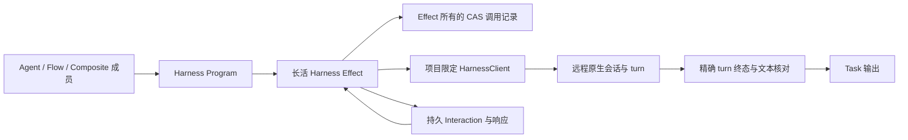
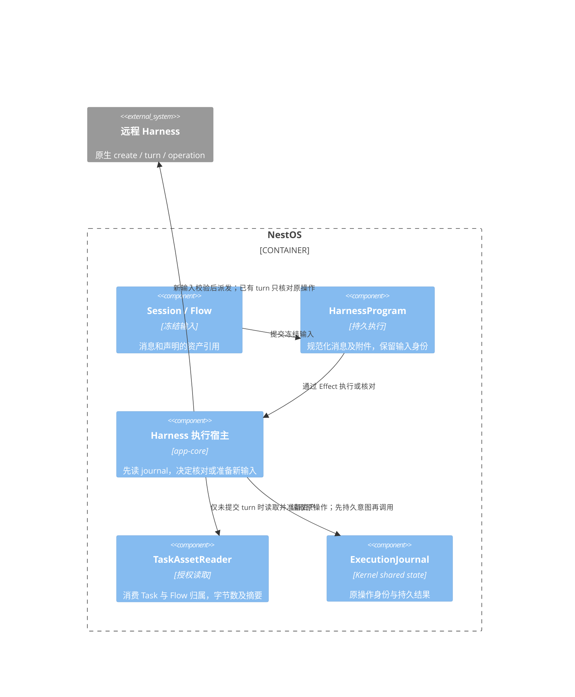
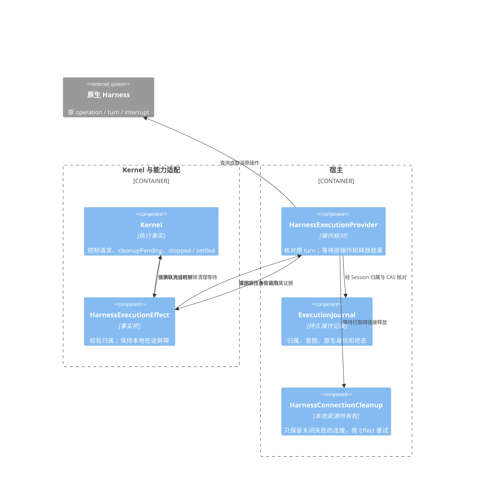

# 远程项目 Harness 执行连接

执行连接将已有 nestos-node 连接、已授权项目与原生 harness profile 保存为一个具名目标。Agent 的 `execution.kind = 'harness'` 使用该目标；普通会话、Flow Agent 节点和 Composite 成员共用 `kernel-adapters.harness@1` 与 `harness.execute@1`。模型调用继续使用 `LLMConnection`，执行连接不参与模型档位或默认模型选择。

## 配置与使用

先在项目设置中连接 nestos-node，完成远程项目注册与授权。项目必须具有完整的服务身份、项目 ID、修订和授权，服务需开放 projectRuntime harness 的 create、history、interrupt 能力。仅发现一个 harness 或配置本地工具列表不会授予远程执行权限。

在 Agent 编辑器的执行方式中选择「远程智能体」，点击「新建远程执行连接」，填写名称，从已授权项目与执行配置候选中选择目标。候选查询按需发起，不创建原生会话，不自动注册缺失授权的项目。连接选择支持重试；配置保存失败保留弹窗草稿。远程模型的选择和工具审批由原生 harness 管理。

连接保存的字段如下，不含地址、认证或新的挂载授权：

```json
{
  "id": "remote-review",
  "name": "远程项目审查",
  "kind": "harness",
  "nodeConnectionId": "existing-node-connection",
  "projectId": "existing-authorized-project",
  "profileId": "claude",
  "enabled": true
}
```

`profileId` 来自服务实际发布目录，不能假定每个节点均使用示例中的名称。可选 `selection: {modelId, reasoningEffort?}` 通过原生模型目录校验；当前设置界面保留已有 selection，不编辑该字段。

保存 Agent 定义，供普通会话和 Flow 引用：

```json
{
  "id": "remote-reviewer",
  "name": "远程项目审查员",
  "type": "agent",
  "config": {},
  "execution": { "kind": "harness", "connectionId": "remote-review" }
}
```

Flow 使用标准 `builtin.agent` 节点。`config.agentId` 引用该 Agent；也可在 inline Agent config 中提供 `execution: {kind: 'harness', connectionId}`，由宿主解析和冻结授权。请沿用 Flow 节点的 `config.instruction`、`inputs` 和依赖传值规则，不把远程连接 ID 写进模型专用的 `connections` 槽位。多个节点即使使用同一连接，也创建各自独立的原生会话。

[可执行示例](../../apps/cli/examples/remote-harness.flow)直接引用命名连接 `remote-review`。先在所用 profile 建立该连接，再运行 `pnpm cli run -f apps/cli/examples/remote-harness.flow --profile <profile> --params <参数文件>`；参数文件形如 `{"request":"读取项目 README 并概述结构"}`。这条执行链只包含 `.flow` 和原生 harness，不依赖额外业务脚本。CLI仍须通过宿主既有凭据解析器取得节点认证；使用credentialRef的连接需要向CLI进程提供对应的 `NESTOS_REMOTE_<credentialRef中的连字符替换为下划线>` 环境变量，凭据不写入Flow或执行连接定义。

Composite 可以使用本地模型主持者和远程成员。成员结果沿现有委派汇总链返回。远程主持者目前明确拒绝，因为原生 harness 尚未桥接本地委派工具。

## 配置管理契约

`IAgentManagementService` 提供以下可选管理方法，已进入应用 RPC 显式方法表；未装配的宿主应隐藏管理入口：

| 方法 | 行为 |
| --- | --- |
| `getHarnessConnections()` | 读取连接定义，包含停用项；不访问原生模型，不携带凭据 |
| `getHarnessConnectionTargets()` | 按需读取已授权项目的可执行 profile，最多四个项目并发查询；失败项目保留安全 errorCode |
| `getHarnessConnectionRecord(id)` | 读取定义与当前 revision |
| `saveHarnessConnection(connection, expectedRevision)` | CAS 保存，首次创建传 0；冲突不得覆盖其他窗口的修改 |
| `removeHarnessConnection(id, expectedRevision)` | CAS 删除并保留修订墓碑，阻止旧写入复活连接 |
| `getHarnessConnection(id)` | 执行准入时解析、验证并冻结连接与项目授权；不用于普通目录展示 |

宿主内部通过 `ApplicationRuntime.executionConnections` 使用同一服务。定义和索引位于系统 VFS 的 `/etc/execution/connections/` 与 `/etc/execution/connections.seq`。平台入队保存连接修订及项目身份快照；执行前重新核对，修改或撤销授权会明确拒绝旧绑定，不自动改投其他项目或默认模型。

## 持久执行与停止



每个原生修改前，先持久化由 Kernel Session、Task、Effect 和子步骤构造的稳定 requestId。创建会话、提交 turn、审批响应及 interrupt 均查询原回执，不因断线生成新身份盲目重放。原生 session/turn、操作回执、事件游标、交互身份和结果存在 Effect 所有的 CAS journal；进程内映射只用于等候当前观察者退出。

提交返回 turnId 只表示接纳。成功必须取得同一 native session/turn 的 completed 证据，核对历史文本，并保存结果。流中断或事件缺口可补读历史；idle、notLoaded、最后一条 assistant 消息或同 ID 的 user item 不作为 turn 成功证明。输出是该 turn 的 assistant 文本集合，当前公共协议不足以保证只取 final 阶段。

等待人工输入时 Effect 持续有效：Program 将通知转为 Kernel Interaction，回应持久写入共享响应通道，Effect 再提交原生响应。审批按服务提供的决策集合映射，不默认批准。取消先退出观察者，再用独立超时信号核对原操作、发送 interrupt，并等待该 turn 权威终态；断开连接与 AbortSignal 均不能作为停止证明。无执行授权的 cleanup 只能访问本 Session/Task/Effect 的 journal，并继续受应用 Session 写租约约束。

实时调用丢回复同样保留 Kernel `effect.indeterminate`，不会把 Task 终结为可盲目重做的普通失败。经核对后可用已有 `TaskHandle.resolveEffect()` 提交结果或显式授权同一 Effect 再核对；Harness Provider继续读取原journal，不更换原生请求身份。明确未启动与明确失败/取消的原生turn仍按失败处理。

回执 epoch 与事件缓存 epoch 独立。nestos-node 进程重启会丢失临时回执并改变回执 epoch，不能把旧回执缺失解释为未执行。已持久化的完整结果可原样返回；结果仍未核对且无法证实原终态时保留 indeterminate，取消无法证明停止时保留 cleanup-pending。当前不承诺任意节点重启后自动完成或自动重跑。

## 真实模型验收（2026-10-23）

后续已使用实际推理服务复验，见[真实模型机器记录](fixtures/remote-harness-real-model-evidence.json)。Claude Code通过用户已配置的Anthropic兼容网关执行，配置中的Sonnet别名在原生usage中实际返回 `deepseek-v4-pro`；Composite主持者使用实际 `deepseek-v4-flash`。这些记录证明实际模型调用，不据配置别名声称Anthropic官方Sonnet直连。

普通Agent、两个独立远程Flow节点、真实主持者选择两名远程成员并汇总，以及Kernel丢回复后同身份回执核对，四项均通过。原生模型使用Read读取隔离项目代码和仅存在于文件中的随机挑战值，正确识别 `lookup_record` 的SQL拼接和 `run_job` 的命令拼接，并区分参数化SQL与argv数组的安全实现；原始模型输出、实际usage、native session/turn和持久终态逐项对应。CWE编号按数值身份比较，原始输出中的前导零保留。

CLI也已真实运行仓库原版 `.flow` 与 `agentId` 引用两个入口，核对Read历史、未入prompt的文件挑战值、计算结果和磁盘journal。旧固定响应协议测试继续独立保留，不改写为真实模型记录。真实模型曾请求Bash而停在审批门禁，旧验收未处理交互并超时；该失败记录保留，后续验收只允许读取指定测试文件，其他工具拒绝，不扩大项目授权。

可通过 `NESTOS_HARNESS_REAL_METADATA=<真实节点元数据文件>` 运行CLI真实验收；应用验收额外提供 `NESTOS_REAL_COORDINATOR_CONFIG=<受限模型配置文件>`：

```bash
pnpm --filter @itookit/app-core exec vitest run tests/harness-real-model-live.test.ts
pnpm --filter @itookit/cli exec vitest run tests/harness-real-model-live.test.ts
```

测试缺少显式环境变量时跳过，不隐式使用日常会话或发送用户消息。测试设施使用临时项目和profile；业务工作流仍由 `.flow` 声明。

## 当前边界

- 输入支持文本消息、已物化的文本/图片附件，以及标准 image/file 资产引用；原生 profile 必须声明相应能力。PDF 等其他格式须先显式转换，远程 URL 不由适配器自动下载。Agent 的 system/user 历史作为调用上下文传入，远端实际系统权限仍由原生 profile 控制。
- 当前返回核对后的终态文本，尚未将原生token流逐条投影为本地聊天增量。Harness Effect默认超时30分钟，Flow节点可显式设置合法的 `config.timeoutMs`，超时仍须确认远程停止。
- 本地模型、Bash、MCP 和 Skill 能力不自动转授原生会话；远端执行由已授权项目、profile 与原生审批控制。
- 本地模型 token 统计不代表原生会话成本；远端提供的 usage 保留在 harness 结果中，缺失不等于免费。
- 复用既有 nestos-node 项目沙箱。Claude profile满16个加载进程时，回收最旧的空闲、未借用、无活动turn和无待审批会话；确认进程退出才腾槽，超时保留容量并返回具体错误，历史与回执保留供冷恢复。本次未新增 Firecracker、网络出口代理、远程机器部署或 RAPTOR 专用运行时。
- 通用远程执行与完整RAPTOR远程扫描分别验收；首轮固定peer协议记录与后续实际模型记录独立。跨机器项目节点部署、任意节点崩溃矩阵及完整RAPTOR远程业务迁移仍未验证。

源码入口：[连接与授权](../../backend/app-core/src/projects/harness-connections.ts)、[调用与核对](../../backend/app-core/src/projects/harness-execution.ts)、[Program](../../backend/kernel-adapters/src/programs/harness-program.ts)、[Effect](../../backend/kernel-adapters/src/effects/harness-execution-effect.ts)、[Session 绑定](../../backend/llm-session/src/session/harness-binding.ts)、[Flow 节点](../../backend/llm-flow/src/flow/harness-agent.ts)。验证记录见[机器记录](fixtures/remote-harness-evidence.json)与 [RAPTOR 与远程编排](raptor-harness-integration.md)。

### 远程恢复记录的本地存储一致性

RemoteConversationStore 只保存原生身份、草稿及操作回执，不保存另一份原生对话历史。同实例 load/save/submitted 串行，保存时冻结输入，读取返回副本；该边界不等待原生 turn。事务回执丢失时，下一次写先读取原键，只有写前或写后值能继续；出现第三值保持冲突，刷新不能重新授权旧实例覆盖。追加 submittedTurnId 先核对原写，再合并持久事实，不能用旧缓存覆盖已提交草稿修订。

### 原生查询、控制及输出的独立通道

发布 Node 原生协议与宿主 RPC、两种 UI 消费者一同接通：目录及状态查询不等待原发送 tail；查询报告保存到原 journal，以 query receipt 更新同一台账，不生成新 turn 或消费原 pending input。取消携带具体 session/turn 与独立 operationId，接纳与实际停止分别展示和核对。结果读取以不可变输出引用分页核验，仅影响结果卡片可读性；结果 envelope 无效时查询原操作，不重发输入。默认工作台用提交计数保留仍在途的写入，只为声明为 query 的命令放行。Node 源码锁定不等于部署更新，原 Session 验收另行核对运行版本与能力。

## 不可变附件的执行传输

普通 Session 将已装配的消息交给 HarnessProgram；Flow 保存声明的 image/file 引用。kernel-adapters 的 `prepareHarnessInput` 只规范化消息及资产身份，不读取存储。app-core 在原生 create/turn 前通过注入的 TaskAssetReader，以实际 Effect 的 sessionId/taskId 授权读取，核验字节数和摘要，再转换为原生文本或图片。Task 文件只允许同一权威 Flow 或合法重试来源，其他调用须显式转交。

| 所有者 | 负责 | 不负责 |
|---|---|---|
| llm-ui / UI adapter | 编辑、提交与状态显示 | 文件读取权限和原生编码 |
| Session / Flow | 冻结消息、实参和声明的材料 | 原生传输协议、隐式格式转换 |
| kernel-adapters | 消息规范化、资产引用契约、持久 Effect 请求 | 访问宿主文件系统 |
| app-core | 当前消费身份授权、内容核验、传输装配 | Flow 模板和业务文件处理 |
| node driver / 原生端 | 原生附件格式和大小约束 | 根据路径或临时 URL 推断授权 |



原生内联协议目前最多 5 个附件，单个文本 64 KiB、图片解码后 256 KiB，编码后总附件 512 KiB；支持的图片为 PNG/JPEG/WebP，最终约束复用 driver 校验。宿主在读取大文件前先检查元数据，读后再核验真实内容。日志只记录操作身份、阶段、错误码、数量和大小，不记录正文或存储路径。

恢复沿原 journal 处理：已有 turn ID 或 turn 操作意图时不重读附件，也不重复上传、create 或 turn。结果丢失与文件后来删除不能变成再次发送。取消沿原清理链等待正在读取/派发的操作结束及连接释放；本切片不改变 Effect 的取消确认契约。

此范围不包括原生上下文续接、任意格式解析、OCR、产物目录或长期资产回收。Flow 结构化 route 将普通实参渲染为消息数据，不自动把参数里的任意引用变成附件；附件须通过已声明的消息材料协议消费。

## Connection 取消和核对事实桥

Connection Provider 报告原生执行事实；Effect 适配器将其转换为现有 Kernel 契约，不修改 `EffectAdapter.cancel(): Promise<void>` 的含义。只有原执行停止、清理确认、证据归属匹配并且本地在途操作退出，取消才允许正常返回。

| Provider 事实 | Effect / Kernel 行为 |
|---|---|
| stopped + cleanup confirmed，且 sessionId/taskId/effectId 与证据匹配 | 等待本地在途操作退出后正常返回，Kernel 再确认清理 |
| stopped + cleanup pending，或 pending | 抛出具体待清理/待停止错误；保留 cleanupPending |
| unknown、缺少结果或错误归属证据 | 不确认释放；保留原 journal 和执行身份 |
| reconcile completed | 返回原结果 |
| reconcile not-started，且证据属于本次 fenced 执行 | 允许 Kernel 按原 Effect 身份 retry |
| reconcile running / unknown | 保持 indeterminate，不创建新的远端操作 |

真实 Harness Provider 在恢复预算内观察原 turn；观察中断或原生 epoch 变化时报告 unknown。操作回执与 journal 都由宿主核对，不能将 UI 的“已请求停止”作为证据。故障日志保留安全错误码和归属，不包含 prompt、远端错误正文或密钥；日志通道异常不改变执行、核对和取消结果。



未释放的本地连接句柄属于宿主资源生命周期机制，不能放入 UI、业务策略或 Kernel 的通用执行状态。关闭失败后保留原句柄；后续取消或恢复先重试该句柄，关闭成功后移除。连接的并发 release 共用同一 Promise，失败后允许重试，成功后保持幂等。该内存集合不是第二份持久执行状态库，宿主重启后的原生核对仍以 journal 和远端事实为准。

清理状态端口只允许访问原 journal，并在打开 Session 前及每次读写前复验写入归属；失去 lease 时不能借清理取得新所有权。上下文 binding 的清理及暂停期间审批准入仍分别属于 F20、F18，本批不提前加入这些契约。
