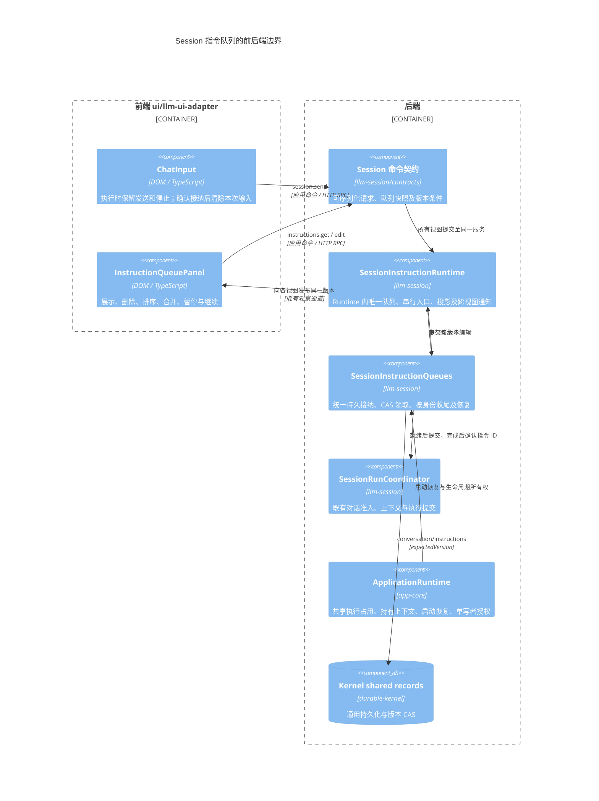
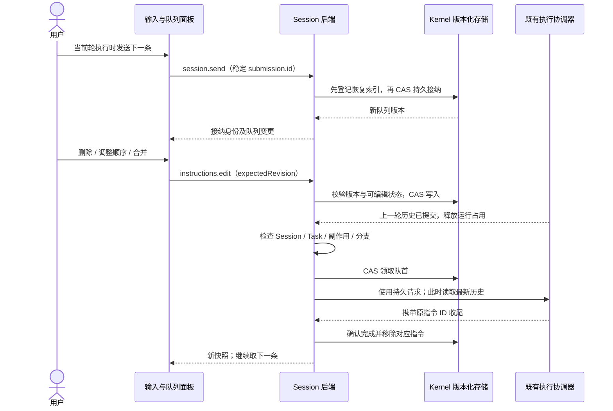
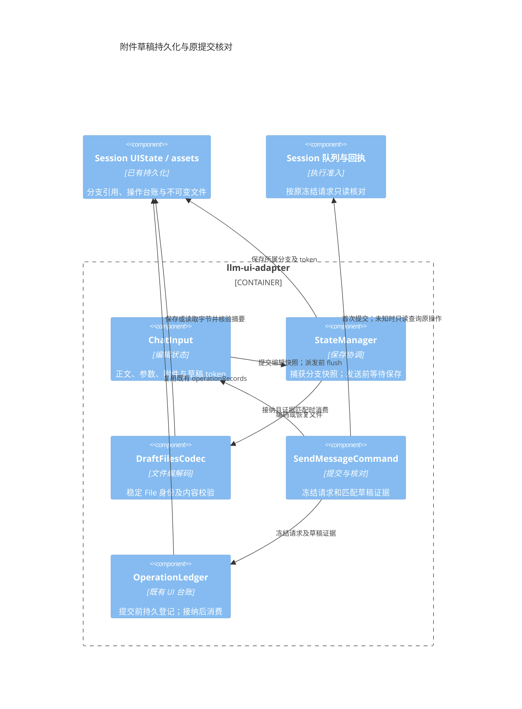
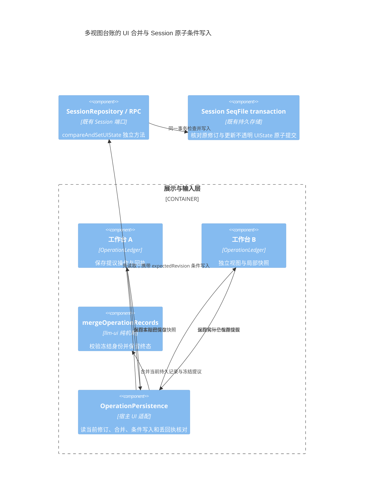

# Session 指令队列

本地 Chat / Agent Session 在执行时仍可发送后续指令。后端先持久接纳，当前轮历史提交完成、Session 打开且无运行任务、待交互任务或待清理副作用时自动发送下一条。页面只展示与编辑队列，释放页面观察不停止仍存活的宿主。HTTP 宿主可在关页后继续执行；纯浏览器本地运行在重开后恢复队列。远程原生 harness 保持现有发送协议，本次不在浏览器补建第二套队列。

## 模块与 C4

模型协议、付费请求、Task 恢复与停止仍由既有执行链负责。队列不解析厂商协议，不在前端调度，不为该功能修改 Kernel 内部调度器。

## 发送与编辑

- 队列属于 Session；指令捕获入队分支、用户选择的 Agent、覆盖参数、执行意图和附件元数据。历史头在实际执行时读取，不能在入队时固定旧历史。密钥与完整 Provider 配置不写入队列；实际执行重新校验配置与权限。
- `session.send` 始终返回稳定的指令 ID。空闲和繁忙使用同一接纳入口：先持久记录请求、摘要和回执，再领取并调用既有运行协调器。空闲首条在持久写入前只校验配置，不调用模型；持久化失败不启动付费执行。UI 读取权威队列确认接纳位置，不把未执行指令伪装为历史轮次；仅有当前 dispatching 指令时隐藏队列面板。
- `session.instructions.get` 是只读命令。`session.instructions.edit` 接受 `expectedRevision` 和 `remove / reorder / merge / pause / resume / retry`。旧版本或已被领取的指令返回冲突，不覆盖服务器状态。
- `reorder.ids` 必须恰好包含全部 pending 指令。`merge.ids` 必须是相邻 pending 指令，且分支、Agent、执行意图与覆盖参数相同；按当前队列顺序用空行连接正文，合并附件，保留首条身份。
- 已领取指令不允许删除、排序或合并。面板的暂停只停止续发；停止当前执行会先暂停后续队列，再调用既有取消链。执行失败或停止后队列暂停，用户处理后显式继续。
- 单条至多 1 MiB，队列至多 100 条、4 MiB；保存最近 256 个接纳身份与内容摘要。同身份同内容返回原接纳结果，同身份异内容拒绝；删除、合并和完成后的近期重试不会重新添加已处理指令。
- 有界回执之外不承诺无限期去重。UI 对失败提交保留原身份与已上传附件引用，重试不重新分配身份；队列不会自动重试付费调用。
- 新 Round 保存原始请求摘要，近期回执被淘汰后仍可核对保留下来的历史。历史中已有相同身份但没有可信摘要时拒绝自动接纳，要求检查历史；不能仅凭 ID 把不同正文当作成功。摘要在宿主补充分支模式、默认连接和附件存储名之前计算，合并后保留各原始接纳回执。

## 并发、恢复与诊断

ApplicationRuntime 为所有 Session 视图注入同一个 `SessionExecutionActivity`，由它持有唯一 `SessionInstructionRuntime`。视图只登记执行上下文端口和观察者，不各自创建队列、发送串行表或权威投影。统一串行入口覆盖所有视图的接纳、编辑、领取和收尾；运行占用从异步准入前保持到历史收尾后。队列收尾必须确认原指令 ID，不能用“当前队首”代替。持久领取继续依靠 CAS，跨宿主写入沿用 Session 单写者租约。退出先关闭共享入口并排空持久写入，再释放视图和 Kernel。

附件使用稳定的提交身份及序号生成存储名，显示名称保留原文件名，后续同名上传不能覆盖排队内容。RPC 对同一观察回调按调用顺序完成编码和传送，防止较大的队列快照被后来的流式事件超越；普通查询及独立回调继续并行。

队列保存在 Session 的 `conversation/instructions` shared record；版本来自 Kernel 的 shared version。`/var/lib/kernel/instruction-queues.seq` 索引未排空的 Session，先写索引再写队列，持久排空后再删除索引；删除索引失败只记录安全诊断，残留索引只会多一次冷读取。这样统一接纳不会使后续启动扫描所有历史会话。恢复用例位于 app-core/session，runtime 只负责调用与生命周期接线。启动先冷读队列，跳过已排空的记录，只为仍有指令的 Session 打开宿主上下文并释放观察租约，执行上下文仍由 Runtime 持有。处于待发送或正在接纳状态的上下文不会被闲置清理回收；队列排空或暂停且执行空闲后可释放。

恢复时 pending 指令可自动继续。dispatching 指令若已有完成的 Round，则确认并继续；若任务仍在执行或清理，则等待；若没有可信的持久收尾，则保留为 uncertain 并暂停，不重发原请求。自动续发前还检查上一轮历史是否完整，缺少结果时保留失败原因并等待处理，避免用不完整上下文继续执行。

关键日志包含 `operation=session.instructions`、阶段、结果、错误分类、Session/指令身份、队列版本、数量和耗时，不记录正文、完整参数、附件内容或凭据。前端保留错误原因，发生版本冲突后读取最新队列，不自动重放编辑命令。

验证覆盖 `llm-session/__tests__/instruction-queue.test.ts`、`app-core/tests/instruction-queue.test.ts`、`app-shell/tests/instruction-queue-panel.test.ts` 与输入就绪测试：持久 CAS、跨视图串行、关闭页面后续发、前一轮历史、删除/排序/合并、去重、失败及未知结果、界面转义和迟到响应。

### 原生队列宿主入口

原生 Harness 队列由 mindos-node-driver 持有，宿主通过 enqueue/editInstructionQueue 及修订 CAS 接入，不转换成已执行聊天消息。项目宿主复用同一 ConversationRegistry 控制器，视图关闭后保留可派发工作和未知控制/查询回执，暂停队列可按持久记录重新打开。@new 转正不得清除后续草稿、队列、回答或未完成控制。RPC 显式开放队列方法；原发送响应悬挂时仍可接纳与编辑，队首派发期间仍消费原生观察。UI 草稿消费依赖持久接纳，由独立台账适配功能接入。

### 默认远程工作台的接纳等待

默认工作台直接用 ConversationControls 适配独立 InstructionQueueView，队列编辑不经过伪造的本地命令总线。持久队列接纳通知可以先于 enqueue RPC 回复结束当前输入等待，原 RPC 的迟到成功/失败只结束原调用。文字与附件仍按冻结修订消费，不覆盖等待期间的新草稿；视图销毁解除订阅和等待，不自动取消原生操作。独立 ChatView 通过 OperationLedger 接入属于后续单独迁移。

### 独立 ChatView 的原生台账

原生适配器把队列 acceptedIds/submissions 和原提交回执投影到同一 OperationLedger，持久接纳可释放尚未返回的旧发送。UI 仅在 canQueue 为真时调用 enqueue，首轮和未声明排队的端点继续 send；两者都传递稳定 operationId。队列本身不生成历史气泡，真实 turn 到达后按同 conversation、提交身份及 turn 关联，action 命令不占用用户提问。新草稿与旧传输结果分别处理，迟到成功或失败均不消费下一条输入。

### 独立原生视图的队列编辑区

createNativeChatView 经工具栏挂载同一 NativeInstructionQueuePanel，绑定 read/edit 最小端口；队列编辑携带显示修订，原发送悬挂不阻塞。工具栏保留宿主挂载、更新和销毁回调，视图隐藏后禁用队列操作，恢复时重新应用 canQueue，重复销毁共享同一 Promise。队列编辑不生成 Submission 或用户历史，迟到结果按原视图代次处理。

## 本地工作台的附件草稿恢复

输入编辑状态归 UI；Session 只保存不透明的分支草稿引用和 OperationLedger，不解释浏览器 File 或维护第二份执行状态。附件二进制复用已有 Session assets；项目首次草稿与原生兼容草稿复用宿主附件端口。DraftFilesCodec 统一处理这三条路径的引用、摘要校验及逻辑 File 身份，不增加存储服务。

持久引用包含逻辑文件 ID、内容 SHA-256、大小、类型、名称和修改时间；图片额外保存原图及处理参数。重开后重新构造的 File 保留逻辑 ID，Flow 上传先查询原上传回执。文件缺失、字节损坏或元数据无效须报具体错误，不能恢复为空附件或静默换一份内容。新日志仅记录操作、阶段、身份、字节量、错误分类及耗时，不记录文件名、正文或原始异常内容。

每份编辑意图具有持久 token；文字、目标、有效参数、可编辑设置或附件变化时更换。重新确认相同参数不算新意图；持久设置的更新时间与执行锁不算用户编辑。发送前等待当前分支草稿及文件保存成功，期间发生编辑则取消此次派发。失败保留输入，不能先执行后补存。

台账保存原 Submission 与草稿证据：token、原编辑正文、可编辑设置和有序文件摘要。恢复查询使用原请求，不重新上传或 Submit。接纳只清除 Session、分支、目标、参数、token 和文件证据仍匹配的草稿；异步核验后再次检查当前视图和文件引用。旧接纳不得清除同名同大小的新文件或后来的编辑。已接纳但清空写入失败时，重开根据同一台账再次消费匹配草稿。旧格式没有充分证据时保留输入供用户核对。

本机制保证发送前已确认保存的草稿恢复；普通输入仍沿用延迟保存，尚未确认写入的最后编辑不在此保证内。UI 台账现通过已有 Session 修订条件合并保存，多视图同分支草稿的写入冲突仍需处理，不能把操作记录并集合并视为正文编辑合并。资产长期回收、原生上下文续接、独立子 Session 路由与函数调用视图按各自计划推进。

## 多视图操作台账的条件合并

多个视图不能各自覆盖整组 operationRecords。独立 llm-ui 的 `mergeOperationRecords` 提供纯合并规则：不同操作保留并集；相同操作的冻结 context、来源会话、输入及草稿必须一致；终态不可被 submitting/unknown 覆盖；矛盾终态或已确认消息身份冲突须报错。register/settle 在进入异步保存队列前复制实参。宿主持久化 save 可以返回实际保存的合并快照；库核对提议操作确实存在后发布，不再发布旧的本地提议。注册时发现已接纳、拒绝或未知的原操作，不再次派发 Chat/Flow 动作。

条件使用 Session 已有的存储 revision，不增加执行版本或状态库。后端仅检查修订，不识别 OperationRecord 的状态和业务字段；UI 也不因此取得 Kernel 执行权威。条件写入使用独立方法，旧宿主缺少该能力时明确拒绝，不能把额外条件参数交给旧 updateUIState 后假定它已生效。普通布局写入仍使用既有 patch；每个写入与修订检查在同一事务完成，冲突不写入也不发布成功通知。

修订冲突后只重读并重新计算 UI 台账合并，最多八次；不重新发送业务指令。写入回复丢失时，只读核对持久记录是否包含原冻结提议；确认成功可以返回实际快照，无法确认则保留错误及本地输入。日志只含操作身份、阶段、尝试次数、耗时和稳定错误分类。类型、真实两个工作台、认证 HTTP 条件写入及回执悬挂回归分别验收。

台账合并与同分支正文编辑是两个问题：多个视图编辑同一分支时，草稿写入及旧接纳触发的清空仍需核对持久草稿基线，冲突时保留本地输入，不能用台账并集拼接正文。该项继续列为 F09d 待完成；子 Session 路由与调用组也保持原安排。
