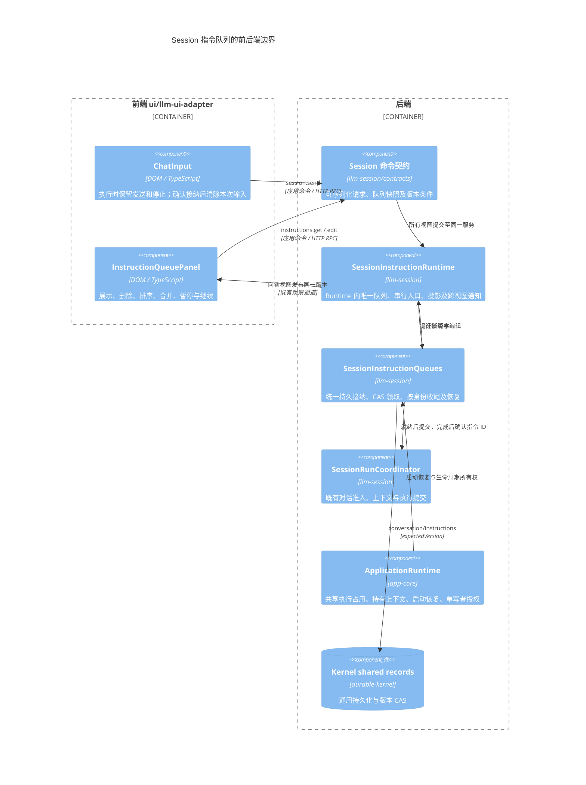
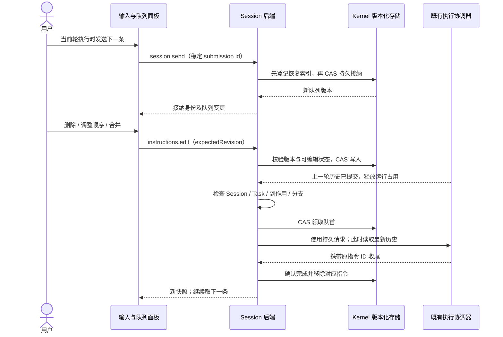

# Session 指令队列

本地 Chat / Agent Session 在执行时仍可发送后续指令。后端先持久接纳，当前轮历史提交完成、Session 打开且无运行任务、待交互任务或待清理副作用时自动发送下一条。页面只展示与编辑队列，释放页面观察不停止仍存活的宿主。HTTP 宿主可在关页后继续执行；纯浏览器本地运行在重开后恢复队列。远程原生 harness 保持现有发送协议，本次不在浏览器补建第二套队列。

## 模块与 C4

模型协议、付费请求、Task 恢复与停止仍由既有执行链负责。队列不解析厂商协议，不在前端调度，不为该功能修改 Kernel 内部调度器。

## 发送与编辑

- 队列属于 Session；指令捕获入队分支、用户选择的 Agent、覆盖参数、执行意图和附件元数据。历史头在实际执行时读取，不能在入队时固定旧历史。密钥与完整 Provider 配置不写入队列；实际执行重新校验配置与权限。
- `session.send` 始终返回稳定的指令 ID。空闲和繁忙使用同一接纳入口：先持久记录请求、摘要和回执，再领取并调用既有运行协调器。空闲首条在持久写入前只校验配置，不调用模型；持久化失败不启动付费执行。UI 读取权威队列确认接纳位置，不把未执行指令伪装为历史轮次；仅有当前 dispatching 指令时隐藏队列面板。
- `session.instructions.get` 是只读命令。`session.instructions.edit` 接受 `expectedRevision` 和 `remove / reorder / merge / pause / resume / retry`。旧版本或已被领取的指令返回冲突，不覆盖服务器状态。
- `reorder.ids` 必须恰好包含全部 pending 指令。`merge.ids` 必须是相邻 pending 指令，且分支、Agent、执行意图与覆盖参数相同；按当前队列顺序用空行连接正文，合并附件，保留首条身份。
- 已领取指令不允许删除、排序或合并。面板的暂停只停止续发；停止当前执行会先暂停后续队列，再调用既有取消链。执行失败或停止后队列暂停，用户处理后显式继续。
- 单条至多 1 MiB，队列至多 100 条、4 MiB；保存最近 256 个接纳身份与内容摘要。同身份同内容返回原接纳结果，同身份异内容拒绝；删除、合并和完成后的近期重试不会重新添加已处理指令。
- 有界回执之外不承诺无限期去重。UI 对失败提交保留原身份与已上传附件引用，重试不重新分配身份；队列不会自动重试付费调用。
- 新 Round 保存原始请求摘要，近期回执被淘汰后仍可核对保留下来的历史。历史中已有相同身份但没有可信摘要时拒绝自动接纳，要求检查历史；不能仅凭 ID 把不同正文当作成功。摘要在宿主补充分支模式、默认连接和附件存储名之前计算，合并后保留各原始接纳回执。

## 并发、恢复与诊断

ApplicationRuntime 为所有 Session 视图注入同一个 `SessionExecutionActivity`，由它持有唯一 `SessionInstructionRuntime`。视图只登记执行上下文端口和观察者，不各自创建队列、发送串行表或权威投影。统一串行入口覆盖所有视图的接纳、编辑、领取和收尾；运行占用从异步准入前保持到历史收尾后。队列收尾必须确认原指令 ID，不能用“当前队首”代替。持久领取继续依靠 CAS，跨宿主写入沿用 Session 单写者租约。退出先关闭共享入口并排空持久写入，再释放视图和 Kernel。

附件使用稳定的提交身份及序号生成存储名，显示名称保留原文件名，后续同名上传不能覆盖排队内容。RPC 对同一观察回调按调用顺序完成编码和传送，防止较大的队列快照被后来的流式事件超越；普通查询及独立回调继续并行。

队列保存在 Session 的 `conversation/instructions` shared record；版本来自 Kernel 的 shared version。`/var/lib/kernel/instruction-queues.seq` 索引未排空的 Session，先写索引再写队列，持久排空后再删除索引；删除索引失败只记录安全诊断，残留索引只会多一次冷读取。这样统一接纳不会使后续启动扫描所有历史会话。恢复用例位于 app-core/session，runtime 只负责调用与生命周期接线。启动先冷读队列，跳过已排空的记录，只为仍有指令的 Session 打开宿主上下文并释放观察租约，执行上下文仍由 Runtime 持有。处于待发送或正在接纳状态的上下文不会被闲置清理回收；队列排空或暂停且执行空闲后可释放。

恢复时 pending 指令可自动继续。dispatching 指令若已有完成的 Round，则确认并继续；若任务仍在执行或清理，则等待；若没有可信的持久收尾，则保留为 uncertain 并暂停，不重发原请求。自动续发前还检查上一轮历史是否完整，缺少结果时保留失败原因并等待处理，避免用不完整上下文继续执行。

关键日志包含 `operation=session.instructions`、阶段、结果、错误分类、Session/指令身份、队列版本、数量和耗时，不记录正文、完整参数、附件内容或凭据。前端保留错误原因，发生版本冲突后读取最新队列，不自动重放编辑命令。

验证覆盖 `llm-session/__tests__/instruction-queue.test.ts`、`app-core/tests/instruction-queue.test.ts`、`app-shell/tests/instruction-queue-panel.test.ts` 与输入就绪测试：持久 CAS、跨视图串行、关闭页面后续发、前一轮历史、删除/排序/合并、去重、失败及未知结果、界面转义和迟到响应。
