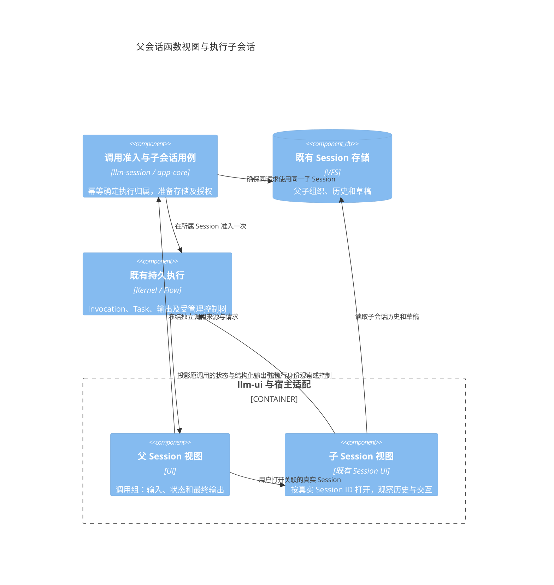

# 子会话与函数调用视图

更新：2026-10-25。状态：目标决策已记录；下文区分现有基础和待实施能力，不把设计当成验收结果。

## 1. 身份与归属

subsession 是具有父级关联的 Session，继续复用 Session 的历史、草稿、队列、交互、资产和存储机制。`subsessionId` 在界面中表示子 Session 的 `sessionId`，不增加 Subsession 类、第二份会话存储或执行器。

| 身份或关联 | 含义 | 不承担的职责 |
| --- | --- | --- |
| sessionId | 持续的工作与状态容器 | 不等于一次运行或一个原生 thread |
| parentSessionId | 父子工作容器的组织关系 | 不自动授予控制、上下文继承或取消传播 |
| invocationId | 一次业务调用，保存目标、输入及执行关联 | 不代替 Session 历史和草稿 |
| parentInvocationId | 调用者与被调用者的执行关联 | 不能由 parentSessionId 猜测 |
| taskId | Kernel 执行任务及其实际状态 | 不作为子会话或跨轮 binding 的身份 |
| bindingId | 可持续的原生上下文关联 | 不因同属父 Session 就可以共享 |

一个父 Session 可以关联多个子 Session。一个子 Session 可以保存多个 Invocation；普通 DAG 节点、工具调用和内部重试继续属于 Task/调用树，不逐节点创建 Session。只有需要独立历史、上下文、输入或可打开工作区的任务，才拥有自己的子 Session。

| 用户动作 | Session 选择 | Invocation 选择 |
| --- | --- | --- |
| 在父会话中发起一个独立任务或 Flow 函数调用 | 默认创建新子 Session | 新建 |
| 再独立运行同一个 Flow | 再创建不同的子 Session | 新建；不能按 flowId 复用上次身份 |
| 打开既有子会话并发送下一轮 | 继续该子 Session | 新建；按显式上下文规则选择 binding |
| 在既有子会话中重新运行已终结调用 | 可保留该工作容器；“独立新运行”则另建子 Session | 新建并关联 retryOfInvocationId，旧终态保留 |
| 丢回复、重连或宿主恢复 | 保持原目标 Session | 查询原提交与调用，不新增执行 |
| 尚未终结调用内部的执行重试 | 保持原 Session | 由 Task/Effect 管理尝试，不创建新子会话 |

“独立运行”和“在当前会话继续”是明确的入口语义。普通聊天发送仍进入当前 Session；不能因为当前目标是 Flow，就把所有后续输入悄悄改到另一个会话。

## 2. 接纳、队列与结果

独立调用由宿主先解析执行所属 Session。子 Session 创建意图以父 Session 与稳定请求身份幂等保存；同一操作丢回复或重启后返回同一子 Session，不按每次页面操作重新分配 ID。执行前仍完成子 Session 存储准备和写租约检查。

实际执行只经过所属 Session 的一次队列或调用准入。父 Session 保存调用关联和输出引用，不再入队执行同一份指令。若父 Flow 需要等待、串行或取消子调用，沿 Invocation 依赖与受管理关系处理，不能靠重复父子队列实现。

台账必须在派发前冻结调用来源、执行所属 Session、原目标和实参；只读回执查询使用原目标 Session。不能从当前打开的标签、当前分支或最新 Flow 目录重新推导恢复请求。原始接纳摘要、用户重新运行的身份和子会话创建身份分别保留。

父子组织关系不代表复制整个父历史。上下文通过选定材料或明确的 binding 策略提供；工作区和项目记忆的隔离另行决定。父调用取消只作用于其受管理的执行子树，不清空整个子 Session 的历史，也不取消该子会话里后来独立发起的调用。

## 3. 默认显示与会话详情

Flow 和独立任务在父级默认显示为函数调用组，以 `invocationId` 为稳定锚点。同一个 Flow 的不同运行不能合并为一个卡片。

| 层级 | 本阶段基础界面 | 后续增强 |
| --- | --- | --- |
| 调用组外层 | 目标名称、输入摘要、状态、最终输出、产物和可用控制 | 展示布局与比较能力 |
| 必须处理的情况 | 审批、补参、失败及清理状态在外层可见 | 更丰富的诊断导航 |
| 关联的子 Session | 提供真实 sessionId 的“打开会话”入口，复用现有 Session UI | 同卡片内嵌消息、时间线、搜索 |
| 节点和子调用 | 保留执行引用，可按需打开现有详情 | 完整树、循环/尝试对比及大历史分页 |

“仅显示输入和最终输出”是默认折叠策略，不删除过程事实，也不隐藏尚需用户处理的交互。未支持详情端口时明确显示该能力不可用，不能生成一个假的子会话入口。

执行结果保持结构化 `value/artifacts`；展示配置只决定主报告及附件的呈现。下游消费输出端口，不解析卡片或会话正文。展开详情的失败、关闭或分页不改变原调用结果；关闭观察也不取消执行。大内容通过引用读取，展开后才加载重型 renderer。

## 4. C4 关系与事件流

父级接纳与子级创建分阶段记录；任何阶段丢回复，都核对原事实，不重新发起一个同内容的新调用。结果更新沿原 Invocation 锚点合并；从子会话返回父会话不复制消息或生成第二份执行结果。

## 5. 现有基础、任务及验收

现有 [Session 持久契约](../../backend/llm-session/src/persistence/types.ts) 已保存 parentSessionId；[ContentTransferService](../../backend/llm-session/src/session/content-transfers.ts) 已提供按父 Session/requestId 保存创建意图、幂等确保子会话及准备执行存储的路径。[FlowInvocationService](../../backend/llm-session/src/session/flow-invocations.ts) 已支持显式目标 Session 的调用与恢复。这些基础不证明所有独立 Agent/Task/Flow 入口已统一到子会话。

任务安排见[功能合入计划第 7 节](functional-merge-plan.md#7-子会话与函数视图的交付安排)：先冻结关联及所属 Session，再打通独立调用和最小函数视图；高级内嵌会话详情后续增强。`630455b4` 已合入当前 Session 的平级目标入口与台账基础；它不代表独立子 Session 路由和函数调用组已经完成。

验收至少覆盖：同 Flow 两次独立运行得到不同子 Session/Invocation；同一创建/提交丢回复或重启仍复用原身份；重开另一分支后查询原回执不重解释上下文；父级只保留一次调用投影；打开子会话不重跑；父取消只覆盖受管理调用；审批不能被折叠；详情失败不改变已完成结果。
