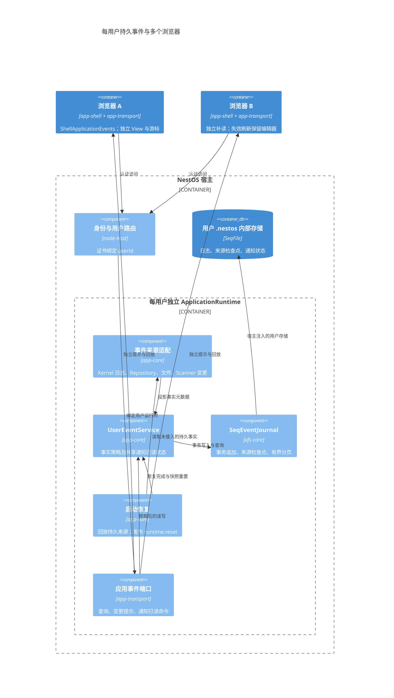

# 每用户事件日志与多浏览器消费

当前实现将内存通知与持久事件日志组合：vfs-core 提供独立 `SeqEventJournal<T>`，app-core 为每个 ApplicationRuntime 装配 UserEventService，app-transport 暴露授权后的查询、订阅提示与用户通知状态。mdxeditor 不依赖此机制。

## 作用域与存储

HTTP 用户身份来自证书映射；UserApplications 为每个用户建立独立运行时。多个浏览器认证为相同 userId 时共享业务状态、日志及通知已读状态，各自拥有 View 和消费游标。channel、客户端 ID 和游标均不代替身份授权。

逻辑存储路径为 `/var/lib/events/events.seq`。多用户 Node 宿主将它绑定到该用户 `.nestos/state` 内部存储，记录由 `.nestos/meta` 的 SeqFile 后端管理；不要求物理存在 `<home>/.nestos/events.seq` 文本文件。普通文档视图不能读取 `.nestos`。浏览器不能指定其他用户路径或直接发布事件。

日志保留最近 1000 条，每条 JSON 最多 16384 个 UTF-16 code units；分页每次最多 200 条。默认值用于限制平台元数据，不是模型输出限制。条目只包含事实类型、资源 ID、来源序号、可选 operationId 和通知级别，不复制消息正文、工具结果、参数或凭据。通知已读集合限制在保留事件内，更新时清理过期 ID。

## 一致性与恢复保证

- `SeqEventJournal.transaction()` 将事件、应用状态或来源检查点放在同一 SeqFile 后端事务中。失败回滚，不发送提交提示；提示订阅者失败不会撤销已提交事实。现有同步 EventBus.emit 不改变语义。
- Kernel 适配器只用 inspectSession/readEvents 读取原日志，不打开执行、不重发指令。来源 sessionId 与来源 sequence 组成稳定事件 ID，接入事件与来源检查点原子提交。仅投影 Session 创建/关闭/归档及 Task 终结类型。content 变更不触发实时扫描，避免每个流式 delta 都读取日志。
- 启动时登记来源观察、遍历当前 Kernel Session、补齐来源日志，再提交 runtime.reset。多用户宿主在开放监听前初始化各用户。结构变更触发增量接入，失败保留待处理来源并每 5 秒重试；失败日志只记录操作、阶段、分类、operationId 和耗时。
- Kernel 来源日志已裁剪时记录 source.reset 并推进到当前快照水位；这明确表示应重取资源状态，不声称找回已删除的历史。
- 文件、Repository、Scanner 当前通过提交后的变更通知接入。它们不是业务事务内的 outbox：进程在业务提交与事件追加之间退出时，不能承诺逐条历史不丢。每次启动的 runtime.reset 要求消费者重新读取当前状态，恢复最终状态。需要完整历史的业务应使用 journal.transaction 同事务写入，或提供自己的持久来源及墓碑；禁止通过重放事件重做业务副作用。
- 文件来源当前接入笔记文件视图；Scanner 发布 scanner.changed 失效事实，不假定每个 onChange 都是扫描完成。其他授权文件空间或外部 Tool 可通过宿主来源适配扩展，不在 vfs-core 按业务名分支。

## 客户端契约

`ApplicationBackend.events` 为可选能力：

| API | 语义 |
|---|---|
| eventBaseline() | 当前持久 streamId 与 sequence |
| readEvents(after?, limit?) | 有界回放；省略 after 从当前保留范围开头读取 |
| onChange(listener) | 提交后的唤醒提示，包括通知状态变化；不携带接收确认 |
| listNotifications(limit?) | 当前保留通知及本用户共享已读状态 |
| setNotificationRead(eventId, read) | 显式修改用户级已读状态 |

`ApplicationEventFeed` 是每浏览器/页面独立的纯传输消费者。调用者先读 baseline，再读取资源快照，最后用 baseline 启动 feed；feed 先订阅提示再补读，串行调用 receive，成功后推进自己的游标。提示丢失或重连后可调用 refresh 主动补读。onChange 不等于事件正文，也不会自动标记通知已读。

游标包含持久 streamId，跨用户、存储更换或保留范围之外的游标返回 ECONFLICT。feed 捕获该读错误，先取新 baseline，再调用 reset 重读快照，随后从 baseline 继续回放；收到 runtime.reset/source.reset 也会调用 reset。调用者负责避免 receive 重复执行 reset。关闭 feed 不影响其他浏览器，也不发送后台任务取消命令。

app-shell 通过 `ShellApplicationEvents` 在工作区加载前捕获 baseline，首屏就绪后开始消费；预加载快照及 baseline 获取失败的恢复路径先使快照失效。事件按工作区归属转成 `invalidateFromEvents`，保留原编辑器、路由与未提交输入；装配期间的事件通过 generation 检查补一次失效标记。在线、焦点、可见性恢复及可见窗口每 15 秒主动补读，补偿丢失的唤醒提示。隐藏工作区只保留 dirty，恢复可见时补读原目录及导航；视图读取失败按 1 至 15 秒退避重试。恢复替换 View 或销毁应用时关闭 feed，不取消后台任务。测试见 [application-events.test.ts](../../ui/app-shell/tests/application-events.test.ts)、[bootstrap-navigation-cleanup.test.ts](../../ui/app-shell/tests/bootstrap-navigation-cleanup.test.ts) 与 [current-resource.test.ts](../../ui/app-shell/tests/current-resource.test.ts)。

当前不新增通知中心 UI、设备推送或浏览器游标存储；现有 View/SSE 观察继续负责流式输出与领域专用状态。调用者可以注入游标存储，但不能把设备接收游标与用户已读状态混用。多浏览器同文档的并发编辑仍使用文件版本/冲突机制，事件日志不替代编辑冲突处理。

## 验证

- vfs-core [event-journal.test.ts](../../libraries/vfs-core/tests/event-journal.test.ts)：事务回滚、业务记录/检查点原子提交、幂等、独立分页、裁剪与外来游标拒绝。
- http-app [user-events.test.ts](../../apps/http-app/tests/user-events.test.ts)：双消费者、通知状态共享、Kernel 来源恢复及日志裁剪、真实 RPC 能力边界。
- http-app [user-events-restart.test.ts](../../apps/http-app/tests/user-events-restart.test.ts)：两个证书用户、同用户两个 HTTP/SSE 客户端、跨用户拒读、实际宿主关闭重启与 SQLite 存储重开。
