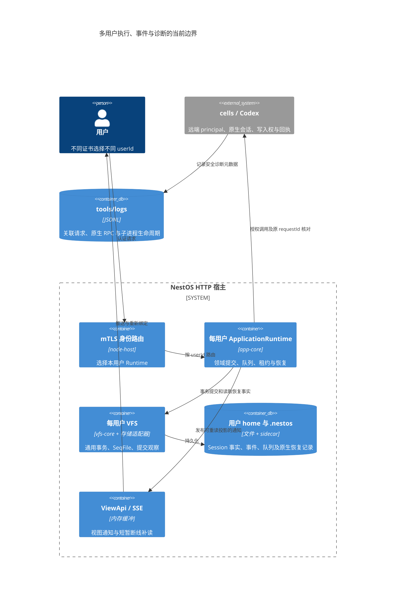

# 核心事件流

独立 llm-ui 的 Chat/Flow 通过宿主 source 发布事实、actions 提交意图，操作结果进入宿主持有的 OperationLedger；视图关闭只释放 UI。以下原产品的 Session/Kernel 接线与编辑器兼容实现位于 llm-ui-adapter。

> Kernel journal、持久 reducer 输入、onChanged 唤醒和诊断回调是不同通道；业务流式事件可嵌入 journal 的 `agent.event` payload。独立内核的顺序、补读及已知限制见[事件契约](../libraries/durable-kernel/docs/events.md)，对照其他 harness 的结论见[接口审查](./design/durable-kernel-interface-review.md)。

## 1. Kernel 持久化事件（EventEnvelope）

Task/Effect 的持久观察事件写进会话事件日志（seqfile），消费方按 `sequence > after` 补读（`session.events({ after })` / `TaskHandle.events({ after })`）。`onChanged` 只表示需要重新读取，不能代替持久事件消费。Task 状态及输入 / 收据是恢复依据，journal 不单独构成完整的可重建执行状态。

| 事件 | 触发 |
|---|---|
| `session.created` | 会话创建 |
| `task.created` / `task.started` / `task.leased` | 任务提交/启动/领取 |
| `task.signal` / `task.spawned` | capabilities 等信号 / patch-graph 子任务 |
| `task.failed` / `task.attempt.lost` | 任务失败 / worker 丢失重试 |
| `effect.leased` / `effect.succeeded` / `effect.failed` / `effect.indeterminate` | Effect 领取及执行结果，v2 信封含 effectId / attemptId |
| `effect.resolved` / `effect.retry.scheduled` / `effect.interrupt.requested` / `effect.cleanup.confirmed` | 人工裁决、重试登记及物理清理确认 |
| `budget.configured` / `budget.consumed` | 预算设置/扣减 |
| `session.shared.set` / `session.shared.deleted` | 会话内共享状态（task 间） |
| `session.context.committed` | context commit（分支） |
| `session.message.queued` / `session.message.received` / `session.message.rejected` | 跨会话同步（outbox/inbox 消息队列） |
| `workspace.snapshot.created` / `workspace.diff.created` | 工作区快照/diff |
| `task.interaction.requested` / `task.interaction.resolved` | HITL 交互请求/解决 |
| `agent.event` | 业务层流式事件透传（见下） |

```
Kernel store.appendEvent → 事件日志 → kernel.eventList(sessionId, after) / TaskHandle.events(after) 轮询
                                        → cli RunStore.appendEvent（events.jsonl）
                                        → llm-ui 流式渲染
```

Task watch 默认在逻辑终态及 Effect 清理均完成（settled）后排空结束；until: exit 只观察逻辑终态。Session watch 在 closed 后排空；AbortSignal 取消观察不取消执行，dispose 结束事件流。新 readEvents / watch 发现裁剪游标过期时抛 CURSOR_EXPIRED，使用 snapshot.asOfSequence 重建后补读；详见独立事件契约。

应用事件投影按会话保存 Kernel 检查点。启动补读遇到裁剪过期、非法检查点，或核对快照确认检查点超过源日志末尾时，以 `snapshot.asOfSequence` 建立新基线；`source.reset` 与检查点更新在同一事务中提交，并比较旧检查点以避免覆盖并发进度。这只重建展示投影，不重发指令或推断执行结果；其他 `INVALID_SPEC`、存储损坏和读取错误仍向上传播。`events.source.recover` 记录会话、原因、合法序号、结果及耗时，不记录原始异常检查点内容。回归见 `backend/app-core/tests/kernel-event-recovery.test.ts`。

## 2. 业务流式事件（agent.event payload）

LLM 流式与程序进度经 `agent.event` 透传（`KernelAction.emit` 或 effect `context.emit`）。

| 事件 | 来源 | 用途 |
|---|---|---|
| `stream:content` / `stream:thinking` | `LlmChatEffectAdapter`（SSE chunk） | 流式正文/思考渲染 |
| `round:start` / `round:end` | `DurableAgentProgram` | 轮次边界 |
| `tool:running` / `tool:success` / `tool:error` | `DurableAgentProgram` | 工具生命周期（开始、结果、失败） |
| `tool:progress` | `ToolCallEffectAdapter`（工具进度回调） | 有界活动/匹配快照，携带真实 callId，最终结果到达后停止展示 |
| `finished` | `DurableAgentProgram`（含 usage） | 任务完成、token 统计 |
| `citations` | `LlmChatEffectAdapter`（终态 chunk） | 联网搜索引用（一次性，投影为 `message:citations`） |

```
LlmChatEffectAdapter.execute（流式逐块）
  → context.emit({ type:'agent.event', payload: { type:'stream:content', delta } })
    → store.appendEvent(sessionId, taskId)
      → TaskHandle.events() → UI / CLI
```

## 3. Interaction（HITL）链路

```
DurableAgentProgram.request-interaction（approval/human）
  → task.interaction.requested（事件 + interaction 入列）
  → 外部（UI/CLI）respondInteraction(interactionId, value)
  → task.interaction.resolved → 程序收到 interaction-resolved
  → interactionApproved(value) 判定 → 放行工具或拒绝重试
```

## 4. Session 事件（llm-session → UI）

`SessionEventBus` 把 durable 运行投影为会话事件供 `llm-ui` 消费：

| 事件 | UI 操作 |
|---|---|
| `message:appended` | 创建会话分组、渲染消息 |
| `message:updated` | 流式追加文字、更新 thought |
| `message:status` | 完成/失败/工具结果 |
| `node:appended` → `tool:running` | 先挂载工具卡片（名称、真实参数），再立即更新运行状态 |
| `tool:success` / `tool:error` | 更新工具卡片的结果/错误，保留多行文本与转义 |
| `finished` | token 统计、停止 loading |
| `message:citations` | 渲染联网搜索引用块 |
| `branch:switched` / 再生事件 | 分支切换/再生 |

```
ConversationRunCoordinator → RoundLog 投影 → SessionEventBus.emitSession()
  → llm-ui SessionEventHandler → HistoryView / StreamController
```

`SessionViewPort.onEvent` 的观察者可以在绑定前登记，独立取消且随当前绑定重新挂接；新增观察者不替换已有观察者。解绑只释放该绑定持有的转发，不清除同一 Session 通道上其他所有者的监听。HTTP 的 ViewObservation 在首屏打开前登记源，因此这一契约同样覆盖首次草稿转正后的回复。回归见 [观察生命周期](../backend/llm-session/__tests__/session-observation.test.ts) 与 [真实 Kernel 经 RPC 到页面](../ui/app-shell/tests/draft-promotion.test.ts)。

Kernel 的 `seq:committed` 存储观察将仅修改当前 Session 的 `events.seq` 的提交分类为 `content`，继续唤醒事件观察者；包含 Task、Session 等其他记录的提交保留 `structure`。这样持久流式事件不会被再次提升为结构变化并触发侧栏整树刷新，任务创建和终态仍更新导航。内核回归见 [protocol.test.ts](../libraries/durable-kernel/src/protocol.test.ts)，实际流式页面回归见 draft-promotion。

> 联网搜索的 citations 事件链与三态决策详见 [web-search.md](./web-search.md)。

Harness 工具事件无需等待 effect 完成：`tool:running` 随发起 effect 的 decision 持久化，`ConversationRunCoordinator` 先发 `node:appended` 再透传生命周期事件，`HistoryView` 对二者立即处理。工具结果区按预格式文本展示；刷新后的失败卡片读取持久化 `data.error`。Grep 目前通过授权 VFS 遍历并执行 JavaScript 正则，没有实际 shell 命令可展示；Bash 的真实命令在调用参数中。Grep 通过 `ToolInvokeRequest.onProgress` → effect `context.emit` → `agent.event/tool:progress` → `HistoryView` 显示 cwd、搜索路径、扫描数、跳过数和匹配预览。快照按约 250ms 限频，首个匹配及时发送；消息最多 2048 字符，预览最多 8192 字符，不作为 LLM 的最终工具结果。终态覆盖预览，迟到进度不改写终态。通用 `getActivityDescription` 已由 ToolDeviceDriver 接入，并通过工具进度端口发出活动描述。回归：`backend/app-core/tests/harness-default-tools.test.ts` 阻塞搜索完成并确认开始事件已到达；`ui/app-shell/tests/tool-history-live.test.ts` 验证执行中卡片及成功/失败结果。

## 5. 跨会话同步（outbox/inbox）

```
source.send({ idempotencyKey, targetSessionId, targetTaskId?, topic, payload })
  → 幂等登记 outbox → session.message.queued
  → relay / 恢复重投 → 目标 inbox 去重 → session.message.received 或 session.message.rejected
  → 源端保存投递结算；双方补齐结算确认
  → 未指定 Task：宿主 inboxPage() 读取并 acknowledgeMessage()
  → 指定 Task：登记 pendingEvents，随 Decision 原子消费
  → 目标 consumedAt + message.consumed
```

消息可用于同 Session 或跨 Session 的 Task 通信，也可进入宿主邮箱。`delivered` 不表示已消费，消费不表示业务回复；跨 Session 没有全局事件顺序。inbox 的增量游标是接收方 deliverySequence，watch 的游标是 Session event sequence，均不能用发送时间替代。跨主机网络传输由宿主提供。

## 6. VFS 事件

```
FSEventBus（vfs-core/src/impl/event/event-bus.ts）：
  node:created / node:updated / node:deleted / node:renamed / node:moved / node:copied
    （payload 统一为数组：{nodes:[…]}；node:deleted 为 {requestedPaths, allDeletedPaths}）
  mount:added / mount:removed（payload {mountPath, mountId, label?}）
  → vfs-ui（EngineAdapter 订阅 driver 事件 → VFSUIShell 刷新树）
  → 后端配置服务重载 → app-core SkillsEngine（skill 变更同步）→ 工具箱导航快照/事件
```

## 7. 消费方一览

`LLMDeviceDriver` 在 `/etc` 文件视图上监听创建、更新、删除、移动和重命名，仅当受影响路径为 `/llm`、其子路径或整个配置根时，防抖 300ms 重载连接、MCP 和 Skill。移动和重命名检查源、目标两侧；`/ui` 状态持久化等无关写入不触发重载。异步重载失败通过 `[LLM config] refresh failed` 报告，不成为未处理的 Promise 异常。

| 消费方 | 事件源 | 用途 |
|---|---|---|
| `cli`（RunStore） | `session.events(after)` | events.jsonl 落盘 + 运行渲染 |
| `llm-ui` | `TaskHandle.events()` / SessionEventBus | 流式聊天渲染、DagWorkbench |
| `app-shell` | VFS FSEventBus / kernel onChanged | 树刷新、skill 同步 |
| kernel 内部 | 持久 Task / pendingEvents / wait / lease / 收据 | drain 推进、recover 恢复；journal 用于观察 |

## 执行取消的错误事件标记

SessionRunCoordinator 在取消终态的 `error` 事件中保留 `code: ABORTED`。HistoryView 与 SessionEventHandler 据此呈现取消状态、取消提示及重新执行入口；缺失该码、TIMEOUT 或仅包含 aborted 文本的普通错误仍按失败显示。状态指示器的取消状态停止 loading，历史 aborted 节点仍保留持久原因。该标记描述执行取消，不替代 Kernel 控制面的外部停止确认。


## 图重试恢复确认

控制端经 requestFlowGraphRetry 把 intent 追加到 Session shared；GraphRetryController 在恢复调度前消费。图状态与 appliedGraphRetries 回执写入同一 scheduler checkpoint 后才确认队列。恢复遇到已有回执时只确认，不重复下游失效、代数推进或 token 退款；checkpoint 写入失败保留 pending 意图。完整序列图见 [运行时架构审查](runtime-architecture.md#集中实施调度会话ui-与解码边界)。

UI 挂接恢复通过 EditorTaskControlPlane 获取状态和事件，每次异步返回后核验 Session、attachment revision 与关闭状态。编辑器销毁先阻止新挂接，再尝试保存、detach、解绑和视图释放；任一失败不会跳过后续清理，最终以 AggregateError 交给宿主。

### 聊天提交反馈

本地与远程共用 `HistoryView.setSubmission` → `SubmissionFeedback` 的临时用户卡片，展示提交中、已接受、失败或结果未知。卡片不写入会话历史，不将 HTTP 返回成功等同于模型开始运行。本地通过既有 `SendIntent.submission.id` 对齐 `round-<id>-user`；远程通过 `ConversationSnapshot.submittedTurnId` 对齐原生用户轮次。真实历史到达后仅按身份移除临时卡片，不按正文去重。直接 Tool 命令不创建聊天卡片。未知远程结果保留草稿并通过既有 reconcile 查询回执，不自动重复提交。原生 `HARNESS_SESSION_BUSY` 明确提示其他 Codex 实例持有写入权，不能通过删除锁或自动抢占恢复。

历史分页入口通过 `HistoryViewOptions.header` 放在历史滚动区顶部；点击才读取下一页，保留原卡片实例及阅读锚点。对话正文禁用“近期活跃”的时间推测，侧栏保留原有观察策略。

默认独立 ChatView 的原生队列失败消息在用户卡片上提供「重新提交」，与队列面板共用 `editInstructionQueue({action: 'retry', id, expectedRevision})`。只对明确 failed 显示；uncertain 必须核对原回执。保留 instructionId，后端持久分配新的 attemptId，原 requestId 的拒绝事实不变；不能另行 enqueue 同一消息。重试冲突只刷新快照，不自动重放。队列失败变化即使不改变临时消息正文修订，也更新卡片动作；成功领取后移除按钮，后来输入的草稿不参与重试消费。回归见 `ui/app-shell/tests/independent-native-composer.test.ts`。

### 多用户、持久事件与重启边界

HTTP 的 `usersDir` 配合 mTLS 证书登记启用多用户；每个 userId 独立 Runtime、VFS 侧车、Kernel 和队列，同一用户的窗口共享宿主执行。逻辑 `/home/admin` 映射当前用户的物理 home，不表示所有用户共用 admin 数据。共享 MCP 凭据在远端仍代表同一 principal，可能访问同一 Codex 原生会话；本地多用户隔离不能消除远端 active writer 冲突。配置及物理布局见 [HTTP 多用户](http-app.md#mtls-多用户与可迁移-home)。

| 事实或通知 | 当前归属与持久性 | 重启处理 |
|---|---|---|
| Kernel Session/Task 事件 | Session 内 `kernel/events.seq`，数据归本用户 sidecar | 结合 Task/Effect/receipt/lease 恢复；不能只重放事件重建执行 |
| 本地 Session 指令队列 | Kernel shared 与恢复索引 | Runtime 启动调用 recoverInstructionQueues，恢复仍遵守暂停和租约 |
| 远程原生指令队列、pending 请求与回执关联 | 本用户逻辑 `/etc/fs/harness-conversations.seq` | 启动扫描有待办的已有记录，重验绑定后重建后台观察；同一 turn 的确认终态随队列持久化，未知提交仍需精确回执核对 |
| 用户级精简事件与通知已读状态 | 本用户逻辑 `/var/lib/events/events.seq` | 启动打开原 stream，补读持久 Kernel 源并原子保存投影/checkpoint，追加 runtime.reset 提示快照重建 |
| 网页 SSE 通知、VFS 失效通知 | ViewEventStream 等进程内缓冲 | 短暂断线有界补读；daemon 重启后重新绑定并读取持久快照，不能恢复旧能力句柄 |
| cells 诊断日志 | 配置文件所在目录的 `logs/`（可配置），JSONL | 保留排障证据；不是事件消费或执行恢复的权威存储 |

当前用户级 journal 只保存精简事件，默认保留 1000 条；原始 SSE、消息正文与逐 token 增量不复制进去。app-core 负责 schema、路径、源 checkpoint 和启动恢复，宿主注入按用户隔离的文件系统；每个浏览器使用独立游标，通知已读状态按用户共享落盘。事件与对应 SeqFile 状态需要在同一事务提交才能保证原子性；当前 Kernel 投影与 checkpoint 满足此条件，但文件等提交后 callback 仍可能在崩溃时丢失提示，由 runtime.reset 触发快照重建，不能称为无损审计。

`vfs-core` 提供通用 SeqFile、事务、提交观察和 `SeqEventJournal<T>`；用户目录策略、Harness 锁归属、队列重试和业务事件 schema 留在各领域服务及宿主。app-shell 的 `ShellApplicationEvents` 已装配独立游标消费，首屏后补读，在线/焦点/可见性恢复和可见窗口的 15 秒核对修复漏提示；事件使已有工作区快照失效，隐藏视图延后刷新，不重建编辑器。远程启动观察的暂时性失败按 15 至 60 秒退避，只重试失败目标且重新校验授权。用户级业务 outbox 与领域状态同事务提交仍需按具体领域接入，不能由提交后 callback 自动保证。详细 C4 与剩余限制见 [多用户与重启恢复](design/cells-project-model.md#多用户事件持久化与队列重启恢复)。



本地多 Session 待办总览由 `Kernel.sessionActivity` → SessionBrowser 的 `metadata.sessionActivity` → SessionWorkbench / 本地状态投影呈现。初次加载和显式刷新从持久活动索引读基线；后续 structure 通知按 Session 失效，HTTP 沿既有观察通知与 SSE 刷新，content 不扫描导航。跨进程补扫批读活动修订和 Session 控制记录，状态变化发 structure，纯事件追加发 content。完整交互验收见[Flow/CLI 验收记录](./design/flow-cli-capabilities-verification.md)。


每用户持久事件、多个浏览器的独立游标、通知已读状态与启动恢复，见[用户事件日志](./design/user-event-journal.md)。现有同步 EventBus 与 View 观察保持原语义。
