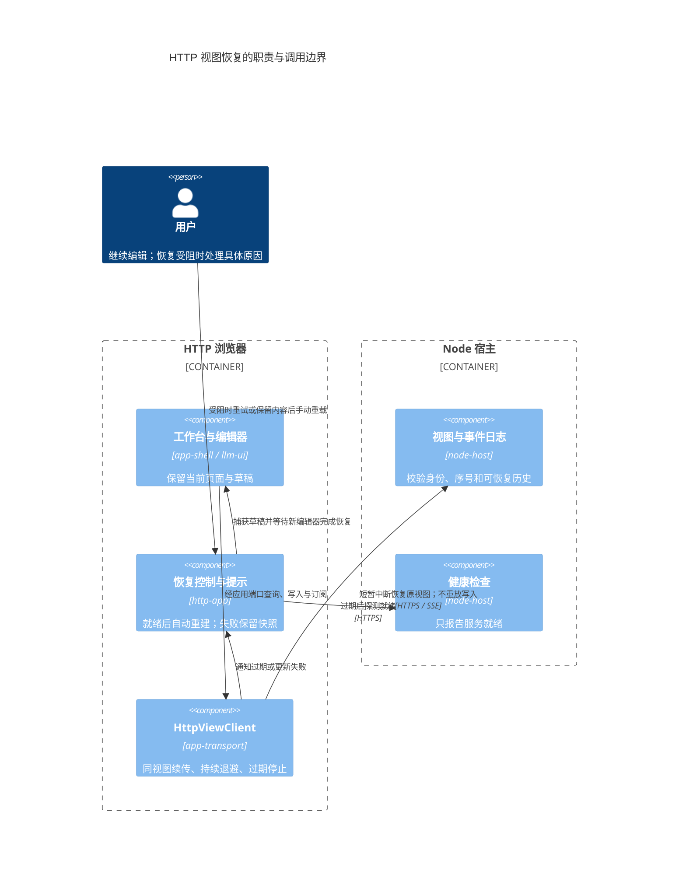
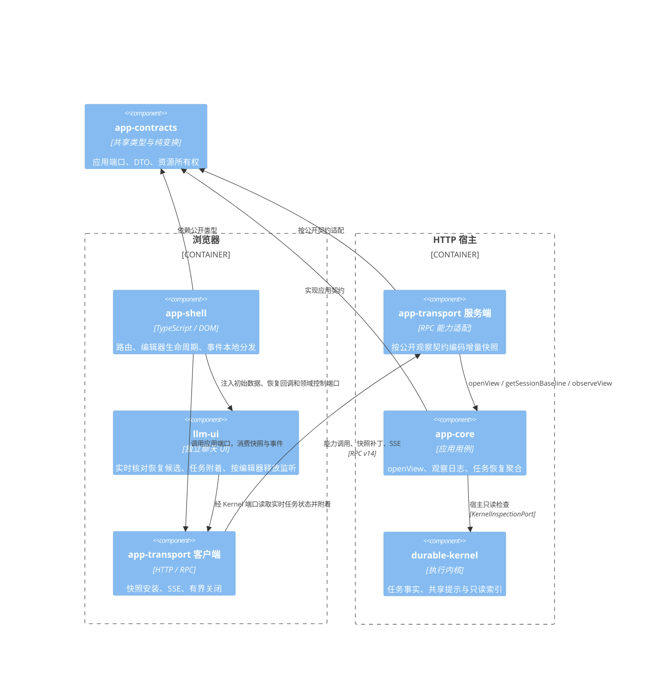
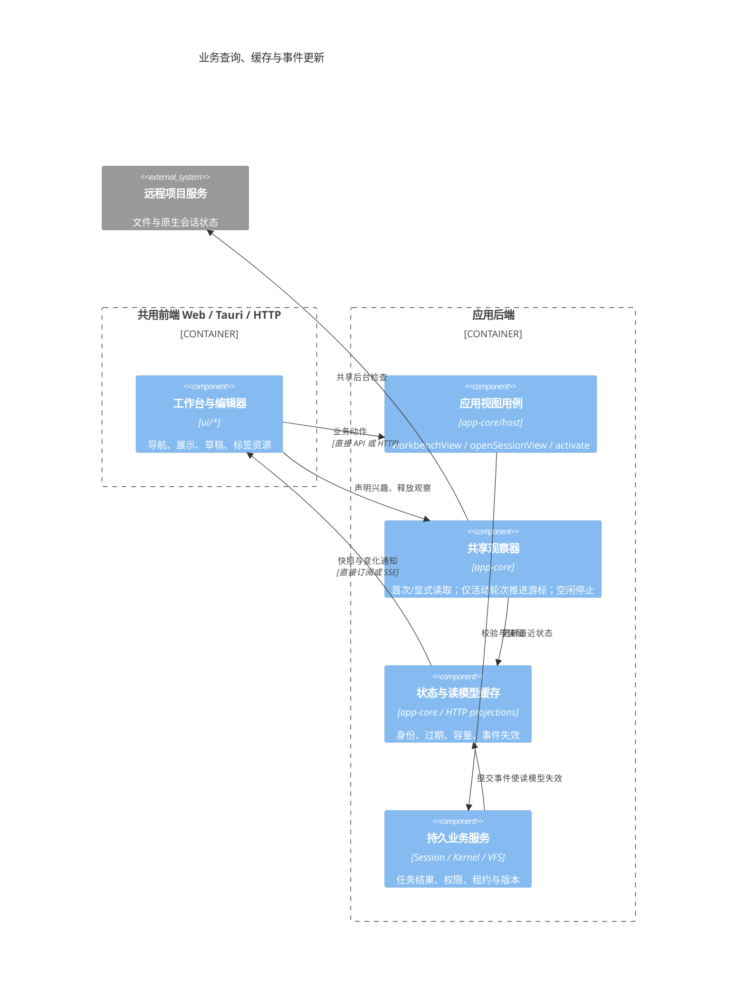
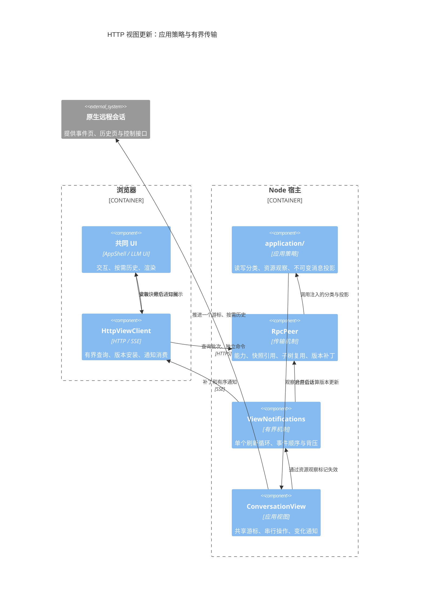

# HTTP 应用宿主

`apps/http-app` 在 Node.js 中装配唯一的 ApplicationRuntime。浏览器使用与 Web 相同的 HTML、CSS、工作区配置、编辑器工厂和 `app-shell.initApp()`，通过服务端口操作后端，不创建 IndexedDB、LLM 或 Kernel Runtime。Tauri 仍通过本地端口注入同一套 UI。CLI 的 `-d` 模式见 [CLI HTTP 模式](http-mode.md)。

## 模块和所有权

| 模块 | 职责 |
|---|---|
| [app-contracts/services](../shared/app-contracts/src/services.ts) | ApplicationClient 前端能力；应用操作异步，快照 selector 同步 |
| [app-shell](../ui/app-shell/src/bootstrap.ts) | 唯一 UI 装配入口；项目、文件、设置、工具箱、数字分身及 Flow 使用原组件 |
| [HTTP 客户端](../shared/app-transport/src/http/view-client.ts) | HTTP 调用、SSE 接收、回调回复与连接状态 |
| [应用能力描述](../shared/app-transport/src/application/capabilities.ts) | 显式方法、字段、查询模式、观察和失效；按 ApplicationBackend 校验方法覆盖 |
| [传输机制](../shared/app-transport/src/rpc/peer.ts) | 注入能力描述；编码、远程句柄、版本、资源借用与撤销 |
| [工作台读模型](../backend/app-core/src/host/workbench-view.ts) | 一次装配侧栏文件视图、生命周期、检索、当前项目、聊天控制和可选首目录/导航数据 |
| [视图缓存](../shared/app-transport/src/rpc/view-cache.ts) | 纯字段差分、版本补丁与追加内容；业务失效关系由应用描述提供 |
| [视图宿主](../apps/node-host/src/http/view-services.ts) | 绑定统一应用门面和每个浏览器的独立会话绑定 |
| [HTTP API](../apps/node-host/src/http/view-api.ts) | 客户端证书指纹与 clientId 隔离、事件连接、空闲回收 |
| [存储保护](../apps/node-host/src/storage/host-storage.ts) | 数据根路径、内部目录和符号链接检查；存储不经过 HTTP |

目录隔离与远程行为一致性分别验证。Web、Tauri 与 HTTP 共用 app-core/host 的应用门面；UI 不传仓储、内核或构造工厂，任务详情和工具箱在后端聚合。同步/异步返回契约显式声明，传输适配持有远端对象句柄；`app-shell`、`llm-ui`、`app-settings` 不识别 HTTP、URL 或证书。

运行时、存储、租约、扫描和任务执行属于 daemon。浏览器只拥有视图绑定、文件视图和订阅。各浏览器的 Session 绑定独立，共用同一份持久化数据与 Kernel。

`pnpm httpd` 和 `pnpm httpd:dev` 沿用启动环境中的 `http_proxy` / `https_proxy`（也支持大写）及 `no_proxy` / `NO_PROXY`。存在非空 HTTP(S) 代理地址且未显式设置 `NODE_USE_ENV_PROXY` 时，启动器为后端进程自动启用 Node 环境代理，无需每次额外设置开关；地址、大小写优先级和绕过规则由 Node 处理。显式 `NODE_USE_ENV_PROXY=0` 保持关闭，没有代理地址时保持默认行为；启动器不修改父进程环境。此规则属于宿主启动层，不进入前端、app-core 或 LLM Provider。

## 协议

`POST /api/application` 使用 `version: 14` 与 `clientId`，支持 bootstrap、queries、bindings、call、reply、close。bootstrap 返回公开服务图、产品模板与 Flow 库，以扁平描述避免重复导出对象图；call 只能调用本视图已经导出的能力句柄上的公开方法。v14 将初始视图打开与观察登记并入 bootstrap，并支持按内容摘要复用纯数据缓存，要求前后端同步更新；聊天配置聚合观察和冷启动目标会话准备继续保留；后端拥有技能文件系统、默认工具分组与工具箱导航装配；toolboxView 初始快照及 resources.navigation 聚合刷新返回目录数据，不接受浏览器反向文件系统能力，消除浏览器逐段路径检查及重复遍历；保留 Provider 订阅授权状态与命令；保留 navigationView、warmNavigation、工作台聚合、会话准备/激活及 UI 文档批量端口；升级服务后需重新加载页面。句柄包含视图随机身份，不能用于另一个浏览器。私有字段、原型访问、Runtime.dispose、设备注册、SQL 和原始记录写入不开放。

queries 合并同一微任务中独立的只读查询，bindings 合并订阅注册，每批最多 32 项、每个合批器最多 2 批在途，等待与在途调用合计最多 1024 项；服务端先检查整批方法类别再执行。共享只读命令策略使 GetSnapshot、GetSessions 和 Flow 读取进入查询批次，不触发全域失效。业务写入独立确认，不混入查询或订阅批次；后续命令先等待此前发起的订阅注册确认，避免快速执行漏事件，独立只读查询仍可并行；失败与结果未知的命令不自动重放。

文件操作经过应用文件视图。用户内容可以读写；`/etc` 的直接写入仅允许 UI 偏好，配置、会话和任务修改通过各自服务执行。字节、Map、Set、回调与持续句柄有显式编码。同步 UI 查询读取已加载的快照；执行和持久化调用经异步端口完成，不使用同步 XMLHttpRequest。

`GET /api/application/events?clientId=<id>` 提供 SSE。通知按 16 ms 窗口合并，只运行一个刷新循环，256 条 / 1 MiB 上限覆盖等待和处理中的事件；刷新期间的失效只安排一次后续刷新，保持事件顺序。客户端也限制排队通知的数量和字节；需要结果的回调单独经 reply 返回，不等待通知批次。领域服务变更也主动更新其他浏览器的快照。客户端先安装 bootstrap，再按序消费已经缓冲的 SSE；服务端在首次快照建立前暂停通知快照刷新。快照补丁携带前后版本，客户端缓冲乱序补丁、忽略旧版本，缺失更新不能覆盖新状态。长连接每 15 秒重新验证证书。初次连接通过 `resume=1` 显式协商带序号的 SSE，未协商的旧客户端仍收到原有 data 帧格式。短暂中断通过 `after=<最后接收序号>&version=14` 恢复同一视图，服务端以 `X-MindOS-View-Resume: 1` 声明支持；按视图保留最近 256 帧 / 2 MiB 内存事件日志，包含离线期间通知。恢复前验证证书、已初始化视图、协议版本和序号范围，缺失历史或回调超时必须重新加载，不能静默漏掉更新或为旧句柄创建新视图。客户端按序接收、忽略重复帧，首次立即重连，连续失败按 1/2/4/8/15 秒退避；响应头成功但立即 EOF 仍累计退避，连接持续 15 秒后重置，online/focus 或立即重连可唤醒；45 秒无心跳触发重连，取消与销毁停止恢复。写请求不会自动重发。事件日志不跨 daemon 重启，不提供持久命令回执，不能宣称跨重载的 exactly-once 保证。

`POST /api/application/files?clientId=<id>&version=14` 使用 application/octet-stream 传输文件字节，X-View-Call 携带编码后的文件能力参数。权限仍由已导出的文件视图检查，不提供宿主路径或存储驱动入口。二进制读写省去 JSON/base64 编码；读取响应头与写入回执携带文件 revision，前端在操作完成前更新 onRevision，条件写入参数保持原有含义。文件接口仍使用完整 ArrayBuffer，不是无限大小的流式存储接口。

HTTP 客户端分别报告传输断开和视图更新失败。fetch/SSE 短暂断开恢复原视图且保留页面与输入，恢复成功收起提示；服务重启或视图过期返回 `X-MindOS-View-Expired: 1` 后，旧句柄的查询、命令和二进制文件请求在客户端立即拒绝，避免重复无效轮询。过期后保留页面及草稿，服务就绪后捕获编辑器快照并自动重建视图，不刷新文档；受阻或恢复失败时保留草稿，显示具体原因和重试/手动重载入口。DOM 输入事件不能证明所有编辑已保存，健康检查成功也不代表视图已经恢复。快照应用、回调、事件解析和通知过载显示页面数据更新失败，提供手动重载入口，保留当前页面未发送内容，不单独触发健康探测或自动重载。解析失败和过载中止事件消费；写命令始终不自动重放。原生 harness 另行区分连接状态与 `refreshError`：目录监听失败不改变会话在线状态，各 profile 的状态读取错误独立显示阶段和安全错误码，events/list 的实际传输断开均标 offline，协议、权限错误与超时只标 stale，成功空轮询也可恢复传输状态。



每个视图最多 4096 个活跃能力句柄、16 个在途业务请求和 128 个待回复回调，最多 128 个浏览器视图。dispose/release/close 撤销独占子图并传送句柄撤销，关闭资源时同步取消其订阅；共享子图按可达拥有者保留；压缩的撤销区间使迟到更新不能复活已释放句柄。回调中的事务能力仅借用到回调结束。没有事件连接和在途回调的视图在空闲 60 秒后回收。JSON 与独立二进制传输分别限制为 32 MiB；通知等待队列和流写缓冲也有上限。

网页视图释放只停止展示与连接兴趣。mindos-node 独立按项目/profile 回收连续空闲 5 分钟的原生运行时，每 60 秒检查一次内存状态；执行、待答交互和在途请求会阻止卸载，等待回答不自动取消。原生历史与操作回执保留，重新访问延迟创建 driver，打开会话时重新读取待答框。进程退出或服务重启的恢复能力仍受原生 harness 限制；该保留策略不承诺跨原生进程故障恢复尚未完成的工具调用。

旧 HttpStorageBackend、记录事务传输、loopback 存储监听、精简 ApplicationShell 与禁用菜单适配已删除。`/api/vfs` 始终拒绝访问；`/api/health` 返回就绪状态及运行模式、构建版本。

## 性能边界

工具箱的 `ToolboxView.files` 由后端组合，权限与链接校验在后端完成；前端只消费文件能力，不重新挂载远端文件源。视图由后端 ViewScope 拥有，工作区关闭后统一释放。工具箱刷新由后端 `refreshGroups` 在一次目录扫描中同时生成分组和导航目录，前端不再按 Agent/Flow 子目录逐个发起 getChildren。描述查询与分组刷新可并行；路径未改变的标题/状态更新不调用 relocate，纯描述查询不触发写域失效。Provider 删除确认以服务端提交为完成条件，导航刷新单独执行，刷新失败不重放删除命令。Provider 删除仍校验确认计划、清理关联连接和默认选择，内置条目以删除标记阻止重启重建；不能直接删除配置文件绕过这些规则。

普通文件模块通过 `navigationView({ root, scope })` 一次取得受限文件能力、首层元数据、根忽略规则及两份不透明 UI 状态；首屏不再顺序调用 openFileSystem、readUiDocuments、getChildren 和 getNodeType。快照只用一次，文件事件、显式版本回调和后续刷新使用实时端口。首次进入空模块不再隐式创建样例文件；用户点击新建时仍使用注册模板。

外壳初始路由完成后，空闲任务优先提前装配工具箱与工作台导航，复用相同的模块加载与订阅，不打开编辑器、会话或 Session 租约，不切换当前路由。用户提前点击时共享在途加载；隐藏工具箱与工作台暂停目录读取、积累变更。任务串行并让出前台加载，随后最多为两个尚未加载的常用目录调用一次 warmNavigation，这一步不导出文件能力或构造普通模块。节省流量模式、低速连接跳过；隐藏页面暂停并在重新可见时继续，销毁取消剩余任务。后端缓存最多 8 个根，每根最多 1000 行 / 512 KiB JSON，15 秒过期；文件事件立即失效，失败不缓存。挂载 revision 不是内容版本，不能单靠它判断数据新旧。缓存前检查已授权根，`/etc` 等托管路径继续保持命令写入约束。

普通模块首层可用后再恢复目录展开；已缓存的普通模块和工作台在没有变化且未过期时直接切回，隐藏期间积累的变更在恢复可见时合并刷新。未通知到当前进程的外部写入依靠短期缓存到期及显式刷新重新读取，缓存不作为正文写入或任务操作的权威。

模块边界不应逐一变成网络请求。可见延迟主要由本地处理、关键路径上的串行往返和传输量组成；总请求数不能直接当作串行往返次数。同步视图查询读取前端快照，业务执行和持久化留在后端。同一套 UI 可使用本地端口或 HTTP 端口，但 HTTP 仍有网络与序列化成本。

bootstrap 不预开文件系统；主题与 UI 状态通过文档端口读取，功能服务和工作区文件视图按消费创建，重复引用使用句柄。只读查询不触发全域快照计算；配置、项目、会话、文件、设置、分身按变更事件失效，只有受影响的能力重新计算。小变更发送字段补丁，追加 token/历史发送追加内容。目录过滤、工具箱扫描留在后端；列表只读取 Provider 的安全元数据，完整配置在打开编辑器时读取。普通事件单向通知，不要求浏览器逐条回复。

`workbenchView` 由后端完成服务装配与首目录读取。HTTP 宿主选择预取，本地宿主直接提供服务；UI 消费同一接口，首目录数据只使用一次，后续刷新读取当前视图。首屏读模型由应用用例返回，不改写底层 RPC proxy，不因描述更新退回细碎调用。并发请求只释放自己借用的回调，订阅回调保持到取消订阅。

完整 Shell 集成测试使用内存后端和进程内协议，空数据启动测量如下。当前大小按 UTF-8 字节计算，不含静态资源、TLS 或 HTTP 头；不是广域网延迟测量。通知到达时序可能使启动窗口内的回调数与响应量略有变化。

| 指标 | 轻量入口 | 聊天首页 | 笔记深链 `/简历.mind` |
|---|---:|---:|---:|
| 启动阶段客户端方法调用（不含 bootstrap） | 1 | 15 | 14 |
| 启动阶段请求（不含 bootstrap/SSE） | 1 | 7 | 8 |
| 启动阶段反向回调 | 0 | 0 | 0 |
| 启动阶段响应体（UTF-8，不含 bootstrap） | 91 B | 约 7.7 KB | 约 5.8 KB |

上述启动路径均不调用 settings、ocr 或 initialFiles 工厂。设置导航只生成本地页面节点；实际编辑器打开后才请求 backend.settings，联系人和标签定义在后端加载。工作区来源只传声明身份或已有文件视图，导出、标签统计和系统浏览按需打开相应来源，保持原有写权限。

2026-10-15 性能复测使用真实 RPC 编解码器、每条正文 256 字符的合成数据，连续九轮向最后一条追加六个字符。旧路径全量刷新，新路径消费带消息身份的更新事件；中位数如下，不代表真实网络或所有领域投影的延迟。

| 历史记录数 | 全量刷新旧测量 | 消息增量投影复测 | 当前补丁大小 |
|---:|---:|---:|---:|
| 100 | 1.9ms | 0.23ms | 206B |
| 1000 | 15ms | 0.85ms | 207B |
| 5000 | 71ms | 2.74ms | 208B |

1000 条记录不变时，poll 响应由 313955B 降为 111B。单个 Session 管理器事件不再重读另外 20 个会话快照，读取次数由 21 降为 1。回归约束使用消息 getter 次数、通知顺序、队列容量与查询在途数，不以易受环境影响的毫秒阈值作为正确性条件。整个工作区导航的合批数受事件到达时序影响，不承诺固定请求数。

## 业务装配与后台缓存

进入工作台通过 `workbenchView` 获取当前项目、导航首屏和聊天控制。HTTP 的 `chat.configuration` 返回已就绪的 `ChatConfigurationView`，一次提供 Agent 展示字段、预设提示词、连接安全元数据、模型目录与默认连接 ID；不包含凭据或系统提示词正文。后端合并配置失效并发布新快照，编辑器共享一个配置订阅，先安装快照再通知本地选择器；本地宿主仍可直接消费配置服务。UI 不再分别请求特权命令、Skill 工厂和当前项目，也不逐 Agent 请求提示词或单独读取连接。聊天深链在主题初始化前预取主题、侧栏、标签和执行器使用记录，合并为一次文档读取；结果各消费一次，新写入优先。`readUiDocuments` 每次最多读取 32 个不透明 UI 文档；`writeUiDocuments` 在后端串行 upsert，前端合并同一轮修改并跳过未变化的内容，失败保留待写数据，flush 可重试。偏好写入不是业务事务批处理。

`ProjectService.navigation` 聚合目标归属、当前项目、离线状态与不透明分组路径；`SessionBrowserPort` 显式声明异步导航失效屏障与目录读取，不依赖 RPC 通用对象的隐式方法。`createSessionDraft` 在服务端完成来源解析和带初始输入的会话创建，客户端收到确认后才导航。`sessionTasks` 返回裁剪后的任务分页，不传输完整任务内部记录。客户端关闭只解绑会话视图，Runtime 保留执行及草稿收尾，闲置上下文按引用和任务状态回收。

冷启动的 `workbenchView({initialSessionId})` 将目标的只读准备与工作台并行完成，通过 `initialSession` 返回；失效链接不阻断工作台，其他准备失败时排空并释放已取得的资源。未使用的准备在更换目标或销毁工作台时释放。普通切换先调用 `openSessionView`，在后端校验/准备访问并取得 manifest、项目、目录权限和文件租约。旧编辑器保存、关闭之后才 `activate(branch)`，后端完成 Bind/分支选择并返回消息快照、设置和元信息，编辑器直接消费，事件绑定后读取同一会话的已观察快照，缺少同步选择器时才回退 GetSnapshot。两步顺序用于保留目标准备失败时的旧视图，避免旧编辑器保存/解绑影响新会话。取消或关闭准备中的视图会释放文件租约；不会取消业务 Task。缓存标签恢复会话绑定，关闭其他标签不解除当前绑定。

连接探测由 Runtime 共享的观察器执行。前端只提交可见项目和打开标签的兴趣集合；后台跳过无远程挂载的项目，最多同时检查 4 个项目，每次检查预算 3 秒，完成后间隔 15 秒再检查。同一挂载的在途检查继续由 remote-mount 服务合并，最后一个观察者退出后中止探测并停止定时器，不取消任务。

### 当前会话后台恢复聚合

原生聊天发送遇到 HTTP 响应丢失时，已冻结提交的界面会按同一个 submissionId 查询一次回执；只有匹配的 accepted/rejected 回执才解除待确认状态，查询失败或仍 pending 保留输入和手动查询入口，不自动重发。提交前的只读检查失败返回 not-committed，拒绝回执保留安全错误码，避免已确认的写锁冲突被显示为结果未知。Codex 后台的写锁可能在界面退出后延迟释放，不能根据历史 source 字段判断当前客户端。

`ApplicationBackend.taskAttachment(sessionId, sharedKey)` 是只读应用聚合端口：校验会话后，通过 Kernel 的只读 inspectSession 在宿主读取指定共享记录、活动任务状态和待审批索引，只返回活动任务 ID 与按更新时间排序的候选 ID，不改变任何浏览器的会话绑定。尚未创建 Kernel Session 的有效会话返回空候选；存储故障仍向调用方报错。读取不附着、不审批、不启动或取消 Task。

llm-ui 通过可选 `readTaskAttachment` 回调消费该能力，没有注入时保留原始 Kernel 端口路径。回复到达后继续校验当前编辑器、会话和附着代次；没有候选时跳过额外的 Flow 列表查询。活动候选附着前读取实时任务状态，已终结则继续待交互候选；待交互候选排除当前 Flow 所属任务，并核对同一 Session、非终态和仍有 pending interaction，过期候选跳过后继续查找。任务打开和状态读取之后均检查编辑器代次，读取失败向上传递；聚合返回的是恢复线索，不是执行凭据。真实 Kernel 重建后的审批恢复测试覆盖两种路径，并核对完成的是原任务。

`session.flow.invocations` 纳入共享只读命令集合，查询不触发全域失效。RPC 的订阅屏障也使用动态查询分类：只读命令不等待先前订阅，写命令继续等待订阅确认，不自动重试。OCR 设置表单与附件管理共享一个 Agent 配置源订阅，每个消费者退出时移除自身监听，最后一个消费者退出时释放源订阅。

JSON 应用请求的 `request.complete` 新增可选 `bodyReadMs`（请求体接收及解析）、`viewReadyMs`（等待应用视图）、`rpcMs`（能力执行、快照及 JSON 响应生成）和 `responseFlushMs`（响应提交至 Node finish/close）。`application.complete.durationMs` 保留原含义，通过 requestId 关联。flush 不代表浏览器收到或渲染完成，客户端证书验证也不计入这些阶段；日志不记录文档、命令参数、共享键或用户内容。部署新版本后可据此区分此前 1 秒级 HTTP 请求与毫秒级 RPC 之间的差异。

`application.complete` 还记录注册命令目录确认的 `rpcCommands`、业务回复的 `rpcErrorCount/rpcErrorCodes`；HTTP 200 不能代替业务成功。图片上传只额外记录声明的 MIME 与字节数 `uploads`，不写文件名、data URL 或异常正文。上传错误区分 `INPUT_ASSET_FORMAT`、`INPUT_ASSET_TOO_LARGE`、`INPUT_ASSET_PERSISTENCE`，存储错误保留安全错误码；业务错误回复附加 HTTP requestId，前端 flow-images 日志可据此关联。当前宿主输入暂存单文件预算为 20 MiB，与 Flow 自行声明的总字节/数量限制分别校验。

### RPC 与往返的生命周期边界

RPC 是逻辑操作，HTTP 往返是传输批次；SSE 是独立的持续事件通道，不能把持续连接的存活时间当作一次加载耗时。目前 queries/bindings 只合并同一轮发起的独立调用；组件之间的 await 会把一次打开拆成多轮网络依赖。

| 生命周期/数据 | 当前调用 | 关系与处理方向 |
|---|---|---|
| 首次进入聊天资源 | openView：UI 文档、工作台、配置、目标准备 | 已合并为应用用例；普通模块仍使用 navigationView，未打开模块不预热 |
| 当前会话激活 | 冷启动由 openView 内部激活；切换用 SessionOpenView.activate | 冷启动无旧编辑器；已有编辑器切换需先保存/释放，保留激活屏障 |
| 初始恢复 | openView 内部读取 taskAttachment、Flow 与 Skill 列表 | 初始编辑器一次消费；读取期间有对应变更则放弃预取，回到实时端口；存在候选时仍核对任务归属 |
| 持续观察 | observation.observeView(cursor, callback) | 宿主先订阅源，再准备首屏；一个远程观察按 topic 在前端分发；底层文件 onAny 仍按文件视图订阅 |
| 可见侧栏 | getNodeType、getChildren、ProjectService.navigation | 只有侧栏可见才需要；首层可用一个导航读模型，第二次读取需依据真实失效，不能因无关写入重刷 |
| 偏好持久化 | writeUiDocuments | 初始化不等于修改；先跳过未变化状态，再按用户操作合并持久化，退出/切换按需 flush |
| 实际业务命令 | 保存文件、发送、取消、审批 | 独立确认和授权顺序仍需保留；结果未知时不得自动重放 |

更高层的目标是“一个前端视图的打开与观察”，不是一个全局当前页面：携带 resource、uiScope、visiblePanels 等明确兴趣，返回首屏快照、资源句柄及事件水位，再消费同一视图的 SSE 增量。后端必须将初始快照与观察水位对齐，避免快照完成到订阅建立之间漏事件。前端 DOM、滚动、菜单及未提交输入继续在各端独立。冷启动与带未保存内容的会话切换走不同准备顺序，不能用同一个无条件批次覆盖。

### 打开与观察聚合（已实现）

`ApplicationBackend.openView({documents, workbench, branch?, taskAttachmentKey?})` 处理首次进入聊天工作区或本地会话深链，返回不透明 UI 文档、工作台资源、可选会话初始数据、`observation` 与 `cursor`。`workbench.initialNavigation` 表达是否读取首层目录，手机正文与隐藏侧栏继续跳过读取。普通文件、原生会话、草稿沿用各自的打开端口，不提前初始化其他工作区。

1. 宿主先订阅仓储、文件、收藏、Kernel、草稿、挂载、Agent 和当前客户端会话事件，再并行读取工作台和 UI 文档；配置与初始 Skill 观察随对应能力建立。
2. 当前客户端无绑定时，宿主内部激活目标分支，并行读取任务恢复、Flow 与 Skill 初始数据。已有绑定的冷打开与同客户端并发打开返回 EBUSY；普通标签切换继续先准备、保存旧编辑器、释放旧绑定，再显式 activate。
3. 返回前同步采集当前会话快照及事件水位，校验绑定仍属于目标；读取期间发生相关变更时不使用过期的恢复/列表预取。恢复缓存同时校验 sessionId 与 sharedKey，一次消费；其他会话事件不会无条件清空当前会话缓存。
4. 前端通过一个 `observeView(cursor, callback)` 登记；宿主按序补发首屏返回到登记之间的变化，再持续经现有 SSE 发送。应用事件日志最多 256 条 / 1 MiB，历史缺失拒绝订阅，不能静默跳过；SSE 自身的断线日志与恢复规则继续独立生效。
5. 前端装配期间缓冲应用事件；读取已经更新的会话快照时记录相同 SSE 帧内的观察水位，跳过已包含的流式增量，后续事件按序分发一次。事件缺口、缓冲超限或通知回调失败报告页面更新失败，保留当前页面。此水位仅对当前视图有效，不是持久化事务版本。
6. 任一打开步骤失败先释放已经取得的资源，仅解绑本次请求激活的目标，不取消 Task；销毁释放源订阅、配置、连接观察和文件租约。每个 HTTP/CLI 客户端有独立绑定与观察，运行任务和业务记录仍由 Runtime 共享。聚合视图是显式受管能力；HTTP 关闭先等待已发起的 RPC（包含从取消订阅到远程释放的整个异步过程）排空，再发送关闭请求。排空、关闭请求和本地清理共用 5 秒上限，超时中止在途请求；重复关闭共用一次过程，不重放命令。

内部仍使用各模块的类型化回调；外部调用使用有结果的异步端口，持续变化走带序号的事件。跨 Task、Flow 与 Skill 的 `SessionPresentationState` 定义在 app-contracts；聚合位于 app-core/app-shell 应用层，llm-ui 保留公开的初始数据与恢复回调，不依赖 HTTP、应用 Runtime 或 app-contracts。

模块关系如下；本地宿主直接将应用端口交给 Shell，HTTP 宿主通过两端传输适配同一契约。



### 一次打开同步握手与首帧（v14）

HTTP 页面现在由轻入口同时启动数据连接、Shell 模块和当前编辑器代码加载。聊天目标及 UI 文档名称通过 app-shell/startup 的纯函数构造，当前路由之外的工作区保持延迟创建。SSE 建连和初始 POST 并行，不再先等待 SSE 响应头才发送 bootstrap。

初始 `POST /api/application` 的 `kind=bootstrap` 可以携带 `initialView: OpenViewRequest` 与 `knownSnapshots: string[]`。后端在本客户端中完成 openView、注册初始观察，再导出服务图和 `initialView`。初始连接兴趣在 openView 内建立，前端按单调 revision 更新：只有已确认相同集合才省略请求；在途或失败时不能按旧集合去重，较早响应不能覆盖较新确认。装配期间只保留最高 revision。普通的无目标 bootstrap 与后续 openView 接口继续可用；已有编辑器切换仍保存后激活。

初始响应开启缓存时为 `{payload, cache}`：payload 中的 `{$cache: sha256}` 指向本地已验证的数据或本次 cache 字典。未携带 knownSnapshots 的显式协议调用继续返回普通 RPC Reply。初始观察事件使用同一 SSE 帧的 viewEvents 字段发送；HttpViewClient 在安装能力图后按序处理，提供本地 observeView 适配，组件不再远程登记初始订阅。全量快照、版本补丁、回调和应用事件仍使用有界顺序队列。

缓存边界与校准：

- ViewApi 持有跨客户端的有界纯数据缓存，浏览器在 sessionStorage 中按 v14 保存副本。两端最多 128 项 / 8 MiB，单块 1–128 KiB；更大的对象按子树处理。资源句柄、函数、回调和包含句柄的对象不进入缓存。
- SHA-256 根据当前实际编码数据计算，不使用预设 getConfigVersion，也不复用旧视图的 descriptor.version。相同数据可以只传摘要；数据改变则发送该块完整当前内容。现有视图内的增量补丁机制继续生效。后台不会以客户端上传的状态覆盖业务记录。
- 前端加载持久副本时验证内容摘要，只有本地确实存在的有效块才声明 knownSnapshots；损坏/不可用缓存按未命中处理，存储配额不足不阻断页面。服务器仍从当前授权视图构造数据和本次连接的新句柄。
- 响应引用缺失时，客户端只调用 `kind=bootstrap-data` 重读同一份已准备响应，不重新打开、绑定、发送消息或执行命令。此补读只服务当前认证客户端，不能按摘要任意读取后台缓存。
- 缓存覆盖纯展示数据；各前端的会话、分支绑定、兴趣和资源生命周期仍独立。已有 SSE 断线恢复继续按同一视图的事件序号补发；历史失效仍要求重新加载，不重放写命令。
- 初始装配使用 observation.getSessionBaseline 的成对快照/水位，避免读取更新的游标后误跳过尚未包含的流式事件。调用者只读使用快照；传输通过公开 observeView 接收失效事件，自行持有不可变 Session 行投影，不依赖具体后端的私有方法。单条流式变更只复制受影响行，分支变化仍全量重建。异步观察登记失败向上报告，关闭后才完成的登记立即释放。

首帧处理：共享 HTML 直接提供当前主题背景和静态页面骨架；主题镜像只用于首帧，后端 UI 文档返回后校准。骨架不显示历史正文或可交互按钮，正常启动没有加载 banner。主样式表以非阻塞方式加载，避免下载大 CSS 时只能显示白色页面。当前目标加载完成后移除骨架；失败时显示现有错误入口。普通 SSE 重连不重建 DOM 或显示首屏骨架。

HTML 的样式处理器在模块加载前记录 load/error，HTTP 和 Web 本地入口共用 `mind-os/startup` 读取已有结果并等待样式，最长 30 秒；超时或失败释放其他样式的等待监听，显示可重载的错误。提示所需样式内联在 HTML，不依赖失败的 CSS。Web 在 IndexedDB 或 Runtime 初始化失败时也解除骨架并显示错误，样式与本地初始化并行。

HTTP 提前连接保留当前连接状态，状态提示安装时同步补报；终结的更新错误或视图过期不会被迟到的重连清除。`mindos:data-ready` 只记录连接数据就绪，不包含编辑器代码和样式等待。服务端通知刷新失败后关闭队列并使 SSE 日志失效，后续请求报告视图过期；不会跳过丢失序号继续发送，也不重放业务命令。回归见 [浏览器启动](../apps/http-app/tests/browser-startup.test.ts)、[Web 初始化失败](../apps/http-app/tests/web-startup-failure.test.ts)、[提前连接状态](../apps/http-app/tests/early-connection-status.test.ts) 和 [通知刷新失败](../apps/http-app/tests/view-notification-failure.test.ts)。

浏览器 Performance 条目 `mindos:document-to-editor` 记录 HTML 脚本开始至编辑器就绪，`mindos:entry-to-editor` 记录入口执行至编辑器就绪；二者包括相应网络/代码/装配等待，不能用服务器 rpcMs 替代。bootstrap 现在也记录 application.complete 和 rpcMs，日志不记录目标、已知摘要或用户正文。

复核范围包括初始握手与快照缓存、Shell 的打开/观察装配、真实 Kernel 重建后的审批恢复，以及过期候选和监听释放。历史样本的请求数、响应大小和测试计数通过 Git 查阅，不作为当前运行版本的性能保证；v14 发布需前后端同步更新。运行版本核对见[启动与认证](#启动与认证)。

```bash
pnpm --filter @itookit/http-app test tests/view-api.test.ts tests/snapshot-cache.test.ts
pnpm --filter @itookit/app-shell test --maxWorkers=4 tests/http-handshake-shell.test.ts tests/opened-view-projection.test.ts tests/task-attachment-recovery.test.ts tests/pending-interaction-restore.test.ts
pnpm --filter @itookit/llm-ui-adapter test --minWorkers=1 --maxWorkers=4
```

原生会话状态由 `RemoteSessionStatus` 按项目共享：初次订阅读取权威快照，后续实时变化由共享 SSE 触发，同时保留 15 秒权威核对；显式 `refresh` 或会话活动变化也可触发读取。缓存读取不触发远端查询；变化才通知，执行期间失败退避 1–30 秒。最后一个订阅退出后保留最多 30 秒的过期投影，重新订阅可先展示并读取一次最新状态。闲置缓存最多 64 个项目、合计 4096 行，单个超过 512 行的项目不保留；缓存身份包含配置、服务器和授权 revision，身份改变立即拒绝旧缓存。过期记录禁止中断/审批操作。任务的最终结果、运行状态与命令回执仍以持久记录为准；缓存不替代写入门、租约、版本校验或结果未知命令的核对。

执行期间的状态缓存对 offline 和 refreshError 均退避，成功观察恢复正常间隔；缓存层异常只令投影过期并显示状态观察失败，连接判断沿用端口证据，订阅回调异常不改变连接投影。空闲观察失败后不启动自动重试，由下一次显式读取核对。

连接观察不再每 15 秒探测，只在进入新的远程项目或授权绑定变化时检查一次。前端聊天只订阅后端快照，不定时调用 poll；后端在有活动轮次且有展示订阅时每 200 ms 推进游标，结束或取消展示即停止。目录和空闲历史由用户显式刷新，文件观察覆盖不足不再制造每 30 秒变化的版本。浏览器隐藏时暂停工作区展示订阅，返回时重新读取；任务执行和持久化不依赖页面可见性。SSE 的 15 秒保活与证书复核保留，不触发业务读取或界面重绘。

前端启动与导航诊断默认静默；需要排查时设置 `localStorage['vfs:debug']='1'` 后重新加载页面。进度回调与错误处理不依赖诊断输出，Node 宿主的启动日志保持原有行为。

默认 Flow 由后端初始化按安装回执准备，用户删除或修改的模板不会在刷新页面时重新覆盖；前端只保留显式恢复与运行交互。



`application.complete` 与 `request.complete` 通过 requestId 对照：前者记录 rpcKind、rpcBatchSize、rpcOperations（注册能力名与方法名）及执行耗时，后者记录整次 HTTP 请求耗时。只记录公开方法元数据，不记录参数、UI 文档名、文件路径、消息或凭据；批次至多记录 32 个方法。bootstrap/SSE/文件传输仍用请求事件统计；不能将逻辑调用数当作 HTTP 请求数或把 SSE 连接寿命当作启动耗时。

## 启动与认证

```bash
pnpm httpd:build --no-activate # 仅构建和验证，不改变下次启动选择
pnpm httpd:build --no-cache    # 绕过构建缓存，重新安装和编译
pnpm httpd:build              # 自动增量构建库，再构建并选择独立 release；不重启当前服务，开发工作区保持源码
pnpm httpd                    # 直接运行已选 release，无构建步骤
pnpm httpd:dev                # 开发工作树，默认端口 2001
pnpm httpd:list
pnpm httpd:activate <版本ID>   # 下次启动使用此版本
```

`httpd:build` 自动先执行增量 `lib:build`，只重建变化的库及受影响依赖方，无变化时复用快照；库构建失败不会继续 HTTP release 构建或激活。无需再手动串联两条命令。

构建缓存位于忽略目录 `release/httpd/.build-cache/`。源码、库快照、运行时及构建环境均未变化时，校验并复用完整 release；源码有变化时复用依赖安装环境，按 Vite/tsup 实际输入分别判断是否重新编译 UI 和服务端。新增文件、配置、锁文件、库快照、Node/ABI、pnpm 或原生模块变化会使对应缓存失效。输出损坏会重新编译，构建锁防止并发改写隔离环境；每步日志包含 operationId、缓存命中原因及耗时。变更构建仍重新 deploy 生产依赖，发布副本与缓存互相独立。清除 `.build-cache/` 后下次重建即可，不影响已有 release；清理时应确保没有构建进程。

release 保存在 `release/httpd/<版本ID>/`，包括固定的服务端、UI 与运行依赖副本，启动校验服务端/UI 校验和及 Node 主版本。依赖打包在临时源码副本执行，不修改开发工作区的 node_modules；构建中源码发生变化则拒绝激活。保留旧版本可回滚，正在运行的进程继续使用原版本和对应静态资源。第一次从旧 tsx 启动方式迁移时，需要先结束原实例再启动 release；不能让两个宿主同时使用真实数据。后续版本切换在下次启动生效。

release 沿用原 profile 数据；dev 默认使用 `<configDir>/http-dev/data`，忽略原 profile 数据根。两者的 OAuth 凭据分别在 `<configDir>/http-auth/release` 与 `dev`。数据根和凭据目录分别以 SQLite 排他锁防止新宿主重复打开，崩溃后由操作系统释放。

默认排查 release 日志：运行日志 `/var/log/mindos/httpd.runtime.log`，审计日志 `/var/log/mindos/httpd.audit.jsonl`。dev 使用同目录的 `httpd.debug.runtime.log` 和 `httpd.debug.audit.jsonl`。目录和文件名不包含版本 ID，切换 release 后继续追加；版本 ID 保留在运行日志的启动记录中。每份 10 MiB，保留当前文件及追加 `.1`、`.2`、`.3` 的轮转文件，文件权限 0600。旧版本目录中的日志不自动迁移或删除。

系统部署时先创建由服务运行用户拥有的目录。以下命令用于以当前用户运行的服务；独立服务账号应替换 owner/group：

```bash
sudo install -d -m 0700 -o "$(id -un)" -g "$(id -gn)" /var/log/mindos
pnpm httpd
```

目录不可写时启动失败。可用 `MINDOS_HTTPD_LOG_DIR=/path/to/logs pnpm httpd` 同时覆盖运行与审计日志目录，`--audit-file` 单独覆盖审计文件；配置、凭据和数据路径仍按原规则解析。相对日志目录按启动工作目录解析。

查询当前运行版本需要使用已登记的客户端证书，访问证书覆盖的实际主机地址：

```bash
cert_dir="${XDG_CONFIG_HOME:-$HOME/.config}/mindos/http-certs"
curl --fail --silent --show-error --cacert "$cert_dir/ca.crt" \
  --cert "$cert_dir/client.crt" --key "$cert_dir/client.key" \
  https://127.0.0.1:2000/api/health
tail -n 100 /var/log/mindos/httpd.runtime.log
```

健康检查返回 `{"ready":true,"mode":"release","version":"<release-id>"}`，其中 `version` 才是当前服务版本。版本 ID 为 `<UTC构建时间 YYYYMMDDTHHmmss>-<Git提交前8位>[-dirty]`，例如 `20261017T100615-b109df0a-dirty`；`dirty` 表示构建时存在未提交修改。运行日志中最新的 `Version:` 记录可用于核对启动版本，但进程退出后仍保留。`release/httpd/current.json` 只指定下次启动选择，不证明当前服务已切换；修改日志目录后，日志查询命令也应使用新目录。

httpd 使用 `startupMode: 'server'`：LLM 配置与设备、MCP 首次自动连接尝试、依赖的项目目录、Skill、Agent、会话调用恢复和项目草稿初始化完成后才创建监听。失败向启动入口传播，关闭 Runtime、存储、日志并释放目录锁，不打印服务已启动，也不开放健康检查。远端 MCP 首次尝试失败作为已观测的连接状态保留，不要求所有远端服务可达；持续任务恢复、周期扫描与分身分析不等待业务运行结束。Web/Tauri 的交互式延迟初始化策略保持独立。

默认只监听 HTTPS `0.0.0.0:2000`，backlog 为 4096。TLS 验证客户端证书与 clients.json 的 SHA-256 指纹，没有匿名或明文入口。CA、密钥、浏览器导入包和审计日志位于数据根之外。

数据根优先级：`--root` → `MINDOS_ROOT` → mindos.json 的 rootDir → 配置目录/data。配置目录遵循 XDG_CONFIG_HOME，默认 `~/.config/mindos`。SQLite 默认保存在 `<root>/_meta/index.db`；`--sidecar` 可以指定数据根之外的位置。
`mindos.json` 的 `http.certDir` 指定证书目录，`http.authDir` 指定认证基址（release/dev 分别追加子目录）；
显式 `--cert-dir` / `--auth-dir` 仍优先且为最终目录，省略配置保持旧路径，不自动迁移。
配置路径相对配置目录解析，CLI 路径相对调用目录解析；两类私有目录仍须在数据根、静态 UI 根之外。`--internal-port` 已移除。

审计仅记录请求和认证元数据，不记录正文、参数、消息或凭据。服务器退出记录 `server.stopping`，先结束 SSE 并停止接入，最多等待 5 秒排空 HTTP 连接，随后关闭残留连接并记录 `server.stopped`，再关闭视图、Runtime、存储、日志和锁。完整释放后运行日志输出 `HTTP host stopped; data and credential locks released`。原生目录选择、Shell/TTY、存储快照等平台能力由宿主注入；统一界面不意味着 Node、浏览器和 Tauri 的平台权限相同。

`pgrep -af 'httpd.mjs|server/main.js'` 按完整命令行查找宿主；`pgrep -l httpd` 可能漏掉进程名为 node/node-MainThread 的实例。可用 `lslocks --pid <PID>` 核对持锁路径。数据锁位于 `<root>/_meta/httpd-host-lock.sqlite`，凭据锁位于 `<authDir>/httpd-host-lock.sqlite`；进程退出时由操作系统自动释放，锁文件保留不表示仍被占用。停机后应确认旧进程结束再启动新实例，不通过删除锁文件绕过独占保护。

## ChatGPT 订阅授权

入口为 **工具箱 → 模型 → ChatGPT · 订阅 → Provider 设置 → 使用 ChatGPT 继续**；现有 **OpenAI** 设置顶部也提供“ChatGPT 订阅授权”跳转，原 API Key 配置保留。授权完成后加载账号模型目录并保存配置；连接选择器依据宿主的 `credentialsReady` 判断可用性，不再把订阅账号当成缺少 API Key。

准备授权后，面板显示只读完整 URL、“打开授权页面”和“复制授权链接”，支持用户在自选浏览器中完成登录；链接显示有效期，等待提示明确下一步操作。“重新生成授权链接”顺序调用现有取消和发起授权命令，旧链接及其回调立即失效，新流程清空旧回调输入；正常登录期间无需重新生成，也不会自动刷新链接。重新生成失败时重新读取后端状态，避免保留已取消的链接。复制操作只在本地执行，不重新请求授权状态或更改 Provider；剪贴板不可用时选中链接供手工复制。准备链接与提交回调分别显示处理状态，避免重复提交；无关通知保留正在输入的回调。

httpd 注入私有 `ProviderAuthorizationHost`，负责 PKCE、state、nonce、OIDC 签名与账号校验、凭据原子保存、共享刷新和退出撤销。UI 只取得授权链接、进度和账号显示，访问/刷新令牌不进入 RPC、VFS、模型配置导出或日志。状态查询读取宿主缓存，UI 无授权轮询计时器。未注入授权宿主的 Web/Tauri 明确显示不支持。

[官方 OAuth 文档](https://developers.openai.com/siwc/token-sharing-open-source/sign-in)要求 `http://127.0.0.1:<端口>/auth/callback` 回调。浏览器与 httpd 同机时自动完成；远程 httpd 可以通过 SSH 转发回调端口，也可以把浏览器授权后地址栏的完整回调 URL 粘贴回已通过 mTLS 认证的授权面板。后一种是本应用的回调转送实现，由后端验证 state、PKCE 与身份后交换授权码，不要求用户复制令牌。

私有凭据目录权限 0700、文件 0600，必须位于数据根和静态目录之外；注销后保留客户端注册身份，清除本地令牌，远端撤销未确认时明确提示。授权流程、刷新和 RPC 用签名模拟响应验证，尚未使用真实订阅账号验收。

授权交换失败写入当前宿主审计文件（release 默认为 `/var/log/mindos/httpd.audit.jsonl`）的 `provider.authorization.failed` 事件，`operation` 区分客户端注册检查、令牌交换、令牌结构/权限校验、OIDC 身份校验、账号核对和凭据保存；记录耗时、HTTP 状态及白名单错误分类，合法的远端请求 ID 作为 `providerRequestId` 保留。上游错误正文、异常原文、回调 URL、授权码及令牌不写日志。授权成功保存后记录 `provider.authorization.completed`。回调结果页的 HTTP 200 仅表示结果页已返回，页面正文才表明授权结果；已有账号在重新授权失败后保持可用，结果页仍明确报告本次失败。

身份字段校验使用独立错误分类区分 issuer、audience、authorized party、过期时间、签发时间、生效时间、subject 及 nonce 缺失/不匹配，不记录字段值。`aud` 可以是包含当前客户端的字符串或字符串数组；单元素数组不强制要求 `azp`，多个 audience 时要求 `azp`，提供的 `azp` 必须匹配当前客户端。身份校验始终在签名验证成功后执行，失败不保存凭据。

授权面板通过后端订阅更新，窗口重新获得焦点或页面恢复可见时补查一次授权状态，同一轮触发合并；无状态变化保留回调输入，销毁后移除监听，不常驻轮询。HTTP 页面的短暂断线由 SSE 续传恢复；视图过期或模块加载失败后才探测 `/api/health`，探测失败按 1、2、4、8、15 秒退避，单次超时 5 秒；联网和窗口返回可提前重试，页面关闭时取消。仅事件订阅与 bootstrap 可创建视图，其他请求遇到不存在或未初始化的视图时返回 `ECAPABILITY` 及 `X-MindOS-View-Expired: 1`；JSON 与二进制客户端据此立即触发恢复，同一次连接丢失只通知一次。服务就绪后按编辑器显式恢复接口保存内存快照、重建视图并恢复表单，不根据输入/选择事件猜测未保存状态；程序填入的草稿同样保留。不能自动恢复时保留原页与具体原因，用户可重试或复制内容后手动重载。不自动重放写命令，也不把 health 就绪当成旧视图已经恢复。

RPC 能力分类中，HarnessConversationPort 必须同时具备 `snapshot`、`respond` 和 `subscribe`，避免将含异步 `snapshot()` 的 TaskHandle 误识别为同步会话快照。TaskHandle 通过 `status` 等公开查询读取状态，不导出内部 `snapshot`。快照编码失败保留错误码、原因和具体能力/方法；不得通过自动等待 Promise 掩盖能力分类错误。真实内核任务经 `openTask` 导出及通知续传的回归见 [task-handle-rpc.test.ts](../apps/http-app/tests/task-handle-rpc.test.ts)。

正文 AI 输入沿用 Session 分支已选 Agent（缺失时回退 default），候选来源于公开调用目录；验收定义须标为 local，不能污染用户调用选择器。HTTP 附件视图通过独立 `FileSystemView` 能力保留 `dispose()`，防止提交准备的清理异常覆盖原始错误；回归见 [附件视图生命周期](../apps/http-app/tests/view-ports.test.ts) 和 [正文 AI 输入](../ui/app-shell/tests/document-chat.test.ts)。

## 验证

- [完整 Shell 回归](../ui/app-shell/tests/http-full-shell.test.ts)：通过远端服务端口装配原 UI、切换工作区，检查导航未被隐藏。
- [重连退避回归](../apps/http-app/tests/view-reconnect-backoff.test.ts)：响应头成功后 EOF、订阅失败、稳定连接重置、立即重试及关闭取消。
- [恢复提示回归](../apps/http-app/tests/status-banner.test.ts)：程序填入草稿保留、手动重载、短暂重连及迟到事件隔离。
- [工具箱重启恢复](../ui/app-shell/tests/http-toolbox-recovery.test.ts)：真实 HTTPS 宿主关闭并在同一端口重启，连接深链表单恢复无输入事件的未保存名称；等待编辑器挂载后才判定完成。
- [服务端口回归](../apps/http-app/tests/view-ports.test.ts)：文件、配置、项目、设置、数字分身、二进制、订阅、异步迭代与所有权边界。
- [真实 HTTPS 回归](../apps/http-app/tests/view-api.test.ts)：mTLS、独立会话绑定、共享持久化、旧存储入口拒绝、版本与跨来源检查。
- [一致性与所有权回归](../apps/http-app/tests/view-consistency.test.ts)：bootstrap 竞态、收藏身份/缓存、750 次资源释放、共享句柄与子服务订阅清理、poll 后快照。
- [性能与并发回归](../apps/http-app/tests/view-performance.test.ts)：查询缓存、追加补丁、乱序版本、批次上限、通知顺序与并发回调寿命。
- [本地存储回归](../apps/http-app/tests/storage.test.ts)：daemon 内部跨 SeqFile 原子提交/回滚和路径保护。

前端 Vite 与服务端 tsup 均检查实际模块图；前端不加载后端实现，后端不加载 UI。运行 `pnpm --filter @itookit/http-app test`、`typecheck`、`build`，以及根目录的模块检查。

## 性能与恢复

Session getSnapshot 是唯一历史快照，getSessions、getStatus 和 isGenerating 从中派生。应用投影将 message:updated 定位到受影响的分组，其余分组保持不可变引用；未知事件和结构变化重新构造投影。编码器复用不可变 DTO 子树，差分、长度比较和引用扫描不再遍历未变消息正文；仍有数组索引与上游领域投影成本，不能宣称总开销与历史长度完全无关。

原生会话在宿主通过 conversation-view 共享一个事件游标推进源，变化时才通知订阅者；关闭最后一个订阅停止后台读取。普通方法返回快照引用，相关版本更新随响应到达后再解析，避免 read/refresh/loadEarlier 同时携带完整返回值和补丁。节点事件经共享 SSE 到达宿主；没有订阅的自定义端口不启动后台轮询。历史由加载入口或明确定位按需读取，不自动遍历全部页面；完整快照和原生 gap 恢复仍保留。

项目 lookup 预热读取内存挂载目录，不再扫描持久项目目录。OCR 后端服务共享首次配置读取；readSettings、label、ready 不写默认值，显式打开配置才 prepareConfiguration，识别不恢复已删除提示词。空输入框订阅也不创建 OCR 服务。工具箱投影内容未变化时跳过写入和元数据事件。

静态 hash 资源使用私有 immutable 缓存，HTML 使用 no-cache 和 ETag 重新验证；gzip 结果按文件身份、大小、修改时间和编码缓存，最多 64 项 / 16 MiB。所有请求仍先通过证书认证。API 响应继续 no-store。

旧 ApplicationPort / ApplicationHost / 持久回执实现、专属测试及废弃设计已删除，不再保留第二套生产入口。

## C4 事件路径



## 当前视图恢复

短暂断线复用已有编辑器和 SSE 视图；页面重新可见或 pageshow 时立即检查流活动，超过 30 秒无活动则替换旧流，健康连接不额外请求。服务重启、闲置视图或事件历史过期时，健康检查就绪后自动捕获所有标签的本地快照并重建应用视图，不刷新文档；只按当前 URL 打开一个资源，其他标签延迟恢复，不构造未打开的工作区。文件深链不以导航目录为前提，工作台以 initialNavigation=false 跳过根目录与组织预读；目录可见后再独立读取，隐藏目录和非活动会话停止观察与轮询。正常启动和恢复静默进行，失败局部重试。

手机页面的恢复目标由当前 URL 决定，工作区用 `data-workspace-opening` 保持正文呈现，不以编辑器 DOM 暂时为空退回列表。内嵌导航准备期间隐藏中间窗口栏；共享 HTML 的 `data-app-starting` 在首个有效导航完成或失败后释放，冷重载不先展示全局导航与历史窗口入口。该标记只控制首次显示，不参与后端会话状态或写命令恢复；SSE 重连保持既有正文、输入和阅读位置。回归见 [手机正文切换](../ui/app-shell/tests/mobile-workspace-view.test.ts)、[手机导航状态](../ui/app-shell/tests/mobile-shell-state.test.ts) 和 [初始资源恢复](../ui/app-shell/tests/bootstrap-project-routes.test.ts)。

文件编辑通过 app-shell 的 browser/file-recovery 保存浏览器本地恢复副本；backend 文件正文与条件写 revision 仍为真相。当前标签页小文本保存在 sessionStorage，大文本进入 IndexedDB，资源间隔离；重载只读取当前文件的副本，先核对原文摘要和权限，冲突保留副本而不覆盖后端。写请求结果未知时不重发，若重新读取的后端正文已等于副本则按已持久化处理。

HTTP 自动恢复保留聊天正文草稿、附件、连接选择、光标与标签滚动位置，以及 Provider/Connection 和模型用途默认表单的内存草稿；不重发消息、工具或结果未知的写入，不能恢复的编辑器、在途提交和弹窗明确阻止自动重建。设置密钥只在内存中交接，不写入 sessionStorage/IndexedDB 或日志。工具箱恢复时打开资源须等待编辑器装配完成；快照在编辑器前后到达均可恢复，未完成装配报告 RECOVERY_RESTORE_INCOMPLETE，恢复异常保留原错误分类。单连接表单的服务通知不替换已挂载草稿。重建失败保留快照供重试，文件原文摘要已变化时显示可复制的冲突副本，不覆盖后端。服务端审计 view.expired 用 requestId 关联 VIEW_NOT_FOUND、VIEW_NOT_INITIALIZED、VIEW_STREAM_INVALIDATED、VIEW_PROTOCOL_MISMATCH、VIEW_HISTORY_EXPIRED；浏览器 http.view.recovery 记录 operationId、阶段、结果和耗时。

## npm 分发

HTTP 工作台以 `mindnest@0.1.0` 发布，使用 `npm install -g mindnest@0.1.0` 安装，
`mindnest init-certs --cert-host <实际 IP/DNS>` 初始化身份，导入 CA 和浏览器个人证书后运行 `mindnest httpd`。
支持聊天/分支、Agent/Flow、Markdown/嵌入式 AI、附件、项目文件、工具箱和共享工作台；模型与远程项目仍需相应配置。
完整启动参数、功能与升级说明见 [npm README](../apps/http-app/npm/README.md)。

打包入口 `pnpm mindnest:pack` 复用本地库快照与隔离 HTTP 构建，不激活运行版本；
服务端编译记录外部运行依赖，npm 包冻结为公开注册表版本，由目标系统安装原生模块。
只打包 bin/server/dist、构建身份、README 和许可证；私有工作区依赖打入服务端，用户数据与证书不进包。
`pnpm mindnest:publish` 按已准备 tarball 的 SHA-256 核对后发布。npm 进程以前台日志运行，
默认审计仍在用户配置目录的 `logs/http/`，仓库 `pnpm httpd` 的系统日志路径不变。
