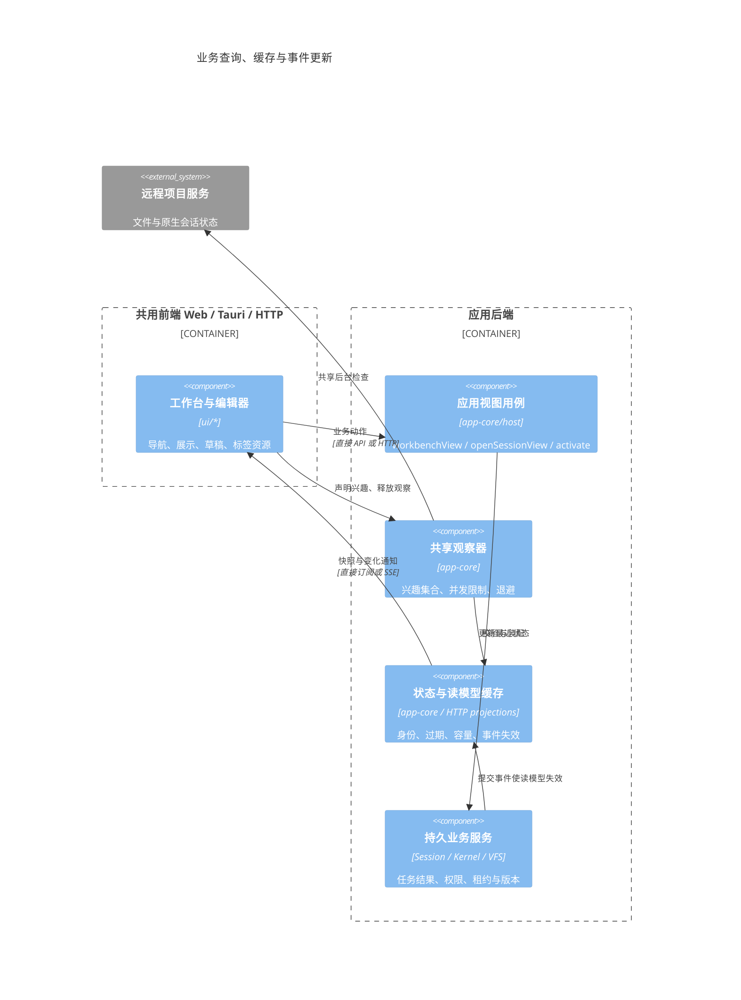
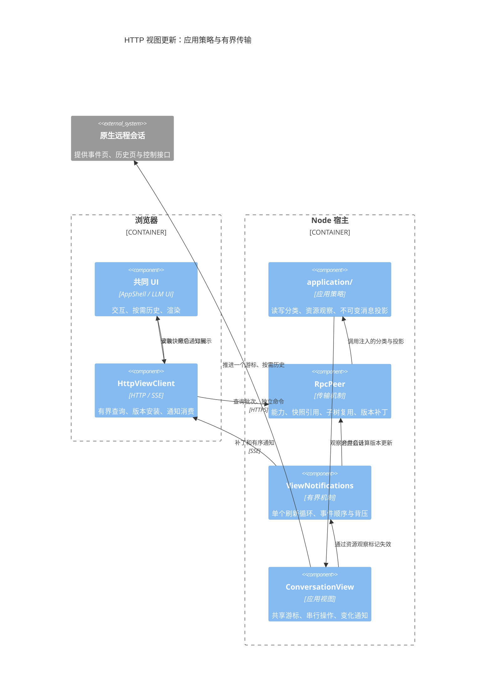

# HTTP 应用宿主

`apps/http-app` 在 Node.js 中装配唯一的 ApplicationRuntime。浏览器使用与 Web 相同的 HTML、CSS、工作区配置、编辑器工厂和 `app-shell.initApp()`，通过服务端口操作后端，不创建 IndexedDB、LLM 或 Kernel Runtime。Tauri 仍通过本地端口注入同一套 UI。CLI 的 `-d` 模式见 [CLI HTTP 模式](http-mode.md)。

## 模块和所有权

| 模块 | 职责 |
|---|---|
| [app-contracts/services](../shared/app-contracts/src/services.ts) | ApplicationClient 前端能力；应用操作异步，快照 selector 同步 |
| [app-shell](../ui/app-shell/src/bootstrap.ts) | 唯一 UI 装配入口；项目、文件、设置、工具箱、数字分身及 Flow 使用原组件 |
| [HTTP 客户端](../apps/http-app/src/client/view-client.ts) | HTTP 调用、SSE 接收、回调回复与连接状态 |
| [应用能力描述](../apps/http-app/src/application/capabilities.ts) | 显式方法、字段、查询模式、观察和失效；按 ApplicationBackend 校验方法覆盖 |
| [传输机制](../apps/http-app/src/rpc/peer.ts) | 注入能力描述；编码、远程句柄、版本、资源借用与撤销 |
| [工作台读模型](../backend/app-core/src/host/workbench-view.ts) | 一次装配侧栏文件视图、生命周期、检索、当前项目、聊天控制和可选首目录/导航数据 |
| [视图缓存](../apps/http-app/src/rpc/view-cache.ts) | 纯字段差分、版本补丁与追加内容；业务失效关系由应用描述提供 |
| [视图宿主](../apps/http-app/src/server/view-services.ts) | 绑定统一应用门面和每个浏览器的独立会话绑定 |
| [HTTP API](../apps/http-app/src/server/view-api.ts) | 客户端证书指纹与 clientId 隔离、事件连接、空闲回收 |
| [存储保护](../apps/http-app/src/server/host-storage.ts) | 数据根路径、内部目录和符号链接检查；存储不经过 HTTP |

目录隔离与远程行为一致性分别验证。Web、Tauri 与 HTTP 共用 app-core/host 的应用门面；UI 不传仓储、内核或构造工厂，任务详情和工具箱在后端聚合。同步/异步返回契约显式声明，传输适配持有远端对象句柄；`app-shell`、`llm-ui`、`app-settings` 不识别 HTTP、URL 或证书。

运行时、存储、租约、扫描和任务执行属于 daemon。浏览器只拥有视图绑定、文件视图和订阅。各浏览器的 Session 绑定独立，共用同一份持久化数据与 Kernel。

## 协议

`POST /api/application` 使用 `version: 6` 与 `clientId`，支持 bootstrap、queries、bindings、call、reply、close。bootstrap 返回公开服务图、产品模板与 Flow 库，以扁平描述避免重复导出对象图；call 只能调用本视图已经导出的能力句柄上的公开方法。v6 增加工作台聚合、会话准备/激活及 UI 文档批量端口，移除独立聊天控制工厂；升级服务后需重新加载页面。句柄包含视图随机身份，不能用于另一个浏览器。私有字段、原型访问、Runtime.dispose、设备注册、SQL 和原始记录写入不开放。

queries 合并同一微任务中独立的只读查询，bindings 合并订阅注册，每批最多 32 项、每个合批器最多 2 批在途，等待与在途调用合计最多 1024 项；服务端先检查整批方法类别再执行。共享只读命令策略使 GetSnapshot、GetSessions 和 Flow 读取进入查询批次，不触发全域失效。业务写入独立确认，不混入查询或订阅批次；失败与结果未知的命令不自动重放。

文件操作经过应用文件视图。用户内容可以读写；`/etc` 的直接写入仅允许 UI 偏好，配置、会话和任务修改通过各自服务执行。字节、Map、Set、回调与持续句柄有显式编码。同步 UI 查询读取已加载的快照；执行和持久化调用经异步端口完成，不使用同步 XMLHttpRequest。

`GET /api/application/events?clientId=<id>` 提供 SSE。通知按 16 ms 窗口合并，只运行一个刷新循环，256 条 / 1 MiB 上限覆盖等待和处理中的事件；刷新期间的失效只安排一次后续刷新，保持事件顺序。客户端也限制排队通知的数量和字节；需要结果的回调单独经 reply 返回，不等待通知批次。领域服务变更也主动更新其他浏览器的快照。客户端先安装 bootstrap，再按序消费已经缓冲的 SSE；服务端在首次快照建立前暂停通知快照刷新。快照补丁携带前后版本，客户端缓冲乱序补丁、忽略旧版本，缺失更新不能覆盖新状态。长连接每 15 秒重新验证证书。连接丢失显示重载入口；写请求不会自动重发。本协议不沿用旧 HTTP 模式的持久命令回执和事件重放，不能宣称跨重载的 exactly-once 保证。

`POST /api/application/files?clientId=<id>&version=6` 使用 application/octet-stream 传输文件字节，X-View-Call 携带编码后的文件能力参数。权限仍由已导出的文件视图检查，不提供宿主路径或存储驱动入口。二进制读写省去 JSON/base64 编码；读取响应头与写入回执携带文件 revision，前端在操作完成前更新 onRevision，条件写入参数保持原有含义。文件接口仍使用完整 ArrayBuffer，不是无限大小的流式存储接口。

每个视图最多 4096 个活跃能力句柄、16 个在途业务请求和 128 个待回复回调，最多 128 个浏览器视图。dispose/release/close 撤销独占子图并传送句柄撤销，关闭资源时同步取消其订阅；共享子图按可达拥有者保留；压缩的撤销区间使迟到更新不能复活已释放句柄。回调中的事务能力仅借用到回调结束。没有事件连接和在途回调的视图在空闲 60 秒后回收。JSON 与独立二进制传输分别限制为 32 MiB；通知等待队列和流写缓冲也有上限。

旧 HttpStorageBackend、记录事务传输、loopback 存储监听、精简 ApplicationShell 与禁用菜单适配已删除。`/api/vfs` 始终拒绝访问；`/api/health` 只返回就绪状态。

## 性能边界

模块边界不应逐一变成网络请求。可见延迟主要由本地处理、关键路径上的串行往返和传输量组成；总请求数不能直接当作串行往返次数。同步视图查询读取前端快照，业务执行和持久化留在后端。同一套 UI 可使用本地端口或 HTTP 端口，但 HTTP 仍有网络与序列化成本。

bootstrap 不预开文件系统；主题与 UI 状态通过文档端口读取，功能服务和工作区文件视图按消费创建，重复引用使用句柄。只读查询不触发全域快照计算；配置、项目、会话、文件、设置、分身按变更事件失效，只有受影响的能力重新计算。小变更发送字段补丁，追加 token/历史发送追加内容。目录过滤、工具箱扫描留在后端；列表只读取 Provider 的安全元数据，完整配置在打开编辑器时读取。普通事件单向通知，不要求浏览器逐条回复。

`workbenchView` 由后端完成服务装配与首目录读取。HTTP 宿主选择预取，本地宿主直接提供服务；UI 消费同一接口，首目录数据只使用一次，后续刷新读取当前视图。首屏读模型由应用用例返回，不改写底层 RPC proxy，不因描述更新退回细碎调用。并发请求只释放自己借用的回调，订阅回调保持到取消订阅。

完整 Shell 集成测试使用内存后端和进程内协议，空数据启动测量如下。当前大小按 UTF-8 字节计算，不含静态资源、TLS 或 HTTP 头；不是广域网延迟测量。通知到达时序可能使启动窗口内的回调数与响应量略有变化。

| 指标 | 聊天首页 | 笔记深链 `/简历.mind` |
|---|---:|---:|
| 启动阶段客户端方法调用（不含 bootstrap） | 16 | 17 |
| 启动阶段请求（不含 bootstrap/SSE） | 8 | 12 |
| 启动阶段反向回调 | 0 | 0 |
| 启动阶段响应体（UTF-8，不含 bootstrap） | 7790 B | 5417 B |
| bootstrap 响应体（UTF-8） | 118228 B | 118228 B |

两条启动路径均不调用 settings、ocr 或 initialFiles 工厂。设置导航只生成本地页面节点；实际编辑器打开后才请求 backend.settings，联系人和标签定义在后端加载。工作区来源只传声明身份或已有文件视图，导出、标签统计和系统浏览按需打开相应来源，保持原有写权限。

2026-10-15 性能复测使用真实 RPC 编解码器、每条正文 256 字符的合成数据，连续九轮向最后一条追加六个字符。旧路径全量刷新，新路径消费带消息身份的更新事件；中位数如下，不代表真实网络或所有领域投影的延迟。

| 历史记录数 | 全量刷新旧测量 | 消息增量投影复测 | 当前补丁大小 |
|---:|---:|---:|---:|
| 100 | 1.9ms | 0.23ms | 206B |
| 1000 | 15ms | 0.85ms | 207B |
| 5000 | 71ms | 2.74ms | 208B |

1000 条记录不变时，poll 响应由 313955B 降为 111B。单个 Session 管理器事件不再重读另外 20 个会话快照，读取次数由 21 降为 1。回归约束使用消息 getter 次数、通知顺序、队列容量与查询在途数，不以易受环境影响的毫秒阈值作为正确性条件。整个工作区导航的合批数受事件到达时序影响，不承诺固定请求数。

## 业务装配与后台缓存

进入工作台通过 `workbenchView` 获取当前项目、导航首屏和聊天控制；UI 不再分别请求特权命令、Skill 工厂和当前项目。`readUiDocuments` 每次最多读取 32 个不透明 UI 文档；`writeUiDocuments` 在后端串行 upsert，前端合并同一轮修改并跳过未变化的内容，失败保留待写数据，flush 可重试。偏好写入不是业务事务批处理。

打开会话先调用 `openSessionView`，在后端校验/准备访问并取得 manifest、项目、目录权限和文件租约。旧编辑器保存、关闭之后才 `activate(branch)`，后端完成 Bind/分支选择并返回消息快照、设置和元信息，编辑器直接消费。两步顺序用于保留目标准备失败时的旧视图，避免旧编辑器保存/解绑影响新会话。取消或关闭准备中的视图会释放文件租约；不会取消业务 Task。缓存标签恢复会话绑定，关闭其他标签不解除当前绑定。

连接探测由 Runtime 共享的观察器执行。前端只提交可见项目和打开标签的兴趣集合；后台跳过无远程挂载的项目，最多同时检查 4 个项目，每次检查预算 3 秒，完成后间隔 15 秒再检查。同一挂载的在途检查继续由 remote-mount 服务合并，最后一个观察者退出后中止探测并停止定时器，不取消任务。

原生会话状态由 `RemoteSessionStatus` 按项目共享轮询，缓存读取不触发远端查询；变化才通知，失败退避 1–30 秒。最后一个订阅退出后保留最多 30 秒的过期投影，重新订阅可先展示并立即后台验证。闲置缓存最多 64 个项目、合计 4096 行，单个超过 512 行的项目不保留；缓存身份包含配置、服务器和授权 revision，身份改变立即拒绝旧缓存。过期记录禁止中断/审批操作。任务的最终结果、运行状态与命令回执仍以持久记录为准；缓存不替代写入门、租约、版本校验或结果未知命令的核对。

默认 Flow 由后端初始化按安装回执准备，用户删除或修改的模板不会在刷新页面时重新覆盖；前端只保留显式恢复与运行交互。



`application.complete` 与 `request.complete` 通过 requestId 对照：前者记录 rpcKind、rpcBatchSize、rpcOperations（注册能力名与方法名）及执行耗时，后者记录整次 HTTP 请求耗时。只记录公开方法元数据，不记录参数、UI 文档名、文件路径、消息或凭据；批次至多记录 32 个方法。bootstrap/SSE/文件传输仍用请求事件统计；不能将逻辑调用数当作 HTTP 请求数或把 SSE 连接寿命当作启动耗时。

## 启动与认证

```bash
pnpm httpd
pnpm --filter @itookit/http-app build
pnpm --filter @itookit/http-app start
```

默认只监听 HTTPS `0.0.0.0:2000`，backlog 为 4096。TLS 验证客户端证书与 clients.json 的 SHA-256 指纹，没有匿名或明文入口。CA、密钥、浏览器导入包和审计日志位于数据根之外。

数据根优先级：`--root` → `MINDOS_ROOT` → mindos.json 的 rootDir → 配置目录/data。配置目录遵循 XDG_CONFIG_HOME，默认 `~/.config/mindos`。SQLite 默认保存在 `<root>/_meta/index.db`；`--sidecar` 可以指定数据根之外的位置。`--internal-port` 已移除。

审计仅记录请求和认证元数据，不记录正文、参数、消息或凭据。服务器退出先结束事件连接，再关闭视图、Runtime、存储和日志。原生目录选择、Shell/TTY、存储快照等平台能力由宿主注入；统一界面不意味着 Node、浏览器和 Tauri 的平台权限相同。

## 验证

- [完整 Shell 回归](../ui/app-shell/tests/http-full-shell.test.ts)：通过远端服务端口装配原 UI、切换工作区，检查导航未被隐藏。
- [服务端口回归](../apps/http-app/tests/view-ports.test.ts)：文件、配置、项目、设置、数字分身、二进制、订阅、异步迭代与所有权边界。
- [真实 HTTPS 回归](../apps/http-app/tests/view-api.test.ts)：mTLS、独立会话绑定、共享持久化、旧存储入口拒绝、版本与跨来源检查。
- [一致性与所有权回归](../apps/http-app/tests/view-consistency.test.ts)：bootstrap 竞态、收藏身份/缓存、750 次资源释放、共享句柄与子服务订阅清理、poll 后快照。
- [性能与并发回归](../apps/http-app/tests/view-performance.test.ts)：查询缓存、追加补丁、乱序版本、批次上限、通知顺序与并发回调寿命。
- [本地存储回归](../apps/http-app/tests/storage.test.ts)：daemon 内部跨 SeqFile 原子提交/回滚和路径保护。

前端 Vite 与服务端 tsup 均检查实际模块图；前端不加载后端实现，后端不加载 UI。运行 `pnpm --filter @itookit/http-app test`、`typecheck`、`build`，以及根目录的模块检查。

## 性能与恢复

Session getSnapshot 是唯一历史快照，getSessions、getStatus 和 isGenerating 从中派生。应用投影将 message:updated 定位到受影响的分组，其余分组保持不可变引用；未知事件和结构变化重新构造投影。编码器复用不可变 DTO 子树，差分、长度比较和引用扫描不再遍历未变消息正文；仍有数组索引与上游领域投影成本，不能宣称总开销与历史长度完全无关。

原生会话在宿主通过 conversation-view 共享一个事件游标推进源，变化时才通知订阅者；关闭最后一个订阅停止后台读取。普通方法返回快照引用，相关版本更新随响应到达后再解析，避免 read/poll/loadEarlier 同时携带完整返回值和补丁。未提供订阅的自定义端口仍可回退轮询。历史由加载入口或明确定位按需读取，不自动遍历全部页面；完整快照和原生 gap 恢复仍保留。

项目 lookup 预热读取内存挂载目录，不再扫描持久项目目录。OCR 后端服务共享首次配置读取；readSettings、label、ready 不写默认值，显式打开配置才 prepareConfiguration，识别不恢复已删除提示词。空输入框订阅也不创建 OCR 服务。工具箱投影内容未变化时跳过写入和元数据事件。

静态 hash 资源使用私有 immutable 缓存，HTML 使用 no-cache 和 ETag 重新验证；gzip 结果按文件身份、大小、修改时间和编码缓存，最多 64 项 / 16 MiB。所有请求仍先通过证书认证。API 响应继续 no-store。

旧 ApplicationPort / ApplicationHost / 持久回执实现与专属测试已删除，历史设计移至 doc/deprecated/，不再保留第二套生产入口。

## C4 事件路径


