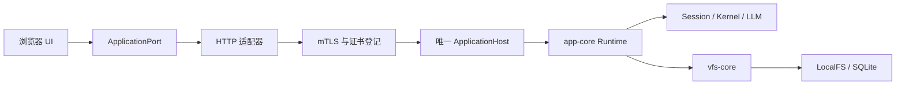

# HTTP 应用宿主

`apps/http-app` 在 Node.js 中装配唯一的 ApplicationRuntime，浏览器只加载 UI 和 HTTP 适配器。Web、Tauri、CLI 的本地装配不要求 HTTP 服务。CLI 自己的 `-d` 入口见 [CLI HTTP 模式](http-mode.md)。



## 接口与执行归属

`POST /api/application` 接收具名查询或命令。客户端必须携带 clientId；命令额外携带 requestId。身份由服务端客户端证书指纹与 clientId 共同确定。API 不接受客户端指定的宿主路径、SQL 或 Runtime 对象。

```json
{"kind":"query","clientId":"tab-1","name":"directory","input":{"workspace":{"kind":"workspace","name":"minds"},"path":"/","limit":200}}
```

文件查询使用工作区/项目身份和相对该工作区的虚拟路径。目录查询只读取一个层级并分页；折叠目录不递归加载。后端提供 revision 且声明 conditionalReplace 时，保存携带该 revision 并沿用 VFS 条件替换。未声明的来源不提供原子 CAS 保证，显式 revision 前置条件会被拒绝；当前 npm LocalFS 驱动只支持普通写入。文件编辑的单次内容上限为 8 MiB。

会话查询按轮次分页；命令只通过会话公开能力执行，内部 Bind/Unbind/GetRuntime 等不开放。命令参数不能改写绑定 Session 身份。Task 响应与取消同时校验 Session 归属和写租约。不同客户端访问同一个 Session 时复用同一个执行上下文，避免多个视图重复装配执行协调器。

`GET /api/application/events?clientId=tab-1` 提供 SSE。变更携带 revision；重连按 epoch 与序号重放有界事件，历史缺口要求重新读取快照。重放上限同时按事件数和字节数限制；慢消费者断开后重新同步。长连接每 15 秒重新核对证书登记。浏览器空闲时不轮询会话，隐藏工作区暂停刷新，重新显示时读取必要的最新数据。

命令回执保存在应用 VFS 的 `/var/lib/application/commands.seq`。相同身份、requestId 与输入的重复送达复用执行中 Promise 或已保存结果；同一 requestId 对应不同输入时拒绝执行。崩溃留下 pending 的命令表示结果未知，不能自动重放。业务操作和回执完成记录不是跨领域原子事务，不能据此宣称所有命令都具有 exactly-once 保证。

客户端关闭只释放自己的订阅和视图；执行上下文属于后端宿主。无订阅且无在途请求的客户端在空闲超时后回收。浏览器草稿和待核对 requestId 由宿主注入的 UI 状态存储保存，重新加载后查询回执，不重新发送未知结果的请求。

## 当前接入范围

HTTP 文件与会话工作区复用 app-shell 的 `Workbench`、VFSUIShell、WorkbenchTabs、WorkbenchSidebar 和默认 MDX 编辑器，不再保留简化 ApplicationWorkbench。`application/workbench-adapter.ts` 只连接具名应用端口与编辑器工厂；`application/file-backend.ts` 将已授权工作区文件和会话导航投影为展示文件源，不创建 LLM/Kernel 执行 Runtime，也不访问原始 HTTP VFS 存储协议。

标题栏、标签页预览/固定/关闭、打开项列表与侧栏布局使用既有组件；支持文件读取/保存、会话创建和聊天。目录创建、文件创建、导入、导出等尚未接入的工具栏按钮保留并禁用，结构修改和标签写入也明确拒绝，不用假成功代替实现。项目选择、归档、挂载、收藏与完整任务检查仍由原 SessionWorkbench 保留，目前没有通过 HTTP 暴露。

新入口覆盖基本文件工作区、会话浏览、历史、发送、停止和人工交互端口。设置、工具箱、数字分身及完整 Flow 工作区尚未迁移，不能把本轮基础端口接入视为完整 UI 功能迁移；未声明的工作区不显示入口。支持新工作区时由宿主注册 renderer，并扩展应用能力契约，不在通用 vfs-ui / llm-ui 内添加 HTTP 分支。

HTTP 浏览器不再使用旧的 HttpStorageBackend 初始化执行 Runtime，也不根据服务端模式切换旧入口。对外 `/api/vfs` 在应用宿主模式下拒绝访问；原始存储服务继续隔离在 loopback 内部监听，保留存储协议测试。

## 启动与认证

```bash
pnpm httpd
pnpm --filter @itookit/http-app build
pnpm --filter @itookit/http-app start
```

默认 HTTPS `0.0.0.0:2000`，内部存储监听 `127.0.0.1:2001`；内部服务要求每次启动生成的凭据。两者的 backlog 默认 4096。TLS 必须验证客户端证书与 clients.json 的证书指纹，不提供匿名或明文降级。CA、密钥、浏览器导入包和审计日志必须位于 VFS 数据根之外。

数据根优先级：`--root` → `MINDOS_ROOT` → `$XDG_CONFIG_HOME/mindos/mindos.json` 或 `~/.config/mindos/mindos.json` 中的 rootDir → 配置目录/data。SQLite 默认 `<root>/_meta/index.db`；`--sidecar` 可指向数据根之外。内部元数据和 rename journal 不向客户端暴露。

路径拒绝穿越、控制字符、反斜杠与符号链接。所有资源在每次请求前认证，跨来源请求被拒绝。文本静态资源支持 gzip；审计只记录请求和认证元数据，不记录参数、消息、文件正文或凭据。服务停止时先结束事件连接，关闭客户端、Runtime 和存储，并汇总清理失败。

LLM、项目与会话初始化在服务器本地执行。预热减少浏览器刷新时的等待，但冷启动仍可能等待宿主就绪；依赖某项能力的访问等待该能力的 readiness。多个宿主访问同一 profile 时仍遵守 Session 租约，不能绕过其他宿主的写所有权。

## 验证

共享工作台回归见 `ui/app-shell/tests/application-workbench.test.ts`：覆盖文件/会话标签切换、编辑器保留、文件 revision 保存、新建会话、目录分页、不可用操作拒绝与真实 Markdown 标题栏。

认证、存储、事务和应用能力测试见 `apps/http-app/tests/`。应用测试覆盖真实 mTLS、命令回执重复送达、客户端释放/回收、会话查询与托管状态写入拒绝；事件测试覆盖重连重放、缺口、字节上限和证书撤销。

2026-10-13 的旧浏览器 Runtime 样本经 SSH 公网入口约 33.1 秒、166 个 VFS 响应。新应用宿主在服务器已预热后的隔离本地样本约 0.22–0.26 秒完成空工作台，首屏两次查询与一条事件连接，空闲 3.5 秒无额外查询；目录展开前只读取根层。两者数据规模与网络条件不同，不能直接按此比值宣称生产提速。
