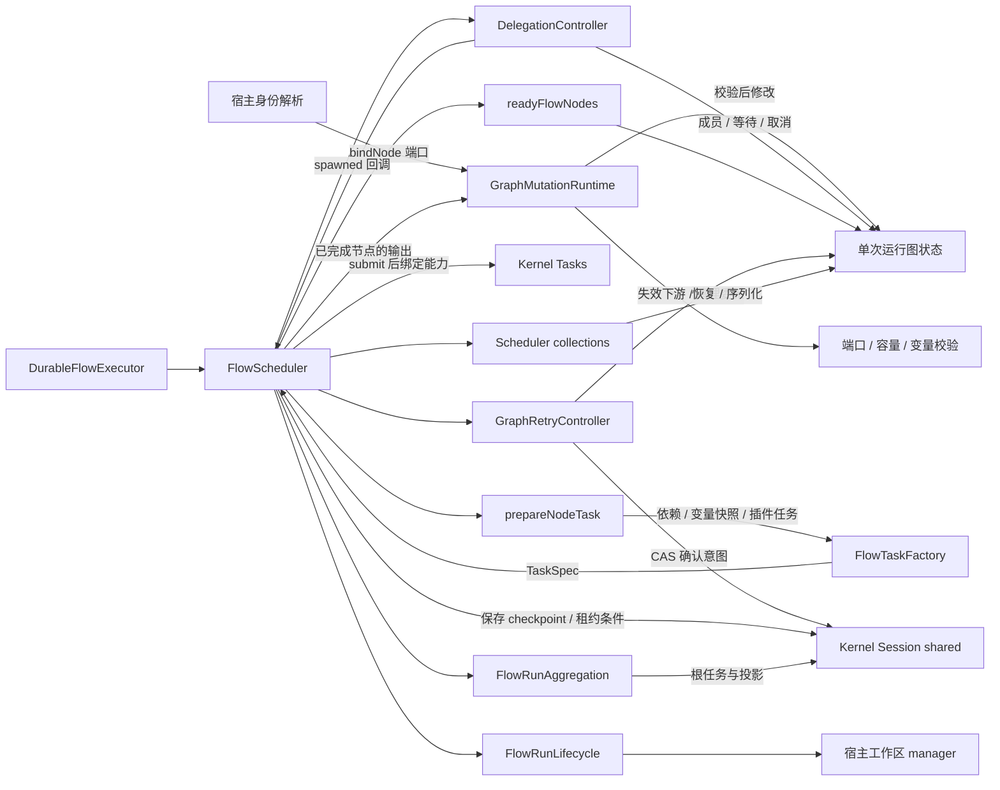

# @itookit/llm-flow — API 参考

`spawn.scope=local` 与函数调用共用节点、边和控制身份映射；除模板引用外，路由规则、默认边、分组成员、join 身份及公开结果键均保持正确作用域。`builtin.agent.config.reasoningEffort` 接受 1–64 字符的字母、数字、下划线或连字符；合法等级由实际模型声明在通信前校验，不固定为跨厂商枚举。

Flow 函数调用使用 `builtin.flow@2.0.0`：`config.flowId/revision/parameters` 绑定子 Flow，子定义通过 `outputs` 声明命名返回值，父节点通过 `${nodes.call.outputs.name}` 使用结果。发布 revision 时固定递归依赖版本和 digest；调用参数在父作用域求值一次，子参数、变量及 Agent 上下文隔离。`builtin.flow@1.0.0` 保留原行为。当前子 Flow 的 `runPolicy` 与调用级 retry/compensate/assign/budget/capabilities 不受支持，会明确拒绝；限额与工作区配置在父 Flow。契约与示例见 [Flow 调用与组合](design/flow-invocation-composition.md)。

同一函数的多组调用使用 `config.parameterSets`（参数对象数组或整值引用），`parameters` 为公共参数，逐组字段覆盖公共值。`maxConcurrency` 默认 1，限制整次子调用的并发；各组参数/变量/上下文隔离，`outputs.result` 按输入序返回命名返回对象数组，空输入返回 `[]`。冻结模板保存于 `DagRunSpec.functionCalls`，应用层 RunDefinition 同步保留；组实例及参数作用域通过检查点恢复，不重新解析子定义。它是通用函数调用能力，不识别业务字段或工具名。示例见 [parameter-calls.flow](../apps/cli/examples/parameter-calls.flow)。

`FlowDraft.functions` / `FlowRevision.functions` 可内嵌完整子 Flow，随主文件递归冻结和发布。`flowId` 优先按定义处的局部作用域解析，外部定义仍从库读取；主文件可独立运行，不必逐个安装内部函数。`builtin.transform.config.operation: batch` 接收 `value` 数组、正整数 `batchSize` 和参数名 `parameter`，返回可直接用作 `parameterSets` 的命名实参数组。可选 `groups` 声明原始分组，`mode: combined | grouped` 决定合并分批或保留组界，完整性检查拒绝漏项、重复和重排。图片、文本及混合内容都按原值传递；见[单文件通用示例](../apps/cli/examples/parameter-batches.flow)及[详细契约](design/flow-invocation-composition.md#单文件函数与图片文本分批)。

当前新图采用独立的 route、taskGroup、join、aggregate@3、loop 控制节点；作文评审模板已迁移。实现、策略默认值及边界见 [Flow 控制节点](design/flow-control-primitives.md)。下文 route@2/@3 的派发模型保留用于旧定义兼容。

`DagRunSpec.input?: FlowRuntimeInput` 保存只读 `{prompt: string}`，缺省为空提示词。模板通过 `${input.prompt}` 读取，变量初值可引用它；参数名 `param.prompt` 和可写 `vars.prompt` 保持独立。输入在提交时复制，随检查点恢复；嵌套调用及结构化派发沿用同一个快照，不属于定义 digest。Agent 的 Flow 执行绑定和运行表单见[内部 Flow Agent](design/flow-invocation-composition.md#agent-引用内部-flow)。

> DAG 编排层：把 `llm-tasks` 的 LLM 任务单元连成动态图（route/loop/spawn/compensate/on_failure/budget），并持久化 Flow 定义。提供 `DurableFlowExecutor`（动态图调度）、`DagCommandService`（命令面）、内置 Flow Programs 与插件。公共 API 从 `@itookit/llm-flow` 根导出；`flow/operations.ts` 的纯操作、`flow/programs.ts` 的输入类型（`FlowDependencyBinding` / `FlowValueInput` / `FlowHumanInput` / `FlowAggregateInput`）与 `flow/executor.ts` 的 `upstreamOf` 未从根导出，需按源码路径导入。

**依赖方向**：`llm-flow → durable-kernel + llm-tasks`（`llm-session` 依赖本包）。不持有会话语义（Round/Branch 属于 `llm-session`）；能力经 Kernel Effect 使用。

`prepareFlowRun(flow, options)` 是共享的校验与编译入口，接受参数、宿主插件目录、节点 binder、定义解析和连接准入端口，返回 `DagRunSpec`；`DagCommandService.prepareRun` 和会话指令准备复用它。`isDagRunSpec` 复用检查点的图 envelope 校验。`externalFlowReferences` 按词法作用域及调用节点的依赖锁收集外部引用；`visitFlowCalls` 用于身份重映射，区分局部与全局名称。`flowRevisionToDraft` 和存储层共用定义正文投影，保留递归内联函数。

`builtin.agent` 支持由宿主冻结的远程执行绑定：`config.execution: {kind: 'harness', connectionId}` 或引用采用该绑定的 `agentId`，宿主解析为 `harnessConnection` 快照，再派发 `kernel-adapters.harness@1`。节点只授予 harness 执行能力，不注入模型默认和本地工具；远程 Agent 不能主持本地 delegation/subtasks。`Flow.connections` 继续为模型连接槽，远程执行连接使用独立配置。使用、恢复与限制见[远程 Harness 执行连接](design/remote-harness-connections.md)。

## 目录

- [统一提交：submitRun](#统一提交submitrun)
- [入口：DurableFlowExecutor](#入口durableflowexecutor)
- [Flow Programs：value / human / aggregate](#flow-programs)
- [命令面：DagCommandService](#命令面dagcommandservice)
- [Flow 定义持久化：FlowDefinitionStore](#flow-定义持久化)
- [DAG 编译：flowToDag / findCycles](#dag-编译)
- [校验：validateFlowRevision / flowRevisionDigest](#校验)
- [插件：DagPluginRegistry / builtin-plugins](#插件)
- [源码结构：文件与路径](#源码结构文件与路径)

---

## 统一提交：submitRun

`submitRun(definition, { kernel, flowExecutor? })` 接受 `CompiledRunDefinition`：`TaskRunDefinition` 提供直接 Program 和能力绑定，`GraphRunDefinition` 提供图与参数。返回 `RunExecution` 的 `root` 和实时 `tasks()`；图重载返回 `GraphRunExecution`，额外保留 `flow: FlowExecutionHandle`。

Chat/Agent、会话 Flow、Flow 编辑器、Plan/Exec 共用该入口。直接 Task 在能力绑定后才启动；图路径沿用已配置的 `DurableFlowExecutor`。`tasks()` 对直接任务返回根任务，对图返回当前节点任务，根任务单独通过 `root` 访问。恢复、图级重试和工作区清理沿用原执行器协议。完整分层见 [RunDefinition](run-definition.md#会话与命令的统一提交)。

## 入口：DurableFlowExecutor

动态图调度器 —— 把 `DagRunSpec` 编译为 Task DAG 并驱动执行。

```ts
class DurableFlowExecutor {
    constructor(options: DurableFlowExecutorOptions);
    async submit(sessionId: string, spec: DagRunSpec, parameters?: Record<string, JsonValue>): Promise<FlowExecutionHandle>;
    async resume(sessionId: string, rootTaskId: string): Promise<FlowExecutionHandle>;
    async waitForCheckpoint(sessionId: string, rootTaskId: string, taskIds: string[], timeoutMs?: number): Promise<void>;
    async waitIdle(): Promise<void>;
}
```

> `submit` 在持久聚合根建立并取得调度租约后、派发任何节点之前就解析（fresh 与 restored 一致），返回的是 live 句柄：`nodes`/`iterations` 随调度填充，最终状态用 `root.wait()` 读取。派发前的确定性校验（图规模、边 schema 引用、`maxNodes`）仍以 rejection 报错；发布之后的调度期失败落在根任务上（`flow.schedule.failed`），宿主应监视 Run 而不是依赖 `submit` 的 rejection。

**`DurableFlowExecutorOptions`**：

```ts
interface DurableFlowExecutorOptions {
    kernel: Kernel;                            // 执行内核
    plugins: DagPluginCatalog;                   // 插件目录（节点类型 → Manifest）
    sessionContext?: { projectInstructions: string; skillInstructions: string; skillIndex: string };
    /** 仅新 Run 解析一次；恢复始终使用其持久化快照 */
    resolveNewRunContext?(sessionId: string): Promise<NonNullable<DurableFlowExecutorOptions['sessionContext']>>;
    bindPatchNode?(sessionId: string, node: DagNodeDefinition, defaults?: Record<string, unknown>): Promise<Partial<Pick<DagNodeDefinition, 'config' | 'inputs'>>>;
    resolveTools?(sessionId, allowedIds): Promise<{
        definitions: ToolDefinition[];
        externalIds: string[];
    }>;
    /** 节点初始化选中 Skill 的激活快照；实现必须把工具限制在节点声明的能力内 */
    resolveSkillContexts?(sessionId, skillIds, allowedToolIds): Promise<SkillContext[]>;
    hooks?: HarnessHookRunner;                   // 可信宿主钩子
    workspaceManager?: FlowWorkspaceManager;     // 宿主工作区管理器
}
```

**`FlowExecutionHandle`** —— 一次 DAG 运行的句柄：

```ts
interface FlowExecutionHandle {
    attachedFromStorage?: boolean; // 只重新连接已有任务，不代表恢复调度
    workspaceCompletion?: Promise<void>; // 可等待工作目录收尾；失败不会改写根 Task 结果
    root: TaskHandle<JsonValue>;                 // 根任务（汇总输出）
    nodes: Map<string, TaskHandle>;              // 节点 id → TaskHandle
    iterations: Map<string, number>;             // 每节点实际执行实例数（Loop 节点 > 1）
}
```

**辅助函数**：`upstreamOf(edges, nodeId): string[]` —— 取某节点的上游边（`flow/executor.ts`，未从包根导出）。

**隔离工作区租约**（`FlowWorkspaceManager`）：`prepare(sessionId, policy)` 创建隔离工作区并返回
`FlowWorkspaceLease`；可选 `restore(sessionId, policy, record)` 让新宿主重新挂载崩溃前的工作区。
`FlowWorkspaceLease.record` 是 JSON 可序列化的租约描述，执行器写入 Session shared
`flow.run.<rootTaskId>.workspace-lease`，因此 `resume` 不会新建第二个工作区，并会补跑中断的
finalization（`workspaceFinalizationKey` 仍为 `flow.run.<rootTaskId>.workspace`）。
`GitWorktreeFlowWorkspaceManager` 是参考实现：record 保存 `{version, directory, branch}`，
restore 校验目录归属与存在性，finish 对「工作区已被上一宿主移除」幂等。

---

## Flow Programs

三个内置 Program 注册为 `flow.value@1` / `flow.human@1` / `flow.aggregate@1`（kind 为 `flow.value` / `flow.human` / `flow.aggregate`，version `1`）。它们是 **Program kind**，不是 Flow 节点类型；Flow 节点类型（plugin id）为 `builtin.transform` / `builtin.reduce` / `builtin.route` / `builtin.spawn` / `builtin.flow` / `builtin.human` / `builtin.agent`，其中前四种映射到 `flow.value@1`，`builtin.human` 映射到 `flow.human@1`，`builtin.agent` 映射到 `llm.agent@1`，`builtin.flow` 是 composite，在执行前展开子 Flow 而不产生 Program；`flow.aggregate@1` 由执行器创建 Run 根任务时使用。

| Program | manifest | 输入 | 输出 |
|---|---|---|---|
| `FlowValueProgram` | `flow.value@1` | `FlowValueInput`（`operation` 纯操作 + 依赖） | `DagNodeOutcome` |
| `FlowHumanProgram` | `flow.human@1` | `FlowHumanInput`（HITL 交互） | `DagNodeOutcome` |
| `FlowAggregateProgram` | `flow.aggregate@1` | `FlowAggregateInput`（聚合策略） | `JsonValue` |

**`FlowDependencyBinding`**：`{ taskId: string; input: string; output?: string; edgeId?: string }` —— 节点对上游输出的引用（`flow/programs.ts`，输入类型未从包根导出）。

**纯操作**（`flow/operations.ts`，供 `FlowValueProgram` 内部使用，未从包根导出）：

| 函数 | 语义 |
|---|---|
| `transformOutcome(...)` | 转换节点输出 |
| `spawnOutcome(...)` | 展开 spawn 子图 |
| `reduceOutcome(...)` | 归约聚合 |
| `routeOutcome(...)` | 路由分发（route 语义） |

---

## 命令面：DagCommandService

把 Flow 草稿/修订命令注册到会话 `CommandBus`（slash 命令控制面）。

```ts
class DagCommandService {
    constructor(options: DagCommandServiceOptions);   // flowStore + kernel + plugins + resolveTools
    register(bus: ICommandBus): void;                 // 注册全部 DAG 命令
}
```

**`DagCommandServiceOptions`**：`{ flowStore: FlowDefinitionStore; kernel: Kernel; plugins: DagPluginCatalog; resolveTools?; resolveSessionContext?; bindNode?; workspaceManager? }`。`bindNode(sessionId, node, defaults?)` 用于静态/Composite 编译及动态 patch 身份解析；动态节点传入产生节点所属 Flow 的 defaults。编译结果 `DagRunSpec.nodeDefaults` 保存按节点划分的默认身份层，Composite 展开保留子 Flow 的作用域；执行器提交时冻结它，并由动态 patch/委派后代沿用。默认配置不扩大动态节点的原能力声明。`DagRunSpec.nodeConnections` 同样按节点保存连接别名、默认槽位、本次运行选择与宿主回退连接，供动态 patch 和委派子节点在提交前解析，Composite 保留子 Flow 的作用域。动态绑定在整批发布前完成，仅采用 config/inputs，并保留原工具能力、预算及委派调度策略；递归保留 resolvedTemplate 的身份内容，将每级模板能力限定为原声明，缺省为空。`resolveSessionContext(sessionId, userMessage)` 返回项目规则、已加载 Skill 规则及 Skill 索引；独立入口传空 userMessage，由执行器冻结并提供给每个 Agent 实例。

**`DurableFlowSnapshot`**：运行快照类型（命令面查询用）。

---

## Flow 定义持久化

```ts
class FlowDefinitionStore {
    constructor(store: FlowStore, plugins?: DagPluginCatalog);
    async createDraft(input: { id: string; name: string }): Promise<FlowDraft>;
    async listDrafts(): Promise<FlowDraft[]>;
    async loadDraft(id: string): Promise<FlowDraft | null>;
    async saveDraft(draft: FlowDraft, expectedDraftVersion: number): Promise<FlowDraft>;
    async createRevision(draft: FlowDraft): Promise<FlowRevision>;
    async saveRevision(revision: FlowRevision): Promise<FlowRevision>;
    async loadRevision(id: string, revision?: number): Promise<FlowRevision | null>;
    async listRevisions(id: string): Promise<FlowRevision[]>;
    async adoptDraft(nodeId: string, name: string): Promise<FlowDraft>;
    // …
}
```

**`FlowStore`**（最小存储接口，由 `llm-session` 的 `FlowEngine` 实现）：

```ts
interface FlowStore {
    listFiles(): Promise<FlowFileRef[]>;
    findFile(name: string): Promise<FlowFileRef | null>;
    createFile(name: string, content: string): Promise<FlowFileRef>;
    readFile(nodeId: string): Promise<string | null>;
    writeFile(nodeId: string, content: string): Promise<void>;
    renameFile(nodeId: string, newName: string): Promise<void>;
    deleteFile(nodeId: string): Promise<void>;
    createAsset(ownerNodeId: string, filename: string, content: string | ArrayBuffer): Promise<unknown>;
    readAsset(ownerNodeId: string, filename: string): Promise<string | ArrayBuffer | null>;
    listAssets(ownerNodeId: string): Promise<Array<{ path?: string; name?: string }>>;
}
```

**`FlowFileRef`**：`{ nodeId: string; name: string }`。**`generateFlowId(name)`**：由显示名派生 ASCII、文件名安全的 Flow id（根导出）。

**`FlowDraftVersionConflictError`**：草稿版本冲突（CAS 失败）抛错。

---

## DAG 编译

`dag.run.start` 支持可选 `connectionId`；`DagCommandServiceOptions.resolveConnection(sessionId, connectionId?)` 由宿主解析会话/全局回退。编译优先级为节点显式连接、本次运行选择、Flow 默认配置、宿主回退。运行选择为实际 Connection ID，不经过 Flow 槽位别名转换；保留节点显式连接，且不修改保存的 Flow 定义。Composite、动态节点和委派子节点沿用持久化的连接作用域。

```ts
type FlowNodeBinder = (
    node: FlowNodeDefinition,
    flowDefaults?: FlowNodeDefinition['config'],
) => Partial<Pick<FlowNodeDefinition, 'config' | 'inputs' | 'capabilities' | 'budget'>>
    | Promise<Partial<Pick<FlowNodeDefinition, 'config' | 'inputs' | 'capabilities' | 'budget'>>>;

flowToDag(
    flow: FlowRevision,
    bind?: FlowNodeBinder,
    fallbackConnectionId?: string,
    resolveComposite?: (id: string, revision?: number) => Promise<FlowRevision | null>,
    compositeStack?: string[],
    dependencyLocks?: FlowRevision['dependencyLocks'],
    isolated?: boolean,
    runConnectionId?: string,
    connectionBindings?: Record<string, string>,
    prepareConnections?: (flow: FlowRevision, bindings?: Record<string, string>) => Promise<FlowRevision>,
): Promise<DagRunSpec>;
findCycles(nodes: GraphNode[], edges: GraphEdge[]): GraphCycles;   // 通用环检测
```

**`GraphNode`** / **`GraphEdge`** / **`GraphCycles`**：泛型图结构（`node.id` / `edge.from→to`），`findCycles` 返回环集合。

连接准入在默认值合并和宿主 `bind` 之后执行：先通过 `prepareConnections` 解析槽位绑定，再对解析后的全局连接执行准入并固定快照，覆盖运行时选择与 fallback。第二次回调不携带槽位或绑定，避免将全局连接 ID 重新解释成槽位别名；未绑定的可选槽保持为空。回调由宿主提供，负责模型能力与媒体请求校验，不应提交任务或执行业务副作用。嵌套 Flow 通过节点 ID 前缀分发自己的 `connectionBindings`，内部编译上下文统一传递递归参数。

结构化派发、控制组调度与重试统一通过包内 `startFlowTask` 绑定能力后启动；Tool 绑定工具能力，Media 绑定模型能力，Agent/Chat 保留既有能力和预算绑定。插件只构造任务声明，具体执行由适配器负责。

`DagCommandService.prepareRun(input: FlowRunPreparation)` 复用命令入口的校验、宿主绑定和完整 DAG 编译，返回 `DagRunSpec`，不创建 Task。宿主可先持久化准入结果，再调用 `submitPrepared(definition: GraphRunDefinition)` 提交可信编译结果；提交仍检查会话写权限并通过既有执行器构造 Run。`RunStart` 复用这两个步骤，命令总线不开放绕过准入的编译图输入。

---

## 校验

```ts
interface ValidationIssue {
    code: string;
    message: string;
    nodeId?: string;
    edgeId?: string;
    severity?: 'error' | 'warning';
}
validateFlowRevision(flow: FlowRevision, plugins?: DagPluginCatalog): ValidationIssue[];   // 结构 + 环 + 引用校验
flowRevisionDigest(flow: Omit<FlowRevision, 'digest'>): string; // 修订摘要（内容寻址）
```

---

## 执行器内部责任边界

`GraphMutationRuntime` 消费单次运行的显式图状态，按顺序处理 patch、边激活/禁用与 join 取消。patch 保留原幂等指纹、图容量、端口、派发和变量校验；整批宿主身份绑定完成后才发布节点与边。`bindNode` 只接收节点和所属作用域默认身份，不能覆盖节点声明的能力及委派策略。它是包内组件，不新增 npm 包或公共根导出。



`delegation-runtime.ts` 保留委派声明解析和成员图构造；`DelegationController` 管理绑定继承、all/any/first-success/quorum 等待、剩余成员取消、失败与超时。它只执行已固定的运行声明，通过 spawned 回调通知调度器，不选择产品策略或安装全局回调。节点轮次身份统一在 `node-instance.ts`，恢复仍使用原有编码。

`prepareNodeTask` 选择上游轮次并校验数据边，解析参数、模板、变量快照和连接，再调用插件生成任务定义。`FlowTaskFactory` 使用显式宿主工具/Skill/身份端口构造 Kernel TaskSpec，包括嵌套 dispatch 目标；整个 Run 使用固定 Context Program 版本。两者不提交 Kernel 任务或写 checkpoint，未新增公共根导出。

执行器仍按 task.started → submit → 记住变量快照与运行成员 → 绑定能力 → checkpoint 的顺序协调提交。LLM 任务及控制组保持 deferStart，图重试 generation 与恢复 requestId 保持原格式；输入装配拆分不改变启动或幂等边界。

`scheduler-state.ts` 统一集合恢复、Task 重挂和内存 checkpoint 序列化，仍使用 version-1 结构。持久化经 `checkpoint-store.ts` 写入 version-2 envelope：运行状态保存在原 scheduler key，较稳定的定义、图、参数和绑定保存在不可变组件中；图内容不变时复用组件。每个历史检查点引用自己的组件，恢复不读取当前 Flow 定义。`readFlowSchedulerCheckpoint(session, rootTaskId, fallback?)` 统一读取旧完整 v1 和新 v2；仅在检查点不存在时使用初始快照，损坏记录、跨 Run 引用、丢失或被改写的组件均拒绝恢复。写入继续受调度租约 fencing 约束，先保存组件再提交指针，历史记录不裁剪。旧版宿主不理解 v2，不能接管新版写入的 Run。

`GraphRetryController` 消费已受理意图，处理下游失效、提交代数、token 退款和递归委派清理；同次消费内，CAS 重读不重复应用同一 requestId，并保留并发追加的新意图。图状态与 `appliedGraphRetries` 回执先写入同一逻辑 checkpoint，再 CAS 确认队列。恢复读取回执，跳过已经应用的 requestId，避免确认前崩溃导致代数/退款重复；checkpoint 写入失败不确认队列。两个写入仍是独立事务，靠可重放协议保证恢复。

`FlowRunLifecycle` 处理工作区创建/恢复、收尾、失败清理与 detached drain；宿主只提供 manager 和 dispose 状态，调用方传入 fenced Session/租约。`FlowRunAggregation` 处理根 Task、运行成员、变量和结果投影，保持输出抑制、失败容忍、结果顺序与嵌套 invocation 幂等请求。根创建使用当前 Session，取得租约后最终投影使用 fenced Session。

`FlowAggregateProgram` 的可变状态只保留依赖、调度等待标记、变量、结果、失败及已消费回执；初始检查点、工作区和运行元数据留在 Task input 中。旧状态在下一次 reduce 时投影为同一结构，避免每个子任务退出事件再次复制大块初始数据。节点退出事件、错误分类和持久提交顺序不变。

FlowValue、FlowHuman 和 FlowAggregate 的后续等待集合仅包含尚未消费退出回执的依赖；完整依赖及已消费身份仍留在持久 state 中。恢复后不重新注册已经完成的等待，历史队列中已存在的重复回执仍按原语义消费，不依赖进程内去重。

运行装配与所有权边界由执行器协调；`FlowScheduler` 经显式端口管理并发派发、等待、生产者校验与结算，失权或宿主关闭返回 detached；图修改组件不自行写存储或取得租约。循环 back-edge 的派发顺序约束，以及 join 只能取消已观察依赖的约束保持原行为。

## 插件

```ts
class DagPluginRegistry implements DagPluginCatalog { … }       // 插件注册表
createBuiltinDagPluginRegistry(): DagPluginRegistry;            // 内置插件
```

内置插件集共 7 个，id 一律为 `builtin.<kind>`、version `1.0.0`：`builtin.transform`、`builtin.reduce`、`builtin.route`、`builtin.spawn`、`builtin.flow`（composite，展开子 Flow）、`builtin.human`、`builtin.agent`（节点类型 → Manifest/UI Contribution）。

---

## 源码结构：文件与路径

`@itookit/llm-flow` 的公共 API 从 `backend/llm-flow/src/index.ts` 根导出（barrel 转发 `flow/index.ts`）。包内结构：

```
backend/llm-flow/src/
├── index.ts                   根导出（flow/* + FlowDefinitionStore/FlowStore/FlowFileRef/generateFlowId）
├── flow-definition-store.ts   FlowDefinitionStore + FlowStore + FlowFileRef + FlowDraftVersionConflictError + generateFlowId
└── flow/
    ├── index.ts               flow 层 barrel
    ├── executor.ts            DurableFlowExecutor + DurableFlowExecutorOptions/FlowExecutionHandle + upstreamOf（未根导出）
    ├── scheduler-state.ts     checkpoint 集合恢复、序列化与 Task 重挂
    ├── checkpoint-store.ts    稳定图组件与运行状态持久化，统一读取 v1/v2
    ├── graph-retry-controller.ts GraphRetryController（包内重试协调）
    ├── run-lifecycle.ts       FlowRunLifecycle + 公共 workspace 类型/lease key（原入口继续转发）
    ├── run-aggregation.ts     FlowRunAggregation（包内根 Task 与投影）
    ├── scheduler-readiness.ts readyFlowNodes（包内就绪判定）
    ├── graph-mutations.ts     GraphMutationRuntime（包内图状态修改与节点身份绑定端口）
    ├── delegation-controller.ts DelegationController（包内委派组生命周期）
    ├── node-instance.ts       instanceKey/parseInstanceKey（包内轮次身份）
    ├── node-task-preparation.ts prepareNodeTask（包内输入与上游轮次装配）
    ├── task-factory.ts        FlowTaskFactory（包内 Kernel 请求构造）
    ├── commands.ts            DagCommandService + DagCommandServiceOptions/DurableFlowSnapshot
    ├── programs.ts            FlowValueProgram/FlowHumanProgram/FlowAggregateProgram + 输入类型
    ├── operations.ts          transformOutcome/spawnOutcome/reduceOutcome/routeOutcome（纯操作，未根导出）
    ├── to-dag.ts              flowToDag + FlowNodeBinder
    ├── validation.ts          validateFlowRevision/flowRevisionDigest + ValidationIssue
    ├── graph.ts               findCycles + GraphNode/GraphEdge/GraphCycles
    ├── plugin-registry.ts     DagPluginRegistry
    ├── builtin-plugins.ts     createBuiltinDagPluginRegistry（内置插件集）
    └── (无持久化路径常量 — Flow 草稿/修订经 FlowStore 落到 llm-session 的 flows 模块)
```

**约定**：只编排 DAG，不持有 Round/Branch/SessionRepository 语义；不依赖 `llm-session`、UI、DOM 或具体设备；`FlowDefinitionStore` 只依赖最小 `FlowStore` 接口（由 `llm-session` 的 `FlowEngine` 适配），每个 Flow 是一个 `.flow` 文件（可变草稿），修订以 asset 形式存放在该文件下（`revision-<n>.json` / `latest.json`）。flows 模块与应用装配路径见 `llm-session-api.md` 的 VFS 路径设定。

## 持久任务 Transcript

`FlowCommand.RunTranscript`（`dag.run.transcript`）接受 `{ sessionId, taskId, targetTaskId }`，taskId 是 Run 根聚合任务 ID。返回 `FlowTaskTranscript`，包含任务 input/output、status/version、完整持久 Effect 交换与 interaction 记录；也可直接调用 `readFlowTaskTranscript(kernel, sessionId, runTaskId, taskId)`。以根任务 input.runTasks 验证归属，无需原 DagCommandService 句柄，拒绝其他 Run 的任务。runTasks 包含全部循环实例、未汇总及 detached 节点。支持可选 `query: { version?, offset?, limit?, maxBytes? }`：默认每页 100 条 Effect、最多 500 条，返回 totalEffects 与可选 nextOffset；`maxBytes`（≥64）限制本页 JSON 编码后的 UTF-8 字节数，超出时按固定顺序裁剪——先丢弃尾部 Effect 并前移 nextOffset，再缩短 input/output 与 Effect 负载，最后只保留首个 Effect 或退化为仅头部——结果带 `bytes` 与 `truncated: true`。后续页携带首屏 version 固定历史快照；未提供 version 的非零 offset 拒绝。这是结构化记录；DagWorkbench 的任务记录对话框按交换分段展示并支持 JSON 和 UTF-8 纯文本文件导出，加载更多会合并同一版本的交换，首屏加载后即可按固定版本独立读取全部分页导出。底层仍整任务读取，输入/输出/interaction 不分页，但整页受 `maxBytes` 字节预算约束。CLI 提供 `mindos export <run-id> [--out file.json] [--max-bytes N]`：以 control 模式读取 transcript（默认 256 KiB/节点）并连同 manifest 写入真实文件，已在 LocalFS 上通过集成测试。纯文本导出包含快照身份与 version，以及完整输入、交换、交互和输出。

`dag.run.list()` 只读枚举最近 100 个 Run（时间倒序，含 Session、根任务 ID、名称、状态）。工作流工具栏的「运行记录」打开列表并进入 Run 控制台；「返回设计」恢复编辑。「继续运行」调用 `dag.run.resume({ sessionId, taskId })`，检查 Session 写权限并取得本机 Run 所有权后恢复调度；同一 Kernel 已有调度器时复用。图级重试提交后会自动继续调度，重开应用后无需额外调用内部 API。列表、快照及固定版本 transcript 均使用持久绑定检查，不因浏览记录激活 Session；显式控制入口才打开 Session。

`dag.run.get({ taskId, sessionId? })` 支持从保存的 Run 根记录重新连接；没有内存句柄时必须提供 sessionId，返回 `attachedFromStorage: true`。依靠 input.run（v1 目标/用量）与 input.runTasks 恢复任务树、最新节点、实例计数及 detached 标记。目标更新使用 Session shared 状态持久保存，读取优先于初始目标。每次快照也刷新持久 Run metadata 中的最终用量，因此先打开的观察控制台在运行完成后能显示最终 token/耗时，与重开一致。`DagWorkbench.openRun(taskId, sessionId?)` 可打开这类记录。若需要继续调度，用 `DurableFlowExecutor.resume(sessionId, rootTaskId)` 从 `flow.run.<rootTaskId>.scheduler` 检查点恢复（首 shared 检查点缺失时回退根 input 的初始快照；版本不支持或隔离 workspace 无法恢复时抛错），`waitForCheckpoint(sessionId, rootTaskId, taskIds, timeoutMs?)` 可等待检查点已包含指定任务。**运行定义在 submit 时冻结并随检查点持久化**：检查点保存 `spec`、`parameters`、`sessionContext`、live `nodes`/`edges`/`edgeState`（含动态 patch 结果）以及 `nodeDefaults`/`nodeConnections`；`resume` 不接受任何宿主定义参数，因此宿主之后改动的 Flow/定义不会改变已在进行的 Run。未被冻结的是宿主插件**实现代码**（同名 `plugin@version` 的新实现会在下一回合生效）。回归：`durable-flow-executor.test.ts`「resumes the Run definition frozen at submit instead of a later host definition」。旧根记录缺少 v1 元数据时拒绝猜测重建。

`prepareFlowTaskRetry(session, rootTaskId, sourceTaskId, requestId)` 返回已登记 Run 成员的 deferred 新 Task，要求非空请求 ID 和当前 Run 的终态源任务。成员含 nodeId/iteration/retryOfTaskId/budget，保存在 `flow.run.<rootTaskId>.retries`；RunGet、重连及 transcript 合并读取。此 API 不授权或启动，不重写旧根输出，也不重算下游，`retryFlowTask` 与 `FlowCommand.RunTaskRetry`（`dag.run.task.retry`）则继续按原 input 白名单和成员预算授权/启动，命令接受 `{ sessionId, taskId, targetTaskId, requestId, downstream? }`，返回新的 targetTaskId 与 retryOfTaskId。旧根输出不改写，新的 Task 结果进入成员查询/transcript；UI 已提供终态任务重试入口与来源标记，进行中禁重，失败复用请求身份；根结束后仍刷新活动成员。RunCancel 包括所有持久成员。

### 图级 retry（下游重算）

`requestFlowGraphRetry(session, rootTaskId, sourceTaskId, requestId)` 在单任务 retry 之上登记「重算下游」意图：

- 从持久化的调度检查点计算源节点的下游闭包（`downstreamNodes(source, nodes, edges)`，含回边，因此重试循环节点会重算整个环）；合成委派子节点不能直接作为重试源；重试父节点或其上游会丢弃原委派组并生成新一代子 Task。
- 调用 `retryFlowTask` 启动重试 Task（成员、预算、`retryOfTaskId` 语义与单任务 retry 一致），再以 CAS 追加意图到 Session shared `flow.run.<rootTaskId>.graph-retry`。
- 下一次调度回合（`resume` 或新宿主）消费意图：把重试 Task 作为该节点的最新实例，丢弃下游各节点已提交实例（取消未终态者）、清 `completed`/`skipped`、把入边重置为 `active`（route 边回到 `pending`），并递增这些节点的提交代数 `nodeGenerations`。代数进入节点 requestId（`flow:<root>:<node>#<iteration>@<generation>`），使重算实例不会命中旧提交的 Kernel 去重，而崩溃恢复的同代重提交仍复用原 Task。
- 要求 Run 可恢复（非终态且存在调度检查点）；已终态 Run 的根不可改写，因此拒绝。重试源的历史用量保留，已废弃下游和委派子节点从 Run 的 token 统计中扣除；工作区收尾仍由 Run 结束时统一执行。

回归：`backend/llm-flow/__tests__/graph-retry.test.ts`（闭包/回边/未知节点）、`durable-flow-executor.test.ts` 的「recomputes downstream nodes after a graph retry of an upstream node」。委派组重算会清理旧成员/边并递增子节点代数，废弃的已完成下游与委派子节点退还 Run 内的 token 统计；这不撤销供应商实际费用。另有预算退款、委派组重算及隔离工作区恢复复用的回归。UI 图级 retry 入口已接线并有 DOM 回归，真实窗口结果收敛提示仍需验收。

并发重试的人工交互按具体 Task 匹配：`dag.run.respond` 接受可选 `targetTaskId`，先刷新持久成员清单并校验目标属于当前 Run；省略目标时，仅在所有成员中恰有一个同名 pending 请求时回应，多于一个则报歧义。Run 面板逐 Task 展示等待请求，回应窗口固定打开时的根 Task 与目标 Task，切换 Run 不改变提交目标。指定 targetTaskId 时支持已 resolved 交互同值重放，终态 Task 也可返回已保存结果；不同值拒绝。省略目标仍只搜索 pending 请求，不猜测已完成回应的目标。

Run 控制会在信号注入和单任务取消前刷新持久成员清单，允许控制其他调用方刚登记的重试任务；按 nodeId 注入信号选择当前最大 iteration 对应的任务，按 targetTaskId 则校验 Run 成员身份。Goal 编辑窗口固定打开时的 Run，信号和取消回调也固定发起时的 Run，异步完成不会刷新切换后的其他 Run；失败通过错误提示呈现。Goal 状态对 Session suspend/resume 的影响及其与目标持久化非原子的边界保持不变。

端口结构注册：`DagPluginRegistry.registerSchema(ref, schema)` / `getSchema(ref)`，或实现 `DagPluginCatalog.getSchema`。相同引用不得重复注册，返回值为副本。FlowSchemaRegistry / flowSchemaIssue / schemaCompatibilityIssue 从包出口导出。目标有 schema 的 data edge 必须解析到已注册定义；发布、直接执行和 patch 拒绝未知引用，下游创建前校验成功上游的实际消费值。id 不同一律拒绝；同一 id 版本不同时要求注册表能证明来源结构是目标结构的子类型（`llm-flow/src/flow/schema-compat.ts`：boolean schema、`integer ⊆ number`、enum 子集、object 的 required/properties/additionalProperties、array items 递归推导）。支持 boolean schema、type、properties、required、items、additionalProperties、enum、minimum/maximum、minLength/maxLength（Unicode 码点数）、pattern 及 title/description 注释，未知关键字和非法模式拒绝。字符串端口兼容性要求长度范围收窄，pattern 相同或有限 enum 可证明满足目标；不假设任意正则表达式之间的包含关系。发布前的边引用与图校验使 `submit` 失败；运行期校验无效数据使 Run 失败（见 `submit` 发布时机的说明）。所有声明 schema 的输出端口都会在节点成功结算时用其**自身**契约校验（`assertNodeOutputs`），包括有消费边、下游契约更宽松或未声明 schema 的情况，失败不派发下游；校验发生在聚合根发布之后，因此表现为失败的 Run。不自动解析 JSON 字符串，不提供端口 repair 策略。

单次运行定义隔离：DurableFlowExecutor.submit 在首次异步操作前复制 DagRunSpec 和 parameters；初始节点的插件清单及其端口 schema 同时缓存，后续动态节点的定义在首次读取时缓存，包含未找到的引用。修改调用方原始对象或宿主之后返回的同名 schema 不影响已缓存定义。DagPluginRegistry 注册时复制清单并保留 runtime/UI 方法的调用接收者。定义持久冻结见上一条：调度检查点保存 `spec`/`parameters`/`sessionContext`/live 图与 `nodeDefaults`/`nodeConnections`，`resume` 只从检查点恢复，因此跨进程恢复不依赖宿主重新编译定义。仍未冻结的是宿主插件实现代码（同名 `plugin@version` 的新实现会在下一回合生效）。

工作区收尾：DurableFlowSnapshot.workspaceFinalization 返回 pending/succeeded/failed 与可选 message，来源为执行句柄状态或 Session shared `flow.run.<rootTaskId>.workspace`。执行器在清理前保存 pending，成功/失败后保存结果，workspaceCompletion 继续可等待并在失败时拒绝。Run 面板显示收尾状态，pending 时继续轮询，失败不改写根 Task 的成功结果。`FlowWorkspaceLease.finish` 可返回 `{ message }`；Git 工作区按策略保留目录/分支时返回具体路径及人工合并说明，失败也附上目录、分支和处理建议。信息持久保存，重开仍可查看；Tauri 透传宿主报告，CLI 执行结束时输出到 stderr。DagCommandServiceOptions.workspaceManager 可注入宿主管理器；`RunResume` 会恢复终态 Run 未完成的收尾。

工作区收尾的 status 表示清理本身的结果，和状态记录保存结果分开。清理成功但最终 shared 写入失败时，活动句柄保留 succeeded 并附加 persistenceError，workspaceCompletion 拒绝；UI 同时显示清理结果和保存错误。清理与保存同时失败以 AggregateError 保留两个原因，不重复调用 workspace.finish。此时重连只能读取最后成功写入的状态（可能仍为 pending），活动句柄的保存错误尚无可靠持久副本。

### Task 所属 Run 与隔离工作区解析

`resolveFlowRunForTask(session, taskId)` 返回持久 `TaskRecord` 或 `undefined`。它读取 Session Task 祖先链及各 Flow 的 members/retries 记录（兼容根 input 中旧成员记录），支持独立提交的节点、其后代和手动重试，并优先最近祖先对应的 Run。普通非 Flow Task 返回 `undefined`；Flow 成员缺失、归属歧义、损坏成员或无效祖先链均抛错。不能用节点 `rootTaskId` 替代成员查询。

`resolveFlowTaskWorkspace(session, taskId)` 返回 `{ rootTaskId, policy, lease }`：策略来自持久 scheduler 检查点，租约来自 `flow.run.<rootTaskId>.workspace-lease`。普通 Task 或 shared 模式返回 `undefined`，隔离模式的检查点或租约缺失时拒绝。此 API 只解析持久身份，不授予宿主路径权限，也不创建/恢复工作区；宿主须验证租约内容并获取授权文件及进程上下文。当前实现读取 Session Task 列表和各 Run 成员，尚无反向索引优化。

`FlowWorkspaceManager.restore(sessionId, policy, record, options?)` 的可选 `FlowWorkspaceRestoreOptions.forFinalization` 只用于终态 Run 的 pending 清理恢复。执行器普通调度恢复不设置此标记。Git manager 据此允许目录已被前宿主删除的清理继续完成分支收尾；不会新建目录，也不会恢复节点执行。工作区列表按完整行匹配。若 cleanup 策略要求保留目录（keep，或失败/取消时的 on-success），缺失目录仍明确报错，不能投影为成功保留。

`FlowWorkspaceLease.releaseCapabilities?(rootTaskId)` 是宿主的文件/进程能力关闭屏障。正常收尾、pending finalization 恢复和调度失败清理均先等待它；失败时不调用 `finish`。`waitForFlowRunTasks(session, rootId)` 等待持久成员（包括 detached）和 Task 后代结束；每轮等待后重读后代，成员缺失则拒绝。不等待聚合根本身，以允许调度失败在清理后投影根终态。单独使用执行器的宿主按需提供屏障，app-core 会话装配自动包装宿主工作区 manager。

节点记忆策略：builtin.agent 将配置 memoryPolicy 通过 buildLlmTaskInput 校验、深复制到持久 Task 输入。会话宿主的 bindFlowNode/bindStandaloneFlowNode 从节点引用的 Agent 解析策略，移除节点与 Flow 默认配置中的直接策略覆盖，不隐含继承父会话记忆权限；没有引用策略的兄弟节点不生成授权。该快照由共享 app-core 装配的 memory_list/write/remove 工具通过 Kernel tool.call 消费；TaskMemoryService 使用 Kernel 提供的 Session/Task 身份读取持久输入，校验工具白名单与策略。模型参数不能覆盖授权来源。

无人消费的输出契约：节点成功返回后，执行器校验没有 active data edge 消费的输出端口自身声明的 schema。控制边不算数据消费；未知 schema 或非法输出使调度失败，不继续派发依赖节点。当前已提交接口在尚未发布句柄时会拒绝 `submit`；已经发布的运行通过根 Task 记录反映失败。此校验不实现输出 repair/continue 策略，也不把 Agent 的 responseFormat 自动编译成端口契约。

### 运行句柄与失败收尾

`DurableFlowExecutor.submit` 在持久根任务建立并取得调度租约后返回，节点集合随调度更新；调用方通过根任务等待结果，关闭宿主存储前还应等待 `waitIdle()`。工作区清理结果通过 `workspaceCompletion` 和持久 finalization 状态单独观察。调度失败时先确认节点取消，再释放宿主能力及清理工作区；取消或释放失败会阻止后续清理，并与原始错误一起呈现在 Run 失败状态中。终态恢复传递 `forFinalization`，供宿主只恢复清理所需能力。

### Run 删除与调度接管互斥

`markSchedulerRunDeleted` 与 `acquireSchedulerLease` 对同一 scheduler-owner 记录使用版本 CAS。删除只有在租约释放或经过时钟误差余量后才写入永久 `deleted` 标记；随后物理删除失败也保留标记供重试。新调度者拒绝已删除 Run，终态恢复同样持有调度租约。CLI 仅移除 Run 投影目录，Kernel 中的删除标记保留。该协议要求参与宿主都识别标记，不等同于对旧版本宿主或在途外部操作的强 fencing。

### 工作区排空与删除互斥

`waitForFlowRunTasks(session, rootTaskId)` 重新读取持久成员及重试，追踪后代，等待成员终态和全部已知任务（含根）的 activeOperations 清零；不等待根的逻辑终态，以免与聚合收尾循环依赖。`resolveFlowRunForTask`/`resolveFlowTaskWorkspace` 查询持久 Run 归属及工作区租约。

`markSchedulerRunDeleted(session, rootTaskId, options?)` 与 acquireSchedulerLease 在同一 scheduler-owner 记录 CAS：仍有效的租约（含 skewMs）拒绝删除；无主时写入 deleted:true、expiresAt:0 和递增 epoch。后续接管拒绝删除标记，终态工作区恢复也先取得调度租约。非法记录拒绝，重复标记幂等；CLI 先写标记再删除投影目录，物理删除失败保留标记供重试。此协议不为不识别标记的旧宿主或外部副作用提供强 fencing。

### 工作台重算与完整记录导出

DagWorkbench 在 Run 未终态时为终态成员提供「重试并重算下游」，单任务重试保持独立请求身份；Run 已终态时只提供单任务重试。失败复用同一请求 ID，等待响应期间相应按钮禁用，实际重算仍由持久图级 retry 协议执行。

任务记录首屏及后续交互页使用 256 KiB 字节预算，同一窗口固定首次读取的版本。只看过首屏也可导出 JSON/文本：导出重新读取该版本全部分页，不给导出请求设置裁剪预算；窗口关闭后不继续读取后续页、不下载迟到结果。导出期间禁用翻页和重复导出，任何已显示页被裁剪时保留截断提示。

导出最多 10,000 条 Effect（含末页），越界、非递增/非法游标、空页却有后续游标、任务身份或版本不符、返回截断数据均报错，不下载不完整文件。此限制不是字节上限，单个交换仍可能很大；分页依然从完整 Task 记录读取。真实 Kernel 重开与命令服务回归覆盖 101 个交换的两页导出、固定版本及 300 KB 原始响应，UI 文件通过浏览器下载接口交付；不替代各平台真实文件保存验收。


新调度检查点包含 `catalog` 契约快照（插件清单及 schema，含动态解析项）；恢复拒绝同 id/version 的清单或 schema 漂移，且不改写 Task。对象键顺序不构成漂移。旧检查点无快照时继续按宿主定义恢复。快照不包含可执行代码，宿主仍须保留旧版本插件的不可变实现。相关回归：`backend/llm-flow/__tests__/run-catalog.test.ts` 和 `durable-flow-executor.test.ts`。


调度租约到期后 assertOwned 拒绝继续推进，心跳不续活过期记录。Flow 的节点提交、共享状态和根信号附带同事务的共享租约条件，旧 owner/epoch 的写入返回失权而不执行 Run 失败清理。工作区 finalization 的完成状态持久化前保持租约，waitIdle 包含此收尾；不保证强制终止任意宿主回调。完整支持边界见[ P1 过渡设计](design/p1-transition.md)。

本地调度租约覆盖调度器取得的 Task 控制句柄、资源创建与预算设置。根结果可先完成，`waitIdle()` 等待有界 detached 工作结束或超时取消；终态 Run 的 resume 同样恢复该收尾。旧 epoch 回调不得取消新调度器的任务。工作区恢复/任务重连失败也会释放调度租约。

节点可用 `portSchemas.inputs/outputs` 声明 `{ id, version?, definition? }`。内联 schema 存入 Run catalog，消费者可仅引用同身份；节点不得削弱插件端口契约。`builtin.agent` 的 `responseFormat.json_schema` 自动绑定解析后的 `result`，默认身份为 `agent.response.<nodeId>.<name>@1`，可由显式 result 引用命名。原始 `message.content` 保留；`outputValidation.onInvalid=continue` 不绕过 Flow 严格校验。发布、直接执行、动态图和恢复均使用同一目录，同身份不同定义拒绝；动态委派子节点的契约也写入快照。

根任务 input 与 `initialScheduler`（冻结的初始检查点）及可选 `initialWorkspace` 一起提交，覆盖根创建至首个 shared 检查点/工作区租约之间的崩溃。恢复优先读最新 shared 检查点，缺失时才使用初始记录；桌面意图清理识别根中的工作区认领。终态恢复会补做尚未写入 pending 的工作区收尾，已成功收尾不会重复执行。

`DagCommandService` 接受 `canWriteSession` 与 `workspaceManager` 宿主端口，独立 DAG 与会话运行共用授权及工作区实现。Run 控制在 `withFlowControl` 内执行：本 Kernel 活跃调度器的租约可复用，其他 Kernel 的活跃所有权不可借用；无调度器时短暂取得租约。Task 响应与所有控制写入携带固定 epoch。每个 Run 的本地控制请求串行执行；暂停先停根调度再停成员，恢复顺序相反，同 Session 其他 Run 不受影响。

工作区收尾超过 5 秒仍未完成时，`workspaceFinalization` 保持 `pending` 并持久记录说明；桌面轮询显示该说明，CLI 退出等待同时报告。超时提示不代表物理清理完成，不释放调度所有权，也不删除仍在使用的文件。完成后的 succeeded 写入排在提示之后，避免迟到提示覆盖终态；确认成功后清除 pending 说明。

## 结构化输入与派发节点

`builtin.input@1.0.0` 校验命名字段并持久等待缺失输入。必填参数可声明 `onMissing: interact`，由对应 input collector 补齐。

`builtin.route@2.0.0` 是普通 DAG 节点：显式 branches 模板、input/prompt/history 策略、maxRounds/maxConcurrency 和 until；每轮通过 Kernel spawn 独立 Task，校验后按 key 保留各类型最新结果。默认不继承上下文，也不发布子 Task 事件到主会话。输出端口为 result。

`builtin.aggregate@1.0.0` 将 previous/updates 按键合并输出 result。节点 outputPolicy 可分别配置 includeInRunOutput/publishToHistory。完整参数与限制见 [结构化派发](design/essay-review-flow.md)；可运行示例见 [作文评审 .flow](../backend/app-core/src/presets/essay-review.json)。旧 route@1 和回边循环行为保留。

运行参数支持 `minimum` / `maximum` / `integer`。`flowToDag` 将参数声明保存为 `DagRunSpec.parameterSchema`；`prepareFlowParameters` 合并默认值并校验，执行器在创建 Task 前调用。route@2 的 maxRounds/maxConcurrency 可使用完整参数模板，运行时保持 number 类型。详见 [参数契约](design/essay-review-flow.md)。

参数可显式声明 `inputSource: 'composer.text' | 'composer.attachments'`，聊天发送时只按此声明预填当前草稿快照，不按字段名猜测。附件源使用现有 `type: 'json', widget: 'images'` 图片契约。需要互斥输入的 Flow 可声明 `inputGroups: [{ name: 'source', mode: 'oneOf', parameters: ['body', 'pages'] }]`；表单展示来源选择，只提交被选字段，并在参数准备、子调用和持久运行中校验恰有一个非空值。没有互斥声明时允许同时提供多种输入；Anki 保留文本和图片合用及 combined/grouped 行为。`DagRunSpec.inputGroups` 与作用域 groups 一起冻结，未选成员的默认值不会重新加入提交。全组缺省只有在所有成员都声明 `onMissing: 'interact'` 时才交给既有显式输入节点补齐。


`FlowCommand.DraftInstall` 校验内置模板后调用 `FlowDefinitionStore.installBuiltinDraft`。独立安装记录防止用户删除模板后重启被自动补装；已有草稿保持原样。

统一调用默认值、param/命名输出引用、schema 判断条件、join/reducer 与可视字段表单见 [作文评审设计第 9 节](design/essay-review-flow.md)。

### 自动输入修改节点

`builtin.revise@1.0.0` 可连接 `builtin.judge` 的 repeat 分支，再返回所属 route。
配置 `fields` 指定允许更新的输入字段，其他调用配置与 check 相同（prompt、systemPrompt、history、outputContract、模型、工具和预算）。运行时编译为 `DispatchConfig.revision.invocation`，每次修改生成独立子 Task；输出更新参数并使旧输入对应的评分失效。最大评审轮数由 judge.maxRounds 控制，最后一轮不再生成未经评审的修改稿。

Flow 的发布 revision 与草稿 draftVersion 分开保存。Session 重跑使用最新保存定义，为新分支固定发布 revision；旧分支和进行中的运行继续使用原版本。详见 [Flow 输出与版本](./design/flow-capabilities-and-output.md)。

### variables 与 assign

FlowDraft/FlowRevision.variables 声明类型和 initial；FlowNodeDefinition.assign 将输出映射到变量。DagRunSpec 同步携带声明与子流程 variableScopes。模板支持 `${vars.field}`、赋值阶段的 `${output.field}` 和 `${output}`。变量提交进入 SchedulerCheckpoint，RunGet 与最终输出可读取其状态与来源。完整语义及示例见 [Flow 内部变量](./design/flow-variables.md)。

调度 checkpoint 经 checkpoint-decoder 验证后恢复，图效果整批结构解码后才进入语义校验和修改；未知插件 config/input 的语义归插件目录。旧 version-1 checkpoint 可不含重试回执，新字段缺省为空。


### 通用 Tool 与媒体 Connection 节点

`builtin.tool@1.0.0` 指定 `toolId/toolVersion/args`，节点 `capabilities` 授权对应工具，
通过 `kernel-adapters.tool@1` 调用既有 `tool.call`。默认持久审批；明确配置 `approval: none`
可确定性执行。成功输出 `outputs.result.content` 为完整有界 JSON，并校验工具输出 Schema。
原生工具可通过 `reconcile(args, context)` 核对同一 `operationId`；无核对能力的写操作
保持不确定状态，缺少原版本不能重放。`ApplicationKernelPlatform.additionalTools` 提供外部注入。

`builtin.media@1.0.0` 使用 `config.connectionId` 或 `config.connectionSlot` 指定连接，
`config.operation` 为 `image.generate` 或 `speech.synthesize`，`config.request` 提供操作参数。
Flow.connections 支持 `name/label?/connectionId?/required?/requiredWhen?/tier?/requirements?`；调用参数的
`connectionBindings: Record<string,string>` 独立于业务 parameters。显式节点绑定优先于
运行/会话默认连接，不能把缺少的媒体连接替换为文本连接。可选槽未绑定时保留空绑定，
若分支最终执行该媒体节点，仍须通过执行时完整校验。

`requiredWhen` 使用既有 `SerializableExpression`（`param`、字面值、比较及布尔组合），只能引用已声明参数，不能读取尚未执行的节点输出；存在条件时由条件决定必选性，否则 `required` 省略时视为必选、`required: false` 允许不绑定。`flowConnectionRequired` 是表单和连接预检共用的纯函数，编译使用当前实际参数与默认值求值并冻结结果。批量函数调用逐行合并公共参数与行覆盖，任一行需要的连接都必须在模板准入时绑定；运行时才能产生的行或未解析的条件参数采用保守必选，不使用子参数默认值静默放过。Anki 文本连接始终必选，配图与语音分别在生成开关开启时必选，OCR 连接只在提供图片时必选。`session.check-flow-connections` 的 `parameters` 与正式准入共用此规则；参数的 `required/default/onMissing` 独立控制必填、默认值与运行时补齐。检查器校验槽位 required 的布尔类型、模型档位和 requirements 的结构，定位未知 connectionSlot 及节点/槽位操作冲突。离线检查不要求安装实际连接；配置可用性和模型能力由宿主的只读连接预检与正式准入核对，需求始终来自 Flow 定义。

可选槽的运行绑定可以显式传空字符串以清除定义中的默认连接；必需槽拒绝空绑定，
嵌套槽使用 `节点路径/槽名`。表单保留已有嵌套绑定，并将清空可选槽与沿用默认值区分。

Provider 与模型须同时显式声明已实现的媒体适配器和实际能力，例如：

```yaml
media:
  image.generate: { adapter: openai-images }
  speech.synthesize: { adapter: openai-speech }
models:
  - id: configured-image-model
    name: Image
    operations:
      image.generate:
        inputModalities: [text]
        outputModalities: [image]
        formats: [png]
  - id: configured-speech-model
    name: Speech
    operations:
      speech.synthesize:
        inputModalities: [text]
        outputModalities: [audio]
        formats: [wav]
        voices: [configured-voice]
```

模型 ID 与音色是占位值，需替换为服务商确认支持的值。`category`、`supportsVision` 和
`supportsAudio` 不会隐式开放生成操作。`size/quality/count/speed/instructions` 等可选参数
也必须与操作声明匹配。媒体声明可通过 Provider 高级设置及模型详情编辑，`.llm` 导入/导出保留。
声明校验不代表真实服务探测；当前适配器使用 OpenAI 兼容 API Key 端点，不使用 ChatGPT OAuth。
旧图片端点可明确指定 `responseFormat: b64_json`、`outputFormatParameter: false`，不按模型名猜测。

媒体节点配置示例：

```json
{
  "connectionSlot": "illustrations",
  "operation": "image.generate",
  "request": { "prompt": "${params.prompt}", "format": "png" }
}
```

媒体 Effect 必须持有 LLM 资源授权，宿主已有 authorizeLlm 时须同时提供 authorizeMedia。
输出 `{ model, assets, usage? }` 的资产项仅有 `sessionId/taskId/owner/name/mimeType/bytes/sha256`；
二进制放在所属 `task.seq` 的 VFS 资产目录，响应上限 64 MiB，不把 base64 写入 Task 日志。
宿主通过 `createMediaResultStore` 与 `readMediaAsset` 为外部工具提供受授权的资产读取端口。
有 token 用量时扣预算，缺失用量不估造；图片/语音专属价格账本尚未实现。

媒体 Effect 默认 180 秒，`config.timeoutMs` 可显式覆盖；传输默认 120 秒，独立客户端可用
`LLMClientConfig.mediaTimeout` 配置。取消须等待在途请求结束。HTTP 失败不自动重试；恢复只
读取并校验本地回执，无回执保持 `MEDIA_INDETERMINATE`，显式重跑可能重复计费。
CLI 使用 `node apps/cli/dist/cli.js run -f job.flow --profile <profile> --connection-bindings bindings.json --json`；
绑定文件为 `{ "illustrations": "configured-connection-id" }`。复现实验：
`pnpm cli:build && node apps/cli/scripts/verify-media-connections.mjs`。

## 图片输入、校对与组合派发

运行参数和 `builtin.input` 字段可声明 `{ type: 'json', widget: 'images', imageConstraints: { maxItems: 4, maxBytes: 6291456, mimeTypes: ['image/png', 'image/jpeg', 'image/webp'] } }`。约束均可省略，核心没有固定数量、字节或格式上限；宿主传输限制仍生效。Anki 的原图数量与总字节限制、处理配方、处理后发送预算均由外部定义声明，详见 [图片处理](design/flow-image-processing.md)。

上传值复用现有多模态消息内容块，例如 `[{ type: 'image_url', image_url: { url: 'data:image/png;base64,...' } }]`；UI 提供选择、预览、清除；浏览器及 CLI 在持久化前把 inline 图片暂存成资产引用。底层执行器保留 inline 调用兼容，模型发送前再解析授权引用。`builtin.agent.config.messageTemplates` 声明标准消息数组，例如 `[{ role: 'user', content: '${param.images}' }]`，支持文本、图片、音频等已有内容块。模板在节点执行前仅渲染一次，并建立上游引用依赖；插入数据中的 `${...}` 不再解释。`messages` 继续表示已有消息快照，不能整体作为模板再次渲染。连接准入推断可见的内容块模态；整体动态内容引用应在连接槽或节点 requirements 中显式声明所需模态。

`builtin.input.config.review: true` 即使初始值有效也会请求用户提交，并在交互 payload.values 中携带预填内容；恢复保持同一待回复交互。默认行为仍只询问缺失或无效字段。

`builtin.flow@2` 的 `config.connectionBindings` 显式映射子槽到父槽，例如 `{ writer: 'text' }`。父槽先完成准入，子槽继续按自己的能力要求校验；运行时的 `callId/writer` 绑定优先于该映射。不隐式继承未映射的槽。

`builtin.spawn.config.scope: 'local'` 使 Tool 返回的局部节点、`${nodes.local.outputs.result}` 引用、`$upstream:local` 端点和幂等键属于当前子 Flow 命名空间，避免多次调用冲突；默认 `run` 保持原行为。公共子 Flow 仍须声明 outputs，不带 runPolicy；并发和工作区策略配置在入口。核心 DraftRestore 仅恢复草稿。应用层通过 app.flow-library.restore 显式协调库恢复和发布，设置恢复也复用同一应用策略；仅新恢复定义会发布，已有用户修改保持原样，依赖定义须按顺序先恢复。


## 用户定义 Flow 的源码检查

`checkFlowSyntax(source, options)` 接受严格 JSON 源码或未信任对象，返回 `{valid, diagnostics, flow?}`；`diagnostics` 含 code、message、severity 以及可定位的 path/line/column。检测 JSON 错误与重复键、定义形状、插件与版本、节点配置 Schema 的类型/必填/枚举/范围/嵌套约束、图/端口/连接、参数默认值及未声明参数引用。消息历史与 systemPrompt 保持字面数据，不误作运行模板。旧 data 边省略 kind 时保留兼容并返回 warning，拼写错误的 kind 仍报错。

`checkFlowSource(source, {resolveComposite, plugins?})` 在此基础上离线展开子 Flow，检查缺失依赖、循环、输出契约和版本锁。`builtin.flow@2` 同时按子流程声明检查未知参数、缺失必填参数、字面值类型、数值范围/整数、非空、选项及图片约束；应用子流程自己的默认值，不隐式继承父参数，允许显式 `onMissing: interact` 收集器补值。整值动态引用的实际类型与值留到运行时校验；插值字符串及包含动态引用的容器仍检查已知外层类型，选项及图片内容约束在引用解析后校验。嵌套调用错误指向当前源码的调用节点，并在消息中标明完整调用路径。诊断代码为 `unknown-call-parameter`、`missing-call-parameter`、`invalid-call-parameter`。不执行模型或 Tool，不要求绑定凭据。没有 resolver 时只检查当前定义，不声称已校验子依赖。扩展插件需要传入相同的 DagPluginCatalog。默认格式为严格 JSON；其他宿主可注入 `parse`，解析错误可携带零基 mark.line/column。

命令 `FlowCommand.SourceCheck`（`flow.source.check`）接收 `{source}`，返回 `{valid,diagnostics}`，使用运行时插件目录和持久子流程解析器。编辑器验证面板、草稿校验与发布共用检查器；`DraftSave` 保存不完整内容并返回校验错误，`DraftValidate` 只校验不写入。草稿安装/恢复只校验自身语法，允许随后安装依赖。发布解析并锁定依赖时再次检查调用参数，错误不写入新发布版本。运行时在动态值解析后再次检查类型、范围、非空和选项约束。

CLI 用 `mindos validate -f example.flow --json` 检查源码和同目录子流程，成功退出 0，错误退出 1。已有 Workflow YAML 的 validate 入口继续使用对应 DSL 校验。检查结果不能证明外部工具已安装、连接凭据可用、图片可解码或业务规则满足；这些由运行准入和 Tool 验证。


## Flow 安装与工具依赖

`toolDependencies: [{ id: 'package.tool', version: '1' }]` 声明具体工具身份和可选工具版本，包版本、模块位置及可执行程序由宿主的可信本地目录管理。Flow 不得携带模块路径、下载地址或安装命令。旧定义兼容推断静态 `builtin.tool.config.toolId/toolVersion` 以及函数依赖；动态工具身份必须显式声明，核心不执行模板或按工具名补规则。Anki 源声明包含其确定性工具、动态打包工具和图片处理工具；业务实现继续由外部工具包提供。

平台无关的 `FlowInstallationService` 统一执行定义检查、工具 ensure、默认参数与条件连接检查。`ready`、`needsConfiguration`、`missingTools`、`failed` 明确区分就绪、待填写配置、缺少工具和失败；报告保留 tools、parameters、connections、errors 明细。工具箱 `flowInstallations.check/ensure/list` 和 `toolPackages.list/ensure` 可查询或重试，`importWithReport` 返回导入路径和安装报告。宿主 `ApplicationRuntimeOptions.toolDependencies` 只能按工具 ID/版本发现并注册已安装或可信本机工具包，不下载未知依赖。

默认 Flow 播种、导入和显式系统恢复复用此机制。资源已存在时保留当前草稿和已发布修订，并对当前保存的声明重新检查；不会用新版产品模板替换用户定义，也不会捏造或写回缺失参数、凭据或连接。系统恢复结果逐项返回 dependencies，`initialFiles.prepareDependencies(ids)` 只重试依赖，不重复恢复资源。
