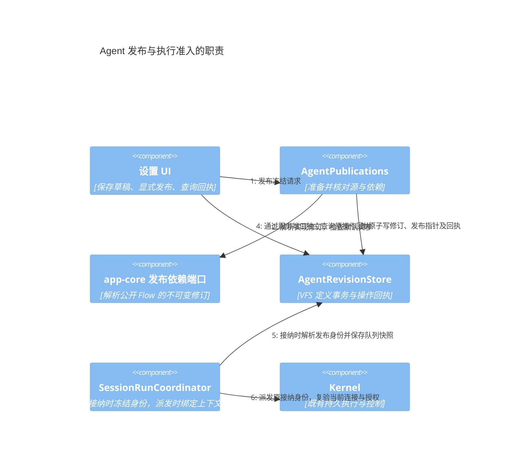
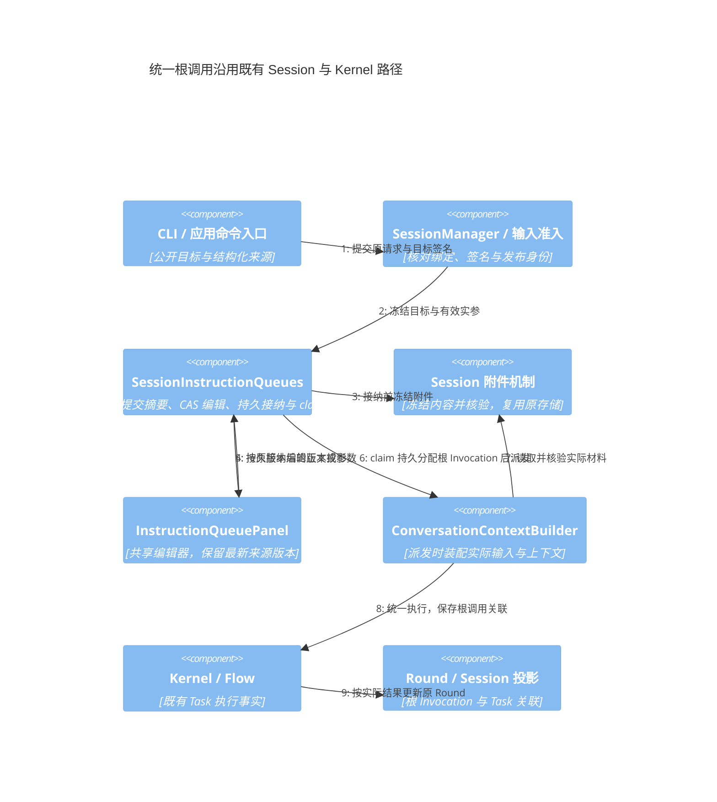
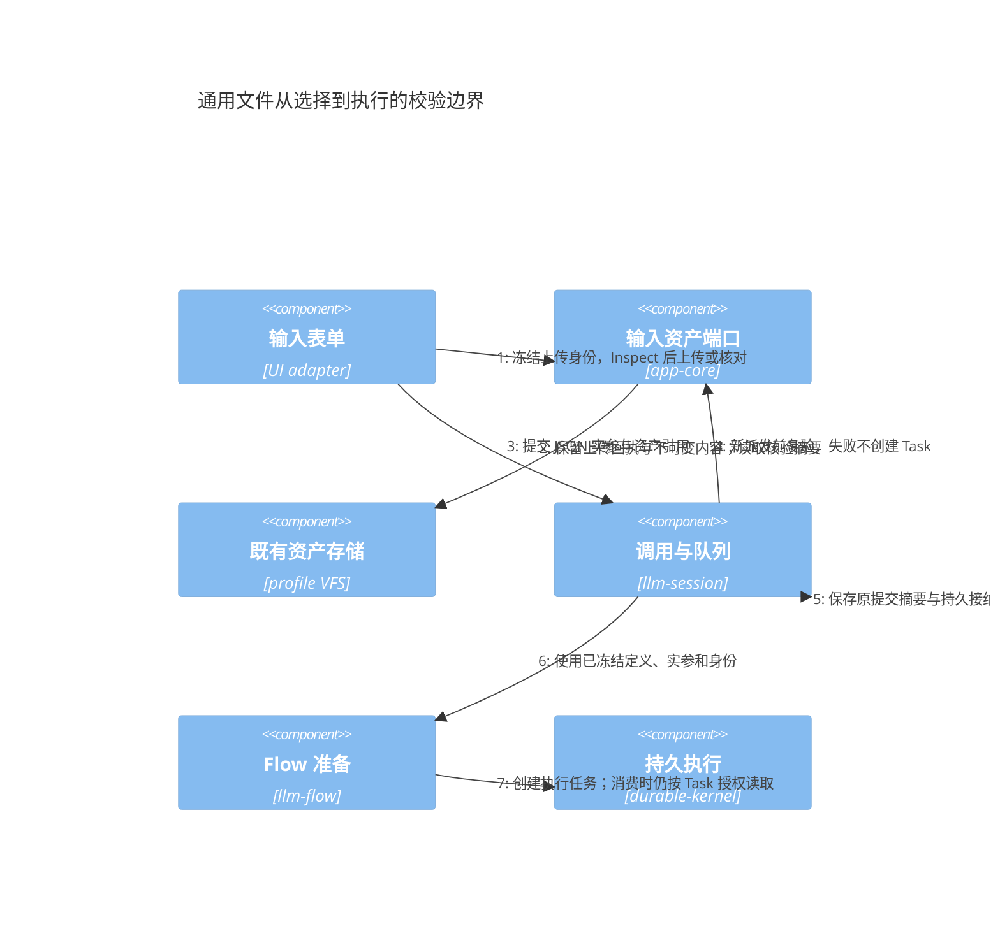
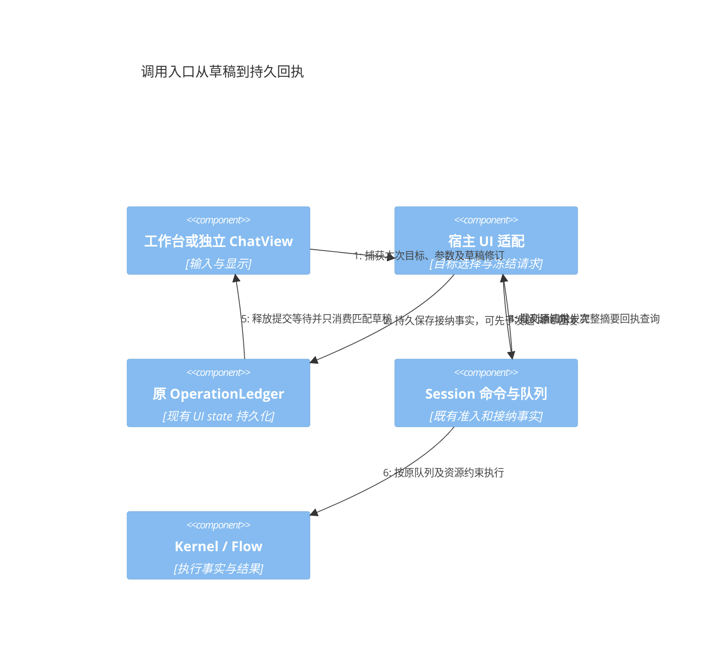

# @itookit/llm-session — API 参考

Agent 可声明 `execution: {kind: 'flow', flowId, revision?, parameters?, connectionBindings?}`，通过普通发送入口运行内部注册的 Flow；省略修订号时跟随最新已发布版本。`ExecutionOverrides.flowParameters/flowConnectionBindings` 为本次覆盖，提示词通过 `DagRunSpec.input.prompt` 传入。接纳队列时冻结 Agent、所选定义及外部依赖，既有请求不受后续文件删除影响；新请求检查只读 `availability`，被引用文件缺失时拒绝且不回退默认助手。资源可用性由宿主通过 `VFSAgentService.configureFlowAvailability` 注入，具体交互、版本与归档见 [Agent 引用内部 Flow](design/flow-invocation-composition.md#agent-引用内部-flow)。

会话 Flow 与 Flow Agent 的新指令在 `flowBinding.plan` 持久保存预编译图及引用身份快照；派发时补入当前历史并复验连接，不重新选择定义或模型。计划摘要损坏会拒绝恢复，无计划的旧队列保持兼容。可用性检查按 Flow ID/修订缓存，资源事件失效，读取单个 Agent 只等待相关绑定；正式准入独立执行。静态引用的 Skill 初始上下文也使用已接纳版本，工具发现与运行授权仍由现有执行链负责。

`FlowInvocationService` 提供 `session.flow.invoke` / `session.flow.invocations`：以 `sessionId + requestId` 幂等启动固定 revision 的独立 Flow Run，同一 Session 可并行调用，调用意图和根 Task 引用持久化，结果不会推进普通对话的 branch head。`SessionCommand.CreateFromFlow` 的 `invocation: true` 直接创建调用；未指定时保留旧 Flow Session 路径。恢复与 UI 交互边界见 [Flow 调用与组合](design/flow-invocation-composition.md)。启动恢复先用上述标记筛出候选 Session：标记存在且不含该 Session 时完全不做 `listShared` 探测；先按标记写入、后写调用记录的顺序保证标记故障只会多扫一次，不会漏恢复。


`session.flow.invoke` 可显式传入 `execution: 'child'`：输入 `sessionId` 表示调用来源，宿主幂等创建并准备子 Session，在子 Session 中接纳一次 Invocation。父级记录返回 `executionSessionId` 指向执行所属 Session；子级记录保存 `callerSessionId`，父级引用与子级执行共用同一个 `invocationId` 和真实 `rootTaskId`。查询根 Task 必须使用 `executionSessionId ?? sessionId`。这些关联是宿主字段，调用者不能通过请求注入。目的地属于请求身份的一部分，同一 requestId 不能从当前 Session 改为子 Session 或反向切换。

父级先固定根发布修订、来源材料和解析实参，保存的是路由意图；子级在实际接纳前固定编译计划。调用接口只有在原根 Task 得到确认后才成功返回，创建子会话的成功不等于执行已接纳。重启与丢回复沿原父意图、子会话创建身份及子调用核对，不新建另一个调用。组织关系不传播控制、队列或完整聊天上下文。普通调用不传 execution 时继续原 Session；工作台默认独立调用及函数卡片尚需迁移，见合入计划 F16。

`ContentTransferService` 提供显式材料传递：`session.content.capture({sessionId})` 固定当前分支的可见文本和已完成 Flow 输出；`session.content.resolve({sessionId,captureId,selection})` 准备消息选择或摘要；`session.content.create-child({sessionId,requestId,title,transfer?})` 幂等创建独立子会话并准备执行存储。`FlowInvocationInput.inputSources` 按参数名引用 `{sessionId,id}`，准入核对实际参数后保存完整 `inputTransfers`。`SessionCreation.initialContext` 与身份同事务创建且不可变；Context 装配将它作为显式材料，父子关系本身不继承聊天历史。摘要由可选 `ConversationSystemOptions.summarizeContent` 宿主端口注入。来源、预算及界面边界见 [显式内容来源与独立子会话](design/flow-invocation-composition.md#显式内容来源与独立子会话)。

> 用户可见的会话语义 + 持久化：Session 生命周期、Round/Branch、SessionRepository（会话目录持久化）、RoundLog、SessionEventBus、UI projections、Durable Conversation。同时是上层装配入口：`initializeConversationSystem()` 统一注册 `llm.chat/agent/plan` 与 `flow.*` Programs 并装配 CommandBus/DAG。公共 API 从 `@itookit/llm-session` 根导出；少数内部工具（`RUNTIME_KEY`、`ulid`/`extractTimestamp`、`log`、`ContextProfileStore`、`VFSEntityStore`、`SessionFolder` 类型）仅按源码路径可用。

**依赖方向**：`llm-session → llm-flow → llm-tasks → durable-kernel`（本包 re-export `@itookit/llm-flow` 全部 API）。

## 目录

- [装配入口：initializeConversationSystem](#装配入口)
- [会话管理：SessionManager](#会话管理sessionmanager)
- [会话核心：CommandBus / ExtensionRegistry / 插件](#会话核心)
- [持久化：SessionRepository（ISessionRepository）](#持久化sessionrepository)
- [Round：RoundLog / RoundGraphService / RoundOperations](#round)
- [分支：BranchService](#分支branchservice)
- [状态与事件：SessionState / SessionEventBus](#状态与事件)
- [服务：VFSAgentService / PromptHistoryService / AgentResolver](#服务)
- [Kernel 存储桥接：SessionDirectoryStorageResolver](#kernel-存储桥接)
- [Durable Projection：DurableConversationProjection](#durable-projection)
- [工具函数](#工具函数)
- [源码结构：文件与路径](#源码结构文件与路径)

---

## 装配入口

```ts
interface ConversationSystemOptions {
    agentService: IAgentConfigService;
    sessionEngine: ISessionRepository;
    promptHistoryFiles: IFileSystem;              // prompt 历史的文件系统
    kernel: Kernel;
    flowStore: FlowStore;                        // 独立 flows 模块的工作流存储
    resolveSessionContext?(sessionId: string, userMessage: string): Promise<{
        projectInstructions: string; skillInstructions: string; skillIndex: string;
    }>;
    resolveTools?(sessionId, allowedIds): Promise<{ definitions: ToolDefinition[]; externalIds: string[] }>;
    retrieveMemory?: ConversationRunCoordinatorOptions['retrieveMemory'];
    dagPlugins: DagPluginCatalog;
}

interface ConversationSystem {
    sessionManager: SessionManager;
    commandBus: CommandBus;
    dag: DagCommandService;
}

async function initializeConversationSystem(options: ConversationSystemOptions): Promise<ConversationSystem>;
```

装配流程：初始化 services（`agentService.init()` / `sessionEngine.init()` / 实例 `PromptHistoryService.init()`）→ `registerDurablePrograms(kernel)` 注册 Programs（`llm.chat/agent/plan` + `flow.value/human/aggregate`）→ 创建 SessionManager → 用 `new FlowDefinitionStore(flowStore, dagPlugins)` 装配 CommandBus + DagCommandService → 激活插件（session/vcs/history）。

---

## 会话管理：SessionManager

`SessionManager implements ISession, SessionQuery` —— 会话门面，UI 主要入口。`ISession`（`llm-session/contracts`）：`signal(s)` 入站 + `events()` 出站事件流（Unix 进程模型）。

```ts
class SessionManager implements ISession, SessionQuery {
    signal(s: Signal): void;
    events(): AsyncIterable<AgentEvent>;

    // 会话绑定（会话 id ↔ 运行时）
    async bindSession(sessionId: string): Promise<SessionSnapshot>;
    unbindSession(): void;
    getCurrentSessionId(): string | null;
    getSnapshot(): SessionSnapshot;
    getSessions(): SessionGroup[];
    getStatus(): SessionStatus | 'unbound';
    isGenerating(): boolean;

    // 消息
    async sendMessage(
        text: string, files: ChatAttachment[], agentId: string,
        overrides?: ExecutionOverrides, origin?: SessionOrigin,
        historyPolicy?: HistoryPolicy, sendIntent?: SendIntent,
    ): Promise<string>;
    abort(): void;

    // 编辑/权限判定
    canRegenerate(messageId): { allowed: boolean; reason?: string };
    canDeleteMessage(messageId): { allowed: boolean; reason?: string };
    canEdit(messageId): { allowed: boolean; reason?: string };

    // 上下文模式（round 级 include/exclude）
    async setContextMode(roundIds: string[], mode: 'include'|'exclude', scope?: 'node'|'subtree'): Promise<void>;
    async getContextModes(roundIds: string[]): Promise<…>;

    // 事件
    onEvent(handler: (e: SessionEventEnvelope) => void): () => void;
    onGlobalEvent(handler: (e: RegistryEvent) => void): () => void;
}
```

**装配**：使用 `initializeConversationSystem(options)` 返回的实例和异步 `dispose()`；低层使用 `new SessionManager(engine, agentService, options)`，由持有者调用 `destroy()`。单例工厂与 getter 已删除。

**项目草稿来源**：首次提交可携带 `SendIntent.submission = { id, source: { kind: 'project-draft', ownerId: projectId, id: draftId } }`。Session 层将 `submissionId` 用作该 Round 的身份，并将来源保存到 `Round.submission`；历史提交完成后的 `execution_task_projected` 同时携带该来源。应用层验证持久 Round、执行引用和历史索引后，事务性地记录草稿转正并补建下一份草稿。普通 `createSession` 不触发此流程，内存队列返回成功也不作为转正依据。生命周期、恢复及通知详见 [项目内的新会话草稿](design/vfs-session-browser.md#项目内的新会话草稿)。

**对话 / 执行模式**：`ChatSessionSettings.executionMode` 与 `ExecutionOverrides.executionMode` 使用 `ChatExecutionMode = 'chat' | 'agent'`；UI 默认 chat，Session settings 持久化该偏好。`SendIntent.execution` 的 agent 分支可携带 `mode`，优先于 overrides。发送准入前复制意图与覆盖参数，创建的 Task 在 labels 固定 executionMode。chat 剥离工作区工具，保留显式授权的客户端 WebSearch / Provider 内置搜索；agent 固定 llm.agent 与默认 50 次交换预算。未配置 `capabilityPolicy.toolIds` 时，宿主 `resolveHarnessToolIds(sessionId)` 提供已启用的 Read/Glob/Grep/Write/Edit/Bash；Bash 需要宿主注入 Shell。显式白名单（含空数组）优先，无可用工具时拒绝提交。工具仍受 Session 挂载与 external 审批限制；执行提示要求实际使用工具并按 Session 虚拟路径操作。无 mode 的旧 API 调用继续按工具自动选择程序；Flow 分支不消费该偏好。实现见 [direct-execution-mode.ts](../backend/llm-session/src/session/direct-execution-mode.ts)，完整调用链回归见 [harness-default-tools.test.ts](../backend/app-core/tests/harness-default-tools.test.ts)。

---

## 会话核心

Session 指令队列由 Runtime 共享的后端服务持久接纳及自动续发；空闲和运行中的 `session.send` 均返回稳定指令 ID，持久写入成功后才进入执行。`session.instructions.get` 读取 `SessionInstructionQueue`，`session.instructions.edit` 使用 `InstructionQueueEdit.expectedRevision` 删除、调整顺序、合并、暂停、继续或重试准入失败的指令。各视图的 `SessionSnapshot.instructionQueue` 和 `instructions:changed` 提供同一版本读模型。状态、恢复边界及前后端 C4 见 [Session 指令队列](design/session-instruction-queue.md)。

### CommandBus

`CommandBus implements ICommandBus` —— 会话命令总线（slash 命令注册/分发；`DagCommandService.register(bus)` 与插件命令均注册于此）。

### ExtensionRegistry

`ExtensionRegistry implements IExtensionRegistry` —— 插件扩展注册表（`register()` + `activate({ commands })`）。

### 插件工厂

| 工厂 | 用途 |
|---|---|
| `createSessionPlugin(sessionManager)` | 会话生命周期命令 |
| `createVcsPlugin(sessionManager)` | 分支/版本控制命令 |
| `createHistoryPlugin(sessionManager)` | 历史/上下文命令 |

---

## 持久化：SessionRepository

`SessionRepository implements ISessionRepository`（`persistence/session-repository.ts`）—— 会话身份、历史文档与附件的唯一事实源。构造参数为根文件系统（`IFileSystem`）；存储布局与一致性约定见[会话数据仓库：SessionRepository](#会话数据仓库sessionrepository)。

```ts
class SessionRepository implements ISessionRepository {
    constructor(fs: IFileSystem);
    init(): Promise<void>;
    dispose(): Promise<void>;
    subscribe(listener: (change?: SessionRepositoryChange) => void): () => void;

    // 会话生命周期
    createSession(title: string, folder?: string | null, parentSessionId?: string | null,
        initialState?: ConversationUIState, creation?: {agentId?: string}): Promise<string>;   // 返回 sessionId
    ensureSession(id: string, title: string, origin?: SessionOrigin, folder?: string | null,
        parentSessionId?: string | null, creation?: {agentId?: string}): Promise<string>;

    // Manifest / 列表 / 删除
    getManifest(sessionId: string): Promise<ConversationManifest>;
    getLoadState(sessionId: string): Promise<SessionLoadState>;
    list(): Promise<ConversationManifest[]>;
    listSummaries(): Promise<SessionSummary[]>;
    deleteSession(sessionId: string): Promise<void>;

    // 文件夹
    listFolders(): Promise<SessionFolder[]>;
    createFolder(path: string): Promise<SessionFolder>;
    deleteFolder(path: string, recursive?: boolean): Promise<void>;
    renameFolder(from: string, to: string): Promise<void>;

    // Manifest / UI 状态 / 设置
    updateManifest(sessionId: string, patch: Partial<ConversationManifest>): Promise<void>;
    getUIState(sessionId: string): Promise<ConversationUIState | null>;
    updateUIState(sessionId: string, patch: Partial<ConversationUIState>): Promise<void>;
    compareAndSetUIState?(sessionId: string, expectedRevision: number, patch: Partial<ConversationUIState>): Promise<void>;
    getSessionSettings(sessionId: string): Promise<ChatSessionSettings>;
    saveSessionSettings(sessionId: string, patch: Partial<ChatSessionSettings>): Promise<void>;

    // 历史文档与附件
    readHistoryChain(sessionId: string): Promise<SessionHistoryChain>;
    readDocument(sessionId: string, name: string): Promise<string | null>;
    writeDocument(sessionId: string, name: string, content: string): Promise<void>;
    listHistory(sessionId: string): Promise<string[]>;
    writeAttachment(sessionId: string, name: string, content: ArrayBuffer): Promise<void>;
    openAttachments(sessionId: string): Promise<FileSystemView>;
    readSessionAsset(sessionId: string, name: string): Promise<Blob | null>;
}
```

**`ISessionRepository`**（`persistence/types.ts`）：上述契约接口。会话身份即 `<id>` 目录，不存在 UI 节点 ↔ 会话的映射 API；会话标题是 manifest 的 `title` 字段，经 `updateManifest()` 修改。

创建与恢复使用不同语义：`createSession` 在事务中预占存储身份，已有 ID 返回 `EEXIST`；`ensureSession` 幂等沿用已登记位置，未登记的中央会话优先保留原位置，安装项目 resolver 不会复制旧会话。读取始终核对持久存储索引，不使用实例启动时的“存在项目存储”标志。`validateProjectSessions(directory)` 是只读预检，项目创建及旧目录接管在写项目身份前调用；`indexProjectSessions` 在同一事务先验证整批目录名、manifest ID、已有位置与迁移状态，再发布索引。重复身份返回 `ECONFLICT`，包含 ID、登记路径和候选路径，不自动覆盖或删除副本。中央迁移和恢复也必须核对来源仍是登记位置，拒绝用过期来源重置索引。正式导入继续分配新 Session ID。

`SessionRepository` 构造函数第三个可选参数接受实例级 logger。存储扫描、身份校验、迁移意图、目录传输、附件复制、索引提交及恢复记录 `session.storage` 事件，包含 operation、operationId、stage、outcome、durationMs 和安全错误分类。重复身份额外记录 sessionId、registered、candidate；迁移及恢复通过稳定 moveKey 关联。日志不写 manifest、历史、附件正文或原始异常；实际 HTTP 运行时输出到 runtime 日志，独立仓储默认静默。

`listSummaries()` 是导航专用读取：每批最多 64 个 Session，使用跨文件 `getEntriesMany` 只读取 `session.seq::session`，返回 `SessionSummary`（身份、标题、摘要、来源、时间及组织关系），不读取 history index，也不返回分支、草稿和 UI 状态。缺失 Session 记录跳过，身份/版本错误仍拒绝。摘要不证明历史完整；打开会话时仍由完整读取校验历史。该能力在 `ISessionRepository` 上可选，旧实现回退 `list()`。Session browser、项目导航和家族选择均使用摘要；完整编辑、导出及恢复保留原接口。

`SessionRepositoryChange` 为 `{ kind: 'session' | 'ui-state'; sessionId?: string }`。纯 UI 状态保存通知 `ui-state`，sidebar 不因此重新枚举；旧实现不提供事件参数时仍按普通变更处理。manifest 更新只读写受影响的记录，UI 状态不触碰 history index；相同内容不增加 revision、不写记录、不通知。比较和分支草稿合并仍在持久事务内完成，不使用跨加载的状态缓存。

---

## Round

### RoundLog

`RoundLog implements ILog` —— round 级消息日志（VFS 持久化）。

```ts
class RoundLog implements ILog {
    get(key: string): ChatMessage[] | null;
    set(key: string, messages: ChatMessage[]): void;
    invalidate(ref: Ref): void; invalidateAll(): void;

    // Ref（分支引用）管理
    create(name: string, at: RoundId): Promise<Ref>;
    move(ref: Ref, to: RoundId): Promise<void>;
    delete(ref: Ref): Promise<void>;
    list(): Promise<Ref[]>;
    refs(): RefStore;

    // Round 追加/折叠
    async append(ref: Ref, round: Round): Promise<RoundId>;
    async appendExpected(ref: Ref, round: Round, expectedHead: RoundId | null): Promise<RoundId>;
    async fold(ref: Ref, strategy?: AssemblyStrategy): Promise<ChatMessage[]>;
    setEventListener(fn: (event: RoundLogEvent) => void): void;
}
```

**辅助**：`roundToProjection(round, roundId): RoundProjection`、`hasEffectiveAssistant(round): boolean`。

**助手占位投影规则（2026-09-11 第六十一/六十二轮）**：chat round 若没有 assistant 输出，`roundToProjection` 仍会按以下规则投影助手占位，否则转写会以用户消息结尾，下一次发送被 `Cannot send consecutive user messages` 拒绝：
1. 终态（`failed`/`cancelled`）且有用户输入 → 投影 `failed`/`aborted` 占位（含 `error`）；
2. **已记录 execution 但仍为 `running`/`pending`**（拥有它的宿主已消失）→ 投影 `running` 占位，`SessionRegistry.getSnapshot().interruptedAssistantId` 据此提示「上次执行未完成」并可重新执行；
3. `waiting`（等待人工输入）与从未启动过执行的 round 保持仅用户消息。
回归：`backend/llm-session/__tests__/failed-round-projection.test.ts`（7 通过）与 `ui/app-shell/tests/host-restart-inflight.test.ts`（真实本地存储 + 永不回包模型，宿主在运行途中退出后重开：转写以助手占位结尾、`interruptedAssistantId` 存在、新消息不再被拒）。

### RoundGraphService

Round DAG 图服务（加载/保存 manifest + 依赖图）：

```ts
class RoundGraphService {
    setEventListener(fn: (event: RoundLogEvent) => void): void;
    async loadManifest(): Promise<RoundManifest>;
    async saveManifest(manifest: RoundManifest): Promise<void>;
    async append(ref: Ref, round: Round, expectedHead?: RoundId | null): Promise<RoundId>;
    // …
}
```

**`RoundGraphError`**：图操作错误（`code` 标识具体规则）。

### RoundOperations

`class RoundOperations` —— round 业务操作（sendMessage 执行、regenerate 判定）。`hasRegenerateAssistant(...)` 辅助。

Chat/Harness 重跑沿用 regenerate：已有回复时创建替代分支和新 Task，保留原 Task；工具重新执行，使用当前文件状态，不自动撤销文件修改。顶部与会话右键入口选择当前分支最后一条用户消息，消息旁入口可选择指定轮次；执行模式由 UI 固定后传入 overrides。`SessionRunCoordinator` 在执行结束后等待 `refreshSession` 同步持久 Round，再发布终态，避免刚完成的临时消息缺少轮次索引而无法立即重新生成。相关真实工具回归见 [harness-default-tools.test.ts](../backend/app-core/tests/harness-default-tools.test.ts)。

---

## 分支：BranchService

手动创建分支与编辑提问具有不同边界：`createBranch` 保留目标消息所属完整 Round（用户提问、智能体回复与工具记录），将新分支 head 指向该已有 Round，后续轮次不进入新分支，也不自动运行。目标用户消息和对应回复均解析到同一 persisted Round；原分支及历史身份保留。RoundLog.branchAfterRound 通过结构写入队列创建并激活新 ref，不复制用户消息或生成占位 Round。多个分支可以暂时共享同一 head，切换必须使用分支名，不能用 head 反推唯一分支。

编辑并运行继续使用 createBranchForReplacement：从目标 Round 的父级建立替换分支，保存修改后的提问并重新运行。原来的提问和回复留在原分支。执行中或等待交互的 Round 不允许作为手动分支的新边界。

共享历史的首次修改使用写时复制：`branchMeta.roundOverrides` 将逻辑 Round ID 映射到分支独立的内容文档 ID。文档文件名与存储 ID 一致，读取投影恢复逻辑 ID，父子拓扑、消息身份和 Context 规则不变；删除回复、删除轮次与后续更新只影响当前分支。新分支继承现有映射，之后修改再独立复制。批量历史快照、Context 装配、分支查询、项目搜索和导入导出均按目标分支解析映射；共享 head 的 `getBranchMessages` 查询必须显式提供分支名。回归见 `round-log.test.ts`、`history-snapshot.test.ts`、`session-bundle.test.ts` 与 `local-session-search.test.ts`。

```ts
class BranchService {
    constructor(registry: SessionRegistry);
    async switchToSibling(messageId: string, siblingIndex: number): Promise<void>;
    async getSiblings(messageId: string): Promise<SessionGroup[]>;
    async createBranch(branchNodeId: string, options?: { name?: string }): Promise<string>;
    async switchBranch(branchName: string): Promise<void>;
    async getBranchTree(): Promise<BranchTreeNode>;
    async renameBranch(oldName: string, newName: string): Promise<void>;
    async deleteBranch(branchName: string): Promise<void>;
}
```

---

## 状态与事件

### SessionState

`class SessionState` —— Round 的 UI 投影（非运行事实源）。`HistoryMessage`：历史消息投影类型。

### SessionEventBus

`class SessionEventBus` —— 会话事件分发（`SessionEventEnvelope` 流）。

### SessionRegistry

`class SessionRegistry` —— 会话运行时注册表（状态取 `SessionStatus`：`idle` / `queued` / `running` / `completed` / `failed` / `aborted`）。`BoundContext`：绑定上下文类型。

注册和分支重载优先使用可选 `ISessionRepository.readHistoryChain`，将 manifest 校验和当前主父链读取放在一次事务内，事务结束后再恢复并投影轮次；无此能力时逐轮读取。两条路径共用父链遍历，不持有跨加载的正文缓存。单条 `SessionRepository.readDocument` 仍在同一事务内校验 Session/历史版本并读取正文，`getSessionSettings` 同样合并校验与设置读取。测量与验证见 [Session 性能审查](./design/llm-ui-session-performance.md)。

可选 `getLoadState` 返回同一事务内的 `{ manifest, settings }`，编辑器在绑定与显式分支切换完成后读取一次，标题、Flow 来源、分支草稿、折叠状态和设置复用该结果。每次打开或显式重载重新读取，不跨打开缓存；旧仓库实现回退原有读取入口。Session 列表使用轻量目录条目，保留物理文件存在性及身份/版本校验，每批最多 64 个 manifest 共用一次事务。

---

## 服务

会话 `ChatSessionSettings.connectionId` 为可选覆盖；未设置时使用 `IConnectionService.getDefaultConnection()`。
`setDefaultConnection(id | null)` 显式设置或清空全局默认。`session.get-connections` 返回连接列表与 `defaultId`，供 Flow 运行表单使用。

`session.check-flow-connections` 是只读预检：接收 `flow` 草稿/修订快照，或 `flowId/revision`，以及 `parameters?/connectionId?/connectionBindings?`，在不创建 Session、不启动 Task、不请求模型的情况下展开依赖并执行连接准入。必需槽位未覆盖时继承声明或用途默认连接，仍缺失时抛出 `FLOW_CONNECTION_BINDING_MISSING`；非法覆盖使用 `FLOW_CONNECTION_BINDING_INVALID`，能力等其他错误保留具体 `FLOW_CONNECTION_*` 分类。槽位错误通过 `field` 标识槽位，RPC 保留该字段；可选空绑定表示显式解绑。表单提交时预检，`session.create-from-flow` 在创建会话前再次按当前配置预检，正式运行仍执行完整授权和连接准入。
`session.check-flow-connection-slots` 接收 `flow/parameters?`，只检查声明槽位及节点派生需求，返回 `{code, field, message}[]`；安装报告复用此入口，不伪造空节点图。
Agent 定义不再包含连接、模型层级和 `modelPolicy`。普通执行在接收请求时冻结解析后的配置。
Flow Invocation 记录请求的 `connectionId`、`connectionBindings` 与接收时的 `resolvedConnectionId`。正式装配通过 `DagCommandService.prepareRun` 完成默认值、宿主身份与子 Flow 展开，将包含模型身份、协议和能力要求的完整 `preparedGraph` 与调用意图一并持久化，再通过 `submitPrepared` 创建根 Task。提交中断后重试复用该图；根 Task 创建成功后，调用记录移除临时图，由根 Task 的执行快照持有配置。已有根 Task 直接重挂，旧的无根调用记录在再次提交前补做准入；普通命令调用仍通过 `RunStart` 校验和编译。

显式节点 `connectionSlot` 与 `connectionId` 都阻断 Flow 默认连接及默认模型的继承；节点自己的显式 `modelName` 仍参与槽位冲突检查。这一规则同时适用于普通绑定和隔离子 Flow 的默认值合并。


| 类 | 职责 | 关键 API |
|---|---|---|
| `VFSAgentService extends FileBackedService implements IAgentManagementService` | Agent 配置的 VFS 持久化 | CRUD（实现 `IAgentManagementService` / `IAgentConfigService` / `IConnectionService`） |
| `PromptHistoryService extends FileBackedService` | prompt 历史（注入的文件系统） | `new PromptHistoryService(fs)`、`init()`、`dispose()`；经 SessionManager 实例注入 |
| `AgentResolver` | 独立解析 Agent 身份，再按会话/全局连接解析执行模型 | `AgentInfo` / `ModelInfo` 类型 |
| `AttachmentProcessor` | 附件处理（文件 → 内联） | — |
| `ContextProfileStore`（`persistence/context-profile-store.ts`） | 上下文画像（VFS） | — |
| `VFSEntityStore<T>`（`utils/vfs-entity-store.ts`） | 通用 VFS 实体存储 | `EntityStoreConfig` / `Identifiable` |

**服务接口**（`services/agent-service.ts`）：`IAgentConfigService`、`IAgentManagementService`、`IConnectionService`、`MCPServer` 等。

---

## Kernel 存储桥接

```ts
const SESSION_DIRECTORY_STORAGE_KIND = 'session-directory';

class SessionDirectoryStorageResolver implements SessionStorageResolver {
    readonly kind = SESSION_DIRECTORY_STORAGE_KIND;
    constructor(fs: IFileSystem);
    async resolve(reference: StorageBindingRef): Promise<ResolvedStorageBinding>;
}

function sessionDirectoryStorage(sessionId: string): StorageBindingRef;
```

将 Kernel Session 存储绑定到会话目录：`rootPath = /var/lib/sessions/<id>/kernel`（`sessionExecutionRoot()`，`persistence/session-storage-layout.ts`）。`sessionDirectoryStorage(sessionId)` 生成 `StorageBindingRef` 传给 `kernel.createSession({ storage })`（`SessionManager.bindSession()` 即以此绑定）。

---

## 会话数据仓库：SessionRepository

`SessionRepository implements ISessionRepository`（`persistence/session-repository.ts`）——会话身份、历史文档与附件的唯一事实源。

**存储布局**（`/var/lib/sessions` 下，与 Kernel 的 `session-directory` 存储根 `<id>/kernel` 同级）：

| 路径 | 内容 |
|---|---|
| `<id>/session.seq` | `session` 记录（身份/标题/所属文件夹/uiState）+ `settings` |
| `<id>/history.seq` | `index`（RoundManifest v3：branches/branchMeta/currentBranch/currentHead/children）+ `document/*` |
| `<id>/attachments/` | 会话附件（二进制） |
| `folders.seq` | 文件夹表（单条 `folders` 记录） |

**一致性约定**：

- **删除顺序**：`deleteSession()` 先做物理删除（目录），成功后才清除 SeqFile 记录。SeqFile 记录独立于文件存在（删文件不清理记录），若先清记录而物理删除失败（Kernel 固定布局 `vfsFixedLayout`、宿主权限），会话将不可恢复地消失。
- **Kernel 存储先删**：`<id>/kernel` 属于 Kernel，仓库不触碰。调用方须先 `kernel.removeSession(id)`（解除固定布局并删除该子树），再调 `deleteSession()`。应用层统一走 `SessionLifecycleService`（`@itookit/app-core`）：close → 等待 `closed` → `removeSession` → `deleteSession`，任一步失败都保留数据。
- **文件夹读写**：`createFolder/deleteFolder/renameFolder` 的读-改-写在同一 `fs.meta.seq.transaction` 内完成；`renameFolder` 把文件夹表与所有受影响会话的归属更新提交在同一事务里。
- **归属校验**：新建会话或修改 `folder` 时目标文件夹必须已存在，否则抛 `ENOENT`（避免产生任何列表都看不到的"幽灵会话"）。
- **全新 seq 文件先清空**：`ensureSession()` 重建缺失的 seq 文件时会清掉同名遗留记录，防止复用身份时复活已删除会话。

---

## Durable Projection

```ts
const RUNTIME_KEY = 'conversation/runtime';

class DurableConversationProjection {
    // 把 Kernel 事件流投影为 Conversation UI 状态（Round 列表/状态）
}
```

---

## 工具函数

| 函数 | 用途 |
|---|---|
| `formatErrorMessage(error)` | 统一错误格式化（`utils/error-formatter.ts`，根导出） |
| `ulid()` / `extractTimestamp(id)` | ULID 生成 / 时间戳提取（`persistence/ulid.ts`，仅按源码路径导入） |
| `log` | 模块日志器（`utils/logger.ts`，scope `llm-conversation`，仅按源码路径导入） |

**常量**：`CONVERSATION_DEFAULTS`（`core/constants.ts`，根导出）、`RUNTIME_KEY`（`persistence/durable-conversation-projection.ts`，仅按源码路径导入）、`SESSION_DIRECTORY_STORAGE_KIND`（根导出）。

**错误**：`ConversationError` + `ConversationErrorCode`（`core/errors.ts`）。

---

## 源码结构：文件与路径

`@itookit/llm-session` 的公共 API 从 `backend/llm-session/src/index.ts` 根导出（并 re-export `@itookit/llm-flow`）。包内按 **core / session / persistence / plugins / services / utils** 组织：

```
backend/llm-session/src/
├── index.ts                      根导出 + initializeConversationSystem() 装配入口
├── core/                         会话核心契约
│   ├── types.ts                  NodeStatus/ExecutorType/ExecutionNode/SessionTokenUsage/HistoryPolicy 等
│   ├── command-bus.ts            CommandBus（ICommandBus 实现）
│   ├── extension-registry.ts     ExtensionRegistry（IExtensionRegistry 实现）
│   ├── constants.ts              CONVERSATION_DEFAULTS
│   └── errors.ts                 ConversationError + ConversationErrorCode
├── session/                      会话运行时（内存态 + 编排）
│   ├── session-manager.ts        SessionManager（实例生命周期）
│   ├── session-registry.ts       SessionRegistry + BoundContext（运行时状态）
│   ├── session-state.ts          SessionState + HistoryMessage（UI 投影）
│   ├── session-event-bus.ts      SessionEventBus
│   ├── session-query.ts          SessionQuery 接口
│   ├── round-operations.ts       RoundOperations + hasRegenerateAssistant
│   ├── branch-service.ts         BranchService
│   ├── agent-resolver.ts         AgentResolver + AgentInfo/ModelInfo
│   ├── attachment-processor.ts   AttachmentProcessor
│   ├── flow-node-binder.ts       bindStandaloneFlowNode（独立 Flow 节点绑定）
│   ├── session-memory-provider.ts  SessionMemoryProvider + MemoryWrite
│   ├── MarkdownAnalyzer.ts       Markdown 结构分析（DocumentInfo 等）
│   ├── conversation-run-coordinator.ts  ConversationRunCoordinator（执行协调）
│   └── session-run-coordinator.ts      SessionRunCoordinator + SessionRunCallbacks
├── persistence/                  会话与 Flow 持久化
│   ├── session-repository.ts     SessionRepository（ISessionRepository 实现）
│   ├── types.ts                  ISessionRepository/ConversationManifest/ConversationUIState/BranchTreeNode
│   ├── session-storage-layout.ts SESSION_STORAGE_ROOT/sessionStorageRoot/sessionExecutionRoot
│   ├── session-directory-storage.ts  SessionDirectoryStorageResolver + sessionDirectoryStorage
│   ├── session-projection.ts     createSessionDataProjection（会话记录的只读文件投影）
│   ├── flow-engine.ts            FlowEngine + FLOW_MODULE_NAME（flows 模块，实现 FlowStore）
│   ├── round-log.ts              RoundLog + roundToProjection/hasEffectiveAssistant
│   ├── round-graph-service.ts    RoundGraphService + RoundGraphError
│   ├── round-types.ts            RoundManifest/PersistedRound/RoundProjection/BranchMeta
│   ├── round-events.ts           RoundLogEvent/RoundChangeSet
│   ├── projection.ts             toolCallsFromResult/buildToolChildren（Round → UI 投影助手）
│   ├── durable-conversation-projection.ts  DurableConversationProjection + RUNTIME_KEY
│   ├── context-profile-store.ts  ContextProfileStore
│   └── vfs-utils.ts / ulid.ts    VFS 助手 / ULID
├── plugins/                      会话插件工厂
│   ├── session-plugin.ts         createSessionPlugin
│   ├── vcs-plugin.ts             createVcsPlugin
│   └── history-plugin.ts         createHistoryPlugin
├── services/                    业务服务（注入文件系统持久化）
│   ├── agent-service.ts          IAgentConfigService/IAgentManagementService/IConnectionService 接口
│   ├── vmindos-node-service.ts      VFSAgentService（Agent 配置 CRUD）
│   ├── privileged-command.ts     IPrivilegedCommandService/PlanCommandRequest/ExecCommandRequest
│   └── prompt-history-service.ts PromptHistoryService（实例生命周期）
└── utils/                        error-formatter / file-backed-service / logger / vfs-entity-store
```

### VFS 路径设定

| 路径 / 常量 | 说明 |
|---|---|
| `/var/lib/sessions` | 会话存储根（`SESSION_STORAGE_ROOT`，`persistence/session-storage-layout.ts`），`SessionRepository` 在其下按 `<id>/` 组织 |
| `/var/lib/sessions/<id>/kernel` | Kernel Session 存储根（`sessionExecutionRoot()`，由 `SessionDirectoryStorageResolver` 解析，含 `catalog.seq/session.seq/tasks/…`，见 `kernel-api.md`） |
| `FLOW_MODULE_NAME = 'flows'` | 独立 flows 模块名（`persistence/flow-engine.ts`）；应用装配于 `/home/admin/flows`（`app-core/src/runtime/create-application-runtime.ts:106`），每个 Flow 一个 `.flow` 文件 |
| `/home/admin/.config/mindos/prompt-history` | prompt 历史文件系统（经 `initializeConversationSystem({ promptHistoryFiles })` 传入，`create-application-runtime.ts:192`） |
| `RUNTIME_KEY = 'conversation/runtime'` | Durable Conversation 运行时共享键 |
| `/var/lib/kernel/flow-invocations.json` | Flow 调用标记（`persistence/flow-invocation-sessions.ts`，经 `initializeConversationSystem({ flowInvocationSessions })` 传入）：受理调用**之前**写入 Session id，启动恢复据此跳过从未受理过调用的 Session；缺失/损坏/不可读时报告 unknown，恢复退回逐 Session 探测并把命中者补写进标记 |

**约定**：Round 只表达对话历史（`historyParentIds`）；Run 引用经 `executions` 附着到 Round；Branch/merge/context fold 只在本包实现；普通 Chat 用 Direct Scheduler，不伪装成单节点 DAG；不访问 Kernel Dispatcher/ProcessTable 内部对象。

记忆检索注入：`initializeConversationSystem({ retrieveMemory, ... })` 将回调传递到 SessionManager。回调签名为 `(plan, agent, { sessionId, policy }) => Promise<RetrievedMemoryEntry[]>`；policy 是当前 Agent memoryPolicy 的独立副本，缺少策略时为 undefined。结果经 ContextAssembler 进入 Task 输入快照。app-core 默认装配 SessionMemoryProvider（`createKernelRuntime` 创建共享 provider，`createConversationSystem` 注入其 retrieve 与管理接口）。

`SessionMemoryProvider(kernel)` 提供 `upsert(sessionId, policy, { entryId, scope, content })`、`remove(sessionId, policy, scope, entryId)`、`prune(sessionId, policy, before)`（按宿主水位裁剪 writeScopes 内未更新的条目）和可直接注入的 `retrieve` 回调。存储在目标 Kernel Session shared，按 namespace/scope 精确隔离，写入校验 writeScopes、检索校验 readScopes。检索默认 10 项（0 禁用），使用词项包含匹配及更新时间排序，返回内容和 SHA-256 摘要。返回 entryId 是 JSON 编码的 `[scope, entryId]`，修改/删除使用原始 entryId。**保留期（2026-09-11）**：`MemoryPolicy.retention` 支持 `maxEntriesPerScope`（写入后优先保留本次写入、再按更新时间保留至 N 条；before 水位仍可剔除本次写入）与 `before` 水位（写入/裁剪时丢弃更早条目），作用范围仅限该策略的 scope；`prune` 只作用于 `writeScopes`，非法上限/水位在打开存储前拒绝。当前存储按 scope 整组加载，未提供跨 Session 共享或向量检索；模型写入工具由下述 TaskMemoryService 接线，调用方必须提供可信的 Agent 策略。

记忆继承边界：executeDirect 保持 memory 检索；executeDag 在组装上下文时禁用 provider，避免父 Agent 的长期记忆进入临时 Flow 的编译快照。需要给 Flow 的信息应作为显式输入传递。

记忆管理：`SessionMemoryProvider.list(sessionId, policy)` 返回 `MemoryEntry[]`（原始 entryId、scope、namespaceId、content、contentHash、updatedAt），仅枚举 readScopes，按 scope/entryId 排序并去重 scope，不受 retrievalLimit 限制；返回值与存储隔离。此接口仍按 scope 整组读取，不是分页接口。`upsert`/`remove` 可传末尾参数 `MemoryMutationOptions`：`expectedContentHash` 省略时保持无条件写语义，null 要求条目不存在，SHA-256 要求当前内容匹配。每次 CAS 重试重新检查条件，冲突拒绝并提示重新加载；这是内容级检查，不是历史版本检查，相同内容的删除重建无法据此识别。策略仍由可信宿主提供，接口不赋予模型选择策略的权限。

会话管理入口：`SessionManager.memory` 提供 `list(agentId)`、`upsert(agentId, entry, options?)` 和 `remove(agentId, scope, entryId, options?)`。每次调用先固定当前绑定 Session，再从 Agent 配置服务读取该 Agent 的 memoryPolicy；Agent 不存在或无策略时拒绝，不使用聊天默认 Agent 回退。调用方不传授权策略，写操作遵守宿主 canWriteSession 门控，读取仍按 readScopes。该接口面向宿主管理 UI，不是模型工具；运行中的模型写入需要单独绑定冻结的 Agent 策略。

`SessionMemoryControls.forSession(sessionId)` 创建固定 Session 的宿主管理视图，沿用同一 Agent 配置服务和写租约检查。app-shell 的会话 Files 页用此视图打开记忆管理对话框，避免后台切换绑定会话后窗口后续操作写错目标。

任务级记忆执行：`TaskMemoryService(kernel).invoke(toolId, args, context)` 支持 memory_list/memory_write/memory_remove/memory_compact。context 的 sessionId/taskId/abortSignal 必须由可信宿主 Effect 适配器提供，不能来自模型参数。服务从持久 Task input 读取 memoryPolicy 和 allowedToolIds，要求 llm.agent、工具在白名单且 Task 未终态；模型不能覆盖 Session/策略。写入参数为 scope、entryId、content，可选 expectedContentHash 与 expectedRevision；删除不含 content。共享 createKernelRuntime 已将服务接入工具目录与 tool.call Effect；调用方需显式允许对应 toolIds。取消等待服务实际完成，不能回滚已经提交的存储操作；写入/删除按 local 副作用，崩溃时不自动重放。

存储失败边界：CAS 只对 KernelErrorCode.CONFLICT 重试（最多三次），每次重新读取并校验内容条件；其他存储错误直接返回，包括已提交但回执失败的情况，调用方应先重新加载再决定操作。prune 按 scope 分别提交，不提供跨 scope 原子性，后续 scope 失败时此前提交仍然保留。

### 失败与取消的消费收尾

ConversationRunCoordinator 在根等待或最终任务发现失败后仍等待所有已启动事件消费者结束。失败和取消的 Round 保留原因以及已开始的工具调用；未完成工具调用生成错误结果，重载投影保留相同错误原因。Session 删除的关闭调用及状态读取共享超时，超时保留记录，迟到结果不会触发删除；已关闭 Session 可安全重试删除。

### 发送失败、审批恢复与终态展示批次（2026-09-14）

发送返回错误时恢复草稿并显示错误，不再按发送前后轮次差集推测并删除记录：回复丢失不能证明请求未被受理，已有历史与执行事实需保留。发送不依赖额外历史查询；附件上传失败不发起 Send。发送期间切换会话的完整草稿/请求归属仍需另行验收。

编辑器重开时优先恢复仍未终态的已记录特权 Task，否则查找当前 Session 最新的待交互 Task。查找返回后核验编辑器身份、Session 与挂接操作代数，关闭或新挂接使旧结果失效；销毁开始就解除挂接。挂接在首次异步让出前捕获代数，detach 后不会复活。事件重放仅向审批界面转发持久记录仍为 pending 的请求；已有历史审批不会再次弹出。

TTY 首次结束信息保持不变，后续结束通知与输出不覆盖；已知退出码与未知退出码分别显示，新增文案同步中英文。failed/aborted 历史节点均显示经过转义的原因。

隔离快照验证：llm-ui 28 项，app-shell 整包 178 项及新增终态原因 2 项，共 208 项通过；30 项既有条件跳过。Web/Tauri 类型检查及 Tauri 前端构建通过。发送回归原逻辑 3 失败/1 通过、修复后 4 通过；关闭挂接回归修复前失败、修复后通过。真实 Kernel 重建后，待审批 Task 重新挂接并批准，原 Task 成功且没有新建替代任务。该测试使用内存 VFS 的持久记录重建，不等同于进程 SIGKILL 或真实 GUI；P0-02/P0-04/P0-05 仍开放。

### 共享 Memory、版本冲突与内容压缩

`createKernelRuntime` 暴露 `memory: SessionMemoryProvider`，其 `shared: SharedMemoryStore` 使用系统文件 `/var/lib/memory/shared.seq`。未配置 `MemoryPolicy.sharedMemory` 时仍使用原 Session shared；配置 `{id, incarnation}` 后使用独立资源。同 namespace 不授予访问权：每次操作在事务内校验资源 incarnation/namespace、当前 Session 的精确 scope grants 与冻结 Task policy 的交集。

宿主管理 API 为 `create(id, namespaceId, creatorSessionId)`、`inspect(ref)`、`list()`、`grant(ref, sessionId, grant|null, expectedRevision)`、`remove(ref, expectedRevision)`、`history(ref, limit?)`。创建不隐式授权；`grant=null` 撤权；删除写墓碑并清空授权，同 ID 重建产生新 incarnation。创建者 Session 删除不删除共享数据。审计与操作回执目前无限期保留，删除不物理清除历史；不支持跨主机/跨数据库原子性。history 默认最多返回前 100 项，上限 1000；尚无分页归档/历史物理 GC。

条目新增 `revision`（每次写入的 UUID）、可信 `source.sessionId/taskId/effectId`。`expectedRevision=null` 要求条目不存在，字符串要求当前 revision 相同，省略保持无条件写语义。管理 UI 先比较最新内容、显式采用比较版本后重提，保留草稿。旧条目读取时生成兼容 revision，下一次写入转为 UUID。

`memory_compact` 参数为目标 scope/entryId/content、`sources: [{entryId, revision}]` 和可选目标版本条件；要求摘要比源总 UTF-8 字节数少、1–100 个同 scope 来源，目标不能覆盖来源。提交时在同一事务校验来源版本、读写授权和目标条件，保存 `compression.version=1/sources/model`，保留全部原文。容量不足以同时保留原文与摘要时拒绝。模型与 Task/Effect 来源由宿主从持久 Task 获取；摘要生成沿用持久 Agent 和 tool.call，不新增语义检索或独立模型调度器。共享写入用可信 Task/Effect 操作身份保存幂等回执，重放不改新版本、不复活已删除内容；工具结果不确定时仍沿用默认阻断、显式恢复策略。

`SessionMemoryControls.sharing` 提供固定 Session 的宿主管理入口；管理权限不注册为模型工具。CLI 和桌面通过同一 provider 写入，共享引用会冻结到 Task policy。词项检索保持原行为，语义检索延期。


## 独立子会话与归属

`ConversationManifest.parentSessionId?: string | null` 表示组织关系，缺省为顶层会话。`SessionRepository.createSession(title, folder?, parentSessionId?)` 创建独立历史与草稿，并使用父会话的项目分组。`updateManifest(id, { parentSessionId })` 调整归属；null 提升到顶层，循环及跨项目操作拒绝。父关系与子树目录在同一结构事务中更新，`folders.seq` 的关系版本防止并发结构修改遗漏新成员。

`prepareSessionDeletion(id)` 记录可恢复意图并提升直接子会话；`pendingSessionDeletions()` 提供待清理 ID。宿主仍应通过 `SessionLifecycleService` 先停止执行再删除。删除意图在物理清理完成后移除，重启可以继续处理。此字段属于 `session.seq` 元信息，不写入 `history.seq` 的 Round 索引，也不编码成物理子目录。详见 [项目抽屉与子会话导航](design/project-session-navigation.md)。

会话工厂接受实例级 `hostPorts` 与 `agentResolution`，返回独立 SessionManager 和幂等异步 dispose。UI 必须接入返回实例；不再提供全局单例入口。业务预设移到 `backend/app-core/src/presets/default-flows.ts` 与 `backend/app-core/src/presets/essay-review.json`；默认安装和系统恢复仅提供这一版作文模板，已有旧文件保留。


会话领域存储支持项目定位：`setStorageDirectoryResolver` 为新会话选择数据目录，`indexProjectSessions` 从项目目录重建会话位置索引；索引位于 `/var/lib/sessions/folders.seq`。本地项目使用 `.mindos/sessions/<sessionId>/`，只读远程项目使用本地 `.mindos/readonly/<项目名>/sessions/<sessionId>/`。没有设置定位器的独立仓库继续使用原默认路径。运行控制文件与执行内核存储不随领域目录移动。移动日志位于 `/var/lib/sessions/storage-moves.seq`，恢复完成前相关领域记录报告 EBUSY；来源与目标同时存在时保留双方并报告冲突，不猜测或清理正文。

已有中心目录会话迁入项目时只复制 `session` / `settings` 领域记录、历史与附件，再事务提交会话定位；`files` 挂载授权和 kernel 控制记录留在 `/var/lib/sessions/<id>/`。迁移路径先校验后写日志；历史版本留下的中心目录迁移日志可在启动恢复中完成。附件复制出现无法确认的中断时保留来源并报告冲突，不覆盖未知目标。

会话目录迁移恢复对已复制附件逐项校验并补齐缺项，不覆盖不同内容。冲突保持 moving 标记与原始数据，记录 `[Session storage] Recovery deferred`；受影响会话不参与普通枚举和自动运行恢复，直接访问返回 EBUSY，其他项目仍可启动。未知的非空项目归属不回退到当前项目。

`ConversationManifest.createdWithAgentId` 记录创建时智能体，由 createSession/ensureSession 的 creation 参数在首次身份事务写入；SessionSummary 和导航索引包含该字段。之后切换轮次智能体不改变它，普通 manifest 更新不能覆盖；旧记录保持缺省。项目草稿由宿主捕获来源，Session bundle 导入导出保留来源。

### Agent 不可变发布与队列身份

Agent 的文件保存只改变草稿。VFSAgentService 的 getAgentPublicationStatus 读取持久源定义、共享提示词和宿主解析的 Flow 修订；publishAgent 以 operationId、源摘要、依赖快照摘要和期望发布版本提交。AgentRevisionStore 在既有 VFS 定义平面的 /.agent-publications.seq 内原子保存不可变修订、当前指针和操作回执，不保存 Task 或控制状态。

AgentResolver 使用发布修订中的提示词和实现锁，精确版本查询不回退到新草稿；未发布定义保留兼容读取。已删除资源保留旧修订以供追溯，但拒绝新调用。global/local 在根准入校验，Flow 内部精确解析可以使用 local；Agent 不能直接封装 local Flow 作为根入口。配置目录仅投影可调用的发布元数据，不把策略正文或凭据发送给选择器。

普通 Agent 在 SessionRunCoordinator 的队列接纳阶段冻结执行身份和策略，并校验摘要。模型连接、授权与实际历史上下文仍按各自边界处理；连接凭据不进入身份快照，公开队列投影移除普通 Agent 策略正文。Flow 与 Harness 继续复用各自已有冻结绑定。新身份元数据带 identityVersion，旧接纳记录保持原 Task 提交形状；这不声称能够还原旧记录从未保存过的策略。



发布结果未知时，设置界面保留原请求并允许独立只读核对；精确回执能够释放原写响应仍悬挂的操作限制。迟到响应不能覆盖后续操作，重试沿用原 operationId，核对不会创建执行。注入日志失败不改变持久发布结果或原始拒绝原因。实现证据见 agent-revisions、agent-publications、agent-publication 和认证 view-api 测试；新目标入口、完整队列编辑及 Invocation 历史仍按各自功能合入。

### 统一根调用、队列编辑与调用身份

session.targets.list 提供 Agent/Flow 平级发布目录，session.submit 将 composer/arguments 规范化为既有 SessionInstructionInput。Flow 不借用包装 Agent 身份；宿主校验目标摘要、输入签名与当前 Session/分支，再冻结定义、依赖、默认实参和连接选择。参数为空、只采用默认值或零参数的 Flow 可以接纳；普通空聊天仍拒绝。外部请求只接收公开字段，不能指定内部计划或 Invocation。

队列保留原提交摘要，编辑使用 expectedRevision CAS。编辑 composer 正文或参数时，从已接纳定义与身份重新编译，不能跟随后来发布的定义；非法编辑不更新持久队列。arguments 来源不做隐式合并。Session 队列在派发 claim 中先保存 Invocation，再提交 Task；核对沿用同一身份，用户重新执行创建新 Invocation，保存 retryOfInvocationId，保留原 Kernel 终态和 Round。Round.executions、Task labels 与结构化调用输入保持关联；本批完成根调用身份，Flow 内部循环/动态子调用的完整身份树仍待后续合入。

session.submission.receipt 核对当前绑定，session.submission.inspect 要求显式 expectedSessionId，直接只读既有队列回执或已提交历史。查询不激活视图、不创建 Kernel Session、不重新解释目标或派发输入；不存在证据返回 unknown，内容冲突明确拒绝。移除队列项后仍可在既有有界回执窗口核对；窗口外仅在真实历史仍可证明时确认，长期回执保留仍属生命周期补项。CLI 的 prepare/submit/receipt 共用这些端口；冻结请求文件在派发前独占写入并同步，未知结果不自动重放。CLI 等待本次 Submission 的实际执行或交互，不用 Session 总状态推断完成。

Session 附件随接纳复制到按操作和内容标识的不可变存储，实际模型消息在 Context 装配、预算和提供方校验前读取并核验字节。ContextAssembler 只提供 resolveMessage 机制端口，不认识 Session、附件路径或业务文件类型；Session 实现来源选择及材料转换。存储复用 SessionRepository 的附件目录，重复相同字节允许，冲突写拒绝；缺失必选附件、内容变化与存储故障分别报告。显示层的共享 InstructionQueueView 仅接收正文、参数及状态等展示数据，不接收编译图；迟到编辑响应不能回退用于后续编辑的来源信封。通用文件参数的宿主授权/传输及原生 Harness 文件编码另行验收。



本批不改变 Kernel Effect.cancel 的确认契约，不开放原生续接，也不把本地队列展示等同默认工作台 OperationLedger 已迁移。默认工作台目标选择、持久台账与草稿修订消费仍需独立完成接线和迟到响应验收。

## 通用输入资产的接纳与派发

通用文件由宿主 `app.assets.import-file` 上传，`app.assets.inspect` 只读核对同一上传身份；`uploadId/name/mimeType/bytes/sha256` 固定，正文在进入异步持久化前复制。宿主复用 profile 的 `inputs.seq` 与不可变内容块，核对依据是实际字节及摘要，不另存一份 ready 状态。单文件上传上限 20 MiB；它不代表远程 Harness 支持该格式或大小。原图片导入继续兼容。

UI 文件及图片字段共享上传端口，浏览器 File 不进入 Flow 实参。选择、重试和丢回复核对保留同一 uploadId；关闭弹窗只取消当前观察，不改写远端上传结果。多个附件参数由用户明确分类，未绑定文件阻止确认；清除使用显式 `[]`。Session 聊天附件也采用不可变写，同名不同内容不能覆盖已入队文件。



`ConversationSystemOptions.validateCallAssets` 是宿主校验端口，贯通 Session 根调用、队列实参编辑及 DagCommandService；独立 FlowInvocation 经过同一 Flow 准备边界。只验证标准 file/image 的 asset 内容块，不把任意业务 JSON 当作文件授权。现有 Task 输出引用必须显式导入，不能冒充新输入资产。

原提交核对不重跑输入解析或材料校验；已接纳文件后来丢失时，原回执仍可查询，真正的新派发则拒绝。接纳不是执行完成。该机制不提供 Harness 文件传输、完整子调用上下文、资产回收或导出保证；这些能力分别在连接适配与生命周期中完成。

上传接口见 [输入契约](../shared/app-contracts/src/presets/input-assets.ts)，存储与核验见 [资产存储](../backend/app-core/src/runtime/input-asset-store.ts)；回归覆盖丢回复、冲突、空文件、上传中原始字节变化、排队期间损坏，以及不泄露正文的失败日志。

## UI 的提交台账与目标恢复

默认工作台和独立 ChatView 通过 `session.targets.list` 选择已发布 Agent/Flow，按 kind、id、version、digest 保持身份。Flow 不创建包装 Agent，空正文的参数/默认值调用也能提交。参数表单保存确认后的 JSON 草稿及签名，展示文字单独进入 presentation，不改变执行实参；按分支恢复目标和参数，损坏草稿明确报错。

默认工作台复用原 OperationLedger，在现有 Session UI state 的 operationRecords 保存冻结请求后才派发。独立 ChatView 的宿主包装同一台账的 register，额外冻结 sessionRequest，保存原 Session/分支及输入；不是新的状态库。新的调用入口以相同 submissionId 对应接纳 Instruction，Kernel Task/Invocation 继续由宿主分配。



队列中的相同 ID 只触发核对，不能直接证明实参一致。接纳使用原冻结请求的完整摘要，由显式 Session 的只读 `session.submission.inspect` 核对；恢复不重新填表、读取最新定义或发送原输入。核对进行期间的新通知合并为后续一次读取，防止丢掉接纳变化。发送 RPC 迟到的成功或失败只影响原操作，不能覆盖已持久终态，也不能消费其他分支或较新的文字/参数/文件。

调用参数在用户历史中以独立 JSON 详情显示；已确认实参使用参数表单重跑，形成新 Invocation 并保留旧结果。JSON 渲染写入转义内容，历史节点从现有 DOM 归属引用定位，避免重新扫描整个历史。正常发送只移除本次捕获的附件；自动回执消费当前覆盖无附件且目标、分支、参数和修订匹配的草稿。完整附件崩溃恢复仍需单独验收，不能由无附件用例推导为完成。

这里的普通聊天/目标发送继续使用当前 Session。独立任务的子 Session 路由、最小函数调用组与打开真实子会话入口按[子会话设计](design/session-invocation-ui.md)及[任务第 7 节](design/functional-merge-plan.md#7-子会话与函数视图的交付安排)推进，不因根目标选择已接通而标为完成。

## UI 台账的条件持久化

`ConversationManifest.revision` 暴露现有 Session 存储修订；它是 UI 条件写入的观察值，不是 Task/Effect 控制版本。`ISessionRepository.compareAndSetUIState(sessionId, expectedRevision, patch)` 在同一 SeqFile 事务核对修订并合并不透明 UIState；陈旧值返回 `SESSION_UI_STATE_CONFLICT`，无效修订返回 `SESSION_UI_STATE_VERSION_INVALID`。条件冲突不落盘、不发布成功通知。传入 patch 在第一个 await 前复制，公开 manifest patch 不能写入 revision。

该方法通过 SessionRepository 的应用 RPC 能力表以独立 async 方法开放。旧 `updateUIState` 继续用于普通 UI patch；缺少条件方法的宿主不能安全保存多视图台账，客户端须报不支持，不能忽略条件后覆盖。后端不合并 OperationRecord，也不将 UI 接纳状态转为 Kernel 执行事实。

宿主 UI 的 OperationPersistence 读取当前记录，调用独立 llm-ui 的纯合并函数，再携带已读修订条件保存；修订冲突最多重读合并八次。写入回复丢失只读核对原提议是否已持久保存。save 返回实际保存快照，OperationLedger 核对后才发布；原操作已接纳、拒绝或未知时不再次派发。回归分别覆盖 SessionRepository 原子并发、真实两个工作台、认证 HTTP 条件冲突及安全诊断。

同一分支正文草稿的并发冲突通过 F09d 的持久基线检查和显式恢复处理：不同分支独立保存；同分支有新编辑时，旧视图不得覆盖或清空该草稿，失败保留本地输入。台账记录的并集不能用来合并用户正文。

## 同分支草稿的编辑基线与恢复决策

草稿保存在现有 Session UIState 与附件目录。每个编辑器只保留自己读取过的分支草稿基线；保存时比较当前持久草稿与该基线，再复用 Session 原有修订条件写入。不同分支可独立保存，同分支发生正文、参数、目标或附件变化时拒绝陈旧覆盖，保留本地输入和 dirty 状态。原操作的接纳事实不授予覆盖另一视图草稿的权利。

冲突栏提供两个明确动作：加载最新已保存草稿，或以当前输入替换用户看到的冲突版本。替换仍核对该冲突快照；远端再次推进时更新提示，要求重新选择。加载附件期间发生新编辑、分支切换或视图隐藏时保留本地输入，丢弃迟到恢复。读取失败、损坏记录和缺少基线均明确报错，不转换成可覆盖的空草稿。恢复动作只改变草稿，不创建调用或重发原操作。

保存先完成草稿条件检查，再保存确实有修改的共享偏好；陈旧草稿不能顺带覆盖会话设置。普通关闭跳过未修改的配置，发送前额外核对已保存输入。台账与草稿共用 conditional-ui-state 的有界条件写入和未知写回执核对；各自的记录合并、草稿基线及恢复规则仍由适配层调用方提供。存储权威在 SessionRepository，展示组件不读写底层文件目录。

验证覆盖真实两个工作台的旧接纳清空、新正文与同名附件、显式替换及再次冲突、加载中的编辑与隐藏；服务回归覆盖不同分支并发、丢写回执、失败读取、无基线、损坏记录及安全日志。子 Session 路由、调用树、控制/上下文和产物能力按各自交付单元继续实施。


### 宿主产物读取端口

`ConversationSystemOptions.loadArtifact?: ArtifactLoader` 接收实际调用的 `(sessionId, artifactId)`，返回文字/JSON 的 Artifact 语义值。`SessionManager.getArtifact` / `session.artifact.get` 使用开始读取时绑定的 Session；Context 执行装配使用实际 ExecutionTask 的 Session，预览固定其开始时的归属。未注入读取器时明确报告 `ARTIFACT_READER_UNAVAILABLE`，不把不可读材料当作空上下文。

宿主从终态 Task 输出派生不可变引用，校验输出选择与摘要。应用协议 `app.artifacts.list/read` 负责目录和二进制下载；Session 包不直接访问应用资产存储，二进制及尚未导入的远端文件不隐式充当文字上下文。
